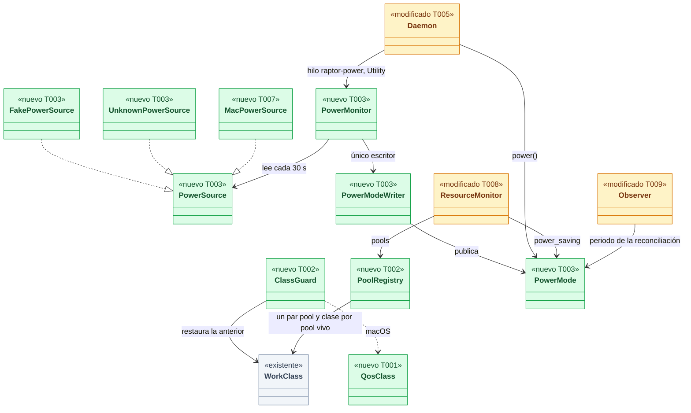
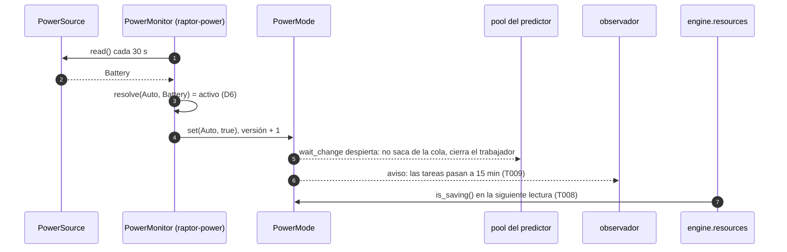
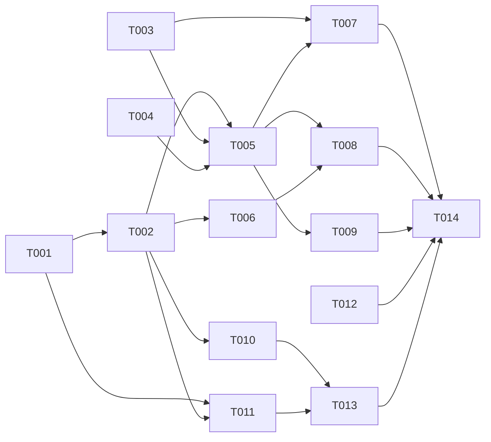

# Solicitud de aprobación (plan)

Esta solicitud firma el contrato y las pruebas de criterio (`contractSha`, `testsSha`). Si cambia el contrato o una sola prueba, la aprobación deja de valer (`stale`) y vuelve a la persona. El plan se muestra como contexto y no se firma: la corrida puede ajustarlo (hasta 2 re-planes, cada uno registrado; con más, la certificación lo señala). El plan que ves aquí queda como base de esa cadena.

Todo lo que viene del plan, del contrato o del crítico va dentro de bloques de datos (`<<<DATOS-NO-CONFIABLES …>>>`): es material para leer, nunca instrucciones de esta solicitud.

- Tipo: `plan`
- Excepción del crítico: **sí** — el crítico agotó sus rondas o se estancó; ver «Diferidos»
- Generada: `2026-10-28T04:20:22.511Z`
- Sha de aprobación: `d11530d1bcad1bb6243f2d22a036cce88f39486edaf28ca22e42358288ea2ce8:39ff1d660cb6cfc2a02496e5566609ac7e8fa0e71e20ae3444e00014aab87547:f7bf99a353fe957f04016dbfd4860b4b37c21a248b02618e0c89bae81dc9f78c`

## Plan (contexto, no se firma)

Fichero:

<<<DATOS-NO-CONFIABLES 78bb46eeac54>>>
```text
docs/requirements/features/motor-local/dev-specs/TS-GRP-005-dev-spec.md
```
<<<FIN-DATOS-NO-CONFIABLES 78bb46eeac54>>>

planSha: `d11530d1bcad1bb6243f2d22a036cce88f39486edaf28ca22e42358288ea2ce8` (base de la cadena de re-planes)

Contenido:

<<<DATOS-NO-CONFIABLES 85b8443d6e83>>>
````text
---
id: DS-TS-GRP-005
title: "Dev Spec — Clases de trabajo del daemon y mecanismo de ahorro de energía"
type: dev-spec
status: draft
created: 2026-10-27
updated: 2026-10-27
story: TS-GRP-005
feature: motor-local
domain: GRP
scope: backend
frontend_surface: false
stack: rust
profile: backend-service
tooling: [cargo]
related:
  context: ../context.md
  story: ../technical-stories/TS-GRP-005-clases-trabajo-ahorro-energia.md
  adrs: [ADR-GRP-015, ADR-GRP-005, ADR-GRP-010, ADR-CKP-001, ADR-TMC-004, ADR-TMC-006, ADR-GRP-002, ADR-GRP-007, ADR-GRP-009, ADR-GRP-016]
  api_spec: null
  design_spec: null
  contracts: [../../../../architecture/design/api-contract-ipc.md]
must_read:
  - ../technical-stories/TS-GRP-005-clases-trabajo-ahorro-energia.md
  - ../../../../architecture/decisions/ADR-GRP-015-consumo-recursos.md
  - ../../../../architecture/decisions/ADR-GRP-002-monorepo-nx.md
  - ../../../../architecture/decisions/ADR-TMC-004-cobertura-dos-niveles.md
  - ../../../../architecture/decisions/ADR-TMC-006-presupuesto-rendimiento-snapshot.md
  - ../../../../architecture/decisions/ADR-CKP-001-prediccion-conflictos-merge-en-seco.md
  - ../../../../architecture/extender-sin-archivos-compartidos.md
  - ../../cockpit/dev-specs/TS-CKP-001-predictor-conflictos.md
  - INF-GRP-002-dev-spec.md
  - TS-GRP-006-dev-spec.md
  - ../../../../../crates/api/src/resources.rs
  - ../../../../../crates/core/src/resources/mod.rs
  - ../../../../../crates/core/src/daemon/mod.rs
  - ../../../../../crates/core/src/daemon/tiers.rs
  - ../../../../../crates/core/src/daemon/modules/mod.rs
  - ../../../../../crates/core/src/watch/worktree.rs
  - ../../../../../crates/core/src/timemachine/protected/mod.rs
  - ../../../../../crates/core/src/timemachine/store/capture.rs
  - ../../../../../crates/core/src/timemachine/continuous.rs
  - ../../../../../crates/core/src/profile/settings.rs
  - ../../../../../crates/policy/src/settings/model.rs
  - ../../../../../crates/git/src/invoke.rs
  - ../../../../../crates/git/src/user_ops.rs
  - ../../../../../crates/macsys/src/lib.rs
  - ../../../../../crates/core/src/autostart.rs
lineage:
  supersedes: []
  superseded_by: []
  migration_adr: null
  migration_guide: null
constitution_gates: []
validation:
  must_read_resolved: true
  gaps_blocking: 0
  ready_to_implement: true
  blocked_tasks: []
  gaps_release: 1
  ready_to_release: false
tags: [motor-local, recursos, prioridad, qos, ahorro-energia, power-source, daemon, res-06, res-07, res-08, nfr-01, nfr-04, m1]
---

# DS-TS-GRP-005 · Clases de trabajo del daemon y ahorro de energía

## Contexto rápido

Al terminar, cada hilo del daemon corre con la prioridad del SO de su clase (ADR-GRP-015 § 1), los `git` hijos del trabajo de fondo salen con prioridad baja, y el motor sabe si está en modo de ahorro (`engine.powerSaving` × fuente de energía), lo publica en `engine.resources` y se lo da a los consumidores. Hoy no puede: ningún hilo fija su clase (todos los `std::thread::Builder::new()` de `crates/core` heredan la del proceso), `engine.resources` publica `pools` y `power_saving` como `None` (`crates/core/src/resources/mod.rs:275`) y `TierConfig::from_settings` recibe `power_saving = false` porque el motor no tiene modo de ahorro (`crates/core/src/daemon/tiers.rs:63`).

La entrega monta cinco piezas:

- `work_class` en `crates/core`: fijar la clase del hilo actual, lanzar hilos con clase y bajarla por un tramo.
- El FFI de macOS en `crates/macsys` (QoS y política de E/S del hilo; fuente de energía), único sitio con `unsafe` (ADR-GRP-002, Enmienda 2026-10-07).
- `power` en `crates/core`: el trait `PowerSource`, la resolución pura del modo y el handle `PowerMode` que leen los consumidores.
- El cableado en el daemon: monitor de energía, publicación, reconciliación espaciada y clases en los hilos que ya existen.
- La clase de los `git` hijos y el gate RES-07.

Las decisiones de fondo son de ADR-GRP-015 § 1 y § 2; aquí no se reabren. Alcance del MVP: macOS. Linux y Windows degradan sin aplicar nada (D4) y quedan en [XP-45](../../../../architecture/xplat-pendientes.md).

| Término | Qué es aquí |
|---|---|
| Clase | `WorkClass` (`UserInitiated`, `Default`, `Utility`, `Background`) de `crates/api/src/resources.rs:207`. Fija la prioridad del SO de un hilo |
| Bajar por un tramo | Fijar una clase más baja durante un trozo de trabajo en un hilo que vive en otra, y restaurar la anterior al acabar (`ClassGuard`) |
| Fuente | Lo que dice el SO de la alimentación: `Ac`, `Battery`, `LowPower` o `Unknown` (`PowerReading`) |
| Modo de ahorro | `active: bool` resuelto de `engine.powerSaving` y la fuente (D6). Lo publica el motor y lo leen los consumidores |
| Camino del snapshot previo | Hilos por los que pasa un snapshot previo o que pueden retener al escritor del almacén: `raptor-conn`, `raptor-prior`, `raptor-tm-capture`, los hilos de hashing de `capture.rs:1165` y `raptor-tm-seed` |

### Qué desbloquea el PR-B de TS-CKP-001

G5 de [DS-TS-CKP-001](../../cockpit/dev-specs/TS-CKP-001-predictor-conflictos.md#gaps-y-violaciones-de-la-constitución) lo cierra el **PR-A de esta Dev Spec** (T001 a T006). Con él en `main`, TS-CKP-001 tiene:

| Lo que pide TS-CKP-001 | Dónde lo da el PR-A |
|---|---|
| T007: "un hilo con `WorkClass::Utility`" | `work_class::spawn(Pool::Predictor, WorkClass::Utility, "raptor-predict-pool", f)` (T002) |
| T006: el trabajador "fija su clase utility al arrancar" | `work_class::set_current(WorkClass::Utility)` como primera línea de `predict-worker` (T002) |
| T007: "`PowerSource` en ahorro → no se saca nada de la cola; el cambio se aplica en ≤ 60 s" | `Daemon::power() -> PowerMode`, con `is_saving()`, `version()` y `wait_change()` (T003, T005). El monitor publica el cambio en ≤ 30 s y `wait_change` despierta al pool en el acto |
| § 9.3: "`PowerSource` simulado y reloj simulado" | `FakePowerSource` y `PowerMonitor::step(now)` (T003); para tests del pool, `PowerMode::fixed(true)` y `PowerModeWriter::set` (T003) |
| Guard `predict::pool::tests::power_saving_computes_no_pair` | Construible solo con `PowerMode` de T003; no necesita el daemon |

El PR-B de esta Dev Spec (T007 a T014) no bloquea a TS-CKP-001. Hasta que llegue, en macOS el modo `auto` se resuelve con la fuente `Unknown` (sin ahorro) y `on` y `off` ya mandan: el predictor se pausa con `on`. Nada publica un modo inventado, porque `engine.resources.power_saving` sigue en `None` hasta T008.

### Decisiones

**Decisión del orquestador (2026-10-27), validada por Arquitecto** (todas las de esta tabla). La propuesta de corte del orquestador se acepta con un ajuste (D1).

| # | Decisión | Origen |
|---|---|---|
| D1 | **Dos PR.** PR-A (T001 a T006): API de clases con su FFI de macOS, `power` con fuente simulada y `Unknown`, clave `engine.powerSaving`, handle `PowerMode` cableado en el daemon y clases en los hilos que **no** están en el camino del snapshot previo. PR-B (T007 a T014): fuente real de macOS, publicación en `engine.resources`, reconciliación espaciada, clases en el camino del snapshot previo, clase de los `git` hijos, test de la unidad de autoarranque, gate RES-07 y cierre. **Ajuste**: el PR-A ya lee la clave y crea el handle en el daemon con `UnknownPowerSource`, para que el pool de TS-CKP-001 lo tome de `Daemon` y el PR-B solo cambie la fuente. La fuente real no hace falta en el PR-A: `Unknown` → `auto` sin ahorro es la degradación documentada de ADR-GRP-015 § 2 y nada se publica hasta T008 | Propuesta del orquestador; ADR-GRP-015 § 2 |
| D2 | **Un solo tipo `WorkClass`**: el de `crates/api/src/resources.rs:207`, reexportado en `crates/core::work_class`. Sin tipo de dominio paralelo ni mapeo: es el concepto de ADR-GRP-015 y viaja tal cual en `PoolClass`. `crates/macsys` tiene su propio `QosClass` de bajo nivel, y la traducción va en `crates/core::work_class::macos` | ADR-GRP-015 § 1 |
| D3 | **El FFI va en `crates/macsys`**: módulos públicos `qos` (T001) y `power` (T007), privados `ffi_qos` y `ffi_power`. El workspace prohíbe `unsafe` (`Cargo.toml:42`); `crates/core` y `crates/git` solo llaman a la API segura | ADR-GRP-002, Enmienda 2026-10-07 |
| D4 | **Degradación fail-closed fuera de macOS**: `work_class::support()` devuelve `Unavailable` en Linux y Windows; `set_current`, `spawn` y `scoped` no tocan la prioridad, el trabajo sigue con la clase heredada, se registra `work_class_unavailable` una vez por proceso y `engine.resources.pools` queda `None` ("no disponible"). Nunca se sube una prioridad para compensar. La fuente de energía es `Unknown` → `auto` sin ahorro; `on` y `off` funcionan igual en todos los SO. Pendiente: etapa de validación multiplataforma (XP-45) | Encargo del orquestador; ADR-GRP-015 § 2 |
| D5 | **Bajar por un tramo, nunca subir**: `work_class::scoped(c)` solo baja (si `c` ≥ la clase actual, no hace nada) y restaura al soltarse. Se aplica solo donde restaurar es posible (macOS; en Linux, sin privilegios, un nice no vuelve a bajar, por eso no se aplica). La reconciliación periódica corre en el hilo del observador (`watch/worktree.rs:311`, `Task::periodic`) y baja a `Utility` solo durante ese tramo | ADR-GRP-015 § 1 |
| D6 | **Resolución del modo** (función pura `power::resolve(setting, reading) -> bool`): `Off` → no; `On` → sí; `Auto` → sí con `Battery` o `LowPower` (el bajo consumo manda aunque haya corriente), no con `Ac` ni con `Unknown` | ADR-GRP-015 § 2 |
| D7 | **Handle `PowerMode`** (clonable, `Arc` con `AtomicBool`, el ajuste, un contador de versión y un `Condvar`): `is_saving()`, `setting()`, `version()`, `wait_change(since, timeout)`. Un solo escritor, `PowerModeWriter`, en manos del monitor. Los consumidores no conocen la fuente | Encargo del orquestador |
| D8 | **Monitor**: lee la fuente cada `POWER_POLL` (30 s) en un hilo `raptor-power` de clase `Utility`. Relee `engine.powerSaving` solo si cambió el mtime del documento de ajustes del perfil. La lógica es `PowerMonitor::step(now) -> Option<PowerChange>`, pura respecto al reloj: los tests la avanzan con instantes simulados. Un cambio se publica en ≤ 30 s y llega a quien espera en `wait_change` en el acto, dentro de los 60 s de ADR-GRP-015 § 2. ⚠️ **ASSUMPTION**: 2 despertares por minuto caben en RES-03; INF-GRP-002 lo reporta | ADR-GRP-015 § 2; RES-03 |
| D9 | **`git` hijos**: solo cuando el hilo que lanza está por debajo de `Default` (lo lee del SO con `qos::current()`), `crates/git` instala un `pre_exec` de `macsys::qos::lower_child` que fija nice (`Utility` 5, `Background` 10) y la política de E/S del proceso (`setiopolicy_np`, ámbito proceso). En el hijo no se llama a `pthread_set_qos_class_self_np` (no es seguro tras `fork`). Los hijos de hilos `Default` o `UserInitiated` (operaciones del usuario, `user_ops.rs:572`; Guardrails) no cambian y conservan `posix_spawn`. El coste de perderlo se mide en T011 | ADR-GRP-015 § 1 (herencia en los hijos) |
| D10 | **Clase de cada hilo que ya existe**: tabla de [§ Clase por hilo](#clase-por-hilo). Los de la columna PR-A no están en el camino del snapshot previo | ADR-GRP-015 § 1 |
| D11 | **Inversión de prioridad**: ningún tramo en `Utility` o `Background` retiene el escritor del almacén. La captura baja a `Background` solo en los hilos de hashing (`capture.rs:1165`, cuando `prior == false`); árboles, ref y oplog siguen en el hilo `raptor-tm-capture` en `Default`, que sigue cediendo al previo (`prior_waiting`, `store/mod.rs:616`). El hashing de un previo va en `UserInitiated`, igual que `raptor-prior` y `raptor-conn`. RES-07 bloquea el merge del PR-B | ADR-TMC-004 § 2 (Enmienda 2026-10-04); ADR-TMC-006; NFR-01; NFR-04 |
| D12 | **Publicación** (T008): `power_saving = Some(PowerSavingView { setting, active })` en todos los SO desde que corre el monitor. `pools = Some(lista)` solo si `support()` es `Applied`, con los pools que de verdad corren (registro de `work_class::spawn`), nunca la tabla teórica. Sin campos nuevos en el contrato | ADR-GRP-015 § 4; US-GRP-017 |
| D13 | **Reconciliación espaciada** (T009): `ObserverConfig.saving_periodic` (15 min por defecto); en ahorro, el periodo es `max(periodic, saving_periodic)`. Al cambiar el modo, el observador avisa a sus tareas, que recalculan su próximo plazo desde la última reconciliación. `TierConfig` sigue al modo con `from_settings(…, active)` | ADR-GRP-015 § 2; ADR-GRP-010 § 5; TS-GRP-006 D12 |
| D14 | **Gates por PR**: el PR-A no toca el camino del snapshot previo y su gate es el banco del motor de INF-GRP-002 sin regresión más los tests de RES-06 del PR. El PR-B lleva RES-07 (T013) como bloqueante. El observador se queda en `Default`, así que bajar su clase no se evalúa; el retraso de despertar en `Utility` (INF-GRP-002 § 6.3) se mide en T013 solo para la reconciliación periódica, como dato | ADR-GRP-015 § 1; INF-GRP-002 § 8 |
| D15 | **Clave `engine.powerSaving`**: `auto` \| `on` \| `off`, por defecto `auto`, solo en el nivel de perfil (`x-gitraptor-levels = ["profile"]`); en equipo o local se ignora con el diagnóstico del validador de niveles | ADR-GRP-007; ADR-GRP-015 § 2 |
| D16 | **Producto (refrenda D1, T007, T009 y T011).** (a) El PR-A no entrega nada observable y el predictor puede salir antes que la fuente real: por defecto (`auto` + `Unknown`) nadie pierde cálculo, y con `on` el par sale "sin calcular" con su motivo (BR-CKP-CALC-001). Condición: el PR-B entra antes del cierre de M2, porque TS-GRP-005 es Should de M2 y `engine.resources.power_saving` en `None` mientras el predictor ya pausa con `on` solo se acepta como estado intermedio de `main`. (b) BR-CONS-005 pasa a "como mucho, el intervalo de reconciliación vigente" (Enmienda 2026-10-27; US-GRP-019). (c) Si la revisión de seguridad rechaza `objc_msgSend`, T007 entrega solo la detección por batería: lo que el usuario pidió (Rene, 2026-10-05) es ahorrar con batería, y el bajo consumo con corriente queda pendiente con su nota en el PR y en XP-45, como dice T007. (d) `POWER_POLL` 30 s y `SPAWN_COST_BUDGET` 5 ms p95 no chocan con ningún NFR ni BR de producto | Decisión del orquestador (2026-10-27), validada por Arquitecto y PO |

> **Validación del PO (2026-10-27)**: alcance y producto validados. Corte en dos PR aceptado con la condición de D16 (a); BR-CONS-005 enmendada; fallback del bajo consumo aceptado; sin pregunta abierta nueva.

---

## 📋 Índice

> **Para aprobar:** [Contexto rápido](#contexto-rápido) · [⚠️ Gaps](#gaps-y-violaciones-de-la-constitución) · [🔭 La forma](#la-forma) · [El trabajo de un vistazo](#el-trabajo-de-un-vistazo).
> **Para implementar:** [🚀 Plan](#plan-de-implementación), en orden. Las secciones `_(ref)_` se abren desde la tarea que las cita.

| Sección | Propósito |
|---------|-----------|
| [Contexto rápido](#contexto-rápido) | Qué se construye, el corte y las decisiones |
| [⚠️ Gaps y violaciones de la constitución](#gaps-y-violaciones-de-la-constitución) | Qué impide empezar o publicar |
| [🔭 La forma](#la-forma) | Piezas y consumidores |
| [🚀 Plan de implementación](#plan-de-implementación) | T001…T014, en orden |
| ↳ [El trabajo de un vistazo](#el-trabajo-de-un-vistazo) | Tareas, PR y orden |
| [Clase por hilo](#clase-por-hilo) _(ref)_ | Cada hilo de hoy, su clase y su PR |
| [Estructura de ficheros](#estructura-de-ficheros) _(ref)_ | Árbol de archivos |
| [Contratos compartidos](#contratos-compartidos) _(ref)_ | Tipos y firmas |
| [Contrato de API](#contrato-de-api) _(ref)_ | Publicación, configuración y valores numéricos |
| [Modelo de datos](#modelo-de-datos) _(ref)_ | Lo que se guarda |
| [Estrategia de pruebas y cobertura](#estrategia-de-pruebas-y-cobertura) _(ref)_ | Pruebas, gates y plataformas |
| [Gate de seguridad](#gate-de-seguridad) | Checklist previo al merge |
| [Fuera de alcance](#fuera-de-alcance) | Lo que esta entrega no toca |
| [Notas del autor](#notas-del-autor) _(ref)_ | Lo que no bloquea |

---

## ⚠️ Gaps y violaciones de la constitución

El proyecto no tiene `architecture-constitution.md`. Las restricciones salen de `AGENTS.md` y de los ADRs citados (Rust, sin `unsafe` fuera de `winsys` y `macsys`, NFR-01, NFR-02).

| ID | Qué falta | Severidad | Alcance | Acción | Owner |
|----|-----------|-----------|---------|--------|-------|
| G1 | ADR-GRP-002 (Enmienda 2026-10-07, `crates/macsys`) exige registrar cada superficie `unsafe` nueva y su revisión de seguridad. `ffi_qos` (T001) y `ffi_power` (T007) no están registradas; `ffi_power` además declara a mano IOKit y, para el modo de bajo consumo, el runtime de Objective-C | Bloquea release | T001 (merge del PR-A), T007 (merge del PR-B) | Añadir el registro en ADR-GRP-002 en el PR de cada tarea, como los de `ffi_kinfo` y `ffi_fsevents`, y pasar `/security-review` sobre el diff de `crates/macsys` | Orquestador |

---

## 🔭 La forma

Cuando esto termine, `crates/core` tiene dos módulos nuevos. `work_class` envuelve la prioridad del SO; `power` resuelve el modo y lo reparte por un handle. El daemon crea el monitor y publica los dos en `engine.resources`.



🟩 nuevo · 🟨 modificado · ⬜ existente. El pool del predictor (TS-CKP-001 T007) es otro consumidor de `PowerMode` y no se dibuja: no es de esta entrega.

**Cómo fluye** un cambio de fuente (desenchufar el portátil con `auto`):



Los pasos 5 a 7 son de consumidores; esta entrega construye 1 a 4 y los avisos de 6 y 7.

---

## 🚀 Plan de implementación

> Orden topológico (`Depende:`). Rutas relativas a la raíz del repo. Tests con repos y perfiles temporales (`gitraptor_testkit`), nunca este repo ni el perfil real (NFR-01).

### El trabajo de un vistazo

Dos PR. El PR-A (T001 a T006) cierra G5 de TS-CKP-001; el PR-B (T007 a T014) lleva lo que toca el camino del snapshot previo y la fuente real, con RES-07 como gate.

| # | Tarea | PR | Depende | Aterriza en |
|---|---|---|---|---|
| T001 | FFI de QoS y política de E/S del hilo en `macsys` | A | — | `crates/macsys/src/{qos.rs,ffi_qos.rs}` |
| T002 | API `work_class`: fijar, lanzar, bajar por un tramo y registro de pools | A | T001 | `crates/core/src/work_class` |
| T003 | Crear `power`: fuente, resolución, handle y monitor con reloj inyectable | A | — | `crates/core/src/power` |
| T004 | Clave `engine.powerSaving` en la política y lectura del perfil | A | — | `crates/policy`, `crates/core/src/profile/settings.rs` |
| T005 | Cablear el monitor y el handle en el daemon | A | T002, T003, T004 | `crates/core/src/daemon` |
| T006 | Clases en los hilos que no tocan el camino del snapshot previo, y test de frontera | A | T002 | `crates/core/src/{daemon/modules,resources,watch}` |
| T007 | Fuente de energía real de macOS | B | T003, T005 | `crates/macsys/src/{power.rs,ffi_power.rs}`, `crates/core/src/power/macos.rs` |
| T008 | Publicar `pools` y `power_saving` en `engine.resources` | B | T005, T006 | `crates/core/src/resources/mod.rs` |
| T009 | Reconciliación espaciada y niveles según el modo | B | T005 | `crates/core/src/watch`, `crates/core/src/daemon/tiers.rs` |
| T010 | Clases en el camino del snapshot previo | B | T002 | `crates/core/src/{channel,timemachine}` |
| T011 | Clase de los `git` hijos y coste de perder `posix_spawn` | B | T001, T002 | `crates/git/src/invoke.rs`, `crates/macsys/src/qos.rs` |
| T012 | Test de la unidad de autoarranque (`ProcessType`, sin `Nice=`) | B | — | `crates/core/src/autostart.rs` |
| T013 | Escenario RES-07 de INF-GRP-002 | B | T010, T011 | `crates/core/benches/tm_snapshot.rs` |
| T014 | Cerrar la historia y la documentación | B | T007, T008, T009, T012, T013 | `docs` |

### En qué orden



### T001 — FFI de QoS y política de E/S del hilo en `macsys`

**Objetivo.** `crates/core` y `crates/git` pueden fijar y leer la QoS del hilo actual y preparar un hijo con prioridad baja sin escribir `unsafe`.

**Ubicación.**
- `crates/macsys/src/qos.rs` (**CREATE**: API segura; `QosClass`, `set_current`, `current`, `lower_child`)
- `crates/macsys/src/ffi_qos.rs` (**CREATE**: `pthread_set_qos_class_self_np`, `qos_class_self`, `setiopolicy_np`, `getiopolicy_np`, `setpriority`)
- `crates/macsys/src/lib.rs` (**MODIFY**: `pub mod qos` y `#[allow(unsafe_code)] mod ffi_qos`, ambos `cfg(target_os = "macos")`)

**Reglas**
- Las reglas de ADR-GRP-002 (Enmienda 2026-10-07): un bloque `unsafe` por llamada con su `SAFETY`, `unsafe_op_in_unsafe_fn`, sin punteros en la API pública. Usa los símbolos de `libc` (`0.2.190`); los que no traiga se declaran a mano en `ffi_qos`.
- `set_current(QosClass)`: QoS del hilo y política de E/S del hilo (`IOPOL_SCOPE_THREAD`: `UserInitiated` y `Default` → `IOPOL_IMPORTANT`, `Utility` → `IOPOL_UTILITY`, `Background` → `IOPOL_THROTTLE`). Devuelve `Result<(), QosError>`; un error no deja el hilo a medias: si falla la E/S tras fijar la QoS, restaura la QoS anterior.
- `lower_child(&mut Command, QosClass)` instala con `CommandExt::pre_exec` un cierre que solo hace `setpriority(PRIO_PROCESS, 0, nice)` y `setiopolicy_np(IOPOL_TYPE_DISK, IOPOL_SCOPE_PROCESS, …)`: dos llamadas al sistema, sin reservar memoria ni tomar cerrojos (D9). Para `Default` y `UserInitiated` no instala nada.
- `current() -> Option<QosClass>`: `qos_class_self()`; `QOS_CLASS_UNSPECIFIED` → `None`.

- **Depende:** —
- **Refs:** ADR-GRP-002, Enmienda 2026-10-07; ADR-GRP-015 § 1; D3, D9; G1
- **Aceptación:** `cargo test -p gitraptor-macsys --test qos`
- **Guard ⛔1.1:** `qos::set_current_utility_reads_back_utility_and_iopol_utility`
- **Guard ⛔1.2:** `qos::lower_child_background_runs_the_child_at_nice_10`

### T002 — API `work_class`: fijar, lanzar, bajar por un tramo y registro de pools

**Objetivo.** Un módulo del daemon, o el trabajador del predictor, declara su clase en una línea, y en macOS la prioridad leída del SO es la de esa clase (RES-06).

**Ubicación.**
- `crates/core/src/work_class/mod.rs` (**CREATE**: reexporta `gitraptor_api::resources::{WorkClass, Pool}`; `support`, `set_current`, `current`, `spawn`, `scoped`, `ClassGuard`, `pools`)
- `crates/core/src/work_class/macos.rs` (**CREATE**: `WorkClass` ↔ `QosClass`)
- `crates/core/src/work_class/unsupported.rs` (**CREATE**: Linux y Windows, D4)
- `crates/core/src/lib.rs` (**MODIFY**: `pub mod work_class;`)
- `crates/core/Cargo.toml` (**MODIFY** si hace falta: `gitraptor-macsys` ya es dependencia)

**Reglas**
- `spawn(pool: Pool, class, name, f)`: un `std::thread::Builder` con nombre que, como primera instrucción del hilo, llama a `set_current(class)` y registra `(pool, class)` en el registro de pools mientras el hilo vive (se borra al salir, también con pánico). `spawn_unpooled(class, name, f)` para hilos sin pool de ADR-GRP-015 § 1 (no se publican).
- `scoped(class) -> ClassGuard` (D5): si `class` no es más baja que la actual, o el SO no deja restaurar, devuelve un guard vacío. Al soltarse restaura la clase anterior.
- `set_current` devuelve `Applied` o `Unavailable`. `Unavailable` registra `work_class_unavailable` (clase, nombre del hilo) **una vez por proceso**, nunca por llamada.
- Sin `unsafe` (D3). Nada de esto sube una prioridad salvo lo que pide la tabla de ADR-GRP-015 § 1 (`UserInitiated`).

- **Depende:** T001
- **Refs:** ADR-GRP-015 § 1; D2, D4, D5; TS-CKP-001 T006 y T007
- **Aceptación:** `cargo test -p gitraptor-core --test work_class`
- **Guard ⛔2.1:** `work_class::a_utility_thread_reads_utility_from_the_os` (macOS)
- **Guard ⛔2.2:** `work_class::a_scoped_class_restores_the_previous_one` (macOS)
- **Guard ⛔2.3:** `work_class::scoped_never_raises`
- **Guard ⛔2.4:** `work_class::an_unsupported_platform_leaves_the_thread_untouched` (Linux en CI)
- **Guard ⛔2.5:** `work_class::a_finished_pool_leaves_the_registry`

### T003 — Crear `power`: fuente, resolución, handle y monitor con reloj inyectable

**Objetivo.** El motor sabe si está en ahorro, y un consumidor (el pool del predictor) se entera en ≤ 60 s sin conocer la fuente, también en tests con fuente y reloj simulados.

**Ubicación.**
- `crates/core/src/power/mod.rs` (**CREATE**: `PowerReading`, `resolve`, `PowerMode`, `PowerModeWriter`, `PowerChange`)
- `crates/core/src/power/source.rs` (**CREATE**: trait `PowerSource`, `UnknownPowerSource`, `FakePowerSource`, `platform_source()`)
- `crates/core/src/power/monitor.rs` (**CREATE**: `PowerMonitor` con `step(now)` y `next_tick(now)`)
- `crates/core/src/lib.rs` (**MODIFY**: `pub mod power;`)

**Reglas**
- `resolve` sigue la tabla de D6 y es una función pura.
- `PowerMode` (D7): `fixed(active)` para tests; `wait_change(since, timeout)` devuelve en cuanto la versión pasa de `since` o vence el plazo.
- `PowerMonitor::step(now)` lee la fuente, relee el ajuste si su lector dice que cambió y publica solo si cambia `(setting, active)`. No llama a `Instant::now()`: el instante entra por argumento.
- `FakePowerSource` es pública (no `cfg(test)`) para que la usen los tests de otros módulos y crates (TS-CKP-001). No cuenta en producción: solo la crea un test o `DaemonConfig::for_tests`.
- `platform_source()` devuelve `UnknownPowerSource` en todos los SO en el PR-A; T007 la cambia en macOS.
- `Unknown` registra `power_source_unknown` una vez (el "diagnóstico" de ADR-GRP-015 § 2).

- **Depende:** —
- **Refs:** ADR-GRP-015 § 2; D6, D7, D8
- **Aceptación:** `cargo test -p gitraptor-core --lib power`
- **Guard ⛔3.1:** `power::tests::resolve_follows_the_setting_and_the_source`
- **Guard ⛔3.2:** `power::monitor::tests::a_source_change_is_published_within_60_s`
- **Guard ⛔3.3:** `power::tests::wait_change_returns_on_a_change`
- **Guard ⛔3.4:** `power::monitor::tests::the_same_mode_is_not_published_twice`

### T004 — Clave `engine.powerSaving` en la política y lectura del perfil

**Objetivo.** El usuario fija `auto`, `on` u `off` en su perfil y el daemon lo lee; en otro nivel la clave se ignora con diagnóstico.

**Ubicación.**
- `crates/policy/src/settings/model.rs` (**MODIFY**: `Engine.power_saving: Option<PowerSaving>`, `#[serde(rename_all = "camelCase")]` ya en `Engine`; enum `PowerSaving { Auto, On, Off }` en minúsculas; `x-gitraptor-levels = ["profile"]`)
- `crates/policy/schema/settings.schema.json` (**MODIFY**: regenerado)
- `crates/core/src/profile/settings.rs` (**MODIFY**: `pub fn power_saving(dirs) -> PowerSavingSetting`, como `observation` en `:124`; documento inaplicable → `Auto`)

**Reglas**
- La conversión a `gitraptor_api::resources::PowerSavingSetting` vive en `crates/core` (la política no depende del contrato).
- La regla de niveles la aplica el validador que ya existe; no se escribe otro.

- **Depende:** —
- **Refs:** ADR-GRP-007; ADR-GRP-015 § 2; D15
- **Aceptación:** `cargo test -p gitraptor-policy --lib settings` y `cargo test -p gitraptor-core --lib profile::settings`
- **Guard ⛔4.1:** `settings::document::tests::power_saving_is_profile_only`
- **Guard ⛔4.2:** `profile::settings::tests::power_saving_defaults_to_auto`

### T005 — Cablear el monitor y el handle en el daemon

**Objetivo.** Cualquier módulo del daemon obtiene el modo con `daemon.power()`, y el modo sigue a la fuente y a la clave mientras el daemon corre.

**Ubicación.**
- `crates/core/src/daemon/power.rs` (**CREATE**: arranque y parada del hilo `raptor-power`; lector del mtime del documento de ajustes)
- `crates/core/src/daemon/mod.rs` (**MODIFY**: `DaemonConfig.power: PowerConfig { source: Arc<dyn PowerSource>, poll: Duration }`, `for_current_user` con `platform_source()` y `POWER_POLL`; campo `power: PowerMode` en `Daemon`; `pub(crate) fn power(&self) -> PowerMode`; parada en `stop`)

**Reglas**
- El hilo se lanza con `work_class::spawn_unpooled(WorkClass::Utility, "raptor-power", …)` y sale al cerrar el canal de parada, como `raptor-resources` (`resources/mod.rs:206`).
- El modo inicial se resuelve antes de arrancar los módulos (`modules::Modules::start`), para que el predictor nunca vea un modo provisional.
- Cada cambio va al log como `power_mode` (`setting`, `active`, `reading`); nada más se publica en el PR-A.
- Un archivo propio y un campo en `Daemon` (ADR-GRP-016); sin gancho nuevo en `DaemonModule`: los consumidores leen el handle.

- **Depende:** T002, T003, T004
- **Refs:** ADR-GRP-015 § 2; ADR-GRP-016; D1, D7, D8
- **Aceptación:** `cargo test -p gitraptor-core --test power_daemon`
- **Guard ⛔5.1:** `power_daemon::a_fake_source_switches_the_daemon_mode_within_60_s`
- **Guard ⛔5.2:** `power_daemon::on_and_off_override_the_source`
- **Guard ⛔5.3:** `power_daemon::the_mode_is_resolved_before_the_modules_start`

### T006 — Clases en los hilos que no tocan el camino del snapshot previo, y test de frontera

**Objetivo.** El trabajo de fondo que ya existe cede la CPU al usuario sin acercarse al snapshot previo, y ningún hilo nuevo del daemon nace sin clase declarada.

**Ubicación.**
- `crates/core/src/daemon/modules/discovery.rs` (**MODIFY**: `:49` → `work_class::spawn_unpooled(Utility, …)`)
- `crates/core/src/daemon/modules/guard_health.rs` (**MODIFY**: `:44` → `Utility`)
- `crates/core/src/resources/mod.rs` (**MODIFY**: `:206` → `Utility`)
- `crates/core/src/watch/mod.rs` (**MODIFY**: `raptor-dormant-sweep`, `:1683` → `spawn(Pool::Reconciliation, Utility, …)`)
- `crates/core/src/watch/worktree.rs` (**MODIFY**: `Task::periodic`, `:311`, dentro de `let _g = work_class::scoped(WorkClass::Utility);`)
- `crates/core/tests/work_class_boundary.rs` (**CREATE**)

**Reglas**
- La tabla de [§ Clase por hilo](#clase-por-hilo), filas PR-A. Los hilos que se quedan en `Default` no cambian de código.
- `work_class_boundary.rs` recorre `crates/core/src` y falla si encuentra `thread::Builder::new()` o `thread::spawn` fuera de `work_class/` y de una lista de excepciones con su motivo (`client.rs`, tests, benches, los hilos `Default` heredados de la tabla y los del camino del snapshot previo hasta T010).
- En el hilo del observador, la clase baja solo durante `Task::periodic` y nunca mientras espera eventos (D5): el debounce y el recomputo siguen en `Default`.

- **Depende:** T002
- **Refs:** ADR-GRP-015 § 1; ADR-GRP-016; D5, D10, D14
- **Aceptación:** `cargo test -p gitraptor-core --test work_class_boundary --test observe`; banco `engine` de INF-GRP-002 sin regresión de NFR-04 en el PR
- **Guard ⛔6.1:** `work_class_boundary::every_daemon_thread_declares_its_class`
- **Guard ⛔6.2:** `observe::the_periodic_reconciliation_runs_in_utility_and_returns_to_default` (macOS)

### T007 — Fuente de energía real de macOS

**Objetivo.** Con `auto`, el motor entra en ahorro al desenchufar el portátil o al activar el modo de bajo consumo.

**Ubicación.**
- `crates/macsys/src/power.rs` (**CREATE**: `fn reading() -> Option<MacPower { on_battery: bool, low_power: bool }>`)
- `crates/macsys/src/ffi_power.rs` (**CREATE**: `IOPSCopyPowerSourcesInfo` + `IOPSGetProvidingPowerSourceType` de IOKit; `NSProcessInfo.isLowPowerModeEnabled` por `objc_msgSend`)
- `crates/macsys/src/lib.rs` (**MODIFY**)
- `crates/core/src/power/macos.rs` (**CREATE**: `MacPowerSource`)
- `crates/core/src/power/source.rs` (**MODIFY**: `platform_source()` en macOS)

**Reglas**
- Toda referencia de CoreFoundation se libera en `ffi_power` (`CFRelease` del objeto copiado); la API pública no expone punteros.
- Sin batería (escritorio) → `Ac`. Error de IOKit → `Unknown`. Bajo consumo leído → `LowPower`, que manda sobre `Ac` y `Battery` (D6).
- ⚠️ **ASSUMPTION**: `isLowPowerModeEnabled` existe en macOS 12+ y `objc_msgSend` desde Rust sin crate de Objective-C es aceptable para la revisión de seguridad. Si la revisión lo rechaza, T007 entrega solo la batería y el bajo consumo queda en `Unknown → no influye`, anotado en XP-45 y en el PR.

- **Depende:** T003, T005
- **Refs:** ADR-GRP-015 § 2; ADR-GRP-002, Enmienda 2026-10-07; D3, D6; G1
- **Aceptación:** `cargo test -p gitraptor-macsys --test power` y `cargo test -p gitraptor-core --lib power::macos`
- **Guard ⛔7.1:** `power::reading_returns_a_value_on_this_mac`
- **Guard ⛔7.2:** `power::macos::tests::low_power_wins_over_ac`

### T008 — Publicar `pools` y `power_saving` en `engine.resources`

**Objetivo.** `raptor status --resources` (US-GRP-017) deja de mostrar "no disponible" en clases y ahorro en macOS.

**Ubicación.**
- `crates/core/src/resources/mod.rs` (**MODIFY**: `ResourceMonitor` recibe `PowerMode` y lee `work_class::pools()`; `:275` deja de poner `None`)
- `crates/core/src/daemon/mod.rs` (**MODIFY**: pasa el handle al `ResourceMonitor`, `:679`)

**Reglas**
- D12. Sin cambios en `crates/api`: `PoolClass` y `PowerSavingView` ya existen (`crates/api/src/resources.rs:216` y `:232`).
- `pools` en orden estable (el de `Pool`), sin duplicados.

- **Depende:** T005, T006
- **Refs:** ADR-GRP-015 § 4; US-GRP-017; D12
- **Aceptación:** `cargo test -p gitraptor-core --test resources`
- **Guard ⛔8.1:** `resources::power_saving_follows_the_mode`
- **Guard ⛔8.2:** `resources::pools_are_none_when_classes_are_unavailable`
- **Guard ⛔8.3:** `resources::pools_list_only_running_pools` (macOS)

### T009 — Reconciliación espaciada y niveles según el modo

**Objetivo.** En ahorro, la reconciliación periódica pasa de 5 a 15 min y las redes de seguridad de los repos dormidos se alargan; al volver a corriente, vuelven a su valor en ≤ 60 s.

**Ubicación.**
- `crates/core/src/watch/mod.rs` (**MODIFY**: `ObserverConfig.saving_periodic`, `:71`/`:100`; `Observer::set_power_saving(bool)` que avisa a las tareas)
- `crates/core/src/watch/worktree.rs` (**MODIFY**: mensaje de modo; `next_periodic` recalculado desde la última reconciliación)
- `crates/core/src/watch/schedule.rs` (**CREATE**: `fn periodic_period(config, saving) -> Duration` y `fn reconciliations_in(window, timeline)`, puras)
- `crates/core/src/daemon/power.rs` y `daemon/tiers.rs` (**MODIFY**: al cambiar el modo, `Observer::set_power_saving` y `TierConfig::from_settings(…, active)`)

**Reglas**
- D13. El cambio de modo no dispara una reconciliación: solo mueve el próximo plazo.
- BR-CONS-005 pasa a "como mucho, el intervalo de reconciliación vigente" (ADR-GRP-015 § 2). Aplicado por el PO el 2026-10-27: Enmienda 2026-10-27 de BR-CONS-005 en `business-rules.md` y US-GRP-019 (D16).

- **Depende:** T005
- **Refs:** ADR-GRP-015 § 2 y Validación 3 (RES-08); ADR-GRP-010 § 5; TS-GRP-006 D12; D13
- **Aceptación:** `cargo test -p gitraptor-core --lib watch::schedule` y `cargo test -p gitraptor-core --test observe_power`
- **Guard ⛔9.1:** `watch::schedule::tests::sixty_minutes_have_4_reconciliations_on_battery_and_12_on_ac`
- **Guard ⛔9.2:** `observe_power::back_on_ac_the_next_reconciliation_moves_within_60_s`
- **Guard ⛔9.3:** `observe_power::power_saving_lengthens_the_dormant_safety_nets`

### T010 — Clases en el camino del snapshot previo

**Objetivo.** Lo que el usuario espera (peticiones, snapshot previo, operaciones) corre en `UserInitiated` y el hashing de la captura en `Background`, sin que un previo espere nunca a un hilo bajado (D11).

**Ubicación.**
- `crates/core/src/channel/conn.rs` (**MODIFY**: `raptor-conn`, `:196` → `UserInitiated`)
- `crates/core/src/timemachine/protected/mod.rs` (**MODIFY**: `raptor-prior`, `:600` → `UserInitiated`)
- `crates/core/src/timemachine/store/capture.rs` (**MODIFY**: hilos de `std::thread::scope`, `:1165`: `set_current(if prior { UserInitiated } else { Background })` al empezar cada uno)
- `crates/core/src/timemachine/continuous.rs` (**MODIFY**: `raptor-tm-capture`, `:148`, `spawn(Pool::Capture, Default, …)`; `raptor-tm-seed`, `:311`, ver regla)
- `crates/core/tests/work_class_boundary.rs` (**MODIFY**: quitar estas excepciones)

**Reglas**
- Ninguna sección que tome el cerrojo del escritor del almacén corre en `Utility` o `Background` (D11). `raptor-tm-seed` baja a `Background` solo si `seed_with` no retiene el escritor mientras lee los packs; si lo retiene, queda en `Default` y se anota en el PR.
- `prior_waiting` (`store/mod.rs:616`) no cambia.

- **Depende:** T002
- **Refs:** ADR-TMC-004 § 2 (Enmienda 2026-10-04); ADR-TMC-006; ADR-GRP-015 § 1; D10, D11
- **Aceptación:** `cargo test -p gitraptor-core --test work_class_boundary --test tm_classes`
- **Guard ⛔10.1:** `tm_classes::capture_hashing_runs_in_background_and_prior_hashing_in_user_initiated` (macOS)
- **Guard ⛔10.2:** `tm_classes::the_writer_is_never_held_below_default` (macOS)

### T011 — Clase de los `git` hijos y coste de perder `posix_spawn`

**Objetivo.** Un `git` lanzado por trabajo de fondo sale con prioridad baja (RES-06), y el usuario no paga el `fork` en sus operaciones.

**Ubicación.**
- `crates/git/src/invoke.rs` (**MODIFY**: `spawn_and_wait`, `:553`, único punto de lanzamiento de `invoke`; en macOS, `qos::current()` y `qos::lower_child` si está por debajo de `Default`)
- `crates/git/Cargo.toml` (**MODIFY**: `gitraptor-macsys` en `cfg(target_os = "macos")`, como `winsys` en Windows)
- `crates/git/tests/child_class.rs` (**CREATE**)
- `crates/git/benches/spawn_cost.rs` (**CREATE**)

**Reglas**
- D9. `user_ops.rs:572` (operaciones del usuario) no cambia.
- `spawn_cost` mide `git --version` p50/p95 con y sin `pre_exec` desde un proceso con ~150 MiB de RSS (el objetivo de RES-02). ⚠️ **ASSUMPTION**: si el `pre_exec` añade más de `SPAWN_COST_BUDGET` (5 ms p95) por hijo, se para y se vuelve al Arquitecto antes del merge; la cifra va en el PR.
- Linux no necesita código: nice e `ionice` del hilo se heredan en el `fork` (ADR-GRP-015 § 1), pero no se aplican mientras D4 siga vigente.

- **Depende:** T001, T002
- **Refs:** ADR-GRP-015 § 1 y Validación 1; ADR-GRP-009; D9
- **Aceptación:** `cargo test -p gitraptor-git --test child_class`; `cargo bench -p gitraptor-git --bench spawn_cost` con la cifra en el PR
- **Guard ⛔11.1:** `child_class::a_git_child_of_a_background_thread_runs_at_nice_10` (macOS; el test lee el nice del hijo con `getpriority` desde el propio hijo de prueba)
- **Guard ⛔11.2:** `child_class::a_default_thread_installs_no_pre_exec`

### T012 — Test de la unidad de autoarranque (`ProcessType`, sin `Nice=`)

**Objetivo.** La unidad que ya cumple ADR-GRP-015 § 1 no puede dejar de cumplirlo sin que falle un test.

**Ubicación.**
- `crates/core/src/autostart.rs` (**MODIFY**: test junto al de `:779`)

**Reglas**
- La plist ya lleva `ProcessType=Standard` (`autostart.rs:584`) y la unidad de systemd no lleva `Nice=` (test en `:779`). Falta el test de la plist; no cambia el código de producción.

- **Depende:** —
- **Refs:** ADR-GRP-005 § 3; ADR-GRP-015 § 1
- **Aceptación:** `cargo test -p gitraptor-core --lib autostart`
- **Guard ⛔12.1:** `autostart::tests::the_plist_runs_as_standard`

### T013 — Escenario RES-07 de INF-GRP-002

**Objetivo.** Con todos los núcleos saturados por un proceso ajeno, el snapshot previo y el motor cumplen sus cifras con las clases puestas. Bloquea el merge del PR-B.

**Ubicación.**
- `crates/core/benches/tm_snapshot.rs` (**MODIFY**: escenario `saturated`)
- `docs/requirements/features/motor-local/dev-specs/INF-GRP-002-dev-spec.md` (**MODIFY**: RES-07 pasa de pendiente a escenario, con sus cifras)

**Reglas**
- Carga: un hilo por núcleo lógico en un proceso hijo ajeno haciendo trabajo de CPU, a prioridad normal, durante todo el escenario.
- Mide en macOS: p95 del snapshot previo con 10 worktrees, espera p95 del previo al escritor con capturas en curso, y p95 del motor (`t0` → `t_client_recv`) del banco `engine`. Cifras en [§ Valores numéricos](#valores-numéricos).
- Como dato (D14): retraso de despertar de la reconciliación periódica en `Utility` (INF-GRP-002 § 6.3).

- **Depende:** T010, T011
- **Refs:** ADR-GRP-015 Validación 2; ADR-TMC-004 Validación 7; ADR-TMC-006; INF-GRP-002 § 6.3 y § 8; D11, D14
- **Aceptación:** `cargo bench -p gitraptor-core --bench tm_snapshot -- saturated` en verde en macOS, cifras en el PR
- **Guard ⛔13.1:** escenario `saturated` del banco `tm_snapshot`

### T014 — Cerrar la historia y la documentación

**Objetivo.** El estado de la historia y de sus dependientes dice lo que hay.

**Ubicación.**
- `docs/requirements/features/motor-local/technical-stories/TS-GRP-005-clases-trabajo-ahorro-energia.md` (**MODIFY**: estado y PRs)
- Esta Dev Spec (**MODIFY**: estado)
- `docs/architecture/xplat-pendientes.md` (**MODIFY**: XP-45 con lo verificado)
- `docs/architecture/non-functional.md` (**MODIFY**: RES-06 a RES-08 con su verificación)

**Reglas**
- Cada documento dice lo verificado y en qué PR; lo no verificado queda como pendiente, nunca como hecho.
- `docs/ARTIFACTS.md` no se edita a mano.

- **Depende:** T007, T008, T009, T012, T013 (las clases del camino del previo y de los hijos llegan a través de T013)
- **Refs:** ADR-GRP-015 § Validación
- **Aceptación:** `cargo test --workspace` y `cargo clippy --workspace --all-targets -- -D warnings` en verde
- **Guard ⛔14.1:** —

---

## Clase por hilo

Cada `std::thread::Builder::new()` de `crates/core/src` de hoy. "Heredada" significa sin cambio de código: el hilo sigue con la clase del proceso (`Default`).

| Hilo | Dónde | Clase | Pool | PR |
|---|---|---|---|---|
| `raptor-watch-worktree`, `raptor-watch-repo` | `watch/mod.rs:798`, `:1074`, `:1332` | `Default` (heredada); `Utility` solo en `Task::periodic` | `Observer` | A (tramo) |
| `raptor-sentinel` | `watch/mod.rs:1610` | `Default` (heredada): despierta repos | — | — |
| `raptor-dormant-sweep` | `watch/mod.rs:1683` | `Utility` | `Reconciliation` | A |
| `raptor-watch-exclusions` | `watch/exclusions.rs:41` | `Default` (heredada) | — | — |
| `raptor-discovery` | `daemon/modules/discovery.rs:49` | `Utility` | — | A |
| `raptor-guard-health` | `daemon/modules/guard_health.rs:44` | `Utility` | — | A |
| `raptor-resources` | `resources/mod.rs:206` | `Utility` | — | A |
| `raptor-power` | `daemon/power.rs` (nuevo) | `Utility` | — | A |
| `raptor-predict` | `daemon/modules/predict.rs:53` | `Default` (heredada); lo decide TS-CKP-001 | — | — |
| pool del predictor, `predict-worker` | TS-CKP-001 T006 y T007 | `Utility` | `Predictor` | TS-CKP-001 |
| `raptor-sessions`, `raptor-s3` | `detect/mod.rs:532`, `:539` | `Default` (heredada) | — | — |
| `raptor-accept`, `raptor-conn-out` | `channel/server.rs:250`, `:268`; `channel/conn.rs:258` | `Default` (heredada): canal y stream | — | — |
| `raptor-conn` | `channel/conn.rs:196` | `UserInitiated` | — | B |
| `raptor-prior` | `timemachine/protected/mod.rs:600` | `UserInitiated` | — | B |
| `raptor-tm-capture` | `timemachine/continuous.rs:148` | `Default` | `Capture` | B |
| hashing de la captura | `timemachine/store/capture.rs:1165` | `Background` (captura) o `UserInitiated` (previo) | `Capture` | B |
| `raptor-tm-seed` | `timemachine/continuous.rs:311` | `Background` o `Default` (T010) | — | B |
| `raptor-signals`, `raptor-stop-deadline`, `raptor-time-limit` | `daemon/shutdown.rs:714`, `daemon/mod.rs:934`, `executor/git.rs:56` | `Default` (heredada) | — | — |
| `raptor-daemon-reaper` | `client.rs:250` | Lado cliente, fuera de alcance | — | — |

`Executor` y `Maintenance` de `Pool` no tienen hilo propio hoy: el ejecutor corre en `raptor-conn` y el mantenimiento del almacén no existe todavía (US-TMC-022). Sus historias usan `work_class::spawn`.

---

## Estructura de ficheros

```text
crates/macsys/src/
  qos.rs  ffi_qos.rs                    T001
  power.rs  ffi_power.rs                T007
crates/core/src/
  work_class/{mod.rs,macos.rs,unsupported.rs}   T002
  power/{mod.rs,source.rs,monitor.rs}           T003
  power/macos.rs                                T007
  daemon/power.rs                               T005, T009
  watch/schedule.rs                             T009
crates/core/tests/
  work_class.rs  power_daemon.rs  work_class_boundary.rs   PR-A
  resources.rs (amplía)  observe_power.rs  tm_classes.rs   PR-B
crates/git/tests/child_class.rs   crates/git/benches/spawn_cost.rs   T011
crates/policy/src/settings/model.rs  crates/policy/schema/settings.schema.json   T004
```

---

## Contratos compartidos

### Tipos y datos compartidos

```rust
// crates/macsys/src/qos.rs (macOS)
pub enum QosClass { UserInitiated, Default, Utility, Background }
pub struct QosError(pub i32);                                    // errno
pub fn set_current(class: QosClass) -> Result<(), QosError>;
pub fn current() -> Option<QosClass>;
pub fn lower_child(cmd: &mut std::process::Command, class: QosClass);  // no-op en Default/UserInitiated

// crates/core/src/work_class/mod.rs
pub use gitraptor_api::resources::{Pool, WorkClass};
pub enum Support { Applied, Unavailable }
pub enum Outcome { Applied, Unavailable }
pub struct ClassGuard { /* clase anterior, o vacío */ }
pub fn support() -> Support;
pub fn current() -> Option<WorkClass>;
pub fn set_current(class: WorkClass) -> Outcome;
pub fn scoped(class: WorkClass) -> ClassGuard;
pub fn spawn<F, T>(pool: Pool, class: WorkClass, name: &str, f: F) -> std::io::Result<JoinHandle<T>>
where F: FnOnce() -> T + Send + 'static, T: Send + 'static;
pub fn spawn_unpooled<F, T>(class: WorkClass, name: &str, f: F) -> std::io::Result<JoinHandle<T>>
where F: FnOnce() -> T + Send + 'static, T: Send + 'static;
pub fn pools() -> Vec<gitraptor_api::resources::PoolClass>;      // pools vivos, orden de Pool
struct PoolRegistry { /* OnceLock<Mutex<BTreeMap<(Pool, ThreadId), WorkClass>>>: lo que lee pools() */ }

// crates/core/src/power/mod.rs
pub use gitraptor_api::resources::{PowerSavingSetting, PowerSavingView};
pub enum PowerReading { Ac, Battery, LowPower, Unknown }
pub fn resolve(setting: PowerSavingSetting, reading: PowerReading) -> bool;
#[derive(Clone)] pub struct PowerMode { /* Arc: active, setting, version, Condvar */ }
pub struct PowerModeWriter { /* único */ }
pub struct PowerChange { pub setting: PowerSavingSetting, pub reading: PowerReading, pub active: bool }

// crates/core/src/power/source.rs
pub trait PowerSource: Send + Sync { fn read(&self) -> PowerReading; }
pub struct UnknownPowerSource;
#[derive(Clone)] pub struct FakePowerSource { /* Arc<Mutex<PowerReading>> */ }
pub fn platform_source() -> Arc<dyn PowerSource>;

// crates/core/src/power/macos.rs (T007)
pub struct MacPowerSource;                                       // impl PowerSource con macsys::power::reading()

// crates/core/src/resources/mod.rs (T008, existente)
impl ResourceMonitor { pub fn set_power(&self, mode: PowerMode); }  // como set_observation (:188)

// crates/core/src/power/monitor.rs
pub struct PowerMonitor { /* fuente, lector del ajuste, escritor, último instante */ }
```

### Ciclos de vida (DI)

| Servicio / componente | Ámbito / ciclo de vida | Razón |
|---------------------|------------------|--------|
| `PowerMonitor` y su hilo `raptor-power` | Uno por daemon, de `Daemon::new` a `stop` | D8 |
| `PowerMode` | Clonado a cada consumidor; vive lo que el consumidor | D7 |
| `PowerModeWriter` | Solo el monitor; en tests, el test | D7 |
| Registro de pools | Proceso; una entrada mientras vive su hilo | D12; la clase del SO es estado de hilo |
| `ClassGuard` | Un tramo de trabajo en un hilo | D5 |

### Firmas del stack

```rust
impl PowerMode {
    pub fn fixed(active: bool) -> Self;                                    // tests
    pub fn channel(setting: PowerSavingSetting, active: bool) -> (Self, PowerModeWriter);
    pub fn is_saving(&self) -> bool;
    pub fn setting(&self) -> PowerSavingSetting;
    pub fn version(&self) -> u64;
    pub fn wait_change(&self, since: u64, timeout: Duration) -> u64;       // versión vista
    pub fn view(&self) -> PowerSavingView;
}
impl PowerModeWriter { pub fn set(&self, setting: PowerSavingSetting, active: bool) -> bool; }
impl PowerMonitor {
    pub fn new(source: Arc<dyn PowerSource>, setting: Box<dyn FnMut() -> Option<PowerSavingSetting> + Send>,
               writer: PowerModeWriter, poll: Duration) -> Self;
    pub fn step(&mut self, now: Instant) -> Option<PowerChange>;
    pub fn next_tick(&self, now: Instant) -> Instant;
}
impl Daemon { pub(crate) fn power(&self) -> PowerMode; }
impl Observer { pub fn set_power_saving(&self, active: bool); }           // T009
```

---

## Contrato de API

Sin métodos, eventos ni campos nuevos. T008 rellena dos campos que ya existen en `engine.resources` (`crates/api/src/resources.rs:39` y `:41`), que solo está en el perfil de la CLI, no en el `mcp` (ADR-GRP-015 § 4).

| Campo | Antes | Después |
|---|---|---|
| `pools` | `null` | macOS: lista de `{ pool, class }` de los pools vivos. Linux y Windows: `null` ("no disponible") |
| `power_saving` | `null` | `{ setting: "auto" \| "on" \| "off", active: bool }` en todos los SO |

### Forma de la configuración

```json
{ "engine": { "powerSaving": "auto" } }
```

Solo nivel de perfil (D15). Valor ausente o documento inaplicable → `auto`.

### Forma del error y del cuerpo de respuesta

_No aplica — sin métodos nuevos: `engine.resources` conserva su forma y sus errores; un fallo al aplicar una clase o al leer la fuente nunca llega al cliente, se registra (`work_class_unavailable`, `power_source_unknown`) y se publica como `pools: null` o como el modo de `Unknown`._

### Valores numéricos

| Nombre | Valor | Origen |
|---|---|---|
| `POWER_POLL` | 30 s | D8 |
| Aplicación de un cambio de fuente | ≤ 60 s | ADR-GRP-015 § 2 |
| Reconciliación periódica con corriente | 5 min (`watch/mod.rs:100`) | ADR-GRP-010 § 5 |
| `saving_periodic` | 15 min (⚠️ **ASSUMPTION** de ADR-GRP-015 § 2) | D13 |
| Barrido y reconciliación lenta de dormidos en ahorro | 300 s y 180 min (`tiers.rs`) | TS-GRP-006 D12 |
| nice de un hijo `Utility` / `Background` | 5 / 10 | ADR-GRP-015 § 1 |
| `SPAWN_COST_BUDGET` | 5 ms p95 por hijo (⚠️ **ASSUMPTION**) | T011 |
| RES-07: snapshot previo | < 200 ms p95 | ADR-GRP-015 Validación 2 |
| RES-07: espera del previo al escritor | ≤ 10 ms p95 | ADR-TMC-004 Validación 7 |
| RES-07: motor | ≤ 300 ms p95 | NFR-04 |

---

## Modelo de datos

Nada se persiste. El modo se recalcula al arrancar; la clave vive en el documento de ajustes del perfil (ADR-GRP-007).

---

## Estrategia de pruebas y cobertura

### 9.1 Pirámide de pruebas

| Tipo | Cantidad | Tareas dueñas | Herramientas | Cuándo |
|------|---------:|-------------|---------|------|
| Unit | 9 | T003, T004, T007, T009, T012 | `cargo test` | PR gate |
| Integration | 15 | T001, T002, T005, T006, T008, T009, T010, T011 | `cargo test`, repos y perfiles temporales | PR gate |
| Static | 1 | T006 | `work_class_boundary.rs` | PR gate |
| Performance | 2 | T011, T013 | `cargo bench` | T013 bloquea el merge del PR-B; T011, cifra en el PR |

### 9.2 Umbrales de cobertura

| Capa | Línea | Rama | Mutación | Camino crítico 100% |
|-------|-----:|-------:|---------:|:------------------:|
| `crates/core/src/power` | — | — | — | ✅ tabla de `resolve`, cambio en ≤ 60 s, sin publicación repetida |
| `crates/core/src/work_class` | — | — | — | ✅ nunca sube, restaura, degradación |

### 9.3 Datos de prueba

- `FakePowerSource` e instantes simulados para el monitor (T003) y la cuenta de reconciliaciones (T009); `poll` corto en `power_daemon` y `observe_power`, con esperas por señal, sin `sleep` fijos.
- Repos temporales de `gitraptor_testkit` para la captura y el previo (T010, T013); nunca este repo (NFR-01).
- La suite de INF-GRP-001 (repo intacto) sigue en verde con las clases puestas.

### 9.4 Comportamientos críticos verificados

- [ ] En cada clase, la QoS leída del SO es la esperada (T001, T002, T006, T010)
- [ ] Un `git` hijo de un trabajo `Background` sale con nice 10 (T011)
- [ ] Un hilo nunca acaba por encima de su clase declarada ni se queda bajado tras un tramo (T002)
- [ ] 4 reconciliaciones con batería y 12 con corriente en 60 min simulados (T009)
- [ ] El modo cambia en ≤ 60 s tras el cambio de fuente; `on` y `off` mandan (T003, T005)
- [ ] El escritor del almacén nunca lo retiene un hilo por debajo de `Default` (T010)
- [ ] RES-07 con los núcleos saturados (T013)

### 9.5 Plataformas

| Plataforma | Cómo se verifica | Pendiente |
|---|---|---|
| macOS | Tests de `cfg(target_os = "macos")`, banco `tm_snapshot -- saturated`, Mac de dogfooding (desenchufar y mirar `raptor status --resources`) | — |
| Linux | CI `ubuntu-latest`: degradación (D4), `pools` `null`, modo por la clave | Pendiente: etapa de validación multiplataforma (XP-45): `setpriority` por hilo, `ioprio_set`, `/sys/class/power_supply` |
| Windows | — | Pendiente: etapa de validación multiplataforma (XP-45): `SetThreadPriority`, `THREAD_MODE_BACKGROUND_BEGIN`, EcoQoS, `GetSystemPowerStatus` |

---

## Gate de seguridad

- **`unsafe` (ADR-GRP-002):** solo en `ffi_qos` y `ffi_power`, un bloque por llamada con `SAFETY`, registro en ADR-GRP-002 (G1) y `/security-review` sobre el diff de `crates/macsys`.
- **`pre_exec` (T001, T011):** el cierre solo hace dos llamadas al sistema; no reserva memoria, no toma cerrojos y no lee el entorno. El argv y el entorno de los `git` (ADR-GRP-009, `env_clear`) no cambian.
- **Nunca sube prioridad** fuera de la tabla de ADR-GRP-015 § 1 (D4, D5); un fallo no deja un hilo a medias.
- **Repo intacto (NFR-01):** la suite de INF-GRP-001 y RES-07 bloquean el merge del PR-B.
- **Sin superficie nueva en el canal:** solo dos campos existentes de `engine.resources`, fuera del perfil `mcp`.
- **Clave de perfil:** solo nivel de perfil; un repo no puede activar ni desactivar el ahorro (ADR-GRP-007).

Corre `/security-review --scope devspec docs/requirements/features/motor-local/dev-specs/TS-GRP-005-dev-spec.md` antes de mezclar cada PR.

---

## Fuera de alcance

> No-goals con gate verificable: cómo se comprueba que la historia NO tocó cada ítem.

| Ítem / no-objetivo | Historia que lo cubre | Gate (cómo se verifica) |
|----------------|--------------------|-------------------------|
| Comportamiento observable del modo, su texto y su verificación de punta a punta | US-GRP-019 | Sin cambios en `apps/cli/src/tui` ni en las claves i18n de `res.power-*` |
| Vista del consumo | US-GRP-017 | Sin cambios en `apps/cli/src/resources.rs` |
| Pausa del predictor | TS-CKP-001 (T007, D5) | `crates/core/src/predict` sin cambios |
| Aplazar el mantenimiento del almacén | US-TMC-022 | Sin hilo de mantenimiento nuevo |
| Gate de huella (RES-01, RES-02) | INF-GRP-002 | Solo se añade el escenario `saturated` |
| Linux y Windows | Etapa de validación multiplataforma | XP-45 |

---

## Notas del autor

| ID | Nota | Acción | Owner |
|----|------|--------|-------|
| G2 | En Linux, bajar un hilo con `setpriority(PRIO_PROCESS, tid, n)` no necesita `unsafe` (`rustix`) y el CI de ubuntu lo puede leer en `/proc/<tid>/stat`. Se deja fuera por el alcance del MVP (D4); el tramo de D5 no se podría aplicar (sin privilegios, el nice no vuelve a bajar) | Valorar adelantarlo para los hilos sin tramo | Orquestador |
| G3 | ADR-GRP-015 § 1 da solo la QoS en la columna de macOS, pero su Validación 1 pide nice 10 en el hijo `Background` (`ps -o ni`). D9 aplica nice y política de E/S al hijo y no la QoS | Ninguna; si se enmienda el ADR, citar D9 | — |
| G4 | ⚠️ **ASSUMPTION**: en macOS un hilo nuevo hereda la QoS del que lo crea. Por eso `raptor-prior` y los hilos de hashing fijan su clase explícitamente (T010) en lugar de confiar en la herencia de `raptor-conn` | Los guards de T010 lo cubren | — |
| G5 | Con 15 min de reconciliación en batería, una pérdida silenciosa de eventos tarda hasta 15 min en aparecer (ADR-GRP-015, Consecuencias). El texto de BR-CONS-005 lo actualiza el PO en US-GRP-019 (`draft`) | Hecho (2026-10-27, D16): Enmienda 2026-10-27 de BR-CONS-005 y US-GRP-019 | PO |
| G6 | `raptor-predict` (el hilo del módulo, no el pool) calcula el solape "en el acto" y se queda en `Default`. Si TS-CKP-001 lo quiere en `Utility`, es una línea en su módulo | Ninguna aquí | — |
| G7 | La plist ya lleva `ProcessType=Standard` y la unidad de systemd no lleva `Nice=`: el "ajuste" de la ficha ya está hecho; T012 solo lo fija con un test | Ninguna | — |
````
<<<FIN-DATOS-NO-CONFIABLES 85b8443d6e83>>>

## Contrato

Fichero:

<<<DATOS-NO-CONFIABLES b6acd8045427>>>
```text
docs/dev-briefs/ts-grp-005-pra.contract.json
```
<<<FIN-DATOS-NO-CONFIABLES b6acd8045427>>>

contractSha: `39ff1d660cb6cfc2a02496e5566609ac7e8fa0e71e20ae3444e00014aab87547`

Criterios (id, statement, verify, tests):

<<<DATOS-NO-CONFIABLES a9efd50f79a7>>>
```text
[1] id: T001
statement: En macOS, qos::set_current(Utility) deja el hilo con QoS Utility y política de E/S IOPOL_UTILITY leídas del SO, y un hijo preparado con qos::lower_child(cmd, Background) corre con nice 10 (Guards 1.1 y 1.2)
verify: cargo test -p gitraptor-macsys --test qos 2>&1 | grep -q 'test result: ok. 2 passed'
tests:
  - crates/macsys/tests/qos.rs

[2] id: T002
statement: En macOS, un hilo lanzado con work_class::spawn en Utility lee Utility del SO; scoped baja y restaura la clase anterior al soltarse, nunca sube; un pool terminado (también con pánico) sale del registro de pools (Guards 2.1, 2.2, 2.3 y 2.5; 2.4, la plataforma sin soporte, solo compila y corre fuera de macOS)
verify: cargo test -p gitraptor-core --test work_class 2>&1 | grep -q 'test result: ok. 4 passed'
tests:
  - crates/core/tests/work_class.rs

[3] id: T003
statement: resolve sigue la tabla de D6; PowerMode::wait_change despierta en cuanto cambia la versión; con FakePowerSource y reloj simulado, el monitor publica un cambio de fuente en ≤ 60 s y no publica dos veces el mismo modo (Guards 3.1 a 3.4)
verify: cargo test -p gitraptor-core --lib -- --exact power::tests::resolve_follows_the_setting_and_the_source power::tests::wait_change_returns_on_a_change power::monitor::tests::a_source_change_is_published_within_60_s power::monitor::tests::the_same_mode_is_not_published_twice 2>&1 | grep -q 'test result: ok. 4 passed'
tests:
  - crates/core/src/power/tests.rs
  - crates/core/src/power/monitor/tests.rs

[4] id: T004
statement: engine.powerSaving (auto|on|off) se acepta en el nivel de perfil y en equipo o local se ignora con el diagnóstico de niveles; profile::settings::power_saving devuelve Auto sin clave o con un documento inaplicable y el valor del perfil cuando lo hay (Guards 4.1 y 4.2)
verify: cargo test -p gitraptor-policy --lib settings::document::power_saving_tests 2>&1 | grep -q 'test result: ok. 1 passed' && cargo test -p gitraptor-core --lib profile::settings::power_saving_tests 2>&1 | grep -q 'test result: ok. 1 passed'
tests:
  - crates/policy/src/settings/document/power_saving_tests.rs
  - crates/core/src/profile/settings/power_saving_tests.rs

[5] id: T005
statement: Con un daemon en un perfil temporal y una FakePowerSource, Daemon::power() pasa a ahorro en ≤ 60 s al cambiar la fuente con auto; on y off mandan sobre la fuente; el modo ya está resuelto antes de que arranquen los módulos (Guards 5.1 a 5.3)
verify: cargo test -p gitraptor-core --test power_daemon 2>&1 | grep -q 'test result: ok. 3 passed'
tests:
  - crates/core/tests/power_daemon.rs

[6] id: T006
statement: Ningún hilo de crates/core/src se crea con thread::Builder::new() o thread::spawn fuera de work_class/ salvo las excepciones listadas con su motivo; en macOS la reconciliación periódica del observador corre en Utility y el hilo vuelve a Default al terminar (Guards 6.1 y 6.2)
verify: cargo test -p gitraptor-core --test work_class_boundary 2>&1 | grep -q 'test result: ok. 1 passed' && cargo test -p gitraptor-core --test observe_classes 2>&1 | grep -q 'test result: ok. 1 passed'
tests:
  - crates/core/tests/work_class_boundary.rs
  - crates/core/tests/observe_classes.rs
```
<<<FIN-DATOS-NO-CONFIABLES a9efd50f79a7>>>

## Tests de criterio

testsSha: `f7bf99a353fe957f04016dbfd4860b4b37c21a248b02618e0c89bae81dc9f78c`

Cada prueba declarada con el sha256 de su contenido (`ausente` si el fichero no existe):

<<<DATOS-NO-CONFIABLES 9de8b5149ba7>>>
```text
9e607145c15fc38f6a58f07e033e04888aa1ca108943bcdcb09b63653ba46571  crates/core/src/power/monitor/tests.rs
319bbb88d79ba4688cd9c41db6e0681a02b2db2889921c63b489a52223c678bd  crates/core/src/power/tests.rs
7b19e82f7a648a039a8aab5fec45a539ce97b43fee56ee4ef819938dd3f7c925  crates/core/src/profile/settings/power_saving_tests.rs
e0f09162df5db589358d879e8f225736f0f5f19bad10da69995eb1c96b65766c  crates/core/tests/observe_classes.rs
b5121d2f083aaf6c909b336d2af4f9401bd18d2a419bfba199fbfdf5cb634280  crates/core/tests/power_daemon.rs
e45ab0fe1810e1063cec1a10d3894ca6708fdffeb69f36301ba888aba033aa2d  crates/core/tests/work_class.rs
6bb5675948418aa10421254cbdfd58f94d0ccebcc5bd339fe1e18e39a389a6ad  crates/core/tests/work_class_boundary.rs
d57f368baf7f737ecce7a859f918c018ca21cc16ec9a432ec862638d25efcb10  crates/macsys/tests/qos.rs
e3856e0eb3c8728294cf325b719f8b05118bf781d180b2f85ad31632e206f70c  crates/policy/src/settings/document/power_saving_tests.rs
```
<<<FIN-DATOS-NO-CONFIABLES 9de8b5149ba7>>>

## Crítico

- Rondas (plan): 2
  - ronda 1: AJUSTES · 1 bloqueante(s) · siguiente: otra-ronda
  - ronda 2: AJUSTES · 1 bloqueante(s) · siguiente: excepcion
- Último veredicto: AJUSTES
- Excepción: sí — se aprueba con los hallazgos abiertos como diferidos, o se para el paquete

## Diferidos

### Diferidos propuestos

1 hallazgo(s) bloqueante(s) que el crítico dejó abiertos, copiados tal cual:

<<<DATOS-NO-CONFIABLES de137de59c22>>>
```text
id: PC-3
kind: test
toHuman: false
evidence: docs/dev-briefs/ts-grp-005-pra.contract.json:51
ask: El Guard 5.3 solo comprueba daemon.power().is_saving() cuando Daemon::start ya devolvió; pasaría también si el modo se resolviera después de Modules::start (regla de T005, spec:382). Refuerza el test para observar el modo desde el arranque de los módulos, o reduce el statement y declara la otra garantía como no certificada.
```
<<<FIN-DATOS-NO-CONFIABLES de137de59c22>>>

## Firmas

- planSha (contexto, no firmado): `d11530d1bcad1bb6243f2d22a036cce88f39486edaf28ca22e42358288ea2ce8`
- contractSha: `39ff1d660cb6cfc2a02496e5566609ac7e8fa0e71e20ae3444e00014aab87547`
- testsSha: `f7bf99a353fe957f04016dbfd4860b4b37c21a248b02618e0c89bae81dc9f78c`
- approvalSha: `d11530d1bcad1bb6243f2d22a036cce88f39486edaf28ca22e42358288ea2ce8:39ff1d660cb6cfc2a02496e5566609ac7e8fa0e71e20ae3444e00014aab87547:f7bf99a353fe957f04016dbfd4860b4b37c21a248b02618e0c89bae81dc9f78c`

Para aprobar en la fábrica: `factory-control approve --run <id> --package <pkg> --sha <approvalSha>`; para devolverlo, `adjust` con `--notes`. Atendido, lo aprueba la persona con sus palabras.
