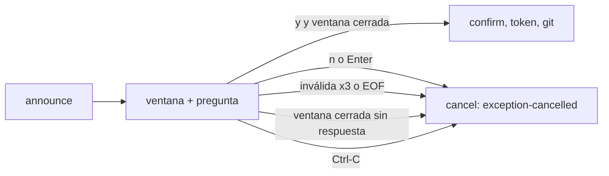

# Brief — arreglos de UX de `raptor guard exec` y `raptor agent correct`

Rama `fix/guard-exec-ux`. Fuente: pruebas manuales de Rene en el Mac (2026-11-08). Referencias: ADR-GRD-007 § 3 (ventana cancelable), ADR-GRD-006 § 1 (`exception-cancelled`), design system v0 § 4 (CLI: errores *qué → por qué → qué hacer*; ConfirmPrompt con **No** por defecto).

## Hallazgo de la investigación

El registro de la cancelación **sí funciona** hoy para respuesta inválida, `n`, EOF y Ctrl-C: un repro con pty (`script`) contra el daemon temporal dejó un `exception-cancelled` en `raptor guard log` (JSON y texto). Lo que no existe es un límite de tiempo: si la ventana se cierra con la pregunta sin responder, `exec` espera indefinidamente y no cancela ni registra nada (`window()` en `apps/cli/src/guard/exec.rs`, rama `left <= 0 && answer.is_some()`). Ese es el caso sin registro. Los tests nuevos fijan los cuatro caminos.

## Gaps y supuestos

- Decisión del orquestador (2026-11-08), validada por Arquitecto (advisor): **A** respuesta inválida explica las válidas y repregunta, máx. 3 inválidas, luego cancela diciéndolo; **B** ventana cerrada sin respuesta cancela (fail-closed) y lo dice; **C** `--yes` solo omite la pregunta. Sin conflicto con ADR-GRD-007 ni ADR-GRD-006.
- Enter solo = **No** (ConfirmPrompt) y se trata como `Answer::No` ("nada se ejecutó"), no como "sin respuesta". Solo en el aviso de `exec`: `ask()` de install, uninstall, confirm y repair no cambia (no-objetivo).
- El plazo para responder es la ventana (10 s por defecto, ⚠️ ASSUMPTION de ADR-GRD-007). Los reintentos no lo alargan: al llegar `applies_at` se cancela aunque el hilo siga leyendo. Se añade una enmienda breve a ADR-GRD-007 § 3 que lo dice (la pide el Arquitecto).
- `cancel()` en `exec.rs` hoy ignora el error. Pasa a devolver `Result`; si falla, `exec` avisa por stderr que no pudo confirmar la cancelación (no dice que quedó auditada) y sale con error. Nunca lanza git. Se prueba con una prueba unitaria del módulo, porque el fallo no es reproducible en e2e sin carrera.
- Plurales: helper `tn(key, count, args)` y `Tr::tn` en `apps/cli/src/i18n.rs` con claves `<key>.one` / `<key>.many` (precedente `timeline.entries.one/.many`). El test `catalogs_match` ya exige las mismas claves y placeholders en en/es. Se corrigen los contadores con sustantivo cuyo valor puede ser 1. Guía: `guard.status.blocked`, `guard.log.summary` (acciones y días), `guard.log.notices`, `guard.log.rate-limited`, `guard.confirm.question-relaxations`, `guard.log.exceptions`, `discovery.found`, `discovery.root-removed`, `status.unmerged`, `status.kept-temps*`, `undo.done-since`, `undo.confirm-plan-since`, `undo.overlap.kept`. El experto enumera con `grep '{count}'` y no cambia los que no pueden valer 1.
- `agent correct`: el rechazo `no-detected-attribution` / `registered-session` no dice que el comando solo corrige sesiones detectadas por GitRaptor. Texto nuevo (en/es): qué pasó, por qué, qué hacer (`raptor sessions` para verlas; `raptor agent register` para atribuir sin sesión detectada; `raptor agent withdraw` si fue registrada).
- Windows: el aviso usa `stdin.is_terminal()` y texto sin ANSI; no se puede verificar desde el Mac. Se añade una fila **XP** (siguiente id libre al implementar y al rebasar) en `docs/architecture/xplat-pendientes.md`: aviso interactivo de `guard exec` en consola real (inválida, `n`, ventana sin respuesta, Ctrl-C).
- UX2 y UX4 fijan comportamiento que ya funciona (regresión); lo nuevo que observa UX2 es el texto del mensaje y que Enter solo cuenta como `n`. UX1, UX3 y UX5 son los rojos.
- El cambio de `cancel()` con resultado no tiene criterio firmado (no es reproducible en e2e); se verifica en la revisión de código y con una prueba unitaria que añade el experto en `exec.rs`.
- Los plurales van después de la pregunta de exec (el mismo experto, en secuencia): ambas tareas tocan `apps/cli/src/guard.rs`; los plurales solo cambian las llamadas `t(...)` con contador.
- La enmienda a ADR-GRD-007 no debe regenerar `docs/ARTIFACTS.md`: si un hook lo modifica, se revierte antes del commit y se anota en el PR.
- Fuera de alcance: duración de la ventana, `guard cancel` desde otra terminal, daemon.

## Componentes

| componente | cambio | fichero |
|---|---|---|
| Pregunta de `exec` | reintento acotado, Enter = No, ventana cerrada cancela, `cancel()` con resultado | `apps/cli/src/guard.rs`, `apps/cli/src/guard/exec.rs` |
| Textos del aviso | ventana, pregunta con plazo y qué pasa sin respuesta, inválida, tiempo agotado, cancelación no confirmada | `apps/cli/i18n/{en,es}/guardexec.txt` |
| Plurales | `tn`, claves `.one/.many` | `apps/cli/src/i18n.rs`, `apps/cli/i18n/{en,es}/*.txt`, sitios de llamada |
| `agent correct` | textos de rechazo | `apps/cli/i18n/{en,es}/registration.txt` |
| Documentos | enmienda ADR-GRD-007, fila XP | `docs/architecture/decisions/ADR-GRD-007-*.md`, `docs/architecture/xplat-pendientes.md` |

## Tareas

### T001 — Pregunta de `exec`: reintento, plazo y cancelación segura
Ficheros: `apps/cli/src/guard.rs` (nueva `ask_retrying`, `ask` intacta), `apps/cli/src/guard/exec.rs` (`spawn_question`, `window`, `cancel`), `apps/cli/i18n/en/guardexec.txt`, `apps/cli/i18n/es/guardexec.txt`; los tests de `apps/cli/tests/guard_us_grd_006.rs` siguen verdes.
Criterios: UX1, UX2, UX3, UX4, UX5
**Aceptación:** `apps/cli/tests/guard_exec_ux.rs`.

### T002 — Plurales con catálogo en/es
Ficheros: `apps/cli/src/i18n.rs`, `apps/cli/i18n/en/guard.txt`, `apps/cli/i18n/es/guard.txt` y los demás catálogos con contadores, sitios de llamada en `apps/cli/src/guard.rs` y los comandos, tests que fijan el texto viejo (`apps/cli/tests/guard_us_grd_005.rs`).
Criterios: UX6
**Aceptación:** `apps/cli/tests/guard_plurals.rs`.

### T003 — Mensaje de `agent correct`
Ficheros: `apps/cli/i18n/en/registration.txt`, `apps/cli/i18n/es/registration.txt`, `apps/cli/src/agent.rs` solo si hace falta un placeholder, `apps/cli/src/agent_correction_tests.rs`.
Criterios: UX7
**Aceptación:** `apps/cli/tests/agent_correct_message.rs`.

### T004 — Documentos
Ficheros: enmienda de ADR-GRD-007 § 3 (plazo de respuesta igual a la ventana; cancelación por falta de respuesta) y la fila XP de `docs/architecture/xplat-pendientes.md`.
Criterios: ninguno (sin código).
**Aceptación:** sin prueba propia; se revisa en `docs/architecture/xplat-pendientes.md`.

## Decisiones abiertas

Ninguna.

## Not Built (deferred)

Plazo o reintentos configurables por flag; unificar `ask()` de install, uninstall, confirm y repair con el mismo reintento; cuenta atrás viva por segundo en pantalla.

### Convenciones observadas
- Textos por catálogo `key = text` con placeholders por nombre (`apps/cli/src/i18n.rs:t`), nunca por concatenación.
- Esperas por señal explícita en tests (`guard_machine::Running::wait_for`, `wait_pending`), sin `sleep` fijos.
- Ctrl-C ya cancela con `gitraptor_core::interrupt::interrupt_flag` (`apps/cli/src/guard/exec.rs:exec`).

### Inventario de reutilización
- Arnés pty y daemon temporal: `apps/cli/tests/guard_machine/mod.rs` (`Machine::with_window`, `developer_spawn`, `Running::type_line`).
- Ayudantes de registro (`log_entries`, `of_kind`, `wait_pending`, `feat_x_remote`) viven en `apps/cli/tests/guard_us_grd_006.rs`; se replican en el test nuevo, porque no hay módulo común y crearlo queda fuera.
- Crea nuevo: `tn` y `Tr::tn` (el catálogo no tiene plurales generales; es un helper de i18n propio del crate).

### Mejoras detectadas
- El `ask()` compartido sigue sin reintento ni Enter = No; candidato a una tarea aparte.
