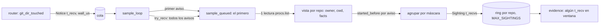

# Brief — TD-GRP-005: un avistamiento S3 por aviso en cola

## Alcance

Arregla TD-GRP-005 §Alcance Técnico, opción (a), en el detector (`crates/core/src/detect/mod.rs`): cada aviso en cola recibe un avistamiento sellado con su propio `t_recv` y su propio `started_before`, todos de una sola lectura de la tabla de procesos. No cambia la regla de ADR-GRP-012 (ventana, `ambiguous`, `no-sighting`). Cierra TD-GRP-005 y enmienda ADR-GRP-012 (fila «Regla concreta de S3»).

**Equivalencia (el argumento de seguridad).** El avistamiento del aviso `n` es justo el que habría dado una muestra inmediata en `n`, con la vista de procesos de la lectura posterior. Esa latencia ya la acepta ADR-GRP-012 para el primer aviso. Añadir avistamientos solo puede añadir sesiones o `git` ajenos dentro de la ventana de un lote. Las muestras que ya existían no cambian: un ajeno que se vio sigue viéndose y el resultado sigue siendo `ambiguous`. La única transición nueva es `no-sighting → attributed`, y solo con un `git` de sesión que escribe, que empezó antes de **ese** aviso y cuyo `t_recv` cae en la ventana del lote. **Riesgo residual (crítico PC-4):** la lectura posterior no ve un `git` ajeno que escribió y terminó entre el aviso en cola y esa lectura, y una muestra inmediata sí lo habría visto. Bajo carga ese retraso es lo que dura una muestra entera. Es el riesgo ya declarado en ADR-GRP-012 (fila «Riesgo residual de S3», 2026-10-05, y regla 6), ahora en más ventanas, y la enmienda de T003 lo dice. El Arquitecto lo validó. La alternativa (no atribuir nunca un aviso en cola) deja M2 criterio 2 sin cumplir.

## Topología

Un solo experto (cambio de producción indivisible en un fichero); tramos disjuntos:

- Slice 1 — tracer bullet (T001): `crates/core/src/detect/mod.rs`
  criterios: TD005-QUEUED-EVIDENCE TD005-NO-LEAK TD005-BOUNDED
- Slice 2 — documentación (T003): `docs/requirements/features/motor-local/technical-stories/TD-GRP-005-muestra-s3-fuera-de-ventana.md`, `docs/requirements/features/motor-local/technical-stories.md`, `docs/architecture/decisions/ADR-GRP-012-deteccion-sesiones-claude-code.md` y el estado de releases regenerado
La tarea de verificación de extremo a extremo no edita ficheros.

## Componentes

| Componente | Cambio |
|---|---|
| `detect::sample_loop` | Vacía la cola sin quedarse con un aviso por repo y llama a `Inner::sample_queued` |
| `Inner::sample` → `Inner::sample_queued(Vec<Notice>)` | Calcula una vista por repo (owner, cwd, facts) y aplica `started_before` por aviso. Junta los avisos con la misma máscara |
| `Sighting` | `t_recv: u64` pasa a `t_recvs: Vec<u64>` (ordenado, sin duplicados) |
| `Detector::evidence` | El filtro de ventana pasa a ser «algún `t_recv` de `t_recvs` está en `[from, t_flush]`» |
| `Detector::sample_now` | Sin cambio de firma: delega en `sample_queued(vec![…])` |

### T001 — Tracer bullet: el aviso del commit en cola cuenta como evidencia

Ficheros: `crates/core/src/detect/mod.rs` (`sample_loop`, `Inner::sample` → `sample_queued`, `Sighting`, `Detector::evidence`, `Detector::sample_now`, comentario de `sample_loop`). Tests (los escribe el tester): `crates/core/src/detect/tests/queued_notices.rs` (nuevo) y la línea `mod queued_notices;` en `crates/core/src/detect/tests.rs`, junto a `mod s3_scope;`.
Criterios: TD005-QUEUED-EVIDENCE, TD005-NO-LEAK, TD005-BOUNDED.

Diseño (exacto):
1. `sample_loop`: `recv` del primero → `inner.sample_queued(vec![first])`. Después, vaciar con `try_recv` en `pending` **sin** filtrar por repo. Si no está vacío → `inner.sample_queued(pending)`. Una sola llamada a `procs.list()` por cada `sample_queued`. Se mantiene la forma «primer aviso solo, luego el lote»: el test depende de que haya exactamente una lectura por llamada.
2. `sample_queued(notices: Vec<Notice>)`: una sola lectura de `list()`, de los `cwd` y de `facts`, como hoy. Agrupar los avisos por `repo_id`. Por repo, una foto de estado (sessions, `RepoPaths`) y una vista `Vec<(GitSeen sin started_before, start_us)>` calculada **una vez**: hoy se calcula una vez por aviso. Por aviso: `mask[i] = start_us[i] <= wall_us + tolerance`. Los avisos con la misma máscara forman un solo `Sighting { t_recvs, gits }`, con `t_recvs` ordenado y sin duplicados. Se guardan en el ring en orden de su menor `t_recv`. Así, por repo y muestra hay como mucho `gits + 1` avistamientos, sea cual sea el número de avisos.
3. `evidence`: `samples.filter(|s| s.t_recvs.iter().any(|t| *t >= from && *t <= t_flush))`. El resto, igual.
4. Comentario de `sample_loop`: decir que cada aviso conserva su propio `started_before`. Hoy dice que el más antiguo es «el más permisivo», y es al revés: es el más estricto.

**Aceptación:** los 3 tests de `crates/core/src/detect/tests/queued_notices.rs` pasan. `cargo test -p gitraptor-core --lib detect::` sigue en verde (incluidos `s3_scope` y `procs_s3_tests`).

### T002 — No regresión de atribución de extremo a extremo y limpieza

Ficheros: ninguno de producción. Se corren, sin editarlos: `apps/cli/tests/{m2_demo_undo_agent,raw_git_undo,undo_overlap_process,undo_overlap_same_session,timeline_process,events_s4_hook_attribution}.rs` y `crates/core/tests/us_tmc_011.rs`.
Criterios: TD005-QUEUED-EVIDENCE (de extremo a extremo).
Los hooks `reference-transaction` de esos tests **no** son un parche para esta carrera. Modelan el hook lento de US-GRP-007, para que la muestra vea el `git` vivo, y lo documentan (`raw_git_undo.rs` //! l.12). Se quedan. Solo se quita una espera que su comentario justifique por esta carrera; hoy no se encontró ninguna.

**Aceptación:** `a_session_reader_does_not_take_the_developers_commit` (`apps/cli/tests/events_s4_hook_attribution.rs`) y los escenarios de US-GRP-008 pasan. Los 5 e2e de la CLI y `us_tmc_011` pasan. Pasan clippy (`--workspace --exclude gitraptor-desktop --all-targets -D warnings`) y `cargo fmt --all -- --check`.

### T003 — Documentación

Ficheros: `docs/requirements/features/motor-local/technical-stories/TD-GRP-005-muestra-s3-fuera-de-ventana.md` (`status: implemented`, `updated`, Dev Spec → este Brief), `docs/requirements/features/motor-local/technical-stories.md` (fila TD-GRP-005), el estado de releases regenerado con `node tools/status/release-status.mjs` y `docs/architecture/decisions/ADR-GRP-012-deteccion-sesiones-claude-code.md`. Esta última recibe dos cambios, con el texto que validó el `nassa-architect:architect` (2026-11-09, «validado con ajustes»):
- En la fila «Regla concreta de S3», «se toma una muestra con el primer aviso.» pasa a ser «se toma una muestra con el primer aviso; los avisos del mismo repo que llegan mientras dura se resuelven con una sola lectura posterior que da un avistamiento por aviso, sellado con su `t_recv` y con «empezó antes del aviso» medido contra el suyo».
- Al final, la sección `## Enmienda (2026-11-09, un avistamiento por aviso: TD-GRP-005)`. Lleva el origen, la regla, por qué se descartaron (b) y ensanchar la ventana, la seguridad (la unión de avistamientos nunca convierte un `ambiguous` en atribuido) y el riesgo residual ya declarado (la fila de 2026-10-05 y la regla 6), ahora en más ventanas. Añade una línea propia: los avisos con la misma máscara comparten un avistamiento para que una ráfaga no expulse del ring uno que vio un `git` ajeno. El `status` sigue en `accepted`.
Criterios: ninguno (documental).

**Aceptación:** sin prueba propia (documental); `crates/core/src/detect/tests/queued_notices.rs` sigue en verde; TD-GRP-005 queda `implemented`, el estado de releases se regenera sin errores y la enmienda no cambia la regla de combinación.

## Contratos

- `fn sample_loop(inner: &Inner, rx: &Receiver<Notice>)`: misma firma.
- `impl Inner { fn sample_queued(&self, notices: Vec<Notice>) }` sustituye a `fn sample(&self, notices: &[Notice])`, que es privada y no tiene otros llamadores.
- `struct Sighting { t_recvs: Vec<u64>, gits: Vec<GitSeen> }`: privado.
- `pub fn sample_now(&self, repo_id: &str, t_recv: u64)`: sin cambios. No se añade ninguna API pública: el test entra por `observer_hooks()`.
- `S3Outcome`, `S3Evidence`, `S3Counts` y los campos de `s3_evidence` en el log no cambian.

## Criterios

- TD005-QUEUED-EVIDENCE → `queued_notices::a_later_queued_notice_is_evidence_of_its_commit`. Lote A (1_000), B1 (2_000) y B2 (500_000_000); el `git` de la sesión (escritor, `/wt/feat-login`) empieza entre B1 y B2; `evidence(500_000_000)` da `Attributed("20:2000")`. Hoy da `NoSighting` (rojo).
- TD005-NO-LEAK → `queued_notices::a_queued_notice_never_takes_a_git_started_after_it` y `queued_notices::a_queued_notice_with_a_foreign_git_still_makes_it_ambiguous`. Primero: `evidence(2_000)` da `NoSighting` con `counts.gits_after_notice >= 1`. Segundo: con un `git` ajeno escritor en `/wt/feat-login` además del de la sesión, `evidence(500_000_000)` da `Ambiguous`. El ajeno empieza antes de A (`start_us` < el `wall_us` de A, como `git()` en tests.rs:483).
- TD005-BOUNDED → `queued_notices::a_burst_of_queued_notices_keeps_the_foreign_sighting`. A (1_000) se muestrea con un `git` ajeno vivo. Mientras la `list()` #1, la de A, está bloqueada, llegan en cola 300 avisos con t_recv `1_000_000_000 + k`, fuera de la ventana `[0, 75_001_000]` de `evidence(1_000)`. Siguen vivos el ajeno y un `git` de sesión. `evidence(1_000)` sigue dando `Ambiguous`: el ring no expulsó la muestra de A. Es una guarda: pasa hoy y falla con un arreglo ingenuo de un avistamiento por aviso.

Arnés del test (en `queued_notices.rs`, sin código de producción):
- Un `GatedProcs(Arc<Table>)` que reenvía los 7 métodos que implementa `impl ProcLister for Arc<Table>` (tests.rs:66). Su `list()` avisa por un canal de que entró y bloquea hasta recibir un permiso. El escaneo S1 usa `list_bare` (mod.rs:892), así que no se bloquea.
- Un `Detector::start` propio, como `Rig::new` (tests.rs:128), con `start_tolerance: Duration::ZERO` y `scan_interval` de 3600 s.
- La compuerta empieza desarmada: `list()` pasa sin bloquear hasta que el test la arma, después de `watch_repo` (que llama a `list()` en el hilo del test, mod.rs:594) y de `scan_now`. `list_bare` se reenvía al `list_bare` de `Arc<Table>`, porque el de por defecto del trait llama a `self.list()` (procs.rs:35).
- Secuencia, todo por señal:
  1. El test envía A con `observer_hooks().git_dir_touched("r", 1_000)` y espera a que `list()` entre (#1).
  2. Envía B1 y lee `w = wall_us()`. Espera activa sobre el reloj hasta `wall_us() > w`. Añade el `git` con `start_us = w + 1`. Espera activa hasta `wall_us() > w + 1` y envía B2.
  3. Da el permiso #1 y espera a que `list()` entre (#2).
  4. Da el permiso #2, envía un aviso centinela (t_recv 10_000_000_000) y espera a que `list()` entre (#3): eso prueba que la muestra #2 ya está guardada.
  5. Afirma, abre la compuerta y suelta el detector: `Drop` espera al hilo de muestras.
- Sin `sleep`. Cada espera usa `recv_timeout` de 10 s y, si vence, falla con mensaje.

### Convenciones observadas

- `crates/core/src/detect/tests.rs:Rig::new`: detector real con un `Table` sintético y el escaneo a mano.
- `crates/core/src/detect/tests.rs:git`: un `git` arrancado «ahora» según `wall_us`. Un `git` sin `call` corre `commit`, que escribe.
- `crates/core/src/detect/tests.rs:mod s3_scope`: submódulo en `tests/`; precedente de `queued_notices`.
- `crates/core/src/detect/mod.rs:Hooks::git_dir_touched`: `Notice { t_recv, wall_us }` se sella al enviar.
- `crates/core/src/detect/mod.rs:Inner::sample`: `facts_of` lee cada pid una vez por muestra, con tope `MAX_REDIRECT_READS`, y nunca toma el lock mientras lee.

### Inventario de reutilización

- Reutiliza: `Table`, `Rig`, `git()` y `AGENT` (`use super::*;` desde `queued_notices`); `Detector::start`, `observer_hooks`, `scan_now`, `watch_repo` y `evidence`; `wall_us` (mod.rs).
- Genera: ninguno.
- Crea nuevo: `Inner::sample_queued` (un refactor de `sample`) y `GatedProcs` (solo para tests). Se buscó `code-search "gate proc lister block list"`: no hay ningún lister con compuerta en `detect/`.

### Mejoras detectadas

- `probed` (`watch/mod.rs::route`) es por evento del SO, no por lote del observador, así que TD-GRP-005 §Causa 6 no se cumple. No hace falta tocarlo: lo que se perdía era el aviso descartado en la cola, no el que nunca se envió.

## Gaps y supuestos

- **Por qué no `sample_queued_now`.** Una entrada pública nueva no existe hoy, así que el test rojo no compilaría, y el commit de stub antes de la aprobación no está permitido. El test entra por `observer_hooks()` con un `ProcLister` con compuerta: compila con el código actual, pasa por el `sample_loop` real (donde está el defecto) y falla por aserción.
- La agrupación por máscara es exacta: dos avisos con la misma máscara dan los mismos `gits`, y `t_recvs` conserva cada marca, así que la ventana se evalúa aviso por aviso. Tiene dos efectos: los contadores de `s3_evidence` no se inflan con avisos idénticos y el ring (256) no se vacía en una ráfaga.
- `t_recvs` crece con la cola. Su tamaño lo limita el canal, que ya no tiene límite hoy: son 8 bytes por aviso, durante una muestra.
- Coste: `owner()` y `launched_from()` se calculan una vez por repo y muestra, no una vez por aviso. Es menos trabajo que hoy con un lote de varios repos.
- Plataformas: el cambio es lógica pura, igual en macOS, Linux y Windows. Linux usa `start_tolerance` de 1 s, que afecta igual a cada aviso. El test fija la tolerancia a 0 para ser determinista.
- Atribución de extremo a extremo bajo carga (10 de 10, TD-GRP-005 §Plan): se verifica en local con la suite de otro crate en paralelo. Si no se puede, se informa como SIN CERTIFICAR.
- Modo rápido: rojo de los tests del contrato, P0 abortado, verificación con la lista de T002.

## Decisiones abiertas

Ninguna.

## Not Built (deferred)

- Avisar por cada escritura de ref en `watch/mod.rs` (`probed`): añadirlo cuando una medida muestre una ref sin aviso.
- Tope de `t_recvs` por muestra: añadirlo cuando la cola de avisos tenga límite.
- Contador entero del retraso máximo entre aviso y muestra en `s3_evidence` (ajuste 2 del Arquitecto): diferido. Cambia el conjunto de campos que fija el test SEC-04 `daemon/sessions_s3_tests.rs` («nothing else»), y la TD deja fuera cambiar tests previos. Va a una TD de diagnóstico si la medida de TD-GRP-005 bajo carga no basta.
- Ensanchar la ventana o sellar con el último aviso (opción b): descartado. Sellar con el último marcaría como «empezó antes» un `git` que empezó después de los avisos anteriores del lote.

## Desviaciones durante la construcción (2026-11-09)

Tras aprobar el plan, la suite bajo carga (~35–40) mostró que T001 no bastaba. Con instrumentación temporal (fuera del commit) aparecieron dos causas más. **Decisión del orquestador, validada por el Arquitecto con ajustes, todos incorporados.** Detalle en ADR-GRP-012, Enmienda 2026-11-09, y en TD-GRP-005, «Estado de la implementación».

| Cambio | Ficheros | Prueba |
|---|---|---|
| Barrera de muestreo en `Detector::evidence` (`SessionConfig::sample_barrier`, 200 ms) | `crates/core/src/detect/mod.rs` | `detect/tests/sample_barrier.rs` (en rojo sin la barrera, comprobado) |
| `ObserverHooks::git_dir_written`: aviso cortado en el mtime del reflog de `HEAD`, tope de 3 s en el detector (`READ_WRITE_MAX_AGE`) | `watch/mod.rs`, `watch/repo.rs`, `detect/mod.rs` | `sample_barrier.rs`: `a_read_notice_*`; `watch/repo.rs`: `the_write_mark_is_the_head_reflogs_mtime` |
| Traza `s3_read_notice age_ms/kept` (condición del Arquitecto) | `daemon/sessions.rs` | revisión en dogfooding |
| La demo de M2 retiene el `git` del commit por señal, no 0,5 s fijos | `apps/cli/tests/m2_demo_undo_agent.rs` | 10 de 10 con carga ~40 |

`crates/core/src/watch/` estaba en `deny_paths`. El contrato quedó sin congelar, porque P0 se abortó en modo rápido, así que esto no es una violación medida. Aun así, se sale de lo que se aprobó y se declara en el PR.
