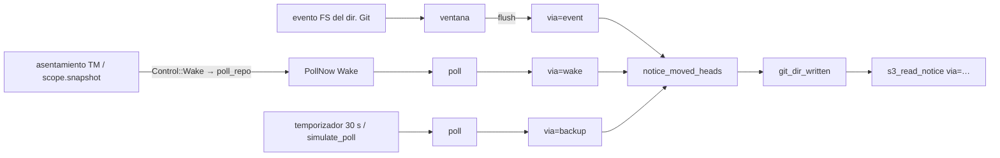

# Brief · TD-GRP-006 · `via` en el aviso de lectura y `us_grp_010` por señal

Fuente: [TD-GRP-006](../requirements/features/motor-local/technical-stories/TD-GRP-006-bajo-carga-los-eventos-de-fsevents.md) § Diagnóstico y § Decisión; [ADR-GRP-010](../architecture/decisions/ADR-GRP-010-observacion-cambios-worktrees.md) § Enmienda 2026-11-10; [ADR-TMC-004](../architecture/decisions/ADR-TMC-004-cobertura-dos-niveles.md) § Enmienda 2026-11-10. Decisión del orquestador (2026-11-10), validada por el Arquitecto.

## Componentes

| componente | cambio | fichero o raíz |
|---|---|---|
| Origen de la lectura | `pub enum ReadVia { Event, Wake, Backup }` con `as_str()` (`"event"`, `"wake"`, `"backup"`); `RepoMsg::PollNow(ReadVia)`: `Observer::poll_repo` manda `Wake` y `Observer::simulate_poll` manda `Backup` (simula el temporizador) | `crates/core/src/watch/mod.rs` (`ObserverHooks`, `RepoMsg`, `poll_repo`, `simulate_poll`, el `impl ObserverHooks` de varios hooks) |
| Trait | `ObserverHooks::git_dir_written(&self, repo_id, t_recv, written_us, via: ReadVia)` | `crates/core/src/watch/mod.rs` |
| Tarea del repo | `flush` → `ReadVia::Event`; `poll` lleva el `via` de quien lo pidió: `Wake`/`Backup` del `PollNow`, `Backup` del temporizador | `crates/core/src/watch/repo.rs` (`run`, `Task::{flush, poll, notice_moved_heads}`) |
| Detector | ignora `via` (la regla S3 no cambia) | `crates/core/src/detect/mod.rs` (`Hooks::git_dir_written`) |
| Log | `s3_read_notice` gana `via=<event|wake|backup>` (palabra fija, SEC-04) | `crates/core/src/daemon/sessions.rs` (`ReadNoticeLog`) |
| Test de la TM | `the_time_machine_sees_the_current_attribution` por señal | `crates/core/tests/us_grp_010.rs` |

## Convenciones observadas

- Campos del log: `Field::word` para una palabra fija, enteros con `Field::from` (`daemon/log.rs`), repo con `Field::id` (`sessions.rs:ReadNoticeLog`).
- Tests de contrato del daemon en su propio archivo, incluidos con `#[path]` desde `sessions.rs` (`sessions_s3_tests.rs`).
- Ganchos de prueba del observador: `simulate_lost_events`, `simulate_poll`, `poll_repo` (`watch/mod.rs`); observador con hooks: `Observer::start_counted` (`tests/suites/observe_tiers.rs`).
- Esperas por señal con guarda de cuelgue por intentos (#353, #356).

## Inventario de reutilización

- Reutiliza `notice_moved_heads`, `head_log_written_us`, `read_write_age`, `Field::word`, `Observer::start_counted`, `simulate_lost_events`, `poll_repo`, `simulate_poll`, `scope.snapshot` con `Scope::Repo` (despierta y lee el repo) y el patrón de volcado de `daemon.log` de `us_tmc_011_common::s3_log`.
- Crea nuevo: `ReadVia`. El catálogo no tiene un equivalente: hoy la lectura no sabe quién la pidió.

## Tareas

### T000 — Stubs que compilan (antes de los tests del contrato)

Ficheros: `crates/core/src/watch/{mod.rs,repo.rs}`, `crates/core/src/detect/mod.rs`, `crates/core/src/daemon/sessions.rs`.
Criterios: ninguno (plomería).

`ReadVia` con `as_str`, re-exportado desde `watch`; el parámetro `via` en `git_dir_written` y en todas sus implementaciones; `RepoMsg::PollNow(ReadVia)`. El stub pasa siempre `ReadVia::Event` y `ReadNoticeLog` no escribe `via`. `sessions.rs` incluye `#[cfg(test)] #[path = "sessions_read_notice_tests.rs"] mod read_notice_tests;` con un archivo vacío.

### T001 — El `via` de cada lectura

Ficheros: `crates/core/src/watch/{mod.rs,repo.rs}`.
Criterios: GRP006-VIA-WAKE, GRP006-VIA-BACKUP, GRP006-VIA-EVENT.

`poll_repo` → `PollNow(Wake)`, `simulate_poll` → `PollNow(Backup)`. La tarea guarda el `via` pedido hasta su siguiente `poll` (un `PollNow` llegado con una ventana abierta lo resuelve el `flush`, que es `Event`); el temporizador es `Backup`. `notice_moved_heads` recibe el `via` y lo pasa al hook.

### T002 — `via` en `s3_read_notice`

Ficheros: `crates/core/src/daemon/sessions.rs`.
Criterios: GRP006-LOG.

`("via", Field::word(via.as_str()))` después de `kept`.

### T003 — `us_grp_010` por señal

Ficheros: `crates/core/tests/us_grp_010.rs` (lo escribe el criterion-tester, no el experto).
Criterios: GRP006-US010.

El hook `post-commit` escribe un marcador y espera un archivo "go" (guarda acotada, después `exit 0`); `Env::drop` escribe "go". El test manda el commit sin esperar al agente, espera el marcador, llama a `scope.snapshot` del repo (Wake → `poll_repo`), espera a que el evento salga en la línea de tiempo y suelta el hook. Si sale sin atribuir, repite con otro commit, como máximo 3 intentos; el fallo imprime `age_ms` y `via` de cada `s3_read_notice` del `daemon.log`. El doc-comment dice lo que prueba: la Time Machine sigue la atribución actual de un commit que S3 atribuyó, no que el motor lea a tiempo bajo carga.

## Gaps y supuestos

- **GRP006-US010 no necesita código de producto** para pasar: es un arreglo de test. Su rojo es el medido en local antes del cambio (3 de 10 con carga 9–19, TD-GRP-006 § Diagnóstico). Solo el mensaje de fallo usa `via` (T002).
- **GRP006-VIA-EVENT necesita un evento FS real**: bajo pérdida silenciosa se repite la escritura contando intentos (guarda de cuelgue de 120 s, sin cota de pared en la aserción). Las otras dos tiran los eventos con `simulate_lost_events(true)` y no dependen de FSEvents.
- **Un `Rescan`** (flag de pérdida del SO) abre una ventana y su `flush` sale como `via=event`. Es raro y la ficha no lo separa.
- **El `via` del temporizador en un test**: `backup_poll` corto en `WatchConfig` (1 s) solo en GRP006-VIA-BACKUP.
- **Modo rápido** (Rene, 2026-11-08): sin línea base de la suite completa. Los tests del contrato se prueban en rojo de forma dirigida y la entrega queda **SIN CERTIFICAR**. Excepción NFR-01, porque toca el observador que alimenta la Time Machine: `cargo test -p gitraptor-core` completo y los e2e de undo de `apps/cli` antes de subir.
- **Linux/Windows**: el `via` es igual en todos los SO; la medición de FSEvents es solo de macOS. Pendiente de la validación multiplataforma.

## Decisiones abiertas

Ninguna: la ficha recoge las decisiones validadas por el Arquitecto.

## Not Built (deferred)

- Medir los eventos del worktree (hueco conocido, ADR-GRP-010 § Enmienda 2026-11-10).
- Tests de caja blanca del observador con cota de pared (TD-GRP-010).
- Acortar el sondeo de respaldo (se reabre si `via=backup` sale alto en el dogfooding).
