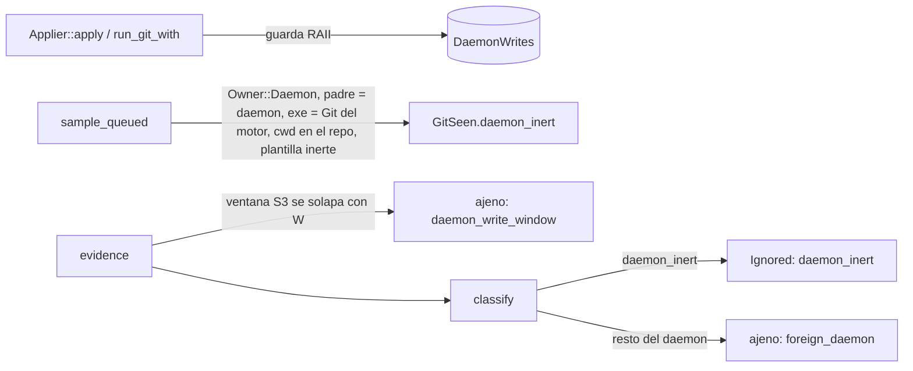

# Brief · TD-GRP-007 · `git` inerte del daemon y ventana de escritura del daemon

Fuente: [TD-GRP-007](../requirements/features/motor-local/technical-stories/TD-GRP-007-cwd-ilegible-ambiguo-bajo-carga.md) § Decisión y [ADR-GRP-012](../architecture/decisions/ADR-GRP-012-deteccion-sesiones-claude-code.md) § Enmienda 2026-11-09 (TD-GRP-007). Diseño en el bucle principal. Lo validaron el Arquitecto (`nassa-architect:architect`, opus) y `security-review` (`nassa-security:security-expert`, opus), con condiciones, y el Arquitecto aceptó las de seguridad.

## Componentes

| componente | cambio | fichero o raíz |
|---|---|---|
| Plantilla del argv del daemon | `is_daemon_inert_argv`: el argv encaja exactamente en una plantilla inerte de las capas de lectura o de escritura | `crates/git/src/invoke.rs:226` (stub), `:281` (`write_argv`), `:18` (`FIXED_OPTIONS`) |
| Lectura del argv | `GitCall::inert` = plantilla inerte y `parsed == Some(subcomando)` | `crates/core/src/detect/procs.rs:251` (`git_call`) |
| Ventana de escritura | `DaemonWrites`: guarda RAII, solapamiento y retención | `crates/core/src/detect/daemon_writes.rs` (stub) |
| Regla S3 | `GitSeen::daemon_inert` en la muestra; `classify` y `evidence` | `crates/core/src/detect/mod.rs:1162` (`sample_queued`), `:395` (`classify`), `:855` (`evidence`) |
| Git del motor | `Detector::set_engine_git` desde la resolución del daemon | `crates/core/src/daemon/sessions.rs:257` (`detector_hooks`) |
| Ventanas abiertas | aplicador de la Time Machine y ejecutor | `crates/core/src/timemachine/apply/mod.rs:425` (`apply_with`), `crates/core/src/executor/git.rs:189` (`run_git_with`) |
| Log | `daemon_inert` y `daemon_write_window` en `s3_evidence` | `crates/core/src/daemon/sessions.rs:218` (`s3_log_fields`) |
| Tests reactivados | quitar los dos `cfg_attr(target_os = "macos", ignore)` | `crates/core/tests/us_tmc_003.rs:327`, `:454` |

## Convenciones observadas

- Booleanos del argv en una sola lectura acotada: `procs.rs:GitFacts`, `mod.rs:facts_of` (tope `MAX_REDIRECT_READS`, mismo proceso verificado con `exe()`).
- El parser fail-closed exige `parsed == Some(s)`: `procs.rs:git_call` (`harmless`).
- Recorrido con `parent_of` (pid reutilizado): `mod.rs:Inner::owner`.
- Contadores enteros de `S3Counts` y su línea: `sessions.rs:s3_log_fields`. Tests sobre la tabla sintética `Rig` (`detect/tests.rs`), que lleva sus propias `DaemonWrites`.
- Reloj de las marcas del lote: `gitraptor_api::clock::monotonic_ns` (`watch/mod.rs:1006`).

## Inventario de reutilización

- Reutiliza `write_argv`, `WRITE_OPTIONS`, `FIXED_OPTIONS`, `WriteSubcommand::words` y `Subcommand::words` (la plantilla sale de ahí, sin duplicar listas), `gitraptor_macsys::process::git_subcommand`, `facts_of`, `parent_of` y `SystemGit::path` (canónica, sin el shim).
- Crea nuevo: `is_daemon_inert_argv` y `DaemonWrites`. El catálogo no tiene un equivalente: `write_argv` es `pub(crate)` y no hay ninguna marca de escritura del daemon (ADR-GRP-012 § Enmienda 2026-11-09).

## Tareas

### T000 — Stubs que compilan (hecho antes de los tests del contrato)

Ficheros: `crates/git/src/invoke.rs`, `crates/git/src/lib.rs`, `crates/git/src/user_ops.rs` (`UserGitCommand::cwd`), `crates/core/src/detect/{mod.rs,procs.rs,daemon_writes.rs,tests.rs}`, `crates/core/src/daemon/{sessions.rs,sessions_s3_tests.rs}`.
Criterios: ninguno (plomería).

Campos `GitCall::inert`, `GitFacts::inert`, `GitSeen::daemon_inert`, `S3Counts::{daemon_inert,daemon_write_window}`. `Detector::set_engine_git` y `Detector::use_daemon_writes`. `DaemonWrites` con `global`, `begin`, `overlaps` y `count` sin efecto. `daemon_git_argvs()` con `WriteSubcommand::ALL`, `Subcommand::ALL` y `match` exhaustivos. `Rig` con sus propias `DaemonWrites`. Las líneas `mod` de los tests.

### T001 — Plantilla exacta del argv del daemon

Ficheros: `crates/git/src/invoke.rs`.
Criterios: GRP007-ARGV, GRP007-FIT.
**Aceptación:** `crates/git/src/invoke_inert_tests.rs`.

- **Escritura**: `WRITE_OPTIONS`, `-c`, `core.hooksPath=<absoluta>`, `-c`, `safe.directory=<absoluta>`, `--git-dir=<absoluta>`, `--work-tree=<absoluta>` opcional y las `words()` exactas de un `WriteSubcommand` distinto de `UpdateRef`, con nada detrás.
- **Lectura**: `FIXED_OPTIONS` y las `words()` de `Version`, `RevParse`, `ForEachRef`, `RevList`, `MergeBase` o `Log`, con argumentos detrás que no sean `--output` ni `--output=…`.
- Todo lo demás da `false`.

### T002 — `inert` en la lectura del argv

Ficheros: `crates/core/src/detect/procs.rs`.
Criterios: GRP007-CALL.
**Aceptación:** `crates/core/src/detect/procs_inert_tests.rs`.

`inert = gitraptor_git::is_daemon_inert_argv(args) && parsed == Some(subcomando)`.

### T003 — La regla del `git` inerte del daemon

Ficheros: `crates/core/src/detect/mod.rs`, `crates/core/src/daemon/sessions.rs`.
Criterios: GRP007-CLASSIFY, GRP007-ENGINE.
**Aceptación:** `crates/core/src/detect/tests/daemon_inert.rs`, `crates/core/src/daemon/sessions_s3_inert_tests.rs`.

- En `sample_queued`, `daemon_inert` es verdadero solo si se cumplen las cinco condiciones:
  - `Owner::Daemon`;
  - el padre directo (`parent_of`) es el propio daemon;
  - `exe` de la tabla igual a `engine_git`;
  - su propio cwd legible y en el repo;
  - `facts_of(git) == Some(f)` con `f.inert`.
- En `classify`, antes del brazo `(Daemon, Some(cwd)) if repo.contains(cwd)`: con `daemon_inert`, da `(Ignored, daemon_inert)`.
- `detector_hooks` llama a `set_engine_git` con la ruta de `SystemGit` del daemon, o con `None`. Lo observa GRP007-ENGINE.

### T004 — La ventana de escritura del daemon

Ficheros: `crates/core/src/detect/daemon_writes.rs`, `crates/core/src/detect/mod.rs`, `crates/core/src/timemachine/apply/mod.rs`, `crates/core/src/executor/git.rs`.
Criterios: GRP007-WINDOW, GRP007-WIRE.
**Aceptación:** `crates/core/src/detect/tests/daemon_write_window.rs`, `crates/core/tests/td_grp_007.rs`.

- `begin(path)` guarda la ruta canónica y `start_ns`. El `Drop` de la guarda pone `end_ns`, también si hay un pánico.
- `overlaps` es verdadero si existe una ventana cuyo `in_repo(path)` se cumple y con `start_ns <= to_ns` y `end_ns.map_or(MAX, |e| e + WINDOW_TAIL) >= from_ns`. `WINDOW_TAIL` = 3 s: el tope del aviso de lectura (ADR-GRP-012 § Enmienda 2026-11-09, «cerrada hace poco»).
- Retención: las ventanas cerradas hace más de 120 s se descartan en cada `begin`.
- En `evidence`, después de S4 y antes de la regla S3: si `overlaps(repo.contains, from, t_flush)`, el resultado es `Ambiguous` y suma `daemon_write_window`.
- `Applier::apply_with` abre la ventana sobre `common_dir` al empezar. `run_git_with` la abre sobre `cmd.cwd()` alrededor del `spawn` y de la espera. GRP007-WIRE observa las dos: un undo simple y una operación de usuario del ejecutor dejan cada uno una ventana en `DaemonWrites::global()`.

### T005 — `s3_evidence`

Ficheros: `crates/core/src/daemon/sessions.rs`, `crates/core/src/daemon/sessions_s3_tests.rs`.
Criterios: GRP007-LOG.
**Aceptación:** `crates/core/src/daemon/sessions_s3_inert_tests.rs`, `crates/core/src/daemon/sessions_s3_tests.rs`.

`daemon_inert` y `daemon_write_window` al final de la línea. El test SEC-04 existente pasa de 10 a 12 en `COUNTERS`: ese cambio lo hace el criterion-tester antes de la firma, no el constructor.

### T006 — Reactivar los dos tests en macOS

Ficheros: `crates/core/tests/us_tmc_003.rs` (el criterion-tester quita los `cfg_attr` antes de la firma).
Criterios: GRP007-MACOS.
**Aceptación:** `crates/core/tests/us_tmc_003.rs`.

No se puede probar en rojo de forma determinista: el fallo es intermitente y depende de la carga. La evidencia son las corridas con carga (cifras en el PR) y el CI de macOS.

## Gaps y supuestos

- **Tests existentes que cambian a propósito**:
  - `daemon/sessions_s3_tests.rs::the_s3_log_line_carries_only_counters` pasa de 10 a 12 contadores. El literal de `S3Counts` ya está en T000. N2.
  - `detect/tests/s3_scope.rs::…counts_the_daemons_git_anywhere_in_the_repo` sigue valiendo, porque su argv por defecto es `commit`.
- **NFR-01 con un `git` ajeno concurrente** (Plan de Verificación de la ficha): GRP007-CLASSIFY añade el caso de un `git` ajeno que escribe en el worktree, junto a un inerte del daemon y un `git` de la sesión, que da `Ambiguous`. Los casos de la Enmienda 2026-10-28 siguen en `detect/tests/s3_scope.rs`.
- **Margen de la ventana**: 3 s después de cerrarse, igual que el tope del aviso de lectura. Un aviso que llega más tarde se descarta y el evento queda `no-sighting` (TD-GRP-006): sin atribuir y nunca al agente. El precio es que un commit del agente hasta 3 s después de un restore o de una operación del ejecutor en el mismo repo queda ambiguo, igual que hoy. N2.
- **Un nieto no es inerte**: el Arquitecto había propuesto aceptar `repack` → `pack-objects`. Solo cuenta el hijo directo: `repack` y `prune` corren en el almacén, fuera del repo, y el `exe` de un hijo de Git es `libexec/git-core/git`, que no es el Git del motor. Es más estricto. N2.
- **Ventana del ejecutor**: abarca cada `git` de usuario del ejecutor, no la operación entera. Entre dos `git` de una misma operación queda un hueco de milisegundos, y es la carrera de S3 que ya se acepta. N2.
- **Retención de 120 s**: más que `s3_lead` y que el tope de 3 s del aviso de lectura. Un lote evaluado más tarde ya no ve la ventana, y con un `git` vivo del daemon sigue siendo ajeno si no es inerte. N2.
- **El test de `env_clear()`** (condición 6) ya existe: `invoke.rs::tests::child_env_is_an_allowlist`. No se añade otro.
- **Windows**: sin lector de argv, ningún `git` del daemon es inerte. La ventana sí se aplica. Pendiente de la validación multiplataforma.
- **Linux**: misma lectura de `/proc`. Lo verifica el CI de ubuntu, no esta Mac.
- **Modo 2 (TD-GRP-006)**: los dos tests reactivados aún pueden fallar por FSEvents con la máquina muy cargada (2 de 14 en local con carga 18+). La condición del coordinador es el CI de macOS en verde con los dos tests activos. Si falla por `no-sighting`, lo informo y pido más corridas. El Arquitecto prefería 5 verdes seguidos en el CI antes de reactivarlos. Lo decide el coordinador. N3.
- **Modo rápido** (Rene, 2026-11-08): sin línea base de la suite completa. Los tests del contrato se prueban en rojo de forma dirigida y la entrega queda **SIN CERTIFICAR**. Excepción NFR-01, porque toca `timemachine/apply`: antes del PR se corren completos `cargo test -p gitraptor-core` y `-p gitraptor-git` y los e2e de undo de cli.

## Decisiones abiertas

- **D1. Umbral para reactivar en macOS los dos tests de `us_tmc_003`.** La ficha pide 10 de 10 con carga en `us_tmc_003`, `us_tmc_003_agents` y `us_tmc_011`. El modo FSEvents (TD-GRP-006, fuera de alcance) fallaba 2 de 14 en esta Mac con carga 18+.
  - **A (recomendada)**: el CI de macOS en verde con los dos tests activos, más las cifras de carga local en el PR. Se enmienda el Plan de Verificación de la ficha para que un fallo `no-sighting` cuente contra TD-GRP-006 y no contra esta TD. Es lo que pidió el coordinador en la tarea.
  - **B**: 5 corridas verdes seguidas del CI de macOS antes de reactivarlos, como prefería el Arquitecto. Hasta entonces siguen ignorados.

## Not Built (deferred)

- `s3_cwd_unreadable` por evento.
- Latencia de FSEvents (TD-GRP-006).
