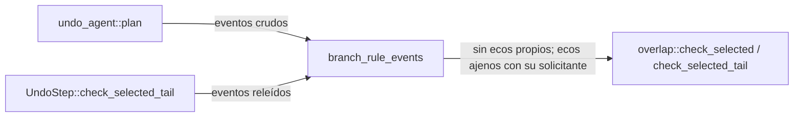

# TD-TMC-003 — El solape del undo por agente no cuenta el eco propio de GitRaptor

Rigor alto (elegido por el coordinador). Fuente: [TD-TMC-003](../requirements/features/time-machine/technical-stories/TD-TMC-003-solape-agente-ecos-de-gitraptor.md). Regla: ADR-TMC-005, Enmienda (2026-11-09, TD-TMC-003), validada por el Arquitecto.

### T001 — Filtro de ecos para la regla de ramas

`undo_agent::branch_rule_events(events, ops, snaps, floor, key, set, own_sessions)` devuelve los eventos que lee la regla de ramas:
- descarta un evento solo si cae en la ventana **anclada** (`engine_mark < seq <= ancla`) de una operación `Finished` del worktree (seq ≥ suelo) que es `Undo(refs ⊆ conjunto, no vacío)` o `Redo` de un undo así; no cae en la ventana (anclada o no) de otra operación que no cumpla; y su actor crudo es «sin atribuir» o una sesión del agente seleccionado;
- un evento en la ventana anclada de otra operación cuenta con el solicitante de esa operación como actor;
- todo lo demás pasa tal cual (sin ancla, `Applying`/`Interrupted`, fuera de ventana).
`overlap.rs` no cambia.

Ficheros: `crates/core/src/timemachine/undo_agent.rs`
Criterios: C2
**Aceptación:** `crates/core/src/timemachine/undo_agent_echo_tests.rs`

### T002 — Cablear las dos fases

- Fase 1 (`undo_agent::plan`): los eventos de `check_selected` pasan por el filtro, con las operaciones y snapshots que ya lee el plan.
- `SelectivePlan` guarda `own_sessions` (sesiones cuyo dueño actual elige el selector, leído una vez en el plan).
- Fase 2 (`UndoStep::check_selected_tail`, `undo.rs`): mismo filtro sobre los eventos releídos con el repo tomado, con el oplog de `ctx` y el suelo del motor.

Ficheros: `crates/core/src/timemachine/undo_agent.rs`, `crates/core/src/timemachine/undo.rs`
Criterios: C1
**Aceptación:** `crates/core/tests/td_tmc_003.rs`

### T003 — Documentos

TD-TMC-003 → `implemented`; US-TMC-011 → `implemented` (su ficha dice que TD-TMC-003 es lo único que le falta: TD-GRP-005 se resolvió en #333 y el redo llegó en #335); backlog; `release-status` regenerado; nota en el GUARD-4.2 de `us_tmc_003.rs` apuntando a `td_tmc_003.rs`.

Ficheros: TD-TMC-003, US-TMC-011 (+ su Dev Spec), `crates/core/tests/us_tmc_003.rs` (solo el comentario del GUARD-4.2), `docs/requirements/backlog.md`, `docs/requirements/release-status.md`, ADR-TMC-005 (ya enmendado)
Criterios: ninguno (documentos; los comprueba docs-lint en CI)
**Aceptación:** `docs/requirements/release-status.md` regenerado con `node tools/status/release-status.mjs` (docs-lint en CI)

## Componentes

| Componente | Cambio |
|---|---|
| `undo_agent` | filtro nuevo + `own_sessions` en `SelectivePlan` + fase 1 |
| `undo` (fase 2) | filtro antes de `check_selected_tail` |
| `overlap` | sin cambios |

## Gaps y supuestos

- El motor atribuye las escrituras del daemon como «sin atribuir» (comprobado en el e2e: el conflicto de hoy sale `unattributed`). Si atribuyera el eco a otra sesión, el eco contaría como movimiento (fail-closed).
- Sin cambio: un commit de otro actor en la rama tras la base del agente sigue dando `overlap` (guarda `another_actors_commit_after_an_own_echo_still_stops_the_undo`, verde antes y después) y los tests de `overlap_selected_tests.rs`, `us_tmc_011.rs`, `us_tmc_003*.rs`.
- Fuera de alcance (anotado por el Arquitecto): el undo por agente solo lee eventos del worktree que lo invoca, mientras § 5 habla de eventos de cualquier worktree para las ramas.
- Modo rápido: sin línea base de suite completa; SIN CERTIFICAR. Antes de subir, `cargo test -p gitraptor-core` completo y los e2e de undo/redo de cli.
