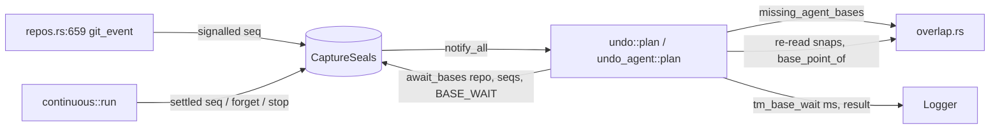

# Brief — TS-TMC-005: el undo espera la captura que da su punto base B

Contrato: [TS-TMC-005](../requirements/features/time-machine/technical-stories/TS-TMC-005-undo-espera-punto-base.md) (§ Alcance Técnico y § Plan de Verificación, CA-1..CA-7) y [ADR-TMC-005 § Nota (2026-11-08, TS-TMC-005)](../architecture/decisions/ADR-TMC-005-solicitante-permisos-solape.md). Sin Dev Spec propia: este Brief es el plan. Citas: `docs/requirements/features/time-machine/technical-stories/TS-TMC-005-undo-espera-punto-base.md` § Alcance Técnico y § Plan de Verificación. Contrato de ejecución: [`ts-tmc-005.contract.json`](./ts-tmc-005.contract.json). Base: `origin/main` = `3a997f89` (2026-11-09). Insumo adoptado con correcciones: [`ts-tmc-005.notas-orquestador.md`](./ts-tmc-005.notas-orquestador.md).

## Gaps y supuestos

- **G1 — Dónde se espera respecto al `repo_lock`. Decisión del orquestador (2026-11-09), validada por Arquitecto (architecture-advisor).** Se espera **con el `repo_lock` tomado** (`undo.rs:1233`), sin el lock del oplog (`plan` ya lo suelta en `undo.rs:720`) ni el writer del almacén (solo lo toma el aplicador, después). Razones: la captura continua no toma el `repo_lock` (ningún uso en `store/`, `continuous.rs` ni `daemon/modules/tm_capture.rs`); el conjunto que se deshace solo se conoce bajo ese lock (`undo.rs:587`, `undo_agent.rs:177`), y soltarlo dejaría cambiar ese conjunto y obligaría a canjear dos veces el desafío de confirmación (`confirm.gate_over`, `undo.rs:746`). Coste aceptado: una operación encolada en el repo (`executor/mod.rs:947`) espera hasta `BASE_WAIT` más, acotado por CA-2, y `repo_lock::busy()` (`daemon/profile_loss.rs:25`) ve el repo ocupado ese tiempo. CA-5 prueba que no hay interbloqueo. La TS § Alcance Técnico «Dónde se espera» y ADR-TMC-005 § Nota (2026-11-08) se enmiendan en T006.
- **G2 — Corrección de las notas: la señal se indexa por `repo_id` y `seq`, no por ruta de worktree.** El `seq` del evento es único por repo (`store.last_seq`, `daemon/repos.rs:567`). Así el planificador no tiene que comparar la ruta que usa el undo con la que firma el evento. `CaptureSeals` guarda, por repo: el `seq` máximo señalado, los `seq` señalados sin asentar (cada uno con su worktree) y si la captura corre.
- **G3 — Ventana de traspaso.** El evento queda persistido y visible para el undo (`set_persisted`, `repos.rs:567`) antes de que llegue la señal (`modules.git_event`, `repos.rs:659`). Si `seq` > máximo señalado del repo y la captura corre, se espera la señal hasta `HANDOFF` = 100 ms (condvar). Si no llega: `not-pending`.
- **G4 — CA-7, alcance del grep.** Un grep de `sleep` sobre todo `crates/core/src/timemachine` falla hoy por código ajeno a esta TS (`engine.rs:717`, `engine.rs:753`, `continuous.rs:746`, `timeline.rs:1513`, `oplog/recovery.rs:461`), y el workspace no tiene `disallowed-methods` (`Cargo.toml:49`). Por eso CA-7 se verifica con un test, `ca7_*` en `crates/core/src/timemachine/base_wait_tests.rs`, que **sustituye** la verificación por clippy o grep de CI que propone la TS (§ Plan de Verificación, CA-7). El test lee con `include_str!` tres fuentes: `base_wait.rs` entero y, en `undo.rs` y `undo_agent.rs`, el texto entre los comentarios marcadores de nombre fijo `// base-wait: begin` y `// base-wait: end`. Esos marcadores encierran el bloque de cada planificador que llama a `missing_agent_bases` y `await_bases`. El test exige que cada marcador aparezca exactamente una vez por fichero y en ese orden, y que cada tramo no esté vacío, así que no puede pasar sin leer nada. Falla si alguno de los tres textos contiene `sleep`, `park_timeout` o `try_recv`. La espera usa solo `Condvar::wait_timeout`. Los `sleep` citados quedan fuera de alcance (Not Built).
- **G5 — Plazos.** `BASE_WAIT` (2 s, ⚠️ ASSUMPTION de la TS) va fuera de `OVERLAP_BUDGET` (`undo.rs:207`). La planificación corre el `deadline` de fase 1 lo esperado y devuelve `Planned.waited`. Fase 2 recibe `OVERLAP_BUDGET − (transcurrido − waited)` (`undo.rs:1371`).
- **G6 — El redo no espera.** Su `undone` es `OpRef::Oplog` (`redo.rs:306`) y su base es el ancla síncrona. `missing_agent_bases` devuelve vacío y `redo.rs` no cambia. Cumple «un solo camino» de la TS: la función que decide vive junto a `base_point_of`.
- **G7 — e2e.** `undo_overlap_same_session.rs` conserva `captured_by_event(reset.seq)` (`:360`): sirve a G4 de DS-US-TMC-012 (una edición posterior no puede caer en B), no al undo. Se quita solo `captured_after_event(moved.seq)` (`:403-404`) y su helper si queda sin uso. En `raw_git_undo.rs` se quita `m.captured_all(..)` (`:386`) y su comentario (`:380-385`): el undo del desarrollador sin confirmar sale en la puerta de confirmación (`undo.rs:745`), antes de cualquier espera.
- **Supuesto S1:** si el hilo de captura muere por un pánico, `seals` sigue con `running`. El waiter vence por plazo (`expired`) y no se cuelga. No se añade un guard de pánico.
- **Coordinación:** TD-TMC-003 (rama `fix/TD-TMC-003-agent-overlap-echoes`) toca `undo_agent.rs` y `overlap.rs` (`check_selected_tail`, `branch_mover`). Las zonas no se solapan con T004 (`undo_agent.rs:225-233`, `overlap.rs:430`), pero el PR se rebasa sobre `main` cuando TD-TMC-003 entre.

## Componentes

| componente | cambio | fichero |
|---|---|---|
| `CaptureSeals` (Mutex + Condvar), `BASE_WAIT`, `HANDOFF`, `await_bases`, `Waited::log` | nuevo | `crates/core/src/timemachine/base_wait.rs` |
| módulo | `pub mod base_wait;` | `crates/core/src/timemachine/mod.rs:6` |
| `CaptureDeps` | campo `pub seals: Arc<CaptureSeals>` | `crates/core/src/timemachine/continuous.rs:92` |
| `ContinuousCapture::start/git_event/forget` | `start` fija `running` y avisa al terminar el hilo; `git_event` marca señalado (síncrono, solo si `enabled`) | `continuous.rs:146`, `:166`, `:175` |
| `run` | asienta los `seq` ≤ `p.event` del worktree al quitar el pendiente (Done o agotado); `Forget` asienta el repo | `continuous.rs:373`, `:441` |
| `missing_agent_bases` | nuevo `pub(crate)`: `seq` de los `GitEvent` sin B con referencia agente | `crates/core/src/timemachine/overlap.rs:310` (junto a `base_point_of`) |
| `plan` (undo simple, `--since`) | espera antes de `check_with`; re-lee snaps; corre `deadline`; nuevos parámetros `engine`, `repo_id` | `crates/core/src/timemachine/undo.rs:541`, `:760` |
| `Planned` | campo `waited: Duration` | `undo.rs:295` |
| `undo_selected` | pasa `env.engine`/`repo_id`; `tail_budget` descuenta `waited` | `undo.rs:1325`, `:1340`, `:1371` |
| `undo_agent::plan` | espera tras leer snaps (`:225`), re-lee, `deadline + waited` | `crates/core/src/timemachine/undo_agent.rs:79`, `:225` |
| daemon | campo `seals` en `Daemon`, `Arc::default()` al construir, clonado en `capture_deps` | `crates/core/src/daemon/mod.rs:354`, `:699`, `:780` |

### Convenciones observadas

- `crates/core/src/timemachine/undo.rs:lock` — `Mutex` envenenado se recupera con `into_inner`, nunca `unwrap`.
- `crates/core/src/timemachine/continuous.rs:Hooks::worktree_changed` — mismo patrón para el `Mutex` de `seals`.
- `crates/core/src/timemachine/continuous.rs:capture_one` — logs con `Field::id(repo)`, sin rutas ni ramas (SEC-12).
- `crates/core/src/timemachine/undo.rs:OVERLAP_BUDGET` — plazos como `const Duration` con doc del porqué.
- `crates/core/src/timemachine/overlap.rs:mod selected_tests` — tests unitarios en fichero propio con `#[cfg(test)] #[path = "..."]`.
- `crates/core/src/timemachine/undo_raw_events_tests.rs:Rig::deps_stuck` — doble de `EngineLink` + `TmRepos` reales sobre `gitraptor_testkit::Fixture`.
- `crates/core/tests/us_tmc_004.rs:logged` — los tests leen `state/daemon.log` (`LOG_FILE`).

### Inventario de reutilización

- **Reutiliza:** `overlap::base_point_of` / `agent_base` (sin cambios de regla), `continuous::CaptureLayer` (retener la captura en tests), `Logger::info` + `Field`, `std::sync::{Mutex, Condvar}` (sin crate nuevo), arnés de `undo_since_tests.rs:Rig::attempt` y `capture_mark_tests.rs:deps` para los tests.
- **Nuevo:** `base_wait.rs` (`CaptureSeals`, `await_bases`, `Waited`), `overlap::missing_agent_bases`, `Planned.waited`, `CaptureDeps.seals`.

## Tareas

### T001 — Tracer bullet: señal sellada y espera en el undo simple (CA-1)

Ficheros: `crates/core/src/timemachine/base_wait.rs` (nuevo), `crates/core/src/timemachine/mod.rs`, `crates/core/src/timemachine/continuous.rs`, `crates/core/src/timemachine/overlap.rs`, `crates/core/src/timemachine/undo.rs`, `crates/core/src/daemon/mod.rs` y cada literal `CaptureDeps { .. }` (añadir `seals: Arc::default()`): `crates/core/tests/{us_mcp_008_repair.rs:123,us_mcp_008.rs:527,tm_calm_reset_in_hook.rs:157}`, `crates/core/src/timemachine/{confirm_window_tests.rs:139,undo_since_review_tests.rs:171,capture_mark_tests.rs:151,hook_prior_live_git_tests.rs:25,undo_agent_tests.rs:192,undo_raw_events_tests.rs:82,hook_prior_mark_tests.rs:107,confirm_known_git_tests.rs:149,undo_agent_more_tests.rs:192,calm_git_alive_tests.rs:240,undo_since_tests.rs:151}`.
Criterios: TMC005-CA1.
Antes del baseline: stubs que compilan (`CaptureSeals` con sus métodos y `await_bases` devolviendo `NotPending`), sin `todo!()` en código de producción (memoria «contract tests R4 guard»).
`await_bases` se monta como «un solo camino» (TS § Alcance Técnico): espera con condvar hasta que todos los `seq` estén asentados, o hasta el plazo, o hasta que la captura pare. Devuelve `Waited { waited, outcome: NotPending | Settled | Expired }`. `Waited::log(logger, repo_id, found)` escribe `tm_base_wait` con `base_wait_ms` y `result`. En `plan`, en el bloque de `undo.rs:760`: lee ops/snaps → `missing_agent_bases` → si no está vacío, suelta el lock, espera, re-lee y corre `deadline`. El bloque va entre `// base-wait: begin` y `// base-wait: end` (G4).
**Aceptación:** `crates/core/src/timemachine/base_wait_tests.rs` (`ca1_*`): con la captura continua real, la capa retiene 500 ms y el test emite `git_event` del reset del agente. El undo inmediato termina bien y su `target_snapshot_id` es el punto previo. `cargo test -p gitraptor-core --lib timemachine::base_wait::tests::ca1` en verde.

### T002 — Plazo, abandono y referencia sin atribuir (CA-2, CA-3, CA-4)

Ficheros: `base_wait.rs`, `continuous.rs` (`Forget`, agotado, parada del hilo), `undo.rs`.
Criterios: TMC005-CA2, TMC005-CA3, TMC005-CA4.
**Aceptación:** `crates/core/src/timemachine/base_wait_tests.rs` (`ca2_*`, `ca3_*`, `ca4_*`) en verde. CA-2: capa retenida 5 s → `overlap-unverified` en ≤ `BASE_WAIT + OVERLAP_BUDGET`, huella del repo intacta y rechazo en el oplog. CA-3: capa que devuelve `Discarded` hasta agotar `MAX_RETRIES`; el test espera el abandono con `CaptureSeals` (sin sondeo). Después, `overlap-unverified` en < 100 ms + plan, con log `result=not-pending`. También sin motor (`engine: None`). CA-4: reset sin atribuir con la captura retenida → ningún `tm_base_wait` con `base_wait_ms` > 0.

### T003 — Sin locks durante la espera y B idéntico al reintento (CA-5, CA-6)

Ficheros: `base_wait_tests.rs` y, si hace falta, `base_wait.rs`.
Criterios: TMC005-CA5, TMC005-CA6.
**Aceptación:** `crates/core/src/timemachine/base_wait_tests.rs`. `ca5_*`: la capa, mientras retiene, comprueba `oplog.try_lock().is_ok()` (`TmRepos::repo`) y la captura sella mientras el undo espera, así que el writer está libre. `ca6_*`: sobre el mismo historial, el `snapshot_id` de B tras esperar es igual al de un undo hecho después de asentar la captura (el camino del reintento).

### T004 — Undo por agente por el mismo camino

Ficheros: `crates/core/src/timemachine/undo_agent.rs` (`AgentPlanInput` gana `engine`, `repo_id`; espera entre `:226` y `:233`, entre los marcadores `// base-wait: begin` y `// base-wait: end` de G4), `undo.rs:1325`, `crates/core/src/timemachine/undo_agent_more_tests.rs:391` (literal `AgentPlanInput`).
Criterios: TMC005-CA1.
**Aceptación:** `crates/core/src/timemachine/base_wait_tests.rs` (`ca1_agent_*`): `undo --agent` tras el reset con la captura retenida termina bien. Los tests existentes `undo_agent_tests` y `undo_agent_more_tests` siguen en verde.

### T005 — e2e sin espera previa (CA-1) y sin `sleep` (CA-7)

Ficheros: `apps/cli/tests/raw_git_undo.rs:380-386`, `apps/cli/tests/undo_overlap_same_session.rs:403-404` (y `captured_after_event` si queda sin uso), `base_wait_tests.rs::ca7_*`.
Criterios: TMC005-CA1, TMC005-CA7.
**Aceptación:** `apps/cli/tests/raw_git_undo.rs`, `apps/cli/tests/undo_overlap_same_session.rs` y `crates/core/src/timemachine/base_wait_tests.rs`: `cargo test -p gitraptor-cli --test raw_git_undo an_agent_recovers_its_work_after_a_raw_reset_hard` y `cargo test -p gitraptor-cli --test undo_overlap_same_session` en verde. `ca7_*` en verde.

### T006 — Medir `BASE_WAIT` y cerrar la documentación

Ficheros: `apps/cli/tests/raw_git_undo.rs` (después del undo del agente, imprime con `eprintln!` el `base_wait_ms` de `tm_base_wait` leído del log del daemon), TS-TMC-005 (frontmatter `status: implemented`, `updated`; § Alcance Técnico «Plazo propio»: la cifra medida sustituye al ASSUMPTION o lo confirma; § Alcance Técnico «Dónde se espera» se sustituye por: «En la fase 1, en el sitio del orden de ADR-TMC-005 § 4, con el cerrojo de escritura del repo ya tomado (la captura continua no lo usa, y soltarlo dejaría cambiar el conjunto deshecho y obligaría a canjear la confirmación dos veces) y sin retener el lock del oplog ni el writer del almacén: la captura los necesita para sellar el punto, así que esperar con ellos tomados sería un interbloqueo.»; en § Plan de Verificación, CA-7 pasa a verificarse con el test de G4), `docs/architecture/decisions/ADR-TMC-005-solicitante-permisos-solape.md` (§ Nota (2026-11-08, TS-TMC-005): una línea fechada, «Precisión (2026-11-09), decisión del orquestador validada por Arquitecto: se espera con el cerrojo de escritura del repo ya tomado, sin el lock del oplog ni el writer del almacén; ver TS-TMC-005 § Alcance Técnico»), `docs/requirements/features/time-machine/technical-stories.md:37`, `docs/requirements/backlog.md:31`, `docs/requirements/release-status.md` (se regenera con `node tools/status/release-status.mjs`).
Medida: 10 ejecuciones de `an_agent_recovers_its_work_after_a_raw_reset_hard -- --nocapture` en reposo y otras 10 bajo carga (`cargo build --workspace --exclude gitraptor-desktop` en paralelo, `CARGO_BUILD_JOBS=4`). Se anotan la mediana y el máximo de `base_wait_ms`, que es lo que tarda la captura desde el evento hasta el sello visto por el undo.
Criterios: TMC005-CA1.
**Aceptación:** `apps/cli/tests/raw_git_undo.rs` imprime `base_wait_ms`; las cifras aparecen en la descripción del PR y en la TS. Si el máximo bajo carga supera 1,5 s, se abre la Decisión abierta 1 antes de fijar `BASE_WAIT`.

## Decisiones abiertas

1. **Valor final de `BASE_WAIT`** (contrato público de latencia del undo, TS § Alcance Técnico). Se construye con 2 s. Si T006 mide un máximo bajo carga por encima de 1,5 s, ¿se sube el plazo (más latencia en el peor caso) o se mantiene (más `overlap-unverified` en máquinas cargadas)? Política: `ask`.

## Not Built (deferred)

- Quitar los `sleep` ya existentes en `timemachine` (G4) y una regla `disallowed-methods` en el workspace.
- La espera en el redo (G6) y en el solape de la restauración (US-TMC-024).
- Acelerar la captura continua y cambiar D7 (TS § Fuera de alcance).
- Un guard de pánico del hilo de captura (S1).
