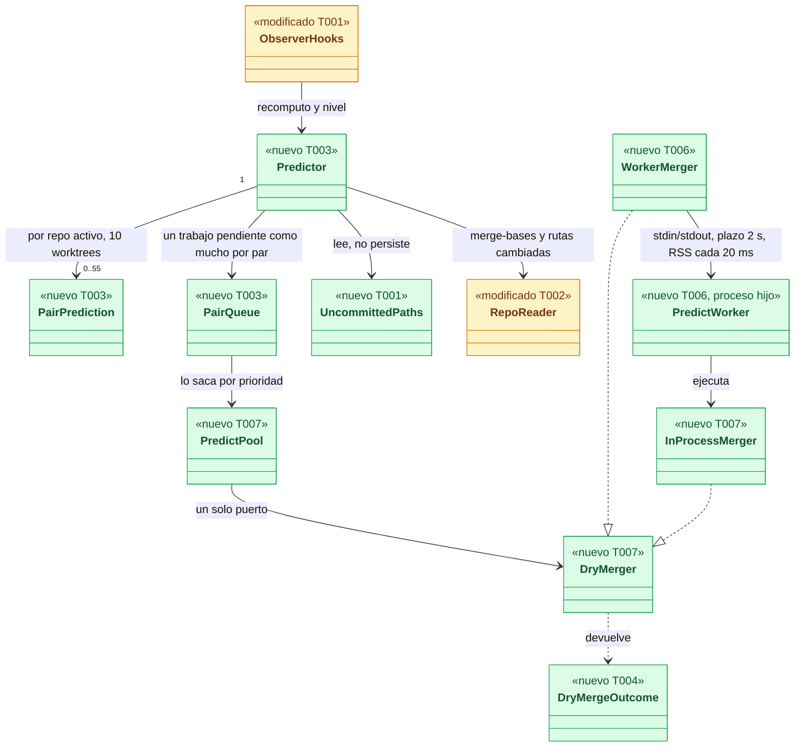
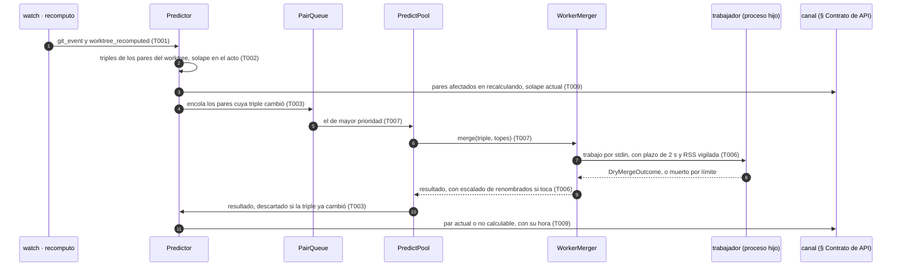
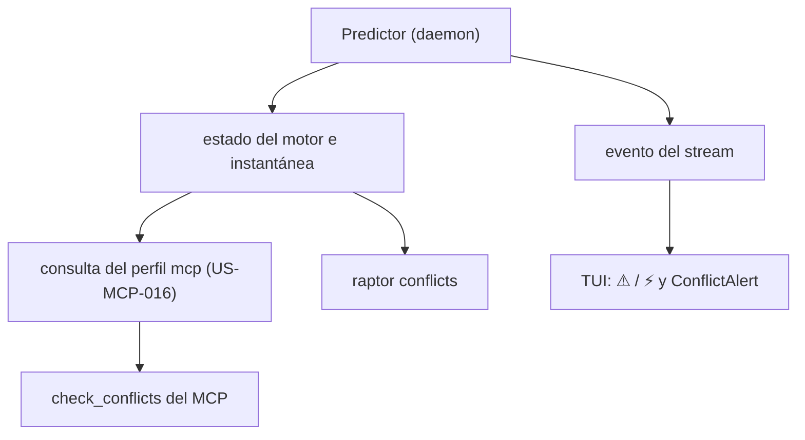
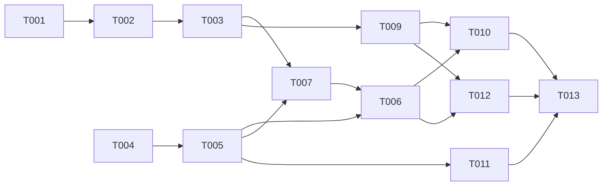

# DS-TS-CKP-001 · Predictor de conflictos en el daemon

Implementado en parte en: PR #275 (T001 a T005, T011 y la excepción G9 de T010). Faltan T006, T007, T009, T010, T012 y T013, que construye el PR-B (G2 cerrado el 2026-10-27 por #283; G5 cerrado el 2026-10-28 por #298).

## Contexto rápido

Al terminar, la TUI, `raptor conflicts` y `check_conflicts` del MCP leen del motor, para cada par de worktrees y para cada worktree contra la rama base, qué archivos se tocan a la vez (⚠ solape) y qué archivos chocarían al integrar, con los rangos de líneas (⚡ conflicto previsto). Cada par llega con su estado y su hora de cálculo, y el repo del usuario queda intacto. Hoy no pueden: `attention.conflicts` se publica como no disponible (`crates/api/src/scope.rs:110`) y el motor no tiene módulo de predicción.

Para eso, la entrega monta cuatro piezas:

- el conjunto de rutas sin commitear de cada worktree, retenido en memoria;
- el módulo `predict` de `crates/core`, con los pares, el solape, los estados, la caché y la cola;
- el merge en seco de `crates/git` (`gix_merge::commit` con plataformas propias), ejecutado en un proceso trabajador;
- la publicación por el canal.

Las decisiones son de ADR-CKP-001 § 1 a § 8 y § 10, con su Enmienda (2026-10-20, SPIKE-CKP-001); aquí no se reabren.

**Rama R-A2W.** [SPIKE-CKP-001](../research/SPIKE-CKP-001-resultados.md) salió por S4 con A2-W (Brief § 7): A2 pasa los eliminatorios, B cae en el 1 (refresca el mtime de objetos del repo) y las cotas de tiempo y memoria solo se cumplen fuera del proceso del daemon. Las cifras son las de la fase (a), indicativa; la fase (b) las confirma sin cambiar la rama salvo regresión del p95 del motor (E9).

| Término | Qué es aquí |
|---|---|
| Par | Worktree contra la rama base, o worktree contra worktree. Con 10 worktrees hay hasta 55 |
| Trabajo propio | Rutas cambiadas entre `merge-base(punta, base)` y la punta, más las rutas sin commitear. Sin trabajo propio un worktree no forma pares |
| Solape (⚠) | Intersección de rutas de trabajo propio, incluido lo sin commitear. No lee contenido |
| Conflicto previsto (⚡) | Merge en seco de lo commiteado: archivos en conflicto, su tipo y los hunks como rangos de líneas |
| Merge en seco | Merge de dos commits cuyo resultado nunca se escribe en el repo |
| Triple | Punta A, punta B y merge-base: la clave de la caché de un par |
| Trabajador | Proceso hijo de vida larga del daemon: el propio binario con el subcomando oculto `predict-worker`, que ejecuta el merge en seco y al que el daemon mata y relanza si un par pasa del plazo o de la cota de memoria |
| Escalado de renombrados | Segundo merge del mismo par con `rewrites_limit` alto, solo si el primero da conflictos de modificado/borrado o de renombrado |

### Rama de decisión

| Rama | Salida del SPIKE | Mecanismo | Dónde corre |
|---|---|---|---|
| **R-A2W** | S4 con A2-W (Brief § 7) | `gix_merge::commit` con plataforma de blobs sin drivers, pila de atributos vacía, pipeline sin filtros y objetos en memoria | Proceso trabajador (T006), con plazo y vigilancia de memoria impuestos por el daemon |

Las ramas R-A2, R-B y R-SOLAPE quedan descartadas y se borraron con sus tareas (T008) y sus aristas.

**Decisiones del orquestador (2026-10-09), validadas por Arquitecto:**

- **D1**: la Dev Spec existe como borrador condicionado (`status: draft`, `ready_to_implement: false`), con G1 como hueco bloqueante del spec entero. Es compatible con el propósito de la regla de ADR-CKP-001 ("no se escribe antes"): no implementar sobre un mecanismo sin medir. *(Cerrado el 2026-10-20 con G1.)*
- **D2**: una rama por salida del SPIKE. Las tareas comunes no cambian de rama a rama. *(Resuelto el 2026-10-20: queda R-A2W.)*

**Decisión del orquestador (2026-10-20), validada por Arquitecto** (cierre de G1 con el [Brief de SPIKE-CKP-001](../research/SPIKE-CKP-001-resultados.md), D-SPK-1 a D-SPK-7, y las decisiones del PO del 2026-10-20):

- **D9**: rama R-A2W. G1, G3 y G4 cerrados. El spec pasa a `ready_to_implement: true` con `blocked_tasks` = las tareas que dependen de G2 y G5 (regla D3).
- **D10**: sin prefiltro (H6 refutada: un falso negativo por renombrado de directorio y más coste que ahorro). T003 no lo tiene.
- **D11**: extractor de conflictos, unión de bloques ≤ 3 líneas, `marker_size` 32 y escalado de `rewrites_limit`, como en el prototipo del SPIKE (T004, T005).
- **D12**: el plazo y la cota de memoria los impone el daemon sobre el trabajador; dentro del trabajador siguen las cotas previas (tope de blob por cabecera, tope de bytes escritos), que cortan antes y sin relanzar (T006, T007).
- **D13**: fidelidad con el umbral corregido del PO (§ Valores numéricos, `FIDELITY_THRESHOLD`): el corpus fijo R-SYN es gate de PR; el corpus real de `git/git` se ejecuta a mano al subir `gix` y no puede empeorar la línea base (T011).
- **D14**: el archivo de un ⚡ lleva una marca cuando tiene una regla `merge=` propia en el `.gitattributes` del árbol de alguna de las dos puntas (decisión del PO, límite declarado 1). Se lee como dato para marcar, nunca para el merge (L-04 intacta, T005).

**Decisión del orquestador (2026-10-21)**, tomada por el worker de TS-CKP-001 al ejecutar `/implement`, dentro de lo que la spec ya prevé (D3, D9, `blocked_tasks`):

- **D15**: entrega en dos PR. El PR-A construye T001 a T005 y T011, más la excepción G9 de T010 (limitada a `write_buf`/`write_stream`, y solo si `dry_merge/memory.rs` abre una memoria de objetos). El PR-B, cuando se cierren G2 y G5, construye T006, T007, T009, T010, T012 y T013. Brief: `docs/dev-briefs/ts-ckp-001-conflict-predictor.md`.

**Decisión del orquestador (2026-10-27), validada por Arquitecto** (A1 y A2 del cierre de G2):

- **D16**: la forma de la publicación de la predicción se fija en esta Dev Spec, [§ Contrato de API](#contrato-de-api), y la implementa T009 (A1). El dueño de la forma pasa de TS-GRP-004 a TS-CKP-001. DS-US-CKP-006, 007 y 008 y DS-US-MCP-016 solo la referencian. La forma es la de A2: capacidad `prediction.pairs`, método `prediction.list`, evento `prediction.changed`, `RepoView.prediction`, `pair_id` determinista, `level` solo en `current` y `recalculating`, `attention.conflicts` híbrido y la regla de la base movida en `RepoPairs::apply`. G2 queda cerrado; `blocked_tasks` no cambia (T009 va en el PR-B, con G5).

**Decisión del Arquitecto como autor de la Dev Spec (2026-10-27)**, huecos que A2 no cubre:

- **D17**: `prediction.changed` lleva también `repo_id` en `data`, porque un evento de ámbito repo se enruta por él (`scope_of`, `crates/api/src/event.rs:93`). El valor `none` de `level` y de `merge_base` se escribe en Rust como `PairLevel::Clean` y `MergeBaseKind::Absent` con `#[serde(rename = "none")]`, para no chocar con `Option::None`; el cable es el de A2. El test de aptitud del marco usa 55 pares (10 worktrees, § Valores numéricos), porque el motor no tiene un tope de worktrees.

**Decisiones del Arquitecto como autor de la Dev Spec (2026-10-09), aceptadas por el orquestador al revisar el borrador (2026-10-09):**

- **D3**: ninguna tarea arranca antes del SPIKE; no hay `blocked_tasks`. Las tareas que no dependen del mecanismo (T001 a T003) toman sus cifras del SPIKE (E11: tope de rutas y memoria del solape), y sin el contrato (G2) no publican nada que se pueda probar de punta a punta. Al cerrar G1, el spec pasa a `ready_to_implement: true` con `blocked_tasks` igual al cierre de G2.
- **D4**: **repo dormido** (ADR-GRP-010, Enmienda 2026-10-07, N1: "sin estado residente"). El predictor suelta la caché y los conjuntos de rutas del repo y publica sus pares `pendiente (repo dormido)`, con el último resultado y su hora. Al despertar, recalcula como en el cálculo inicial.
- **D5**: **ahorro de energía** (ADR-GRP-015 § 2, decisión de Rene del 2026-10-05: "pausar el predictor"). Se pausan los dos niveles. Los pares quedan `pendiente (ahorro de energía)`, con el último resultado y su hora. Al volver a corriente se recalculan los pares cuya triple cambió.
- **D6**: la subida de `gix` a ≥ 0.89.0 va en un PR `chore/` propio antes de T005 (G3). La feature `merge` se pide solo en la dependencia de `crates/git`. *(La subida está en `main`, PR #251; la feature `merge` la añade T005.)*
- **D7**: los hunks se publican en las coordenadas de cada lado (ADR-CKP-001 § 3). Se calculan desde el blob fusionado con marcadores y un diff de alineación con cada lado. *(E7: 85 % de rangos idénticos a `merge-ort`, 96,5 % con la unión de D11.)*
- **D8**: el pool ve un solo puerto, `DryMerger`. En R-A2W, `WorkerMerger` lo implementa en el daemon y `InProcessMerger` corre dentro del trabajador; los tests de `crates/core` pueden usar `InProcessMerger` directamente.

---

## 📋 Índice

> **Para aprobar:** [Contexto rápido](#contexto-rápido) · [⚠️ Gaps](#gaps-y-violaciones-de-la-constitución) · [🔭 La forma](#la-forma) · [El trabajo de un vistazo](#el-trabajo-de-un-vistazo).
> **Para implementar:** [🚀 Plan](#plan-de-implementación), en orden. Las secciones `_(ref)_` se abren desde la tarea que las cita.

| Sección | Propósito |
|---------|-----------|
| [Contexto rápido](#contexto-rápido) | Qué se construye, las ramas y las decisiones |
| [⚠️ Gaps y violaciones de la constitución](#gaps-y-violaciones-de-la-constitución) | Qué impide empezar |
| [🔭 La forma](#la-forma) | Piezas, flujo y consumidores |
| [🚀 Plan de implementación](#plan-de-implementación) | T001…T013, en orden |
| ↳ [El trabajo de un vistazo](#el-trabajo-de-un-vistazo) | Las tareas, su rama y su orden |
| [Estructura de ficheros](#estructura-de-ficheros) _(ref)_ | Árbol de archivos |
| [Contratos compartidos](#contratos-compartidos) _(ref)_ | Tipos, ciclos de vida y firmas |
| [Contrato de API](#contrato-de-api) _(ref)_ | Publicación, errores y valores numéricos |
| [Modelo de datos](#modelo-de-datos) _(ref)_ | Lo que se guarda (casi nada) |
| [Estrategia de pruebas y cobertura](#estrategia-de-pruebas-y-cobertura) _(ref)_ | Pruebas y gates |
| [Gate de seguridad](#gate-de-seguridad) | Checklist previo al merge |
| [Fuera de alcance](#fuera-de-alcance) | Lo que esta entrega no toca |
| [Notas del autor](#notas-del-autor) _(ref)_ | Lo que no bloquea |

---

## ⚠️ Gaps y violaciones de la constitución

| ID | Qué falta | Severidad | Alcance | Acción | Owner |
|----|-----------|-----------|---------|--------|-------|
| G1 | ~~Resultados de SPIKE-CKP-001~~. **Cerrado (2026-10-20)** por el [Brief](../research/SPIKE-CKP-001-resultados.md) (§ 7 y § 8): S4 con A2-W → R-A2W, sin prefiltro, cifras en § Valores numéricos, método de rangos de E7 con unión de bloques, umbral de fidelidad corregido por el PO. ADR-CKP-001 enmendado (Enmienda 2026-10-20) | — | — | — | — |
| G2 | ~~Forma del estado y del evento de predicción en el contrato: tipos, nombres de campos, consulta bajo demanda, evento de lote y capacidad~~. **Cerrado (2026-10-27)** por D16: la forma está en [§ Contrato de API](#contrato-de-api) y la implementa T009. El dueño pasa a TS-CKP-001 ([Enmienda (2026-10-27, G2) de ADR-CKP-001](../../../../architecture/decisions/ADR-CKP-001-prediccion-conflictos-merge-en-seco.md)). Lleva la marca `has_merge_rule` (D14). La consulta del perfil `mcp` (`mcp.conflicts`) la añade US-MCP-016 sobre este estado | — | — | — | — |
| G3 | ~~`gix` ≥ 0.89.0 en el workspace~~. **Cerrado (2026-10-20)**: `gix` 0.89 y `gix-pack` 0.76 están en `main` (PR #251). La feature `merge` solo en `crates/git/Cargo.toml` la añade T005 | — | — | — | — |
| G4 | ~~Enmienda de ADR-GRP-009 Validación 5 para R-A2W~~. **Cerrado (2026-10-20)**: aplicada como [Enmienda (2026-10-20, SPIKE-CKP-001) de ADR-GRP-009](../../../../architecture/decisions/ADR-GRP-009-frontera-solo-lectura-git.md): el lanzador del trabajador del predictor (`crates/core::predict::worker`) es el único módulo autorizado fuera de `crates/git` para lanzar el propio binario, con argv fijo y sin shell. Las enmiendas de R-B quedan descartadas | — | — | — | — |
| G5 | ~~TS-GRP-005 (`WorkClass::Utility` y `PowerSource`) está en `ready`, sin implementar. TS-CKP-001 no la lista en `related.stories`~~. **Cerrado (2026-10-28)** por el PR-A de TS-GRP-005 (#298): `work_class`, `PowerMode`, `FakePowerSource` y `Daemon::power()` están en `main`; el guard `power_saving_computes_no_pair` lo escribe T007 en el PR-B | — | T007 (y T006, T010, T012, T013 por arrastre) | Implementar TS-GRP-005 antes de T007 y añadirla a las dependencias de TS-CKP-001. **Nota (2026-10-27)**: lo cierra el PR-A de [DS-TS-GRP-005](../../motor-local/dev-specs/TS-GRP-005-dev-spec.md#qué-desbloquea-el-pr-b-de-ts-ckp-001) (T001 a T006: `work_class`, `PowerMode`, `FakePowerSource` y `Daemon::power()`); su PR-B no bloquea a TS-CKP-001 | Orquestador |

---

## 🔭 La forma

Cuando esto termine, el daemon tiene un módulo `predict` que escucha al observador, mantiene los pares de cada repo activo, calcula el solape en el acto y encola el merge en seco en un pool de prioridad baja, que lo envía a un proceso trabajador detrás del puerto `DryMerger`.



🟩 nuevo · 🟨 modificado · ⬜ existente. El daemon usa `WorkerMerger`; `InProcessMerger` corre dentro del trabajador y en los tests.

**Cómo fluye** un commit en un worktree:



El paso 12 es el único que cambia un contrato publicado, y su forma está en § Contrato de API (D16). El paso 11 decide que un resultado viejo no se publique nunca como `actual`.

**Dónde acaba el dato:**



Los tres consumidores leen el mismo resultado del motor (BR-CKP-CONS-001). T009 comprueba que la instantánea y el evento llevan el mismo par con la misma hora.

---

## 🚀 Plan de implementación

> Se ejecuta en orden topológico (`Depende:`). Rutas relativas a la raíz del repo. T008 (rama R-B) se borró al cerrar G1; la numeración no se rehace.

### El trabajo de un vistazo

Tres frentes y un cierre: el predictor común (T001 a T003, T009), el merge en seco y su trabajador (T004 a T007) y las verificaciones (T010 a T012), con T013 al final. T006, T007, T009, T010, T012 y T013 van en el PR-B (D15), sin bloqueos: G2 se cerró el 2026-10-27 (D16, #283) y G5 el 2026-10-28 (#298).

| # | Tarea | Depende | Aterriza en |
|---|---|---|---|
| T001 | Retener las rutas sin commitear y avisar al predictor del recomputo y del nivel | — | `crates/core/src/{observe.rs,watch}` |
| T002 | Crear el módulo de predicción con los pares, el trabajo propio y el solape | T001 | `crates/core/src/predict`, `crates/git/src/reader.rs` |
| T003 | Crear los estados, la caché por triple y la cola coalescente, y registrar el módulo del daemon | T002 | `crates/core/src/predict`, `daemon/modules` |
| T004 | Crear los tipos del merge en seco, el extractor de conflictos y el de hunks | — | `crates/git/src/dry_merge` |
| T005 | Implementar el merge en seco en memoria con `gix_merge::commit` | T004 | `crates/git/src/dry_merge/memory.rs` |
| T006 | Implementar el proceso trabajador del predictor | T005, T007 | `crates/core/src/predict/worker`, `apps/cli/src/commands` |
| T007 | Montar el pool `utility` con los topes por par y la pausa por ahorro de energía | T003, T005 | `crates/core/src/predict/pool.rs` |
| T009 | Publicar el estado y el evento de predicción | T003 | `crates/api/src`, `crates/core/src/channel` |
| T010 | Añadir la suite "predicción" de INF-GRP-001 y las comprobaciones estáticas | T006, T009 | `crates/{core,git}/tests`, `crates/testkit` |
| T011 | Crear el corpus fijo de fidelidad | T005 | `crates/git/tests` |
| T012 | Añadir el escenario "commit hasta predicción publicada" a INF-GRP-002 | T006, T009 | `apps/cli/benches` |
| T013 | Cerrar la historia y la documentación | T010, T011, T012 | `docs` |

### En qué orden

Dos frentes paralelos (el predictor en `crates/core` y el merge en seco en `crates/git`) que se juntan en el pool y el trabajador.



### T001 — Retener las rutas sin commitear y avisar al predictor del recomputo y del nivel

**Objetivo.** Al cerrar el recomputo de un worktree, el conjunto completo de sus rutas sin commitear llega al predictor, y un cambio de nivel del repo también. No se persiste ni se publica.

**Ubicación.**
- `crates/core/src/observe.rs` (**MODIFY**)
- `crates/core/src/watch/mod.rs` (**MODIFY**)
- `crates/core/src/daemon/modules/mod.rs` (**MODIFY**)

**Reglas**
- `UncommittedPaths` se construye con la lista completa de `changes()`, antes de `bounded()`, con las rutas de todas las áreas sin repetir.
- Con más rutas que `MAX_UNCOMMITTED_FOR_OVERLAP`, se guardan las primeras en orden de bytes y `partial = true`.
- `ObserverHooks` gana `worktree_recomputed(repo_id, root, &UncommittedPaths)` y `repo_tier_changed(repo_id, Tier)`, con implementación por defecto vacía. Se llaman desde un solo sitio de `watch`.
- El conjunto se comparte con `Arc` y no se clona por par.

> **Nota técnica.** Hoy `read_worktree` calcula el estado completo y `bounded()` (`observe.rs:793`) lo recorta a `MAX_WORKTREE_CHANGES` para publicarlo. La Enmienda 2026-10-04 de ADR-GRP-010 § 4 pide retener el conjunto completo y no está implementada: `all_changes` vuelve a leer el repo a petición.

- **Depende:** —
- **Refs:** ADR-CKP-001 § 3; ADR-GRP-010 § 4 (Enmienda 2026-10-04) y N1 (Enmienda 2026-10-07); `extender-sin-archivos-compartidos.md` § Añadir un módulo del daemon
- **Aceptación:** `cargo test -p gitraptor-core --lib observe::tests::uncommitted_paths`

### T002 — Crear el módulo de predicción con los pares, el trabajo propio y el solape

**Objetivo.** Para un repo activo, la lista de pares con su triple y el solape de cada uno. El merge en seco queda fuera.

**Ubicación.**
- `crates/core/src/predict/mod.rs` (**CREATE**)
- `crates/core/src/predict/pairs.rs` (**CREATE**)
- `crates/core/src/predict/overlap.rs` (**CREATE**)
- `crates/core/src/lib.rs` (**MODIFY**)
- `crates/git/src/reader.rs` (**MODIFY**)

**Reglas**
- Trabajo propio de W = `changed_paths(merge_base(punta W, punta base), punta W)` ∪ `UncommittedPaths` de W. Sin trabajo propio, W no forma pares.
- Pares: cada W con trabajo propio contra la base, salvo el W que tiene sacada la base, y cada pareja de W con trabajo propio.
- Base `Unconfirmed` → pares contra la base `pendiente (base no confirmada)`, y los pares entre worktrees siguen. Base `Invalid`, o una rama base sin ref → `no calculable (base inexistente)`, sin buscar otra rama.
- Solape W–base = trabajo propio de W ∩ `changed_paths(merge_base, punta base)`. Solape W1–W2 = trabajo propio de W1 ∩ trabajo propio de W2. Si una de las entradas es `partial`, el resultado es `partial`.
- Un `ChangedPaths` con `total` mayor que su `max` da un solape `partial`, nunca uno vacío.
- `RepoReader::merge_bases(a, b)` recibe ids hex y devuelve todas las merge-bases, para que el merge en seco construya la base virtual.

> **Nota técnica.** `changed_paths` compara árboles sin detectar renombrados, así que un renombrado aparece con su ruta de origen y su ruta de destino, y el solape lo ve por las dos. `merge_base` existente (`reader.rs:484`) recibe `RefName` y devuelve una sola base. El solape cubre también lo **commiteado** de los dos lados: un archivo que modifican los dos lados sin ⚡ (límite declarado 3 de ADR-CKP-001) sigue visible como ⚠.

- **Depende:** T001
- **Refs:** ADR-CKP-001 § 2 y § 3; BR-CKP-WF-005, BR-CKP-EDGE-001
- **Aceptación:** `cargo test -p gitraptor-core --lib predict::pairs` y `cargo test -p gitraptor-core --lib predict::overlap`
- **Guard ⛔2.1:** `predict::pairs::tests::a_worktree_on_an_older_base_does_not_overlap_by_base_commits`

### T003 — Crear los estados, la caché por triple y la cola coalescente, y registrar el módulo del daemon

**Objetivo.** El ciclo de vida de cada par, el recálculo incremental y el módulo `predict` registrado en el daemon. La ejecución del merge queda en T007.

**Ubicación.**
- `crates/core/src/predict/state.rs` (**CREATE**)
- `crates/core/src/predict/queue.rs` (**CREATE**)
- `crates/core/src/daemon/modules/predict.rs` (**CREATE**)
- `crates/core/src/daemon/modules/mod.rs` (**MODIFY**)

**Pasos**
1. Disparadores del merge en seco: cambio de punta de un worktree (`git_event`), cambio de punta de la base, base confirmada o cambiada, alta o baja de un worktree. `worktree_recomputed` solo recalcula el solape.
2. Una triple igual a la de la caché no encola nada.
   2.1 ⛔3.1 Un trabajo en curso cuya triple cambió se descarta al terminar. Publicarlo como `actual` presenta una predicción vieja como vigente (BR-CKP-CALC-003).
3. Cola coalescente: como mucho un trabajo pendiente por par; uno nuevo sustituye al anterior.
4. Prioridad: (1) los pares contra la base del worktree que cambió; (2) sus pares con worktrees con sesión presente; (3) el resto. En el cálculo inicial, primero los pares con sesión presente.
5. Operación en curso en un worktree (rebase o merge a medias) → sus pares `pendiente (operación en curso)`, sin encolar.
6. Sin prefiltro (D10): todo par cuya triple cambió va al merge en seco.
7. `repo_tier_changed(Dormant)` → D4. `repo_retired` → se borran los pares del repo.
8. Registrar el módulo con una línea en `MODULES`.

- **Depende:** T002
- **Refs:** ADR-CKP-001 § 4, § 5 y § 6, y Enmienda 2026-10-20 (sin prefiltro); ADR-GRP-010 N1; D4, D10
- **Aceptación:** `cargo test -p gitraptor-core --lib predict::state` y `cargo test -p gitraptor-core --lib predict::queue`
- **Guard ⛔3.1:** `predict::state::tests::a_result_of_stale_inputs_is_never_current`

### T004 — Crear los tipos del merge en seco, el extractor de conflictos y el de hunks

**Objetivo.** El resultado tipado del merge en seco: la lista de archivos en conflicto con su tipo y los rangos de líneas por lado. La ejecución del merge queda en T005.

**Ubicación.**
- `crates/git/src/dry_merge/mod.rs` (**CREATE**)
- `crates/git/src/dry_merge/conflicts.rs` (**CREATE**)
- `crates/git/src/dry_merge/hunks.rs` (**CREATE**)
- `crates/git/src/lib.rs` (**MODIFY**)

**Reglas — extractor de conflictos** (Brief § 2 y § 9.6; `spikes/conflict-prediction/src/a2.rs`)
- La lista de archivos sale de aplicar los conflictos del `Outcome` a un índice construido **en memoria** desde el árbol fusionado, nunca al índice del repo.
- Se añaden aparte los conflictos que no dejan etapa en ese índice (F2: un directorio ocupa el lugar del archivo) y los archivos movidos por un renombrado de directorio (`merge.directoryRenames=conflict`, el valor por defecto de `merge-ort`). Sin esto, la paridad en R-SYN baja del 100 % al 90 %.
- Cada archivo lleva su `ConflictKind`. `has_kind_needing_escalation()` dice si hay alguno `ModifyDelete` o `Rename` (lo usa el escalado de T006).

**Reglas — extractor de hunks**
- Las entradas son ids de commit hex ya resueltos, nunca nombres de ref.
- Los rangos son números de línea (inicio en 1 y longitud) en la versión de cada lado, nunca contenido (NFR-03, D7).
- Un marcador solo cuenta con la longitud exacta `marker_size` (32) y al principio de línea. Los marcadores más largos de una base virtual son contenido.
- **Unión de bloques** (D11, Brief § 4.3): dos bloques de conflicto separados por ≤ `HUNK_JOIN_GAP` líneas (3) en **los dos** lados se publican como uno solo, como hace Git (`XDL_MERGE_ZEALOUS_ALNUM`). Un bloque publicado puede abarcar líneas que no están en conflicto (límite declarado 4).
- Un archivo binario, un submódulo o un blob por encima de `max_blob_bytes` dan el archivo sin hunks.
- Pasados `max_files` archivos o `max_hunks_per_file` hunks (después de la unión), se corta y se marca `truncated` o `hunks_truncated`.

> **Nota técnica.** `gix-merge` no expone los hunks: el blob con marcadores queda en `ContentMerge::merged_blob_id` (anexo, A2). Los números de línea del blob fusionado no son los de cada lado, porque las partes resueltas solas pueden venir del otro lado. D7 los alinea con un diff contra cada lado; es el método de `spikes/conflict-prediction/src/hunks.rs`, que dio el 96,5 % de rangos idénticos a `merge-ort` con la unión.

- **Depende:** —
- **Refs:** ADR-CKP-001 § 3 y Enmienda 2026-10-20; Brief § 2, § 4.3 y § 9.6; D7, D11
- **Aceptación:** `cargo test -p gitraptor-git --lib dry_merge::conflicts` y `cargo test -p gitraptor-git --lib dry_merge::hunks`
- **Guard ⛔4.1:** `dry_merge::hunks::tests::a_line_that_mimics_a_short_marker_is_content`
- **Guard ⛔4.2:** `dry_merge::hunks::tests::blocks_three_lines_apart_are_joined`
- **Guard ⛔4.3:** `dry_merge::conflicts::tests::a_directory_rename_conflict_is_listed`

### T005 — Implementar el merge en seco en memoria con `gix_merge::commit`

**Objetivo.** `merge_in_memory` calcula el conflicto previsto de una triple sin escribir nada en disco y sin lanzar procesos. Corre dentro del trabajador de T006.

**Ubicación.**
- `crates/git/src/dry_merge/memory.rs` (**CREATE**)
- `crates/git/src/dry_merge/merge_attr.rs` (**CREATE**)
- `crates/git/Cargo.toml` (**MODIFY**: feature `merge` de `gix` solo aquí)

**Reglas**
- Abrir con `RepoReader::open` (permisos de `reader.rs:639`, `bail_if_untrusted`, `config.system = false`, `attributes.system = false`, `ignore_replacements = true`) y una instancia `with_object_memory()` por trabajo, que se descarta al terminar.
- Llamar a `gix_merge::commit(...)` (merge-base, virtual si hay varias) con `blob::Platform::new(<pipeline sin drivers>, ToGit, <pila de atributos vacía>, Vec::new(), …)` y un `diff::blob::Platform` igual.
- Fijar desde `DryMergeLimits` `rewrites_limit`, `marker_size` (32), `max_blob_bytes` y `max_written_bytes`. Nunca se leen de la configuración del repo; el umbral de similitud sí. `marker_size_multiplier` se deja en su valor por defecto, para que los marcadores de una base virtual sean más largos que 32 y el extractor de T004 no los cuente.
- **Todo acceso a objetos pasa por un envoltorio** con dos cotas previas (Brief § 2 y § 6), que cortan sin matar el trabajador:
  - el tamaño de cada blob se lee de su cabecera antes de cargarlo; por encima de `max_blob_bytes`, el archivo es binario (sin hunks);
  - los bytes escritos en la memoria de objetos del trabajo no pasan de `max_written_bytes`; si se pasan → `DryMergeError::LimitExceeded`.
- Objeto ausente (*partial clone*) → `DryMergeError::MissingObject`, sin red. Repo superficial sin la merge-base → `DryMergeError::Shallow`.
- **Marca de regla de merge propia** (D14, límite declarado 1): para cada archivo en conflicto, `merge_attr.rs` busca el atributo `merge` en los `.gitattributes` del **árbol de cada punta** (el del directorio del archivo y los de sus padres), leídos como blobs con el mismo envoltorio y analizados con una búsqueda de `gix-attributes` propia. Si alguna punta le da un valor distinto de "sin definir" (`merge=<x>`, `-merge`, `merge`), el archivo lleva `has_merge_rule = true`. Esa búsqueda **nunca** se pasa a la plataforma del merge (L-04), no lee el disco, el índice, `info/attributes` ni `core.attributesFile`, y no cuenta como conflicto.
- Prohibido llamar a `merge_trees`, `merge_commits`, `merge_resource_cache`, `tree_merge_options` o `Repository::attributes*` (los barre T010).

> **Nota técnica.** `Repository::merge_trees` construye su propia caché de recursos, que lee `merge.<x>.driver`, `.gitattributes` del índice o del árbol de `HEAD` y monta filtros que lanzan procesos (anexo, A3; plan F4). `gix-merge` no tiene interrupción cooperativa (F3), y el merge de texto de un solo blob no accede a objetos, así que un plazo dentro del proceso no lo corta (Brief § 6: 36 s con un blob de 8 MB). El plazo y la memoria los impone el daemon sobre el trabajador (T006). La forma de referencia es `spikes/conflict-prediction/src/a2.rs`, sin el plazo por acceso (P6), que no sirve.

- **Depende:** T004
- **Refs:** ADR-CKP-001 § 1 (a) y Enmienda 2026-10-20; ADR-GRP-009, Enmienda 2026-10-04 (merge en memoria); L-04, M-02, M-06; D11, D12, D14
- **Aceptación:** `cargo test -p gitraptor-git --lib dry_merge::memory` y `cargo test -p gitraptor-git --lib dry_merge::merge_attr`
- **Guard ⛔5.1:** `dry_merge::memory::tests::a_merge_attribute_runs_no_driver`
- **Guard ⛔5.2:** `dry_merge::memory::tests::a_blob_over_the_cap_is_binary_without_loading`
- **Guard ⛔5.3:** `dry_merge::merge_attr::tests::a_union_rule_in_either_tip_marks_the_file`

### T006 — Implementar el proceso trabajador del predictor

**Objetivo.** El merge en seco corre en un proceso hijo de vida larga, el propio binario, que el daemon mata y relanza si un par pasa del plazo o de la cota de memoria. `WorkerMerger` implementa `DryMerger` en el daemon.

**Ubicación.**
- `crates/core/src/predict/worker/mod.rs` (**CREATE**: lanzador y `WorkerMerger`, el único lanzamiento de procesos de `predict`)
- `crates/core/src/predict/worker/serve.rs` (**CREATE**: bucle del lado hijo)
- `apps/cli/src/commands/predict_worker.rs` (**CREATE**)
- `apps/cli/src/commands/mod.rs` (**MODIFY**)

**Reglas — lanzamiento** (ADR-GRP-009, Enmienda 2026-10-20)
- Argv fijo: la ruta absoluta del ejecutable que resolvió el daemon al arrancar (`current_exe`, una vez) y el subcomando oculto `predict-worker`. Sin shell. Entorno construido desde cero (`env_clear`) con solo `HOME`, `PATH` sin entradas relativas y las variables de sistema imprescindibles del SO; ninguna `GIT_*`, `DYLD_*` ni `LD_*`. cwd fijo fuera de cualquier repo.
- Un solo trabajador por daemon (`PREDICT_CONCURRENCY` = 1). Se lanza con el primer trabajo y se cierra (EOF en stdin) cuando el predictor queda sin trabajo durante `WORKER_IDLE_EXIT`, y al pausar por D4 o D5, para que su memoria no cuente en reposo.

**Reglas — protocolo**
- Tramas con prefijo de longitud por stdin/stdout, con un tope por trama (`MAX_WORKER_FRAME`). El daemon trata la respuesta como no confiable: valida tamaños, tipos y que las rutas y rangos cumplen los topes de `DryMergeLimits` antes de usarla.
- El primer intercambio compara la versión del binario. Si no coincide, el trabajador se relanza.
- El trabajador fija su clase `utility` al arrancar, antes de leer el primer trabajo. EOF en stdin → sale. No abre el perfil, ni el canal, ni el cerrojo del daemon (ADR-GRP-005: el daemon es el único escritor del perfil), y no lanza ningún proceso.

**Reglas — cotas** (D12, Brief § 6)
- **Plazo**: un temporizador del daemon de `PAIR_DEADLINE` (2 s, reloj de pared) por trabajo. Vencido → mata el trabajador (SIGKILL; en Windows, `TerminateProcess`), espera su salida y lo relanza con el siguiente trabajo.
- **Memoria**: el daemon lee la memoria residente del hijo cada `WORKER_RSS_POLL` (20 ms): `proc_pidinfo` en macOS y `/proc/<pid>/statm` en Linux, más `RLIMIT_AS` en Linux. Por encima de `JOB_MEMORY_CAP` → lo mata y relanza. Con 20 ms de muestreo puede pasarse hasta unos 130 MiB antes de morir (Brief § 6).
- **Sin `RLIMIT_CPU` como cota por par**: en un proceso de vida larga es acumulativo y acabaría matando un trabajador sano. El tiempo por par lo da el temporizador.
- Par cortado por plazo o memoria → `no calculable (límite excedido)`, sin reintento hasta que cambie su triple. Un `DryMergeError::LimitExceeded` del propio trabajador (tope de bytes escritos) da el mismo estado sin relanzar.

**Reglas — escalado de renombrados** (D11, D-SPK-4)
- Primer trabajo con `rewrites_limit` = `REWRITES_LIMIT` (1.000). Si su resultado tiene algún archivo `ModifyDelete` o `Rename`, se envía un segundo trabajo del mismo par con `REWRITES_LIMIT_ESCALATED` (100.000), con su propio plazo de 2 s.
- Si el segundo trabajo termina, se publica su resultado. Si lo corta un límite, se publica el **del primero**, como `actual`, con el límite declarado 2 (renombrados no detectados); nunca `no calculable`.

> **Nota técnica.** En macOS `RLIMIT_AS`/`RLIMIT_RSS` no se imponen (confirmado por E10), por eso la vigilancia desde el padre. Windows: un *Job Object* da el tope de memoria y de CPU (pendiente de la etapa multiplataforma). Referencia: `spikes/conflict-prediction/src/worker.rs`, que usa JSON por líneas; aquí las tramas llevan prefijo de longitud.

- **Depende:** T005, T007
- **Refs:** ADR-CKP-001 § 1 y § 5, y Enmienda 2026-10-20; ADR-GRP-009, Enmienda 2026-10-20 (Validación 5); ADR-GRP-015 § 1 y § 3; D12
- **Aceptación:** `cargo test -p gitraptor-core --test predict_worker`
- **Guard ⛔6.1:** `predict_worker::a_pair_over_the_deadline_kills_and_relaunches_the_worker`
- **Guard ⛔6.2:** `predict_worker::a_worker_over_the_memory_cap_is_killed`
- **Guard ⛔6.3:** `predict_worker::a_cut_escalation_publishes_the_first_result`

### T007 — Montar el pool `utility` con los topes por par y la pausa por ahorro de energía

**Objetivo.** Los trabajos de la cola se ejecutan fuera del camino caliente, con los topes de ADR-CKP-001 § 5, a través del puerto `DryMerger`.

**Ubicación.**
- `crates/core/src/predict/pool.rs` (**CREATE**)
- `crates/core/src/predict/merger.rs` (**CREATE**)

**Reglas**
- Un hilo con `WorkClass::Utility` de TS-GRP-005 (G5), separado del observador y del recomputo, que saca de la cola de uno en uno (`PREDICT_CONCURRENCY` = 1).
- `InProcessMerger` llama a `merge_in_memory`; lo usan el trabajador (T006) y los tests. En el daemon, el pool recibe `WorkerMerger` (T006).
- Los estados por plazo o memoria superados los produce `WorkerMerger` (T006): `no calculable (límite excedido)`, sin reintento hasta que cambie la triple.
- `PowerSource` en ahorro → D5: no se saca nada de la cola y se cierra el trabajador. El cambio se aplica en ≤ 60 s.

- **Depende:** T003, T005
- **Refs:** ADR-CKP-001 § 5 y Enmienda 2026-10-20; ADR-GRP-015 § 1 y § 2; D5, D8; G5
- **Aceptación:** `cargo test -p gitraptor-core --lib predict::pool`
- **Guard ⛔7.1:** `predict::pool::tests::power_saving_computes_no_pair`

### T009 — Publicar el estado y el evento de predicción

**Objetivo.** Cada par se publica con su nivel, estado, motivo, hora de cálculo y límites declarados como datos, en la instantánea y en el stream, y `attention.conflicts` pasa a contar los ⚡. La forma es la de [§ Contrato de API](#contrato-de-api) (D16).

**Ubicación.**
- `crates/api/src/prediction.rs` (**CREATE**)
- `crates/api/src/methods/prediction.rs` (**CREATE**)
- `crates/api/src/methods/mod.rs` (**MODIFY**)
- `crates/core/src/channel/conn.rs` (**MODIFY**)

**Reglas**
- Rutas y nombres de rama van como texto no confiable (`Untrusted`, `UntrustedName`). Nunca contenido de archivos.
- Los límites declarados (§ 7 de ADR-CKP-001 y Enmienda 2026-10-20) son datos con un código cada uno, no texto libre. Por archivo del ⚡, solo la marca `has_merge_rule` (límite 1, D14); los límites 2, 3 y 4 van a nivel de vista, sin marca por archivo (decisión del PO, 2026-10-20). El texto "sin ⚡ no garantiza un merge limpio" (límite 3) es de los clientes.
- La forma nueva va detrás de una capacidad (ADR-GRP-016). En el mismo PR se adaptan la CLI, la TUI y `raptor-mcp`.
- **Forma.** Los tipos de `crates/api/src/prediction.rs`, la capacidad `prediction.pairs`, el método `prediction.list` y el evento `prediction.changed` son los de § Contrato de API, sin campos añadidos. El módulo `crates/api/src/methods/prediction.rs` declara la capacidad y el método en su propio archivo (ADR-GRP-016). `RepoView.prediction` y `prediction.changed` solo salen hacia una conexión que negoció `prediction.pairs`.
- **Base movida** (ajuste de `RepoPairs::apply`, `crates/core/src/predict/state.rs:56`): un par contra la base (`PairSide::Base`) cuya `tip_b` cambió pasa a `Calculating`, no a `Recalculating`: pierde `level`, deja de publicar el resultado anterior y deja de contar en `attention.conflicts`. La caché por triple se conserva (si la triple vuelve, el resultado se reutiliza). Los pares entre worktrees y el cambio de `tip_a` siguen el `queued_state` de hoy (`state.rs:23`): `Recalculating` si había resultado.
- **`attention.conflicts`.** `counted n` con n = pares con `level: conflict` en `current` o `recalculating`, si n > 0; `counted 0` solo si ningún par está `calculating`; `unavailable {reason: not-published}` si n = 0 y hay algún par `calculating`. `repo.attention` se emite solo cuando el valor cambia. El comentario de `UnavailableCause::NotPublished` (`crates/api/src/scope.rs:137`) se reescribe para cubrir "aún sin calcular" (solo texto; el nombre de cable no cambia).
- **Tope del marco.** `RepoView.prediction` cabe en `MAX_MESSAGE_BYTES` (1 MiB, `crates/api/src/framing.rs:13`) junto con el resto del `RepoView`: los pares que no caben se cortan, `pairs_truncated: true`, y el cliente pide el resto con `prediction.list`. `prediction.changed` se trocea en varios lotes si no cabe en uno.
- **`pair_id`** = hex de un hash estable (sin sal por ejecución) de `PairKey` (`repo_id`, raíz `a`, lado `b`). `prediction.list` rechaza un `pair_id` mal formado y más de 50.
- **Lectura interna compartida.** `prediction.list` se sirve con una función `pub(crate) fn predict_read(repo_id, worktree: Option<&Path>) -> Vec<PairDetail>`, fuera del brazo de `conn.rs`, con los pares de un repo en el mismo orden que la página. `mcp.conflicts` la reutiliza sin cambiar su forma (Decisión del orquestador (2026-10-27), validada por Arquitecto; cierra G2 de DS-US-MCP-016).
- `mcp.conflicts` no es de esta tarea: lo añade US-MCP-016 (DS-US-MCP-016) sobre el mismo estado del predictor.

- **Depende:** T003
- **Refs:** ADR-CKP-001 § 6 a § 8 y Enmienda (2026-10-27, G2); BR-CKP-CALC-002, CALC-003, CONS-001; D16
- **Aceptación:** `cargo test -p gitraptor-core --test predict_publish` y `cargo test -p gitraptor-api prediction`. Tests con nombre:
  - `predict_publish::snapshot_and_event_carry_same_pair_and_rev`
  - `predict_publish::base_move_turns_base_pair_calculating_and_drops_level`
  - `predict_publish::worktree_tip_move_keeps_recalculating_with_last_level`
  - `predict_publish::base_move_back_reuses_cached_triple`
  - `predict_publish::attention_counts_known_conflicts_and_is_unavailable_while_calculating`
  - `predict_publish::repo_attention_emitted_only_on_change`
  - `predict_publish::pair_id_survives_daemon_restart`
  - `predict_publish::no_file_content_in_any_publication`
  - `prediction::tests::level_absent_outside_current_and_recalculating`
  - `prediction::tests::wire_names_are_kebab_case` (estados, motivos, `LimitCode`, `kind`)
  - `prediction::tests::snapshot_fits_one_mib_at_worst_case` (aptitud: 55 pares, raíces `Untrusted` de 4 KiB de caracteres que se escapan en JSON; `pairs_truncated: true` y el marco ≤ 1 MiB)
  - `prediction::tests::list_page_caps_at_50_pairs_or_512_kib`
  - `prediction::tests::list_rejects_malformed_or_more_than_50_pair_ids`
  - `prediction::tests::capability_off_leaves_wire_unchanged`

### T010 — Añadir la suite "predicción" de INF-GRP-001 y las comprobaciones estáticas

**Objetivo.** El gate de esta historia: repo intacto, cero ejecución, sin red, mismos objetos y fronteras.

**Ubicación.**
- `crates/core/tests/predict_repo_intact.rs` (**CREATE**)
- `crates/core/tests/predict_boundary.rs` (**CREATE**)
- `crates/git/tests/static_check.rs` (**MODIFY**)
- `crates/testkit/src/canary.rs` (**MODIFY**)

**Reglas**
- Los tests de la suite van dentro de un `mod repo_intact`, el filtro del gate de CI (`repo-intact.yml:183`).
- Repo intacto: 10 worktrees, los 55 pares, recálculos por commit y por movimiento de la base, `gc` concurrente del usuario. Cero diferencias en la huella, con el mtime de packs, objetos sueltos y directorios de `objects/`.
- Canario ampliado: `merge.<x>.driver`, `.gitattributes` con `merge=<x>` en el disco, en el índice y en el árbol, `refs/replace/*` e `info/grafts`. El marcador nunca aparece. El único proceso hijo del predictor es el trabajador (el propio binario, por ruta absoluta); el trabajador no lanza ninguno (trampa de `PATH` como en el SPIKE; auditoría de `exec` donde haya permisos).
- *Partial clone* con remoto *promisor* local: `no calculable (objeto ausente)`, 0 conexiones.
- Hostiles (M-06): blob de 100 MB cortado por cabecera sin relanzar; 10.000 archivos en conflicto → trabajador muerto por memoria y par `no calculable (límite excedido)`; blob denso de 2 MB → muerto por plazo a los 2 s. El daemon sigue respondiendo en los tres.
- Comprobaciones estáticas: `predict` no importa `tm_write`, `guard_write`, `user_ops` ni `invoke`; `merge_trees`, `merge_commits`, `merge_resource_cache`, `tree_merge_options` y `Repository::attributes*` no aparecen en `crates/git/src/dry_merge`; `dry_merge/memory.rs` entra en la excepción de `gix_writes_only_in_store_writer` solo si contiene `with_object_memory`.
- El único `Command::new` bajo `crates/core/src/predict/` está en `predict/worker/mod.rs`, y su programa es `current_exe` (ADR-GRP-009, Enmienda 2026-10-20). `apps/cli/src/commands/predict_worker.rs` no tiene `Command::new`.

- **Depende:** T006, T009
- **Refs:** ADR-CKP-001, Validación 1 a 3, 9 y 10; ADR-GRP-009 Validación 5 y 7, y Enmienda 2026-10-20
- **Aceptación:** `cargo test --workspace -- repo_intact` y `cargo test -p gitraptor-core --test predict_boundary`

### T011 — Crear el corpus fijo de fidelidad

**Objetivo.** El corpus sintético del SPIKE (R-SYN, 31 casos con la demo del BRD § 13) como test de PR que se repite al subir `gix`, y el corpus real de `git/git` como comprobación a mano al subir `gix`.

**Ubicación.**
- `crates/git/tests/dry_merge_fidelity.rs` (**CREATE**)
- `crates/testkit/src/syn_corpus.rs` (**CREATE**: generador de R-SYN, portado de `spikes/conflict-prediction/suites/lib/mk-syn.sh`)

**Reglas**
- La referencia es `git merge-tree --write-tree --name-only -z` en un clon temporal desechable, con configuración aislada, `merge.renameLimit=1000` y `conflict-marker-size=32`, nunca en el repo observado.
- **R-SYN (gate de PR)**: paridad del 100 % sobre los pares con conflicto en alguno de los dos motores, rangos de hunks idénticos y 0 falsos negativos en la demo del BRD § 13. Incluye un caso de historia cruzada en el que las dos bases chocan en el mismo archivo, para verificar los marcadores de la base virtual (⚠️ **ASSUMPTION** de `marker_size_multiplier`, § Valores numéricos).
- **R-REAL (a mano, al subir `gix`)**: test `#[ignore]` `real_git_corpus` que lee la ruta de un clon de `git/git` de `GITRAPTOR_FIDELITY_GIT_REPO` y reejecuta sus últimos 2.000 merges de dos padres. Falla si la paridad baja de 93,4 % o si los pares con falso negativo pasan de 3 (línea base del Brief, que ninguna versión puede empeorar), y en cualquier caso por debajo del umbral del PO (90 % y ≤ 2 % de falsos negativos). Los falsos positivos se informan y no fallan.

- **Depende:** T005
- **Refs:** ADR-CKP-001, Validación 4, y Enmienda 2026-10-20; Brief § 4; decisión del PO (2026-10-20); Q-CKP-25; D13
- **Aceptación:** `cargo test -p gitraptor-git --test dry_merge_fidelity`

### T012 — Añadir el escenario "commit hasta predicción publicada" a INF-GRP-002

**Objetivo.** Medir del fin del commit a la predicción publicada con 10 worktrees y el repo `H` de `repogen`, y el p95 del motor durante una ráfaga.

**Ubicación.** `apps/cli/benches/engine.rs` (**MODIFY**)

**Reglas**
- Escenario con `ENGINE_BENCH_ROOT` y `repogen::generate`, como los existentes. ≥ 200 muestras, descartando las 10 primeras (ADR-GRP-011 § 4).
- `FRESHNESS_TARGET` es **gate** (Brief § 8, fila 6: 96 ms de p95 medidos frente a 5 s). El p95 del motor (`ENGINE_P95`) es gate desde el principio, medido solo y durante una ráfaga del predictor (E9, que el SPIKE dejó para su fase (b)).
- La huella del daemon (RES-02) se mide en reposo con el trabajador cerrado (`WORKER_IDLE_EXIT`); durante la ráfaga se informa la RSS del daemon más la del trabajador.

- **Depende:** T006, T009
- **Refs:** ADR-CKP-001, Validación 5; ADR-GRP-011
- **Aceptación:** `cargo bench -p gitraptor-cli --bench engine -- prediction`

### T013 — Cerrar la historia y la documentación

**Objetivo.** TS-CKP-001 y su índice reflejan lo construido.

**Ubicación.**
- `docs/requirements/features/cockpit/technical-stories/TS-CKP-001-predictor-conflictos.md` (**MODIFY**)
- `docs/requirements/features/cockpit/technical-stories.md` (**MODIFY**)

**Reglas**
- `status: implemented`, `related.specs: [DS-TS-CKP-001]` y la referencia "Dev Spec: Generado".

- **Depende:** T010, T011, T012
- **Refs:** —
- **Aceptación:** `cargo fmt --all --check`, `cargo clippy --all-targets -- -D warnings` y `cargo test --workspace` en verde

---

> Las secciones siguientes son de referencia. Se abren desde la tarea que las cita.

## Estructura de ficheros

```text
crates/
├── git/                                   # ADR-GRP-009: única capa que toca repos
│   ├── Cargo.toml                         ← MODIFY  feature `merge` de gix
│   ├── src/lib.rs                         ← MODIFY  `pub mod dry_merge;`
│   ├── src/reader.rs                      ← MODIFY  merge_bases por ids
│   ├── src/dry_merge/mod.rs               ← CREATE  tipos
│   ├── src/dry_merge/conflicts.rs         ← CREATE  extractor de conflictos
│   ├── src/dry_merge/hunks.rs             ← CREATE
│   ├── src/dry_merge/memory.rs            ← CREATE
│   ├── src/dry_merge/merge_attr.rs        ← CREATE  marca de regla de merge propia (D14)
│   └── tests/
│       ├── static_check.rs                ← MODIFY
│       └── dry_merge_fidelity.rs          ← CREATE
├── core/                                  # ADR-CKP-001 § 10: lógica del motor
│   ├── src/lib.rs                         ← MODIFY  `pub mod predict;`
│   ├── src/observe.rs                     ← MODIFY  UncommittedPaths
│   ├── src/watch/mod.rs                   ← MODIFY  puntos nuevos de ObserverHooks
│   ├── src/daemon/modules/mod.rs          ← MODIFY  una línea en MODULES
│   ├── src/daemon/modules/predict.rs      ← CREATE
│   ├── src/predict/                       ← CREATE  mod, pairs, overlap, state, queue, pool, merger
│   ├── src/predict/worker/                ← CREATE  lanzador, WorkerMerger y bucle del hijo
│   ├── src/channel/conn.rs                ← MODIFY  T009
│   └── tests/
│       ├── predict_repo_intact.rs         ← CREATE
│       ├── predict_boundary.rs            ← CREATE
│       ├── predict_publish.rs             ← CREATE
│       └── predict_worker.rs              ← CREATE
├── api/src/prediction.rs                  ← CREATE  T009
├── api/src/methods/prediction.rs          ← CREATE  T009
├── api/src/methods/mod.rs                 ← MODIFY
├── testkit/src/canary.rs                  ← MODIFY
└── testkit/src/syn_corpus.rs              ← CREATE  R-SYN (T011)
apps/cli/
├── src/commands/predict_worker.rs         ← CREATE  subcomando oculto
├── src/commands/mod.rs                    ← MODIFY
└── benches/engine.rs                      ← MODIFY
```

`← CREATE`: fichero nuevo. `← MODIFY`: fichero existente. Una cita a una carpeta vale para todo lo que contiene.

---

## Contratos compartidos

### Tipos y datos compartidos

```rust
// crates/git/src/dry_merge/mod.rs
pub struct DryMergeInput { pub ours: String, pub theirs: String }        // ids hex resueltos
pub struct DryMergeLimits {
    pub max_blob_bytes: u64, pub max_written_bytes: u64, pub rewrites_limit: usize,
    pub max_files: usize, pub max_hunks_per_file: usize, pub marker_size: u8, pub hunk_join_gap: u32,
}
pub enum MergeBaseUsed { Single(String), Virtual { bases: Vec<String> }, None }
pub enum ConflictKind { Content, AddAdd, ModifyDelete, Rename, DirectoryFile, Binary, Submodule }
pub struct LineRange { pub start: u32, pub len: u32 }                    // 1-based, nunca contenido
pub struct ConflictFile {
    pub path: String, pub kind: ConflictKind,
    pub ours: Vec<LineRange>, pub theirs: Vec<LineRange>, pub hunks_truncated: bool,
    pub has_merge_rule: bool,                                            // D14, límite declarado 1
}
pub struct DryMergeOutcome {
    pub merge_base: MergeBaseUsed, pub files: Vec<ConflictFile>, pub truncated: bool,
    pub rewrites_escalated: bool,                                        // segundo trabajo de T006 aplicado
}
pub enum DryMergeError { MissingObject, Shallow, TooLarge, LimitExceeded, Unavailable(String) }

// crates/core/src/observe.rs
pub struct UncommittedPaths { pub paths: Arc<BTreeSet<String>>, pub partial: bool }

// crates/core/src/predict/mod.rs
pub enum PairSide { Base, Worktree(PathBuf) }
pub struct PairKey { pub repo_id: String, pub a: PathBuf, pub b: PairSide }
pub struct Triple { pub tip_a: String, pub tip_b: String, pub merge_base: Option<String> }
pub enum PendingReason { BaseUnconfirmed, OperationInProgress, PowerSaving, Dormant }
pub enum NotComputableReason { BaseMissing, MissingObject, Shallow, LimitExceeded, Error }
pub enum PairState { Calculating, Current, Recalculating, Pending(PendingReason), NotComputable(NotComputableReason) }
pub struct Overlap { pub files: Vec<String>, pub partial: bool }
pub struct PairPrediction {
    pub key: PairKey, pub triple: Option<Triple>, pub state: PairState,
    pub computed_at_utc_ms: Option<i64>, pub overlap: Overlap, pub conflict: Option<DryMergeOutcome>,
}
pub struct Predictor { /* pares y caché por repo activo; implementa DaemonModule y ObserverHooks */ }

// crates/core/src/predict/queue.rs
pub struct PairQueue { /* un trabajo pendiente por PairKey, con su prioridad y su generación */ }

// crates/core/src/predict/pool.rs
pub struct PredictPool { /* un hilo WorkClass::Utility que saca de PairQueue y llama a DryMerger */ }

// crates/core/src/predict/merger.rs y predict/worker/mod.rs
pub struct InProcessMerger;                                              // dentro del trabajador y en tests
pub struct WorkerMerger { /* hijo, temporizador, vigilancia de RSS, escalado */ }  // el del daemon
```

### Ciclos de vida (DI)

| Servicio / componente | Ámbito / ciclo de vida | Razón |
|---------------------|------------------|--------|
| `Predictor` (módulo `predict`) | Uno por daemon, de `start` a `stop` | Registro en `MODULES` (ADR-GRP-016) |
| Pares y caché de un repo | Mientras el repo está activo o despertando | D4: un repo dormido no tiene estado residente |
| `UncommittedPaths` | Hasta el siguiente recomputo del worktree, compartido con `Arc` | ADR-GRP-010 § 4: en memoria, sin persistir |
| Instancia `with_object_memory()` | Un trabajo | ADR-CKP-001 § 1 (a): se descarta al terminar |
| Proceso trabajador | Vida larga mientras haya trabajo; relanzado tras un límite o un cambio de versión; cerrado tras `WORKER_IDLE_EXIT` sin trabajo, en repo dormido sin pares activos y en ahorro de energía | ADR-CKP-001 § 1 y Enmienda 2026-10-20; ADR-GRP-015 |

### Firmas del stack

```rust
// crates/git
impl RepoReader {
    pub fn merge_bases(&self, a: &str, b: &str) -> Result<Vec<String>, ReadError>;
}
pub fn merge_in_memory(repo: &Path, input: &DryMergeInput, limits: &DryMergeLimits)
    -> Result<DryMergeOutcome, DryMergeError>;                            // corre dentro del trabajador
pub fn hunk_ranges(merged: &[u8], ours: &[u8], theirs: &[u8], limits: &DryMergeLimits)
    -> (Vec<LineRange>, Vec<LineRange>, bool);                            // con la unión de bloques

// crates/core
pub trait ObserverHooks: Send + Sync {
    // … existentes
    fn worktree_recomputed(&self, _repo_id: &str, _root: &Path, _paths: &UncommittedPaths) {}
    fn repo_tier_changed(&self, _repo_id: &str, _tier: Tier) {}
}
pub trait DryMerger: Send + Sync {
    fn merge(&self, repo: &Path, input: &DryMergeInput, limits: &DryMergeLimits, deadline: Instant)
        -> Result<DryMergeOutcome, DryMergeError>;
}
```

---

## Contrato de API

Forma de la publicación de la predicción (D16, A2). La implementa T009; DS-US-CKP-006, 007 y 008 y DS-US-MCP-016 la referencian aquí. Rutas como `Untrusted` (SEC-12, NFR-03), límites como códigos y nunca contenido de archivos.

| Pieza | Nombre | Dónde | Sin negociar |
|---|---|---|---|
| Capacidad | `prediction.pairs` | `crates/api/src/methods/prediction.rs` (**CREATE**): `pub const CAP_PREDICTION_PAIRS: Capability = Capability::new("prediction.pairs")` | Sin `RepoView.prediction` ni `prediction.changed`; el cable no cambia |
| Método | `prediction.list` | mismo archivo; se descubre en `hello.methods`, sin capacidad | — |
| Evento (ámbito repo) | `prediction.changed` | mismo archivo: `pub const PREDICTION_CHANGED: &str = "prediction.changed"` | No se emite |
| Campo de la instantánea | `RepoView.prediction: Option<PredictionSummary>` | `crates/api/src/messages.rs:143` (**MODIFY**, `skip_serializing_if = "Option::is_none"`) | Ausente |
| Atención | `AttentionView.conflicts` | `crates/api/src/scope.rs:104`, sin cambio de forma | Igual: es el mismo campo |

**Tipos** (`crates/api/src/prediction.rs`, **CREATE**). Todos `Serialize, Deserialize, JsonSchema`; los enums con `rename_all = "kebab-case"`.

```rust
pub struct PredictionSummary {          // RepoView.prediction
    pub limits: Vec<LimitCode>,         // siempre los 8
    pub pairs: Vec<PairSummary>,
    pub pairs_truncated: bool,          // no cupo en el marco: el resto, con prediction.list
}

pub struct PairSummary {
    pub pair_id: String,                // hex de un hash estable de PairKey, sin sal
    pub rev: u64,                       // scope_seq del evento que cambió el par por última vez
    pub a: PairSideView,
    pub b: PairSideView,
    pub state: PairStateView,
    pub reason: Option<PairReason>,     // solo en pending y not-computable
    pub level: Option<PairLevel>,       // solo en current y recalculating; se omite en los demás
    pub computed_at_utc_ms: Option<i64>,
    pub overlap_files: u32,
    pub overlap_partial: bool,
    pub conflict_files: u32,
    pub conflict_truncated: bool,
}   // los Option, con skip_serializing_if = "Option::is_none"

pub enum PairSideView { Worktree { root: Untrusted }, Base {} }   // sin nombres: los deriva el cliente
pub enum PairStateView { Calculating, Current, Recalculating, Pending, NotComputable }
pub enum PairReason {
    BaseUnconfirmed, OperationInProgress, PowerSaving, Dormant,      // pending
    BaseMissing, MissingObject, Shallow, LimitExceeded, Error,       // not-computable
}
pub enum PairLevel { #[serde(rename = "none")] Clean, Overlap, Conflict }
pub enum LimitCode {
    OverlapIncludesUncommitted, ConflictCommittedOnly, NoMergeDriversOrAttributes, RenameLimit,
    InsertionsMayMerge, JoinedHunks, PairIgnoresBaseMoves, LocalOnly,
}

pub struct PairDetail {                 // prediction.list; mismo rev que su PairSummary
    #[serde(flatten)] pub summary: PairSummary,
    pub overlap: Vec<Untrusted>,        // ≤ 200 (max_files)
    pub conflict: Option<ConflictView>,
}
pub struct ConflictView {
    pub merge_base: MergeBaseKind,      // single | virtual | none
    pub files: Vec<ConflictFileView>,
    pub truncated: bool,
    pub rewrites_escalated: bool,
}
pub enum MergeBaseKind { Single, Virtual, #[serde(rename = "none")] Absent }
pub struct ConflictFileView {
    pub path: Untrusted,
    pub kind: ConflictKindView,         // content | add-add | modify-delete | rename | directory-file | binary | submodule
    pub ours: Vec<LineRange>,
    pub theirs: Vec<LineRange>,
    pub hunks_truncated: bool,
    pub has_merge_rule: bool,           // límite 1, D14; única marca por archivo
}
pub struct LineRange { pub start: u32, pub len: u32 }

pub struct ListPredictionParams {       // prediction.list
    pub repo_id: String,
    pub worktree: Option<String>,       // raíz: los pares que la incluyen
    pub pair_ids: Option<Vec<String>>,  // ≤ 50, formato validado
    pub cursor: Option<String>,
}
pub struct PredictionPage { pub limits: Vec<LimitCode>, pub pairs: Vec<PairDetail>, pub next_cursor: Option<String> }
pub struct PredictionChanged {          // data de prediction.changed (version 1)
    pub repo_id: String,                // lo exige scope_of (crates/api/src/event.rs:93) en un evento de repo
    pub pairs: Vec<PairSummary>,
    pub removed: Vec<String>,           // pair_ids
}
```

`PairDetail` usa `flatten`, que no admite `deny_unknown_fields`: el resto de tipos sí lo llevan. Correspondencia con el motor: `PairStateView` y `PairReason` salen de `PairState`, `PendingReason` y `NotComputableReason` (`crates/core/src/predict/mod.rs:47-75`), uno a uno.

**`prediction.changed`**: un lote por plan aplicado o por resultado completado.

```json
{"subscription": 3, "scope": {"scope": "repo", "repo_id": "r1"}, "scope_seq": 812,
 "event": {"seq": 40211, "kind": "prediction.changed", "version": 1, "wall_ms": 1793091605000,
  "data": {"repo_id": "r1",
   "pairs": [{"pair_id": "9f2c41d07ab3e815", "rev": 812,
     "a": {"worktree": {"root": "/w/claude-1"}}, "b": {"base": {}},
     "state": "calculating", "overlap_files": 2, "overlap_partial": false,
     "conflict_files": 0, "conflict_truncated": false}],
   "removed": ["04be77a1c9d2f630"]}}}
```

Es la notificación `scope.event` de hoy (`ScopeEventNotification`, `crates/api/src/scope.rs:193`); el `rev` de cada par del lote es el `scope_seq` de esa notificación.

**`prediction.list`**:

```json
→ {"repo_id": "r1", "pair_ids": ["5a10e3c2f9b84d77"]}
← {"limits": ["overlap-includes-uncommitted", "conflict-committed-only", "no-merge-drivers-or-attributes",
     "rename-limit", "insertions-may-merge", "joined-hunks", "pair-ignores-base-moves", "local-only"],
   "pairs": [{"pair_id": "5a10e3c2f9b84d77", "rev": 809,
     "a": {"worktree": {"root": "/w/claude-1"}}, "b": {"worktree": {"root": "/w/claude-2"}},
     "state": "current", "level": "conflict", "computed_at_utc_ms": 1793091600000,
     "overlap_files": 1, "overlap_partial": false, "conflict_files": 1, "conflict_truncated": false,
     "overlap": ["src/api.rs"],
     "conflict": {"merge_base": "single", "truncated": false, "rewrites_escalated": false,
       "files": [{"path": "src/api.rs", "kind": "content", "ours": [{"start": 40, "len": 6}],
         "theirs": [{"start": 41, "len": 3}], "hunks_truncated": false, "has_merge_rule": false}]}}]}
```

**Reglas del contrato**

- **`rev` y coherencia.** `rev` = `scope_seq` del evento que cambió el par por última vez; la instantánea y el evento llevan el mismo `rev` para el mismo par. El cliente muestra un detalle solo si su `rev` es igual al del resumen que tiene; si es mayor, espera el evento (ya viene en camino); si es menor, lo descarta.
- **`pair_id` determinista.** Hex de un hash estable de (`repo_id`, raíz `a`, lado `b`), sin sal por ejecución: sobrevive a un reinicio del daemon y a `scope.resync`. `prediction.list` rechaza un `pair_id` mal formado y más de 50 con `ErrorCode::InvalidParams` (-32602, `crates/api/src/rpc.rs:26`).
- **Tope del marco.** `RepoView` con `prediction` cabe en `MAX_MESSAGE_BYTES` (1 MiB, `crates/api/src/framing.rs:13`). Si no cabe, se cortan pares, `pairs_truncated: true`, y el resto se pide a `prediction.list`. Un `prediction.changed` que no cabe se trocea en varios lotes.
- **Página de `prediction.list`.** Hasta 50 pares o 512 KiB serializados, lo que llegue antes; `next_cursor` si quedan. Un par que no cabe solo en la página se recorta en `overlap` (`overlap_partial: true`) y en `conflict.files` (`truncated: true`). Nunca contenido.
- **`level`.** Solo en `current` y `recalculating` (en `recalculating`, el del último resultado). En `calculating`, `pending` y `not-computable` se omite: no se afirma un "sin conflicto" no calculado.
- **Base movida.** Un par contra la base cuya `tip_b` cambió pasa a `calculating` (pierde `level`); los demás cambios de triple dan `recalculating` (T009).
- **`attention.conflicts` híbrido.** `counted n` si hay al menos un ⚡ conocido (`level: conflict` en `current` o `recalculating`); `counted 0` solo si ningún par está `calculating`; `unavailable {reason: not-published}` si el conteo es 0 y hay pares `calculating`. `repo.attention` se emite cuando cambia.
- **Límites.** Los 8 `LimitCode` van siempre en `limits`. El texto lo ponen los clientes (i18n en/es), incluido "sin ⚡ el merge aún puede tener conflictos" (`insertions-may-merge`).

### Forma del error y del cuerpo de respuesta

No hay respuestas de error nuevas en el canal. Los errores del merge en seco terminan en un estado del par:

| Causa | Estado publicado | Motivo |
|---|---|---|
| Base `Invalid` o rama base sin ref | `no calculable` | `base-missing` |
| `DryMergeError::MissingObject` | `no calculable` | `missing-object` |
| `DryMergeError::Shallow` | `no calculable` | `shallow` |
| Plazo o memoria superados (trabajador muerto), o `DryMergeError::LimitExceeded` | `no calculable` | `limit-exceeded` |
| Escalado de renombrados cortado por un límite | `actual`, con el resultado del primer trabajo | — (límite declarado 2) |
| `DryMergeError::Unavailable` | `no calculable` | `error` (el texto no se publica) |
| Base `Unconfirmed` | `pendiente` | `base-unconfirmed` |
| Operación en curso en el worktree | `pendiente` | `operation-in-progress` |
| Ahorro de energía (D5) | `pendiente` | `power-saving` |
| Repo dormido (D4) | `pendiente` | `dormant` |

`DryMergeError::TooLarge` no llega al par: el archivo pasa a binario. Los nombres de cable de los motivos están fijados en [§ Contrato de API](#contrato-de-api) (`PairReason`).

### Forma de la configuración

_No aplica — los topes son constantes de GitRaptor. Un repo no puede cambiarlos (ADR-CKP-001 § 7) y no hay clave de perfil nueva._

### Valores numéricos

| Concepto | Valor | Fuente |
|---------|-------|--------|
| Pares con 10 worktrees | 55 (10 contra la base, 45 entre worktrees) | ADR-CKP-001 § 2 |
| `PAIR_DEADLINE` | 2 s de reloj de pared por trabajo, impuesto por el daemon sobre el trabajador | ADR-CKP-001 § 5; Brief § 6 y § 8 (3a) |
| `PREDICT_CONCURRENCY` | 1 trabajo (un trabajador) | Brief § 5 y § 8 (3h): los 10 pares de un commit en 96 ms de p95 y los 55 iniciales en 719 ms, en serie |
| `JOB_MEMORY_CAP` | 512 MiB de RSS del trabajador (umbral de muerte, no presupuesto); puede pasarse ~130 MiB antes de morir | Brief § 6 y § 8 (3b); un trabajo normal usa 42 MiB |
| `WORKER_RSS_POLL` | 20 ms | Brief § 2 y § 6 |
| `WORKER_IDLE_EXIT` | 60 s sin trabajo, ⚠️ **ASSUMPTION** | ADR-GRP-015 (huella en reposo); no medido |
| `MAX_UNCOMMITTED_FOR_OVERLAP` | 10.000 rutas por worktree (cota de memoria: ~545 KB; el coste es despreciable) | Brief § 5.1 y § 8 (3i) |
| `max_files` | 200 por par, ⚠️ **ASSUMPTION** (el SPIKE no lo midió) | ADR-CKP-001 § 3; Brief § 8 (3k) |
| `max_hunks_per_file` | 50, ⚠️ **ASSUMPTION** (el SPIKE no lo midió) | ADR-CKP-001 § 3; Brief § 8 (3k) |
| `max_blob_bytes` | 8 MiB, leído de la cabecera antes de cargar | Brief § 6 y § 8 (3c) |
| `max_written_bytes` | 64 MiB escritos en la memoria de objetos por trabajo | Brief § 6 y § 8 (3d) |
| `REWRITES_LIMIT` / `REWRITES_LIMIT_ESCALATED` | 1.000; 100.000 solo para pares con conflictos de modificado/borrado o renombrado, en un segundo trabajo con su propio plazo | Brief § 4.2 y § 8 (3e): p95 152 ms, p99 727 ms por par |
| `marker_size` | 32 | Brief § 4.3 y § 8 (3f) |
| `marker_size_multiplier` | valor por defecto de `gix-merge` (no 0), ⚠️ **ASSUMPTION**: los marcadores de una base virtual deben ser más largos que 32; lo verifica el caso de historia cruzada de T011 | Ajuste del Arquitecto al Brief § 8 (3f) |
| `HUNK_JOIN_GAP` | 3 líneas en los dos lados | Brief § 4.3 y § 8 (3g) |
| `MAX_WORKER_FRAME` | 4 MiB, ⚠️ **ASSUMPTION**: 200 archivos con rutas de hasta 4 KiB y 50 rangos por lado caben en ~1 MiB | Derivado de `max_files` y `max_hunks_per_file`; no medido |
| `FIDELITY_THRESHOLD` | R-SYN y demo del BRD § 13: 100 % y 0 falsos negativos (gate de PR). `git/git`: paridad ≥ 90 % y falsos negativos ≤ 2 % de los pares con conflicto real, sin empeorar la línea base (93,4 %, 3 pares con falso negativo). Los falsos positivos no son eliminatorios | Decisión del PO (2026-10-20); Brief § 4 |
| `FRESHNESS_TARGET` | ≤ 5 s p95, de fin del commit a predicción publicada (gate; medido: 96 ms de p95, fase (a)) | ADR-CKP-001 § 5; Brief § 5 y § 8 (6) |
| `ENGINE_P95` | ≤ 300 ms p95, solo y con ráfaga del predictor | ADR-GRP-011; E9 pendiente de la fase (b) del SPIKE |
| Cambio de fuente de energía aplicado | ≤ 60 s | ADR-GRP-015 § 2 |
| Versión mínima de `gix` | 0.89.0 (en `main`, PR #251) | Brief § 4.6 y § 8 (7) |

Las cifras medidas son de la fase (a) del SPIKE, con la máquina cargada. Si la fase (b) cambia alguna, se actualiza esta tabla; la rama solo cambia si E9 muestra una regresión del p95 del motor.

---

## Modelo de datos

_No aplica — el predictor no persiste nada y el trabajador no escribe en disco. El registro del KPI es de US-CKP-010._

---

## Estrategia de pruebas y cobertura

### 9.1 Pirámide de pruebas

| Tipo | Cantidad | Tareas dueñas | Herramientas | Cuándo |
|------|---------:|-------------|---------|------|
| Unit | 15 | T001, T002, T003, T004, T005, T007 | `cargo test` | PR gate |
| Integration | 3 | T006, T009, T011 | `cargo test`, repos temporales de `gitraptor_testkit` | PR gate (R-REAL de T011: a mano, `#[ignore]`) |
| Security | 2 | T010 | `cargo test -- repo_intact`, canario, trampa de `PATH`, hostiles | PR gate (`repo-intact.yml`) |
| Performance | 1 | T012 | `cargo bench`, banco de INF-GRP-002 | gate |

### 9.2 Umbrales de cobertura

| Capa | Línea | Rama | Mutación | Camino crítico 100% |
|-------|-----:|-------:|---------:|:------------------:|
| `crates/core/src/predict` | — | — | — | ✅ estados, descarte de entradas viejas, pausa, dormido |
| `crates/git/src/dry_merge` | — | — | — | ✅ cero drivers, objeto ausente, tope de blob, marcadores, unión de bloques, conflictos sin etapa |
| `crates/core/src/predict/worker` | — | — | — | ✅ muerte por plazo y por memoria, relanzamiento, escalado cortado, respuesta inválida |

### 9.3 Datos de prueba

- Repos temporales con `gitraptor_testkit::Fixture`; repo `H` de `repogen` para T012; canario de `canary.rs` ampliado en T010; corpus sintético del SPIKE para T011. Nunca este repo (NFR-01).
- `PowerSource` simulado de TS-GRP-005 y reloj simulado para la pausa.
- Sin PII: el corpus es sintético.

### 9.4 Comportamientos críticos verificados

- [ ] Repo intacto con los 55 pares, mtime incluido (T010)
- [ ] Ningún driver, filtro ni atributo del repo se ejecuta ni se lee (T005, T010)
- [ ] *Partial clone*: `no calculable (objeto ausente)` sin red (T005, T010)
- [ ] Un resultado de entradas viejas nunca es `actual` (T003)
- [ ] Base no confirmada: pares contra la base `pendiente`, entre worktrees siguen (T002)
- [ ] Un repo hostil da `no calculable` o `truncado` dentro del plazo, con el trabajador muerto y relanzado y el daemon respondiendo (T006, T010)
- [ ] 0 falsos negativos en la demo del BRD § 13 y 100 % en R-SYN (T011)
- [ ] Ninguna publicación lleva contenido de archivos (T009)

### 9.5 Plataformas

| Plataforma | Cómo se verifica | Pendiente |
|---|---|---|
| macOS | CI `repo-intact.yml` (macOS) y máquina de dogfooding | — |
| Linux | CI `ubuntu-latest` | Clase `utility` (nice 5), RSS del trabajador por `/proc/<pid>/statm` y `RLIMIT_AS` |
| Windows | — | Pendiente: etapa de validación multiplataforma (`xplat-pendientes.md`): prioridad del hilo, `config.system = false` (F9), *Job Object* para el trabajador y auditoría de `exec` |

---

## Gate de seguridad

- **Repo intacto (NFR-01):** la suite de T010 bloquea el merge de esta historia.
- **Cero ejecución (SEC-09, L-04):** sin drivers, sin filtros, pila de atributos vacía (ni disco, ni índice, ni árbol), sin `refs/replace` ni grafts. `merge_trees`, `merge_commits` y `merge_resource_cache` prohibidos por comprobación estática.
- **Sin red (M-02):** un objeto ausente nunca se descarga.
- **Cotas (M-06):** plazo de 2 s y RSS de 512 MiB impuestos por el daemon (el trabajador muere y se relanza); dentro, tope de blob por cabecera, tope de bytes escritos, `rewrites_limit` propio con escalado acotado, y topes de archivos y hunks.
- **Texto no confiable (SEC-12):** rutas y ramas salen como `Untrusted`; el saneado con las categorías de L-03 es de los clientes. El texto de un error del merge no se publica.
- **Sin contenido (NFR-03):** solo rutas y rangos de líneas.
- **Fronteras:** `predict` no importa ninguna capa de escritura (ADR-GRP-009, Validación 5, punto 3).
- **Trabajador (ADR-GRP-009, Enmienda 2026-10-20):** el propio binario por ruta absoluta, argv fijo, sin shell, entorno construido desde cero sin `GIT_*`, tramas con tope, respuesta del hijo validada antes de usarse, sin acceso al perfil y sin lanzar procesos.
- **Marca de regla de merge (D14):** los `.gitattributes` del árbol se leen como dato para marcar; nunca llegan a la plataforma del merge (L-04).

Corre `/security-review --scope devspec docs/requirements/features/cockpit/dev-specs/TS-CKP-001-predictor-conflictos.md` antes de mezclar.

---

## Fuera de alcance

> No-goals con gate verificable: cómo se comprueba que la story NO tocó cada ítem.

| Ítem / no-objetivo | Historia que lo cubre | Gate (cómo se verifica) |
|----------------|--------------------|-------------------------|
| Registro del KPI de detección (Q-CKP-21), con el diagnóstico del PO (2026-10-20) que separa los conflictos no detectados en "había commits de los dos lados y no hubo ⚡" y "no había nada commiteado" | US-CKP-010 | `predict` no escribe en el perfil: no importa `crates/core/src/profile` (`predict_boundary.rs`) |
| Presentación del ⚡, ConflictAlert y el toast | US-CKP-006, US-CKP-007, US-CKP-008, US-CKP-009 | Sin cambios en `apps/cli/src/tui` |
| `raptor conflicts` | US-CKP-011 | Sin subcomando `conflicts` en `apps/cli/src/commands` |
| `check_conflicts` y la consulta del perfil `mcp` | US-MCP-016 | Sin cambios en `apps/mcp` |
| Estado en conflicto real (`MERGE_HEAD`, rutas sin fusionar) | DEP-CKP-14 (motor-local) | Sin cambios en el estado publicado del worktree |
| Linux y Windows | Etapa de validación multiplataforma | § 9.5 |

---

## Notas del autor

| ID | Nota | Acción | Owner |
|----|------|--------|-------|
| G6 | ADR-GRP-009 (Enmienda 2026-10-04, Cockpit) pide "pila de atributos sin `.gitattributes` del disco", que es más laxo que L-04. Este spec sigue a ADR-CKP-001 § 1: ni disco, ni índice, ni árbol (la ruta por defecto de `gix` lee el índice o el árbol de `HEAD`, anexo A3) | Corregir el texto de ADR-GRP-009 | Orquestador |
| G7 | D4 y D5 añaden dos motivos de `pendiente` que ADR-CKP-001 § 6 no tiene, porque los niveles (ADR-GRP-010, 2026-10-07) y la pausa (ADR-GRP-015) son posteriores | **Hecho (2026-10-20)**: incluidos en la Enmienda (2026-10-20) de ADR-CKP-001 | — |
| G8 | El texto de NFR-07 en el BRD depende de la rama (ADR-CKP-001 § 11). Ganó R-A2W: la predicción no usa el Git CLI | Reformular la justificación de Git 2.38 | PO |
| G11 | La fase (b) del SPIKE (máquina en reposo) no ha corrido: confirma las cifras y mide E9 (p95 del motor con ráfaga) | Si cambia una cifra, actualizar § Valores numéricos; si E9 muestra regresión, revisar `PREDICT_CONCURRENCY` y la clase del trabajador antes que la rama. T012 mide E9 como gate en cualquier caso | Orquestador |
| G9 | `static_check.rs:64` prohíbe `write_buf` fuera de `tm_write/store`: `dry_merge/memory.rs` necesita la excepción de T010, condicionada a `with_object_memory` | Ninguna (T010) | — |
| G10 | Solo se verificará en macOS y Linux; Windows sigue la etapa de validación multiplataforma | Etapa de validación | Rene |
