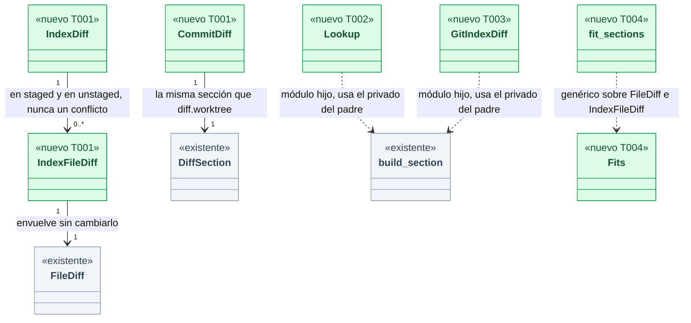
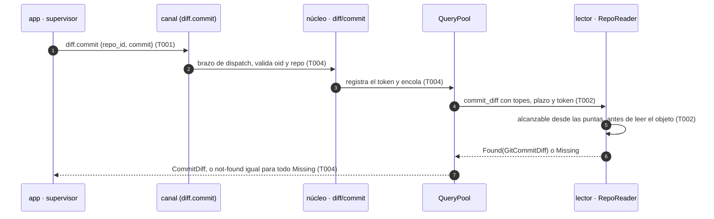
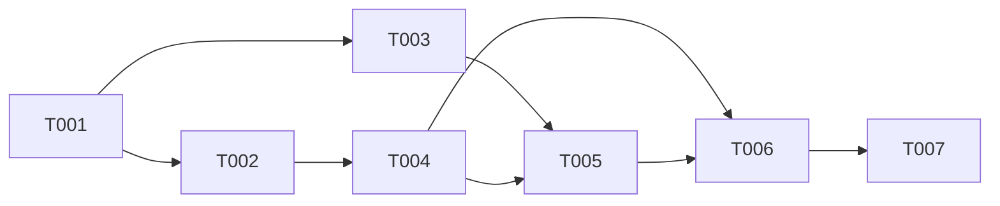

# DS-TS-CKP-006 · El diff de un commit, entre dos commits y del índice, servido por el motor

## Contexto rápido

Al terminar, la app de escritorio puede pedir al daemon el diff de un commit del grafo o de la búsqueda, el diff entre dos commits (de todo el árbol o de un archivo) y el diff de un worktree partido en preparado y sin preparar, con los mismos topes, cancelación y reparto a una sola conexión que ya tiene el diff de un worktree. Hoy no puede: el canal solo sirve `diff.worktree` (rama `feat/US-CKP-012-agent-diff`, `evidence[]`), y la app no lee Git por su cuenta (Q-DSK-1, ADR-GRP-017 § 1).

Para eso, la entrega monta tres piezas por cada capa (contrato, lector Git, canal):

- `diff.commit` y `diff.between`, que comparan árboles de commits que una ref del repo alcanza, sin oráculo de existencia;
- `diff.index`, que separa HEAD contra índice y índice contra working tree, identifica el contenido de cada lado y marca los conflictos;
- una comprobación estática que impide lanzar procesos o resolver revspecs en los módulos nuevos.

Las decisiones de alcance son de la [TS-CKP-006](../technical-stories/TS-CKP-006-diff-de-commit.md) y de los requisitos R1 a R8 de [DS-US-DSK-009](../../desktop/dev-specs/US-DSK-009-diff-visual.md#requisitos-para-la-ficha-de-motor-del-diff-de-un-commit-g2); aquí no se reabren. Las de frontera nuevas están en § Decisiones y esperan la revisión del coordinador.

| Término | Qué es aquí |
|---|---|
| Oid completo | Identificador de objeto Git de 40 (SHA-1) o 64 (SHA-256) caracteres hex en minúscula |
| Alcanzable | Commit al que se llega recorriendo padres desde la punta de una ref de `refs/heads/`, `refs/remotes/`, `refs/tags/` (pelada a commit) o desde `HEAD` del repo |
| Lado | Uno de los dos contenidos que se comparan en un archivo: `old` (antes) y `new` (después) |
| Id de contenido | El oid de blob de un lado: el del árbol o del índice, o el hash Git de los bytes crudos del working tree |
| Fragmento | Un `Hunk` del diff; su identificador estable se define en D8 |
| W147 | El worker que implementa US-CKP-012 en la rama `feat/US-CKP-012-agent-diff` |
| Modo rápido | Regla de los workers: tests de los crates afectados, sin la suite completa en local; el CI corre la suite completa |

> **Modo rápido (fast mode).** Cada tarea verifica con los tests afectados que nombra su `Aceptación`; no se corre `cargo test --workspace` en local. El CI corre la suite completa antes de mezclar.

### Decisiones

**Propuestas del Arquitecto (2026-11-10), pendientes de revisión del coordinador**; la revisión de seguridad (2026-11-10) ya está incorporada (§ Revisión de seguridad). Las tareas las incorporan como reglas.

| # | Decisión (recomendada) | Alternativa descartada y por qué |
|---|---|---|
| D1 | **Reutilizar el pool y la tabla de consultas tal cual.** `QueryTable::register`, `QueryPool::submit`, `QueryTable::run` y `Busy` de `crates/core/src/channel/query.rs` sin cambios: los tres métodos comparten con `diff.worktree` la consulta en vuelo por conexión, la cola global de 4 y `query.cancel`. Una segunda consulta de la misma conexión responde `query-busy` al momento, sin esperar. El reparto de la cola por solicitante (I-01) queda fuera de esta entrega (§ Fuera de alcance) | Un pool propio: daría a la app un segundo presupuesto de consultas y rompería el «una en vuelo por conexión» que P27 de DS-US-DSK-009 reparte en la app |
| D2 | **Módulos hijos, no hermanos.** El código nuevo va en `diff/commit.rs` y `diff/index.rs` bajo cada `diff.rs` existente (`crates/api/src/`, `crates/git/src/`, `crates/core/src/channel/`), más `crates/core/src/channel/diff/fit.rs`. Un módulo hijo ve los elementos privados del padre (`Side`, `build_section`, `file_diff`, `components`, `read_worktree`, `resolve`, `section_of`, `file_of`, `not_found`), así que no cambia la visibilidad de nada y no toca `lib.rs` ni `channel/mod.rs`. En los archivos de US-CKP-012 solo entran líneas `mod`, las constantes del módulo `diff` y el envoltorio de `fit` (D15) | Hermanos `diff_commit.rs` (lo sugerido en el encargo): obliga a pasar a `pub(crate)` unos diez elementos de dos archivos de W147 y a tocar `lib.rs` y `channel/mod.rs`, que comparten todos los módulos (ADR-GRP-016) |
| D3 | **Forma de `diff.commit` y `diff.between`** (R2). `CommitDiff { computed_at_utc_ms, parents, merge, section: DiffSection }` y `BetweenDiff { computed_at_utc_ms, section: DiffSection }`, con `DiffSection`, `FileDiff`, `FileBody` y `Hunk` de `gitraptor_api::diff` sin cambios. `merge == (parents > 1)` | Reutilizar `WorktreeDiff` con `committed`: mentiría sobre la semántica (no hay merge-base ni sin commitear) y la app tendría que ignorar la mitad |
| D4 | **Validación del oid** (R1). El canal exige `^[0-9a-f]{40}$` o `^[0-9a-f]{64}$` antes de convertir: otra cosa (abreviado, mayúsculas, `-…`, `HEAD~`, `@{-1}`, `:/regex`) es `invalid-params`. Luego `gix::ObjectId::from_hex`. Un oid de 64 en un repo SHA-1 (o al revés) responde `not-found` **antes** del recorrido: solo revela el tipo de hash del repo, que no es secreto (I-01). El SHA-1 es el de gix con detección de colisiones. Nunca `rev_parse` ni revspec | Solo `ObjectId::from_hex`: acepta mayúsculas, así que la regla de R1 dependería del parser de gix |
| D5 | **Alcanzabilidad sin oráculo** (R3). Un solo recorrido de padres desde todas las puntas de D-glosario («Alcanzable»), con `use_commit_graph(false)` y sin corte por fecha, **antes** de leer el objeto pedido; acotado por el plazo de la consulta (2 s), el token y `MAX_ANCESTRY_WALK`. «No existe», «no alcanzable», «no es un commit» y «corte del recorrido» salen por la misma variante (`Lookup::Missing`) y el canal responde el mismo `not-found` con el mismo mensaje | El corte por fecha de `reached_by_other_refs` (`crates/git/src/guard_read.rs:145`): lee antes la fecha del commit pedido, y un oid inexistente respondería al momento frente a un recorrido completo, un oráculo de existencia por tiempo. Todas las refs (`refs/*`): metería `refs/stash`, `refs/notes` y las del almacén de la Time Machine, que el grafo no enseña |
| D6 | **`diff.between` es `a → b` de árbol a árbol** (como `git diff a b`), sin merge-base y sin exigir ancestro común: dos historias sin relación dan el diff de sus árboles, acotado por los topes de siempre. No se llama a `merge_bases` (`crates/git/src/reader.rs:571`), que no tiene plazo ni cancelación y bloquearía el único hilo `raptor-query` (M-02). La ruta opcional es un archivo literal, validada por `relative_components` (L-01): se leen sus dos lados con `committed_file` sin listar el árbol; sin coincidencias de patrón ni directorios (un directorio o una ruta ausente en los dos lados da una sección vacía) | Semántica `a...b` (contra el merge-base): es lo que ya hace la sección «entraría al merge» de `diff.worktree`, y «cómo cambió esto entre dos puntos» (DEP-DSK-3) pide `a → b` |
| D7 | **Forma de `diff.index`.** Parámetros: los de `diff.worktree` (`DiffParams`). Resultado: `IndexDiff { computed_at_utc_ms, staged: IndexSection, unstaged: IndexSection, conflicts, conflicts_total }`; cada archivo es `IndexFileDiff { file: FileDiff, old: ContentId, new: ContentId }`. Una ruta con entradas de etapa 1 a 3 en el índice va a `conflicts` (solo la ruta, sin contenido) y sale de las dos secciones (US-DSK-014). `conflicts` entra en el presupuesto de bytes con una reserva propia de 64 KiB; lo que no cabe se queda fuera de la lista y `conflicts_total` cuenta todos (M-01). Lo sin seguimiento no ignorado va a `unstaged` como añadido. Ids y pertenencia a cada sección salen de la **misma** lectura del índice (L-02) | Añadir un campo opcional a `FileDiff`: cambia el esquema de `diff.worktree`, un método que ya existe, y pide una capacidad (guía de extensión, § cambio de forma) |
| D8 | **Identificador estable de fragmento** (para TS-CKP-008): la tupla (sección `staged` o `unstaged`, ruta, `old`, `new`, `old_start`, `old_len`, `new_start`, `new_len`) de un `Hunk` de `diff.index`. `Hunk` no gana campos. TS-CKP-008 rehace el fragmento en el motor desde los blobs de esos ids, nunca acepta texto de líneas del cliente, y rechaza el fragmento si el cuerpo del archivo no es `Text`, si viene `truncated` o si alguna de sus líneas llegó cortada por el tope de `Untrusted` (L-03). Cualquier cambio de cualquier lado cambia su `ContentId` e invalida todos sus fragmentos, lo que detecta el archivo que «claude-1» modifica a la vez (US-DSK-011, escenario 3). TS-CKP-008 valida fragmentos contra `diff.index` (índice contra working tree o HEAD contra índice), no contra `diff.worktree` (HEAD contra working tree, que no se puede aplicar al índice) | Un hash por fragmento: campo nuevo en `Hunk` (cambio de forma de `diff.worktree`) y no ve un cambio del archivo fuera de ese fragmento |
| D9 | **Perfil: ninguno de los tres se ofrece ni se atiende al perfil `mcp`** (R6): `method(NAME, false, false).since(CAPABILITIES_PROTOCOL)`, igual que `diff.worktree` (I-02). **Residuo aceptado (G1 de DS-US-CKP-012)**: una TUI o CLI lanzada por un agente tiene perfil completo y ve también el diff de commits; se cierra con S-01 sin cambiar esta DS. **Aceptado por el coordinador (2026-11-10), como el G1 de US-CKP-012**: el agente ya puede leer esos objetos en disco, así que no amplía su acceso. El daemon ya lo cumple sin código nuevo: `offered` filtra por `m.mcp` (`crates/core/src/channel/conn.rs:841-845`) y `dispatch` responde `not-found` a lo no ofrecido (`conn.rs:897`). Una ventana de la app con agente en su ascendencia, ascendencia dudosa o solicitante sin resolver recibe perfil `mcp` del propio daemon (D3 (b) a (f) de DS-TS-GRP-009), así que tampoco los ve: coincide con P25 de DS-US-DSK-009 sin un control más en el daemon | Negar por solicitante en cada petición: duplicaría la decisión de perfil de DS-TS-GRP-009 en un segundo sitio que puede divergir. El residuo de G1 de DS-US-CKP-012 (una TUI lanzada por un agente tiene perfil completo) es el mismo y está aceptado |
| D10 | **Lectura** (R7). `diff.commit` y `diff.between` abren el directorio común con `RepoReader::open(…, &ReaderOptions::default())`, como el observador (`crates/core/src/observe.rs:288`); `diff.index`, con `crate::observe::open_worktree`, como `diff.worktree`. Los dos aplican `neutralize_programs` e ignoran `refs/replace`. Las líneas se comparan con el `text_diff` de `crates/git/src/diff.rs` sobre bytes crudos, sin `Platform`, caché de recursos ni pipeline de filtros, así que `[diff] external` (que `neutralize_programs` no borra, `reader.rs:759-779`) nunca se consulta. `neutralize_programs` no cambia: el guard lo prueba | Borrar también `[diff] external` en `neutralize_programs`: cambia el lector que comparten todas las lecturas del motor por un camino que este código no recorre. Si el guard fallara, se hace en un TD propio |
| D11 | **Errores.** Se reutilizan `invalid-params`, `not-found`, `diff-unavailable` (`repo-unavailable`, `worktree-unavailable`), `query-busy` y `query-cancelled`, con sus mensajes de siempre. **Ningún código nuevo**: el bloque del módulo `diff` no cambia (tras M-02 ya no hay rechazo por falta de base común). Una ruta inválida es `invalid-params`, nunca `INTERNAL` (L-01) | Un código o una variante nueva de `DiffUnavailable`: cambia el esquema del `data` de un código que ya devuelve `diff.worktree` y obliga a tocar los catálogos i18n compartidos |
| D12 | **Merge, raíz y renombrados** (R4, R8). Merge: contra el primer padre (`ChangedPaths.first_parent`). Raíz: contra el árbol vacío (`changed_paths(None, …)`). Sin renombrados: un `git mv` es un borrado y un añadido (D16 de DS-US-CKP-012) | Diff combinado de merge: la vista no lo sabe pintar y R4 no lo pide |
| D13 | **Sin registro del contenido** (SEC-05, Validación 8). Cada consulta deja una línea `diff_commit`, `diff_between` o `diff_index` con `repo`, `ms`, `files` y `cut`; ni oids, ni rutas, ni líneas. Rutas y líneas viajan como `Untrusted` (SEC-12) | Registrar el oid pedido: no aporta al diagnóstico y es texto del cliente |
| D14 | **Tarjeta de fitness CKP006-FIT**: un test estático, como GRP007-WRITERS, que lee el código de producción de los módulos nuevos y falla si aparece `Command`, `std::process`, `rev_parse`, `revision::Spec`, `merge_bases`, `Platform`, `resource_cache`, `filter::Pipeline` o `attributes(` | Confiar en GRP007-WRITERS y `process_spawn_only_in_invoke_module`: impiden un `git` hijo pero no un revspec ni el pipeline de filtros de gix |
| D15 | **Recorte por bytes genérico.** El cuerpo de `fit` (`crates/core/src/channel/diff.rs`) pasa a `diff/fit.rs` como `fit_sections` genérico sobre el tipo de archivo; `fit` queda como envoltorio de `WorktreeDiff`. Sin cambio de comportamiento: los tests de `diff.worktree` son el guard | Copiar `fit` en cada módulo: tres copias de la regla «los primeros archivos conservan contenido y `files_total` no se toca», que divergen al primer ajuste |

---

## 📋 Índice

> **Para aprobar:** [Contexto rápido](#contexto-rápido) · [⚠️ Gaps](#gaps-y-violaciones-de-la-constitución) · [🔭 La forma](#la-forma) · [El trabajo de un vistazo](#el-trabajo-de-un-vistazo).
> **Para implementar:** [🚀 Plan](#plan-de-implementación), en orden. Las `_(ref)_` se abren desde la tarea que las cita.

| Sección | Propósito |
|---------|-----------|
| [Contexto rápido](#contexto-rápido) | Qué se construye, el glosario y las decisiones |
| [⚠️ Gaps y violaciones de la constitución](#gaps-y-violaciones-de-la-constitución) | Qué impide empezar |
| [🔭 La forma](#la-forma) | Piezas, cambios y flujo |
| [🚀 Plan de implementación](#plan-de-implementación) | T001…T007, en orden |
| ↳ [El trabajo de un vistazo](#el-trabajo-de-un-vistazo) | Tareas en tabla y su orden |
| [Estructura de ficheros](#estructura-de-ficheros) _(ref)_ | Árbol anotado de ficheros |
| [Contratos compartidos](#contratos-compartidos) _(ref)_ | Tipos y firmas |
| [Contrato de API](#contrato-de-api) _(ref)_ | Métodos, códigos y topes |
| [Modelo de datos](#modelo-de-datos) _(ref)_ | No aplica |
| [Estrategia de pruebas y cobertura](#estrategia-de-pruebas-y-cobertura) _(ref)_ | Criterio → test |
| [Gate de seguridad](#gate-de-seguridad) | Checklist pre-merge |
| [Revisión de seguridad](#revisión-de-seguridad-2026-11-10-opus-aprobada-con-comentarios-0-críticoalto-2-medio-3-bajo-2-informativos) | Hallazgos y dónde se incorporaron |
| [Fuera de alcance](#fuera-de-alcance) | Lo que esta entrega no toca |
| [Notas del autor](#notas-del-autor) _(ref)_ | Lo que no bloquea |

---

## ⚠️ Gaps y violaciones de la constitución

_No gaps. Ready to implement_, con una condición de arranque que no es un hueco de diseño: la ficha está `blocked_by: [US-CKP-012]` y T001 empieza comprobando que los símbolos de la rama de W147 están en `main` (lista en T001). Sin ellos no compila nada; con ellos, nada de esta DS espera una decisión.

El repo no tiene `architecture-constitution.md` en la cascada. Restricciones activas, de [AGENTS.md](../../../../../AGENTS.md) y los ADRs: `unsafe_code = forbid` (ADR-GRP-001), protocolo congelado en 9 y métodos y códigos en el archivo de su módulo (ADR-GRP-016), lectura solo con `gix` sin filtros (ADR-GRP-009 § 1), contenido del diff nunca al MCP, al stream ni al disco (Q-CKP-8, SEC-05). Ninguna tarea las viola.

---

## 🔭 La forma

Al terminar, el módulo `diff` del contrato tiene cuatro métodos; los tres nuevos viven en módulos hijos de los `diff.rs` de US-CKP-012 y se sirven por el mismo pool.



🟩 nuevo · 🟨 modificado · ⬜ existente. Cada pieza dice qué tarea la toca.

Lo que el diagrama dice y la prosa no: los hijos dependen de elementos **privados** del padre, así que ningún archivo compartido cambia de visibilidad.

**Cómo fluye:**



El paso que no se adivina es el 5: la alcanzabilidad se decide antes de mirar el objeto pedido, y todo lo que no llega (inexistente, otro repo, blob, huérfano, corte) sale por la misma variante. `diff.between` y `diff.index` siguen el mismo camino; `diff.index` no tiene paso 5 (no recibe oids).

---

## 🚀 Plan de implementación

> Orden topológico (`Depende:`). Rutas relativas a la raíz del repo.

### El trabajo de un vistazo

Tres frentes y un cierre: contrato y tests en rojo (T001), lector Git (T002, T003), canal (T004, T005), fitness y rendimiento (T006) y cierre (T007).

| # | Tarea | Depende | Aterriza en |
|---|---|---|---|
| T001 | Verificar US-CKP-012 en `main` y escribir en rojo los tests con los stubs del contrato | — | `crates/api/src/diff/`, `crates/api/src/methods/diff.rs`, `crates/*/tests/ts_ckp_006_*.rs` |
| T002 | Calcular el diff de un commit y entre dos commits con alcanzabilidad acotada | T001 | `crates/git/src/diff/commit.rs` |
| T003 | Calcular el diff del índice con ids de contenido y conflictos | T001 | `crates/git/src/diff/index.rs` |
| T004 | Servir `diff.commit` y `diff.between` desde el pool | T002 | `crates/core/src/channel/diff/{fit,commit}.rs`, `conn.rs` |
| T005 | Servir `diff.index` desde el pool | T003, T004 | `crates/core/src/channel/diff/index.rs`, `conn.rs` |
| T006 | Fijar la frontera con CKP006-FIT, el canario y el banco | T004, T005 | `crates/core/tests/`, `crates/core/benches/` |
| T007 | Cerrar la ficha y desbloquear T007 de US-DSK-009 | T006 | `docs` |

### En qué orden

Dos frentes paralelos tras T001 (lector de commits y lector de índice) que se juntan en el canal; T005 va tras T004 porque usa `diff/fit.rs`.



### T001 — Verificar US-CKP-012 en `main` y escribir en rojo los tests con los stubs del contrato

**Objetivo.** Los criterios CKP006-001 a CKP006-011 en rojo, contra tipos y firmas que ya compilan. Fuera: cualquier cálculo real.

**Ubicación.**
- `crates/api/src/diff/commit.rs` (**CREATE**): `CommitParams`, `BetweenParams`, `CommitDiff`, `BetweenDiff`
- `crates/api/src/diff/index.rs` (**CREATE**): `IndexDiff`, `IndexSection`, `IndexFileDiff`, `ContentId`
- `crates/api/src/diff.rs` (**MODIFY**): `pub mod commit; pub mod index;`
- `crates/api/src/methods/diff.rs` (**MODIFY**): `DIFF_COMMIT`, `DIFF_BETWEEN`, `DIFF_INDEX` y su sitio en `GROUP.methods`
- `crates/git/src/diff/commit.rs` (**CREATE**): firmas de § Firmas del stack con cuerpo stub
- `crates/git/src/diff/index.rs` (**CREATE**): firma de `index_diff` con cuerpo stub
- `crates/git/src/diff.rs` (**MODIFY**): `mod commit; mod index; pub use commit::*; pub use index::*;`
- `crates/core/src/channel/diff/commit.rs` (**CREATE**): `start` stub
- `crates/core/src/channel/diff/index.rs` (**CREATE**): `start` stub
- `crates/core/src/channel/diff.rs` (**MODIFY**): `pub(super) mod commit; pub(super) mod index;`
- `crates/core/src/channel/conn.rs` (**MODIFY**): dos brazos tras `DIFF_WORKTREE`
- `crates/git/tests/ts_ckp_006_commit_diff.rs` (**CREATE**)
- `crates/git/tests/ts_ckp_006_index_diff.rs` (**CREATE**)
- `crates/core/tests/ts_ckp_006_diff_query.rs` (**CREATE**)

**Pasos**
1. Comprobar en `main` que existen: `gitraptor_api::diff::{DiffParams, DiffSection, FileDiff, FileBody, Hunk, DiffCut, DiffUnavailable, MAX_DIFF_*, DIFF_DEADLINE_MS}`, `methods::{DIFF_WORKTREE, DIFF_UNAVAILABLE, QUERY_CANCEL, QUERY_BUSY, QUERY_CANCELLED}`, `crates/core/src/channel/query.rs` (`QueryPool::submit`, `QueryTable::{register, run, finish, cancel}`, `Busy`), en `crates/core/src/channel/diff.rs` las funciones `resolve`, `start`, `compute`, `section_of`, `file_of`, `fit`, `summary`, `valid_repo_id`, `not_found`, `invalid`, `unavailable`, el brazo `methods::DIFF_WORKTREE` de `conn.rs`, y en `crates/git/src/diff.rs` `ChannelConfig::test_diff_deadline` (`crates/core/src/channel/mod.rs:131`), `DiffLimits`, `GitSection`, `GitFileDiff`, `Side`, `build_section`, `file_diff`, `components`, `read_worktree`, `text_diff`.
   1.1 ⛔1.1 Si falta uno o cambió de nombre, parar y avisar al orquestador: no recrearlo aquí. Recrearlo deja dos copias que el rebase de W147 enfrenta.
2. Declarar los tipos de § Tipos y datos compartidos con `Serialize, Deserialize, JsonSchema`, `deny_unknown_fields` en los structs y `rename_all = "kebab-case"` en los enums.
3. Declarar en `methods/diff.rs` los tres métodos con `method(NAME, false, false).since(CAPABILITIES_PROTOCOL)`, como `DIFF_WORKTREE` (I-02). `errors` y `error_block` no cambian.
4. Escribir los stubs: las funciones de `crates/git` devuelven `Err(ReadError::Unavailable("not implemented".into()))`; los `start` del canal devuelven `Err(ErrorObject::new(code::INTERNAL, "not implemented"))`. Ningún `todo!()` ni `unimplemented!()`.
5. Añadir en `conn.rs`, justo después del brazo de `DIFF_WORKTREE`, `methods::DIFF_COMMIT | methods::DIFF_BETWEEN => …super::diff::commit::start(…)` y `methods::DIFF_INDEX => …super::diff::index::start(…)`, con la misma forma que el de `DIFF_WORKTREE` (solo delegan y responden el `Err`).
6. Escribir los tests de § 9.4 en sus tres archivos, cada uno con su id `CKP006-xxx` en el nombre o en un comentario de una línea. Commit de los stubs y los tests antes de la línea base.

> **Nota técnica.** Los tests de `crates/core/tests/` usan sockets Unix: `#![cfg(any(target_os = "macos", target_os = "linux"))]`, como `diff_query.rs`. Repos con `gitraptor_testkit::Fixture` en directorios temporales; nunca este repo ni el perfil real (NFR-01).

- **Depende:** —
- **Refs:** D1 a D4, D7, D9, D11; ADR-GRP-016; guía de extensión § Añadir un método (la guía pide métodos sin `.since`; se sigue el precedente de `diff.worktree` por I-02)
- **Aceptación:** `cargo test -p gitraptor-api` en verde (`architecture.rs` y el test de bloques disjuntos incluidos); `cargo test -p gitraptor-git --test ts_ckp_006_commit_diff --test ts_ckp_006_index_diff` y `cargo test -p gitraptor-core --test ts_ckp_006_diff_query` compilan y fallan por «not implemented»
- **Guard ⛔1.1:** `cargo build -p gitraptor-core` en `main` antes de editar: falla si falta un símbolo de W147

### T002 — Calcular el diff de un commit y entre dos commits con alcanzabilidad acotada

**Objetivo.** `RepoReader::commit_diff` y `RepoReader::between_diff` devuelven la sección o `Missing`, sin leer nada del objeto pedido antes de saberlo alcanzable.

**Ubicación.** `crates/git/src/diff/commit.rs` (**MODIFY**) · `crates/git/src/diff.rs` (**MODIFY**, solo si el hijo necesita un `use` del padre)

**Pasos**
1. Validar cada oid con `is_full_oid` y convertirlo con `gix::ObjectId::from_hex`; un oid cuyo tipo de hash no es el del repo es `Missing` antes del recorrido (I-01: solo revela el tipo de hash).
2. Reunir las puntas: `self.repo.references()` filtrado a `refs/heads/`, `refs/remotes/`, `refs/tags/` (pelado con `peel_to_id`, solo si es commit) y `HEAD`.
   2.1 ⛔2.1 No usar `rev_parse`, `rev_parse_single` ni `revision::Spec` para nada, tampoco para `HEAD`: CKP006-FIT falla.
3. Recorrer con `self.repo.rev_walk(puntas).use_commit_graph(false)` sin `Sorting::ByCommitTimeCutoff`; parar al encontrar todos los oids pedidos. Mirar el plazo (`limits.deadline`) y `stop()` cada 1.000 commits y parar en `MAX_ANCESTRY_WALK`. Cualquier parada sin encontrarlos es `Missing`.
   3.1 ⛔3.1 No leer el objeto pedido (ni cabecera ni fecha) antes de terminar el recorrido: un «no existe» que responde al momento es un oráculo por tiempo.
4. `commit_diff`: con el commit alcanzable, `parents` de `self.repo.find_commit`; `changed_paths(primer padre o None, commit, limits.max_files, limits.deadline)`; el fallo por plazo de `changed_paths` da la sección vacía con `cut: Time` y `files_total` 0 (nunca `Missing`: el commit existe).
5. Construir la sección con `build_section` y un `load` que lee los dos lados con `committed_file` y `Side::from_committed`, todo el presupuesto de bytes para la única sección.
6. `between_diff`: los dos oids en un solo recorrido; sin ruta, como el paso 4 con `changed_paths(Some(a), b, …)`; con ruta, `relative_components(ruta)` y los dos lados con `committed_file`, sin listar el árbol.
   6.1 ⛔6.1 No llamar a `merge_bases` ni a ningún cálculo de base común: no tiene plazo ni token y bloquea el único hilo `raptor-query` (M-02).
7. Escribir `pub fn relative_components(path: &str) -> Result<Vec<&str>, ReadError>`: aplica `components()` del padre (`crates/git/src/diff.rs:340`) y además rechaza la cadena vacía, NUL, cualquier carácter de control, `/` inicial y más de 4.096 bytes, con `ReadError::InvalidInput`. Es la única función de validación de esta ruta: el canal la llama antes de encolar (T004) y `between_diff` la vuelve a aplicar (L-01).

> **Nota técnica.** `RepoReader::open` ya aplica `neutralize_programs` e ignora `refs/replace` (`crates/git/src/reader.rs:160-195`); el diff de líneas es `text_diff` sobre bytes crudos, sin `Platform`. `[diff] external` queda en la configuración pero ningún camino de este código la consulta (D10). El SHA-1 de gix es el que detecta colisiones (I-01): comprobar en `Cargo.lock` que la característica de SHA-1 que usa la versión fijada de gix es la verificada (`sha1-checked` o la que la sustituya) y no desactivarla.

- **Depende:** T001
- **Refs:** D4, D5, D6, D10, D12; R1, R3, R4, R7, R8
- **Aceptación:** `cargo test -p gitraptor-git --test ts_ckp_006_commit_diff` y `cargo test -p gitraptor-git --test static_check`
- **Guard ⛔2.1:** `ts_ckp_006_boundary.rs` › `ckp006_fit_new_modules_never_parse_revspecs_nor_spawn` (T006)
- **Guard ⛔3.1:** `ts_ckp_006_commit_diff.rs` › `ckp006_005_missing_and_unreachable_take_the_same_path` (mismo resultado `Missing` para todo) y la revisión de código: no hay punto de inyección que cuente lecturas, así que «no leer el objeto antes del fin del recorrido» es una regla de implementación que el revisor comprueba (propuesta del worker confirmada por el coordinador, 2026-11-10: PC-2 de la crítica)
- **Guard ⛔6.1:** `ts_ckp_006_boundary.rs` › `ckp006_fit_new_modules_never_parse_revspecs_nor_spawn` (`merge_bases` está en la lista de D14) y `ts_ckp_006_commit_diff.rs` › `ckp006_003_unrelated_histories_diff_tree_to_tree`

### T003 — Calcular el diff del índice con ids de contenido y conflictos

**Objetivo.** `RepoReader::index_diff` devuelve lo preparado, lo sin preparar, el id de contenido de cada lado y los conflictos.

**Ubicación.** `crates/git/src/diff/index.rs` (**MODIFY**)

**Pasos**
1. Leer el índice una vez (`self.repo.index_or_empty()`, sin refrescar ni escribir), guardar su suma de comprobación y separar las rutas con entradas de etapa distinta de 0: son `conflicts` y salen de las dos secciones.
2. Partir `self.status()`: `staged` → sección preparada (HEAD contra índice); `unstaged` y `untracked` → sección sin preparar (índice contra working tree).
   2.1 ⛔2.1 Ids de contenido y pertenencia a cada sección salen de la **misma** lectura del índice (L-02). Tras `status()`, volver a leer la suma del índice; si cambió, rehacer los pasos 1 y 2 una vez; si cambia otra vez, `ReadError::TemporarilyUnavailable`, que el canal responde `diff-unavailable {worktree-unavailable}`. Mezclar dos índices daría un id que no corresponde a la sección.
3. Lado del índice: la entrada de etapa 0 por ruta; su modo decide `Side` (enlace → `Link`, gitlink → `Submodule`) y su id lee el blob con `blob_by_id`. Lado HEAD: `committed_file`. Lado working tree: `read_worktree` del padre.
4. Guardar, dentro del `load` de `build_section`, el `ContentId` de cada lado en un mapa por ruta: del árbol y del índice, el id que ya traen; del working tree, el hash Git de blob de los bytes leídos (`gix::objs::compute_hash` o el equivalente de la versión fijada); un lado ausente, demasiado grande, enlace, submódulo o ilegible no tiene id.
   4.1 ⛔4.1 El hash del working tree se calcula sobre los bytes crudos, sin filtro `clean` ni conversión de fines de línea; nunca con `git hash-object`.
5. Repartir el presupuesto de bytes a medias entre las dos secciones, como `worktree_diff`.

> **Nota técnica.** Para un archivo con filtros o `autocrlf`, el hash crudo del working tree no coincide con el que daría `git add`. Es lo esperado: TS-CKP-008 compara ese id con el mismo cálculo, no con el índice.

- **Depende:** T001
- **Refs:** D7, D8, D10; US-DSK-010, US-DSK-011, US-DSK-014
- **Aceptación:** `cargo test -p gitraptor-git --test ts_ckp_006_index_diff`
- **Guard ⛔2.1:** `ts_ckp_006_index_diff.rs` › `ckp006_004_content_ids_come_from_the_index_head_and_worktree` (sin punto de inyección en `index_diff`: la ventana entre las dos lecturas del índice no la alcanza un test de integración, así que la regla de rehacer una vez y `TemporarilyUnavailable` la comprueba el revisor; el test verifica que, con el índice quieto, ids y pertenencia salen del mismo índice. Propuesta del worker confirmada por el coordinador, 2026-11-10: PC-3 de la crítica)
- **Guard ⛔4.1:** `ts_ckp_006_index_diff.rs` › `ckp006_004_worktree_id_is_the_raw_blob_hash` (repo con `filter.x.clean` y `.gitattributes`: el id es el de los bytes crudos y el canario no salta)

### T004 — Servir `diff.commit` y `diff.between` desde el pool

**Objetivo.** El daemon responde las dos consultas, fuera de orden y solo a quien pregunta, con los topes de D4 de DS-US-CKP-012.

**Ubicación.**
- `crates/core/src/channel/diff/fit.rs` (**CREATE**): `Fits`, `fit_sections`
- `crates/core/src/channel/diff.rs` (**MODIFY**): el cuerpo de `fit` pasa a `fit_sections`; `fit` queda como envoltorio; `pub(super) mod fit;` (o `mod fit;`)
- `crates/core/src/channel/diff/commit.rs` (**MODIFY**)

**Pasos**
1. Mover el cuerpo de `fit` a `fit_sections` sin cambiar su regla (los primeros archivos conservan contenido, los siguientes salen `Omitted` o fuera de la lista, `cut: Bytes`, `files_total` intacto).
   1.1 ⛔1.1 No cambiar el orden ni el margen (`ENVELOPE_MARGIN`): `diff_query.rs` › `limits_cut_bytes_keeps_the_reply_under_768_kib` es el guard.
2. En `start`, antes de encolar: decodificar `CommitParams` o `BetweenParams` según `request.method`; `valid_repo_id`; `is_full_oid` de cada oid; `gitraptor_git::diff::relative_components` sobre `path` si viene (L-01). Cualquier fallo es `invalid()`, nunca `INTERNAL`.
3. Resolver el repo en `ctx.bus.snapshot()` por `repo_id` con las mismas reglas que `resolve` (no listo → `diff-unavailable {repo-unavailable}`, ausente → `not-found`); registrar el token y encolar como `diff::start`; el plazo sale igual que en `diff::start` (`#[cfg(debug_assertions)] ctx.config.test_diff_deadline.unwrap_or(DIFF_DEADLINE_MS)`, `crates/core/src/channel/diff.rs:125-127`), para que los tests fuercen el corte por plazo por el canal.
4. En el trabajo: `RepoReader::open(common_dir, &ReaderOptions::default())`; `commit_diff` / `between_diff` con `DiffLimits` de las constantes de US-CKP-012; `Missing` → `not_found()`; `ReadError::InvalidInput` → `invalid()`; otro `ReadError` → `INTERNAL "diff failed"`. Mapear con `section_of` del padre y recortar con `fit_sections`.
5. Registrar `diff_commit` o `diff_between` con `repo`, `ms`, `files`, `cut` (D13).

- **Depende:** T002
- **Refs:** D1, D3, D4, D9, D11, D13, D15; ADR-GRP-009 Validación 8
- **Aceptación:** `cargo test -p gitraptor-core --test ts_ckp_006_diff_query commit` y `cargo test -p gitraptor-core --test diff_query`
- **Guard ⛔1.1:** `cargo test -p gitraptor-core --test diff_query limits_cut_bytes_keeps_the_reply_under_768_kib`

### T005 — Servir `diff.index` desde el pool

**Objetivo.** El daemon responde `diff.index` para un worktree observado, con los ids de contenido y los conflictos.

**Ubicación.** `crates/core/src/channel/diff/index.rs` (**MODIFY**)

**Reglas**
- Parámetros y resolución: `DiffParams` y `resolve` del padre, con sus mismas respuestas inmediatas (`not-found`, `diff-unavailable`).
- Plazo como en `diff::start` (`test_diff_deadline` en debug).
- Lectura con `crate::observe::open_worktree`, como `compute` de `diff.worktree`; `index_diff` con los `DiffLimits` de US-CKP-012.
- `IndexFileDiff.file` con `file_of` del padre; `old`/`new` del mapa de ids por ruta; `conflicts` como `Untrusted`, como mucho `MAX_DIFF_FILES`, y `conflicts_total` con todos.
- Recorte (M-01): `conflicts` toma primero su reserva de 64 KiB (`CONFLICTS_RESERVE_BYTES`): entran rutas en orden mientras quepan, el resto queda fuera de la lista y `conflicts_total` no cambia. Las dos secciones se recortan con `fit_sections` sobre el límite menos lo que ocupó `conflicts`.
- `ReadError::TemporarilyUnavailable` de `index_diff` (⛔2.1 de T003) → `diff-unavailable {worktree-unavailable}`.
- Log `diff_index` con `repo`, `ms`, `files`, `cut`.

- **Depende:** T003, T004
- **Refs:** D7, D8, D13, D15
- **Aceptación:** `cargo test -p gitraptor-core --test ts_ckp_006_diff_query index`

### T006 — Fijar la frontera con CKP006-FIT, el canario y el banco

**Objetivo.** Que un cambio futuro no pueda abrir un proceso, un revspec o un filtro en estos módulos, y que el rendimiento quede medido.

**Ubicación.**
- `crates/core/tests/ts_ckp_006_boundary.rs` (**CREATE**)
- `crates/core/tests/diff_git.rs` (**MODIFY**): una aserción en `no_exec_filters_textconv_and_external_diff_never_run`
- `crates/core/benches/diff_commit.rs` (**CREATE**)
- `crates/core/Cargo.toml` (**MODIFY**): `[[bench]] name = "diff_commit"`, `harness = false`

**Reglas**
- `ts_ckp_006_boundary.rs` copia el lector de fuentes de producción de `td_grp_007_writers.rs` (sin `tests/`, `*_tests.rs` ni `#[cfg(test)]`) y recorre `crates/git/src/diff/` y `crates/core/src/channel/diff/`; falla con la ruta y el token si aparece uno de la lista de D14. Un test más falla si alguno de esos directorios no existe o está vacío (que no pase en vacío).
- En `diff_git.rs`, antes de pedir el diff: `git config --get diff.external` en el repo del canario devuelve el script armado (`Canary::arm` ya lo pone sin subsección, `crates/testkit/src/canary.rs:97`). Así el caso de R7 queda probado para `diff.worktree` sin escribir otro test.
- El banco usa el repo de 100K commits de `gitraptor_testkit::repogen` (INF-GRP-002), llama a `RepoReader::commit_diff` sobre un commit típico y sobre un oid inexistente, y a `index_diff` en un worktree con 20 archivos cambiados; imprime p50 y p95.

- **Depende:** T004, T005
- **Refs:** D5, D10, D14; R7; NFR-05; INF-GRP-002
- **Aceptación:** `cargo test -p gitraptor-core --test ts_ckp_006_boundary`, `cargo test -p gitraptor-core --test diff_git no_exec_filters_textconv_and_external_diff_never_run` y `cargo bench -p gitraptor-core --bench diff_commit` dentro de § Valores numéricos

### T007 — Cerrar la ficha y desbloquear T007 de US-DSK-009

**Objetivo.** La ficha y su DS pasan a `implemented` y G2 de DS-US-DSK-009 apunta al método en `main`.

**Ubicación.**
- `docs/requirements/features/cockpit/technical-stories/TS-CKP-006-diff-de-commit.md` (**MODIFY**)
- `docs/requirements/features/cockpit/dev-specs/TS-CKP-006-diff-de-commit.md` (**MODIFY**)
- `docs/requirements/features/desktop/dev-specs/US-DSK-009-diff-visual.md` (**MODIFY**): la fila G2 y la línea de requisitos, que pasan a «en `main`»

**Reglas**
- `implemented` solo con CKP006-001 a CKP006-012 en verde en CI.
- No se edita `docs/ARTIFACTS.md` a mano.

- **Depende:** T006
- **Refs:** P29 de DS-US-DSK-009
- **Aceptación:** `cargo fmt --all --check` y `cargo clippy --workspace --exclude gitraptor-desktop --all-targets -- -D warnings` en local; la suite completa la corre el CI

---

> Las secciones siguientes son de referencia: se abren desde la tarea que las cita.

## Estructura de ficheros

```text
crates/
├── api/src/
│   ├── diff.rs                          ← MODIFY  (2 líneas `pub mod`)
│   ├── diff/commit.rs                   ← CREATE  (D3)
│   ├── diff/index.rs                    ← CREATE  (D7)
│   └── methods/diff.rs                  ← MODIFY  (3 métodos, ningún código; ADR-GRP-016)
├── git/src/
│   ├── diff.rs                          ← MODIFY  (`mod` y `pub use`)
│   ├── diff/commit.rs                   ← CREATE  (D4, D5, D6)
│   └── diff/index.rs                    ← CREATE  (D7, D8)
├── git/tests/
│   ├── ts_ckp_006_commit_diff.rs        ← CREATE
│   └── ts_ckp_006_index_diff.rs         ← CREATE
├── core/src/channel/
│   ├── conn.rs                          ← MODIFY  (2 brazos que delegan)
│   ├── diff.rs                          ← MODIFY  (`mod`, envoltorio de `fit`)
│   ├── diff/fit.rs                      ← CREATE  (D15)
│   ├── diff/commit.rs                   ← CREATE
│   └── diff/index.rs                    ← CREATE
├── core/tests/
│   ├── ts_ckp_006_diff_query.rs         ← CREATE
│   ├── ts_ckp_006_boundary.rs           ← CREATE  (D14)
│   └── diff_git.rs                      ← MODIFY  (1 aserción)
├── core/benches/diff_commit.rs          ← CREATE
└── core/Cargo.toml                      ← MODIFY  ([[bench]])
```

`← CREATE`: fichero nuevo. `← MODIFY`: fichero existente (los de `diff.rs`, `methods/diff.rs`, `conn.rs` y `diff_git.rs` llegan con US-CKP-012).

---

## Contratos compartidos

### Tipos y datos compartidos

```rust
// crates/api/src/diff/commit.rs (CREATE)
pub struct CommitParams { pub repo_id: String, pub commit: String }            // oid completo (D4)
pub struct BetweenParams { pub repo_id: String, pub old: String, pub new: String,
                           #[serde(default)] pub path: Option<String> }        // ruta relativa literal (D6)
pub struct CommitDiff { pub computed_at_utc_ms: i64, pub parents: u32, pub merge: bool, pub section: DiffSection }
pub struct BetweenDiff { pub computed_at_utc_ms: i64, pub section: DiffSection }

// crates/api/src/diff/index.rs (CREATE) — parámetros: gitraptor_api::diff::DiffParams
pub struct IndexDiff {
    pub computed_at_utc_ms: i64,
    pub staged: IndexSection,                // HEAD contra índice
    pub unstaged: IndexSection,              // índice contra working tree, sin seguimiento incluidos
    pub conflicts: Vec<Untrusted>,           // rutas con etapas 1 a 3, sin contenido
    pub conflicts_total: u32,
}
pub struct IndexSection { pub files: Vec<IndexFileDiff>, pub files_total: u32, pub cut: Option<DiffCut> }
pub struct IndexFileDiff { pub file: FileDiff, pub old: ContentId, pub new: ContentId }
pub enum ContentId { Blob { id: String }, None {} }   // id: oid hex minúscula del blob del lado
pub const CONFLICTS_RESERVE_BYTES: usize = 64 * 1024; // reserva de `conflicts` dentro de MAX_DIFF_RESPONSE_BYTES (M-01)
```

`DiffSection`, `FileDiff`, `FileBody`, `Hunk`, `DiffCut` y `DiffParams` son los de `gitraptor_api::diff` (US-CKP-012), sin cambios. `Untrusted` es el de `crates/api/src/untrusted.rs` (4.096 bytes). Ningún tipo lleva actor, sesión ni mensaje de commit (D8 de DS-US-CKP-012).

```rust
// crates/git/src/diff/commit.rs (CREATE)
pub enum Lookup<T> { Found(T), Missing }      // Missing: no existe, no alcanzable, no es commit o corte (D5)
pub struct GitCommitDiff { pub parents: usize, pub section: GitSection }
pub fn is_full_oid(hex: &str) -> bool;        // 40 o 64 hex minúscula, nada más
pub fn relative_components(path: &str) -> Result<Vec<&str>, ReadError>;   // única validación de la ruta de diff.between (L-01)

// crates/git/src/diff/index.rs (CREATE)
pub struct GitContentIds { pub old: Option<String>, pub new: Option<String> }
pub struct GitIndexSection { pub section: GitSection, pub ids: std::collections::BTreeMap<String, GitContentIds> }
pub struct GitIndexDiff { pub staged: GitIndexSection, pub unstaged: GitIndexSection,
                          pub conflicts: Vec<String>, pub conflicts_total: usize }
```

### Ciclos de vida (DI)

_No aplica — Rust sin contenedor de dependencias._ Los tres métodos usan el `QueryPool` de `ServerCtx` y la `QueryTable` de la conexión que crea US-CKP-012; no añaden estado ni hilos.

### Firmas del stack

```rust
// crates/git/src/diff/commit.rs
impl RepoReader {
    pub fn commit_diff(&self, commit: &str, limits: &DiffLimits, stop: &dyn Fn() -> bool)
        -> Result<Lookup<GitCommitDiff>, ReadError>;
    pub fn between_diff(&self, old: &str, new: &str, path: Option<&str>, limits: &DiffLimits,
        stop: &dyn Fn() -> bool) -> Result<Lookup<GitSection>, ReadError>;   // a → b, sin base común (D6)
    fn reachable(&self, wanted: &[gix::ObjectId], limits: &DiffLimits, stop: &dyn Fn() -> bool)
        -> Result<bool, ReadError>;   // recorre antes de leer nada de `wanted`
}

// crates/git/src/diff/index.rs
impl RepoReader {
    pub fn index_diff(&self, limits: &DiffLimits, stop: &dyn Fn() -> bool) -> Result<GitIndexDiff, ReadError>;
}

// crates/core/src/channel/diff/fit.rs
pub(in crate::channel) trait Fits: serde::Serialize { fn omit(&mut self); }   // body Omitted, added/removed a 0
pub(in crate::channel) fn fit_sections<F: Fits>(whole: usize,
    sections: Vec<(&mut Vec<F>, &mut Option<DiffCut>)>, limit: usize);

// crates/core/src/channel/diff/{commit,index}.rs — misma firma que diff::start
pub(in crate::channel) fn start(ctx: &ServerCtx, queries: &QueryTable, outbox: &Arc<Outbox>,
    request: &Request) -> Result<(), ErrorObject>;
```

---

## Contrato de API

| Pieza | Nombre | Dónde | Notas |
|---|---|---|---|
| Método | `diff.commit` | `methods/diff.rs`: `DIFF_COMMIT` | `CommitParams` → `CommitDiff`; fuera de orden; `mcp: false`, no reservado |
| Método | `diff.between` | `methods/diff.rs`: `DIFF_BETWEEN` | `BetweenParams` → `BetweenDiff`; ídem |
| Método | `diff.index` | `methods/diff.rs`: `DIFF_INDEX` | `DiffParams` → `IndexDiff`; ídem |
| Código | — | — | ninguno nuevo (D11); el bloque de `diff` no cambia |
| Capacidad | — | — | métodos nuevos con `.since(CAPABILITIES_PROTOCOL)`, como `diff.worktree`; se descubren en `hello.methods`; ninguna forma existente cambia |

```json
→ {"jsonrpc":"2.0","id":51,"method":"diff.commit","params":{"repo_id":"r1","commit":"3f1c…(40 hex)"}}
← {"jsonrpc":"2.0","id":51,"result":{"computed_at_utc_ms":1793091600000,"parents":2,"merge":true,
    "section":{"files_total":1,"cut":null,"files":[{"path":{"untrusted":"src/pay.rs"},"change":"modified",
    "added":1,"removed":0,"body":{"text":{"truncated":false,"hunks":[…]}}}]}}}
```

### Forma del error y del cuerpo de respuesta

```json
// JSON-RPC 2.0 del canal (mismo sobre que diff.worktree)
{"jsonrpc":"2.0","id":51,"error":{"code":-32602,"message":"invalid params"}}            // oid mal formado, campo de más, ruta inválida
{"jsonrpc":"2.0","id":51,"error":{"code":<code::NOT_FOUND>,"message":"not found"}}       // no existe · no alcanzable · no es commit · corte del recorrido · repo o worktree desconocido
```

`diff-unavailable`, `query-busy` y `query-cancelled` salen con la forma de DS-US-CKP-012 § Contrato de API. Ninguna respuesta de error repite el oid, la ruta ni el motivo interno.

### Forma de la configuración

_No aplica — la entrega no añade configuración; los topes son constantes del contrato de US-CKP-012._

### Valores numéricos

| Concepto | Valor | Fuente |
|---------|-------|--------|
| Plazo de la consulta (recorrido + diff) | `2.000 ms` | `DIFF_DEADLINE_MS`, D4 de DS-US-CKP-012 |
| Archivos por sección · líneas por archivo · blob | `1.000` · `2.000` · `8 MiB` | `MAX_DIFF_*`, D4 de DS-US-CKP-012 |
| Respuesta serializada | `768 KiB` | `MAX_DIFF_RESPONSE_BYTES` |
| Consultas en vuelo por conexión · cola global | `1` · `4` | `QUERIES_PER_CONNECTION`, `QUERY_QUEUE` |
| Commits máximos del recorrido | `2.000.000` | `MAX_ANCESTRY_WALK` (`crates/git/src/guard_read.rs:9`) |
| Comprobación de plazo en el recorrido | cada `1.000` commits | D5 |
| Ruta de `diff.between` | `≤ 4.096 bytes`, sin vacíos, `.`, `..`, `\`, NUL ni controles | `relative_components`, L-01 |
| Reserva de `conflicts` en `diff.index` | `64 KiB` (`CONFLICTS_RESERVE_BYTES`, constante de `crates/api/src/diff/index.rs`) | M-01 |
| Presupuesto en el repo de 100K commits (⚠️ **ASSUMPTION**, lo fija este plan) | `diff.commit` típico (≤ 20 archivos, ≤ 500 líneas) p95 `≤ 1.000 ms`; oid inexistente p95 `≤ 2.000 ms` (responde `not-found` por plazo o por fin del recorrido); `diff.index` con 20 archivos p95 `≤ 500 ms` | NFR-05; INF-GRP-002; T006 |

---

## Modelo de datos

_No aplica — solo lectura; nada se persiste (SEC-05)._

---

## Estrategia de pruebas y cobertura

### 9.1 Pirámide de pruebas

| Tipo | Cantidad | Tareas dueñas | Herramientas | Cuándo |
|------|---------:|-------------|---------|------|
| Integration (lector Git) | 4 | T002, T003 | `cargo test -p gitraptor-git`, `Fixture` | PR gate |
| Integration (canal) | 6 | T004, T005 | `cargo test -p gitraptor-core`, arnés de `diff_query.rs` | PR gate |
| Security | 3 | T004, T006 | canario de `gitraptor_testkit`, escaneo de perfil y logs | PR gate |
| Fitness (estático) | 1 | T006 | `ts_ckp_006_boundary.rs` | PR gate |
| Performance | 1 | T006 | `cargo bench -p gitraptor-core --bench diff_commit` | manual / nightly |

### 9.2 Umbrales de cobertura

| Capa | Línea | Rama | Mutación | Camino crítico 100% |
|-------|-----:|-------:|---------:|:------------------:|
| `crates/git/src/diff/` | — | — | — | ✅ `reachable`, `is_full_oid` |
| `crates/core/src/channel/diff/` | — | — | — | ✅ mapeo de `Missing` a `not-found` |

El repo no mide cobertura por línea; el camino crítico lo cubren los tests nombrados en § 9.4.

### 9.3 Datos de prueba

- Builders / fixtures: `gitraptor_testkit::Fixture` y `Canary::arm` en directorios temporales; repo con commit raíz, commit normal, merge de dos padres y `git mv`; un segundo repo para «oid de otro repo»; un blob suelto (`git hash-object -w` en el fixture) y un commit huérfano sin ref.
- Multi-tenant data: dos conexiones al mismo daemon (otra conexión no recibe la respuesta).
- PII / PHI: secretos plantados en un archivo del commit (`AKIA…` de prueba), para el escaneo de perfil y logs.
- Time / clock: plazo forzado con un historial largo generado por `repogen` para cortar el recorrido.
- Nunca este repo ni el perfil real (NFR-01).

### 9.4 Comportamientos críticos verificados

- [ ] CKP006-001 Contrato: los tres métodos en `hello.methods` de TUI y app y no en `raptor-mcp`; una conexión `mcp` que los invoca recibe `not-found`; un campo de más es `invalid-params` — `ts_ckp_006_diff_query.rs` › `ckp006_001_*`
- [ ] CKP006-002 Oid: abreviado, mayúsculas, longitud 39/41/63/65, `-abc…`, `HEAD~`, `@{-1}`, `:/regex` → `invalid-params` — `ts_ckp_006_diff_query.rs` › `ckp006_002_*`
- [ ] CKP006-003 Forma: raíz contra árbol vacío; merge contra primer padre con `parents = 2` y `merge = true`; `git mv` como borrado y añadido; `diff.between` con ruta trae solo ese archivo; dos historias sin ancestro común dan el diff de árbol a árbol, sin `merge_bases`; una ruta con `..`, NUL, control o de más de 4.096 bytes → `invalid-params` — `ts_ckp_006_commit_diff.rs` › `ckp006_003_*`
- [ ] CKP006-004 Índice: preparado, a medio preparar y sin seguimiento separados; conflicto en `conflicts` y fuera de las secciones; ids de contenido del índice, de HEAD y del working tree (crudo) — `ts_ckp_006_index_diff.rs` › `ckp006_004_*`
- [ ] CKP006-005 Alcanzabilidad: blob suelto, commit huérfano, oid de otro repo, oid de otro tipo de hash y recorrido cortado por plazo → el mismo `not-found` con el mismo mensaje que un oid inexistente, sin leer el objeto pedido — `ts_ckp_006_commit_diff.rs` y `ts_ckp_006_diff_query.rs` › `ckp006_005_*`
- [ ] CKP006-006 Topes: archivo de 40 MB `too-large`; `.png` `binary`; más de 1.000 archivos `cut: files` con `files_total` real; respuesta ≤ 768 KiB; `diff.index` con 1.000 conflictos de ruta de 4 KiB: `conflicts` ocupa ≤ 64 KiB, `conflicts_total = 1000` y la respuesta sigue ≤ 768 KiB (M-01) — `ts_ckp_006_diff_query.rs` › `ckp006_006_*`
- [ ] CKP006-007 Cancelación y cola: `query.cancel` sobre un `diff.commit` en vuelo → `query-cancelled`; una segunda consulta de la misma conexión → `query-busy` al momento; cola llena → `query-busy` — `ts_ckp_006_diff_query.rs` › `ckp006_007_*`
- [ ] CKP006-008 Frontera: `diff.external` sin subsección, `diff.x.textconv`, `filter.x.clean`, `gpg.program` y `.gitattributes` armados con `Canary::arm`; tras `diff.commit`, `diff.between` y `diff.index` el canario no salta — `ts_ckp_006_diff_query.rs` › `ckp006_008_no_exec_*`
- [ ] CKP006-009 Canario de `diff.worktree` con `diff.external` sin subsección comprobado armado — `diff_git.rs` › `no_exec_filters_textconv_and_external_diff_never_run`
- [ ] CKP006-010 Secretos (Validación 8): diff pedido varias veces con secretos plantados; perfil y logs con 0 hallazgos; el stream no lleva contenido; otra conexión no recibe la respuesta — `ts_ckp_006_diff_query.rs` › `ckp006_010_*`
- [ ] CKP006-011 Logs: las líneas `diff_commit`, `diff_between`, `diff_index` solo llevan `repo`, `ms`, `files`, `cut` — `ts_ckp_006_diff_query.rs` › `ckp006_011_*`
- [ ] CKP006-FIT (test de T006 que escribe el experto; corre en la suite, no es criterio del contrato, y el revisor lo comprueba) Los módulos nuevos no contienen ningún token de D14 y existen — `ts_ckp_006_boundary.rs`
- [ ] CKP006-012 Rendimiento: el banco cumple § Valores numéricos en el repo de 100K commits — `cargo bench -p gitraptor-core --bench diff_commit`

### 9.5 Plataformas

| Plataforma | Cómo se verifica | Pendiente |
|---|---|---|
| macOS | local y CI | — |
| Linux | CI `ubuntu-latest` | — |
| Windows | **Pendiente: etapa de validación multiplataforma** | Los tests del canal usan sockets Unix (`cfg(macos, linux)`); el lector Git (`crates/git/tests/ts_ckp_006_*`) corre en todas, pero no se ha verificado en una máquina Windows real |

---

## Gate de seguridad

- Oid solo por `is_full_oid` + `ObjectId::from_hex`; ningún revspec (D4, CKP006-002, CKP006-FIT).
- Alcanzabilidad antes de leer el objeto pedido; un solo código y mensaje para todo `Missing` (D5, CKP006-005).
- Sin `git` hijo, sin filtros, `textconv`, diff externo ni `gpg` (D10, CKP006-008, CKP006-009, CKP006-FIT).
- `mcp: false` en los tres; la app restringida recibe perfil `mcp` del daemon (D9, CKP006-001).
- Respuesta solo a la conexión que pregunta; nada al stream, al log, a la auditoría ni al perfil (D13, CKP006-010, CKP006-011).
- Rutas y líneas como `Untrusted` (SEC-12); la ruta de `diff.between` validada como relativa literal.
- Revisión de seguridad hecha el 2026-11-10 (§ [Revisión de seguridad](#revisión-de-seguridad-2026-11-10-opus-aprobada-con-comentarios-0-críticoalto-2-medio-3-bajo-2-informativos)); sus siete hallazgos están incorporados.
- Conflictos acotados por su reserva (M-01); ningún cálculo sin plazo en el hilo de consultas (M-02); ruta validada antes de encolar (L-01); un solo índice por respuesta (L-02).

Corre `/security-review --scope devspec docs/requirements/features/cockpit/dev-specs/TS-CKP-006-diff-de-commit.md` antes de mezclar.

---

## Revisión de seguridad 2026-11-10 (opus, APROBADA CON COMENTARIOS: 0 crítico/alto, 2 medio, 3 bajo, 2 informativos)

| ID | Hallazgo | Dónde quedó incorporado |
|---|---|---|
| M-01 | `conflicts` de `diff.index` no entraba en el presupuesto de bytes | D7; T005 (reserva de 64 KiB, `conflicts_total` intacto); `CONFLICTS_RESERVE_BYTES` en § Tipos; § Valores numéricos; caso de 1.000 conflictos de 4 KiB en CKP006-006 |
| M-02 | `merge_bases` sin plazo ni cancelación bloqueaba el único hilo `raptor-query` (rompe R5) | D6 (árbol a árbol, sin base común); D11 (se elimina `diff-no-common-history`: ningún código nuevo, el bloque no cambia); T001 sin i18n; T002 ⛔6.1; `merge_bases` en la lista de CKP006-FIT (D14); CKP006-003; N5 |
| L-01 | La ruta de `diff.between` podía llegar mal formada al pool y salir como `INTERNAL` | `relative_components` (T002 paso 7), llamada por el canal antes de encolar (T004 paso 2) → `invalid-params`; § Valores numéricos; CKP006-003 |
| L-02 | Ids de contenido y pertenencia a sección podían salir de dos lecturas distintas del índice | D7; T003 ⛔2.1 (suma del índice, rehacer una vez, si no `diff-unavailable`); TD por abrir para el plazo y la cancelación de `status()` en § Fuera de alcance |
| L-03 | El fragmento no decía su sección y TS-CKP-008 podía aceptar texto del cliente | D8 (la tupla incluye `staged`/`unstaged`; TS-CKP-008 rehace desde los blobs y rechaza cuerpos no `Text`, `truncated` o con líneas cortadas); una línea en el Alcance de TS-CKP-008 |
| I-01 | Un oid de 64 hex en un repo SHA-1 responde antes del recorrido | D4 y T002 paso 1 (documentado: solo revela el tipo de hash); Nota técnica de T002 (SHA-1 de gix con detección de colisiones) |
| I-02 | Los métodos nuevos no seguían `.since(CAPABILITIES_PROTOCOL)` de `diff.worktree`; el residuo G1 no estaba escrito | D9 y T001 paso 3; residuo G1 en D9 |

---

## Fuera de alcance

| Ítem / no-objetivo | Historia que lo cubre | Gate (cómo se verifica) |
|----------------|--------------------|-------------------------|
| La vista del diff en la app y el comando `diff_commit` | US-DSK-009 (T007) | `git diff --stat` del PR sin `apps/desktop/` |
| Preparar por fragmento | TS-CKP-008 | sin cambios en `crates/core/src/executor/` |
| Lista de commits y ramas | TS-CKP-007 | sin métodos `refs.*` ni `log.*` en `methods/` |
| Reparto de la cola global por solicitante (I-01) | [TD-GRP-009](../../motor-local/technical-stories/TD-GRP-009-cola-consultas-por-solicitante.md), reservada en este PR (dueño Arquitecto) | `crates/core/src/channel/query.rs` sin cambios en el PR |
| Diff combinado de merge y renombrados | — (D12) | CKP006-003 fija primer padre y `git mv` como dos archivos |
| Cambiar `neutralize_programs` | TD solo si CKP006-008 fallara (D10) | `crates/git/src/reader.rs` sin cambios en el PR |
| Plazo y cancelación de `status()` (ya afecta a `diff.worktree`; L-02) | TD por abrir (dueño Arquitecto) | `crates/git/src/reader.rs` sin cambios en el PR |

---

## Notas del autor

| ID | Nota | Acción | Owner |
|----|------|--------|-------|
| N1 | El canario de `diff.worktree` ya arma `diff.external` sin subsección: `Canary::arm` lo escribe con `c.config("diff.external", …)` (`crates/testkit/src/canary.rs:97`). Lo que pide R7 («añadir el mismo caso a `diff_git.rs:420`») se cumple con una aserción de que la clave está armada (T006), no con un test nuevo | Ninguna | — |
| N2 | `diff.between` no tiene hoy escenario consumidor: DS-US-DSK-009 deja el diff de un archivo entre dos puntos a US-DSK-017 u otra (`US-DSK-009-diff-visual.md:537`). Se implementa porque la ficha `ready` lo pide; su coste es T002 paso 6 y su parte de T004 | Si el coordinador prefiere diferirlo, se quita de T001, T002 y T004 sin tocar lo demás | Coordinador |
| N3 | Los commits que solo alcanza el `HEAD` separado de un worktree enlazado no son alcanzables por D5 (solo `HEAD` del repo). El grafo de TS-CKP-007 debe listar las mismas puntas para que la app nunca ofrezca un commit que el diff rechaza | Alinear la lista de puntas al escribir la DS de TS-CKP-007 | Arquitecto |
| N4 | Riesgo de rebase con W147: `crates/api/src/diff.rs`, `crates/api/src/methods/diff.rs`, `crates/git/src/diff.rs`, `crates/core/src/channel/diff.rs`, `conn.rs` y `crates/core/tests/diff_git.rs` llegan con US-CKP-012. Mientras esa rama no esté en `main`, cualquier cambio suyo en esos archivos choca. Mitigación: T001 empieza tras la mezcla (⛔1.1) y las ediciones en esos archivos son de pocas líneas (`mod`, constantes, dos brazos, envoltorio de `fit`, una aserción) | Ninguna, salvo esperar la mezcla | Orquestador |
| N5 | La ficha dice en Fuera de alcance «el diff entre ramas que aún no tienen commit común (se rechaza con motivo)». Tras M-02, `diff.between` compara árbol a árbol y no exige base común, así que ese rechazo no existe; la frase de la ficha queda sin efecto para esta DS | Ajustar esa línea de la ficha al cerrar (T007) | Arquitecto |

Implementado en: PR #362. Sin certificar (modo rápido). Ajustes a la DS durante la corrida: `ChannelConfig::test_diff_deadline` para forzar el plazo, y las reglas «el objeto pedido no se lee antes del fin del recorrido» y «el índice se relee y se rehace una vez» las comprueba el revisor (sin punto de inyección); la comparación del índice usa además una huella de entradas porque `index.skipHash` deja el checksum en nulo.
