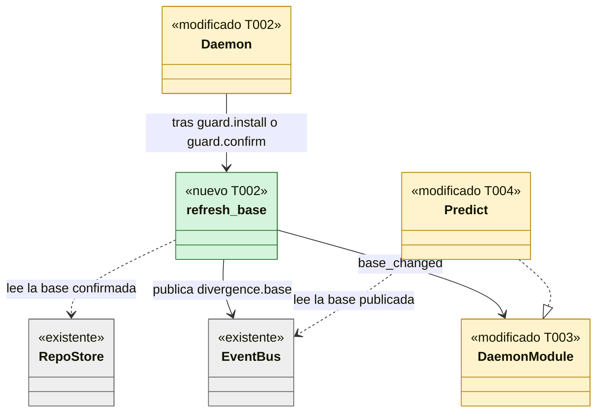
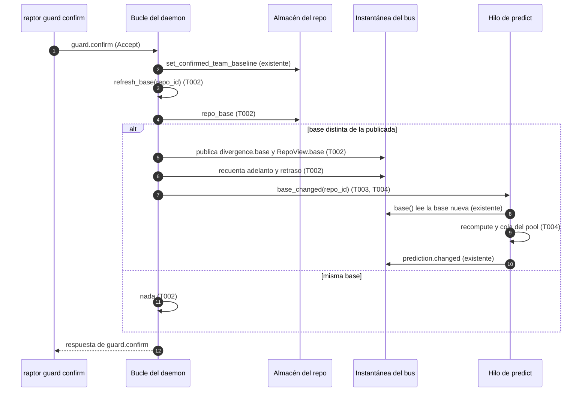
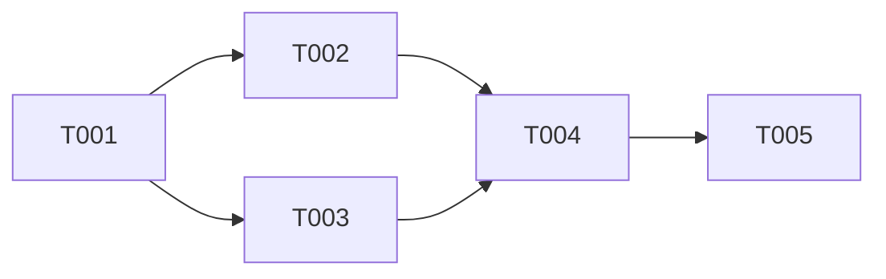

# DS-TS-CKP-011 · La base confirmada en runtime llega al predictor

## Contexto rápido

Al terminar, un desarrollador que confirma la rama base con el daemon en marcha (`raptor guard confirm` o `raptor guard install`) ve en la TUI el ⚡ o el ⚠ de cada worktree contra esa base, sin reiniciar el daemon. Hoy no puede: la confirmación solo escribe el almacén del repo (`crates/core/src/guardrails/confirm.rs:147`, `crates/core/src/guardrails/install.rs:1178`), la base publicada no cambia y el predictor lee la publicada (`crates/core/src/daemon/modules/predict.rs:480`), así que el par contra la base sigue `pending(base_unconfirmed)` (`crates/core/src/predict/pairs.rs:79`).

Para eso, la entrega monta tres piezas:

- un paso del bucle del daemon que, tras `guard.install` o `guard.confirm`, compara la base del almacén con la publicada y publica la nueva si cambió;
- un punto nuevo del trait de módulos, `base_changed(repo_id)`, llamado después de publicar;
- su implementación en el módulo `predict`, que marca el repo para recalcular.

Las decisiones son de la [TS-CKP-011](../technical-stories/TS-CKP-011-base-confirmada-replanifica.md). **Decisión del orquestador (2026-11-08), validada por Arquitecto**: avisa el bucle del daemon, no Guardrails, y el aviso va por el trait de módulos (ADR-GRP-016 § 5), no por un evento del canal.

| Término | Qué es aquí |
|---|---|
| Base publicada | `BaseBranch` que guarda la instantánea del bus en `divergence[repo_id].base` (`crates/core/src/channel/bus.rs:383`); la leen el recuento de adelanto y retraso y `Predict::base()` |
| Base del almacén | La que devuelve `repo_base` (`crates/core/src/daemon/mod.rs:1356`): la confirmada en `store_meta` o `main` sin confirmar |
| Par contra la base | El par `(worktree, None)` de `PairKey`: un worktree contra la rama base |
| Primera / segunda fase | Publicar sin leer Git / recontar el adelanto y retraso después (ADR-GRP-011 § 2, `crates/core/src/daemon/repos.rs:662`) |
| G-B | El hueco de la nota N4 de [DS-US-CKP-006](./US-CKP-006-conflictos-previstos.md) que esta entrega cierra |

---

## 📋 Índice

> **Para aprobar:** [Contexto rápido](#contexto-rápido) · [⚠️ Gaps](#gaps-y-violaciones-de-la-constitución) · [🔭 La forma](#la-forma) · [El trabajo de un vistazo](#el-trabajo-de-un-vistazo).
> **Para implementar:** [🚀 Plan](#plan-de-implementación), en orden. Las `_(ref)_` se abren desde la tarea que las cita.

| Sección | Propósito |
|---------|-----------|
| [Contexto rápido](#contexto-rápido) | Qué se construye y el glosario |
| [⚠️ Gaps y violaciones de la constitución](#gaps-y-violaciones-de-la-constitución) | Qué impide empezar |
| [🔭 La forma](#la-forma) | Piezas, cambios y flujo |
| [🚀 Plan de implementación](#plan-de-implementación) | T001…T005, en orden |
| ↳ [El trabajo de un vistazo](#el-trabajo-de-un-vistazo) | Tareas en tabla y su orden |
| [Estructura de ficheros](#estructura-de-ficheros) _(ref)_ | Árbol anotado de ficheros |
| [Contratos compartidos](#contratos-compartidos) _(ref)_ | Lo que dos devs resolverían distinto |
| [Contrato de API](#contrato-de-api) _(ref)_ | Endpoints · configuración · numéricos |
| [Modelo de datos](#modelo-de-datos) _(ref)_ | Tablas, migraciones |
| [Estrategia de pruebas y cobertura](#estrategia-de-pruebas-y-cobertura) _(ref)_ | Pirámide, umbrales, comportamientos críticos |
| [Gate de seguridad](#gate-de-seguridad) | Checklist pre-merge |
| [Fuera de alcance](#fuera-de-alcance) | Lo que esta entrega no toca |
| [Notas del autor](#notas-del-autor) _(ref)_ | Lo que no bloquea |

---

## ⚠️ Gaps y violaciones de la constitución

_No gaps. Ready to implement._

Lo que no bloquea nada va en [Notas del autor](#notas-del-autor), con su id `Gn`.

---

## 🔭 La forma

Al terminar, el bucle del daemon tiene un paso propio, `refresh_base`, que publica la base y avisa a los módulos; el trait de módulos gana un punto y el predictor lo atiende con un mensaje de su hilo.



El flujo de una confirmación:



---

## 🚀 Plan de implementación

> Orden topológico (`Depende:`). Una casilla se marca cuando su `Aceptación` está verificada. Las rutas son relativas a la raíz del repo.

### El trabajo de un vistazo

Dos frentes y un cierre: las pruebas en rojo (T001), el motor (T002 a T004) y la historia cerrada (T005).

| # | Tarea | Depende | Aterriza en |
|---|---|---|---|
| T001 | Escribir en rojo las pruebas del contrato | — | `crates/core/tests`, `apps/cli/tests` |
| T002 | Crear el paso `refresh_base` del bucle y llamarlo tras las peticiones de Guardrails | T001 | `crates/core/src/daemon` |
| T003 | Añadir el punto `base_changed` al trait de módulos | T001 | `crates/core/src/daemon/modules` |
| T004 | Replanificar el repo en el módulo `predict` al oír `base_changed` | T002, T003 | `crates/core/src/daemon/modules` |
| T005 | Cerrar la historia y enlazar US-CKP-006 | T004 | `docs/requirements/features/cockpit` |

### En qué orden

T002 y T003 van en paralelo; T004 las une.



### T001 — Escribir en rojo las pruebas del contrato

**Objetivo.** Las pruebas que fijan el comportamiento, en rojo antes de tocar el motor; los stubs compilan.

**Ubicación.**
- `crates/core/tests/ts_ckp_011_base_refresh.rs` (**CREATE**)
- `apps/cli/tests/tui_conflicts.rs` (**MODIFY**)

**Reglas**
- Las pruebas de `ts_ckp_011_base_refresh.rs` usan el daemon real en proceso, un perfil temporal y repos temporales, como `crates/core/tests/predict_publish.rs` (NFR-01); nunca este repo.
- El repo de prueba arranca **sin** base confirmada (sin `set_confirmed_team_baseline` antes de arrancar, a diferencia de `predict_publish.rs:168`).
- Ninguna espera fija: cada prueba espera la notificación `prediction.changed` que prueba el hecho, con plazo solo como techo.
- En `tui_conflicts.rs` se borra el atributo `#[ignore = "G-B: …"]` de `a_worktree_against_the_confirmed_base_shows_the_conflict` y nada más del test.
- Las pruebas nuevas van en su propio archivo; ninguna prueba existente cambia salvo el `#[ignore]`.

Pruebas de `ts_ckp_011_base_refresh.rs`:

| Prueba | Comprueba |
|---|---|
| `confirm_turns_the_base_pair_from_pending_to_current` | Tras `guard.confirm` (Accept sin ventana), el par `(wt-a, None)` pasa de `pending` a `calculating` y a `current` con `level` y `conflict_files` |
| `install_confirming_the_base_replans` | Igual con `guard.install` que confirma la base (`journal.confirms_base`) |
| `confirming_the_same_base_twice_publishes_once` | La segunda confirmación de la misma base no publica ningún `prediction.changed` del par contra la base |
| `a_new_base_replans_against_it_and_drops_late_results` | Confirmar otra rama como base deja el par calculado contra la rama nueva; ningún lote posterior trae el nivel calculado contra la anterior |
| `a_dormant_repo_replans_on_waking` | Con el repo dormido, la confirmación no publica cálculo; al volver a activo, el par sale `current` contra la base confirmada |

> **Nota técnica.** `guard.confirm` es un comando reservado: el cliente del desarrollador no puede ser descendiente del daemon. `crates/core/tests/us_grd_014_confirm_expired.rs` ya monta ese arnés (daemon en proceso hijo, cliente por `script`); se reutiliza su forma, no se inventa otra.

- **Depende:** —
- **Refs:** TS-CKP-011 § Plan de Verificación; US-CKP-006 escenario 3
- **Aceptación:** `cargo test -p gitraptor-core --test ts_ckp_011_base_refresh` compila y sus cinco pruebas fallan por el motivo esperado (el par sigue `pending`); el e2e de `tui_conflicts.rs` sin `#[ignore]` falla por plazo.

### T002 — Crear el paso `refresh_base` del bucle y llamarlo tras las peticiones de Guardrails

**Objetivo.** Publicar la base del almacén cuando difiere de la publicada y avisar a los módulos; sin cambio, nada.

**Ubicación.**
- `crates/core/src/daemon/base.rs` (**CREATE**)
- `crates/core/src/daemon/mod.rs` (**MODIFY**: una línea `mod base;`)
- `crates/core/src/daemon/guard.rs` (**MODIFY**: una llamada al final de `guard`)

**Pasos**
1. En `base.rs`, `impl Daemon { pub(super) fn refresh_base(&self, repo_id: &str) }`. Arma sus `Timings` como `repos.rs:162`: `batch_id: self.bus.next_batch()` y `clock::monotonic_ns()` como `t_recv`, `t_flush`, `t_computed` y `t_persisted` (el cambio no viene de un lote observado).
2. Leer `let base = repo_base(&self.stores, repo_id);` y la publicada, `self.bus.snapshot().1.divergence.get(repo_id)`. Sin entrada publicada (repo sin primera lectura): volver sin hacer nada.
3. Si `inputs.base == base`: volver sin publicar ni avisar.
4. Publicar con `self.publish_views(repo_id, <worktrees publicados>, DivergenceInputs { base: base.clone(), ..inputs }, Some(observe::base_view(&base)), Vec::new(), timings)`: los worktrees y las cabezas son los publicados; solo cambia la base.
5. Recontar con `self.publish_divergence(repo_id, timings)`.
6. Avisar con `self.modules.base_changed(repo_id)`, después de los dos pasos anteriores.
7. En `guard.rs`, justo antes de `self.protection_after(...)` (hoy `guard.rs:467`), llamar a `self.refresh_base(&entry.repo_id)` cuando la petición fue `GuardRequest::Install { .. }` o `GuardRequest::Confirm { .. }`. Se decide por la petición, no por la respuesta: la comparación del paso 3 hace inofensiva la llamada cuando nada se escribió.

> **Nota técnica.** `guard` corre en el bucle, que es el único escritor de los almacenes y de la instantánea (`guard.rs:47`); por eso la lectura del almacén y la publicación no necesitan más cerrojo que el de `publish_with`. El recuento usa `DivergenceCache` y `MAX_DIVERGENCE_WALK`, el mismo coste acotado que la segunda fase de un cambio observado.

- **Depende:** T001
- **Refs:** ADR-GRP-011 § 2 (dos fases); ADR-GRD-004 § 3.5 (la base es la confirmada); ADR-GRP-016 § 5; `extender-sin-archivos-compartidos.md` § Añadir un módulo del daemon, punto 3
- **Aceptación:** prueba unitaria en `base.rs` `same_base_publishes_nothing` (sin evento `worktree.state` ni aviso); con T003 y T004, `confirm_turns_the_base_pair_from_pending_to_current` y `confirming_the_same_base_twice_publishes_once` en verde.

### T003 — Añadir el punto `base_changed` al trait de módulos

**Objetivo.** Un punto nuevo con implementación vacía, repartido en el orden de `MODULES`.

**Ubicación.** `crates/core/src/daemon/modules/mod.rs` (**MODIFY**)

**Reglas**
- `fn base_changed(&self, _repo_id: &str) {}` en `DaemonModule`, documentado como "la base publicada del repo cambió; ya está en la instantánea".
- `Modules::base_changed(&self, repo_id: &str)` recorre los módulos en orden, como `git_event`.
- El registrador de la prueba `every_point_follows_the_registration_order` anota también `base_changed` y la prueba lo llama.
- Se llama desde un solo sitio del daemon: `refresh_base` (T002).

- **Depende:** T001
- **Refs:** ADR-GRP-016 § 5; `extender-sin-archivos-compartidos.md` § Añadir un módulo del daemon, punto 3
- **Aceptación:** `every_point_follows_the_registration_order` en verde con el punto nuevo.

### T004 — Replanificar el repo en el módulo `predict` al oír `base_changed`

**Objetivo.** El repo avisado se recalcula en el siguiente pase del hilo del predictor, leyendo la base ya publicada.

**Ubicación.** `crates/core/src/daemon/modules/predict.rs` (**MODIFY**)

**Reglas**
- Variante nueva `Msg::BaseChanged(String)`; `base_changed` del `impl DaemonModule for Predict` solo envía el mensaje (no bloquea el bucle).
- En `take`: si el repo está dormido, no hace nada; si no, `dirty.entry(repo_id).or_default()`. Sin rutas cambiadas: la prioridad la decide `priority` como en el cálculo inicial.
- El ahorro de energía no tiene caso propio: `recompute` ya lo difiere en `self.deferred` (`predict.rs:437`).
- Una ráfaga de avisos del mismo repo produce un solo `recompute`, por el diseño del bucle de `run` (`predict.rs:269`).
- No se lee el almacén ni Git fuera de `read_plan`: la base sale de `Predict::base()`.

> **Nota técnica.** El orden queda garantizado sin cerrojos nuevos: `refresh_base` publica antes de llamar a `base_changed`, en el mismo hilo, y `Predict::base()` lee la instantánea al recalcular, que es posterior al mensaje. Un resultado del pool calculado con la base anterior trae otro triple y `RepoPairs::complete` lo descarta (`crates/core/src/predict/state.rs:149`).

- **Depende:** T002, T003
- **Refs:** ADR-CKP-001 (pares contra la base); DS-TS-CKP-001 § Contrato de API (estados `pending`, `calculating`, `current`)
- **Aceptación:** las cinco pruebas de `ts_ckp_011_base_refresh.rs` y `a_worktree_against_the_confirmed_base_shows_the_conflict` en verde en macOS; `cargo clippy -p gitraptor-core` sin avisos.

### T005 — Cerrar la historia y enlazar US-CKP-006

**Objetivo.** La documentación dice que G-B está cerrado y dónde.

**Ubicación.**
- `docs/requirements/features/cockpit/technical-stories/TS-CKP-011-base-confirmada-replanifica.md` (**MODIFY**)
- `docs/requirements/features/cockpit/dev-specs/US-CKP-006-conflictos-previstos.md` (**MODIFY**)
- `docs/requirements/features/cockpit/user-stories/US-CKP-006-conflictos-previstos.md` (**MODIFY**)

**Reglas**
- TS-CKP-011 y esta Dev Spec pasan a `implemented` con el número de PR.
- En US-CKP-006, el escenario 3 deja de figurar como pendiente; el estado de la historia lo decide el orquestador al mergear.

- **Depende:** T004
- **Refs:** TS-CKP-011
- **Aceptación:** las tres fichas dicen `implemented` con el número de PR y la nota N4 de DS-US-CKP-006 enlaza el cierre; lo comprueba la revisión del PR.

---

## Estructura de ficheros

```
crates/core/src/daemon/
├── base.rs                 # CREATE T002: refresh_base y su prueba unitaria
├── guard.rs                # MODIFY T002: una llamada al final de guard()
├── mod.rs                  # MODIFY T002: mod base;
└── modules/
    ├── mod.rs              # MODIFY T003: punto base_changed + prueba de orden
    └── predict.rs          # MODIFY T004: Msg::BaseChanged
crates/core/tests/
└── ts_ckp_011_base_refresh.rs   # CREATE T001
apps/cli/tests/
└── tui_conflicts.rs        # MODIFY T001: quita el #[ignore] del escenario 3
```

---

## Contratos compartidos

### Tipos y datos compartidos

No hay tipos nuevos. Las piezas existentes que aparecen en § La forma:

| Pieza | Dónde | Qué hace aquí |
|---|---|---|
| `Daemon` | `crates/core/src/daemon/mod.rs` | El bucle que atiende `guard` y llama a `refresh_base` |
| `DaemonModule` | `crates/core/src/daemon/modules/mod.rs:26` | El trait que gana el punto `base_changed` |
| `Predict` | `crates/core/src/daemon/modules/predict.rs` | El módulo del predictor; su `base()` lee la base publicada |
| `EventBus` | `crates/core/src/channel/bus.rs` | La instantánea; `divergence[repo_id].base` es la base publicada |
| `RepoStore` | `crates/core/src/profile/store.rs` | El almacén del repo; `confirmed_team_baseline()` da la base confirmada |

Se reutilizan `BaseBranch` (`gitraptor_policy::team`), `observe::DivergenceInputs` y `observe::base_view`; la igualdad que decide la idempotencia es la de `BaseBranch` (`name` y `status`).

### Ciclos de vida (DI)

_No aplica — sin piezas nuevas con ciclo de vida._ `refresh_base` es un método del `Daemon` en el bucle; `Msg::BaseChanged` vive en el canal `mpsc` que el módulo `predict` ya tiene.

### Firmas del stack

```rust
// crates/core/src/daemon/base.rs
impl Daemon {
    pub(super) fn refresh_base(&self, repo_id: &str);
}

// crates/core/src/daemon/modules/mod.rs
pub(super) trait DaemonModule: Send {
    /// The repo's published base branch changed; the snapshot already holds it.
    fn base_changed(&self, _repo_id: &str) {}
}
impl Modules {
    pub(super) fn base_changed(&self, repo_id: &str);
}

// crates/core/src/daemon/modules/predict.rs
enum Msg { /* … */ BaseChanged(String), /* … */ }
```

---

## Contrato de API

Sin métodos, notificaciones ni capacidades nuevas en el canal. `prediction.changed` y la instantánea conservan la forma de [DS-TS-CKP-001 § Contrato de API](./TS-CKP-001-predictor-conflictos.md#contrato-de-api); lo nuevo es que el par contra la base cambia de estado tras confirmar.

### Forma del error y del cuerpo de respuesta

_No aplica — las respuestas de `guard.confirm` y `guard.install` no cambian._ Si la publicación falla, la confirmación ya está escrita y la respuesta es la misma: el refresco no convierte un `Applied` en error.

### Forma de la configuración

_No aplica — sin configuración nueva_ (no entra nada en `DaemonConfig`).

### Valores numéricos

| Valor | Cifra | De dónde |
|---|---|---|
| Lecturas del almacén por petición de Guardrails | 1 (`repo_base`) | T002 paso 2 |
| Publicaciones con la misma base | 0 | T002 paso 3 |
| Recálculos por ráfaga de avisos de un repo | 1 | `predict.rs:269` |
| Presupuesto del recuento | El de la segunda fase (ADR-GRP-011 § 2) | `repos.rs:738` |

---

## Modelo de datos

_No aplica — sin tablas ni claves nuevas._ La base confirmada sigue en las dos claves de `store_meta` de `crates/core/src/profile/team_baseline.rs`.

---

## Estrategia de pruebas y cobertura

### 9.1 Pirámide de pruebas

| Nivel | Qué | Dónde |
|---|---|---|
| Unitaria | Misma base no publica ni avisa | `crates/core/src/daemon/base.rs` |
| Unitaria | Orden del punto `base_changed` | `crates/core/src/daemon/modules/mod.rs` |
| Integración (daemon real en proceso) | Las cinco pruebas de T001 | `crates/core/tests/ts_ckp_011_base_refresh.rs` |
| Punta a punta (TUI real) | Escenario 3 de US-CKP-006 | `apps/cli/tests/tui_conflicts.rs` |

### 9.2 Umbrales de cobertura

Todas las ramas de `refresh_base` (sin publicada, misma base, base distinta) y las dos de `Msg::BaseChanged` (dormido, activo) las recorre al menos una prueba.

### 9.3 Datos de prueba

Repo temporal con `main` y un worktree `wt-a` (rama `a`) que cambia las mismas líneas que `main`, como `conflicting()` de `predict_publish.rs:184` pero sin base confirmada al arrancar; para la base que vuelve a cambiar, una segunda rama `develop` sin conflicto con `a`.

### 9.4 Comportamientos críticos verificados

- Confirmar la base con el daemon en marcha replanifica el par contra la base (escenario 3 de US-CKP-006).
- Idempotencia: la misma base no produce publicación ni recálculo.
- Un resultado tardío con la base anterior no llega a publicarse.
- Un repo dormido no se despierta por el aviso.
- NFR-01: ninguna prueba toca este repo; el motor no escribe en el repo observado.

### 9.5 Plataformas

macOS en local y en CI de Linux para la integración (`#![cfg(any(target_os = "macos", target_os = "linux"))]`, como `predict_publish.rs`). El e2e de la TUI corre donde ya corre `tui_conflicts.rs`. Windows queda pendiente de validar en máquina real.

---

## Gate de seguridad

- [ ] Sin escritura nueva en el repo observado ni lectura de Git fuera de `read_plan` y del recuento existente (ADR-GRP-009).
- [ ] La confirmación sigue escribiéndose solo por las vías de Guardrails existentes; `refresh_base` solo lee el almacén (ADR-GRD-004 § 3.5).
- [ ] Sin método, capacidad ni evento nuevo en el canal: la superficie del MCP no cambia (NFR-02).
- [ ] El log nuevo, si lo hay, lleva el repo como `Field::id`, nunca rutas ni nombres de rama en claro.

---

## Fuera de alcance

- Un evento del canal que lleve la base nueva: los clientes ven `RepoView.base` en la siguiente instantánea (`WorktreeStateData` no lleva base, `crates/api/src/messages.rs:497`).
- Desconfirmar la base: hoy ningún camino borra la confirmación (`team_baseline.rs` solo hace upsert). `refresh_base` trata cualquier cambio de base, incluida la vuelta a sin confirmar, y quien añada ese camino solo tiene que pasar por `guard`.
- La frescura visible del par y el aviso de conflicto nuevo (US-CKP-007, US-CKP-008).
- Cambiar `publish_observed_views`, que conserva la base publicada (`repos.rs:712`): con esta entrega la publicada ya es la del almacén.

---

## Notas del autor

| ID | Nota | Acción | Owner |
|----|------|--------|-------|
| N1 | Se descartó que Guardrails llame al predictor: `guardrails/` no conoce módulos del daemon y acoplaría dos features. También un evento interno del bus: el bus publica a clientes (ADR-GRP-013), y el reparto interno es el del trait de módulos (ADR-GRP-016 § 5) | Ninguna | — |
| N2 | El punto se llama `base_changed` y no `base_confirmed`: lo dispara cualquier cambio de la base publicada, también la que se confirme otra vez con otra rama | Ninguna | — |
| N3 | Que `RepoPairs::apply` encole el par que pasa de `pending(base_unconfirmed)` a calculable con el mismo tip de `main` se dedujo de `pairs.rs:79` y del triple ausente en estado pendiente; lo fija `confirm_turns_the_base_pair_from_pending_to_current` | Si falla, ajustar `apply` dentro de T004 | Implementador |
| N4 | Decisión del orquestador (2026-11-08), validada por Arquitecto | Ninguna | — |

## Estado

- Hecho: TS-CKP-011 (`ready`) y esta Dev Spec (`approved`), 2026-11-08.
- Siguiente paso: implementar T001 a T005 en una rama `feat/TS-CKP-011-base-confirmada-replanifica`.
