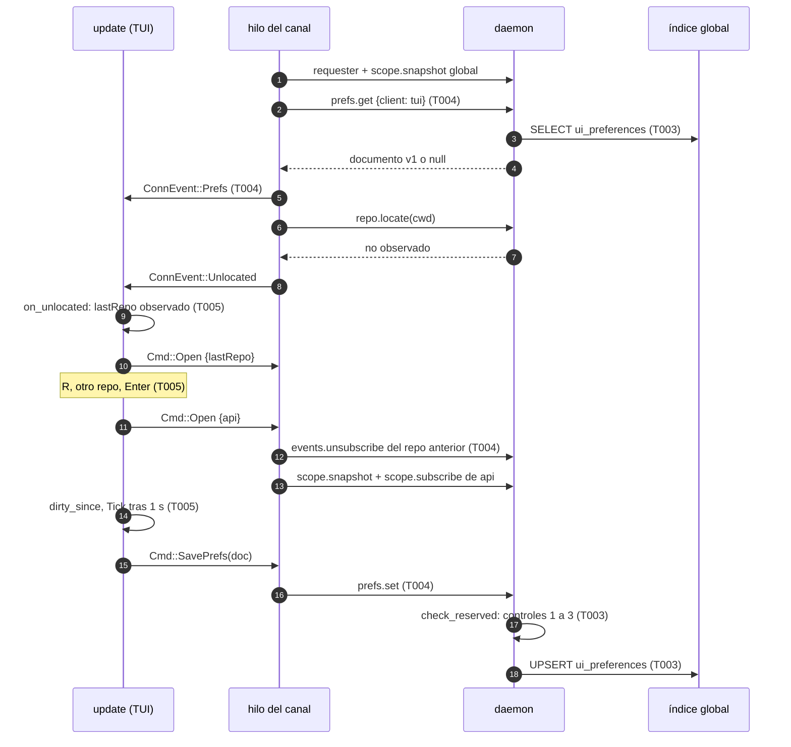
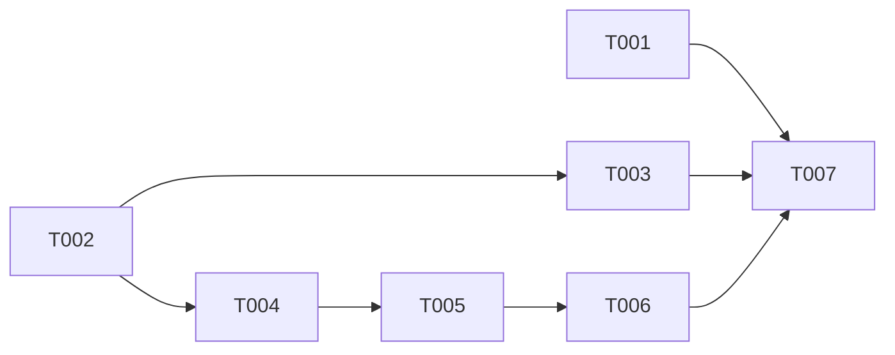

# DS-US-CKP-004 · Cambiar de repo y que la TUI recuerde cómo la dejó

## Contexto rápido

Al terminar, el desarrollador abre `raptor` en cualquier carpeta y la TUI muestra el repo de esa carpeta o, si no está en ninguno observado, el último que usó. Con `R` cambia a otro repo observado sin salir. El filtro "ver terminadas" (`f`, DS-US-CKP-002 D7) y la aprobación del editor (`editorApproved`, DS-US-CKP-013 K9) sobreviven al cierre. Todo se guarda en el perfil a través del daemon; el repo no se toca. Una TUI que el daemon no ve como la persona (lanzada por un agente, sin verificar o con un motor sin preferencias) trabaja con las preferencias en memoria y lo dice una vez.

Hoy:
- La TUI abre el repo del cwd (`repo.locate`, N4) o, si no está en ninguno, el único observado o el selector de arranque (`Pick::Choosing`, `tui/update.rs:269`). No hay forma de cambiar de repo con la TUI ya abierta.
- `LinkCmd::Open` (`client/mod.rs:357`) abre otro repo sin dar de baja la suscripción anterior. El daemon admite 4 suscripciones por conexión (`subscriptions_per_connection`, `crates/core/src/channel/mod.rs:76`) y compara con `>=` (`conn.rs:2507`). El ámbito global y el primer repo ya ocupan 2: con el selector en marcha, el tercer cambio respondería `LIMIT_REACHED`.
- `session` abre el repo del cwd antes que el elegido (`located.or_else(|| chosen.clone())`, `client/mod.rs:313`): tras una reconexión, la TUI volvería al repo de la carpeta y perdería el cambio hecho con el selector.
- `show_ended` vive en `Model.ui` y no se guarda (`model.rs:104`).
- No hay método de preferencias en `crates/api/src/methods/` ni tabla en el índice global (`crates/core/src/profile/schema.rs`). N9 está pendiente (ADR-CKP-003 § 4).
- El daemon ya aplica los controles 1 a 3 dentro del manejador de un método no reservado: `registration.register` llama a `check_reserved` (`channel/authz.rs:279`) y decide según el veredicto (`conn.rs:2219`).
- La cabecera cuenta ⚡ y ⛔ desde `RepoAttention` (N3, `model.rs:295`), que publica el motor, no desde las filas pintadas.

Sin `architecture-constitution.md` en la cascada (release-plan, fila 11): rigen [AGENTS.md](../../../../../AGENTS.md) y los ADR citados (NFR-01, NFR-02, protocolo congelado y extensión por módulo propio de ADR-GRP-016, la TUI no importa `gitraptor_core`, `gitraptor_git` ni `gitraptor_policy` de ADR-CKP-003 V5, único escritor del perfil de ADR-GRP-005 § 1). Ninguna tarea las viola.

### Decisiones

| ID | Decisión | Por qué / descartado |
|----|----------|----------------------|
| P1 | **Contrato N9 = módulo nuevo `prefs`** en `crates/api/src/methods/prefs.rs`: `method(PREFS_GET, false, false)` y `method(PREFS_SET, false, false)`. Ninguno es reservado y los dos quedan fuera del MCP. Sin capacidad: el cliente los descubre en `hello.methods`. Sin códigos nuevos: un documento inválido es `INVALID_PARAMS` con `data: PrefsRejected { reason }`; un solicitante que no pasa los controles, `RESERVED_REFUSED` con `RefusedData`. Los manejadores viven en `crates/core/src/channel/conn/prefs.rs`, como `conn/exception.rs`; en `conn.rs` solo quedan los dos brazos del dispatch | ADR-GRP-016, "Añadir un método": un módulo propio no toca archivos compartidos salvo las tres líneas de `methods/mod.rs` y los brazos del dispatch. Con `mcp = false` y sin `reserved`, una conexión MCP recibe "no encontrado" en el filtro de entrada (`conn.rs:798`). **Decisión del orquestador (2026-10-28), validada por Arquitecto y PO** |
| P2 | **`prefs.set` comprueba los controles 1 a 3 dentro de su manejador**: llama a `check_reserved(self.peer, &self.ctx.checks())` en cada petición, con el patrón de `registration.register` (`conn.rs:2219`). Con rechazo responde `RESERVED_REFUSED` y lo audita; una aceptación no se audita. No hay confirmación interactiva (control 4). ADR-GRP-005 no cambia: `prefs.set` no es un comando reservado, solo usa sus controles | Una preferencia no actúa sobre un repo ni sobre el motor, así que no entra en la lista de comandos reservados de ADR-GRP-005 § 6. Auditar cada aceptación, con un guardado por segundo como máximo, llenaría `reserved_audit` de filas sin valor. Coste: al no ser reservado, `prefs.set` no gasta el cubo de reservados (1/s, ráfaga 5) y cada petición recorre la ascendencia del proceso. Lo compensa el guardado ≤ 1/s de P9. Descartado: (a) declararlo `reserved = true` y verificar con `reserved_quiet`, que lo metería en la lista de reservados y obligaría a enmendar ADR-GRP-005; (b) comprobar solo el requester `Unattributed` en el daemon, que no mira la terminal de control ni el líder de sesión (control 3). **Decisión del orquestador (2026-10-28), validada por Arquitecto y PO** |
| P3 | **Almacén**: tabla `ui_preferences` del índice global, añadida al final de `INDEX_MIGRATIONS`, una fila por tipo de cliente (hoy solo `tui`). El documento se guarda como texto JSON en una sola sentencia (`INSERT … ON CONFLICT(client) DO UPDATE`). Gana la última escritura | ADR-GRP-006, Enmienda Cockpit: índice global, por usuario, escrito solo por el daemon. SQLite da la atomicidad: un corte deja el documento anterior o el nuevo, nunca uno a medias. **Decisión del orquestador (2026-10-28), validada por Arquitecto y PO** |
| P4 | **Esquema v1** (§ Forma de la configuración): `version`, `lastRepo`, `filters.showEnded` y `editorApproved`. `deny_unknown_fields` en todos los niveles y valor por defecto para cada campo ausente. Tope de 64 KiB del documento serializado y de 2 KiB para `editorApproved`. Ninguna clave del editor (`editor`, `editorKind`) ni `worktreePathTemplate`: el esquema no las admite y un test lo fija | ADR-GRP-006 (tope de 64 KiB, campos desconocidos rechazados), ADR-CKP-003 N9 y DS-US-CKP-013 § Enmiendas (`editorApproved` ≤ 2 KiB). **Panel y layout no entran en v1**: en `main` no hay ninguna elección de panel ni de layout que recordar (el grafo cede espacio solo, DS-US-CKP-022 D10; diff, historial y grafo a pantalla completa dependen de una fila). Guardar un campo que nadie escribe sería un contrato sin productor. Los añade la historia que cree esa elección (§ Cómo extender). BR-CKP-CONS-006 se enmienda en ese sentido (§ Enmiendas). **Decisión del orquestador (2026-10-28), validada por Arquitecto y PO** (Q-CKP-61, resuelta) |
| P5 | **El repo se guarda por su `repo_id`**, nunca por ruta. El daemon solo comprueba su forma (`valid_repo_id`, `conn.rs:4413`). Un `lastRepo` que ya no está entre los observados se ignora sin aviso y el siguiente guardado lo reemplaza | ADR-GRP-006 pide referenciar el repo "por su clave, nunca por ruta". La clave interna del índice (`key_path`) es una ruta canónica; el `repo_id` es el identificador estable que ya usa el canal (se conserva al reactivar un repo, `index.rs:278`). **Decisión del orquestador (2026-10-28), validada por Arquitecto y PO** |
| P6 | **Repo de arranque**, en este orden: (1) el repo observado del cwd (N4); (2) si el cwd está en un repo no observado, la pregunta de US-CKP-025; (3) `lastRepo`, si sigue observado; (4) el flujo actual: el único observado, el selector o la guía de primer repo. La decide `update::on_unlocated`, que es puro; el cliente manda las preferencias antes que `Unlocated` o `Unobserved` | Escenarios 1 y 2. Estar dentro de un repo no observado es una señal más fuerte que la última vista: la pregunta de US-CKP-025 sigue apareciendo y, si la respuesta es No, se abre `lastRepo`. Así se lee "vista recordada que gana" en el Fuera de alcance de DS-US-CKP-025: gana fuera de un repo, y en un repo no observado la pregunta va primero. La fórmula de BR-CKP-CONS-006 y la tabla de contratos de `user-stories.md` se corrigen así (T007). **Decisión del orquestador (2026-10-28), validada por Arquitecto y PO** (Q-CKP-62, resuelta) |
| P7 | **Selector con la TUI abierta: tecla `R`** (en y es). Abre el `RepoPicker` existente sobre la flota, con el repo actual seleccionado. Cada fila gana los recuentos ⚡ y ⛔ de su repo, tomados de `global.attention` (N3, `model.rs:282`); un recuento sin publicar se pinta "–", nunca 0 (BR-CKP-CALC-001). Hoy `RepoChoiceModel` solo tiene `name` y `path` (`widgets/repo_picker.rs:15`). `Enter` en otro repo lo abre; `Enter` en el actual o `Esc` cierran sin cambiar nada; `q` sale de la TUI. Solo en "En vivo" y con al menos un repo observado; si no, "tecla sin acción" con su motivo. Mientras está abierto, las flechas son suyas (DS-US-CKP-012 D10) | Escenario 3. Teclas ocupadas (DS-US-CKP-013 K13 y código): `a`, `c`, `d`, `D`, `e`, `f`, `g`, `j`, `k`, `m`, `n`, `o`, `q`, `r`, `s`, `t`, `u`, `w`, `x`, `y`, `?`. `R` se lee "Repo" en los dos idiomas. Descartado: `Tab`, que en las TUIs suele mover el foco entre paneles y quedaría bloqueado para eso. **Decisión del orquestador (2026-10-28), validada por Arquitecto y PO** (Q-CKP-63, resuelta) |
| P8 | **Cambio de repo en el hilo del canal**: `LinkCmd::Open` con un repo ya abierto da de baja su suscripción (`events.unsubscribe`, con el id que devolvió `scope.subscribe`) antes de la instantánea y la suscripción del nuevo. Al empezar cada sesión gana el repo elegido: `chosen.clone().or(located)` en lugar de `located.or_else(|| chosen.clone())` (`client/mod.rs:313`), así una reconexión mantiene el repo cambiado con el selector. En `update`, la instantánea de un `repo_id` distinto vacía el estado de vista ligado al repo con una sola función, `Ui::leave_repo` | ADR-CKP-003 § 4 ("baja de la suscripción del repo anterior"), que el cliente aún no cumple, y el límite de 4 suscripciones. `leave_repo` vacía hoy `colors` (DS-US-CKP-002 D4); el cursor de DS-012, el historial de DS-021 y el formulario de DS-018 añaden su línea ahí. **Decisión del orquestador (2026-10-28), validada por Arquitecto y PO** |
| P9 | **Cuándo se guarda**: un campo persistido cambia cuando llega la instantánea del repo abierto (`lastRepo`), con `f` (`showEnded`) y cuando DS-013 aprueba un argv (`editorApproved`). `update` marca `prefs.dirty_since = now_ms`; el primer `Tick` 1 s después emite `Cmd::SavePrefs(doc)`. Al salir, si queda algo sin guardar, `Cmd::SavePrefs` sale antes de `Cmd::Quit`, y el hilo del canal lo atiende antes del `Shutdown` porque la cola es FIFO. Un documento igual al último guardado o leído no se envía | ADR-CKP-003 § 10: rebote de 1 s y guardado al salir (⚠️ **ASSUMPTION** heredada). `update` sigue sin leer el reloj: usa `Model.now`. **Decisión del orquestador (2026-10-28), validada por Arquitecto y PO** |
| P10 | **Quién guarda** (L-05, escenario 5): `Model.ui.prefs.mode = Persist` solo si el requester del handshake es `Unattributed { layer: Cockpit }` y el daemon ofrece `prefs.set`. Si no, `MemoryOnly(why)` con `why` ∈ `Agent(nombre)`, `Unverified`, `NoEngineSupport`. La primera vez que cambia un campo persistido en `MemoryOnly`, una nota lo dice ("preferencias solo en esta sesión: actúas como claude-1"); después, nada. Si el daemon rechaza un `prefs.set` (`reserved-refused` o `invalid-params`), la TUI pasa a `MemoryOnly(Refused)`, lo dice una vez y no vuelve a intentarlo en esa ejecución. Una TUI en `MemoryOnly` **sí lee** las preferencias | Comprobarlo en la TUI es solo experiencia de uso: el daemon lo vuelve a decidir (P2). No reintentar tras un rechazo evita una fila de auditoría por segundo. Leer es inocuo: ningún campo da permisos y el filtro no puede ocultar alertas (P12). **Decisión del orquestador (2026-10-28), validada por Arquitecto y PO** |
| P11 | **Lectura una vez por ejecución**: `prefs.get` se pide en la primera sesión que llega a "En vivo". Una reconexión no lo repite, para no pisar cambios hechos en memoria con un documento más viejo. Un guardado que falla por conexión caída deja el documento sucio y se reintenta en el siguiente `Tick` en vivo. Un documento guardado que no pasa la validación (de otra versión o dañado) se trata como ausente: la TUI arranca con los valores por defecto, lo dice una vez y el siguiente guardado lo reemplaza | ADR-GRP-006: "si el perfil se pierde, la TUI arranca con los valores por defecto". Con varias TUIs gana la última escritura del documento entero (ADR-CKP-003 § 10). **Decisión del orquestador (2026-10-28), validada por Arquitecto y PO** |
| P12 | **Un filtro nunca oculta alertas**: la cabecera y el selector cuentan ⚡ y ⛔ desde `RepoAttention` (N3), nunca desde las filas visibles. Un test con `show_ended = false` y una sesión Terminada oculta en un worktree con ⚡ lo fija, y otro comprueba que `status_bar` no lee `ui.prefs` ni `ui.show_ended` | Escenario 6 y ADR-CKP-003 § 7 (L-05): una preferencia escrita por otro no puede esconder una alerta. Ya se cumple por construcción; el test evita que un filtro futuro lo rompa. **Decisión del orquestador (2026-10-28), validada por Arquitecto y PO** |
| P13 | **Los filtros son por usuario, no por repo**: `filters` es un solo objeto; activar "ver terminadas" en `shop` también lo activa en `api` | Un documento acotado sin un mapa por repo que crezca con cada repo observado. **Decisión del orquestador (2026-10-28), validada por Arquitecto y PO** (Q-CKP-64, resuelta) |

## ⚠️ Gaps y violaciones de la constitución

_No gaps. Ready to implement._ Lo informativo está en [Notas del autor](#notas-del-autor) (G1 a G5). Ninguna violación: sin constitución, ver Contexto rápido.

## 🔭 La forma



Con un requester que no es la persona, el paso del guardado no existe: `update` no emite `Cmd::SavePrefs` y pone la nota una vez (P10).

## 🚀 Plan de implementación

> Orden topológico (`Depende:`). Rutas relativas a la raíz del repo.

### El trabajo de un vistazo

| # | Tarea | Depende | Aterriza en |
|---|---|---|---|
| T001 | Escribir en rojo los tests de proceso (pty) de los seis escenarios | — | `apps/cli/tests/tui_prefs.rs` |
| T002 | Tipos y validación del documento v1 en el contrato | — | `crates/api/src/{prefs.rs,methods/prefs.rs}` |
| T003 | Tabla, lectura, escritura y métodos en el daemon | T002 | `crates/core/src/{profile/prefs.rs,profile/schema.rs,channel/conn/prefs.rs,channel/conn.rs}` |
| T004 | Leer y guardar preferencias y dar de baja el repo anterior en el hilo del canal | T002 | `apps/cli/src/client/mod.rs` |
| T005 | Preferencias en el modelo, arranque, selector `R` y guardado en `update` | T004 | `apps/cli/src/{model.rs,tui/update.rs,tui/keymap.rs,tui/app.rs}` |
| T006 | Textos en/es, pista de `R`, recuentos del selector y snapshots | T005 | `apps/cli/src/{present/i18n.rs,tui/view.rs,tui/help.rs,tui/widgets/repo_picker.rs}` |
| T007 | Cerrar la historia y la documentación | T001, T003, T006 | `docs` |

### En qué orden



### T001 — Escribir en rojo los tests de proceso (pty)

**Objetivo.** Los seis escenarios de la historia contra el `raptor` real bajo `script` (macOS), con el daemon real, perfil temporal y repos temporales.

**Ubicación.** `apps/cli/tests/tui_prefs.rs` (**CREATE**)

**Reglas**
- Mismo arnés que `tui_unobserved_repo.rs`: `GITRAPTOR_PROFILE_DIR` temporal, `GITRAPTOR_AGENT_EXECUTABLES=raptor-fake-agent`, el agente simulado como copia del binario de test (`tui_as_agent`) y la persona bajo `script`.
- Sin `sleep` fijos: se espera a un texto del pty con plazo y se escribe la tecla cuando aparece. Tras cerrar la TUI, se espera a que el proceso termine antes de volver a abrirla.
- Repos `shop` y `api`, los dos observados, creados con `gitraptor_testkit::Fixture`. Nunca este repo.
- Casos:
  - `opens_the_repo_of_the_folder` (escenario 1, en `api`);
  - `outside_any_repo_opens_the_last_one_used` (escenario 2: abrir en `shop`, salir, abrir desde una carpeta temporal fuera de los repos);
  - `the_picker_switches_to_the_other_repo_only` (escenario 3: `R`, elegir `api`, `Enter`; aparece el worktree de `api` y ningún nombre de worktree de `shop`);
  - `show_ended_survives_a_restart_and_the_repo_is_untouched` (escenario 4: con el cwd en `shop`, `f`, `q` y reabrir con el cwd otra vez en `shop`; la pista dice "f hide ended"; la sesión entera corre dentro de `gitraptor_testkit::control::check` sobre `shop` y `assert_intact()`);
  - `a_tui_opened_by_an_agent_saves_nothing_and_says_so_once` (escenario 5: `tui_as_agent`, `f` dos veces; la nota sale una vez; la persona reabre y `show_ended` sigue como estaba);
  - `a_filter_never_hides_the_alert_count` (escenario 6: con `show_ended` falso y una sesión Terminada en un worktree con ⚡ publicado, la cabecera muestra `⚡ 1`). Si el motor de la prueba aún no publica ⚡ (TS-CKP-001 en parte), el caso queda `#[ignore = "pendiente: el motor no publica ⚡ (TS-CKP-001)"]` y se anota como pendiente en § Estado de la implementación; la invariante la cubren los tests de `TestBackend` de T005.
- Los casos se commitean en rojo y compilan (sin `todo!()` en caminos de producción).

- **Depende:** —
- **Refs:** US-CKP-004, escenarios 1 a 6
- **Aceptación:** `cargo test -p gitraptor-cli --test tui_prefs` (en rojo al empezar, en verde al cerrar T006)

### T002 — Tipos y validación del documento v1 en el contrato

**Objetivo.** El documento de preferencias, su validación pura y el grupo de métodos `prefs`, compartidos por el daemon y la TUI.

**Ubicación.**
- `crates/api/src/prefs.rs` (**CREATE**)
- `crates/api/src/methods/prefs.rs` (**CREATE**)
- `crates/api/src/methods/mod.rs` (**MODIFY**: `mod prefs;`, `pub use prefs::*;`, `&prefs::GROUP` en `GROUPS`)
- `crates/api/src/lib.rs` (**MODIFY**: `pub mod prefs;`; no cambia `PROTOCOL_VERSION`)
- `crates/api/tests/prefs_schema.rs` (**CREATE**)

**Reglas**
- `methods/prefs.rs`: `PREFS_GET = "prefs.get"` con `method(PREFS_GET, false, false)` y `PREFS_SET = "prefs.set"` con `method(PREFS_SET, false, false)` (P2). Sin `.since(...)`, sin capacidades ni bloque de errores.
- `UiPrefs` con `#[serde(deny_unknown_fields, rename_all = "camelCase")]` en él y en cada estructura anidada, y `#[serde(default)]` en cada campo salvo `version`.
- `validate(&UiPrefs, raw_len: usize) -> Result<(), PrefsRejection>`, en este orden: `raw_len > MAX_PREFS_BYTES` → `TooLarge`; `version != 1` → `UnsupportedVersion`; `lastRepo` presente y con otra forma que `[0-9a-fA-F-]{1,64}` → `BadRepo`; `editorApproved` con 0 palabras, más de 32, una palabra vacía o con NUL, o más de `MAX_APPROVED_EDITOR_BYTES` sumando palabras y modo → `BadEditor`. Un error de `serde` (campo desconocido, tipo equivocado) se convierte en `UnknownField` o `BadShape` antes de llamar a `validate`.
- `parse(raw: &str) -> Result<UiPrefs, PrefsRejection>` mide `raw.len()`, deserializa y valida: es la única entrada que usan el daemon y la TUI.
- Las palabras de `editorApproved` viajan como `UntrustedName` (N6), igual que en DS-013 K7.

- **Depende:** —
- **Refs:** P1, P4, P5
- **Aceptación:** `cargo test -p gitraptor-api --test prefs_schema` y `cargo test -p gitraptor-api --test architecture` (el test de arquitectura confirma que `methods/mod.rs` no declara métodos y que el protocolo no sube)

### T003 — Tabla, lectura, escritura y métodos en el daemon

**Objetivo.** `prefs.get` devuelve el documento guardado o `null`; `prefs.set` lo valida, verifica al solicitante y lo guarda.

**Ubicación.**
- `crates/core/src/profile/schema.rs` (**MODIFY**: una migración nueva **al final** de `INDEX_MIGRATIONS`)
- `crates/core/src/profile/prefs.rs` (**CREATE**)
- `crates/core/src/profile/mod.rs` (**MODIFY**: `pub mod prefs;`)
- `crates/core/src/channel/conn/prefs.rs` (**CREATE**: los dos manejadores, como `conn/exception.rs`)
- `crates/core/src/channel/conn.rs` (**MODIFY**: solo `mod prefs;` y dos brazos en el `match` de dispatch, junto a los de `requester`)
- `crates/core/tests/us_ckp_004_prefs.rs` (**CREATE**)

**Reglas**
- Migración: `CREATE TABLE ui_preferences (client TEXT PRIMARY KEY CHECK (client = 'tui'), doc TEXT NOT NULL, updated_ms INTEGER NOT NULL);`. Append-only: nunca se edita una migración publicada (G1).
- `profile::prefs::load(index, client) -> Result<Option<String>>` y `save(index, client, doc: &str, now_ms) -> Result<()>`. `save` es un único `INSERT … ON CONFLICT(client) DO UPDATE`.
- `prefs.get {client: "tui"}`: otro `client` → `INVALID_PARAMS`. Con fila, se pasa por `gitraptor_api::prefs::parse`; si no pasa, la respuesta es `{ doc: null, unreadable: true }` y el log del daemon registra el motivo tipado, nunca el contenido. Sin fila, `{ doc: null, unreadable: false }`.
- `prefs.set {client: "tui", doc}`: (1) `check_reserved(self.peer, &self.ctx.checks())`, con el patrón de `registration.register` (`conn.rs:2219`); con `refused = Some(reason)`, se audita el rechazo (`AuditOutcome::Rejected`) y se responde `RESERVED_REFUSED` con `RefusedData { reason }`; una aceptación no se audita (P2); (2) `parse` del documento serializado; un rechazo → `INVALID_PARAMS` con `data: PrefsRejected { reason }`, sin tocar lo guardado; (3) `save`. Un fallo de SQLite → `INTERNAL_ERROR` con el texto fijo "preferences not saved", sin la ruta del perfil. La respuesta es `{ saved: true }`.
- `prefs.set` no gasta el cubo de reservados ni el de escrituras por solicitante: no es reservado ni escribe en un repo. El ritmo lo limita el guardado ≤ 1/s de la TUI (P9).
- Una conexión MCP no llega a los manejadores: `mcp = false` responde "no encontrado" en la entrada del dispatch.
- Ningún brazo nuevo lee ni escribe en un repo. `editorApproved` nunca se usa en el daemon.

- **Depende:** T002
- **Refs:** P1, P2, P3, P11; ADR-GRP-006, Enmienda Cockpit
- **Aceptación:** `cargo test -p gitraptor-core --test us_ckp_004_prefs` y `cargo test -p gitraptor-core --lib profile::prefs`

### T004 — Leer y guardar preferencias y dar de baja el repo anterior en el hilo del canal

**Objetivo.** El cliente lee las preferencias antes de decidir el repo, guarda cuando se lo piden y da de baja el repo anterior al cambiar.

**Ubicación.** `apps/cli/src/client/mod.rs` (**MODIFY**)

**Reglas**
- `Link` gana `fn offers(&self, _method: &str) -> bool { false }`; la implementación real usa `hello.methods` (`support::offers`).
- En `session`, tras enviar el requester y sincronizar el ámbito global, y **antes** de `locate`: si `!prefs_read && link.offers(PREFS_GET)`, llama a `prefs.get` y envía `ConnEvent::Prefs(PrefsLoad)`: `Loaded(UiPrefs)`, `Absent`, `Unreadable`. Pone `prefs_read = true` (vive en `run`, fuera de `session`, como `chosen`). Sin el método, envía `ConnEvent::Prefs(PrefsLoad::Unsupported)` una vez. Un error de transporte → `End::Reconnect`. Una respuesta que no se decodifica como `PrefsGetResult`, o un `doc` que no pasa `prefs::parse` en el cliente, es `PrefsLoad::Unreadable`, nunca `End::Reconnect`: unas preferencias dañadas no pueden impedir que la TUI conecte. El daemon solo devuelve campos que la conexión entiende: un campo nuevo irá detrás de su capacidad (§ Cómo extender).
- Al elegir el repo de la sesión gana el elegido: `chosen.clone().or(located)` sustituye a `located.or_else(|| chosen.clone())` (`client/mod.rs:313`, P8). `locate` se sigue pidiendo para la primera sesión, cuando `chosen` está vacío.
- `sync` devuelve el id de suscripción del ámbito repo; `session` lo guarda en `repo_sub: Option<u32>`. `LinkCmd::Open { repo_id }` con `repo_sub = Some(id)` y otro `repo_id` llama antes a `events.unsubscribe { subscription: id }`. Un `false` (ya no existía) se ignora; un error de transporte → `End::dropped(lagged)`. Un `Open` del repo ya abierto no hace nada.
- `LinkCmd::SavePrefs(UiPrefs)` → `call_refusal(PREFS_SET, …)`. `Ok` → `ConnEvent::PrefsSaved`. `Refusal::Engine` con `RESERVED_REFUSED` → `ConnEvent::PrefsRefused(PrefsRefusal::NotTheDeveloper)`; con `INVALID_PARAMS` → `PrefsRefusal::Rejected(reason)`; otro → `PrefsRefusal::Failed`. `Refusal::Link` → `ConnEvent::PrefsUnsent` y `End::dropped(lagged)`.
- Fuera de una sesión (reconectando), `SavePrefs` se descarta y se envía `ConnEvent::PrefsUnsent`; `update` lo deja sucio (P11). `Shutdown` sigue llegando después en la cola.

- **Depende:** T002
- **Refs:** P6, P8, P10, P11
- **Aceptación:** `cargo test -p gitraptor-cli --lib client::tests::prefs`, `cargo test -p gitraptor-cli --lib client::tests::switch_unsubscribes` y `cargo test -p gitraptor-cli --lib client::tests::a_reconnection_keeps_the_switched_repo`

### T005 — Preferencias en el modelo, arranque, selector `R` y guardado en `update`

**Objetivo.** `update` decide el repo de arranque, abre el selector con `R`, marca y emite el guardado y dice una vez cuándo no se guarda.

**Ubicación.**
- `apps/cli/src/model.rs` (**MODIFY**)
- `apps/cli/src/tui/update.rs` (**MODIFY**)
- `apps/cli/src/tui/keymap.rs` (**MODIFY**)
- `apps/cli/src/tui/app.rs` (**MODIFY**: `Cmd::SavePrefs` → `LinkCmd::SavePrefs`)

**Reglas**
- `ConnEvent::Prefs(load)`: `Loaded(doc)` → `ui.prefs.saved = Some(doc.clone())`, `ui.show_ended = doc.filters.show_ended`, `ui.prefs.last_repo = doc.last_repo`, `ui.prefs.editor_approved = doc.editor_approved`. `Unreadable` → valores por defecto y `Notice::PrefsUnreadable`. `Unsupported` → `mode = MemoryOnly(NoEngineSupport)`.
- `mode` se fija con `ConnEvent::Requester`: `Some(Unattributed { layer: Cockpit })` → `Persist` (salvo que ya sea `MemoryOnly(Refused | NoEngineSupport)`); `Agent { name, .. }` → `MemoryOnly(Agent(name))`; `Unverified`, `None` o capa `Mcp` sin agente → `MemoryOnly(Unverified)`.
- `on_unlocated`: si `ui.prefs.last_repo` está en `global.repos`, `Pick::Opening` y `Cmd::Open { repo_id }`. Si no, el flujo actual. `on_unobserved` no cambia: la pregunta sigue primero (P6) y el No acaba en `on_unlocated`.
- `Action::Repos` con `Key::Char('R')`, `is_hinted() == true`. Con `conn == Live`, `pick == Pick::None`, ayuda cerrada y al menos un repo → `Pick::Choosing { selected: índice del repo actual o 0 }` y `ui.picking_over = true`. En `Choosing` con `picking_over`: `Enter` sobre otro repo → `Pick::Opening` y `Cmd::Open`; sobre el actual, o `Esc` (`Action::Later`) → `Pick::None`. Sin `picking_over` (el selector de arranque), `Esc` sigue sin cerrar: no hay vista a la que volver. Fuera de esas condiciones, `R` responde `Notice::UnknownKey`.
- `on_snapshot` del ámbito repo con un `repo_id` distinto del actual → `ui.leave_repo()` (vacía `colors`), `picking_over = false`, y `touch(LastRepo)`.
- `touch(field)`: actualiza el campo en `ui.prefs` y, si el documento resultante difiere de `ui.prefs.saved`: con `Persist`, `dirty_since = Some(now_ms)` si estaba en `None`; con `MemoryOnly(why)` y `!ui.prefs.said`, `Notice::PrefsMemoryOnly(why)` y `said = true`. Lo llaman la instantánea de otro repo, `Action::ShowEnded` y el registro aprobado de DS-013 (G2).
- `Msg::Tick`: con `Persist`, `conn == Live` y `now_ms - dirty_since >= PREFS_DEBOUNCE_MS` → `Cmd::SavePrefs(doc)` y `in_flight = true` (un solo guardado en vuelo).
- `PrefsSaved` → `saved = Some(doc)`, `in_flight = false` y `dirty_since = None` si no cambió nada desde el envío; si cambió, `dirty_since = Some(now_ms)`. `PrefsUnsent` → `in_flight = false`, sigue sucio. `PrefsRefused(r)` → `mode = MemoryOnly(Refused)`, `Notice::PrefsRefused(r)` una vez, y nada más se guarda en esta ejecución.
- `Action::Quit`: con `Persist` y documento distinto de `saved`, devuelve `[Cmd::SavePrefs(doc), Cmd::Quit]`.
- Cobertura de P12: tests `header_counts_alerts_hidden_by_the_filter` y `status_bar_ignores_prefs_and_filters` sobre `TestBackend`.
- Cobertura de P6 y P13: `an_unobserved_repo_asks_even_with_a_last_repo` (con `last_repo = shop` y `ConnEvent::Unobserved`, sale la pregunta; con No, `Cmd::Open { shop }`) y `show_ended_is_per_user` (con `show_ended` activo, abrir `api` lo deja activo y el documento tiene un solo `filters`).

- **Depende:** T004
- **Refs:** P6, P7, P8, P9, P10, P11, P12, P13
- **Aceptación:** `cargo test -p gitraptor-cli --lib tui::update::tests::prefs` y `cargo test -p gitraptor-cli --lib tui::update::tests::picker`

### T006 — Textos en/es, pista de `R` y snapshots

**Objetivo.** Las notas de preferencias, la pista "R repos" y el selector sobre la flota, con snapshots en los dos idiomas.

**Ubicación.**
- `apps/cli/src/present/i18n.rs` (**MODIFY**)
- `apps/cli/src/tui/view.rs` (**MODIFY**)
- `apps/cli/src/tui/help.rs` (**MODIFY**)
- `apps/cli/src/tui/widgets/repo_picker.rs` (**MODIFY**: `RepoChoiceModel` gana `conflicts` y `denials`)
- `apps/cli/src/tui/snapshots/picker_over_fleet_80x24_{en,es}.snap` (**CREATE**)
- `apps/cli/src/tui/snapshots/prefs_memory_only_80x24_{en,es}.snap` (**CREATE**)

**Reglas**
- Textos en § Mensajes. El nombre del agente pasa por `SafeText` (SEC-12).
- La pista "R repos" sale en la barra solo con dos o más repos observados; en la ayuda `?` sale siempre, en el grupo de navegación.
- `RepoChoiceModel` gana `conflicts: Option<u32>` y `denials: Option<u32>`, que `view` toma de `global.attention` por `repo_id`. `None` se pinta "–", nunca 0 (BR-CKP-CALC-001); el selector de arranque usa el mismo widget y gana los mismos recuentos. Su título dice "Cambiar de repo" / "Switch repo" y la pista de `Esc` "volver" / "back".
- Colores solo por tokens semánticos. Las notas de preferencias usan el tono informativo, no el de error: no guardar no es un fallo del desarrollador.

- **Depende:** T005
- **Refs:** P7, P10, P11; DSYS-GRP-001 § 3 y § 5
- **Aceptación:** `cargo test -p gitraptor-cli --lib tui::view::tests::prefs` y `cargo test -p gitraptor-cli --lib present::i18n`

### T007 — Cerrar la historia y la documentación

**Objetivo.** La historia queda implementada y las enmiendas pendientes de § Enmiendas, aplicadas en sus documentos.

**Ubicación.**
- `docs/requirements/features/cockpit/user-stories/US-CKP-004-selector-repo-preferencias.md` (**MODIFY**)
- `docs/requirements/features/cockpit/dev-specs/US-CKP-004-selector-repo-preferencias.md` (**MODIFY**: § Estado de la implementación)
- `docs/architecture/decisions/ADR-CKP-003-arquitectura-tui.md` (**MODIFY**: enmienda de § 4 y § 10)
- `docs/architecture/decisions/ADR-GRP-006-perfil-ubicacion-almacenamiento.md` (**MODIFY**: enmienda de la sección Cockpit)
- `docs/requirements/features/cockpit/dev-specs/US-CKP-002-orden-atencion-terminadas.md` (**MODIFY**: D7)
- `docs/requirements/features/cockpit/dev-specs/US-CKP-013-abrir-en-editor.md` (**MODIFY**: G2, K13)
- `docs/requirements/features/cockpit/dev-specs/US-CKP-025-tui-repo-no-observado.md` (**MODIFY**: Fuera de alcance)

**Reglas**
- `status: implemented` en la historia y el PR en su sección de diseño. Linux y Windows, como pendiente de la etapa de validación multiplataforma (XP-61).
- Cada fila de § Enmiendas con estado "Pendiente (T007)" se aplica en su documento con una línea "Enmienda (fecha, US-CKP-004)" y pasa a "Aplicada". Las que ya dicen "Aplicada (2026-10-28)" no se tocan.
- Si el escenario 6 quedó `#[ignore]` (T001), § Estado de la implementación lo lista como pendiente, con TS-CKP-001 como dueño.

- **Depende:** T001, T003, T006
- **Refs:** § Enmiendas
- **Aceptación:** `cargo fmt --all --check`, `cargo clippy --all-targets -- -D warnings` y `cargo test --workspace` en verde

---

> Las secciones siguientes son de referencia.

## Estructura de ficheros

```text
crates/api/
├── src/prefs.rs                     ← CREATE  UiPrefs, validate, parse, PrefsRejection
├── src/methods/prefs.rs             ← CREATE  prefs.get, prefs.set
├── src/methods/mod.rs               ← MODIFY  3 líneas del módulo nuevo
├── src/lib.rs                       ← MODIFY  pub mod prefs
└── tests/prefs_schema.rs            ← CREATE
crates/core/
├── src/profile/schema.rs            ← MODIFY  migración ui_preferences (al final)
├── src/profile/prefs.rs             ← CREATE  load, save
├── src/profile/mod.rs               ← MODIFY
├── src/channel/conn.rs              ← MODIFY  mod prefs y los dos brazos del dispatch
├── src/channel/conn/prefs.rs        ← CREATE  manejadores de prefs.get y prefs.set
└── tests/us_ckp_004_prefs.rs        ← CREATE
apps/cli/
├── src/client/mod.rs                ← MODIFY  offers, prefs.get/set, repo_sub, unsubscribe
├── src/model.rs                     ← MODIFY  Ui.prefs, picking_over, leave_repo, ConnEvent, Cmd, Notice
├── src/present/i18n.rs              ← MODIFY  textos en/es
├── src/tui/app.rs                   ← MODIFY  Cmd::SavePrefs → LinkCmd::SavePrefs
├── src/tui/keymap.rs                ← MODIFY  Action::Repos, R
├── src/tui/update.rs                ← MODIFY  arranque, selector, touch, Tick, Quit
├── src/tui/view.rs                  ← MODIFY  selector sobre la flota, pista
├── src/tui/help.rs                  ← MODIFY  R en la ayuda
├── src/tui/widgets/repo_picker.rs   ← MODIFY  RepoChoiceModel.{conflicts, denials}
├── src/tui/snapshots/               ← CREATE  picker_over_fleet_*, prefs_memory_only_*
└── tests/tui_prefs.rs               ← CREATE
```

## Contratos compartidos

### Tipos y datos compartidos

```rust
// crates/api/src/prefs.rs (T002)
pub const PREFS_VERSION: u32 = 1;
pub const MAX_PREFS_BYTES: usize = 64 * 1024;
pub const MAX_APPROVED_EDITOR_BYTES: usize = 2 * 1024;
pub struct UiPrefs { pub version: u32, pub last_repo: Option<String>, pub filters: Filters,
                     pub editor_approved: Option<ApprovedEditorDoc> }
pub struct Filters { pub show_ended: bool }
pub struct ApprovedEditorDoc { pub words: Vec<UntrustedName>, pub mode: EditorModeDoc }
pub enum EditorModeDoc { Terminal, Gui }                       // "terminal" | "gui"
pub enum PrefsRejection { TooLarge, UnsupportedVersion, UnknownField, BadShape, BadRepo, BadEditor }
pub struct PrefsGetParams { pub client: PrefsClient }          // solo "tui"
pub struct PrefsGetResult { pub doc: Option<UiPrefs>, pub unreadable: bool }
pub struct PrefsSetParams { pub client: PrefsClient, pub doc: UiPrefs }
pub struct PrefsSetResult { pub saved: bool }
pub struct PrefsRejected { pub reason: PrefsRejection }        // data de INVALID_PARAMS

// apps/cli/src/model.rs (T005)
pub struct Prefs { pub mode: PrefsMode, pub saved: Option<UiPrefs>, pub last_repo: Option<String>,
                   pub editor_approved: Option<ApprovedEditorDoc>, pub dirty_since: Option<i64>,
                   pub in_flight: bool, pub said: bool }
pub enum PrefsMode { Persist, MemoryOnly(MemoryOnlyWhy) }
pub enum MemoryOnlyWhy { Agent(Option<SafeText>), Unverified, NoEngineSupport, Refused }
pub enum PrefsLoad { Loaded(UiPrefs), Absent, Unreadable, Unsupported }
pub enum PrefsRefusal { NotTheDeveloper, Rejected(PrefsRejection), Failed }
pub enum ConnEvent { /* … */ Prefs(PrefsLoad), PrefsSaved, PrefsUnsent, PrefsRefused(PrefsRefusal) }
pub enum Cmd { /* … */ SavePrefs(UiPrefs) }
pub enum Notice { /* … */ PrefsMemoryOnly(MemoryOnlyWhy), PrefsUnreadable, PrefsRefused(PrefsRefusal) }
pub struct Ui { /* … */ pub prefs: Prefs, pub picking_over: bool }
// apps/cli/src/client/mod.rs (T004)
pub enum LinkCmd { /* … */ SavePrefs(UiPrefs) }
```

### Ciclos de vida (DI)

- `Ui.prefs` vive toda la ejecución; se carga una vez (P11) y no se vacía al reconectar ni al cambiar de repo.
- `prefs_read` y `repo_sub` viven en el hilo del canal: el primero en `run`, el segundo en cada `session`.
- El documento guardado vive en `index.sqlite`; el daemon no lo cachea.

### Firmas del stack

```rust
// crates/api/src/prefs.rs (T002)
pub fn parse(raw: &str) -> Result<UiPrefs, PrefsRejection>;
pub fn validate(prefs: &UiPrefs, raw_len: usize) -> Result<(), PrefsRejection>;
impl Default for UiPrefs;                                     // version 1, todo vacío o falso

// crates/core/src/profile/prefs.rs (T003)
pub fn load(index: &GlobalIndex, client: &str) -> Result<Option<String>>;
pub fn save(index: &GlobalIndex, client: &str, doc: &str, now_ms: i64) -> Result<()>;

// apps/cli/src/model.rs (T005)
impl Ui { pub fn leave_repo(&mut self); }
impl Prefs { pub fn doc(&self, show_ended: bool) -> UiPrefs; }
pub const PREFS_DEBOUNCE_MS: i64 = 1_000;
```

## Contrato de API

| Método | Reservado | MCP | Parámetros | Respuesta |
|---|---|---|---|---|
| `prefs.get` | No | No | `{ "client": "tui" }` | `{ "doc": UiPrefs \| null, "unreadable": bool }` |
| `prefs.set` | No; controles 1 a 3 en el manejador (`check_reserved`, P2) | No | `{ "client": "tui", "doc": UiPrefs }` | `{ "saved": true }` |

Ninguno sube el protocolo ni pide capacidad: un cliente sin ellos en `hello.methods` trabaja como hoy (P10, `NoEngineSupport`).

### Forma del error y del cuerpo de respuesta

| Caso | Código | `data` | Lo que hace la TUI |
|---|---|---|---|
| Documento inválido | `INVALID_PARAMS` | `{ "reason": "too-large" \| "unsupported-version" \| "unknown-field" \| "bad-shape" \| "bad-repo" \| "bad-editor" }` | `MemoryOnly(Refused)`, nota una vez |
| El solicitante no pasa los controles 1 a 3 | `RESERVED_REFUSED` | `RefusedData { reason }` | `MemoryOnly(Refused)`, nota una vez |
| Conexión MCP | "no encontrado" (`mcp = false`) | — | No ocurre desde la TUI |
| Fallo del almacén | `INTERNAL_ERROR` | — | `MemoryOnly(Refused)`, nota "no se pudieron guardar" una vez |
| `client` distinto de `tui` | `INVALID_PARAMS` | — | No ocurre desde la TUI |

El texto del daemon nunca se muestra; la TUI pinta el motivo tipado (SEC-12).

### Forma de la configuración

Documento de preferencias v1, guardado en `ui_preferences.doc` del índice global. Nunca en la carpeta de configuración ni en el repo.

```json
{
  "version": 1,
  "lastRepo": "5f0c2a9e-3b1d-4c7a-9e21-0d4b8a6f1c33",
  "filters": { "showEnded": true },
  "editorApproved": { "words": ["code", "--wait"], "mode": "gui" }
}
```

| Campo | Tipo | Por defecto | Lo escribe |
|---|---|---|---|
| `version` | `1` | — (obligatorio) | La TUI |
| `lastRepo` | `repo_id` (`[0-9a-fA-F-]`, ≤ 64) o `null` | `null` | La instantánea del repo abierto (P9) |
| `filters.showEnded` | bool | `false` | `f` (DS-US-CKP-002 D7) |
| `editorApproved` | `{ words: [string] (1 a 32), mode: "terminal" \| "gui" }` ≤ 2 KiB, o `null` | `null` | La aprobación de DS-US-CKP-013 K9 |

Claves que el esquema rechaza siempre: cualquier otra, y en particular `editor`, `editorKind`, `worktreePathTemplate` y `cockpit`.

### Valores numéricos

| Valor | Cifra | Fuente |
|---|---|---|
| Tope del documento | 64 KiB | ADR-GRP-006, Enmienda Cockpit (⚠️ **ASSUMPTION** heredada) |
| Tope de `editorApproved` | 2 KiB | DS-US-CKP-013 K9 |
| Palabras de `editorApproved` | 1 a 32 | DS-US-CKP-013 K4 |
| Rebote del guardado | 1 s | ADR-CKP-003 § 10 (⚠️ **ASSUMPTION** heredada) |
| Suscripciones por conexión | 4 | `subscriptions_per_connection`, `channel/mod.rs:76` |
| Guardados por segundo | ≤ 1 (no gasta el cubo de reservados) | P2, P9 |

### Mensajes

| Clave (`Text`) | en | es |
|---|---|---|
| `KeyRepos` | `R repos` | `R repos` |
| `PickerSwitchTitle` | `Switch repo` | `Cambiar de repo` |
| `PrefsMemoryOnly(Agent(n))` | `preferences kept for this session only: acting as {n}` | `preferencias solo en esta sesión: actúas como {n}` |
| `PrefsMemoryOnly(Unverified)` | `preferences kept for this session only: the engine could not verify it is you` | `preferencias solo en esta sesión: el motor no pudo verificar que eres tú` |
| `PrefsMemoryOnly(NoEngineSupport)` | `preferences kept for this session only: restart the engine to save them` | `preferencias solo en esta sesión: reinicia el motor para guardarlas` |
| `PrefsRefused(NotTheDeveloper)` | `preferences not saved: only you can save them, from your terminal` | `preferencias no guardadas: solo tú puedes guardarlas, desde tu terminal` |
| `PrefsRefused(Rejected(_))` / `Failed` | `preferences not saved: the engine did not accept them` | `preferencias no guardadas: el motor no las aceptó` |
| `PrefsUnreadable` | `saved preferences could not be read: using the defaults` | `no se pudieron leer las preferencias guardadas: se usan las de por defecto` |

## Modelo de datos

```sql
-- INDEX_MIGRATIONS, entrada nueva al final (T003)
CREATE TABLE ui_preferences (
    client     TEXT PRIMARY KEY CHECK (client = 'tui'),
    doc        TEXT NOT NULL,
    updated_ms INTEGER NOT NULL
);
```

Solo metadatos de la interfaz (NFR-03): un id de repo, un booleano y un argv que el desarrollador aprobó. Ni rutas de repo, ni contenido, ni el texto de una alerta.

## Estrategia de pruebas y cobertura

### 9.1 Pirámide de pruebas

| Nivel | Dónde | Qué |
|---|---|---|
| Unit | `crates/api/tests/prefs_schema.rs`, `profile::prefs`, `client::tests`, `tui::update::tests`, `tui::view::tests` | Esquema, almacén, canal, arranque, selector, guardado, textos |
| Integración (daemon) | `crates/core/tests/us_ckp_004_prefs.rs` | Métodos reales, controles 1 a 3, MCP, auditoría |
| E2E (pty) | `apps/cli/tests/tui_prefs.rs` | Los seis escenarios, con el daemon real |
| Snapshots | `apps/cli/src/tui/snapshots/` | Selector sobre la flota y nota en/es |

### 9.2 Umbrales de cobertura

Cada regla de `validate`, cada rama de `PrefsMode` y cada paso del orden de arranque (P6) con su test. Sin cifra de cobertura de líneas en el repo.

### 9.3 Datos de prueba

`gitraptor_testkit::Fixture` con `shop` (worktree `feat-pagos`, con una sesión Terminada de `raptor-fake-agent` "claude-1") y `api` (worktree `feat-login`). Perfil temporal por `GITRAPTOR_PROFILE_DIR` (solo en debug). Nunca este repo ni el perfil real (NFR-01).

### 9.4 Comportamientos críticos verificados

| Escenario | Test |
|---|---|
| 1. Arranca en el repo del directorio actual | `tui_prefs::opens_the_repo_of_the_folder`; `update::tests::prefs::the_folder_wins_over_the_last_repo` |
| 2. Fuera de un repo, el último usado | `tui_prefs::outside_any_repo_opens_the_last_one_used`; `update::tests::prefs::{a_retired_last_repo_falls_to_the_picker, no_to_the_question_opens_the_last_repo, an_unobserved_repo_asks_even_with_a_last_repo}` |
| 3. El selector cambia de repo | `tui_prefs::the_picker_switches_to_the_other_repo_only`; `client::tests::{switch_unsubscribes, a_reconnection_keeps_the_switched_repo}`; `update::tests::picker::{esc_goes_back, enter_on_the_current_repo_changes_nothing, three_switches_never_hit_the_subscription_limit}` |
| 4. Sobreviven y no tocan el repo | `tui_prefs::show_ended_survives_a_restart_and_the_repo_is_untouched` (cwd en `shop` al reabrir; `control::check`, `assert_intact`); `update::tests::prefs::show_ended_is_per_user` |
| 5. Una TUI de agente no guarda | `tui_prefs::a_tui_opened_by_an_agent_saves_nothing_and_says_so_once`; `us_ckp_004_prefs::an_agent_child_is_refused_and_the_stored_doc_is_unchanged`; `update::tests::prefs::memory_only_says_it_once` |
| 6. Un filtro no oculta alertas | `tui_prefs::a_filter_never_hides_the_alert_count` (`#[ignore]` y pendiente mientras el motor no publique ⚡, T001); `view::tests::prefs::{header_counts_alerts_hidden_by_the_filter, status_bar_ignores_prefs_and_filters, picker_counts_come_from_attention_and_unpublished_is_a_dash}` |

Además:
- `prefs_schema::{unknown_field_is_rejected, editor_keys_are_rejected, version_2_is_rejected, over_64_kib_is_rejected, editor_approved_over_2_kib_is_rejected, missing_fields_take_defaults, bad_repo_id_is_rejected}`.
- `us_ckp_004_prefs::{get_without_a_row_is_null, set_then_get_round_trips, a_rejected_doc_leaves_the_stored_one, an_mcp_connection_gets_not_found, prefs_are_not_reserved_commands, only_refusals_are_audited, an_unreadable_row_reads_as_null}`.
- `client::tests::prefs::an_undecodable_answer_is_unreadable_and_keeps_the_session`.
- `update::tests::prefs::{nothing_is_saved_when_nothing_changed, the_save_waits_one_second, quit_saves_what_is_pending, a_refusal_stops_saving_for_the_run, a_reconnection_does_not_reload}`.

### 9.5 Plataformas

Se ejecuta en macOS. Linux y Windows: **Pendiente: etapa de validación multiplataforma** ([`xplat-pendientes.md`](../../../../architecture/xplat-pendientes.md)). Lo que cambia por plataforma son los controles 1 a 3 (`channel/authz.rs:262-275`). En Windows `TERMINAL_PROOF` ya está activo, pero `ORPHANS_MARKED` no; lo esperable es que la TUI de la persona no pueda guardar y lo diga una vez, pero la rama exacta se valida en la máquina Windows (XP-61), no se da por hecha aquí.

## Gate de seguridad

- [ ] **L-05, escritura**: el manejador de `prefs.set` aplica los controles 1 a 3 (`check_reserved`) en cada petición; la decisión de la TUI (P10) es solo de experiencia. Un hijo del agente simulado no cambia lo guardado.
- [ ] **L-05, alertas**: la cabecera y el selector cuentan ⚡ y ⛔ desde N3; ningún campo del documento puede ocultarlas (P12).
- [ ] **NFR-02, MCP**: `prefs.*` fuera de la allowlist del MCP; una conexión MCP recibe "no encontrado" en los dos métodos.
- [ ] **Validación y tamaño**: `deny_unknown_fields`, versión exacta, forma del `repo_id`, topes de 64 KiB y 2 KiB, en el daemon antes de escribir. Las claves del editor y de la plantilla de worktrees no caben en el esquema.
- [ ] **Sin shell**: ningún brazo lanza procesos. `editorApproved` es un dato que solo compara la TUI (DS-013 K9) y nunca se ejecuta tal cual: el argv que se lanza sale de la resolución N10 y se revalida (K7).
- [ ] **Texto no confiable**: las palabras de `editorApproved` viajan como `UntrustedName` y se pintan como `SafeText`. El daemon no registra el contenido del documento, solo el motivo tipado.
- [ ] **NFR-01**: nada se escribe en un repo; el escenario 4 corre dentro de `control::check`.
- [ ] **Fronteras (ADR-CKP-003 V5)**: la TUI no importa `gitraptor_core`; `tests/tui_boundaries.rs` sigue en verde.

## Cómo extender

- **Un campo nuevo** (el panel o el layout, cuando una historia cree esa elección): campo opcional con valor por defecto en `UiPrefs` y una capacidad `prefs.<campo>` en `methods/prefs.rs` (ADR-GRP-016, "Añadir una capacidad"). La TUI solo lo envía si la conexión la tiene; si no, lo mantiene en memoria. `version` no sube.
- **Un cambio incompatible**: `version: 2` y su capacidad; el daemon conserva la lectura de v1.
- **Otro tipo de cliente** (Fase 3): otro valor de `client` en el `CHECK` y en `PrefsClient`, con su propio documento.

## Enmiendas

Cada fila dice si ya está aplicada o si la aplica T007. Todas son **Decisión del orquestador (2026-10-28), validada por Arquitecto y PO**.

| Fecha | Origen | Qué cambia | Estado | Ids |
|---|---|---|---|---|
| 2026-10-28 | DS-US-CKP-013 § Enmiendas que implica (línea de DS-US-CKP-004) | El documento de N9 incluye `editorApproved: { words: [string], mode: "terminal" \| "gui" }` (≤ 2 KiB), escrito solo por un "sin atribuir" que pasa los controles 1 a 3; nunca `cockpit.editor` ni `cockpit.editorKind` | Aplicada (2026-10-28) en esta DS: P4, § Forma de la configuración | DS-US-CKP-013 K9, G2 |
| 2026-10-28 | PO, Q-CKP-61 | BR-CKP-CONS-006: panel y layout quedan diferidos hasta la historia que cree esa elección; v1 recuerda repo, filtros y aprobación del editor | Aplicada (2026-10-28) en `business-rules.md` | BR-CKP-CONS-006 |
| 2026-10-28 | PO, Q-CKP-62 | Fórmula de arranque de BR-CKP-CONS-006: `repo del cwd observado → (cwd no observado: pregunta US-CKP-025; con No) → último usado si sigue observado → flujo actual` | Aplicada (2026-10-28) en `business-rules.md` | BR-CKP-CONS-006, P6 |
| 2026-10-28 | PO, Q-CKP-62 | Tabla de contratos de `user-stories.md`: "la vista recordada gana fuera de un repo; en un repo no observado la pregunta va primero"; el estado de US-CKP-004 en el índice enlaza esta DS | Aplicada (2026-10-28) en `user-stories.md` | US-CKP-025, US-CKP-004 |
| 2026-10-28 | PO, Q-CKP-61 | US-CKP-004: la descripción deja de prometer "panel"; el frontmatter `rules` pasa a BR-CKP-CONS-006 | Aplicada (2026-10-28) en la historia | US-CKP-004 |
| 2026-10-28 | Esta DS | DS-US-CKP-013 G2 se cierra cuando las dos historias estén en `main`: el `ApprovalStore` de DS-013 T006 lee y escribe `Ui.prefs.editor_approved` y llama a `touch(EditorApproved)`. La segunda en entrar conecta las dos (G2 de esta DS). `decide` no cambia | Pendiente (T007) | DS-US-CKP-013 G2, T006, § Cómo extender |
| 2026-10-28 | Esta DS | DS-US-CKP-013 K9 "Una TUI cuyo solicitante no puede guardar preferencias lo aprueba solo en memoria" = `PrefsMode::MemoryOnly` de P10, con la misma nota una vez | Pendiente (T007) | DS-US-CKP-013 K9 |
| 2026-10-28 | Esta DS | ADR-CKP-003 § 4 N9: aplicado como `prefs.get` y `prefs.set`, sin método reservado (P1, P2). § 4, "Cambio de repo": la baja de la suscripción anterior se aplica aquí y una reconexión mantiene el repo elegido (P8) | Pendiente (T007) | ADR-CKP-003 |
| 2026-10-28 | Revisión independiente | ADR-CKP-003 § 10: "Al arrancar se usa el repo del directorio actual (N4) o, si no, el último usado" pasa a la fórmula de P6 (con la pregunta de US-CKP-025 antes del último usado); panel y layout fuera de v1 (P4); la lectura, una vez por ejecución (P11) | Pendiente (T007) | ADR-CKP-003 § 10 |
| 2026-10-28 | Esta DS | ADR-GRP-006, Enmienda Cockpit: el dueño del contrato pasa de "worker del canal (TS-GRP-004)" a US-CKP-004; "por su clave" se concreta como el `repo_id` del índice (P5); panel y layout, como en ADR-CKP-003 | Pendiente (T007) | ADR-GRP-006 |
| 2026-10-28 | Esta DS | DS-US-CKP-002 D7: "no se guarda entre ejecuciones" pasa a "se guarda en las preferencias (DS-US-CKP-004), por usuario"; su Fuera de alcance "Recordar el filtro" se cierra | Pendiente (T007) | DS-US-CKP-002 D7 |
| 2026-10-28 | Esta DS | DS-US-CKP-025 Fuera de alcance, "Vista recordada que gana sobre esta historia": gana fuera de un repo; en un repo no observado la pregunta va primero y con No se abre `lastRepo` (P6) | Pendiente (T007) | DS-US-CKP-025 |
| 2026-10-28 | Esta DS | La lista común de teclas (DS-US-CKP-013 K13) añade `R` (selector de repo) | Pendiente (T007) | DS-US-CKP-013 K13, DS-US-CKP-017 X12 |

ADR-GRP-005 no cambia: `prefs.set` no es un comando reservado y solo usa sus controles 1 a 3 desde el manejador (P2).

## Fuera de alcance

| Ítem / no-objetivo | Historia que lo cubre | Gate (cómo se verifica) |
|---|---|---|
| Recordar panel y layout | La historia que cree una elección de panel o layout (Q-CKP-61) | `UiPrefs` no tiene esos campos |
| Un flag `--repo` que gane sobre las preferencias | — (no existe ningún flag de repo en `commands/tui.rs`) | — |
| Preferencias por repo (un filtro distinto en cada uno) | — (v1 es por usuario) | `filters` es un solo objeto |
| Vista multi-repo | Fuera del MVP (Q-CKP-1) | — |
| Registro del KPI (US-CKP-010) | US-CKP-010, en el almacén por repo (ADR-GRP-006), no en N9 | — |

## Notas del autor

| ID | Nota | Acción | Owner |
|----|------|--------|-------|
| G1 | `INDEX_MIGRATIONS` es append-only y compartido: otra historia que añada una migración en paralelo choca al rebasar | Rebasar y reordenar la entrada nueva al final | Orquestador |
| G2 | DS-US-CKP-013 aún no está en `main`: hasta entonces `editorApproved` se lee y se guarda tal como llega, pero nada lo produce | La segunda historia en entrar conecta `ApprovalStore` con `Ui.prefs` (§ Enmiendas) | Orquestador |
| G3 | Con varias TUIs abiertas gana la última escritura del documento entero: una TUI que solo cambió el filtro puede pisar el `editorApproved` que otra acaba de aprobar. La consecuencia es una confirmación de más en el siguiente `e` | Ninguna en el MVP (ADR-CKP-003 § 10) | — |
| G4 | Solo se verifica en macOS; Linux y Windows siguen la etapa de validación multiplataforma | XP-61 en `xplat-pendientes.md` | Rene |
| G5 | El guardado al salir espera la respuesta del daemon con el plazo normal de una llamada; con el motor colgado, la salida tarda ese plazo | Ninguna | — |

### Preguntas abiertas

| ID | Pregunta | Para |
|----|----------|------|
| ~~Q-CKP-61~~ | ~~¿Basta v1 sin panel ni layout para cerrar BR-CKP-CONS-006 en el MVP?~~ **Resuelta.** Sí: panel y layout quedan diferidos hasta la historia que cree esa elección (P4, § Enmiendas). **Decisión del orquestador (2026-10-28), validada por Arquitecto y PO** | PO |
| ~~Q-CKP-62~~ | ~~En un repo no observado, ¿la pregunta de US-CKP-025 va antes que el último usado?~~ **Resuelta.** Sí, P6 es correcto; se corrigen la fórmula de BR-CKP-CONS-006 y la tabla de contratos de `user-stories.md` (§ Enmiendas). **Decisión del orquestador (2026-10-28), validada por Arquitecto y PO** | PO |
| ~~Q-CKP-63~~ | ~~¿La tecla `R` para el selector con la TUI abierta?~~ **Resuelta.** Aceptada (P7). **Decisión del orquestador (2026-10-28), validada por Arquitecto y PO** | PO |
| ~~Q-CKP-64~~ | ~~¿El filtro por usuario y no por repo?~~ **Resuelta.** Aceptado (P13). **Decisión del orquestador (2026-10-28), validada por Arquitecto y PO** | PO |
