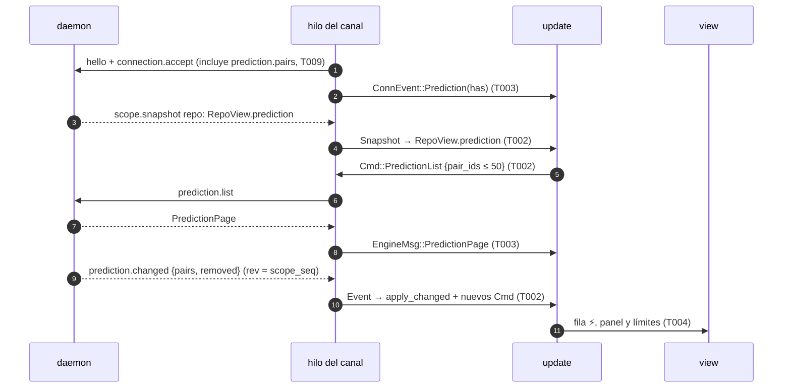

# DS-US-CKP-006 · La TUI muestra qué agentes van a chocar antes del merge

## Contexto rápido

Al terminar, la TUI pinta la predicción que publica el daemon (TS-CKP-001): un panel de conflictos bajo la flota con cada par ⚡ (archivo y rangos de líneas por lado) y ⚠ (archivos en común), ⚡ primero, y al pie la línea de límites. Cada fila con un ⚡ conocido lleva el símbolo y sube a la zona de atención por el orden que ya existe (DS-US-CKP-002 D2). Con `?`, la ayuda da el texto completo de los límites. Hoy `AgentRowModel.conflict` está fijo a `false` (`apps/cli/src/tui/view.rs:518`) y ningún método ni evento del predictor llega a la TUI.

La TUI no calcula nada. Lee `RepoView.prediction` de la instantánea, aplica `prediction.changed` del ámbito repo y pide con `prediction.list` el detalle de los pares que muestra. No inventa pares: un par que el motor no publica no existe (P7).

**Decisiones del orquestador (2026-10-27).** Están incorporadas en las reglas de cada tarea.

- **A1** (validada por Arquitecto): la forma del contrato vive en [DS-TS-CKP-001 § Contrato de API](./TS-CKP-001-predictor-conflictos.md#contrato-de-api). Esta DS solo la consume, con los nombres de esa sección.
- **A2** (validada por Arquitecto): capacidad `prediction.pairs`, `PredictionSummary`, `PairSummary` con `rev`, `pair_id` determinista, evento `prediction.changed {pairs, removed}`, método `prediction.list` (≤ 50 `pair_ids`) y la regla de `rev`: el detalle se muestra solo si su `rev` es igual al del resumen; si es mayor, se espera el evento; si es menor, se descarta. `level` solo existe en `current` y `recalculating`.
- **A4** (validada por Arquitecto): la antigüedad es de DS-US-CKP-007. Aquí solo se guardan `state`, `computed_at_utc_ms` y `rev`.
- **P2** (validada por PO): el panel lista ⚡ y ⚠, con ⚡ primero. Los agregados por estado son de DS-US-CKP-007.
- **P3** (validada por PO): línea corta de límites siempre visible al pie, que cabe en 80×24 y se pliega a ASCII; con `?`, el texto de los 8 `LimitCode`, incluido "Sin ⚡ el merge aún puede tener conflictos".
- **P5** (validada por PO): el nombre de cada lado es el que encabeza su fila (BR-CKP-WF-001); contra la base, el nombre de la rama base. `↔` con fallback `<->`.
- **P7** (validada por PO): solo el motor excluye pares; la TUI no inventa filas.

**Decisiones del Arquitecto como autor de la Dev Spec (2026-10-27).**

| ID | Decisión | Por qué |
|----|----------|---------|
| AD1 | Los textos van en un catálogo tipado propio, `apps/cli/src/present/prediction_text.rs` (`PredictionText`, `render(self, lang: Lang)` con `match` exhaustivo en/es, `every()` para el test de los dos idiomas), registrado con una línea en `present/mod.rs`. La vista lo pinta con `say.glyphs.fold(&t.render(say.lang))`, el mismo plegado que `Say::text` (`view.rs:60`). Es el patrón de las tres DS de la predicción: DS-US-CKP-007 usa `present/freshness_text.rs` y DS-US-CKP-008 `present/conflict_alert_text.rs` | `present/i18n.rs` es un archivo compartido (ADR-GRP-016). Los `.txt` de `apps/cli/i18n/` no son tipados y su lector (`apps/cli/src/i18n.rs`) es un módulo del binario (`main.rs:8`), fuera de la librería donde vive la TUI |
| AD2 | El modelo y sus reglas viven en `apps/cli/src/tui/prediction.rs`. `update.rs` solo despacha y `RepoView` gana un campo | Así lo que cambian DS-US-CKP-007 y DS-US-CKP-008 queda en un archivo propio |
| AD3 | Se pide el detalle de todos los pares ⚡/⚠ en `current` o `recalculating` cuyo detalle no tenga su `rev`, con ⚡ primero, en lotes de 50 y con una sola petición en vuelo por par. Un detalle con `rev` mayor se guarda aparte (`early`) y se adopta cuando el resumen llega a ese `rev` | Son los que el panel lista (≤ 55 pares, ADR-CKP-001 § 2). Guardar el adelantado evita una segunda llamada |
| AD4 | Con `pairs_truncated`, la TUI recorre `prediction.list {repo_id, cursor}` hasta que no hay `next_cursor` y une los resúmenes. Nunca sustituye un resumen por otro de `rev` menor | Es el camino que A2 da al cliente |
| AD5 | El lado `worktree` se casa con su `WorktreeRow` por `key(root.raw())`, el mismo hash de `present/ingest.rs:162`. Si la raíz no casa con ninguna fila, el nombre es la carpeta de la raíz, nunca vacío | El contrato no lleva nombres (A2) y las sesiones ya se casan así |
| AD6 | El panel es `ConflictPanelModel`, un widget compuesto en `widgets/conflict_alert.rs`: una línea por par y sus archivos mientras haya sitio. `ConflictAlertModel` no cambia ni lo usa el panel; el registro de la alerta de DS-US-CKP-008 es la marca `ConflictEntry.new` que esa DS añade. `↔` ya es `Glyphs.versus` (`style.rs:49`, `↔` en `:93`, `<->` en `:118`): no hace falta un símbolo nuevo | A 80×24 la región de alertas tiene 7 filas (`layout.rs:24` y `:61`), y un `ConflictAlertModel` por par no cabe |
| AD7 | La marca `has_merge_rule` solo va en los archivos del ⚡ | El cable la lleva solo ahí (E5-1). El ⚠ lista rutas sin marca |

## Gaps

| ID | Qué falta | Severidad | Acción | Owner |
|----|-----------|-----------|--------|-------|
| G1 | T009 de TS-CKP-001 (`crates/api/src/prediction.rs`, `methods/prediction.rs`, `PREDICTION_CHANGED`, `CAP_PREDICTION_PAIRS`) y el resto del PR-B (T006, T007, T010, T012). Esperan a G5 (TS-GRP-005). Sin ellos no compila T002 ni corre T001 | Bloqueante | Implementar el PR-B de [DS-TS-CKP-001](./TS-CKP-001-predictor-conflictos.md) | Orquestador |

---

## La forma



Sin la capacidad, el daemon no manda `prediction` ni `prediction.changed`: la TUI queda como hoy, sin panel y con las filas sin ⚡.

---

## Plan de implementación

### El trabajo de un vistazo

| # | Tarea | Depende | Aterriza en |
|---|---|---|---|
| T001 | Escribir en rojo las pruebas de punta a punta | — | `apps/cli/tests/tui_conflicts.rs` |
| T002 | Crear el modelo de la predicción y aplicarlo en `update` | G1 | `apps/cli/src/tui/prediction.rs`, `update.rs`, `model.rs`, `present/` |
| T003 | Pedir `prediction.list` desde el hilo del canal y avisar de la capacidad | T002 | `apps/cli/src/client/mod.rs`, `tui/app.rs` |
| T004 | Pintar la fila, el panel, los límites y la ayuda, con textos en/es | T002 | `apps/cli/src/tui/{view,help}.rs`, `widgets/conflict_alert.rs`, `present/prediction_text.rs` |
| T005 | Cerrar la historia | T001, T003, T004 | `docs` |

### T001 — Escribir en rojo las pruebas de punta a punta

**Objetivo.** Los seis escenarios de la historia contra el daemon real, con perfil y repos temporales y la `App` real sobre `TestBackend`.

**Ubicación.** `apps/cli/tests/tui_conflicts.rs` (**CREATE**)

**Reglas**
- El mismo arnés que `apps/cli/tests/live_fleet.rs`: `#![cfg(all(target_os = "macos", debug_assertions))]`, `gitraptor_testkit::Fixture`, `raptor` de debug, `raptor-fake-agent`. Nunca este repo ni el perfil real (NFR-01).
- Sin esperas fijas: cada estado se espera en la pantalla pintada con un plazo de 30 s, que cubre la cifra de 5 s p95 (S-CKP-1, la mide T012 de TS-CKP-001).
- Repo `shop` con los worktrees `claude-1` a `claude-4`, `feat-pagos` y `feat-nuevo`, y `main` confirmada como base.
- Escenario 1: tras ver ⚡ con `src/api.rs` y su rango, se hace `git merge` real en un clon desechable del fixture (`git clone --no-hardlinks`) y Git deja `src/api.rs` en conflicto.
- Escenario 5: huella (`Fixture::fingerprint`, `crates/testkit/src/fixture.rs:289`) antes de abrir la TUI y después de que se publiquen los pares; `fingerprint::diff` vacío.

- **Depende:** —
- **Refs:** US-CKP-006, escenarios 1 a 6
- **Aceptación:** `cargo test -p gitraptor-cli --test tui_conflicts`

### T002 — Crear el modelo de la predicción y aplicarlo en `update`

**Objetivo.** `RepoView.prediction` sale de la instantánea, `prediction.changed` lo actualiza en orden y `update` pide el detalle que falta.

**Ubicación.**
- `apps/cli/src/tui/prediction.rs` (**CREATE**): tipos, `apply_summary`, `apply_changed`, `apply_page`, `wanted`, `known_conflict`
- `apps/cli/src/present/prediction.rs` (**CREATE**): ingest del cable a `SafeText` (SEC-12)
- `apps/cli/src/present/mod.rs` (**MODIFY**): `pub mod prediction;` y `pub mod prediction_text;`
- `apps/cli/src/present/ingest.rs` (**MODIFY**): `repo()` (`:53`) rellena `prediction`; `key` (`:162`) pasa a `pub(crate)`
- `apps/cli/src/model.rs` (**MODIFY**): `RepoView.prediction`, `EngineReplica.prediction: bool`, `ConnEvent::Prediction(bool)`, `EngineMsg::PredictionPage`, `Cmd::PredictionList`
- `apps/cli/src/tui/update.rs` (**MODIFY**): en `apply` (`:457`), la rama de `PREDICTION_CHANGED`; `on_event` (`:420`), `on_snapshot` (`:388`) y la página devuelven `prediction::wanted`

**Reglas**
- `apply_changed(batch, scope_seq)`: inserta o sustituye por `pair_id` y quita los de `removed`. Un resumen con `rev` menor que el guardado no sustituye. Al cambiar el `rev` de un par, su detalle deja de valer (A2).
- `apply_page(page)`: por par, `rev` igual → se guarda el detalle; mayor → `early`; menor → se descarta. Un resumen que llega al `rev` de `early` lo adopta (AD3).
- `wanted(model) -> Vec<Cmd>`: los pares con `level ∈ {conflict, overlap}` y `state ∈ {current, recalculating}` sin detalle de su `rev` y sin petición en vuelo, con ⚡ primero, en lotes de 50 (AD3). Con `pairs_truncated` y sin recorrer, primero `cursor` (AD4).
- En particular, todo par con ⚡ cuyo `rev` cambió vuelve a pedirse: el cambio de `rev` invalida su detalle. DS-US-CKP-008 cuenta con ello para poner el primer archivo en el toast (su E3).
- Las peticiones en vuelo (`asked: BTreeMap<pair_id, rev>`) se vacían con cada instantánea, `scope.resync` y reconexión.
- `known_conflict(key) -> bool`: algún par que incluye ese worktree tiene `level: conflict` en `current` o `recalculating` (la misma cuenta que `attention.conflicts`, A2). Sin `level` no hay ⚡: un par `calculating` o `pending` no lo afirma.
- No se guarda contenido: el cable no lo trae y el ingest solo acepta rutas como `Untrusted`.

- **Depende:** G1
- **Refs:** A2, A4, P7, AD2, AD3, AD4
- **Aceptación:** `cargo test -p gitraptor-cli --lib tui::prediction`

### T003 — Pedir `prediction.list` desde el hilo del canal y avisar de la capacidad

**Objetivo.** El hilo del canal dice si la conexión tiene `prediction.pairs` y ejecuta `Cmd::PredictionList`.

**Ubicación.**
- `apps/cli/src/client/mod.rs` (**MODIFY**): `LinkCmd::PredictionList { repo_id, pair_ids, cursor }`, su brazo junto al de `Observe` (`:392`) y, en `session` (`:303`), `ConnEvent::Prediction(link.has(CAP_PREDICTION_PAIRS.name))`
- `apps/cli/src/tui/app.rs` (**MODIFY**): `Cmd::PredictionList` → `LinkCmd::PredictionList` (junto a `:202`)

**Reglas**
- El handshake no cambia en el cliente: `accept_capabilities` (`crates/api/src/client/mod.rs:375`) pide toda capacidad registrada que el daemon sirve, y `prediction.pairs` entra en el registro con T009.
- `Ok` → `EngineMsg::PredictionPage { repo_id, page }`. `Refused` (par desconocido, formato) → se descarta sin aviso; el próximo evento corrige. Error de transporte → `End::Reconnect`.
- Fuera de una sesión, la orden se ignora: la instantánea de la reconexión vuelve a pedir lo que falte.

- **Depende:** T002
- **Refs:** A2, AD3
- **Aceptación:** `cargo test -p gitraptor-cli --lib client::tests::prediction`

### T004 — Pintar la fila, el panel, los límites y la ayuda, con textos en/es

**Objetivo.** El ⚡ en la fila, el panel ⚡/⚠ con sus archivos, la línea de límites al pie y el texto completo con `?`.

**Ubicación.**
- `apps/cli/src/tui/view.rs` (**MODIFY**): `conflict: known_conflict(worktree.key)` en `row` (`:518`); el nombre de la fila sale a `fn row_name` para reutilizarlo en los lados (AD5); `layout` con `BodyPlan { alerts: panel.height(), .. }` (`:73`) y el panel en `regions.alerts`
- `apps/cli/src/tui/widgets/conflict_alert.rs` (**MODIFY**): `ConflictPanelModel`, `ConflictEntry`, `AlertFile` (AD6). `ConflictAlertModel` no cambia
- `apps/cli/src/tui/help.rs` (**MODIFY**): con predicción publicada, `help()` (`:58`) añade el grupo "Límites de la predicción"
- `apps/cli/src/present/prediction_text.rs` (**CREATE**): `PredictionText`, `render(lang)`, `every()` (AD1)
- `apps/cli/src/tui/snapshots/conflicts_80x24_{en,es,ascii}.snap` (**CREATE**)

**Reglas**
- Orden: ⚡ primero y luego ⚠; dentro, el orden del motor. Línea del par: símbolo, `lado_a ↔ lado_b` con el color de agente de cada fila, y en `ConflictEntry.status` "recalculando" atenuado si el estado es `recalculating`. DS-US-CKP-007 sustituye ese texto por la frescura entera de cada par.
- ⚡ por archivo: ruta, y en `kind: content` los rangos por lado, `12–18 ↔ 14–20`. Se ven hasta 3 rangos por lado y el resto como "+N". Los demás `kind` muestran su nombre ("añadido en los dos", "modificado y borrado"…). Con `has_merge_rule`, la marca "regla de merge" (AD7).
- ⚠: las rutas de `overlap`; con `overlap_partial`, "y más". Mientras no hay detalle con el `rev` del resumen, la línea dice "N archivos" con `overlap_files` o `conflict_files`, nunca rutas viejas.
- Si no caben todos, la última fila dice "+N pares más". La fila de abajo del panel es siempre la línea de límites (P3), en tres piezas con los símbolos del tema: "⚠ con lo sin commitear · ⚡ solo commits · sin drivers de merge ni .gitattributes". Cabe en 78 columnas; en ASCII, los símbolos de `SymbolSet::Ascii`.
- Lados (P5, AD5): `worktree` → `row_name` de su fila; `base` → `RepoView.base`.
- Con la capacidad y 0 pares publicados, el panel solo lleva la línea de límites (P7; ajuste del PO, 2026-10-27).
- `?`: los 8 `LimitCode` en orden fijo; `insertions-may-merge` = "Sin ⚡ el merge aún puede tener conflictos". Cada texto ocupa ≤ 60 columnas, para caber en `HELP_WIDTH` (64).
- Las cadenas van enteras en el catálogo, sin concatenar frases. Solo tokens semánticos: `StatusWarning` en ⚡ y `GitConflict` en las rutas, como `ConflictAlertModel`.
- Rutas y nombres solo como `SafeText` (SEC-12).

- **Depende:** T002
- **Refs:** P3, P5, AD1, AD5, AD6, AD7; DSYS-GRP-001 § 3
- **Aceptación:** `cargo test -p gitraptor-cli --lib tui::view::tests::conflicts` y `cargo test -p gitraptor-cli --lib present::prediction_text`

### T005 — Cerrar la historia

**Objetivo.** La historia apunta a lo implementado y la tabla de estado de la DS se rellena.

**Ubicación.** `docs/requirements/features/cockpit/user-stories/US-CKP-006-conflictos-previstos.md` (**MODIFY**), esta DS (**MODIFY**)

- **Depende:** T001, T003, T004
- **Aceptación:** `cargo fmt --all --check`, `cargo clippy --all-targets -- -D warnings` y `cargo test --workspace` en verde

---

## Contratos compartidos

La forma del cable es la de [DS-TS-CKP-001 § Contrato de API](./TS-CKP-001-predictor-conflictos.md#contrato-de-api) (A1). Los enums sin texto (`PairStateView`, `PairReason`, `PairLevel`, `LimitCode`, `ConflictKindView`) y `LineRange` se usan tal cual desde `gitraptor_api::prediction`. La TUI no importa motor ni Git (`apps/cli/tests/tui_boundaries.rs`).

```rust
// apps/cli/src/tui/prediction.rs (CREATE)
pub struct PredictionModel {
    pub limits: Vec<LimitCode>,
    pub pairs: Vec<PairRow>,               // en el orden del motor
    pub truncated: bool,                   // pairs_truncated, hasta recorrer las páginas
    pub details: BTreeMap<String, PairDetailRow>,
    early: BTreeMap<String, PairDetailRow>,
    asked: BTreeMap<String, u64>,          // pair_id → rev en vuelo
}
pub struct PairRow {
    pub pair_id: String, pub rev: u64, pub a: Side, pub b: Side,
    pub state: PairStateView, pub reason: Option<PairReason>, pub level: Option<PairLevel>,
    pub computed_at_utc_ms: Option<i64>,   // para DS-US-CKP-007
    pub overlap_files: u32, pub overlap_partial: bool,
    pub conflict_files: u32, pub conflict_truncated: bool,
}
pub enum Side { Worktree { key: u64, folder: SafeText }, Base }
pub struct PairDetailRow { pub rev: u64, pub overlap: Vec<SafeText>, pub conflict: Option<ConflictDetail> }
pub struct ConflictDetail { pub files: Vec<ConflictFileRow>, pub truncated: bool }
pub struct ConflictFileRow {
    pub path: SafeText, pub kind: ConflictKindView,
    pub ours: Vec<LineRange>, pub theirs: Vec<LineRange>,
    pub hunks_truncated: bool, pub has_merge_rule: bool,
}
pub fn wanted(model: &mut Model) -> Vec<Cmd>;
impl PredictionModel { pub fn known_conflict(&self, key: u64) -> bool; }

// apps/cli/src/model.rs (MODIFY)
pub struct RepoView { /* … */ pub prediction: Option<PredictionModel> }
pub enum ConnEvent { /* … */ Prediction(bool) }
pub enum EngineMsg { /* … */ PredictionPage { repo_id: String, page: Box<PredictionPage> } }
pub enum Cmd { /* … */ PredictionList { repo_id: String, pair_ids: Vec<String>, cursor: Option<String> } }

// apps/cli/src/tui/widgets/conflict_alert.rs (MODIFY)
pub struct ConflictPanelModel { pub title: SafeText, pub entries: Vec<ConflictEntry>, pub hidden: SafeText, pub limits: [SafeText; 3] }
pub struct ConflictEntry { pub conflict: bool, pub left: AgentRef, pub right: AgentRef, pub status: Option<SafeText>, pub files: Vec<AlertFile> }
// DS-US-CKP-007 añade ConflictPanelModel.summary y Prediction::Pending; DS-US-CKP-008 añade ConflictEntry.new
pub struct AlertFile { pub path: SafeText, pub detail: SafeText, pub merge_rule: Option<SafeText> }
```

---

## Estrategia de pruebas

Un test de punta a punta por escenario (T001) y los de unidad de las reglas. Los escenarios 1 y 5 se apoyan además en las pruebas del productor:

| Escenario | Test de esta DS | Lo que ya prueba el productor |
|---|---|---|
| 1 Demo del BRD § 13 | `tui_conflicts::demo_conflict_is_seen_before_the_merge_and_the_merge_produces_it` | `crates/git/tests/dry_merge_fidelity.rs` (`r_syn::ckp001_fidelity_the_demo_has_no_false_negatives`, `ckp001_fidelity_hunk_ranges_are_identical`, T011) |
| 2 Lo sin commitear solo solapa | `tui_conflicts::uncommitted_work_only_overlaps` | `crates/core/src/predict/overlap.rs` (T002) |
| 3 Contra la base confirmada | `tui_conflicts::a_worktree_against_the_confirmed_base_shows_the_conflict` | `predict_publish::snapshot_and_event_carry_same_pair_and_rev` (`crates/core/tests/predict_publish.rs`, **CREATE** en T009) |
| 4 La vista declara sus límites | `tui_conflicts::the_panel_declares_its_limits` y el snapshot `conflicts_80x24_{en,es,ascii}` | — |
| 5 Sin rastro (NFR-01) | `tui_conflicts::predicting_with_the_tui_open_leaves_the_repo_intact` | `crates/git/tests/repo_intact.rs`, `crates/git/tests/repo_intact_exec.rs`, `crates/git/tests/static_check.rs` (`mod repo_intact`) y `crates/core/tests/predict_repo_intact.rs` (**CREATE** en T010) |
| 6 Sin trabajo propio | `tui_conflicts::a_worktree_without_own_work_forms_no_worktree_pairs` | `crates/core/src/predict/pairs.rs` (`a_cut_comparison_alone_is_own_work`, T002) |

**Unidad (`tui::prediction::tests`, `tui::view::tests::conflicts`, `present::prediction_text::tests`, `client::tests::prediction`):**

- `detail_with_equal_rev_is_shown`, `detail_with_greater_rev_waits_for_the_event`, `detail_with_lower_rev_is_dropped` (A2)
- `changed_batch_replaces_by_pair_id_and_removes` y `older_summary_never_replaces_a_newer_one`
- `asks_conflicts_first_in_batches_of_fifty` y `never_asks_twice_for_the_same_rev` (AD3)
- `truncated_summary_walks_the_cursor` (AD4)
- `row_rises_with_a_known_conflict_only` (`current` y `recalculating` sí; `calculating` y `pending` no; DS-US-CKP-002 D2)
- `a_pair_absent_from_the_publication_is_never_drawn` (P7)
- `sides_take_the_row_name_and_the_base_branch` y `an_unmatched_root_falls_back_to_its_folder` (P5, AD5)
- `without_the_capability_there_is_no_panel` (A2)
- `limits_line_fits_78_columns_in_both_languages_and_ascii` y `help_lists_the_eight_limits` (P3)
- `every_prediction_text_has_both_languages` (AD1)
- `pair_and_file_names_are_sanitized` (SEC-12)

**Datos.** Fixture `shop` de T001 en un perfil temporal; los tests de unidad construyen `PredictionSummary` y `PredictionPage` con los tipos de `gitraptor_api::prediction`.

**Plataformas.** macOS en el PR. Linux y Windows: *Pendiente: etapa de validación multiplataforma* ([`xplat-pendientes.md`](../../../../architecture/xplat-pendientes.md)).

---

## Gate de seguridad

- **Texto no confiable:** rutas y raíces llegan como `Untrusted` y solo se pintan como `SafeText`, después de pasar por el saneado de ADR-CKP-003 § 8 ampliado por L-03 (SEC-12, NFR-03). Los límites son códigos y el texto lo pone el catálogo.
- **Sin contenido:** la TUI no recibe ni guarda contenido de archivos ni diff; el ⚡ muestra rutas y rangos.
- **Solo lectura:** la TUI no llama a Git ni al motor (`tui_boundaries.rs`). `prediction.list` es una lectura con `pair_ids` validados por el daemon (≤ 50, formato).

---

## Fuera de alcance

| Ítem | Dónde se cubre | Gate |
|---|---|---|
| Antigüedad ("hace 3 min"), "desactualizado · recalculando", filas de pares `recalculating` sin ⚡ ni ⚠, "Calculando N de M pares", agregados `pending`/`not-computable` por motivo y "Sin conflictos previstos" (P2, P4, A4) | [DS-US-CKP-007](./US-CKP-007-frescura-prediccion.md). Usa `state`, `computed_at_utc_ms` y `rev` de `PairRow` | no hay texto de antigüedad en `prediction_text.rs` |
| Alerta de ⚡ nuevo, toast de 5 s, pila de toasts (`tui/toasts.rs`), conjunto de alertados (`tui/alerts.rs`) y marca `ConflictEntry.new` (A5, P5) | [DS-US-CKP-008](./US-CKP-008-alerta-conflicto-nuevo.md) | no hay toast de predicción en `update.rs` |
| Base pendiente con PolicyBanner y acción | [US-CKP-009](../user-stories/US-CKP-009-base-pendiente.md) (P1) | — |
| Registro KPI | [US-CKP-010](../user-stories/US-CKP-010-kpi-deteccion.md), pendiente del Arquitecto (P1) | — |
| `check_conflicts` del MCP | DS-US-MCP-016 (A3) | — |
| Navegar entre pares con teclas y abrir un par | Sin historia; el panel no recibe foco en esta entrega | no hay `Action` nueva en `keymap.rs` |

---

## Notas del autor

| ID | Nota | Acción | Owner |
|----|------|--------|-------|
| N1 | Si DS-TS-CKP-001 § Contrato de API cambia un nombre respecto de decisiones-finales (A2), manda esa sección (A1) y estas reglas se leen con el nombre nuevo | Revisar al cerrar T009 | Arquitecto |
| N2 | T001 no puede pasar hasta que el trabajador y el pool del PR-B existan (G1): la predicción no se publica sin ellos | Ninguna | — |
| N3 | La cifra de 5 s p95 la mide T012 de TS-CKP-001 (INF-GRP-002), no T001 | Ninguna | — |

## Estado

- Hecho: Dev Spec en `draft` con T001 a T005.
- Pendiente: G1 (T009 y PR-B de TS-CKP-001, bloqueados por G5 / TS-GRP-005).
- Siguiente paso: cuando T009 esté en `main`, pasar a `ready_to_implement: true` y empezar por T001 en rojo.
