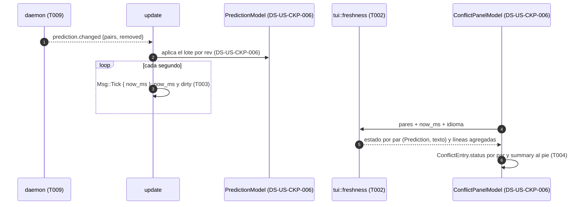

# DS-US-CKP-007 · Una predicción vieja nunca se presenta como actual

## Contexto rápido

Al terminar, cada par del panel de conflictos lleva su antigüedad ("hace 40 s", "hace 3 min"), que avanza sola una vez por segundo. Un par que el motor recalcula dice "desactualizado · hace 40 s · recalculando". Los pares sin resultado se agregan en "Calculando 3 de 10 pares". Los pendientes y los no calculables se agrupan por motivo. "Sin conflictos previstos" solo aparece cuando todos los pares están vigentes y ninguno tiene ⚡ ni ⚠. Ningún par sin resultado dice "sin conflictos" (BR-CKP-CALC-003).

El trabajo es solo de la TUI. El motor decide qué par se recalcula y cuándo (DS-TS-CKP-001). DS-US-CKP-006 construye el modelo de la predicción en `Model`, el panel y la recepción de `RepoView.prediction` y `prediction.changed`. Esta DS se apoya en ese modelo y no lo duplica: añade la presentación de la frescura.

**Decisiones del orquestador (2026-10-27), validadas por Arquitecto/PO.** Están incorporadas en las reglas de cada tarea:

- **A1** (Arquitecto): la forma del contrato vive en [DS-TS-CKP-001 § Contrato de API](./TS-CKP-001-predictor-conflictos.md#contrato-de-api) y la implementa T009. Esta DS solo la referencia y usa sus nombres: `PairSummary`, `state`, `reason`, `level`, `computed_at_utc_ms`, `rev`, `pair_id`.
- **A2** (Arquitecto): `state` ∈ `calculating | current | recalculating | pending | not-computable`. `level` solo existe en `current` y `recalculating`. Con la base movida, el motor pasa los pares contra la base a `calculating` (regla de T009, ajuste de `RepoPairs::apply`).
- **A4** (Arquitecto): la TUI deriva la antigüedad de `computed_at_utc_ms` con su reloj, en el `Msg::Tick` de 1 Hz (`apps/cli/src/tui/app.rs:30`, `:113`). No pide nada al daemon. Una antigüedad negativa (reloj por detrás) vale 0.
- **P1** (PO): `pending` y `not-computable` se muestran con su motivo y nunca como "sin conflictos". US-CKP-009 parte de aquí (PolicyBanner y acción).
- **P2** (PO): el panel lista los ⚡ y ⚠ **y** los pares `recalculating` sin ⚡ ni ⚠. Los `calculating` van en una línea agregada con singular y plural. El escenario 1 se lee como "ningún par sin resultado dice 'sin conflictos'". "Sin conflictos previstos · hace N" solo con todo `current` y sin ⚡ ni ⚠, con la antigüedad del resultado más antiguo.
- **P4** (PO): "hace N s" (< 60 s, incluido "hace 0 s"), "hace N min" (< 60 min), "hace N h" (< 24 h), "hace N d". Cadenas enteras en el catálogo en/es, sin concatenar.

**Decisiones del Arquitecto como autor de la Dev Spec (2026-10-27):**

- **E1**: los textos van en un catálogo tipado propio, `apps/cli/src/present/freshness_text.rs` (`FreshnessText`, `render(self, lang: Lang)` con `match` exhaustivo en/es y `every()`), registrado con una línea en `present/mod.rs`. Es el patrón de AD1 de DS-US-CKP-006 (`present/prediction_text.rs`) y de DS-US-CKP-008 (`present/conflict_alert_text.rs`): un archivo por historia y un mismo mecanismo (ADR-GRP-016). Los `.txt` de `apps/cli/i18n/` no sirven aquí: su lector, `apps/cli/src/i18n.rs`, es un módulo del binario (`main.rs:8`) y la TUI vive en la librería. Corrección del pase de coherencia (2026-10-27).
- **E2**: `Text::Ago` (`present/i18n.rs:348`) dice "ahora" por debajo de 1 s, y P4 exige "hace 0 s". No se reutiliza el texto, solo el corte por unidades: `fn age` (`present/i18n.rs:92`) pasa a `pub(crate)`.
- **E3**: `Prediction` (`widgets/conflict_alert.rs:20`) solo distingue `PendingBase`. Se añade `Prediction::Pending` para los otros motivos de `pending`, con el mismo estilo (`SymbolToken::Info`, `StatusInfo`).
- **E4**: un par `current` o `recalculating` sin `computed_at_utc_ms` (el contrato no lo permite, pero el cliente no confía) se presenta como `calculating`. Sin hora no hay resultado que mostrar.
- **E5**: con 0 pares no se pinta "Sin conflictos previstos". Con 0 pares, el panel solo lleva la línea de límites (P7: la TUI no inventa filas).

## 📋 Índice

> **Para aprobar:** [Contexto rápido](#contexto-rápido) · [⚠️ Gaps](#️-gaps-y-violaciones-de-la-constitución) · [🔭 La forma](#-la-forma).
> **Para implementar:** [🚀 Plan](#-plan-de-implementación), en orden.

---

## ⚠️ Gaps y violaciones de la constitución

| ID | Gap | Tipo | Bloquea | Cierre | Owner |
|----|-----|------|---------|--------|-------|
| G1 | T009 y el resto del PR-B de TS-CKP-001 sin construir: no existen `PairSummary`, `prediction.changed` ni la regla de base movida. El PR-B espera a G5 de DS-TS-CKP-001 (TS-GRP-005) | Bloqueante | T001 a T004 | Mergear el PR-B de TS-CKP-001 | Orquestador |

**Dependencia (no es gap):** [DS-US-CKP-006](./US-CKP-006-conflictos-previstos.md) ya está escrita y se implementa antes que esta DS: `PredictionModel` y `PairRow` en `apps/cli/src/tui/prediction.rs`, `RepoView.prediction` y el panel `ConflictPanelModel` en `apps/cli/src/tui/widgets/conflict_alert.rs`.

---

## 🔭 La forma

No aparece ninguna entidad nueva en el contrato. Hay un módulo puro de presentación (`tui::freshness`) entre `PredictionModel` (DS-US-CKP-006) y su `ConflictPanelModel`.

### Qué presenta cada estado

| `state` (A2) | `Prediction` (T002) | Dónde | Texto (es) |
|---|---|---|---|
| `current` con ⚡ o ⚠ | `Current` | fila del par | "hace 3 min" |
| `current` sin ⚡ ni ⚠ | `Current` | no tiene fila; cuenta para la línea final | — |
| `recalculating` (con o sin ⚡/⚠) | `Stale` | fila del par (P2) | "desactualizado · hace 40 s · recalculando" |
| `calculating` | `Calculating` | línea agregada | "Calculando 3 de 10 pares" / "Calculando 1 de 10 pares" |
| `pending` + `base-unconfirmed` | `PendingBase` | línea por motivo | "Pendiente: confirma la rama base (4 pares)" |
| `pending` + otro motivo | `Pending` (E3) | línea por motivo | "Pendiente: operación en curso (1 par)" |
| `not-computable` + motivo | `NotComputable` | línea por motivo | "No calculable: falta la rama base (4 pares)" |
| todos `current`, ninguno con ⚡/⚠, ≥ 1 par | — | línea final | "Sin conflictos previstos · hace 3 min" (el más antiguo) |

---

## 🚀 Plan de implementación

> Orden topológico (`Depende:`). Rutas relativas a la raíz del repo.

### El trabajo de un vistazo

| # | Tarea | Depende | Aterriza en |
|---|---|---|---|
| T001 | Añadir el catálogo tipado `FreshnessText` en/es | — | `apps/cli/src/present/freshness_text.rs` |
| T002 | Crear la presentación de la frescura y el mapeo a `Prediction` | T001 | `apps/cli/src/tui/freshness.rs`, `widgets/conflict_alert.rs` |
| T003 | Redibujar cada segundo mientras haya resultados | T002 | `apps/cli/src/tui/update.rs` |
| T004 | Pintar las filas y las líneas agregadas en el panel, con snapshots | T002, T003 | `apps/cli/src/tui/widgets/conflict_alert.rs`, `tui/view.rs` |
| T005 | Cerrar la historia y la documentación | T004 | `docs` |

### T001 — Añadir el catálogo tipado `FreshnessText` en/es

**Objetivo.** Todas las cadenas de esta historia, enteras, en los dos idiomas (P4, E1).

**Ubicación.**
- `apps/cli/src/present/freshness_text.rs` (**CREATE**)
- `apps/cli/src/present/mod.rs` (**MODIFY**, una línea: `pub mod freshness_text;`)

**Reglas**
- Una variante por forma, con la cadena entera en cada brazo y sin concatenar: `Age { n, unit }` = "hace {n} s|min|h|d"; `Stale { n, unit }` = "desactualizado · hace {n} … · recalculando"; `Clear { n, unit }` = "Sin conflictos previstos · hace {n} …". `unit` es la de `fn age` (E2), y el `match` tiene un brazo por unidad.
- `Calculating { n, m }`: "Calculando {n} de {m} pares", con brazos propios para `n = 1` y para `m = 1` ("Calculando 1 de 1 par").
- `Pending { reason: PairReason, n }` y `NotComputable { reason: PairReason, n }`, con singular y plural por motivo. `match` exhaustivo sobre `PairReason` (DS-TS-CKP-001 § Contrato de API): `BaseUnconfirmed`, `OperationInProgress`, `PowerSaving`, `Dormant`, `BaseMissing`, `MissingObject`, `Shallow`, `LimitExceeded`, `Error`. El tono es el de la guía de contenido (DSYS-GRP-001): "Pendiente: confirma la rama base ({n} pares)", "No calculable: el clon es superficial ({n} pares)".
- `every()` devuelve todas las variantes; el test comprueba que ninguna queda vacía en en/es.
- El `·` pasa por el plegado ASCII de la vista (`tui/style.rs:127`, `fold`), como el resto de textos de la TUI.

- **Depende:** —
- **Refs:** P1, P2, P4, E1; AD1 de DS-US-CKP-006
- **Aceptación:** `cargo test -p gitraptor-cli --lib present::freshness_text` (`every_freshness_text_has_both_languages`, **CREATE**)

### T002 — Crear la presentación de la frescura y el mapeo a `Prediction`

**Objetivo.** Funciones puras que, con los `PairRow` de `PredictionModel` (DS-US-CKP-006), `now_ms` y el idioma, dan el `Prediction` y el `FreshnessText` de cada par, y las líneas agregadas.

**Ubicación.**
- `apps/cli/src/tui/freshness.rs` (**CREATE**)
- `apps/cli/src/tui/mod.rs` (**MODIFY**: una línea, `pub mod freshness;`)
- `apps/cli/src/tui/widgets/conflict_alert.rs` (**MODIFY**: variante `Prediction::Pending`, E3; mismo brazo de estilo que `PendingBase`, línea 91)
- `apps/cli/src/present/i18n.rs` (**MODIFY**: `fn age` en la línea 92 pasa a `pub(crate)`, E2)
- `apps/cli/src/tui/gallery/stories.rs` (**MODIFY**: una historia de `Prediction::Pending`)

**Reglas**
- Antigüedad = `now_ms − computed_at_utc_ms`, fijada a 0 si es negativa (A4). Sin `computed_at_utc_ms`, el par se trata como `calculating` (E4).
- Mapeo: la tabla de [Qué presenta cada estado](#qué-presenta-cada-estado). El `match` sobre `state` y `reason` es exhaustivo: un motivo nuevo del contrato no compila hasta tener texto.
- Un par entra en una fila si `level` es `PairLevel::Conflict` u `Overlap` (con `current` o `recalculating`) o si está `recalculating` (P2). El orden de las filas ⚡/⚠ es de DS-US-CKP-006; las filas `recalculating` sin ⚡ ni ⚠ van detrás, en el orden del motor.
- Líneas agregadas, en este orden: "Calculando N de M" si N ≥ 1, con M = total de pares del repo; una línea por (`state`, `reason`) de `pending` y `not-computable`, en el orden de `PairReason`; "Sin conflictos previstos · hace N" solo si M ≥ 1, todos `current` y ninguno con `level` distinto de `PairLevel::Clean` (`none` en el cable) (P2, E5).
- Ninguna rama produce "sin conflictos" para un par que no esté `current` (BR-CKP-CALC-003).
- La TUI no lee el motor ni Git (ADR-CKP-003; `tests/tui_boundaries.rs`).

- **Depende:** T001
- **Refs:** A2, A4, P1, P2, P4; BR-CKP-CALC-003
- **Aceptación:** `cargo test -p gitraptor-cli --lib tui::freshness`

### T003 — Redibujar cada segundo mientras haya resultados

**Objetivo.** Que la antigüedad avance sola. Hoy el `Msg::Tick` (`update.rs:55`) solo marca `dirty` si el repo publica la actividad.

**Ubicación.** `apps/cli/src/tui/update.rs` (**MODIFY**: brazo `Msg::Tick`)

**Reglas**
- El tick también marca `dirty` si algún `PairRow` de `RepoView.prediction` (DS-US-CKP-006) tiene `computed_at_utc_ms`. Si ninguno lo tiene, no repinta por la predicción (la línea "Calculando" no cambia con el reloj).
- Ninguna petición al daemon (A4).

- **Depende:** T002
- **Refs:** A4; ADR-CKP-003 § 3 (`APPLY_BUDGET`, `TICK`)
- **Aceptación:** `cargo test -p gitraptor-cli --lib tui::update::tests::freshness`

### T004 — Pintar las filas y las líneas agregadas en el panel, con snapshots

**Objetivo.** El `ConflictPanelModel` de DS-US-CKP-006 usa `tui::freshness` para el `status` de cada `ConflictEntry` y para las líneas del pie, en 80×24, en/es y en ASCII.

**Ubicación.**
- `apps/cli/src/tui/widgets/conflict_alert.rs` (**MODIFY**): `ConflictPanelModel.summary: Vec<PanelLine>` y `PanelLine { prediction: Prediction, text: SafeText }`, pintadas con el estilo de `Prediction` (`:89`) encima de `limits`
- `apps/cli/src/tui/view.rs` (**MODIFY**): donde DS-US-CKP-006 T004 construye el `ConflictPanelModel`, `ConflictEntry.status` y `summary` salen de `tui::freshness`; y los tests de snapshot
- `apps/cli/src/tui/snapshots/freshness_*_{en,es,ascii}.snap` (**CREATE**)

**Reglas**
- `ConflictEntry.status` lleva el texto de T002 tal cual y sustituye el "recalculando" de DS-US-CKP-006; el widget no compone frases. Los textos se pintan con `say.glyphs.fold(&t.render(say.lang))` (AD1 de DS-US-CKP-006).
- Las líneas agregadas van antes de la línea de límites de P3 (que es de DS-US-CKP-006) y se recortan con `+N` si no caben en 80×24, nunca la de "Calculando".
- Los eventos se simulan con `apply_summary` / `apply_changed` de `tui::prediction` (DS-US-CKP-006): no hace falta daemon.

- **Depende:** T002, T003
- **Refs:** P2, P3; DSYS-GRP-001 § 3 (ConflictAlert)
- **Aceptación:** `cargo test -p gitraptor-cli --lib tui::view::tests::freshness`

### T005 — Cerrar la historia y la documentación

**Objetivo.** US-CKP-007 en `implemented` con los enlaces a los tests y a las pruebas del motor que cubren los escenarios 2 y 3.

**Ubicación.** `docs/requirements/features/cockpit/user-stories/US-CKP-007-frescura-prediccion.md` y esta DS (**MODIFY**)

- **Depende:** T004
- **Aceptación:** `cargo fmt --all --check`, `cargo clippy --all-targets -- -D warnings` y `cargo test -p gitraptor-cli` en verde

---

## Contratos compartidos

**Contrato de API.** Ninguno propio. Lee `RepoView.prediction` y `prediction.changed` con la forma de [DS-TS-CKP-001 § Contrato de API](./TS-CKP-001-predictor-conflictos.md#contrato-de-api) (A1). No usa `prediction.list`.

**Tipos de la TUI.**

| Símbolo | Archivo | Acción |
|---|---|---|
| `Prediction::{Current, Stale, Calculating, PendingBase, NotComputable}` | `apps/cli/src/tui/widgets/conflict_alert.rs:20` | existe |
| `Prediction::Pending` | ídem | **CREATE** (E3) |
| `PredictionModel`, `PairRow` | `apps/cli/src/tui/prediction.rs` | **CREATE** en DS-US-CKP-006 T002 |
| `ConflictPanelModel`, `ConflictEntry.status` | `apps/cli/src/tui/widgets/conflict_alert.rs` | **CREATE** en DS-US-CKP-006 T004 |
| `ConflictPanelModel.summary`, `PanelLine` | ídem | **CREATE** (T004) |
| `PairStateView`, `PairReason`, `PairLevel` | `gitraptor_api::prediction` | **CREATE** en DS-TS-CKP-001 T009 |
| `Msg::Tick { now_ms }`, `TICK` | `apps/cli/src/tui/app.rs:30`, `:113`; `update.rs:55` | existe |
| `Model.now_ms` (reloj de pared, ms UTC: `app.rs:221`, `wall_ms`) | `apps/cli/src/model.rs` | existe |
| `fn age(ms) -> (i64, &str)` | `apps/cli/src/present/i18n.rs:92` | **MODIFY** a `pub(crate)` (E2) |
| `FreshnessText` | `apps/cli/src/present/freshness_text.rs` | **CREATE** (T001, E1) |
| `tui::freshness` | `apps/cli/src/tui/freshness.rs` | **CREATE** (T002); firmas libres, puras, sin E/S |

---

## Estrategia de pruebas y cobertura

### Un test por criterio de aceptación

| Escenario de US-CKP-007 | Quién lo garantiza | Test |
|---|---|---|
| 1. "Calculando" en el cálculo inicial (10 worktrees) | TUI | `tui::freshness::tests::pairs_without_result_never_say_no_conflicts` (todas las combinaciones de `state` y `reason` × presencia de ⚡/⚠); `tui::view::tests::freshness_initial_calculation_10_worktrees` (snapshot en/es: "Calculando 10 de 10 pares", ninguna "Sin conflictos") |
| 2a. Tras un commit solo se recalculan los pares de ese worktree | Motor (DS-TS-CKP-001 T003, ya en `main`) | `cargo test -p gitraptor-core --test ts_ckp_001_state ckp001_cache_a_new_triple_queues_the_pair_and_recalculates_what_had_a_result` (`crates/core/tests/ts_ckp_001_state.rs:158`: encola solo los pares de `w1` y el par de `w2` contra la base sigue `Current`) y `a_result_of_stale_inputs_is_never_current` (`:115`) |
| 2b. Se marca "desactualizado, recalculando" con su antigüedad | TUI | `tui::update::tests::freshness_commit_marks_only_that_pair_stale`: un `prediction.changed` simulado lleva "claude-1 ↔ claude-2" a `recalculating` con `computed_at` de hace 40 s; "claude-3 ↔ claude-4" sigue `current` "hace 40 s"; un segundo evento lo devuelve a `current` "hace 0 s" |
| 2c. Resultado nuevo en 5 s p95 con 10 worktrees (S-CKP-1) | Motor (DS-TS-CKP-001 T012, INF-GRP-002) | `cargo bench -p gitraptor-cli --bench engine -- prediction` (escenario nuevo de T012 en `apps/cli/benches/engine.rs`, gate `FRESHNESS_TARGET`) |
| 3a. Mover la base pone en `calculating` los pares contra la base | Motor (DS-TS-CKP-001 T009, regla de base movida de A2) | `cargo test -p gitraptor-core --test predict_publish base_move_turns_base_pair_calculating_and_drops_level` (CREATE en T009; hoy `queued_state`, `crates/core/src/predict/state.rs:23`, da `Recalculating` siempre que hay resultado) |
| 3b. La TUI presenta esos pares como "calculando" | TUI | `tui::update::tests::freshness_base_move_shows_base_pairs_calculating`: el evento pasa los pares contra "main" a `calculating` sin `level`; el panel muestra "Calculando 4 de 10 pares", pierde sus filas y no muestra "Sin conflictos previstos" |
| 4. La antigüedad siempre se ve ("hace 3 min") | TUI | `tui::view::tests::freshness_age_shows_3_min` (snapshot en/es con `now_ms = computed_at + 180_000`) y `tui::update::tests::freshness_tick_moves_the_age` (de "hace 59 s" a "hace 1 min" en un tick) |

Los tests de la TUI de esta tabla y de la lista siguiente son **CREATE**: `tui::freshness::tests` en T002, `tui::update::tests::freshness_*` en T003 y `tui::view::tests::freshness_*` en T004. Los del motor existen (`ts_ckp_001_state`) o los crea T009 (`predict_publish`).

### Unitarias de `tui::freshness` (T002)

- `age_is_never_negative` (reloj por detrás → "hace 0 s", A4).
- `age_units_follow_p4` (0 s, 59 s, 60 s → 1 min, 59 min, 1 h, 23 h, 1 d), en/es.
- `maps_every_state_and_reason_to_prediction` (tabla completa, E3, E4).
- `recalculating_without_marks_has_a_row` (P2).
- `pending_and_not_computable_group_by_reason_with_singular_and_plural` (P1).
- `clear_only_when_every_pair_is_current_without_marks` (P2) y `no_clear_line_without_pairs` (E5); la antigüedad es la del más antiguo.
- `calculating_line_singular_and_plural`.

### Pirámide

| Tipo | Cantidad | Tareas | Herramientas | Cuándo |
|------|---------:|--------|--------------|--------|
| Unit | ~12 | T001, T002, T003 | `cargo test` | PR gate |
| Snapshot | ~4 (×2 idiomas, + ASCII) | T004 | `TestBackend`, `insta` | PR gate |
| Motor (citado) | 3 + bench | DS-TS-CKP-001 T003, T009, T012 | `cargo test`, `cargo bench` | PR gate / gate de bench |

Datos: pares construidos en memoria con la forma de A2; sin daemon, sin repos (no toca Git, NFR-01 no aplica). Camino crítico al 100 %: toda rama que pueda pintar "sin conflictos".

---

## Gate de seguridad

- **Textos no confiables:** la frescura no pinta rutas ni nombres. Los nombres de las filas son `SafeText` saneados por DS-US-CKP-006 (SEC-12, NFR-03).
- **Sin contenido:** solo códigos (`state`, `reason`) y una hora; el texto sale del catálogo propio.
- **Fronteras:** sin dependencias nuevas; la TUI no importa motor ni Git (`apps/cli/tests/tui_boundaries.rs`).

---

## Fuera de alcance

| Ítem | Dueño | Gate |
|---|---|---|
| Modelo de la predicción, recepción de eventos, petición del detalle, orden de las filas ⚡/⚠, línea de límites (P3) y estado vacío | [DS-US-CKP-006](./US-CKP-006-conflictos-previstos.md) | sus tests |
| Qué pares se recalculan, cuándo y en cuánto tiempo; la regla de base movida | DS-TS-CKP-001 (T003, T009, T012) | tests citados arriba |
| Alerta de un ⚡ nuevo, toast de 5 s, pila de toasts y marca `ConflictEntry.new` (A5, P5) | [DS-US-CKP-008](./US-CKP-008-alerta-conflicto-nuevo.md) | — |
| PolicyBanner y acción ante `pending` / `not-computable` | US-CKP-009 (P1) | — |
| Registro KPI de US-CKP-010 | Arquitecto (sin historia técnica, P1) | — |
| `age_s` del perfil `mcp` | DS-US-MCP-016 (A3) | — |

---

## Notas del autor

| ID | Nota | Acción | Owner |
|----|------|--------|-------|
| N1 | ⚠️ **ASSUMPTION**: no hay `architecture-constitution.md` en el repo. Las restricciones salen de `AGENTS.md` y de los ADR citados (ADR-GRP-001, ADR-GRP-016, ADR-CKP-003) | Validar o crear la constitución | Rene |
| N2 | Con un reloj muy adelantado la antigüedad crece sin límite y dice "hace N d"; es honesto (el resultado puede ser viejo) y no se corrige | Ninguna | — |
| N3 | Solo se verificará en macOS; Linux y Windows siguen la etapa de validación multiplataforma | Etapa de validación | Rene |
