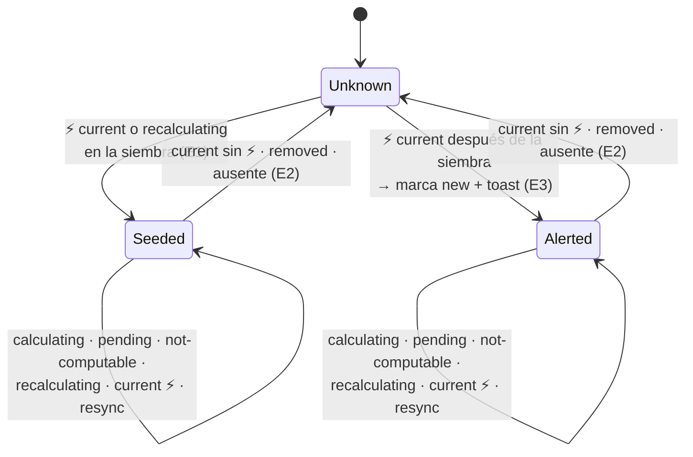

# DS-US-CKP-008 · La TUI avisa cuando aparece un conflicto previsto nuevo

## Contexto rápido

Al terminar, cuando el predictor publica un ⚡ que la TUI no había visto en esta ejecución, la TUI muestra un aviso efímero de 5 s ("⚡ Conflicto previsto: claude-1 ↔ claude-2 en src/api.rs") y marca la entrada del par en el panel de conflictos (`ConflictEntry` de `ConflictPanelModel`) como nueva. La marca sigue ahí cuando el aviso desaparece. Las dos filas suben a la zona de atención. Un ⚡ que ya se conocía no vuelve a avisar, aunque el par se recalcule, la base se mueva o el daemon se reinicie. No suena la campana ni sale una notificación del sistema operativo (BR-CKP-WF-007).

Esta DS solo **decide qué ⚡ es nuevo y lo presenta**. La recepción de `prediction.changed`, `PredictionModel` (`apps/cli/src/tui/prediction.rs`), la petición del detalle, el panel `ConflictPanelModel` y el `AgentRowModel.conflict` de cada fila son de [DS-US-CKP-006](./US-CKP-006-conflictos-previstos.md), ya escrita. La antigüedad y las líneas agregadas del panel son de [DS-US-CKP-007](./US-CKP-007-frescura-prediccion.md). La forma del cable es la de [DS-TS-CKP-001 § Contrato de API](./TS-CKP-001-predictor-conflictos.md#contrato-de-api) (A1). Esta DS no la repite.

**Decisiones del orquestador (2026-10-27), validadas por Arquitecto/PO.** Están incorporadas en las reglas de cada tarea:

- **A1** (Arquitecto): la forma vive en DS-TS-CKP-001 § Contrato de API. Aquí solo se usan sus nombres: `pair_id`, `rev`, `state`, `level`, `removed`, `conflict_files` y `PairDetail.conflict.files`.
- **A5** (Arquitecto y PO): un ⚡ nuevo es un `pair_id` que pasa a `level: conflict` con `state: current` y no está en el conjunto de alertados, que vive en memoria de la TUI.
  - Pasar de `recalculating` a `current` con el mismo ⚡ no alerta.
  - Pasar por `calculating` o `pending` no saca el par del conjunto. Lo saca un `current` sin ⚡ o que el par llegue en `removed`.
  - Al abrir la TUI, los ⚡ que ya existen no avisan.
  - Tras `scope.resync` (también `daemon-restarted`, porque el `pair_id` es determinista) solo avisan los ⚡ que no estaban en el conjunto.
  - Sin BEL y sin notificación del SO.
- **A2** (Arquitecto), en lo que esta DS usa: el `pair_id` no tiene sal por ejecución, y la base movida pasa el par a `calculating` sin `level`. El detalle se acepta solo si su `rev` es igual al del resumen.
- **P5** (PO): el texto es "⚡ Conflicto previsto: claude-1 ↔ claude-2 en src/api.rs", con " y N más" cuando hay más archivos. Cada lado se nombra como encabeza su fila (BR-CKP-WF-001); contra la base, con el nombre de la rama base. `↔` tiene fallback ASCII `<->`. La alerta queda en el panel ConflictAlert cuando el toast de 5 s desaparece.

**Decisiones del Arquitecto como autor de la Dev Spec (2026-10-27).** Huecos que A5 y P5 no cubren:

- **E1. Siembra por repo.** Con la primera instantánea de un repo que trae `prediction` en esta ejecución, sus ⚡ entran al conjunto sin avisar (`Known::Seeded`). Las páginas de `prediction.list` que DS-US-CKP-006 recorre por `pairs_truncated` (su AD4) también siembran. Las instantáneas siguientes (resync, reconexión, reinicio) comparan.
- **E2. Desaparecer en una instantánea.** Un par alertado que no está en la instantánea de un resync se trata como `removed`, salvo que la instantánea traiga `pairs_truncated`: en ese caso su ausencia no prueba nada y el par se queda en el conjunto. `ScopeClosed` olvida el repo entero.
- **E3. El aviso espera al archivo.** El nombre del primer archivo está en el `PairDetail`, no en el `PairSummary`. DS-US-CKP-006 (AD3, `wanted`) pide el detalle de todo par ⚡/⚠ cuyo `rev` cambió, ⚡ primero, en lotes de 50, y guarda en `early` el que llega con un `rev` mayor hasta que el resumen lo alcanza. El toast se emite cuando `PredictionModel.details` tiene el detalle con el mismo `rev`. Si no llega en dos `Msg::Tick` (entre 1 y 2 s), sale sin archivo: "⚡ Conflicto previsto: claude-1 ↔ claude-2". La marca del panel se pone al detectarlo, sin esperar.
- **E4. El toast guarda ids, no texto.** El toast guarda `(repo_id, pair_id)`. La vista compone el texto al pintarlo, con los mismos nombres que usa el panel. Si el par desaparece antes de los 5 s, el toast se retira en el siguiente `Tick`: un aviso de un ⚡ que ya no existe es falso.
- **E5. La marca `new` dura lo que dura el ⚡.** Un par `Known::Alerted` lleva la marca "nuevo" en su `ConflictEntry.new` hasta que sale del conjunto. Es el registro de la alerta de P5 (AD6 de DS-US-CKP-006). Los sembrados no la llevan. Quitarla al revisarla no tiene historia; queda anotado para el backlog.
- **E6. `ToastKind::Conflict`.** Es una variante nueva del widget, con `SymbolToken::Conflict` y `status.warning`. El ⚡ lo pinta el widget y el catálogo guarda el texto sin el símbolo. Con `ToastKind::Warning` saldría "⚠ ⚡ Conflicto…".
- **E7. El plural de P5.** " y N más" y " and N more" no cambian con N. El catálogo tiene de todos modos una rama para N = 1 y otra para N > 1, cada una con la cadena entera (P4: nada de concatenar), y el test cubre las dos.
- **E8. La pila de toasts es genérica y se crea aquí.** El widget `notification.rs` es puro: la caducidad y la pila "son del update" (INF-CKP-001, DS-TS-CKP-005), pero ninguna historia los ha construido. Se crean en un módulo propio, `tui/toasts.rs`, con 3 toasts como máximo (el más viejo sale primero), para que US-CKP-014 a 018 los reutilicen. DS-US-CKP-006 y DS-US-CKP-007 no crean toasts. La pila se ancla en `regions.list` y nunca tapa `regions.alerts`, para que la línea de límites de P3 siga siempre visible.
- **E9. Catálogo tipado propio.** Los textos van en `apps/cli/src/present/conflict_alert_text.rs` (`ConflictAlertText`), con el patrón de AD1 de DS-US-CKP-006 y E1 de DS-US-CKP-007, y no en `present/i18n.rs`, que es compartido (ADR-GRP-016). Corrección del pase de coherencia (2026-10-27).

## 📋 Índice

> **Para aprobar:** [Contexto rápido](#contexto-rápido) · [⚠️ Gaps](#gaps-y-violaciones-de-la-constitución) · [🔭 La forma](#la-forma).
> **Para implementar:** [🚀 Plan](#plan-de-implementación), en orden. **Referencia:** [Contratos](#contratos-compartidos) · [Pruebas](#estrategia-de-pruebas-y-cobertura) · [Seguridad](#gate-de-seguridad) · [Fuera de alcance](#fuera-de-alcance).

---

## ⚠️ Gaps y violaciones de la constitución

| ID | Gap | Bloquea | Dueño |
|----|-----|---------|-------|
| G1 | T009 del PR-B de TS-CKP-001 no está en `main`. Sin ella el daemon no publica `RepoView.prediction` ni `prediction.changed`. El PR-B espera a G5 (TS-GRP-005) | Implementar (bloqueante) | TS-CKP-001 |
| G2 | El orden de la flota por atención (DS-US-CKP-002, `draft`) no está construido. Sin él, `conflict = true` marca la fila pero no la sube | Cerrar el escenario 1 (release) | US-CKP-002 |

**Dependencia (no es gap):** [DS-US-CKP-006](./US-CKP-006-conflictos-previstos.md) está escrita y se implementa antes que esta DS ([Contratos § Lo que se toma de DS-US-CKP-006](#lo-que-se-toma-de-ds-us-ckp-006)).

Sin violaciones de la constitución: no hay dependencia nueva, no hay I/O en `update` (ADR-CKP-003 § 2) y la TUI no importa motor, Git ni políticas.

---

## 🔭 La forma

Un par entra al conjunto con un ⚡ `current` y solo sale por un `current` sin ⚡ o por desaparecer. El resto de los estados no lo mueve.



En el bucle TEA, todo ocurre dentro de `update`, que es puro (sin reloj ni I/O). El reloj llega con `Msg::Tick { now_ms }` (`apps/cli/src/tui/app.rs:113`):

1. DS-US-CKP-006 aplica la instantánea, el evento `prediction.changed` o la página de `prediction.list` a `PredictionModel` (`apply_summary`, `apply_changed`, `apply_page`).
2. Justo después, `update` llama a `ConflictAlerts::observe` con el lote, que devuelve los `pair_id` nuevos (T002).
3. Por cada nuevo: si `PredictionModel.details` ya tiene su detalle con el mismo `rev`, `Toasts::push`; si no, queda pendiente (E3).
4. `Msg::Tick` caduca los toasts (5 s), retira los de pares desaparecidos y emite los pendientes sin archivo al segundo tick.
5. `view` pinta la pila de toasts dentro de `regions.list` (`ToastStackModel::area`, `notification.rs:88`) y pone `new` en el `ConflictEntry` del par.

---

## 🚀 Plan de implementación

> Orden topológico (`Depende:`). Rutas relativas a la raíz del repo. Todo requiere G1 y DS-US-CKP-006 en `main`.

### El trabajo de un vistazo

| # | Tarea | Depende | Aterriza en |
|---|---|---|---|
| T001 | Escribir en rojo las pruebas estáticas de "sin BEL ni SO" | — | `apps/cli/tests/tui_no_os_alert.rs` |
| T002 | Crear el conjunto de alertados y su regla (A5, E1, E2) | — | `apps/cli/src/tui/alerts.rs` |
| T003 | Crear la pila de toasts con su caducidad (E8) y cablearla en `Model` y `update` | T002 | `apps/cli/src/tui/{toasts,update}.rs`, `apps/cli/src/model.rs` |
| T004 | Pintar el toast y la marca `new` en en/es y ASCII, con snapshots | T003 | `apps/cli/src/tui/{view,widgets/notification,widgets/conflict_alert}.rs`, `present/conflict_alert_text.rs` |
| T005 | Cerrar la historia y la documentación | T001, T004 | `docs` |

### T001 — Escribir en rojo las pruebas estáticas de "sin BEL ni SO"

**Objetivo.** Dejar fijado por la fuente y por `Cargo.lock` que la TUI no hace sonar la campana ni puede notificar al SO.

**Ubicación.** `apps/cli/tests/tui_no_os_alert.rs` (**CREATE**). Es un archivo propio y no se toca `tui_boundaries.rs` (ADR-GRP-016). El ayudante `code()` (sin comentarios ni `mod tests`) se copia de `apps/cli/tests/tui_boundaries.rs:46`.

**Reglas**
- `the_tui_sources_never_write_a_bell`: en los módulos de la TUI (`tui`, `model.rs`, `client`, `present`, `queue.rs`, `paths.rs`, la misma lista que `TUI_MODULES`), el código de producción no contiene `\x07`, `\u{7}`, `\u{07}`, `\a`, `0x07` ni `char::from(7)`. Se excluye `present/sanitize.rs`, que **escapa** el BEL de los textos no confiables y lo nombra en sus tablas (`sanitize.rs:151`).
- `the_tui_names_no_os_notifier`: el mismo código no contiene `osascript`, `notify-send`, `terminal-notifier`, `UNUserNotificationCenter`, `NSUserNotification` ni `ToastNotificationManager`. El test que ya existe, `the_tui_launches_no_process` (`tui_boundaries.rs:142`), cubre lanzar un notificador como proceso.
- `apps_cli_pulls_no_notification_crate`: lee el `Cargo.lock` del workspace, recorre por líneas (`[[package]]`, `name =`, `dependencies = [...]`) el cierre de dependencias de `gitraptor-cli` y comprueba que no incluye `notify-rust`, `mac-notification-sys`, `winrt-notification`, `tauri-winrt-notification`, `user-notify`, `objc2-user-notifications`, `zbus` ni `dbus`. Hoy no hay ninguno en todo el lock (comprobado el 2026-10-27). Se recorre el cierre de `gitraptor-cli`, y no el lock entero, porque la app de escritorio de la Fase 3 sí podrá traerlos.
- Como no hay código de la historia, los tres tests pasan desde el primer día: son guardas de regresión, y así se declara en el PR.

- **Depende:** —
- **Refs:** A5; US-CKP-008, escenario 3; BR-CKP-WF-007
- **Aceptación:** `cargo test -p gitraptor-cli --test tui_no_os_alert`

### T002 — Crear el conjunto de alertados y su regla

**Objetivo.** `ConflictAlerts`: un tipo puro que, con cada lote de pares, devuelve los `pair_id` que acaban de pasar a ⚡ nuevo y mantiene el conjunto con las reglas de A5.

**Ubicación.**
- `apps/cli/src/tui/alerts.rs` (**CREATE**)
- `apps/cli/src/tui/mod.rs` (**MODIFY**, una línea: `pub mod alerts;`)

**Reglas**
- El estado es `known: BTreeMap<repo_id, BTreeMap<pair_id, Known>>` más `seeded: BTreeSet<repo_id>`, con `Known ∈ { Seeded, Alerted }`. Nada persiste entre ejecuciones.
- Con `Batch::Snapshot { repo_id, pairs, complete }`:
  - si el repo no está en `seeded`, todo ⚡ (`level: conflict` en `current` o `recalculating`) entra como `Seeded`, el repo pasa a `seeded` y la llamada devuelve vacío (E1);
  - si ya está, se aplica la regla de entrada y salida par a par y, con `complete`, los pares conocidos ausentes salen (E2).
- Con `Batch::Page { repo_id, pairs }` (las páginas de `prediction.list`), la regla es la misma que con la instantánea, pero sin sacar ausentes. Una página que llega mientras el repo siembra también siembra.
- Con `Batch::Changed { repo_id, pairs, removed }`, se aplica la regla par a par y los `removed` salen.
- Regla par a par:
  - `current` con `conflict` y ausente del conjunto → `Alerted`, y se devuelve;
  - `current` con `PairLevel::Clean` (`none` en el cable) u `Overlap` → sale;
  - cualquier otro estado, o `recalculating` con cualquier `level` → no cambia nada.
- `forget(repo_id)` borra el repo, con `ScopeClosed` (E2).
- `is_new(repo_id, pair_id)` es verdadero solo para `Alerted` (E5).
- Sin reloj ni I/O. La entrada son los `PairRow` de `tui::prediction` (DS-US-CKP-006), ya ingeridos, nunca `Untrusted`.

- **Depende:** —
- **Refs:** A2, A5; E1, E2, E5
- **Aceptación:** `cargo test -p gitraptor-cli --lib tui::alerts::tests`

### T003 — Crear la pila de toasts y cablearla en `Model` y `update`

**Objetivo.** Que cada ⚡ nuevo termine en un toast de 5 s, y el conjunto y la pila vivan en `Model`.

**Ubicación.**
- `apps/cli/src/tui/toasts.rs` (**CREATE**)
- `apps/cli/src/tui/mod.rs` (**MODIFY**, `pub mod toasts;`)
- `apps/cli/src/model.rs` (**MODIFY**: `Ui.alerts: ConflictAlerts` y `Ui.toasts: Toasts`, con sus valores iniciales en `Model::new`, `model.rs:36`)
- `apps/cli/src/tui/update.rs` (**MODIFY**)

**Reglas**
- `Toasts`:
  - es una `VecDeque<Toast>` de 3 como máximo;
  - `push` descarta el más viejo cuando está llena, y no duplica un toast del mismo `(repo_id, pair_id)` que siga vivo;
  - `until_ms = now_ms + TOAST_TTL_MS` si `model.now_ms > 0`. Si no, queda `None` y lo fija el primer `Tick`.
- En `update.rs`, una llamada a `ConflictAlerts::observe` justo después de cada ingestión de DS-US-CKP-006: `on_snapshot` (`:388`), la rama `PREDICTION_CHANGED` de `apply` (`:457`) y el brazo de `EngineMsg::PredictionPage`. En `on_resync` con `ScopeClosed` (`update.rs:527`), `alerts.forget(repo_id)`. No se añade ninguna rama a `apply` más allá de esas llamadas.
- Pendientes (E3):
  - por cada `pair_id` nuevo, si `PredictionModel.details[pair_id].rev` es el `rev` del `PairRow`, `push`; si no, `pending.insert(pair_id, rev, ticks: 0)`;
  - al llegar un detalle con ese `rev` (página o adopción de `early`), `push`;
  - si llega un `rev` mayor con el par todavía en ⚡ `current`, se actualiza el `rev` pendiente;
  - si el par sale del conjunto, se descarta el pendiente.
- `Msg::Tick` (`update.rs:54`):
  - fija los `until_ms` que falten y quita los toasts con `now_ms >= until_ms`;
  - quita los toasts cuyo par ya no está en `PredictionModel.pairs` (E4);
  - incrementa `ticks` de los pendientes y emite sin archivo los que llegan a 2;
  - pone `dirty = true` si la pila cambió.
- Esta DS no pide nada al daemon: el detalle lo pide `tui::prediction::wanted` de DS-US-CKP-006 (AD3), que cubre todo par con ⚡ cuyo `rev` cambió.

- **Depende:** T002
- **Refs:** A4 (el reloj solo por `Tick`), A5; E3, E4, E8
- **Aceptación:** `cargo test -p gitraptor-cli --lib tui::update::tests::conflict_alert`

### T004 — Pintar el toast y la marca `new` en en/es y ASCII

**Objetivo.** El texto exacto de P5 en los dos idiomas, el ⚡ pintado por el widget y la marca "nuevo" en la entrada del panel.

**Ubicación.**
- `apps/cli/src/tui/widgets/notification.rs` (**MODIFY**: `ToastKind::Conflict` y su brazo en `look`, `notification.rs:40`)
- `apps/cli/src/tui/widgets/conflict_alert.rs` (**MODIFY**: `ConflictEntry.new: Option<SafeText>`, pintada como la de `ConflictAlertModel`, `:71`)
- `apps/cli/src/tui/view.rs` (**MODIFY**: la pila se pinta después del cuerpo y antes de la ayuda, en `view`, `view.rs:69`, dentro de `regions.list`)
- `apps/cli/src/present/conflict_alert_text.rs` (**CREATE**: `ConflictAlertText`, `render(self, lang: Lang)`, `every()`; E9)
- `apps/cli/src/present/mod.rs` (**MODIFY**, una línea: `pub mod conflict_alert_text;`)
- `apps/cli/src/tui/snapshots/conflict_toast_80x24_{en,es,ascii}.snap` (**CREATE**)

**Reglas**
- `ConflictAlertText::Toast { left, right, file: Option<&str>, more: u32 }`, con una cadena entera por combinación (E7):

  | Caso | es | en |
  |---|---|---|
  | sin archivo | `Conflicto previsto: {left} ↔ {right}` | `Predicted conflict: {left} ↔ {right}` |
  | `more = 0` | `Conflicto previsto: {left} ↔ {right} en {file}` | `Predicted conflict: {left} ↔ {right} in {file}` |
  | `more = 1` | `… en {file} y 1 más` | `… in {file} and 1 more` |
  | `more > 1` | `… en {file} y {more} más` | `… in {file} and {more} more` |

- `ConflictAlertText::New` es "nuevo" / "new", la marca de `ConflictEntry.new`.
- `more = conflict_files − 1`, del resumen y no de la lista recortada del detalle. `file` es `PredictionModel.details[pair_id].conflict.files[0].path` (`ConflictFileRow.path`, ya `SafeText`).
- Los nombres de los lados salen de lo mismo que usa DS-US-CKP-006 para `ConflictEntry.left` y `.right` (AD5): `Side::Worktree { key }` → `row_name` de su fila (`view.rs`, la crea DS-US-CKP-006 T004) y, si no casa, la carpeta; `Side::Base` → `RepoView.base`. La vista no calcula nombres por su cuenta.
- El texto se pinta con `say.glyphs.fold(&t.render(say.lang))` (AD1 de DS-US-CKP-006), que pliega `↔` a `<->` en el conjunto ASCII (`style.rs:67`), como `Glyphs.versus` (`style.rs:49`). `SymbolToken::Conflict` tiene su propio fallback en el tema.
- El `ConflictEntry` de un par con `is_new` lleva `new: Some(..)` con `ConflictAlertText::New`.
- Colores: solo tokens (`status.warning`). Un toast que no cabe en 60 columnas se corta con elipsis (`MAX_WIDTH`, `notification.rs:36`). El texto completo queda en el panel.

- **Depende:** T003
- **Refs:** P5, E4, E6, E7; DSYS-GRP-001 § 3
- **Aceptación:** `cargo test -p gitraptor-cli --lib tui::view::tests::conflict_toast` y `cargo test -p gitraptor-cli --lib present::conflict_alert_text`

### T005 — Cerrar la historia y la documentación

**Objetivo.** La historia queda con su estado real.

**Ubicación.** `docs/requirements/features/cockpit/user-stories/US-CKP-008-alerta-conflicto-nuevo.md` (**MODIFY**)

**Reglas**
- `status: implemented` solo si G2 está cerrado. Si no, `partially-implemented`, con "las filas suben a la zona de atención" pendiente de US-CKP-002.

- **Depende:** T001, T004
- **Aceptación:** `cargo fmt --all --check`, `cargo clippy -p gitraptor-cli --all-targets -- -D warnings` y `cargo test -p gitraptor-cli` en verde

---

> Las secciones siguientes son de referencia.

## Contratos compartidos

### Tipos y datos compartidos

```rust
// apps/cli/src/tui/alerts.rs
pub enum Known { Seeded, Alerted }
pub enum Batch<'a> {
    Snapshot { repo_id: &'a str, pairs: &'a [PairRow], complete: bool }, // complete = !pairs_truncated
    Page { repo_id: &'a str, pairs: &'a [PairRow] },
    Changed { repo_id: &'a str, pairs: &'a [PairRow], removed: &'a [String] },
}
#[derive(Debug, Clone, Default)]
pub struct ConflictAlerts { /* known, seeded, pending */ }

// apps/cli/src/tui/toasts.rs
pub const TOAST_TTL_MS: i64 = 5_000;
pub const MAX_TOASTS: usize = 3;
pub enum ToastBody { Conflict { repo_id: String, pair_id: String, file: bool } }
pub struct Toast { pub body: ToastBody, pub until_ms: Option<i64> }
#[derive(Debug, Clone, Default)]
pub struct Toasts { /* VecDeque<Toast> */ }

// apps/cli/src/tui/widgets/notification.rs
pub enum ToastKind { Success, Info, Warning, Error, Conflict }
```

### Firmas del stack

```rust
impl ConflictAlerts {
    pub fn observe(&mut self, batch: Batch<'_>) -> Vec<String>;  // pair_ids nuevos
    pub fn forget(&mut self, repo_id: &str);
    pub fn is_new(&self, repo_id: &str, pair_id: &str) -> bool;
}
impl Toasts {
    pub fn push(&mut self, body: ToastBody, now_ms: i64);
    pub fn tick(&mut self, now_ms: i64, alive: impl Fn(&ToastBody) -> bool) -> bool; // ¿cambió?
    pub fn iter(&self) -> impl Iterator<Item = &Toast>;
}
```

### Lo que se toma de DS-US-CKP-006

Nombres reales de [DS-US-CKP-006](./US-CKP-006-conflictos-previstos.md) (sus T002 y T004 y su § Contratos compartidos). Los enums del cable (`PairStateView`, `PairLevel`, `PairReason`) son los de [DS-TS-CKP-001 § Contrato de API](./TS-CKP-001-predictor-conflictos.md#contrato-de-api).

| Papel | Nombre en DS-US-CKP-006 |
|---|---|
| Modelo de pares | `RepoView.prediction: Option<PredictionModel>`; `PredictionModel.pairs: Vec<PairRow>` con `pair_id`, `rev`, `state: PairStateView`, `level: Option<PairLevel>` y `conflict_files` (`apps/cli/src/tui/prediction.rs`) |
| Detalle | `PredictionModel.details: BTreeMap<pair_id, PairDetailRow>`; `PairDetailRow.conflict.files: Vec<ConflictFileRow>` con `path: SafeText`. Lo pide `wanted` (AD3): todos los ⚡/⚠ sin detalle de su `rev`, ⚡ primero, lotes de 50, `early` para un `rev` mayor |
| Ingestión | `apply_summary` (en `on_snapshot`, `update.rs:388`), `apply_changed` (rama `PREDICTION_CHANGED` de `apply`, `:457`) y `apply_page` (brazo de `EngineMsg::PredictionPage`) |
| Nombres | `Side::{Worktree { key, folder }, Base}` → `row_name` (`view.rs`, CREATE en DS-US-CKP-006 T004, AD5) o `RepoView.base`; `↔` es `Glyphs.versus` |
| Panel | `ConflictPanelModel { entries: Vec<ConflictEntry>, .. }` en `widgets/conflict_alert.rs` (AD6); esta DS añade `ConflictEntry.new` |
| Filas | `PredictionModel::known_conflict(key)` → `AgentRowModel.conflict` (`view.rs:518`, DS-US-CKP-002 D2) |

## Contrato de API

_Sin métodos, campos ni eventos nuevos._ Consume `RepoView.prediction`, `prediction.changed` y `prediction.list` tal como los fija [DS-TS-CKP-001 § Contrato de API](./TS-CKP-001-predictor-conflictos.md#contrato-de-api).

### Valores numéricos

| Concepto | Valor | Fuente |
|---|---|---|
| Vida del toast | 5 s (`TOAST_TTL_MS`) | P5; BR-CKP-WF-002 |
| Toasts a la vez | 3 (`MAX_TOASTS`) | DS-TS-CKP-005 (galería "pila de tres") |
| Espera del detalle | 2 `Tick` (de 1 a 2 s) | E3, ⚠️ **ASSUMPTION**: el detalle es una llamada local de un par; validar con la medición de T012 |
| Ancho del toast | 60 columnas | `notification.rs:36` |

---

## Estrategia de pruebas y cobertura

`update` ya es puro y se prueba en su `mod tests` con `update(&mut m, msg)` y mensajes fabricados (`update.rs:557`). La vista se prueba con `TestBackend` e `insta` (`view.rs:628`, `view.rs:949`). Esta DS sigue los mismos dos patrones. El escenario 1 de punta a punta contra el daemon real lo añade DS-US-CKP-006 (prueba de proceso de la TUI). Aquí no se repite.

### 9.1 Un test por criterio de aceptación de la historia

| Escenario | Test | Tarea |
|---|---|---|
| 1. Un ⚡ nuevo genera una alerta | `conflict_alert_scenario_1_a_new_conflict_records_an_alert_and_a_toast`: `prediction.changed` con el par `current`/`conflict` → `is_new`, un toast y `ConflictEntry.new` | T003 |
| 1. (texto) | `conflict_toast_scenario_1_text_en_es_ascii`: snapshots con la línea "⚡ Conflicto previsto: claude-1 ↔ claude-2 en src/api.rs", "⚡ Predicted conflict: … in src/api.rs" y la versión ASCII con `<->` | T004 |
| 1. (filas) | `conflict_alert_scenario_1_both_rows_rise_to_attention`: las dos filas tienen `conflict` y, con G2 cerrado, quedan en el grupo de atención | T003, G2 |
| 2. Un ⚡ que ya existía no repite | `conflict_alert_scenario_2_a_known_conflict_recalculated_does_not_alert_again`: `current` ⚡ → `recalculating` ⚡ → `current` ⚡ con `rev` mayor → un solo toast | T003 |
| 3. Sin SO ni campana | `conflict_alert_scenario_3_the_output_has_no_bell`: `App` dibuja el modelo con la alerta sobre `CrosstermBackend` con un `Write` que guarda los bytes en un `Rc<RefCell<Vec<u8>>>` y `Viewport::Fixed(80×24)`. La ruta del archivo trae un `\u{7}` en el `Untrusted`. La salida no contiene `0x07` | T003 |
| 3. (estático) | `the_tui_sources_never_write_a_bell`, `the_tui_names_no_os_notifier`, `apps_cli_pulls_no_notification_crate` | T001 |

Todos los tests de 9.1 y 9.2 son **CREATE** en la tarea de su fila; los de `alerts::tests`, `update::tests` y `view::tests` viven en `tui::`.

### 9.2 Los obligatorios de A5

| Test | Qué prueba | Tarea |
|---|---|---|
| `alerts::tests::base_moves_the_same_conflict_returns_and_no_toast` | `current` ⚡ → `calculating` sin `level` (base movida, A2) → `current` ⚡: vacío | T002 |
| `alerts::tests::recalculating_to_current_with_the_same_conflict_does_not_alert` | sembrado en `recalculating` ⚡ → `current` ⚡: vacío | T002 |
| `alerts::tests::a_conflict_that_disappears_and_returns_alerts` | ⚡ → `current` `overlap` → ⚡ alerta, y ⚡ → `removed` → ⚡ alerta | T002 |
| `update::tests::conflict_alert_after_daemon_restarted_does_not_repeat` | `Resync { DaemonRestarted }` → instantánea con otro `run_id`, el mismo `pair_id` en `calculating` y luego `current` ⚡: ningún toast | T003 |
| `alerts::tests::opening_seeds_without_alerting` | primera instantánea con dos ⚡: vacío, los dos como `Seeded` | T002 |
| `update::tests::conflict_alert_a_resync_alerts_only_the_new_ones` | resync con un ⚡ conocido y otro nuevo: un toast, el del nuevo | T003 |
| `alerts::tests::pending_and_not_computable_keep_the_pair` | ⚡ → `pending` → `not-computable` → `current` ⚡: vacío | T002 |
| `alerts::tests::a_truncated_snapshot_drops_no_absent_pair` | `complete = false` sin el par: sigue en el conjunto (E2) | T002 |
| `update::tests::conflict_alert_toast_expires_at_5_s` | `Tick` a +4.999 ms sigue; a +5.000 ms se va; la marca `new` sigue | T003 |
| `update::tests::conflict_alert_toast_waits_for_the_detail` | sin detalle no hay toast; con el detalle del mismo `rev`, toast con archivo; sin detalle tras 2 `Tick`, toast sin archivo | T003 |
| `view::tests::conflict_toast_more_files_singular_and_plural` | `more` 1 y 3, en en/es (E7) | T004 |
| `update::tests::conflict_alert_scope_closed_forgets_the_repo` | `ScopeClosed` → el repo sale del conjunto | T003 |

### 9.3 Datos de prueba

Repo `shop` con los worktrees `claude-1` y `claude-2` y la base `main`, como modelos fabricados en los tests (sin daemon). Un `pair_id` fijo de 16 hex por par. Ningún test toca este repo (NFR-01).

---

## Gate de seguridad

- **Texto no confiable (SEC-12, NFR-03):** la ruta del archivo y los nombres llegan como `Untrusted` y DS-US-CKP-006 los ingiere a `SafeText`. El toast guarda ids (E4) y compone desde `SafeText`. `the_model_and_the_view_never_hold_untrusted_text` (`tui_boundaries.rs:157`) lo sigue vigilando. Un `\u{7}` en una ruta sale escapado: es el caso del test del escenario 3.
- **Sin BEL ni SO (BR-CKP-WF-007):** T001 y el test del escenario 3. La TUI no lanza procesos (`tui_boundaries.rs:142`).
- **Memoria:** el conjunto crece como mucho hasta los pares del repo (55 con 10 worktrees, DS-TS-CKP-001 § Valores numéricos) y se vacía con `removed`, con `current` sin ⚡ y con `ScopeClosed`.

---

## Fuera de alcance

| Ítem | Historia que lo cubre | Gate |
|---|---|---|
| Quitar la marca `new` al revisar el ⚡, y la acción sobre el panel | Sin historia (backlog) | no existe acción de foco en ConflictAlert |
| Notificación del SO o campana opcionales | Fuera del MVP (BR-CKP-WF-007) | T001 |
| Recordar los alertados entre ejecuciones | — (A5: en memoria) | ningún archivo de estado nuevo en el perfil |
| Panel, `PredictionModel`, petición del detalle y ⚡ por fila | [DS-US-CKP-006](./US-CKP-006-conflictos-previstos.md) | dependencia |
| Antigüedad, "recalculando", líneas agregadas y "Sin conflictos previstos" | [DS-US-CKP-007](./US-CKP-007-frescura-prediccion.md) | — |
| Orden de la flota por atención | US-CKP-002 | G2 |
| Registro KPI de alertas (ADR-CKP-001 § 9) | Pendiente del Arquitecto (P1) | — |

---

## Notas del autor

| ID | Nota | Acción | Owner |
|----|------|--------|-------|
| N1 | Una TUI abierta mientras el predictor calcula sus primeros resultados verá avisos de los ⚡ que vayan saliendo: la siembra cubre lo que ya era ⚡ en la instantánea, no lo que estaba en `calculating`. Así lo pide A5 ("un `pair_id` que pasa a ⚡ `current`") | Ninguna | — |
| N2 | `zbus` y `dbus` están en la lista prohibida porque `notify-rust` los usa en Linux. Si un día otra dependencia legítima los trae, el test se ajusta con un ADR | Ninguna | — |
| N3 | Solo se verificará en macOS. Linux y Windows siguen la etapa de validación multiplataforma | Etapa de validación | Rene |
