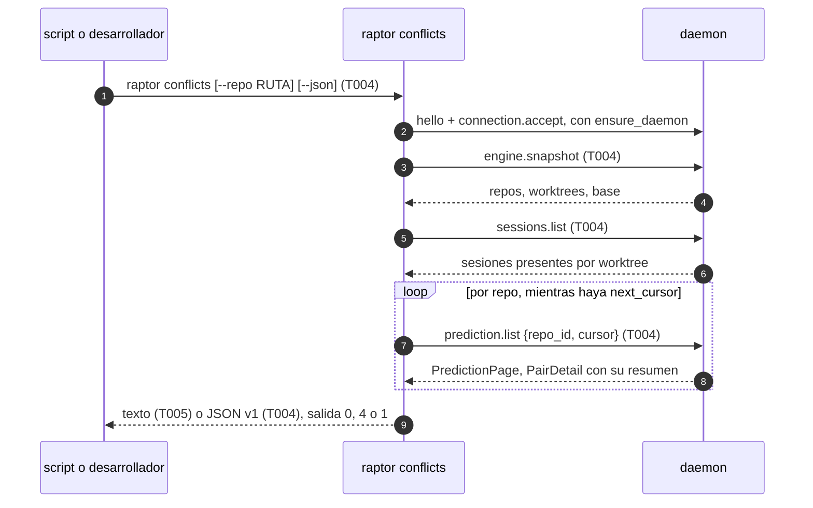

# DS-US-CKP-011 · Consultar la flota y los conflictos desde la línea de comandos

## Contexto rápido

Al terminar, un script o un desarrollador sin la TUI abierta sabe qué agentes van a chocar: `raptor conflicts` lista cada par ⚡ y ⚠ con su nivel, archivos, rangos de líneas y antigüedad, en texto o en `--json`, y sale con código `4` si hay un ⚡ conocido. `raptor status` ya existe (US-GRP-001) y publica worktrees, sesiones, cambios y ahead/behind; esta historia demuestra con un test que dice lo mismo que la TUI y deja escrito que la CLI no integra, rebasa ni descarta. Hoy no hay subcomando `conflicts` en `apps/cli/src/commands/` (DS-TS-CKP-001, § Fuera de alcance) y nada comprueba la paridad de `status` con la TUI.

La CLI no calcula nada. Lee lo que el daemon publica: `engine.snapshot` para los repos, worktrees y la base; `sessions.list` para los agentes; y `prediction.list` (contrato de [DS-TS-CKP-001 § Contrato de API](./TS-CKP-001-predictor-conflictos.md#contrato-de-api)) para los pares con su detalle. No hay métodos, campos ni capacidades nuevas en `crates/api`.

El repo no tiene `architecture-constitution.md` en la cascada. Las restricciones activas son las de [AGENTS.md](../../../../../AGENTS.md) y los ADRs: protocolo congelado en 9 y sin archivos compartidos nuevos (ADR-GRP-016), solo lectura (NFR-01), texto del motor como no confiable (SEC-12, NFR-02) y códigos de salida de DSYS-GRP-001 § 4. Ninguna tarea las viola.

### Decisiones

Cada decisión es **Decisión del orquestador (2026-10-27), validada por Arquitecto (revisión)** (§ Revisión de arquitectura: C1 a C11 ratificadas, C8 corregida); C1 a C10 quedan además validadas por PO el 2026-10-27 y C11 es **Decisión del orquestador (2026-10-27), validada por PO**. Las incorporan las reglas de cada tarea.

| # | Decisión | Alternativa descartada y por qué |
|---|---|---|
| C1 | **`raptor status` no se reescribe.** Sigue con `engine.snapshot` + `sessions.list` + `guard.status` y su JSON actual (`apps/cli/src/status.rs:377`). La paridad con la TUI la prueba un test de punta a punta que compara las dos salidas sobre el mismo fixture en reposo (T002). Es una desviación de ADR-CKP-003 § 11, que pedía reutilizar `present::ingest`; queda anotada en N1 para enmendar el ADR | Rehacer `status` sobre `present::ingest`: su JSON es un contrato publicado desde US-GRP-001, y la ingesta produce `SafeText`, que recorta nombres a 100 caracteres (`present/sanitize.rs:14`) y no sirve para un script |
| C2 | **`raptor conflicts` lee solo `prediction.list`** para los pares, recorriendo `next_cursor` sin `pair_ids`. Cada `PairDetail` ya lleva aplanado su `PairSummary` con el mismo `rev`, así que no hay que casar resumen y detalle. Los repos, los worktrees y la base salen de `engine.snapshot`; los agentes, de `sessions.list` | Leer `RepoView.prediction` y pedir el detalle por `pair_ids` como la TUI (DS-US-CKP-006 AD3): una orden de un disparo no tiene stream que corrija un `rev` desfasado, y serían dos lecturas en vez de una |
| C3 | **Alcance: todos los repos observados**, como `status`. `--repo <RUTA>` lo limita al repo de esa carpeta, resuelto por el daemon con `repo.locate` (N4 de ADR-CKP-003) | Solo el repo del directorio actual: un script de la máquina quiere la flota entera, igual que `status` |
| C4 | **Códigos de salida**: `0` sin ⚡ conocido; `4` con al menos un par `level: conflict` en `current` o `recalculating` (la misma cuenta que `attention.conflicts` y que `known_conflict` de DS-US-CKP-006); `1` error o motor sin `prediction.list`; `2` uso incorrecto (clap). Confirma el supuesto de ADR-CKP-003 § 11. Validada por PO (2026-10-27): DSYS-GRP-001 § 4 pide códigos "documentados y estables", así que la ayuda de `raptor conflicts` los lista y advierte que `0` con `complete: false` no descarta un ⚡ (T004) | `4` también con pares `calculating`: el motor no afirma un ⚡ que no calculó (P7) |
| C5 | **Predicción incompleta**: el código de salida no cambia por pares `calculating` o `pending`. El JSON lleva `complete: false` y el texto cierra con "N pares aún sin calcular" | Esperar a que termine (`--wait`): sin historia que lo pida; el script puede repetir la orden |
| C6 | **JSON propio y versionado** (`schema_version: 1`), mapeado campo a campo con structs propios en `commands/conflicts/view.rs`, nunca reenviando los tipos de `crates/api` (ADR-CKP-003 § 11). Las rutas van como cadenas JSON desde `Untrusted::raw()`, como en `raptor status --json` (`status.rs:4-6`): el escapado de JSON deja inertes los controles de terminal | Reenviar `PredictionPage`: un campo nuevo del contrato aparecería en la salida sin pasar por la allowlist |
| C7 | **Antigüedad**: el JSON da `computed_at_utc_ms` y `age_s` (reloj local en el momento de la salida). El texto dice "hace 40 s", "hace 3 min", "hace 2 h", "hace 1 d" con la unidad entera mayor, como DS-US-CKP-002 D11. Sin `computed_at_utc_ms`, "sin calcular" | Reutilizar `present/freshness_text.rs` de DS-US-CKP-007: es un catálogo tipado de la TUI aún sin implementar, y la CLI usa los catálogos `.txt` (`apps/cli/src/i18n.rs`) |
| C8 | **Lados del par**: en JSON, `{"kind": "worktree", "path", "folder", "agents": [{"agent", "agent_name?"}]}` con una entrada por sesión presente y los mismos valores que `raptor sessions --json` (`agent`: `claude-code` u `other`; `agent_name` solo para el nombre declarado de un "otro agente", `apps/cli/src/sessions.rs:83`), o `{"kind": "base", "branch"}`. En texto, el nombre de la fila de la TUI: el agente como lo nombra `agent_name` de `tui/view.rs:430` ("Claude Code", o el nombre declarado) seguido de la carpeta ("Claude Code · claude-1"), "Sin agente · feat-x", o la rama base. `↔` con fallback `<->` | Solo la ruta: el escenario de la historia nombra el par por sus agentes. Una lista de cadenas inventaba un nombre que el contrato no tiene: una sesión de Claude Code no lleva nombre propio |
| C9 | **La CLI no tiene acciones de BR-07.** La ayuda remite a la TUI desde el `about` de `raptor tui` (`commands/tui.rs:10`), que aparece en `raptor --help`. Los subcomandos que escriben hoy (`undo`, `restore`, `repo`, `guard`, `agent`, `daemon`, `mcp`) son de Time Machine, motor, Guardrails y MCP, no de BR-07: integrar, rebasar o descartar un worktree no existe en la CLI (BR-CKP-CONS-007; BR-CKP-AUTH-003 solo se alcanza desde la TUI) | Un `after_help` en `Cli`: vive en `apps/cli/src/main.rs`, archivo compartido que no se toca (ADR-GRP-016) |
| C10 | **Archivos propios.** `commands/conflicts.rs` con sus submódulos `commands/conflicts/{view,tests}.rs` y una línea en `commands!`. Los textos en `apps/cli/i18n/{en,es}/conflicts.txt` (grupo `conflicts.`). Ningún `mod` nuevo en `main.rs` | Un `apps/cli/src/conflicts.rs` como `status.rs`: obliga a declarar el módulo en `main.rs` |
| C11 | **`raptor status --json` gana `schema_version: 1`** como campo de primer nivel, añadido y sin cambiar ningún campo existente; el mapeo sigue siendo el de C1. Cierra Q-CKP-31. Un script que lee las dos órdenes detecta un cambio de forma igual en ambas, como pide DSYS-GRP-001 § 4 ("esquema estable y versionado") | Mapear `status` desde el modelo de vista (`present::ingest`): rompe el contrato publicado de US-GRP-001 y recorta nombres (C1), y la historia no lo pide. No versionar: un script no distingue la forma vieja de la nueva |

## 📋 Índice

> **Para aprobar:** [Contexto rápido](#contexto-rápido) · [⚠️ Gaps](#gaps) · [🔭 La forma](#la-forma) · [El trabajo de un vistazo](#el-trabajo-de-un-vistazo).
> **Para implementar:** [🚀 Plan](#plan-de-implementación), en orden. Las secciones `_(ref)_` se abren desde la tarea que las cita.

| Sección | Propósito |
|---------|-----------|
| [Contexto rápido](#contexto-rápido) | Qué se construye, por qué y las decisiones |
| [⚠️ Gaps](#gaps) | Qué impide empezar |
| [🔭 La forma](#la-forma) | Qué piezas quedan y cómo fluye el dato |
| [🚀 Plan de implementación](#plan-de-implementación) | T001…T006 |
| [Contratos compartidos](#contratos-compartidos) _(ref)_ | Tipos y firmas |
| [Contrato de API](#contrato-de-api) _(ref)_ | Salida JSON v1, errores y valores numéricos |
| [Estrategia de pruebas](#estrategia-de-pruebas) _(ref)_ | Escenario → test |
| [Gate de seguridad](#gate-de-seguridad) | Texto no confiable, solo lectura |
| [Cómo extender](#cómo-extender) | Qué tocar para añadir un campo o una orden |
| [Fuera de alcance](#fuera-de-alcance) | Lo diferido y su dueño |
| [Notas del autor](#notas-del-autor) _(ref)_ | Lo que no bloquea |

---

## Gaps

| ID | Qué falta | Severidad | Alcance | Acción | Owner |
|----|-----------|-----------|---------|--------|-------|
| G1 | T009 de TS-CKP-001 (`crates/api/src/prediction.rs`, `methods/prediction.rs`, `prediction.list`) y el trabajador que publica los pares (PR-B de DS-TS-CKP-001, a su vez bloqueado por TS-GRP-005). Sin ellos no compila T004 ni hay pares que listar | Bloqueante | T004, T005 | Implementar el PR-B de [DS-TS-CKP-001](./TS-CKP-001-predictor-conflictos.md) | Orquestador |

T001 a T003 (paridad de `status` y CLI sin acciones) no dependen de G1 y pueden mezclarse antes.

---

## 🔭 La forma



`raptor status` no cambia de forma: el test de T002 lo pone al lado de la TUI.

---

## 🚀 Plan de implementación

### El trabajo de un vistazo

| # | Tarea | Depende | Aterriza en |
|---|---|---|---|
| T001 | Escribir en rojo las pruebas de la historia | — | `apps/cli/tests/cli_read_only.rs` |
| T002 | Probar que `status --json` dice lo mismo que la TUI | T001 | `apps/cli/tests/cli_read_only.rs` |
| T003 | Remitir a la TUI desde la ayuda y probar que no hay acciones de BR-07 | T001 | `apps/cli/src/commands/tui.rs`, `apps/cli/tests/cli_read_only.rs` |
| T004 | Crear `raptor conflicts`: lectura, modelo y salida JSON v1 | G1, T001 | `apps/cli/src/commands/conflicts.rs`, `commands/conflicts/view.rs`, `commands/mod.rs` |
| T005 | Pintar la salida de texto con textos en/es | T004 | `commands/conflicts/view.rs`, `apps/cli/i18n/{en,es}/conflicts.txt` |
| T006 | Cerrar la historia | T002, T003, T005 | `docs` |

### En qué orden

T001 → {T002, T003} → (G1) → T004 → T005 → T006. T002 y T003 pueden ir en un PR propio antes de G1.

### T001 — Escribir en rojo las pruebas de la historia

**Objetivo.** Los tres escenarios de la historia contra el daemon real, con perfil y repos temporales.

**Ubicación.** `apps/cli/tests/cli_read_only.rs` (**CREATE**)

**Reglas**
- El arnés de `apps/cli/tests/live_fleet.rs`: `#![cfg(all(target_os = "macos", debug_assertions))]` (T002 conduce la `App` y `GITRAPTOR_PROFILE_DIR` solo vale en debug), `env!("CARGO_BIN_EXE_raptor")`, `GITRAPTOR_PROFILE_DIR` temporal y `gitraptor_testkit::Fixture`. Nunca este repo ni el perfil real (NFR-01).
- Repo `shop` con los worktrees `claude-1` y `claude-2`, base `main` confirmada y `raptor-fake-agent` como sesión en cada uno (como `apps/cli/tests/live_fleet.rs`).
- Sin esperas fijas: se repite la orden hasta que la salida tiene lo esperado, con un plazo de 30 s.
- Los tests de `conflicts` llevan `#[ignore = "G1: prediction.list (T009 de TS-CKP-001)"]` hasta que G1 esté en `main`.

- **Depende:** —
- **Refs:** US-CKP-011, escenarios 1 a 3
- **Aceptación:** `cargo test -p gitraptor-cli --test cli_read_only` compila; el test de T003 falla porque la ayuda de `tui` no nombra "merge, rebase or discard". El de T002 es de caracterización: puede pasar ya, porque `status` existe; si falla, el fallo dice qué campo falta y T002 lo arregla

### T002 — Probar que `status --json` dice lo mismo que la TUI

**Objetivo.** Escenario 1: con el fixture en reposo, la TUI y `raptor status --json` coinciden en worktrees, agentes, estados, archivos modificados y ahead/behind.

**Ubicación.** `apps/cli/tests/cli_read_only.rs` (**MODIFY**)

**Reglas**
- La TUI se conduce como en `live_fleet.rs` (la `App` real sobre `TestBackend`) y se lee su `Model` tras "En vivo"; `status --json` se corre después sin cambios en el fixture (en reposo: ningún evento entre las dos lecturas, comprobado con el `seq` del `engine.snapshot`).
- Equivalencias que el test compara por worktree (clave: la ruta raíz):

  | TUI (`WorktreeRow`, `SessionRow`, `AgentRowModel`) | `status --json` |
  |---|---|
  | `path` | `worktrees[].path` |
  | `WorktreeState::Unavailable(r)` | `state: "unavailable"`, `unavailable_reason` |
  | `changes` | `counts.staged + counts.unstaged + counts.untracked` |
  | `divergence` | `ahead_behind.{state, ahead, behind}` |
  | sesiones presentes y su `state` (`Active`, `Idle`, `Done`) | `sessions[].state` (`active`, `inactive`, `ended`) |
  | `SessionRow.kind` y `SessionRow.name` | `sessions[].agent` (`claude-code`, `other`) y `sessions[].agent_name` (solo el nombre declarado) |
  | `detection` | `session_detection` |
- Si una equivalencia falla, el arreglo va en `status.rs` (el campo que falte) y no en la TUI. Añadir un campo al JSON es compatible; cambiar uno existente no se hace aquí.
- `status.rs` añade `schema_version: 1` en el primer nivel del JSON (C11); el test comprueba que está y que ningún campo previo cambió.

- **Depende:** T001
- **Refs:** C1, C11; BR-CKP-CONS-007
- **Aceptación:** `cargo test -p gitraptor-cli --test cli_read_only status_matches_the_tui`

### T003 — Remitir a la TUI desde la ayuda y probar que no hay acciones de BR-07

**Objetivo.** Escenario 3: ninguna orden de la CLI integra, rebasa ni descarta un worktree, y `raptor --help` dice que eso se hace en la TUI.

**Ubicación.**
- `apps/cli/src/commands/tui.rs` (**MODIFY**): el doc comment de `Cmd` (`:10`) pasa a "Open the cockpit (the default without a subcommand): watch the fleet, and merge, rebase or discard an agent's worktree. Needs a terminal."
- `apps/cli/tests/cli_read_only.rs` (**MODIFY**)

**Reglas**
- El test recorre el árbol de `raptor --help` (cada subcomando y sus hijos con `--help`) y falla si algún nombre de orden es `merge`, `rebase`, `discard`, `integrate` o `prune`, o si hay un grupo `worktree`, o si la ayuda de primer nivel no contiene la línea de `tui` con "merge, rebase or discard".
- `remove` no entra en la lista: `raptor repo roots remove` (deja de vigilar una carpeta de código, `commands/repo.rs:54`) ya existe y no es de BR-07, igual que `repo retire` y `mcp uninstall`. El test nombra solo verbos que integran, rebasan o descartan un worktree.
- La ayuda de clap va en inglés; `--lang` no la traduce. Es lo que hay hoy para todos los subcomandos.

- **Depende:** T001
- **Refs:** C9; BR-CKP-CONS-007, BR-CKP-AUTH-003
- **Aceptación:** `cargo test -p gitraptor-cli --test cli_read_only no_write_action_and_help_points_to_the_tui`

### T004 — Crear `raptor conflicts`: lectura, modelo y salida JSON v1

**Objetivo.** `raptor conflicts --json` imprime los pares de cada repo observado con su nivel, estado, archivos, rangos y antigüedad, y sale con 0, 4 o 1.

**Ubicación.**
- `apps/cli/src/commands/conflicts.rs` (**CREATE**): `Cmd { json: bool, repo: Option<PathBuf> }`, `run`, la lectura (`read`) y `mod view;` `#[cfg(test)] mod tests;`
- `apps/cli/src/commands/conflicts/view.rs` (**CREATE**): `Fleet`, `PairOut`, `SideOut`, `FileOut`, `ConflictsJson` y `json()`
- `apps/cli/src/commands/conflicts/tests.rs` (**CREATE**)
- `apps/cli/src/commands/mod.rs` (**MODIFY**): `Conflicts(conflicts),` justo después de `Status(status),`

**Reglas**
- Conexión con `crate::engine(CMD)` (arranca el daemon como `status`, ADR-CKP-003 § 5). Si `prediction.list` no está en `hello.methods` (`support::offers`), sale con `1` y `conflicts.restart-engine` en stderr.
- Repos: `engine.snapshot`; con `--repo`, la ruta pasa por `support::command_path` (absoluta y canónica, como `raptor repo`) y luego `repo.locate {path}`, y solo cuenta ese `repo_id`. `repo.locate` responde `NOT_FOUND` (-32009, `conn.rs` `repo_locate`) a una ruta fuera de todo repo observado: sale con `1` y `conflicts.not-observed`.
- Por repo: `prediction.list {repo_id, cursor}` hasta que `next_cursor` es `None` (C2). Un par repetido entre páginas se queda con el `rev` mayor. Errores del canal → stderr saneado con `error_text` y salida `1`.
- Agentes: `sessions.list` si se ofrece (`offers`), como `commands/status.rs:52`. Se casan con el lado por la ruta raíz cruda (`SessionView.worktree.raw() == root.raw()`). Sin detección, `agents` va vacío y el texto dice "agente no disponible", nunca "sin agente" (BR-CKP-CONS-003).
- Orden de salida: por repo en el orden del snapshot; dentro, ⚡ primero, luego ⚠, luego el resto; en cada grupo, el orden del motor.
- `level` solo se emite si el contrato lo trae (`current`, `recalculating`). `complete = ningún par en calculating o pending` (C5).
- Salida: `4` si algún par cumple C4, si no `0`. Con `--json` la salida va a stdout aunque el código sea `4`.
- La ayuda de `raptor conflicts --help` lista los códigos `0`, `4`, `1` y `2` y dice que `0` con la predicción incompleta no descarta un ⚡ (C4, DSYS-GRP-001 § 4).
- Nada de contenido: el modelo no tiene campo para texto de archivo, hunk o mensaje de commit; el contrato tampoco lo trae.

- **Depende:** G1, T001
- **Refs:** C2 a C6, C8, C10; A2 de DS-US-CKP-006
- **Aceptación:** `cargo test -p gitraptor-cli --bin raptor commands::conflicts` y `cargo test -p gitraptor-cli --test cli_read_only conflicts_json_lists_pairs_without_content`

### T005 — Pintar la salida de texto con textos en/es

**Objetivo.** Sin `--json`, una línea por par y sus archivos debajo, indentados (DSYS-GRP-001 § 4).

**Ubicación.**
- `apps/cli/src/commands/conflicts/view.rs` (**MODIFY**): `text(&Fleet, &Sides, Tr, ascii: bool) -> String` (la firma de § Firmas del stack; no hay tipo `Glyphs`)
- `apps/cli/i18n/en/conflicts.txt` y `apps/cli/i18n/es/conflicts.txt` (**CREATE**; `build.rs` los registra)

**Reglas**
- Cabecera por repo: carpeta del repo. Línea del par: símbolo (`⚡`/`⚠`, en ASCII `[c]`/`[!]`: los `SymbolSpec` de conflicto y aviso de `crates/theme/src/generated.rs:461,471` que usa la TUI, sin copiarlos), `lado_a ↔ lado_b` (C8), estado si no es `current` ("recalculando", "calculando", "pendiente: base sin confirmar"…, un texto por `PairStateView` y `PairReason`) y la antigüedad (C7).
- Archivos del ⚡: ruta y, en `kind: content`, los rangos por lado `40–45 ↔ 41–43` (`LineRange{start,len}` → `start–start+len-1`); los demás `kind` con su nombre. Con `has_merge_rule`, "regla de merge". Con `hunks_truncated` o `conflict.truncated`, "y más". Archivos del ⚠: rutas de `overlap`; con `overlap_partial`, "y más".
- Pie: los 8 `LimitCode` en una línea corta, como la de DS-US-CKP-006 P3, y "N pares aún sin calcular" si `complete` es falso. Sin pares: "Sin conflictos previstos" solo si `complete`; si no, "Aún calculando".
- Rutas y nombres saneados con `Untrusted::sanitized()`; color solo si stdout es TTY y no hay `NO_COLOR` (`--no-color`, `--ascii` del `Display` global).
- ASCII: `--ascii` o locale no UTF-8 → `<->`, `[c]`, `[!]` y `-` en los rangos.
- Claves en un solo grupo `conflicts.`; los tests de `i18n.rs` exigen las mismas claves y marcadores en en y es.

- **Depende:** T004
- **Refs:** C7, C8; DSYS-GRP-001 § 4
- **Aceptación:** `cargo test -p gitraptor-cli --bin raptor commands::conflicts::tests::text` y `cargo test -p gitraptor-cli --bin raptor i18n`

### T006 — Cerrar la historia

**Objetivo.** La historia apunta a lo implementado; esta DS cambia a `implemented` con su tabla de estado.

**Ubicación.** `docs/requirements/features/cockpit/user-stories/US-CKP-011-cli-solo-lectura.md` (**MODIFY**), esta DS (**MODIFY**)

**Reglas**
- La historia pasa a `implemented` solo con los tres escenarios en verde; los tests `#[ignore]` de T001 ya no llevan la marca.
- Si T002 obligó a añadir un campo a `status --json`, se anota en la historia y en N1.
- No se edita `docs/ARTIFACTS.md` ni el backlog a mano.

- **Depende:** T002, T003, T005
- **Refs:** C1, C9; US-CKP-011
- **Aceptación:** `cargo fmt --all --check`, `cargo clippy --all-targets -- -D warnings` y `cargo test --workspace` en verde

---

## Contratos compartidos

### Tipos y datos compartidos

La forma del cable es la de [DS-TS-CKP-001 § Contrato de API](./TS-CKP-001-predictor-conflictos.md#contrato-de-api): `ListPredictionParams`, `PredictionPage`, `PairDetail`, `PairSummary`, `PairSideView`, `PairStateView`, `PairReason`, `PairLevel`, `LimitCode`, `ConflictFileView`, `LineRange`, desde `gitraptor_api::prediction` (**a crear** en T009 de TS-CKP-001). Ya existen y se usan tal cual: `methods::ENGINE_SNAPSHOT`, `methods::SESSIONS_LIST`, `methods::REPO_LOCATE`, `messages::{Snapshot, RepoView, SessionsListResult}`, `scope::{RepoLocateParams, RepoLocateResult}`.

### Ciclos de vida (DI)

_No aplica — Rust sin contenedor de dependencias._ `raptor conflicts` es una orden de un disparo: abre una conexión, hace sus lecturas, imprime y sale. No guarda nada en el perfil.

### Firmas del stack

```rust
// apps/cli/src/commands/conflicts.rs (CREATE)
#[derive(clap::Args)]
pub(crate) struct Cmd {
    /// Print JSON instead of text.
    #[arg(long)] json: bool,
    /// Only the repo of this folder.
    #[arg(long)] repo: Option<std::path::PathBuf>,
}
impl Cmd { pub(crate) fn run(self, global: &Global) -> ExitCode; }
fn read(client: &mut gitraptor_core::client::Client, repo: Option<&Path>) -> Result<(Fleet, Sides), ExitCode>;

// apps/cli/src/commands/conflicts/view.rs (CREATE)
pub(super) struct Fleet { pub repos: Vec<RepoPairs>, pub now_utc_ms: i64 }
pub(super) struct RepoPairs { pub repo_id: String, pub folder: String, pub base: Option<String>, pub limits: Vec<LimitCode>, pub pairs: Vec<PairDetail> }
impl Fleet {
    pub fn known_conflicts(&self) -> usize;     // C4
    pub fn complete(&self) -> bool;             // C5
}
pub(super) fn json(fleet: &Fleet, sides: &Sides) -> ConflictsJson;
pub(super) fn text(fleet: &Fleet, sides: &Sides, tr: Tr, ascii: bool) -> String;
/// Casa cada raíz con su carpeta y sus agentes presentes (C8).
pub(super) struct Sides { /* raíz cruda → (folder, Vec<agent_name>) */ }
```

`read` recibe el cliente que devuelve `crate::engine` (`apps/cli/src/support.rs:30`), el mismo tipo que usa `commands/status.rs`.

## Contrato de API

No hay métodos nuevos en el canal. Se consumen `engine.snapshot`, `sessions.list`, `repo.locate` (existentes) y `prediction.list` (T009 de TS-CKP-001). La salida nueva es la de la orden.

**Salida `--json`, versión 1** (C6). Todas las claves existen siempre salvo las marcadas `?`, que se omiten si no aplican.

```json
{
  "schema_version": 1,
  "complete": true,
  "known_conflicts": 1,
  "repos": [{
    "repo_id": "r1", "path": "/w/shop", "base_branch": "main",
    "limits": ["overlap-includes-uncommitted", "conflict-committed-only", "no-merge-drivers-or-attributes",
               "rename-limit", "insertions-may-merge", "joined-hunks", "pair-ignores-base-moves", "local-only"],
    "pairs": [{
      "pair_id": "5a10e3c2f9b84d77",
      "a": {"kind": "worktree", "path": "/w/claude-1", "folder": "claude-1", "agents": [{"agent": "claude-code"}]},
      "b": {"kind": "worktree", "path": "/w/claude-2", "folder": "claude-2", "agents": [{"agent": "other", "agent_name": "aider"}]},
      "state": "current", "reason?": "base-unconfirmed", "level?": "conflict",
      "computed_at_utc_ms?": 1793091600000, "age_s?": 120,
      "overlap_files": 1, "overlap_partial": false, "overlap": ["src/api.rs"],
      "conflict_files": 1, "conflict_truncated": false,
      "conflict": [{"path": "src/api.rs", "kind": "content",
                    "ours": [{"start": 40, "len": 6}], "theirs": [{"start": 41, "len": 3}],
                    "hunks_truncated": false, "has_merge_rule": false}]
    }]
  }]
}
```

`b` contra la base: `{"kind": "base", "branch": "main"}`. `conflict` es `[]` si el par no tiene ⚡. Los enums usan los nombres de cable kebab-case del contrato (`status::wire`). No hay `merge_base`, `rewrites_escalated` ni ningún campo que el script no necesite: añadir uno es `schema_version` igual; quitar o renombrar uno lo sube a 2.

### Forma del error y del cuerpo de respuesta

Un error nunca escribe JSON en stdout: stdout queda vacío, stderr lleva una línea `raptor conflicts: <texto>` y el código es `1`.

| Causa | Texto (clave) | Código |
|---|---|---|
| Motor sin `prediction.list` en `hello.methods` | `conflicts.restart-engine` | 1 |
| `--repo` fuera de todo repo observado (`repo.locate` sin repo) | `conflicts.not-observed` | 1 |
| Motor no disponible o canal rechazado | el de `support::engine` | 1 |
| Error de una llamada (`ClientError`) | `error_text(err)`, saneado; nunca el `message` del daemon | 1 |
| Argumento inválido | el de clap | 2 |

### Valores numéricos

| Concepto | Valor | Fuente |
|---------|-------|--------|
| Pares por página de `prediction.list` | ≤ 50 o 512 KiB | DS-TS-CKP-001 § Contrato de API |
| Pares con 10 worktrees | 55 | ADR-CKP-001 § 2 |
| Plazo de cada llamada | el de `call_timeout` de la biblioteca cliente | `crates/api/src/client/mod.rs` |
| Códigos de salida | 0, 1, 2, 4 | DSYS-GRP-001 § 4; C4 |
| `schema_version` | 1 | C6 |

---

## Estrategia de pruebas

| Escenario | Test | Nivel |
|---|---|---|
| 1 `status` muestra lo mismo que la TUI | `cli_read_only::status_matches_the_tui` | Punta a punta (daemon real, TUI sobre `TestBackend`) |
| 2 `conflicts` lista pares sin contenido | `cli_read_only::conflicts_json_lists_pairs_without_content`: fixture con ⚡ `claude-1 ↔ claude-2` en `src/api.rs`; la salida lleva par, `level`, archivo, rangos y `age_s`; un secreto plantado en el contenido de `src/api.rs` y en el mensaje del commit no aparece en stdout; las claves del JSON son exactamente las de v1 | Punta a punta |
| 3 La CLI no ofrece acciones de escritura | `cli_read_only::no_write_action_and_help_points_to_the_tui` | Punta a punta (binario) |

**Unidad (`commands::conflicts::tests`):**

- `exit_is_4_with_a_known_conflict_only` (`current` y `recalculating` sí; `calculating`, `pending` y `not-computable` no; C4)
- `incomplete_prediction_keeps_the_exit_code_and_says_so` (C5)
- `pages_are_walked_and_a_repeated_pair_keeps_the_greater_rev` (C2)
- `conflicts_first_then_overlaps_in_engine_order`
- `level_is_omitted_outside_current_and_recalculating`
- `base_side_names_the_base_branch` y `worktree_side_names_its_agents_or_says_not_available` (C8)
- `json_keys_are_the_v1_allowlist` (C6)
- `ranges_are_inclusive_and_fold_to_ascii` y `age_uses_the_largest_whole_unit` (C7)
- `paths_with_controls_are_sanitized_in_text_and_escaped_in_json` (SEC-12): rama y ruta con `\x1b]52;…`, RLO y U+2028

**Datos.** Fixture `shop` en perfil temporal (punta a punta); en unidad, `PredictionPage` y `Snapshot` construidos con los tipos de `gitraptor_api`.

**Plataformas.** macOS en el PR. Linux y Windows: *Pendiente: etapa de validación multiplataforma* ([`xplat-pendientes.md`](../../../../architecture/xplat-pendientes.md)).

---

## Gate de seguridad

- **Texto no confiable (SEC-12, NFR-02):** rutas, ramas y nombres de agente llegan como `Untrusted`/`UntrustedName`. En texto se pintan con `sanitized()`; en JSON van escapados por `serde_json`, como en `raptor status --json`. Los límites, estados y motivos son códigos y su texto lo pone el catálogo.
- **Sin contenido (Q-CKP-20):** el contrato de la predicción no trae contenido de archivos, hunks ni mensajes de commit, y el mapeo de C6 no tiene campo donde ponerlos. El escenario 2 lo prueba con un secreto plantado.
- **Solo lectura (NFR-01):** las tres llamadas son lecturas (`engine.snapshot`, `sessions.list`, `prediction.list`, y `repo.locate` con `--repo`). `raptor conflicts` no lanza procesos ni importa `gitraptor_git`; no hay shell en ningún camino (argv fijo de clap).

---

## Cómo extender

Sin archivos compartidos (ADR-GRP-016, [guía](../../../../architecture/extender-sin-archivos-compartidos.md)):

- **Un campo nuevo en `conflicts --json`:** un campo en el struct de `commands/conflicts/view.rs`, en la allowlist del test `json_keys_are_the_v1_allowlist` y en el ejemplo de § Contratos compartidos. `schema_version` sigue en 1 si solo se añade.
- **Un texto nuevo:** una clave `conflicts.*` en los dos `conflicts.txt`.
- **Un filtro nuevo (`--worktree`):** un campo de `Cmd` en `commands/conflicts.rs`, que pasa a `ListPredictionParams.worktree`.
- **Otra orden de solo lectura:** un archivo `commands/<orden>.rs` y una línea en `commands!`. Si escribe en un repo, no es de esta historia: las acciones de BR-07 son de la TUI (C9).

---

## Fuera de alcance

| Ítem | Dónde se cubre | Gate |
|---|---|---|
| Acciones de BR-07 desde la CLI (integrar, rebasar, descartar, crear worktree) | Fuera del MVP (Q-CKP-20); en la TUI, US-CKP-014 a 018 | `no_write_action_and_help_points_to_the_tui` |
| Mapeo de `raptor status --json` por `present::ingest` | Descartado (C1, C11); `schema_version` sí entra (T002) | — |
| `check_conflicts` del MCP | DS-US-MCP-016 | — |
| `--worktree`, `--wait` | Sin historia | — |
| Antigüedad y agregados por estado en la TUI | DS-US-CKP-007 | — |

---

## Notas del autor

| ID | Nota | Acción | Owner |
|----|------|--------|-------|
| N1 | C1 se aparta de ADR-CKP-003 § 11 ("reutilizan `client` y `present::ingest`"): `status` existía antes que la TUI y su JSON es un contrato. `conflicts` sí cumple el resto del § 11 (esquema propio y versionado, allowlist en un solo mapeo) | Añadir a ADR-CKP-003 una enmienda que lo recoja | Arquitecto |
| N2 | `commands/status.rs` importa `gitraptor_core::client` y `gitraptor_core::profile`. Está permitido: tras la Enmienda (2026-10-08) de ADR-CKP-003, V5 rige la biblioteca de `apps/cli` (`lib.rs`: `client`, `model`, `present`, `tui`…), y `commands/` es del binario (`main.rs:4`), que es quien construye el lanzador (`tui_boundaries.rs`, `only_the_binary_builds_the_launcher`). `conflicts` vive en `commands/` y solo nombra `gitraptor_core::client::Client`, el tipo que devuelve `crate::engine`, igual que `status`. Lo que sí rige: `apps_cli_does_not_depend_on_git_or_policy`, así que `conflicts` no importa `gitraptor_git` | Ninguna | — |
| N3 | Si DS-TS-CKP-001 § Contrato de API cambia un nombre, manda esa sección y estas reglas se leen con el nombre nuevo | Revisar al cerrar T009 de TS-CKP-001 | Arquitecto |

### Revisión de arquitectura (2026-10-27)

Revisión contra `main` (`crates/api`, `apps/cli/src/{commands,tui,client}`, `crates/core/src/channel`), ADR-CKP-001, ADR-CKP-003, ADR-GRP-016 y DS-TS-CKP-001 § Contrato de API. **Decisión del orquestador (2026-10-27), validada por Arquitecto (revisión).**

- **Ratificadas sin cambio:** C1 (desviación de ADR-CKP-003 § 11 justificada: el JSON de `status` es contrato de US-GRP-001 y `SafeText` recorta a 100 caracteres; la enmienda del ADR sigue pendiente en N1), C2 a C7, C9 a C11. Los nombres del contrato de la predicción (`ListPredictionParams`, `PredictionPage`, `PairDetail` con `PairSummary` aplanado, `PairSideView`, `PairStateView`, `PairReason`, `PairLevel`, los 8 `LimitCode`, `ConflictFileView`, `LineRange`, `next_cursor`) coinciden uno a uno con DS-TS-CKP-001. `engine.snapshot`, `sessions.list`, `repo.locate`, `support::{engine, offers, error_text}` y la macro `commands!` existen con esos nombres. G1 es real: `crates/api` no tiene aún `prediction`.
- **Corregido:** C8 y el ejemplo JSON (una sesión de Claude Code no tiene nombre propio: `agents` lleva `agent` y `agent_name?` como `sessions --json`, y el texto usa el nombre de la fila de la TUI); la fila de nombres de T002; el arnés de T001 (`cfg` de `live_fleet.rs`, porque T002 conduce la `App`) y su criterio de rojo (T002 es de caracterización); la lista de verbos de T003 (`remove` rompía el test por `repo roots remove`); `--repo` con `command_path` y el `NOT_FOUND` de `repo.locate`; la firma de `text` en T005; N2 (V5 rige la biblioteca, no el binario).

### Preguntas abiertas

| ID | Pregunta | Por qué importa | Para |
|----|----------|-----------------|------|
| Q-CKP-31 | **Cerrada el 2026-10-27 → C11** (Decisión del orquestador, validada por PO: `schema_version: 1` sí, mapeo desde el modelo de vista no). ¿`raptor status --json` gana `schema_version` y pasa a mapearse desde el modelo de vista, como pide ADR-CKP-003 § 11 y DSYS-GRP-001 § 4 ("esquema estable y versionado")? | Hoy no lleva versión; un script no puede detectar un cambio de forma | PO y Arquitecto |

## Estado

- Hecho: Dev Spec en `draft` con T001 a T006.
- Hecho: validación del PO (2026-10-27) de C1 a C10, C11 y Q-CKP-31 cerrada.
- Pendiente: G1 (T009 y PR-B de TS-CKP-001, bloqueados por TS-GRP-005). T001 a T003 no esperan a G1.
- Siguiente paso: implementar T001 a T003 en un PR; cuando T009 esté en `main`, pasar a `ready_to_implement: true` y seguir con T004.
