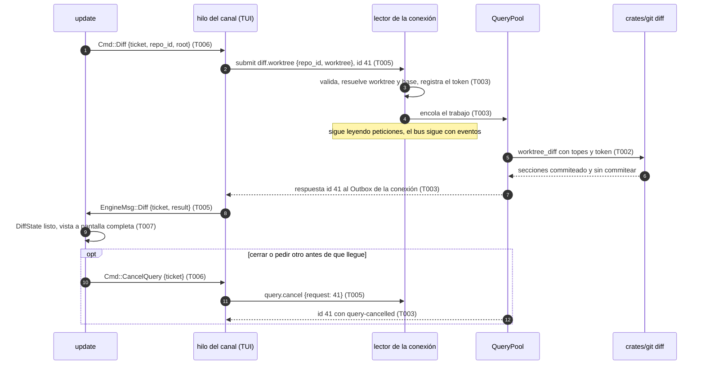

# DS-US-CKP-012 · Revisar lo que un agente integraría antes del merge

## Contexto rápido

Al terminar, el desarrollador selecciona la fila de un agente en la TUI, pulsa `d` y ve en pantalla completa dos secciones: lo que entraría al merge (la rama frente a su merge-base con la base confirmada) y, aparte, lo que el worktree tiene sin commitear. Los binarios salen como "binario" sin contenido, los archivos grandes truncados con aviso, y el agente, su sesión y el repo no cambian. Hoy no puede: la flota no tiene cursor de fila (las flechas solo mueven el selector de repo, `tui/update.rs:145`), ninguna tecla actúa sobre una fila (`tests/tui_engine_states.rs:620`), el canal no tiene consulta de diff y `DiffView` (`tui/widgets/diff_view.rs`) no tiene quien lo alimente.

La historia fija además el contrato de las **consultas bajo demanda** (N8 de ADR-CKP-003 § 4): id de petición, cancelación y topes, con la respuesta fuera de orden y sin bloquear el stream. ADR-GRP-005 (Enmienda 2026-10-04, Cockpit) fijó el qué (gix sin filtros, pool propio, solo a la conexión que pide) y dejó la forma pendiente; ADR-GRP-009 Validación 8 la necesita para excluir esas respuestas del escaneo de secretos. US-CKP-021 (timeline) y US-CKP-022 (grafo) reutilizan esta forma.

Ver el diff no es una operación del catálogo (ADR-CKP-002 § 1: "Ver diff no es una operación del catálogo") ni pasa por Guardrails (BR-CKP-ELIG-006): no escribe en el repo. Tampoco toca BR-CKP-AUTH-003, que solo gobierna merge, rebase y descarte: ver el diff del worktree de otro actor no pide confirmación.

El repo no tiene `architecture-constitution.md` en la cascada. Las restricciones activas son las de [AGENTS.md](../../../../../AGENTS.md) y los ADRs: `unsafe_code = forbid` (ADR-GRP-001), protocolo congelado en 9, códigos nuevos solo en el bloque del módulo y métodos en su archivo (ADR-GRP-016), lecturas solo con `gix` sin filtros (ADR-GRP-009 § 1), y el contenido del diff nunca al MCP ni al stream ni al disco (Q-CKP-8, SEC-05). Ninguna tarea las viola.

### Decisiones

Cada decisión es **Decisión del orquestador (2026-10-27), validada por Arquitecto (revisión)** (§ Revisión de arquitectura: D1 a D5 y D7 a D16 ratificadas, D6 y D13 corregidas); D1 a D15 quedan además validadas por PO el 2026-10-27, y D4 y D16 son **Decisión del orquestador (2026-10-27), validada por PO** en lo que toca a alcance. Las incorporan las reglas de cada tarea.

| # | Decisión | Alternativa descartada y por qué |
|---|---|---|
| D1 | **Dos módulos del contrato.** `query` (genérico, N8): el método `query.cancel` y los códigos `query-busy` y `query-cancelled`. `diff` (de esta historia): el método `diff.worktree` y el código `diff-unavailable`. Cada uno en su archivo de `crates/api/src/methods/` y sus tipos en `crates/api/src/{query,diff}.rs`. Ninguno se ofrece a `raptor-mcp` (`mcp: false`) ni es reservado | Todo en `diff`: US-CKP-021 y 022 tendrían que importar la cancelación de un módulo ajeno o duplicarla |
| D2 | **Respuesta asíncrona en el daemon.** El brazo de `diff.worktree` en `conn.rs` valida, resuelve el worktree en el estado del motor y encola el trabajo en `QueryPool`; no responde. Un hilo del pool calcula y empuja la respuesta con el `id` de la petición al `Outbox` de la conexión (`Arc`, ya compartido con el escritor). Mientras, el lector sigue atendiendo peticiones y el bus sigue empujando eventos | Responder dentro del brazo: el lector de la conexión no podría leer `query.cancel` mientras calcula, y una TUI con varias peticiones esperaría al diff |
| D3 | **Cancelación.** `query.cancel {request}` marca el token de esa petición de la misma conexión y responde al momento `{cancelled}`. El trabajo mira el token entre archivos y responde a la petición original con `query-cancelled`. Al cerrarse la conexión se cancelan todos sus tokens. Una conexión no puede cancelar peticiones de otra | Cancelar sin responder la original: el cliente se quedaría esperando una respuesta que no llega |
| D4 | **Topes** (⚠️ **ASSUMPTION**, ver § Valores numéricos): 1 consulta en vuelo por conexión, pool de 1 hilo con cola global de 4 (más → `query-busy`), plazo de 2 s, respuesta ≤ 768 KiB serializada, ≤ 1.000 archivos, ≤ 2.000 líneas de diff por archivo, blobs ≤ 8 MiB. Al superar un tope la respuesta sale con lo calculado y `cut: files | bytes | time`; nunca un error. Validada por PO (2026-10-27, cierra Q-CKP-32) como valores iniciales del MVP, con dos condiciones que no se negocian al ajustarlos: la cabecera de sección cuenta todos los archivos (`files_total`) y lista las rutas de los omitidos mientras quepan, y una vista truncada nunca se presenta como completa. Bajarlos tras medir (N4) no pide otra validación si se cumplen las dos | Error al pasar el tope: el desarrollador no vería nada justo en el diff grande, que es el que más necesita revisar |
| D5 | **Qué compara cada sección** (BR-CKP-CALC-005). *Entraría al merge*: el primer merge-base (`RepoReader::merge_bases`, `reader.rs:530`) entre la punta de la base confirmada y `HEAD` del worktree, contra `HEAD`; con `HEAD` separado también vale. *Sin commitear*: `HEAD` contra el working tree, con lo preparado y lo no preparado juntos, más los archivos sin seguimiento no ignorados como añadidos. Base sin confirmar, sin base, rama base sin ref o sin merge-base: la sección dice "no calculable" con su motivo, y la de sin commitear se calcula igual | Excluir los sin seguimiento: el escenario 1 cuenta "sin commitear (1 archivo)" y un archivo nuevo de un agente es lo primero que hay que revisar |
| D6 | **Cómo se lee** (ADR-GRP-009 § 1). `crates/git/src/diff.rs` con `gix` en solo lectura. *Entraría al merge*: las rutas con `changed_paths(merge_base, HEAD, max_files, deadline)` (`changed_paths.rs:66`: solo rutas y `total`, sin ids ni renombrados; falla entero si pasa el plazo, nunca da un total parcial) y el contenido de cada lado con `committed_file(commit, componentes, max_blob_bytes)` (`committed.rs:60`: `Absent`, `NotRegular`, `TooLarge` por la cabecera antes de cargar, o `Blob`), que también da el tipo de cambio. *Sin commitear*: las rutas con `RepoReader::status` (`reader.rs:605`), el lado `HEAD` con `committed_file` y el lado del working tree abriendo cada componente sin seguir enlaces (`O_NOFOLLOW` con `rustix`, ya dependencia de `crates/git`) y midiendo con `fstat` antes de leer. Un enlace simbólico, en cualquier lado, es `symlink` sin contenido: ni se sigue ni se lee su destino. Las líneas se comparan con `gix::diff::blob::{Diff, InternedInput}` sobre los bytes crudos, como ya hace `dry_merge/hunks.rs:8`, sin `Platform` ni pipeline de conversión: ni filtros, ni `textconv`, ni diff externo. Ningún `git` hijo | `git diff` del CLI: ejecuta filtros `clean` y `textconv` que un agente puede configurar (H2 de ADR-GRP-009) |
| D7 | **Binario**: un byte NUL en los primeros 8.000 bytes de cualquiera de los dos lados, la heurística de Git. Un blob de más de 8 MiB es `too-large`. Ninguno lleva contenido | Respetar `.gitattributes` (`-diff`): lo escribe el agente, y la lectura no aplica atributos |
| D8 | **Sin atribución por archivo** (BR-CKP-EDGE-004). La respuesta no tiene campo de actor ni de sesión, y la vista no pinta nombres de agente dentro del diff. El título nombra el worktree por su carpeta | Atribuir por sesión activa: con dos sesiones no hay forma fiable de saber quién tocó cada archivo (Q7 de motor-local) |
| D9 | **El diff es una foto**: se pide al pulsar `d` y no se actualiza con los eventos. La cabecera dice "a las 14:03:12". Para refrescar, se cierra (`Esc` o `d`) y se vuelve a abrir | Recalcular con cada evento del worktree: un agente activo cambia archivos cada segundo y la vista saltaría mientras se lee |
| D10 | **Cursor de fila en la flota.** `↑`/`↓` (`k`/`j`) mueven el cursor cuando no hay selector de repo ni pregunta en pantalla. El cursor guarda la clave del worktree (`WorktreeRow.key`), no el índice: sobrevive a los reordenamientos de DS-US-CKP-002. Si su fila desaparece, pasa a la siguiente en el orden. Arranca en la primera fila. Se pinta con el marcador de foco que ya tiene `AgentListModel.selected` | Cursor por índice: con el orden por atención, la fila seleccionada cambiaría sola al subir otra |
| D11 | **Tecla `d` "ver diff"**, la primera acción por fila (D7 de DS-US-CKP-003). Sobre un worktree no disponible, `d` no pide nada: la barra muestra la pista desactivada con el motivo "el worktree no está disponible" (`KeyHints::disabled`) y la nota dice lo mismo (BR-CKP-ELIG-006, BR-CKP-EDGE-003). En cualquier estado de sesión, incluido Activo, `d` funciona | `Enter`: ya abre el repo en el selector; el editor es `e` (DS-US-CKP-013 K13) |
| D12 | **Vista a pantalla completa** (ADR-CKP-003 § 7: el detalle pasa a pantalla completa bajo demanda). Una lista desplazable: cabecera de sección "entraría al merge (3 archivos)" / "sin commitear (1 archivo)", una cabecera por archivo con su cambio y `+a −r`, y sus líneas con `DiffView`. `↑`/`↓` desplazan una línea; `Esc` o `d` cierran. Los avisos van en la cabecera del archivo: "binario", "truncado: más de 2.000 líneas", "demasiado grande: más de 8 MiB" y, por sección, "truncado: …" según `cut` | Panel lateral: a 80×24 no cabe una línea de diff legible junto a la flota |
| D13 | **Cliente sin bloqueo.** La biblioteca cliente gana `Client::submit` (envía sin esperar y apunta el id). `next_incoming` sigue entregando tramas sin decodificar (`Incoming::Frame`, `client/mod.rs:486`; decodificar cuenta en el presupuesto del cliente, ADR-CKP-003 § 6), así que la respuesta a un `submit` leída ahí llega como una trama más y la decodifica `apps/cli/src/client::decode`, que hoy descarta toda respuesta (`client/mod.rs:697`). Solo cambia `call`: hoy descarta una respuesta de otro id (`crates/api/src/client/mod.rs:431`); con el id apuntado, la guarda ya decodificada y `next_incoming` la entrega como `Incoming::Reply`, igual que hoy entrega como `Buffered` las notificaciones que `call` leyó. El hilo del canal de la TUI envía el diff con `submit` y sigue leyendo el stream | Una segunda conexión solo para consultas: la cancelación tendría que cruzar conexiones (D3 lo prohíbe) |
| D14 | **La raíz cruda del worktree en el modelo.** `WorktreeRow` gana `root: PathBuf`, rellenado en la ingesta y usado solo como identificador en `Cmd::Diff`; nunca se pinta. Es el mismo patrón que `Cmd::Observe { root: PathBuf }` | Pedir el diff por `key`: el daemon no conoce el hash del cliente; por `path` (`SafeText`): el saneado puede cambiar la ruta |
| D15 | **El pool del diff usa la clase de trabajo de las peticiones IPC** (`UserInitiated`, ADR-GRP-015 § 1) cuando TS-GRP-005 exponga `WorkClass`. Hasta entonces, un hilo con nombre `raptor-query` sin prioridad explícita | Esperar a TS-GRP-005: la clase no cambia el contrato ni el comportamiento visible |
| D16 | **Sin detección de renombrados en el MVP** (cierra Q-CKP-33). Un `git mv` sale como un borrado y un añadido, cada uno con su ruta, que es lo que muestra `changed_paths` (D6). Ni la historia ni BR-CKP-CALC-005 lo piden | Detectarlos: obliga a leer y comparar los blobs borrados y añadidos, gasta el plazo de 2 s justo en las refactorizaciones grandes y no cambia la decisión de integrar |

## 📋 Índice

> **Para aprobar:** [Contexto rápido](#contexto-rápido) · [⚠️ Gaps](#gaps) · [🔭 La forma](#la-forma) · [El trabajo de un vistazo](#el-trabajo-de-un-vistazo).
> **Para implementar:** [🚀 Plan](#plan-de-implementación), en orden. Las secciones `_(ref)_` se abren desde la tarea que las cita.

| Sección | Propósito |
|---------|-----------|
| [Contexto rápido](#contexto-rápido) | Qué se construye, por qué y las decisiones |
| [⚠️ Gaps](#gaps) | Qué impide empezar |
| [🔭 La forma](#la-forma) | Piezas y flujo |
| [🚀 Plan de implementación](#plan-de-implementación) | T001…T008 |
| [Contratos compartidos](#contratos-compartidos) _(ref)_ | Tipos y firmas |
| [Contrato de API](#contrato-de-api) _(ref)_ | Métodos, códigos, cable y topes |
| [Estrategia de pruebas](#estrategia-de-pruebas) _(ref)_ | Escenario → test |
| [Gate de seguridad](#gate-de-seguridad) | Contenido confidencial, texto no confiable, solo lectura |
| [Cómo extender](#cómo-extender) | Otra consulta bajo demanda, otra acción por fila |
| [Fuera de alcance](#fuera-de-alcance) | Lo diferido y su dueño |
| [Notas del autor](#notas-del-autor) _(ref)_ | Lo que no bloquea |

---

## Gaps

| ID | Qué falta | Severidad | Acción | Owner |
|----|-----------|-----------|--------|-------|
| G1 | Perfil `mcp` por solicitante (S-01, ADR-GRP-005 Enmienda MCP): hoy el perfil sale del ejecutable del par (`conn.rs:506-517`) y una TUI lanzada por un agente ve el diff. **Decisión del orquestador (2026-10-27), validada por Arquitecto (revisión)**: se acepta como residuo conocido del MVP, porque el diff solo expone contenido de worktrees que el agente ya puede leer en disco (no amplía su acceso) y Q-CKP-8 solo prohíbe el MCP | No bloqueante | Se cierra al implementar S-01 en el canal; `mcp: false` cierra entonces `diff.worktree` sin cambiar esta DS | Worker del canal (TS-GRP-004) |

Fuera de G1, todo lo que esta DS consume existe en `main`: lector `gix`, `changed_paths`, `committed_file`, `merge_bases`, `status`, `gix::diff::blob` (`dry_merge/hunks.rs`), `Outbox`, `DiffView`, `KeyHints::disabled` y `AgentListModel.selected`. La clase de trabajo de TS-GRP-005 es opcional (D15).

---

## 🔭 La forma



---

## 🚀 Plan de implementación

### El trabajo de un vistazo

| # | Tarea | Depende | Aterriza en |
|---|---|---|---|
| T001 | Escribir en rojo las pruebas de la historia y los stubs del contrato | — | `crates/api/src/{query,diff}.rs`, `methods/{query,diff}.rs`, `apps/cli/tests/tui_diff.rs`, `crates/core/tests/diff_query.rs` |
| T002 | Calcular el diff de un worktree con `gix`, sin filtros y con topes | T001 | `crates/git/src/diff.rs` |
| T003 | Servir `diff.worktree` y `query.cancel` desde un pool, con respuesta fuera de orden | T001, T002 | `crates/core/src/channel/{query,diff}.rs`, `conn.rs`, `server.rs` |
| T004 | Enviar sin esperar y recibir respuestas en la biblioteca cliente | T001 | `crates/api/src/client/mod.rs` |
| T005 | Pedir y cancelar el diff desde el hilo del canal de la TUI | T004 | `apps/cli/src/client/{mod,engine}.rs`, `tui/app.rs` |
| T006 | Añadir el cursor de fila y la tecla `d` con su estado | T001 | `apps/cli/src/tui/{selection,diff,update,keymap}.rs`, `model.rs`, `present/ingest.rs` |
| T007 | Pintar la vista del diff con textos en/es | T006 | `apps/cli/src/tui/{view,help}.rs`, `present/{diff,diff_text}.rs` |
| T008 | Cerrar la historia | T003, T005, T007 | `docs` |

### En qué orden

T001 → {T002, T004, T006} → T003 (tras T002), T005 (tras T004), T007 (tras T006) → T008. Backend (T002, T003), cliente (T004, T005) y TUI (T006, T007) no comparten archivos: pueden ir en paralelo sobre los stubs de T001.

### T001 — Escribir en rojo las pruebas de la historia y los stubs del contrato

**Objetivo.** Los cinco escenarios de la historia, en rojo, contra tipos del contrato que ya compilan.

**Ubicación.**
- `crates/api/src/query.rs` y `crates/api/src/diff.rs` (**CREATE**): los tipos de § Contratos compartidos
- `crates/api/src/methods/query.rs` y `crates/api/src/methods/diff.rs` (**CREATE**): constantes, `GROUP` y códigos
- `crates/api/src/methods/mod.rs` (**MODIFY**): por módulo, `mod`, `pub use` y su `&GROUP` en `GROUPS` (3 líneas cada uno, ADR-GRP-016)
- `crates/api/src/lib.rs` (**MODIFY**): `pub mod query; pub mod diff;`
- `apps/cli/i18n/{en,es}/contract.txt` (**MODIFY**): `error.query-busy`, `error.query-cancelled`, `error.diff-unavailable` (V8, `codes.rs`)
- `apps/cli/tests/tui_diff.rs` y `crates/core/tests/diff_query.rs` (**CREATE**)

**Reglas**
- Bloques de error: los dos siguientes libres al implementar. Hoy están tomados `-33020` a `-33080` en `main` y `-33100` reservado por DS-US-MCP-006 (`registration-unregister-refused`); serían `-33120` (`query`) y `-33140` (`diff`). Si al rebasar otro módulo tomó uno, el test de bloques disjuntos falla: tomar el siguiente.
- Los métodos se declaran `method(NAME, false, false)` sin `.since(...)`: existen para toda conexión de protocolo 9 y el cliente los busca en `hello.methods`.
- El arnés de `apps/cli/tests/live_fleet.rs` (`#![cfg(all(target_os = "macos", debug_assertions))]`, `gitraptor_testkit::Fixture`, `raptor-fake-agent`, la `App` real sobre `TestBackend`). Nunca este repo ni el perfil real (NFR-01).
- Repo `shop`; worktree `feat-pagos` con 3 commits desde su merge-base con `main` confirmada (uno cambia `logo.png`, otro un `big.txt` de 3.000 líneas cambiadas) y 1 archivo modificado sin commitear.

- **Depende:** —
- **Refs:** US-CKP-012 escenarios 1 a 5; D1
- **Aceptación:** `cargo test -p gitraptor-api` en verde (`architecture.rs` incluido) y `cargo test -p gitraptor-cli --test tui_diff` compila y falla por "no implementado"

### T002 — Calcular el diff de un worktree con `gix`, sin filtros y con topes

**Objetivo.** `RepoReader::worktree_diff` devuelve las dos secciones con sus líneas, sin escribir nada en el repo.

**Ubicación.**
- `crates/git/src/diff.rs` (**CREATE**): `DiffRequest`, `DiffLimits`, `GitWorktreeDiff`, `impl RepoReader { pub fn worktree_diff(..) }`
- `crates/git/src/lib.rs` (**MODIFY**): `pub mod diff;` y una línea en el doc comment de la frontera ("[`diff`] lee el diff de un worktree para la TUI, sin filtros")

**Reglas**
- Secciones y comparaciones según D5; lectura según D6. Ningún `Command::new`: `crates/git/tests/static_check.rs` sigue en verde.
- Cada archivo: `change` (`added`, `modified`, `deleted`, `type-changed`), `added`/`removed` y un `body`: `text` con hunks (3 líneas de contexto), `binary` (D7), `too-large`, `submodule`, `symlink` o `omitted` (cuando ya se pasó un tope de la sección). `CommittedFile::NotRegular(Submodule)` → `submodule`; `NotRegular(Symlink)` → `symlink`; un cambio entre blob y no-blob es `type-changed`.
- Topes de D4 con `DiffLimits`; al pasar el de líneas, el archivo queda `truncated: true` con lo que cupo. El plazo y el token se miran entre archivos (`stop: &dyn Fn() -> bool`).
- `changed_paths` recibe el plazo de la consulta y `max_files`: `total` da `files_total` y, si supera `max_files`, `cut: files`. Si `changed_paths` falla por el plazo, la sección es `not-computable {reason: too-slow}`: nunca una lista vacía con total cero. `status` no tiene plazo propio (lo comparte con el observador) y no se interrumpe; su coste se mide en N4.
- Working tree: la ruta de `status` se resuelve bajo la raíz del worktree componente a componente, sin `..` y sin seguir enlaces; un componente que es enlace da `symlink`. El tamaño sale de `fstat` del descriptor abierto, antes de leer.
- Texto de cada línea como bytes crudos convertidos con `from_utf8_lossy`; el corte a 4.096 bytes lo hace la capa del API al envolverlo en `Untrusted`.
- Orden: por ruta, en bytes, dentro de cada sección.

- **Depende:** T001
- **Refs:** D4 a D7; BR-CKP-CALC-005; ADR-GRP-009 § 1
- **Aceptación:** `cargo test -p gitraptor-git --lib diff` y `cargo test -p gitraptor-git --test repo_intact`

### T003 — Servir `diff.worktree` y `query.cancel` desde un pool, con respuesta fuera de orden

**Objetivo.** El daemon responde al diff de la conexión que lo pidió sin bloquear su lector ni el stream, y lo cancela al pedirlo o al cerrarse la conexión.

**Ubicación.**
- `crates/core/src/channel/query.rs` (**CREATE**): `QueryPool`, `QueryToken`, `QueryTable` (por conexión)
- `crates/core/src/channel/diff.rs` (**CREATE**): resolver el worktree y la base en el estado del motor, llamar a `worktree_diff` y mapear a `gitraptor_api::diff`
- `crates/core/src/channel/mod.rs` (**MODIFY**): `mod query; mod diff;`
- `crates/core/src/channel/server.rs` (**MODIFY**): campo `query: QueryPool` en `ServerCtx` (`:70`) y su construcción
- `crates/core/src/channel/conn.rs` (**MODIFY**): campo `queries: QueryTable` en `Connection`; brazos `DIFF_WORKTREE` y `QUERY_CANCEL` en `dispatch` (`:703`), juntos, después de `TM_NOTICES`; al terminar la conexión, `conn.queries.cancel_all()` justo después de `conn.serve(reader_stream)` (`:225`) y antes de `executor.drop_connection(id)`: es el único punto donde `conn` sigue vivo

**Reglas**
- El brazo de `diff.worktree`: parámetros con `validate::client_path` sobre `worktree`; repo por `repo_id` en el estado del motor (el que sirve `engine.snapshot`); worktree que no es del repo → `NOT_FOUND`; worktree no disponible → `diff-unavailable {reason: worktree-unavailable}`; repo no listo → `diff-unavailable {reason: repo-unavailable}`. Todo eso responde al momento. Si no, registra el token y encola; con 1 en vuelo en la conexión o la cola llena → `query-busy {limit}` (D4). Una conexión MCP no ve el método (`mcp: false` → `not_found`).
- El trabajo, al terminar: si el token está cancelado, responde `query-cancelled`; si no, `Response::ok(id, WorktreeDiff)`. En los dos casos quita el token y empuja con `outbox.push`. Un `outbox` cerrado descarta sin más.
- `query.cancel {request}`: busca el id en la tabla de la conexión; responde `{cancelled: true}` si estaba en vuelo, `{cancelled: false}` si no.
- La respuesta del diff no pasa por `self.ctx.logger` ni por el registro de auditoría, y nunca se escribe en el perfil (SEC-05). Los logs del brazo llevan solo `repo_id`, duración, número de archivos y `cut`.
- El rate limit de la conexión (`bucket`) aplica a las dos peticiones como a cualquier otra.

- **Depende:** T001, T002
- **Refs:** D1 a D4, D15; ADR-GRP-005 (Enmienda 2026-10-04, Cockpit); ADR-GRP-009 Validación 8
- **Aceptación:** `cargo test -p gitraptor-core --test diff_query`, con los tests de § Estrategia de pruebas

### T004 — Enviar sin esperar y recibir respuestas en la biblioteca cliente

**Objetivo.** Un cliente puede tener una petición en vuelo y seguir leyendo notificaciones.

**Ubicación.** `crates/api/src/client/mod.rs` (**MODIFY**)

**Reglas**
- `pub fn submit<P: Serialize>(&mut self, method: &str, params: P) -> Result<u64, ClientError>`: escribe la petición con el siguiente id y lo apunta en `pending: BTreeSet<u64>` (como mucho 8; uno más → `ClientError::Protocol`).
- `pub fn settle(&mut self, id: u64)`: quita el id de `pending`. Lo llama quien decodificó su respuesta desde una trama.
- `call` guarda en `replies: VecDeque<(u64, Response)>` (con el `recv_ns` de la trama) toda respuesta cuyo id esté en `pending`, y lo quita de `pending`, en lugar de descartarla (`:431`). Una de otro id sigue descartándose.
- `Incoming` (`:220`) gana `Reply { recv_ns: u64, response: Response }`. `next_incoming` entrega primero las notificaciones guardadas (`Buffered`), luego las respuestas guardadas (`Reply`) y después lee tramas como hoy (`Frame`, sin decodificar): la respuesta a un `submit` leída aquí sale como `Frame` y la decodifica el cliente.
- Sin cambio para quien no usa `submit`: `raptor status`, `raptor-mcp` y los hooks. Quien hace `match` sobre `Incoming` (hoy `apps/cli/src/client/engine.rs:88`) añade el brazo de `Reply` en T005.

- **Depende:** T001
- **Refs:** D13
- **Aceptación:** `cargo test -p gitraptor-api client::tests::submit`

### T005 — Pedir y cancelar el diff desde el hilo del canal de la TUI

**Objetivo.** El hilo del canal envía el diff, sigue con el stream y entrega la respuesta a `update`.

**Ubicación.**
- `apps/cli/src/client/mod.rs` (**MODIFY**): en `Link`, `fn submit(&mut self, method: &str, params: Value) -> Result<u64, LinkError>` (por defecto `Err(LinkError::Unsupported)`), `fn settle(&mut self, id: u64)` (por defecto nada) y `fn offers(&self, method: &str) -> bool` (por defecto `false`); el `Incoming` propio de la CLI (`:89`, hoy `Decoded` y `Frame`) gana `Reply { recv_ns, response }`; las respuestas dejan de perderse en `decode` (`:697`): el hilo separa antes de `decode` toda trama que sea `ServerMessage::Response` con un id de su tabla; `LinkCmd::Diff { ticket, repo_id, root }` y `LinkCmd::CancelQuery { ticket }`, junto al brazo de `Observe` (`:392`); al empezar la sesión (`:303`), `ConnEvent::Diff(link.offers(DIFF_WORKTREE))`
- `apps/cli/src/client/engine.rs` (**MODIFY**): `submit`, `settle` y `offers` sobre la biblioteca cliente (`offers` mira `hello().methods`, como `support::offers` del binario) y el brazo `ApiIncoming::Reply` en `next` (`:85`)
- `apps/cli/src/tui/app.rs` (**MODIFY**): `Cmd::Diff` → `LinkCmd::Diff`, `Cmd::CancelQuery` → `LinkCmd::CancelQuery`

**Reglas**
- El hilo guarda `ticket → id` mientras la petición está en vuelo. `Incoming::Reply` de ese id, o una `Frame` que decodifica a una respuesta de ese id (y entonces `link.settle(id)`), → `EngineMsg::Diff { ticket, result }`, con `result` como `Ok(WorktreeDiff)` o `Err(DiffFailure)` (`busy`, `cancelled`, `unavailable(reason)`, `refused`).
- `LinkCmd::CancelQuery` de un ticket en vuelo → `link.call(QUERY_CANCEL, {request: id})`; de uno que ya no está, nada.
- Una reconexión vacía la tabla y entrega `EngineMsg::Diff { ticket, result: Err(DiffFailure::Lost) }` por cada petición que estaba en vuelo.
- El hilo no deserializa líneas a `SafeText`: entrega el `WorktreeDiff` del contrato y la ingesta (T007) lo sanea.

- **Depende:** T004
- **Refs:** D3, D13
- **Aceptación:** `cargo test -p gitraptor-cli --lib client::tests::diff`

### T006 — Añadir el cursor de fila y la tecla `d` con su estado

**Objetivo.** El desarrollador mueve el cursor por la flota, pulsa `d` y `update` pide el diff de esa fila o explica por qué no.

**Ubicación.**
- `apps/cli/src/tui/selection.rs` (**CREATE**): `move_cursor`, `selected_row`
- `apps/cli/src/tui/diff.rs` (**CREATE**): `DiffState`, `open`, `close`, `apply_reply`, `scroll`
- `apps/cli/src/tui/mod.rs` (**MODIFY**): `pub mod selection; pub mod diff;`
- `apps/cli/src/tui/keymap.rs` (**MODIFY**): `Action::Diff` con `Key::Char('d')` y `Text::KeyDiff`
- `apps/cli/src/model.rs` (**MODIFY**): `Ui.cursor: Option<u64>`, `Ui.diff: Option<DiffState>`, `Ui.next_ticket: u64`, `WorktreeRow.root: PathBuf`, `EngineReplica.diff: bool`, `ConnEvent::Diff(bool)`, `EngineMsg::Diff`, `Cmd::Diff`, `Cmd::CancelQuery`, y en `Notice` (`:193`, hoy sin ninguna de las dos) `RowActionDisabled(UnavailableReason)` y `DiffUnsupported`
- `apps/cli/src/present/i18n.rs` (**MODIFY**, compartido como `keymap.rs`, ADR-CKP-003 § 10): `Text::KeyDiff` (la pista de la tecla sale de `Text`, `keymap.rs:86`) y el texto de las dos notas, en en y es
- `apps/cli/src/present/ingest.rs` (**MODIFY**): `worktrees()` (`:169`) rellena `root` con `PathBuf::from(view.path.raw())`
- `apps/cli/src/tui/update.rs` (**MODIFY**): en la entrada (`:145`), `Up`/`Down` van al selector si lo hay y si no a `selection::move_cursor`; `Action::Diff` y, con `Ui.diff` abierto, `Up`/`Down`/`Later`/`Diff` van a `diff::scroll`/`diff::close`; `EngineMsg::Diff` a `diff::apply_reply`
- `apps/cli/tests/tui_engine_states.rs` (**MODIFY**): `no_action_targets_a_row` pasa a `row_actions_are_disabled_with_a_reason_on_unavailable_rows`: `targets_a_row(Action::Diff) == true` y, para cada acción que apunta a una fila, sobre un worktree no disponible no sale ningún `Cmd` y la nota es la del motivo

**Reglas**
- Cursor según D10. Con el selector de repo o una pregunta en pantalla, las flechas siguen siendo suyas.
- `d` sobre la fila del cursor: worktree no disponible → nota `Notice::RowActionDisabled(UnavailableReason)` y ningún `Cmd` (D11); motor sin `diff.worktree` (`EngineReplica.diff == false`) → `Notice::DiffUnsupported`, "el motor no ofrece el diff; reinícialo"; si no, `Ui.diff = Some(DiffState::Loading { ticket, worktree })` y `Cmd::Diff`. Si había otro en vuelo, primero `Cmd::CancelQuery` del anterior.
- Con la vista abierta, `Esc` (`Action::Later`) o `d` cierran: `Ui.diff = None` y, si estaba en `Loading`, `Cmd::CancelQuery`.
- `apply_reply`: una respuesta de un `ticket` que no es el actual se descarta. `cancelled` del actual no se muestra (ya se cerró). `busy`, `unavailable`, `lost` y `refused` dejan la vista con su mensaje.
- El estado de sesión no cuenta: `d` funciona con la sesión Activa, Inactiva o Terminada, y sin agente (BR-CKP-ELIG-006).
- `q` sigue saliendo de la TUI también con la vista abierta.

- **Depende:** T001
- **Refs:** D9 a D11, D14; DS-US-CKP-003 D7; DS-US-CKP-002 D1
- **Aceptación:** `cargo test -p gitraptor-cli --lib tui::selection`, `cargo test -p gitraptor-cli --lib tui::diff` y `cargo test -p gitraptor-cli --test tui_engine_states row_actions_are_disabled_with_a_reason_on_unavailable_rows`

### T007 — Pintar la vista del diff con textos en/es

**Objetivo.** La vista a pantalla completa de D12, el cursor en la flota y la tecla en la barra y en `?`.

**Ubicación.**
- `apps/cli/src/present/diff.rs` (**CREATE**): ingesta de `WorktreeDiff` a líneas de `DiffView` con `SafeText`
- `apps/cli/src/present/diff_text.rs` (**CREATE**): `DiffText`, `render(self, lang: Lang)` con `match` exhaustivo en/es y `every()`, el patrón de `present/prediction_text.rs` (DS-US-CKP-006 AD1)
- `apps/cli/src/present/mod.rs` (**MODIFY**): `pub mod diff; pub mod diff_text;`
- `apps/cli/src/tui/view.rs` (**MODIFY**): con `Ui.diff` abierto, el cuerpo entero es la vista del diff; si no, `AgentListModel.selected` = índice de `Ui.cursor` en el orden; la pista `d` con `KeyHints::disabled(motivo)` si la fila del cursor no está disponible
- `apps/cli/src/tui/help.rs` (**MODIFY**): `d ver diff` en el grupo de la flota; `↑↓ desplazar · Esc cerrar` en el de la vista
- `apps/cli/src/tui/snapshots/diff_80x24_{en,es,ascii}.snap` (**CREATE**)

**Reglas**
- Título: carpeta del worktree y "diff a las HH:MM:SS" (D9). Nunca un nombre de agente (D8).
- Cabeceras de sección con el número de archivos de `files_total`: "entraría al merge (3 archivos)", "sin commitear (1 archivo)"; "no calculable: base sin confirmar" (y un texto por cada `CommittedGap`). Con `cut`, "truncado: más de 1.000 archivos" / "truncado: respuesta demasiado grande" / "truncado: más de 2 s".
- Cabecera de archivo: ruta, cambio ("añadido", "modificado", "borrado", "cambio de tipo") y `+a −r`; `binary` → "binario" sin líneas (`DiffBody::Binary`); `too-large` → "truncado: más de 8 MiB"; `symlink` → "enlace simbólico" sin líneas; `submodule` → "submódulo"; `truncated` → las líneas que llegaron y "truncado: más de 2.000 líneas"; `omitted` → "sin contenido: se alcanzó un tope". `CommittedGap::TooSlow` → "no calculable: tardó demasiado".
- Antes de `SafeText`, `present/diff.rs` expande cada `\t` a espacios hasta el siguiente múltiplo de 4 columnas y quita un `\r` final (CRLF). Sin ese paso, el saneado escapa la tabulación como `\x09` (`present/sanitize.rs:93`, `must_escape` incluye todo control) y un archivo con tabuladores o fines de línea de Windows sería ilegible. El resto de controles sigue escapado: `sanitize.rs` no cambia.
- Líneas con `DiffLineKind::{Hunk, Context, Added, Removed}` y sus números `old`/`new` derivados del hunk. `DiffView` no cambia.
- Estados: `Loading` → "calculando el diff…"; `busy` → "otra consulta en curso; inténtalo en un momento"; `unavailable` → el motivo; `lost` → "se perdió la conexión; vuelve a pedirlo".
- Cadenas enteras en el catálogo, sin concatenar frases. Solo tokens semánticos (`git.added`, `git.removed`, `text.muted`).
- Rutas y líneas solo como `SafeText` (SEC-12): `SafeText::from_untrusted` sobre `Untrusted`.

- **Depende:** T006
- **Refs:** D8, D9, D12; DSYS-GRP-001 § 3 (DiffView)
- **Aceptación:** `cargo test -p gitraptor-cli --lib tui::view::tests::diff`, `cargo test -p gitraptor-cli --lib present::diff_text` y `cargo test -p gitraptor-cli --test tui_diff`

### T008 — Cerrar la historia

**Objetivo.** La historia apunta a lo implementado y esta DS pasa a `implemented`.

**Ubicación.** `docs/requirements/features/cockpit/user-stories/US-CKP-012-ver-diff.md` (**MODIFY**), esta DS (**MODIFY**), `docs/architecture/decisions/ADR-GRP-009-frontera-solo-lectura-git.md` y `ADR-CKP-003-arquitectura-tui.md` (**MODIFY**, solo la línea "pendiente" de N8 y de Validación 8, que pasa a citar esta DS)

**Reglas**
- La historia pasa a `implemented` solo con los cinco escenarios en verde.
- En ADR-CKP-003 § 4, N8 pasa a "aplicado por DS-US-CKP-012"; en ADR-GRP-009 Validación 8 y en ADR-GRP-005 (Enmienda Cockpit), "forma del contrato: DS-US-CKP-012 § Contrato de API".
- No se edita `docs/ARTIFACTS.md` ni el backlog a mano.

- **Depende:** T003, T005, T007
- **Refs:** N8; ADR-GRP-009 Validación 8
- **Aceptación:** `cargo fmt --all --check`, `cargo clippy --all-targets -- -D warnings` y `cargo test --workspace` en verde

---

## Contratos compartidos

### Tipos y datos compartidos

```rust
// crates/api/src/query.rs (CREATE) — consultas bajo demanda (N8)
pub struct CancelParams { pub request: Id }          // el id JSON-RPC de la petición a cancelar
pub struct CancelResult { pub cancelled: bool }
pub struct QueryBusyData { pub limit: u32 }          // data de query-busy

// crates/api/src/diff.rs (CREATE)
pub struct DiffParams { pub repo_id: String, pub worktree: String }   // raíz del worktree
pub struct WorktreeDiff {
    pub computed_at_utc_ms: i64,
    pub committed: CommittedDiff,
    pub uncommitted: DiffSection,
}
pub enum CommittedDiff {
    Ready { base: UntrustedName, section: DiffSection },
    NotComputable { reason: CommittedGap },
}
pub enum CommittedGap { BaseUnconfirmed, NoBase, BaseMissing, NoMergeBase, TooSlow }   // too-slow: changed_paths pasó el plazo
pub struct DiffSection {
    pub files: Vec<FileDiff>,
    pub files_total: u32,               // todos los archivos cambiados, también los que no cupieron
    pub cut: Option<DiffCut>,
}
pub enum DiffCut { Files, Bytes, Time }
pub struct FileDiff {
    pub path: Untrusted,
    pub change: FileChange,             // added | modified | deleted | type-changed
    pub added: u32,
    pub removed: u32,
    pub body: FileBody,
}
pub enum FileBody {
    Text { hunks: Vec<Hunk>, truncated: bool },
    Binary {}, TooLarge {}, Submodule {}, Symlink {}, Omitted {},   // ninguno lleva contenido
}
pub struct Hunk { pub old_start: u32, pub old_len: u32, pub new_start: u32, pub new_len: u32, pub lines: Vec<DiffLineView> }
pub struct DiffLineView { pub kind: LineKind, pub text: Untrusted }   // context | added | removed
pub struct DiffUnavailableData { pub reason: DiffUnavailable }
pub enum DiffUnavailable { WorktreeUnavailable, RepoUnavailable }
```

Todos `Serialize, Deserialize, JsonSchema` con `deny_unknown_fields`; los enums con `rename_all = "kebab-case"`. `Untrusted` y `UntrustedName` son los de `crates/api/src/untrusted.rs` (4.096 y 1.024 bytes). Ningún tipo lleva actor, sesión ni mensaje de commit (D8).

```rust
// crates/git/src/diff.rs (CREATE)
pub struct DiffRequest<'a> { pub base: Option<&'a RefName>, pub base_confirmed: bool }
pub struct DiffLimits { pub max_files: usize, pub max_lines_per_file: usize, pub max_blob_bytes: u64, pub max_bytes: usize, pub deadline: Instant }
pub struct GitWorktreeDiff { pub committed: Result<GitSection, CommittedGapKind>, pub uncommitted: GitSection }
pub struct GitSection { pub files: Vec<GitFileDiff>, pub files_total: usize, pub cut: Option<CutKind> }
impl RepoReader {
    pub fn worktree_diff(&self, req: &DiffRequest<'_>, limits: &DiffLimits, stop: &dyn Fn() -> bool)
        -> Result<GitWorktreeDiff, ReadError>;
}
```

### Ciclos de vida (DI)

_No aplica — Rust sin contenedor de dependencias._ `QueryPool` vive en `ServerCtx` tanto como el canal: se crea con él y su hilo termina al cerrar el canal (`close_all`). `QueryTable` vive con su `Connection` y cancela todo al terminar. `DiffState` vive en `Model.ui` mientras la vista está abierta; no se guarda entre ejecuciones.

### Firmas del stack

```rust
// crates/core/src/channel/query.rs (CREATE)
pub(crate) struct QueryPool { /* hilo raptor-query, cola acotada */ }
impl QueryPool {
    pub fn new(queue: usize) -> Self;
    pub fn submit(&self, job: Box<dyn FnOnce() + Send>) -> Result<(), Busy>;
}
#[derive(Clone)] pub(crate) struct QueryToken(Arc<AtomicBool>);
pub(crate) struct QueryTable { /* Id → QueryToken, ≤ 1 */ }
impl QueryTable {
    pub fn register(&self, id: &Id) -> Result<QueryToken, Busy>;
    pub fn cancel(&self, id: &Id) -> bool;
    pub fn finish(&self, id: &Id);
    pub fn cancel_all(&self);
}

// crates/api/src/client/mod.rs (MODIFY)
impl Client { pub fn submit<P: Serialize>(&mut self, method: &str, params: P) -> Result<u64, ClientError>; }
impl Client { pub fn settle(&mut self, id: u64); }
pub enum Incoming { Buffered { /* hoy */ }, Frame { /* hoy */ }, Reply { recv_ns: u64, response: gitraptor_api::rpc::Response } }

// apps/cli/src/model.rs (MODIFY)
pub struct Ui { /* … */ pub cursor: Option<u64>, pub diff: Option<DiffState>, pub next_ticket: u64 }
pub struct WorktreeRow { /* … */ pub root: std::path::PathBuf }
pub enum Cmd { /* … */ Diff { ticket: u64, repo_id: String, root: std::path::PathBuf }, CancelQuery { ticket: u64 } }
pub enum EngineMsg { /* … */ Diff { ticket: u64, result: Result<Box<WorktreeDiff>, DiffFailure> } }
pub enum DiffFailure { Busy, Cancelled, Unavailable(DiffUnavailable), Lost, Refused }

// apps/cli/src/tui/diff.rs (CREATE)
pub enum DiffState {
    Loading { ticket: u64, worktree: SafeText },
    Ready { worktree: SafeText, at_utc_ms: i64, lines: Vec<DiffRow>, offset: usize },
    Failed { worktree: SafeText, failure: DiffFailure },
}
pub fn open(model: &mut Model) -> Vec<Cmd>;
pub fn close(model: &mut Model) -> Vec<Cmd>;
pub fn apply_reply(model: &mut Model, ticket: u64, result: Result<Box<WorktreeDiff>, DiffFailure>);

// apps/cli/src/tui/selection.rs (CREATE)
pub fn move_cursor(model: &mut Model, down: bool);
pub fn selected_row(model: &Model) -> Option<&WorktreeRow>;
```

`DiffRow` es una cabecera de sección, una cabecera de archivo o una `DiffLine` de `widgets/diff_view.rs`, ya con `SafeText`.

---

## Contrato de API

| Pieza | Nombre | Dónde | Notas |
|---|---|---|---|
| Método | `diff.worktree` | `crates/api/src/methods/diff.rs` (**CREATE**): `pub const DIFF_WORKTREE: &str = "diff.worktree"` | `DiffParams` → `WorktreeDiff`; respuesta asíncrona (D2); `mcp: false` |
| Método | `query.cancel` | `crates/api/src/methods/query.rs` (**CREATE**): `pub const QUERY_CANCEL: &str = "query.cancel"` | `CancelParams` → `CancelResult`; responde al momento |
| Código | `query-busy` | bloque de `query` (hoy `-33120`) | `QueryBusyData { limit }` |
| Código | `query-cancelled` | bloque de `query` (hoy `-33121`) | responde a la petición cancelada |
| Código | `diff-unavailable` | bloque de `diff` (hoy `-33140`) | `DiffUnavailableData { reason }` |
| Capacidad | — | — | Métodos nuevos: se descubren en `hello.methods`. Ninguna forma existente cambia |

**`diff.worktree`**:

```json
→ {"jsonrpc": "2.0", "id": 41, "method": "diff.worktree", "params": {"repo_id": "r1", "worktree": "/w/feat-pagos"}}
← {"jsonrpc": "2.0", "id": 41, "result": {
    "computed_at_utc_ms": 1793091600000,
    "committed": {"ready": {"base": {"untrusted": "main"}, "section": {"files_total": 3, "files": [
      {"path": {"untrusted": "src/pay.rs"}, "change": "modified", "added": 4, "removed": 1,
       "body": {"text": {"truncated": false, "hunks": [{"old_start": 10, "old_len": 3, "new_start": 10, "new_len": 6,
         "lines": [{"kind": "context", "text": {"untrusted": "fn pay() {"}},
                   {"kind": "added", "text": {"untrusted": "    charge();"}}]}]}}},
      {"path": {"untrusted": "logo.png"}, "change": "modified", "added": 0, "removed": 0, "body": {"binary": {}}}]}}},
    "uncommitted": {"files_total": 1, "files": [ /* … */ ]}}}
```

Otra petición puede responderse antes que el 41: el cliente correlaciona por `id`.

**`query.cancel`**:

```json
→ {"jsonrpc": "2.0", "id": 42, "method": "query.cancel", "params": {"request": 41}}
← {"jsonrpc": "2.0", "id": 42, "result": {"cancelled": true}}
← {"jsonrpc": "2.0", "id": 41, "error": {"code": -33121, "message": "query cancelled"}}
```

**Reglas del contrato**
- La respuesta de `diff.worktree` solo va a la conexión que la pidió: nunca al bus, nunca a otra conexión, nunca a `raptor-mcp`. No se registra ni se persiste.
- Un tope superado nunca es un error: la sección lleva `cut` y los archivos que no cupieron como `omitted` mientras quepan sus rutas; `files_total` cuenta todos.
- La respuesta serializada cabe en `MAX_MESSAGE_BYTES` (1 MiB, `crates/api/src/framing.rs`) con margen: el tope de 768 KiB lo impone el daemon al construirla.
- `query.cancel` de un id que no está en vuelo responde `{cancelled: false}`; no es un error.

### Forma del error y del cuerpo de respuesta

| Causa | Respuesta | Cuándo |
|---|---|---|
| Parámetros mal formados, ruta inválida | `INVALID_PARAMS` (-32602) | al momento |
| `repo_id` desconocido o worktree que no es del repo | `NOT_FOUND` (-32009) | al momento |
| Worktree no disponible / repo no listo | `diff-unavailable {reason}` | al momento |
| 1 en vuelo en la conexión o cola llena | `query-busy {limit}` | al momento |
| Cancelada por `query.cancel` | `query-cancelled` | al terminar el trabajo |
| Conexión MCP | `METHOD_NOT_FOUND` (`not_found`, el método no existe para ella) | al momento |
| Error de lectura de Git (`ReadError`) | `INTERNAL` "diff failed"; el texto del error no se publica | al terminar |
| Rate limit de la conexión | `RATE_LIMITED` (-32005) | al momento |

La TUI presenta cada código por su clave (`error.<nombre>` de `contract.txt` para la CLI, `DiffText` para la TUI), nunca el `message` del daemon (N7).

### Forma de la configuración

_No aplica — los topes son constantes de GitRaptor (§ Valores numéricos); no hay clave de perfil ni de repo nueva._

### Valores numéricos

| Concepto | Valor | Fuente |
|---------|-------|--------|
| Consultas en vuelo por conexión | 1 | ⚠️ **ASSUMPTION** (D4) |
| Hilos del pool / cola global | 1 / 4 | ⚠️ **ASSUMPTION**; ADR-GRP-015 (huella) |
| Plazo por consulta | 2 s, medido desde que empieza el trabajo | ⚠️ **ASSUMPTION**; el mismo orden que `PAIR_DEADLINE` de DS-TS-CKP-001 |
| Respuesta serializada | ≤ 768 KiB | Margen bajo `MAX_MESSAGE_BYTES` (1 MiB) |
| Archivos por sección | ≤ 1.000 | ⚠️ **ASSUMPTION** |
| Líneas de diff por archivo | ≤ 2.000 | ⚠️ **ASSUMPTION** |
| Tamaño de blob o archivo leído | ≤ 8 MiB (de la cabecera o de `lstat`, antes de cargar) | `max_blob_bytes` de DS-TS-CKP-001 |
| Bytes que se miran para "binario" | 8.000 | Heurística de Git (D7) |
| Líneas de contexto | 3 | Por defecto de Git |
| Texto por línea | ≤ 4.096 bytes (`Untrusted`) | `crates/api/src/untrusted.rs:16` |

---

## Modelo de datos

_No aplica — el diff no se persiste: vive en la respuesta y en `Model.ui.diff` mientras la vista está abierta (SEC-05)._

---

## Estrategia de pruebas

| Escenario | Test | Nivel |
|---|---|---|
| 1 Dos secciones | `tui_diff::two_sections_committed_and_uncommitted`: "entraría al merge (3 archivos)" y "sin commitear (1 archivo)" en la pantalla | Punta a punta (daemon real, `App` sobre `TestBackend`) |
| 2 Binarios y archivos enormes | `tui_diff::binary_and_huge_files`: `logo.png` "binario" sin líneas; `big.txt` truncado con aviso | Punta a punta |
| 3 Ver el diff no afecta al agente | `tui_diff::viewing_the_diff_leaves_repo_session_and_worktree_intact`: `Fixture::fingerprint` antes y después y `fingerprint::diff` vacío; la sesión de `raptor-fake-agent` sigue Activa con el mismo `session_id` | Punta a punta |
| 4 Compartido sin atribución | `tui_diff::shared_worktree_attributes_no_file`: con dos sesiones en `feat-pagos`, ningún nombre de agente en la vista | Punta a punta |
| 5 Worktree no disponible | `tui_diff::unavailable_worktree_disables_the_action_with_its_reason` y `tui_engine_states::row_actions_are_disabled_with_a_reason_on_unavailable_rows` | Punta a punta y lógica |

**Daemon (`crates/core/tests/diff_query.rs`):**

- `reply_comes_out_of_order_and_does_not_block_the_stream`: con un diff de 5.000 archivos en vuelo, `ping` responde antes y llegan eventos `scope.event`
- `cancel_answers_now_and_the_query_gets_query_cancelled`
- `closing_the_connection_cancels_its_queries`
- `a_second_query_in_flight_is_busy`
- `another_connection_cannot_cancel_it`
- `mcp_connection_does_not_see_diff_worktree` (F-001-05: el diff nunca sale por el MCP)
- `diff_responses_are_never_logged_nor_persisted`: repo con secretos plantados (`.env`, token en un archivo cambiado), diff pedido 3 veces; gitleaks sobre perfil y logs con 0 hallazgos; en la captura del stream solo aparecen en las respuestas con el id del diff (ADR-GRP-009 Validación 8)
- `limits_cut_and_never_fail` (`files`, `bytes`, `time`)

**Git (`crates/git`, unidad y `repo_intact`):**

- `committed_section_starts_at_the_merge_base_with_the_confirmed_base`, `uncommitted_includes_untracked_and_skips_ignored`, `unconfirmed_base_makes_committed_not_computable_and_keeps_uncommitted`
- `filters_textconv_and_external_diff_never_run`: repo canario con `filter.*.clean`, `diff.*.textconv` y `diff.external` apuntando a un script que deja un marcador; el marcador no aparece (ADR-GRP-009 Validación 7)
- `symlinks_are_not_followed` (enlace a un archivo con un marcador fuera del worktree, como archivo y como directorio padre: sale `symlink` y el marcador no aparece) y `nul_in_the_first_8000_bytes_is_binary`
- `committed_past_the_deadline_is_too_slow_never_an_empty_section`
- `repo_intact::worktree_diff_writes_nothing` (índice, refs, config y objetos sin cambios)

**Cliente y TUI (unidad):** `client::tests::submit_keeps_replies_of_pending_ids` (respuesta leída por `call` → `Reply`; leída por `next_incoming` → `Frame`; de un id no enviado → descartada), `client::tests::diff` (incluye la respuesta que llega como `Frame` y la que llega como `Reply` mientras el hilo hace `query.cancel`), `present::diff::tests::tabs_expand_and_crlf_is_trimmed`, `tui::selection::tests::cursor_follows_the_worktree_across_reorders`, `tui::diff::tests::a_reply_for_an_old_ticket_is_dropped`, `tui::diff::tests::closing_while_loading_cancels`, `tui::view::tests::diff` (snapshots en/es/ASCII), `present::diff_text::tests::every_text_has_both_languages`, `present::diff::tests::lines_with_controls_are_sanitized` (SEC-12: `\x1b]52;…`, RLO, U+2028).

**Plataformas.** macOS en el PR. Linux y Windows: *Pendiente: etapa de validación multiplataforma* ([`xplat-pendientes.md`](../../../../architecture/xplat-pendientes.md)).

---

## Gate de seguridad

- **Contenido confidencial (Q-CKP-8, NFR-03, SEC-05):** el diff solo va a la conexión CLI/TUI que lo pide; `diff.worktree` no existe para `raptor-mcp` (`mcp: false`); no pasa por el bus, el logger, la auditoría ni el perfil. Lo comprueba `diff_responses_are_never_logged_nor_persisted`. El perfil de la conexión lo fija hoy el handshake por el ejecutable del par o el `client` declarado (`conn.rs:506-517`), así que una TUI que lanza un agente recibe el diff como cualquier conexión CLI; ese agente ya puede leer los archivos del worktree, y Q-CKP-8 habla del MCP. Cuando el canal aplique el perfil `mcp` por solicitante (S-01, ADR-GRP-005 Enmienda MCP; aún no implementado), `mcp: false` le cerrará `diff.worktree` sin cambiar esta DS.
- **Texto no confiable (SEC-12, NFR-02):** rutas, nombre de la base y cada línea de diff llegan como `Untrusted`/`UntrustedName` y solo se pintan como `SafeText` tras el saneado de ADR-CKP-003 § 8 (L-03). El modelo y la vista no tienen `Untrusted` (`tui_boundaries.rs`).
- **Sin ejecución (NFR-02, SEC-09):** ni shell ni `git` hijo; `gix` sin filtros, `textconv` ni diff externo (D6). Los parámetros son un `repo_id` opaco y una ruta validada con `validate::client_path` que tiene que ser un worktree publicado del repo.
- **Solo lectura (NFR-01):** el lector no escribe índice, refs, config ni objetos (`reader.rs:1-4`); el working tree se lee con `lstat` y sin seguir enlaces. Escenario 3 y `repo_intact` lo comprueban.
- **Denegación de servicio (SEC-08):** 1 consulta en vuelo por conexión, cola global de 4, plazo de 2 s, topes de tamaño y el rate limit de la conexión.

---

## Cómo extender

Sin archivos compartidos más allá del dispatch de `conn.rs` (ADR-GRP-016, [guía](../../../../architecture/extender-sin-archivos-compartidos.md)):

- **Otra consulta bajo demanda (grafo de US-CKP-022, timeline de US-CKP-021):** su método en el archivo de su módulo (`methods/graph.rs`), su brazo en `conn.rs` junto a los de su módulo y la misma pieza de `channel/query.rs`: `queries.register(id)`, `ctx.query.submit(job)`, respuesta con `outbox.push`. La cancelación es `query.cancel` y los códigos `query-busy` / `query-cancelled`: no se declaran otros. En la TUI, `Link::submit` y `Incoming::Reply` ya existen; el hilo del canal añade su `LinkCmd` y su `EngineMsg`.
- **Otra acción por fila (abrir en el editor, US-CKP-013; integrar, US-CKP-014):** su `Action` en `keymap.rs`, su clasificación en `row_actions_are_disabled_with_a_reason_on_unavailable_rows` (no compila sin ella) y su efecto sobre `selection::selected_row`. El cursor no cambia.
- **Un tope nuevo:** un campo de `DiffLimits` y una variante de `DiffCut`. Añadir una variante es un cambio de forma del cable: necesita capacidad (ADR-GRP-016 § 1).

---

## Fuera de alcance

| Ítem | Dónde se cubre | Gate |
|---|---|---|
| Abrir el worktree en el editor | US-CKP-013 | — |
| Diff de un commit concreto o de una operación detenida | US-CKP-016 (DiffView compartido) | — |
| Detección de renombrados | Post-MVP, sin historia (D16) | `changed_paths` sin renombrados |
| Filtrar el diff por archivo o buscar dentro | Sin historia (Q-CKP-8: "sin filtros") | — |
| Diff desde la CLI (`raptor diff`) | Sin historia; la CLI del MVP es `status` y `conflicts` (DS-US-CKP-011) | — |
| Diff por el MCP | Nunca (Q-CKP-8) | `mcp_connection_does_not_see_diff_worktree` |

---

## Enmienda (2026-10-28, US-CKP-013)

**Decisión del orquestador (2026-10-28), validada por Arquitecto y PO.** Origen: [DS-US-CKP-013](./US-CKP-013-abrir-en-editor.md) K13. Cambia una celda de D11 (columna "Por qué / descartado"). Antes decía: "`Enter`: ya abre el repo en el selector, y "abrir" una fila se reserva para el editor (US-CKP-013)"; ahora: "`Enter`: ya abre el repo en el selector; el editor es `e` (DS-US-CKP-013 K13)".

## Notas del autor

| ID | Nota | Acción | Owner |
|----|------|--------|-------|
| N1 | Esta DS fija la forma de N8 (ADR-CKP-003 § 4) y de la consulta de diff que ADR-GRP-005 y ADR-GRP-009 Validación 8 dejaban "pendiente, dueño: worker del canal (TS-GRP-004)". La historia ya la declaraba ("Contrato que fija") y ninguna otra Dev Spec la ha fijado | T008 actualiza las tres líneas "pendiente" | Arquitecto |
| N2 | `crates/api/src/client/mod.rs` es la biblioteca cliente que comparten CLI, TUI y MCP. T004 solo añade; `call` cambia en un caso (guardar en vez de descartar una respuesta de un id enviado con `submit`), que hoy no ocurre | Ninguna | — |
| N3 | El dispatch de `conn.rs` sigue siendo compartido (guía, § Qué sigue siendo compartido): T003 añade dos brazos juntos | Rebasar con cuidado si otra historia toca `dispatch` | Orquestador |
| N5 | DS-US-CKP-014 (`m` integrar) selecciona "la fila de un agente" y no define cursor: depende del cursor de D10 y de `selection::selected_row` (T006) de esta DS | Ordenar T006 de esta DS antes de la tecla `m` de DS-US-CKP-014 | Orquestador |
| N4 | Los topes de D4 no están medidos. Si INF-GRP-002 muestra que un diff de 768 KiB pasa el presupuesto de pintado de la TUI (100 ms p95, ADR-CKP-003 § 6), se bajan aquí | Medir en el banco cuando exista el escenario | Arquitecto |

### Revisión de arquitectura (2026-10-27)

Revisión contra `main` (`crates/api`, `crates/core/src/channel`, `crates/git`, `apps/cli/src/{client,tui,present}`), ADR-CKP-003, ADR-GRP-005, ADR-GRP-009, ADR-GRP-016 y NFR-02. **Decisión del orquestador (2026-10-27), validada por Arquitecto (revisión).**

- **Ratificadas:** D1 (módulos `query` y `diff`; los bloques `-33120`/`-33140` están libres: hoy `-33020` a `-33080` en código y `-33100` reservado por DS-US-MCP-006, y ninguna otra DS reclama bloque), D2 (el brazo no responde y el pool empuja al `Outbox` compartido; `dispatch` ya responde con `self.reply`, así que no hace falta otra variante de `After`), D3, D4 como ⚠️ supuesto medible (N4), D5, D7 a D12, D14 a D16. `mcp: false` deja el método fuera de una conexión MCP por `offered` (`conn.rs:674`).
- **Corregido:** D6 (`changed_paths` solo da rutas y falla entero si pasa el plazo → `committed_file` por lado y `CommittedGap::TooSlow`; enlaces como `FileBody::Symlink` sin contenido ni destino, apertura sin seguir enlaces; `gix::diff::blob` como en `dry_merge/hunks.rs`). D13 y T004/T005 (`next_incoming` entrega tramas sin decodificar: la respuesta de un `submit` llega como `Frame` y la decodifica la CLI; `Reply` solo para las que guarda `call`; `settle`). T003 (`cancel_all` tras `conn.serve`). T006 (`Notice::{RowActionDisabled, DiffUnsupported}` y `Text::KeyDiff` en `present/i18n.rs`). T007 (tabulaciones y CRLF antes de `SafeText`). Gate (el perfil MCP por solicitante, S-01, aún no está en el canal).

### Preguntas abiertas

| ID | Pregunta | Por qué importa | Para |
|----|----------|-----------------|------|
| Q-CKP-32 | **Cerrada el 2026-10-27 → D4** (Decisión del orquestador, validada por PO: valen como valores iniciales, con `files_total` y rutas omitidas visibles). ¿Valen los topes de D4 (1.000 archivos, 2.000 líneas por archivo, 2 s, 768 KiB)? | Un agente que regenera un lockfile o un directorio de fixtures supera fácil los 1.000 archivos; el aviso "truncado" lo dice, pero el PO decide si basta | PO |
| Q-CKP-33 | **Cerrada el 2026-10-27 → D16** (Decisión del orquestador, validada por PO: no en el MVP). ¿El diff debe detectar renombrados? Hoy un `git mv` sale como un borrado y un añadido (D6) | Afecta a la legibilidad de una refactorización; detectarlos cuesta leer todos los blobs borrados y añadidos | PO y Arquitecto |

## Estado

- Hecho: Dev Spec en `draft` con T001 a T008, sin gaps bloqueantes.
- Hecho: validación del PO (2026-10-27) de D1 a D16; Q-CKP-32 y Q-CKP-33 cerradas.
- Pendiente: medir los topes de D4 en el banco (N4).
- Siguiente paso: T001 en rojo; luego backend, cliente y TUI en paralelo.
