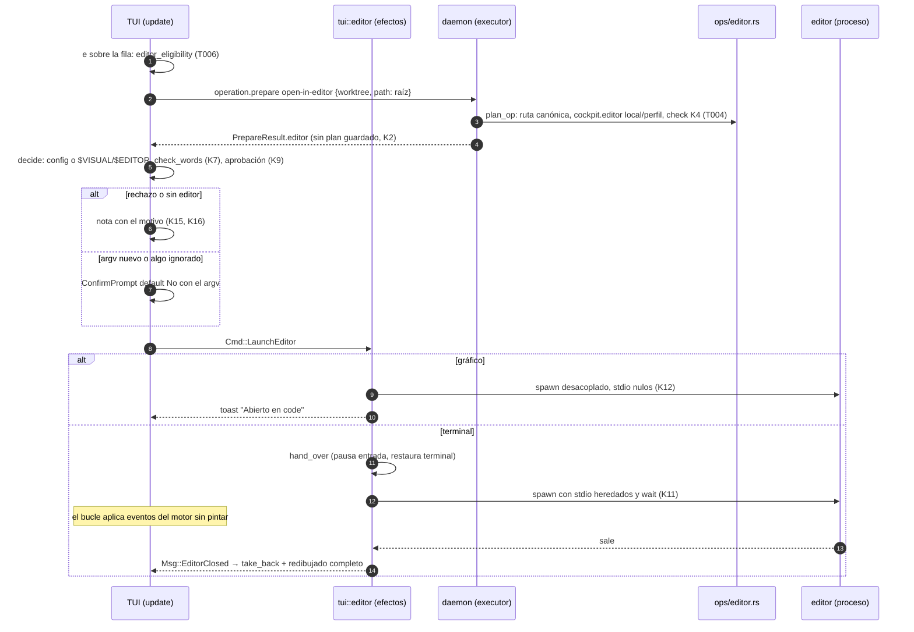

# DS-US-CKP-013 · Abrir el worktree de un agente en el editor

## Contexto rápido

El desarrollador selecciona la fila de un agente, pulsa `e` y el worktree se abre en su editor. El editor sale de `cockpit.editor` (local personal de ese repo, o perfil) o, si no hay, de `$VISUAL` y después `$EDITOR` del proceso de la TUI. La línea se separa en palabras **sin shell**; un metacarácter de shell la rechaza. Un editor de terminal suspende la TUI y la devuelve al cerrarse; uno gráfico se lanza desacoplado y la TUI sigue respondiendo. Si el argv que viene de configuración cambió respecto del último aprobado, la TUI lo muestra y pide confirmación con default No antes de lanzar nada.

La acción no escribe en el repo: no pasa por la operación protegida, ni por la Time Machine, ni por Guardrails (BR-CKP-ELIG-006).

Hoy:
- `open-in-editor` está en el catálogo (`crates/api/src/catalog.rs:221`): `NoRepoWrite`, sin gobierno, solo capa `cockpit`, `owner = US-CKP-013`, fuera de la operación protegida (`protected`, `catalog.rs:157`). Su argumento es `OpenInEditorArgs { path }` (`catalog.rs:289`), que ya exige ruta absoluta (`check_absolute`, `catalog.rs:360`). El ejecutor no tiene brazo (`ARMS`, `executor/ops/mod.rs:27`): `operation.prepare` responde `-32004` con `implemented_by = US-CKP-013`.
- `check_common` (`executor/facts.rs:72`) solo exige identidad coherente a una operación `NoRepoWrite`: el editor ya se ofrece con un merge o un rebase a medias, que es lo que necesita DS-US-CKP-016.
- `admit` (`executor/mod.rs:186`) rechaza con `not-available-for-layer` una operación que el catálogo no ofrece a la capa: el editor nunca llega a la capa `mcp`.
- No hay sección `cockpit` en los ajustes (`crates/policy/src/settings/model.rs:12`). DS-US-MCP-019 la crea con `worktreePathTemplate` y deja `editor` y `editorKind` a esta historia.
- Los niveles personales se leen al usarlos: `profile_settings` (`crates/core/src/profile/settings.rs:26`) y `local_settings(dirs, repo_id)` (`:84`, `<config>/repos/<repo_id>/settings.local.json`), sin seguir enlaces y con tope de 64 KiB.
- La TUI ya sabe devolver la terminal y retomarla: `term::suspended` (`apps/cli/src/tui/term.rs:36`) pausa el hilo de entrada, restaura la terminal, corre `f` y vuelve a entrar; `Ctrl-Z` la usa (`term.rs:30`), y su comentario ya dice "The editor reuses [`suspended`]". `App::suspend` (`tui/app.rs:177`) fuerza el redibujado completo al volver.
- El único `Command::new` permitido en la TUI es `tui/editor.rs`: la excepción ya está en `apps/cli/tests/tui_boundaries.rs:144` (V5, DEP-CKP-12). El archivo no existe.
- No hay cursor de fila ni `WorktreeRow.root` en `main`: los crea DS-US-CKP-012 (D10, D14, T006). Tampoco las variantes genéricas del canal `LinkCmd::Operation`/`EngineMsg::Operation` ni `OpsContext`/`EngineFacts`: los crea DS-US-CKP-014 (I1, I10, I14; T002 y T005).

Sin `architecture-constitution.md` en la cascada: las restricciones activas salen de [AGENTS.md](../../../../../AGENTS.md) y de los ADR citados (sin shell y argv fijo, NFR-02; `unsafe_code = forbid`, ADR-GRP-001; protocolo congelado y capacidades aditivas, ADR-GRP-016; la TUI no importa `gitraptor_core`, `gitraptor_git` ni `gitraptor_policy`, ADR-CKP-003 V5). Ninguna tarea las viola.

### Decisiones

Se reutiliza sin repetir lo que fijan otras DS: contexto adjunto `OpsContext`/`EngineFacts` (DS-014 I1), capacidad aditiva por operación (I2), vista del plan en `OpPlan.expected["view"]` → `Prepared.view` (I14) y variante genérica del canal (I10); cursor de fila por clave y `WorktreeRow.root` crudo, nunca pintado (DS-012 D10, D14).

| ID | Decisión | Por qué / descartado |
|----|----------|----------------------|
| K1 | **Capacidad `operation.editor`** en `methods/operation.rs`. Solo con ella el daemon prepara `open-in-editor` y devuelve `PrepareResult.editor`. Sin ella, `-32004` con `implemented_by = US-CKP-013`, como hoy | Patrón de DS-014 I2 y de `operation.snapshot` (ADR-GRP-016, "Añadir una capacidad"). Un cliente viejo ve lo que veía. **Decisión del orquestador (2026-10-28), validada por Arquitecto y PO** |
| K2 | **La resolución es `operation.prepare` de `open-in-editor`, y ahí acaba** (N10 de ADR-CKP-003). El daemon valida la ruta, lee y valida `cockpit.editor` y `cockpit.editorKind`, y devuelve la vista. **No guarda el plan**: ni `StoredPlan`, ni cuenta para `MAX_PLANS_PER_CONNECTION`, ni reto; `expires_in_ms = 0` y `decision = not-governed`. Un `operation.run` con ese `plan_id` responde `plan-unknown`. Nada en el oplog. El brazo lo declara con un campo nuevo `OpPlan.store: bool` (`false` para `open-in-editor`, `true` en los demás), no con un caso especial en `Executor::prepare` | ADR-CKP-002 § 10: "el daemon resuelve y valida, la TUI lanza". Guardar un plan que nunca se ejecuta llenaría el cupo de planes de la conexión con cada `e`. Descartado: un método nuevo `editor.resolve`, que dejaría huérfana la entrada `open-in-editor` del catálogo y su compuerta de capa. **Decisión del orquestador (2026-10-28), validada por Arquitecto y PO (revisión, con cambios)** |
| K3 | **Ruta destino** (I-03, SEC-02). `args.path` debe ser la raíz del worktree nombrado en `worktree`: el daemon la canonicaliza y la compara con la raíz canónica de `RepoFacts`. Otra ruta, aunque esté dentro → `invalid-params` (`path`). La vista devuelve la raíz canónica absoluta; en Windows, sin el prefijo `\\?\` (`fastpath::simplified`, `crates/policy/src/guard/fastpath.rs:14`) | La historia abre el worktree, no un archivo. Un enlace simbólico que sale del worktree no pasa la comparación canónica. Abrir un archivo concreto (las rutas en conflicto de DS-016) se añade después ampliando esta regla (§ Cómo extender). **Decisión del orquestador (2026-10-28), validada por Arquitecto y PO** |
| K4 | **Una sola función pura en `crates/api/src/editor.rs`**, compartida por el daemon y la TUI (ADR-CKP-002 § 10). Gramática: palabras separadas por espacio o tabulador; `'…'` y `"…"` agrupan **solo para conservar espacios**, sin escapes ni expansión. Rechazo en cualquier posición, también entre comillas: `; & \| < > $ \` ( ) { } [ ] * ? ~ ! # % ^`, salto de línea, NUL y todo carácter de control; `\` en macOS y Linux (en Windows es separador de ruta). Con `EditorSyntax::Windows`, `(` y `)` se admiten **dentro de comillas** (`"C:\Program Files (x86)\…"`); se valida en XP-55. Otros rechazos: comilla sin cerrar, `=` en la primera palabra (asignación de entorno), primera palabra con separador de ruta pero relativa (`./vim`, `bin/vim`), más de 1.024 bytes o de 32 palabras, valor no UTF-8. Una línea vacía o solo con espacios cuenta como no definida | BR-CKP-VAL-003: sin shell y con rechazo de metacaracteres. Rechazar también entre comillas mantiene una regla que el usuario puede predecir: quien escribe `$HOME` o `~` espera una expansión que no va a ocurrir. Las comillas hacen falta por las rutas de macOS con espacios (`"/Applications/Visual Studio Code.app/…/code"`). **Decisión del orquestador (2026-10-28), validada por Arquitecto y PO (revisión, con cambios)** |
| K5 | **Origen y precedencia** (ADR-GRP-007, "Precedencia"; ADR-GRP-008): `cockpit.editor` local personal del repo, si no perfil (los resuelve el daemon); si no hay ninguno, `$VISUAL` y después `$EDITOR` **del proceso de la TUI**, capturados una vez al arrancar (`term::run`), nunca leídos en `update`. El equipo no se lee para esto: `x-gitraptor-levels = ["profile", "local"]` hace que el cargador común descarte la clave con diagnóstico | Por qué la TUI lee su propio entorno: el daemon arranca con entorno limpio (SEC-10) y un editor gráfico debe heredar el de la sesión (ADR-CKP-002 § 10). El entorno de un proceso no cambia desde fuera mientras corre, así que capturarlo al arrancar es exacto y mantiene `update` puro. **Decisión del orquestador (2026-10-28), validada por Arquitecto y PO** |
| K6 | **Valor de configuración que no sirve** (ADR-GRP-007, "Valor que no sirve"): si la función de K4 rechaza `cockpit.editor` de un nivel, el daemon lo descarta y sigue con el nivel siguiente (local → perfil → entorno). La vista lo lista en `ignored` con su nivel y su motivo. **Con algo en `ignored`, la TUI siempre pide confirmación** (default No), muestra el motivo y el argv que usaría, y nunca lanza el valor rechazado | Cumple el ADR (se usa el valor por defecto, con diagnóstico) sin sorprender: el desarrollador configuró un editor y va a abrirse otro. Ver Q-CKP-55. **Decisión del orquestador (2026-10-28), validada por Arquitecto y PO** |
| K7 | **Revalidación en la TUI** (L-06): las palabras que manda el daemon viajan como `UntrustedName` y la TUI las vuelve a pasar por `check_words` de K4 antes de lanzar. `is_truncated`/`is_lossy` (`untrusted.rs`) se comprueban en `client/`, y una palabra así llega al modelo como `EditorRefusal` (`too-long` o `not-utf8`). Las palabras crudas viven en el modelo como `WorktreeRow.root` (DS-012 D14): se lanzan, nunca se pintan (`tui_boundaries.rs:171`). Si no pasa, no lanza nada y muestra el motivo | ADR-CKP-003 § 9 y Validación V9: el rechazo también si "llega del daemon". **Decisión del orquestador (2026-10-28), validada por Arquitecto y PO (revisión, con cambios)** |
| K8 | **Tipo de editor**: `cockpit.editorKind` (local, si no perfil; por defecto `auto`) se aplica sea cual sea el origen del editor. Con `auto`, `classify` de K4 mira el nombre del programa (sin directorio, en minúsculas y sin `.exe`): lista de terminal (`vi`, `vim`, `nvim`, `nano`, `pico`, `emacs`, `hx`, `helix`, `micro`, `kak`, `ne`, `joe`, `mg`, `ed`, `jed`) y lista gráfica (`code`, `code-insiders`, `codium`, `cursor`, `windsurf`, `subl`, `zed`, `mate`, `bbedit`, `gedit`, `kate`, `gnome-text-editor`, `notepad`, `notepad++`, `idea`, `webstorm`, `rustrover`, `gvim`, `mvim`, `open`, `xdg-open`). Lo desconocido, como de terminal; si un programa desconocido se trató así, al volver la nota dice "si tu editor es gráfico, pon cockpit.editorKind = gui" / "if your editor is graphical, set cockpit.editorKind = gui". ⚠️ **ASSUMPTION**: las listas; se ajustan con el dogfooding sin cambiar el contrato | ADR-CKP-003 § 9: suspender es seguro y lanzar sin esperar un editor de terminal no lo es. `emacs` va como terminal: sin `-nw` también abre ventana, pero suspender no rompe nada; quien lo quiera gráfico pone `editorKind = gui`. **Decisión del orquestador (2026-10-28), validada por Arquitecto y PO (revisión, con cambios)** |
| K9 | **Argv visible y aprobado** (L-05). Pide aprobación el argv que sale de configuración (perfil o local) y todo argv con algo en `ignored` (K6). El de `$VISUAL`/`$EDITOR` sin nada ignorado no la pide: es el entorno del propio desarrollador (escenario 2). **El registro aprobado es el argv canónico literal**: palabras más modo (terminal o gráfico), sin la ruta destino; se compara byte a byte. Se guarda en las preferencias (N9, US-CKP-004) como `editorApproved`. Hasta que exista N9, vive en memoria mientras la TUI está abierta (G2). Una TUI cuyo solicitante no puede guardar preferencias (US-CKP-004, escenario 5) lo aprueba solo en memoria | ADR-CKP-003 § 9 llama "huella" al último argv aprobado. Guardar el argv literal (≤ 2 KiB) en vez de un hash deja mostrar "antes: … / ahora: …" en el prompt, y la TUI no necesita una dependencia de hash. El argv no es secreto. **Decisión del orquestador (2026-10-28), validada por Arquitecto y PO** |
| K10 | **Quién y cómo lanza**: solo `apps/cli/src/tui/editor.rs` (a crear; ya autorizado en `tui_boundaries.rs:144`). `argv[0]`: absoluta → se usa tal cual si es un archivo regular ejecutable; nombre suelto → se busca en el `PATH` del proceso, **saltando entradas vacías, relativas y `.`** (nunca el directorio actual). En Windows solo se aceptan `.exe` y `.com`; un `.cmd`, `.bat` o `.ps1` se rechaza con motivo `script-launcher` (ver Q-CKP-56). Si lo que encontró es `…\Microsoft VS Code\bin\code.cmd`, la nota propone `cockpit.editor = "<carpeta padre de bin>\Code.exe"`; si no, "usa la ruta al .exe del editor" / "use the path to the editor's .exe". `Command::new(<ruta absoluta del programa>)`, `.args(palabras[1..])` y la ruta destino como **último argumento separado** (`Command::arg`), sin `--`. Directorio de trabajo: la raíz del worktree. Entorno: el de la TUI, sin cambios | NFR-02 y ADR-CKP-002 § 10 ("resuelve `argv[0]` a ruta absoluta con un PATH sin entradas relativas y sin el cwd"). La ruta absoluta (I-03) nunca empieza por `-`, así que no puede leerse como opción. Windows ejecuta un `.cmd`/`.bat` con `cmd.exe`, que es un shell: lanzarlo rompería NFR-02 aunque Rust escape los argumentos. **Decisión del orquestador (2026-10-28), validada por Arquitecto y PO (revisión, con cambios)** |
| K11 | **Editor de terminal** = los cinco pasos de ADR-CKP-003 § 9. `term::suspended` se parte en dos mitades públicas, `hand_over(pause)` (pausar la entrada, `ratatui::restore`, cursor visible) y `take_back(pause)` (`enter`, reanudar la entrada); `suspended` queda como su composición y `Ctrl-Z` no cambia. El **hilo principal** hace `hand_over` en `dispatch(Cmd::LaunchEditor)`, después de `resolve_program`; si falla, no se lanza nada. El hilo `raptor-editor` solo hace `spawn` (entrada y salida heredadas) y `wait`, y envía `EditorClosed`; si `spawn` falla, envía `EditorClosed { error }` para que el principal haga `take_back`. Mientras tanto, `App` sigue aplicando los mensajes del motor **sin pintar** y sin leer teclas. `App` recibe `Msg::EditorClosed` por la cola de entrada, retoma la terminal y fuerza el redibujado completo como `App::suspend`. Un código de salida distinto de cero se informa en la nota, sin más | Bloquear el hilo principal como `Ctrl-Z` dejaría crecer sin tope la cola del motor (mpsc sin límite, `queue.rs`) durante una sesión de `vim` de una hora, y al volver la TUI tardaría en ponerse al día. **Decisión del orquestador (2026-10-28), validada por Arquitecto y PO (revisión, con cambios)** |
| K12 | **Editor gráfico**: entrada, salida y error nulos; grupo de procesos propio (Unix: `CommandExt::process_group(0)`; Windows: `creation_flags(CREATE_NEW_PROCESS_GROUP)`); no se espera en el bucle. Un hilo `raptor-editor-reaper` hace `wait` para no dejar zombis y descarta el resultado. Si el lanzamiento falla (programa ausente, permiso), la nota lo dice al momento | ADR-CKP-003 § 9: "se lanza sin esperar, con la entrada y la salida nulas, y no bloquea". `code --wait` no vuelve hasta cerrar la pestaña: esperarlo bloquearía el escenario 1. API segura de `std`, sin `unsafe`. **Decisión del orquestador (2026-10-28), validada por Arquitecto y PO** |
| K13 | **Tecla `e`** "abrir en el editor", fila nueva en `keymap.rs`. `Enter` sigue siendo del selector de repo. Ocupadas (lista común de la revisión): `a`, `c` (DS-016), `d` (DS-012), `D` (DS-017), `e` (DS-013), `m`, `o`/`u` (DS-014), `r`, `t` (DS-021), `w` (DS-018), `x` (DS-019), `?`; además, en el código, `q`, `Ctrl-c`, `k`/`j`, `Enter`, `Ctrl-z`, `y`/`s`, `n`, `Esc` y `f`. En el panel de operación detenida de DS-016, `e` hace lo mismo sobre la fila de ese worktree (cierra su G3) | `e` ya estaba reservada para el editor en DS-US-CKP-002 D7 y DS-US-CKP-016 S13, y es la del ejemplo de BR-CKP-WF-003 ("[e] Editor"). DS-012 D11 decía que "abrir" una fila con `Enter` quedaba para el editor: se enmienda (§ Enmiendas). **Decisión del orquestador (2026-10-28), validada por Arquitecto y PO (revisión, con cambios)** |
| K14 | **Elegibilidad** (BR-CKP-ELIG-006, columna "Abrir editor" de BR-CKP-ELIG-001), función pura. Desactivada con motivo solo si: fuera de "En vivo"; worktree no disponible (BR-CKP-EDGE-003); capa distinta de `cockpit` ("actúas como <agente>: abre raptor desde tu propia terminal para usar el editor" / "acting as <agent>: open raptor from your own terminal to use the editor": el catálogo no ofrece `open-in-editor` a la capa `mcp`, ver Q-CKP-54); o ya hay una apertura en curso (preparando o con el editor de terminal abierto). Se ofrece en cualquier estado de sesión, con operación en curso, en el worktree principal, bloqueado, en la rama base o en una protegida | La matriz de BR-CKP-ELIG-001 no restringe la columna salvo "worktree no disponible". La capa sale de la entrada del catálogo (`(true, false)`, `catalog.rs:221`) y del `admit` del ejecutor: la TUI lo refleja en vez de dejar que el daemon lo rechace. **Decisión del orquestador (2026-10-28), validada por Arquitecto y PO (revisión, con cambios)** |
| K15 | **Sin editor** (BR-CKP-EDGE-007): vista sin configuración y `$VISUAL`/`$EDITOR` ausentes o vacíos → nota accionable: "No hay editor configurado. Define $EDITOR o la clave cockpit.editor en tu perfil" / "No editor configured. Set $EDITOR or the cockpit.editor key in your profile". Ningún proceso | Escenario 5, con el nombre real de la clave. **Decisión del orquestador (2026-10-28), validada por Arquitecto y PO (revisión, con cambios)** |
| K16 | **Respuesta visible**: gráfico lanzado → toast "Abierto en <programa>: <carpeta>" / "Opened in <program>: <folder>"; terminal → al volver, la vista tal cual estaba más los cambios del motor aplicados mientras tanto; rechazo de K4/K7/K10 → nota con el motivo; aprobación negada → "No se abrió el editor" / "Editor not opened"; metacaracteres → "el editor contiene caracteres de shell no admitidos" / "the editor contains shell characters that are not allowed". Nombres, palabras y rutas por `SafeText`: una secuencia de escape en el argv se ve neutralizada en el prompt (BR-CKP-VAL-002) | L-05: el argv que se aprueba es el que se ve, y no puede borrar la pantalla para ocultarse. **Decisión del orquestador (2026-10-28), validada por Arquitecto y PO (revisión, con cambios)** |

## ⚠️ Gaps y violaciones de la constitución

| ID | Qué falta | Severidad | Alcance | Acción | Owner |
|----|-----------|-----------|---------|--------|-------|
| G1 | **Dependencia de orden**: `OpsContext`, `EngineFacts`, `ProductionCatalog::attach` y `Prepared.view` (DS-US-CKP-014 T002); `LinkCmd::Operation(OpRequest)`, `EngineMsg::Operation(OpReply)` (DS-014 T005); cursor de fila y `WorktreeRow.root` (DS-US-CKP-012 T006). Ninguno está en `main` (comprobado el 2026-10-28) | Bloqueante | T001b, T004, T006 | Mezclar antes DS-012 T004 a T006 y DS-014 T002, T005 y T007 (entrega 013-b). La entrega 013-a (T001a, T002, T003, T005) puede entrar ya | Orquestador |
| G2 | **Preferencias N9** (US-CKP-004, sin Dev Spec): sin ellas, la aprobación del argv vive solo en memoria y el escenario 1 ("ya aprobado antes") pide confirmar una vez por arranque de la TUI | Bloquea liberación | — | DS-US-CKP-004 añade `editorApproved` a su esquema (§ Enmiendas); T006 deja el almacén detrás de un trait | Orquestador |
| G3 | **Sección `cockpit` de los ajustes**: la crea DS-US-MCP-019 (`worktreePathTemplate`). Quien entre primero en `main` crea `Settings.cockpit: Option<Cockpit>`; el otro añade sus claves | Informativo | T003 | Rebase y regenerar `settings.schema.json` | Orquestador |

Ninguna violación: sin constitución, ver Contexto rápido.

## 🔭 La forma



---

## 🚀 Plan de implementación

### El trabajo de un vistazo

| # | Tarea | Depende | Aterriza en |
|---|---|---|---|
| T001a | Escribir en rojo los tests de la función pura, de los ajustes y del lanzador | — | `crates/api/tests/editor_line.rs`, `crates/policy/src/settings/cockpit_tests.rs`, tests de `tui::editor`, stubs |
| T001b | Escribir en rojo los tests del daemon y del flujo de la TUI | G1 | `crates/core/tests/us_ckp_013_editor.rs`, `apps/cli/tests/tui_editor.rs`, stubs |
| T002 | Crear la función pura del editor y el contrato (capacidad, `PrepareResult.editor`) | T001a | `crates/api/src/editor.rs`, `lib.rs`, `catalog.rs`, `methods/operation.rs` |
| T003 | Añadir `cockpit.editor` y `cockpit.editorKind` a los ajustes y su lectura en el perfil | T001a | `crates/policy/src/settings/model.rs`, `schema/settings.schema.json`, `crates/core/src/profile/settings.rs` |
| T004 | Crear el brazo `open-in-editor` del daemon | T001b, T002, T003, G1 | `crates/core/src/executor/ops/editor.rs`, `ops/mod.rs`, `executor/mod.rs`, `ops/context.rs`, `daemon/operation_facts.rs`, `channel/conn.rs` |
| T005 | Crear el lanzador de la TUI y el traspaso de la terminal | T001a, T002 | `apps/cli/src/tui/editor.rs`, `tui/term.rs`, `tui/app.rs`, `model.rs` |
| T006 | Crear el flujo de la TUI: elegibilidad, decisión, aprobación, prompt, tecla `e` y textos en/es | T001b, T004, T005, G1 | `apps/cli/src/tui/open_editor.rs`, `tui/{update,view,help,keymap,mod}.rs`, `present/editor_text.rs` |
| T007 | Cerrar la historia | T001a–T006 | `docs` |

Dos entregas, para no dejar tests en rojo en `main`. **013-a** (T001a, T002, T003, T005) puede entrar ya; T002, T003 y T005 van en paralelo. **013-b** (T001b, T004, T006) entra después de DS-012 T004 a T006 y DS-014 T002, T005 y T007 (G1).

### T001a y T001b — Escribir en rojo los tests de contrato

**Objetivo.** Los seis escenarios de la historia, en rojo, contra la función pura, el daemon real con repos y perfil temporales, y la `App` real. Se parte en dos para que cada entrega llegue a `main` con sus tests en verde.

**Ubicación — T001a** (entrega 013-a, sin dependencias)
- `crates/api/tests/editor_line.rs` (**CREATE**): la gramática de K4 y la clasificación de K8, tabla de casos.
- `crates/policy/src/settings/cockpit_tests.rs` (**MODIFY** o **CREATE**, G3): niveles de `cockpit.editor` y `cockpit.editorKind`.
- Tests unitarios de `apps/cli/src/tui/editor.rs` (`resolve_program`) y `tui_loop::a_handed_over_terminal_applies_engine_messages_without_drawing`.
- Stubs que compilan en los archivos de T002, T003 y T005.

**Ubicación — T001b** (entrega 013-b, tras G1)
- `crates/core/tests/us_ckp_013_editor.rs` (**CREATE**): daemon en proceso con `OperationsWiring::production()` y el contexto adjunto; perfil temporal con `settings.json` y `repos/<id>/settings.local.json`.
- `apps/cli/tests/tui_editor.rs` (**CREATE**): `App` sobre `TestBackend` con el arnés de `apps/cli/tests/tui_loop.rs`, y los casos de terminal real con el pseudo-terminal de `apps/cli/tests/tui_process.rs` (`script` de macOS). `#![cfg(all(target_os = "macos", debug_assertions))]` en los de proceso.
- Editores falsos: scripts ejecutables escritos por el test en un directorio temporal, que se pone primero en el `PATH` del proceso bajo prueba. `vim` (terminal): escribe su argv y su cwd en un archivo, comprueba que su entrada es una tty y espera una línea por la entrada. `code` (gráfico): escribe su argv y duerme 30 s. Los scripts solo existen en los tests; producción nunca lanza un shell.
- Stubs que compilan (`todo!()` o `PlanError::NotImplemented`) en los archivos de T004 y T006.

**Reglas**
- Los tests rojos van en su archivo y no se editan durante la implementación (R4 de `/implement`).
- Nunca este repo ni el perfil real (NFR-01); `GITRAPTOR_PROFILE_DIR` temporal.

- **Depende:** T001a, —; T001b, G1
- **Refs:** US-CKP-013 escenarios 1 a 6; § 9.4
- **Aceptación:** T001a: `cargo test -p gitraptor-api --test editor_line`, `cargo test -p gitraptor-policy` y `cargo test -p gitraptor-cli --lib tui::editor` compilan y fallan por "no implementado". T001b: lo mismo con `cargo test -p gitraptor-core --test us_ckp_013_editor` y `cargo test -p gitraptor-cli --test tui_editor"

### T002 — Crear la función pura del editor y el contrato

**Objetivo.** El daemon y la TUI separan, validan y clasifican la línea del editor con el mismo código, y el contrato sabe transportar la resolución.

**Ubicación.**
- `crates/api/src/editor.rs` (**CREATE**): `EditorSyntax`, `parse_line`, `check_words`, `classify`, `EditorRefusal`, `EditorKind`, `EditorMode`, `EditorSource`, `EditorPlanView`, `EditorConfigView`, `IgnoredEditor`. Una línea `pub mod editor;` en `crates/api/src/lib.rs`.
- `crates/api/src/catalog.rs` (**MODIFY**): `PrepareResult.editor: Option<crate::editor::EditorPlanView>` con `#[serde(default, skip_serializing_if = "Option::is_none")]`. `for_mcp` no la copia.
- `crates/api/src/methods/operation.rs` (**MODIFY**): `CAP_OPERATION_EDITOR = Capability::new("operation.editor")` en el `GROUP` (`:49`).

**Reglas**
- `parse_line(line: &str, syntax: EditorSyntax) -> Result<Option<Vec<String>>, EditorRefusal>`: `Ok(None)` para línea vacía o solo espacios. Gramática y rechazos de K4, en este orden: tamaño, carácter de control o NUL, metacarácter (el primero encontrado, con su posición), comilla sin cerrar, número de palabras, primera palabra (asignación `=`, ruta relativa con separador).
- `check_words(words: &[String], syntax) -> Result<(), EditorRefusal>`: las mismas reglas por palabra, sin comillas (ya separadas). La usan la TUI (K7) y el propio `parse_line` al final.
- `EditorSyntax::native()`: `Windows` con `cfg!(windows)`, si no `Posix`. Solo cambia `\` (K4) y el separador de ruta de la primera palabra (`/` y `\` en Windows).
- `classify(program: &str, kind: EditorKind, syntax: EditorSyntax) -> EditorMode`: K8. `program` es la primera palabra; se toma el último componente con los separadores de `syntax`.
- Sin E/S, sin entorno, sin reloj: tests de tabla en `editor_line.rs`.
- `EditorRefusal` es un código tipado (N7): `shell-metacharacter { ch }`, `control-character`, `unbalanced-quote`, `env-assignment`, `relative-program`, `too-long`, `too-many-words`, `not-utf8`, `script-launcher`, `program-not-found`. Los dos últimos solo los produce la TUI al lanzar (K10); viven aquí para que el texto sea uno.

- **Depende:** T001a
- **Refs:** K1, K2, K4, K7, K8; ADR-CKP-002 § 10 y § 11; ADR-GRP-016
- **Aceptación:** `cargo test -p gitraptor-api` en verde, con:
- [ ] `editor_line`: `code --wait` → `["code", "--wait"]`; `"/Applications/Visual Studio Code.app/Contents/Resources/app/bin/code" --wait` → dos palabras; `vim; rm -rf ~` → `shell-metacharacter { ch: ';' }`; `vim $HOME`, `~/bin/vim`, `` vim `x` ``, `"vim;x"` → rechazo; `EDITOR=x vim` → `env-assignment`; `./vim` → `relative-program`; `"vim` → `unbalanced-quote`; 1.025 bytes → `too-long`; `C:\Tools\nvim.exe` → válido solo con `Windows`.
- [ ] `classify`: `vim` → terminal; `code` y `Code.exe` → gráfico; `foo` → terminal; `code` con `EditorKind::Terminal` → terminal.
- [ ] `describe` y el esquema incluyen la capacidad; `crates/api/tests/architecture.rs` en verde (sin códigos nuevos).

### T003 — Añadir las claves del editor a los ajustes

**Objetivo.** `cockpit.editor` y `cockpit.editorKind` existen en el esquema, solo en perfil y local, y el daemon las lee por repo al usarlas.

**Ubicación.**
- `crates/policy/src/settings/model.rs` (**MODIFY**): en `Cockpit` (G3), `editor: Option<String>` y `editor_kind: Option<EditorKindSetting>` con `#[schemars(extend("x-gitraptor-levels" = ["profile", "local"]))]`, como `idle_threshold_minutes` (`model.rs:39-40`). `EditorKindSetting { Auto, Terminal, Gui }`, `kebab-case`.
- `crates/policy/schema/settings.schema.json` (**MODIFY**, regenerado).
- `crates/policy/src/settings/cockpit_tests.rs` (**MODIFY** o **CREATE**, según G3): casos de nivel.
- `crates/core/src/profile/settings.rs` (**MODIFY**, al final): `pub fn cockpit_editor(dirs: &ProfileDirs, repo_id: &str) -> EditorSetting`.

**Reglas**
- `crates/policy` no valida la línea: no depende de `crates/api`. Solo el tipo (`string`, ≤ 1.024 caracteres en el esquema). La validación de K4 la aplica el daemon al usarla (K6).
- `cockpit_editor`: lee `local_settings(dirs, repo_id)` y `profile_settings(dirs)` (`.applicable()`), por clave y en ese orden. Convierte `EditorKindSetting` (de `crates/policy`, que no conoce `EditorKind`) en `gitraptor_api::editor::EditorKind`. Devuelve `EditorSetting { lines: Vec<(EditorSource, String)>, kind: Option<(EditorSource, EditorKind)> }`, con `lines` en orden de precedencia (local, perfil) y sin las vacías. Nunca crea nada; un documento ilegible o ignorado cuenta como ausente (como `include_credential_files`, `settings.rs:114`).
- Con `cockpit.editor` en `.gitraptor/settings.json` (equipo), el cargador común lo descarta con su diagnóstico de nivel, como `idleThresholdMinutes`. No se añade código para eso: lo da `x-gitraptor-levels`.

- **Depende:** T001a; G3
- **Refs:** K5, K6; ADR-GRP-007 (Enmienda, Cockpit), ADR-GRP-008; DEP-CKP-13
- **Aceptación:** `cargo test -p gitraptor-policy` y `cargo test -p gitraptor-core --lib profile::settings` en verde, con:
- [ ] Equipo con `cockpit.editor` → clave descartada con diagnóstico de nivel; perfil y local la admiten.
- [ ] Local gana sobre perfil, por clave (`editor` local y `editorKind` del perfil se combinan).
- [ ] El test del esquema generado frente a `settings.schema.json` en verde.

### T004 — Crear el brazo `open-in-editor` del daemon

**Objetivo.** `operation.prepare` de `open-in-editor` devuelve la ruta canónica y la resolución validada del editor, sin guardar plan ni escribir nada.

**Ubicación.**
- `crates/core/src/executor/ops/editor.rs` (**CREATE**): `plan_op`.
- `crates/core/src/executor/ops/mod.rs` (**MODIFY**): `OperationId::OpenInEditor` en `ARMS` (`:27`) y su despacho en `plan_op`; sin `step` (nunca se ejecuta).
- `crates/core/src/executor/mod.rs` (**MODIFY**): campo `OpPlan.store: bool`; `prepare` (`:577`) guarda el plan solo si `store` (K2). Los brazos existentes ponen `true`.
- `crates/core/src/executor/ops/context.rs` (**MODIFY**, creado por DS-014): `EngineFacts::editor_setting(repo_id) -> EditorSetting`.
- `crates/core/src/daemon/operation_facts.rs` (**MODIFY**, creado por DS-014): la implementación, con `profile::settings::cockpit_editor` y los `ProfileDirs` del daemon.
- `crates/core/src/channel/conn.rs` (**MODIFY**): en `operation_prepare`, `OpenInEditor => (CAP_OPERATION_EDITOR, "US-CKP-013")` en la tabla `gated` (`:3490`); `PrepareResult.editor` desde `Prepared.view` (DS-014 I14) solo para `open-in-editor` y una conexión con la capacidad.
- Cliente de `crates/core`: pide `operation.editor` en `connection.accept`.

**Reglas** — `plan_op` (`check_common` ya pasó: solo identidad, `NoRepoWrite`)
1. Contexto adjunto, o `NotImplemented`.
2. `args.path` canonicalizada; distinta de la raíz canónica de `facts.root` → `invalid-params` (`path`) (K3).
3. `EngineFacts::editor_setting(repo_id)`. Para cada línea, en orden: `parse_line` con `EditorSyntax::native()`. La primera válida es `config = Set { source, words }`; cada rechazada va a `ignored` con su nivel y su `EditorRefusal` (K6). Ninguna válida → `config = Unset`.
4. `kind`: el de `editor_setting`, o `auto`.
5. `OpPlan`: `expected = { path, view }` (`view` = `EditorPlanView`, I14); `warnings = []`; `affected = Nobody`; `other_session = false`; `governed = None`; `store = false`.

**Reglas** — `Executor::prepare`
- Sin caso especial por operación: con `OpPlan.store == false` no hay `StoredPlan` ni cuenta para `MAX_PLANS_PER_CONNECTION`; sin reto porque `affected = Nobody`. `plan_id` aleatorio que no se registra, `expires_in_ms = 0`, `decision = NotGoverned`. Lo demás (`admit`, `check_common`, la huella) sigue igual.
- La capa `mcp` recibe `not-available-for-layer` de `admit` (`executor/mod.rs:186`), sin código nuevo.

- **Depende:** T001b, T002, T003, G1
- **Refs:** K1, K2, K3, K5, K6; DS-014 I1, I2, I14
- **Aceptación:** `cargo test -p gitraptor-core --lib executor::ops::editor` y `cargo test -p gitraptor-core --test us_ckp_013_editor` en verde, con:
- [ ] Un test unitario por regla de `plan_op`, con repos y perfil temporales.
- [ ] `ops::tests::production_wiring_has_no_governed_arm_without_guardrails` sigue en verde (el brazo no está gobernado).

### T005 — Crear el lanzador de la TUI y el traspaso de la terminal

**Objetivo.** La TUI sabe lanzar un argv ya validado, desacoplado o con la terminal prestada, sin shell y sin dejar de aplicar el motor.

**Ubicación.**
- `apps/cli/src/tui/editor.rs` (**CREATE**, el único `Command::new` de la TUI): `EditorLaunch`, `resolve_program`, `spawn_gui`, `spawn_terminal`.
- `apps/cli/src/tui/term.rs` (**MODIFY**): `hand_over(pause)` y `take_back(pause)` públicas; `suspended` (`:36`) pasa a usarlas sin cambiar de firma. `run` captura `EditorEnv { visual, editor }` (`std::env::var_os`) y la pasa al modelo.
- `apps/cli/src/tui/app.rs` (**MODIFY**): `EditorHost` inyectable como `on_suspend` (`:90`); `Cmd::LaunchEditor` en `dispatch` (`:196`), donde el hilo principal resuelve el programa y hace `hand_over`; estado `handed_over` que salta el dibujo y la cola de entrada; `Msg::EditorClosed` retoma la terminal y fuerza el redibujado como `App::suspend` (`:177`).
- `apps/cli/src/model.rs` (**MODIFY**, tres líneas): `Cmd::LaunchEditor(EditorLaunch)`, `Msg::EditorClosed(EditorExit)` y `Ui.editor_env`.

**Reglas**
- `resolve_program` (K10): absoluta → `symlink_metadata` y después `metadata`: archivo regular y ejecutable (Unix: algún bit `x`); con separador pero relativa → `relative-program` (ya lo rechaza K4, se comprueba otra vez); nombre suelto → recorre `PATH` saltando vacías, relativas y `.`. Windows: prueba `<nombre>`, `<nombre>.exe` y `<nombre>.com`; si solo encuentra `.cmd`, `.bat` o `.ps1`, `script-launcher`; si no, `program-not-found`.
- `spawn_gui` (K12): `Stdio::null()` en los tres; `process_group(0)` en Unix y `CREATE_NEW_PROCESS_GROUP` en Windows; `current_dir(raíz)`; la ruta como último `arg`. Hilo `raptor-editor-reaper` con `wait`. Devuelve en cuanto el hijo existe.
- `dispatch(Cmd::LaunchEditor)` de terminal (K11): el **hilo principal** llama a `resolve_program` y después a `hand_over`; si cualquiera de los dos falla, no se lanza nada y la nota lo dice.
- `spawn_terminal` (K11): el hilo `raptor-editor` solo hace `spawn` con stdio heredados y `wait`, y envía `Msg::EditorClosed { code }` por la salida de entrada; si `spawn` falla, envía `Msg::EditorClosed { error }`. En los dos casos `take_back` lo hace el hilo principal al recibirlo, para que el dibujo y la terminal sigan siendo solo suyos.
- Mientras `handed_over`: `App::step` aplica la cola del motor con su presupuesto y no llama a `draw`; `Ctrl-Z` y las teclas no llegan (la entrada está pausada).
- Ningún `sh`, `cmd.exe` ni `Command::new` con una cadena del usuario sin resolver.

- **Depende:** T001a, T002
- **Refs:** K10, K11, K12; ADR-CKP-003 § 3 y § 9; DEP-CKP-12
- **Aceptación:** `cargo test -p gitraptor-cli --lib tui::editor`, `cargo test -p gitraptor-cli --test tui_loop` y `cargo test -p gitraptor-cli --test tui_boundaries` en verde, con:
- [ ] `resolve_program` con un `PATH` que tiene `""`, `.` y una relativa delante de la buena → resuelve la buena.
- [ ] `tui_loop::a_handed_over_terminal_applies_engine_messages_without_drawing`: con el host falso, N eventos del motor se aplican y `frames` no sube hasta `EditorClosed`; después, un dibujo completo.
- [ ] `tui_loop::ctrl_z_suspends_and_repaints` sigue en verde.
- [ ] `tui_loop::a_failed_editor_spawn_takes_the_terminal_back` (`EditorClosed { error }`: `take_back` y nota).

### T006 — Crear el flujo de la TUI

**Objetivo.** `e` sobre una fila abre su worktree en el editor, con el argv visible, aprobado cuando hace falta, o con un motivo claro cuando no se puede.

**Ubicación.**
- `apps/cli/src/tui/open_editor.rs` (**CREATE**), una línea en `tui/mod.rs`: `editor_eligibility`, `decide`, `ApprovalStore` y su implementación en memoria.
- `apps/cli/src/tui/keymap.rs` (**MODIFY**): `Action::OpenInEditor` en `e` (K13).
- `apps/cli/src/tui/update.rs` (**MODIFY**): `e` → elegibilidad → `Cmd::Operation(OpRequest::Prepare { open-in-editor, worktree: row.root, args: { path: row.root } })` (DS-014 I10); la respuesta → `decide`; el prompt; `Msg::EditorClosed`.
- `apps/cli/src/tui/{view,help}.rs` (**MODIFY**): la pista "e editor", desactivada con su motivo.
- `apps/cli/src/present/editor_text.rs` (**CREATE**): textos en/es y el texto de cada `EditorRefusal`.
- `apps/cli/src/client/` (**MODIFY**, la ingesta de DS-014 T005): `PrepareResult.editor` → tipo del modelo. Aquí se comprueban `is_truncated`/`is_lossy` de cada palabra y de la ruta; una que falla llega al modelo como `EditorRefusal` (K7). Las palabras crudas viven en el modelo como `WorktreeRow.root` (DS-012 D14): se lanzan y nunca se pintan (`tui_boundaries.rs:171`); para pintar, su `SafeText`.

**Reglas** — `editor_eligibility(row, layer, live, opening) -> Eligibility` (K14), el primero que falla manda
1. Fuera de "En vivo" → `NotLive`.
2. Worktree no disponible → `Unavailable` (BR-CKP-EDGE-003).
3. Capa distinta de `cockpit` → `AgentLayer` ("actúas como <agente>").
4. Apertura en curso → `Opening`.

**Reglas** — `decide(view, env, approved) -> EditorDecision` (pura)
1. `check_words` sobre las palabras de `config` (K7); rechazo → `Refused(motivo)`.
2. Argv: `config` si es `Set`; si no, `$VISUAL` y después `$EDITOR` con `parse_line(EditorSyntax::native())` (un valor no UTF-8 → `not-utf8`); rechazo → `Refused`; ninguno → `NoEditor` (K15).
3. Modo: `classify(argv[0], view.kind)`.
4. Aprobación (K9): origen configuración, o `ignored` no vacío → `Confirm` si el registro aprobado no es igual al argv canónico (palabras + modo); si no, `Launch`. Origen entorno sin nada ignorado → `Launch`.

**Reglas** — presentación
- `Confirm` → un solo `ConfirmPrompt` (`widgets/confirm.rs`, default No). Título "Abrir en el editor". Línea "Se va a lanzar: code --wait /ruta/feat-pagos" con el origen ("del perfil" / "de la configuración local de este repo" / "de $EDITOR"); "Antes: code --wait" si había registro; por cada ignorado, "cockpit.editor de <nivel> ignorado: <motivo>". `y`/`s` → guarda el registro (N9 o memoria) y lanza; `n`, `Enter` o `Esc` → nota "No se abrió el editor".
- Textos de K15 y K16; el de metacaracteres es exactamente "el editor contiene caracteres de shell no admitidos" (escenario 4).
- `ApprovalStore`: `get() -> Option<ApprovedEditor>` y `set(ApprovedEditor)`. Implementación en memoria ahora; la de N9 la añade quien implemente US-CKP-004 (G2) sin tocar `decide`.
- Plegado ASCII y sin color (DS-US-CKP-005).

- **Depende:** T001b, T004, T005, G1; G2 solo para la persistencia
- **Refs:** K5 a K9, K13 a K16; BR-CKP-VAL-003, BR-CKP-ELIG-006, BR-CKP-EDGE-007
- **Aceptación:** `cargo test -p gitraptor-cli --lib tui` y `cargo test -p gitraptor-cli --test tui_editor` en verde, con snapshots en/es del prompt (con y sin "Antes", con un ignorado), de la pista desactivada por cada motivo y de cada nota

### T007 — Cerrar la historia

**Objetivo.** La historia queda implementada, verificada y enlazada.

**Ubicación.** `docs/requirements/features/cockpit/user-stories/US-CKP-013-abrir-en-editor.md` (**MODIFY**) y esta DS (**MODIFY**).

**Reglas**
- La historia pasa a `implemented` y enlaza el PR; esta DS añade `## Estado de la implementación`.
- Las [Enmiendas que implica](#enmiendas-que-implica) se aplican en el mismo PR o quedan anotadas en él.

- **Depende:** T001a a T006
- **Refs:** AGENTS.md (reglas de calidad)
- **Aceptación:** `cargo clippy --workspace` y `node tools/test/nextest-junit.mjs` en verde

---

## Estructura de ficheros

| Archivo | Acción | Tarea |
|---|---|---|
| `crates/api/src/editor.rs` | CREATE | T002 |
| `crates/api/src/lib.rs` | MODIFY (1 línea `pub mod`) | T002 |
| `crates/api/src/catalog.rs` | MODIFY (campo `editor`) | T002 |
| `crates/api/src/methods/operation.rs` | MODIFY (capacidad) | T002 |
| `crates/api/tests/editor_line.rs` | CREATE | T001a |
| `crates/policy/src/settings/model.rs`, `schema/settings.schema.json` | MODIFY | T003 |
| `crates/policy/src/settings/cockpit_tests.rs` | MODIFY o CREATE (G3) | T003 |
| `crates/core/src/profile/settings.rs` | MODIFY (`cockpit_editor`) | T003 |
| `crates/core/src/executor/ops/editor.rs` | CREATE | T004 |
| `crates/core/src/executor/ops/mod.rs` | MODIFY (brazo) | T004 |
| `crates/core/src/executor/mod.rs` | MODIFY (sin plan guardado) | T004 |
| `crates/core/src/executor/ops/context.rs`, `daemon/operation_facts.rs` | MODIFY | T004 |
| `crates/core/src/channel/conn.rs` | MODIFY (capacidad, `PrepareResult.editor`) | T004 |
| `crates/core/tests/us_ckp_013_editor.rs` | CREATE | T001b |
| `apps/cli/src/tui/editor.rs` | CREATE | T005 |
| `apps/cli/src/tui/{term,app}.rs` | MODIFY | T005 |
| `apps/cli/src/model.rs` | MODIFY (3 líneas) | T005 |
| `apps/cli/src/tui/open_editor.rs` | CREATE | T006 |
| `apps/cli/src/tui/{update,view,help,keymap,mod}.rs` | MODIFY | T006 |
| `apps/cli/src/present/editor_text.rs` | CREATE | T006 |
| `apps/cli/src/client/` (ingesta de DS-014) | MODIFY | T006 |
| `apps/cli/tests/tui_editor.rs` | CREATE | T001b |

## Contratos compartidos

### Tipos y datos compartidos

```rust
// crates/api/src/editor.rs (T002) — a crear
#[derive(Debug, Clone, Copy, PartialEq, Eq)]
pub enum EditorSyntax { Posix, Windows }

#[derive(Debug, Clone, Copy, PartialEq, Eq, Serialize, Deserialize, JsonSchema)]
#[serde(rename_all = "kebab-case")]
pub enum EditorKind { Auto, Terminal, Gui }           // cockpit.editorKind

#[derive(Debug, Clone, Copy, PartialEq, Eq, Serialize, Deserialize, JsonSchema)]
#[serde(rename_all = "kebab-case")]
pub enum EditorMode { Terminal, Gui }                 // resultado de classify

#[derive(Debug, Clone, Copy, PartialEq, Eq, Serialize, Deserialize, JsonSchema)]
#[serde(rename_all = "kebab-case")]
pub enum EditorSource { Profile, Local }              // el entorno no viaja: lo lee la TUI

#[derive(Debug, Clone, PartialEq, Eq, Serialize, Deserialize, JsonSchema)]
#[serde(tag = "code", rename_all = "kebab-case", deny_unknown_fields)]
pub enum EditorRefusal {
    ShellMetacharacter { ch: char },
    ControlCharacter, UnbalancedQuote, EnvAssignment, RelativeProgram,
    TooLong, TooManyWords, NotUtf8,
    ScriptLauncher, ProgramNotFound,                  // solo en la TUI, al lanzar (K10)
}

#[derive(Debug, Clone, PartialEq, Eq, Serialize, Deserialize, JsonSchema)]
#[serde(deny_unknown_fields)]
pub struct EditorPlanView {
    pub path: Untrusted,                              // raíz canónica absoluta (I-03); se lanza, nunca se pinta cruda
    pub config: EditorConfigView,
    pub kind: EditorKind,                             // por defecto Auto
    pub ignored: Vec<IgnoredEditor>,                  // K6; vacío casi siempre
}

#[derive(Debug, Clone, PartialEq, Eq, Serialize, Deserialize, JsonSchema)]
#[serde(tag = "state", rename_all = "kebab-case", deny_unknown_fields)]
pub enum EditorConfigView {
    Unset,                                            // la TUI usa $VISUAL y después $EDITOR
    Set { source: EditorSource, words: Vec<UntrustedName> },
}

#[derive(Debug, Clone, PartialEq, Eq, Serialize, Deserialize, JsonSchema)]
#[serde(deny_unknown_fields)]
pub struct IgnoredEditor { pub source: EditorSource, pub refusal: EditorRefusal }

// crates/api/src/catalog.rs (T002) — PrepareResult, campo nuevo (solo con operation.editor)
#[serde(default, skip_serializing_if = "Option::is_none")]
pub editor: Option<crate::editor::EditorPlanView>,

// crates/core/src/executor/ops/context.rs (T004) — añadido a lo de DS-014
pub trait EngineFacts: Send + Sync {
    // … base, present_sessions (DS-014), protected_branch (DS-017)
    fn editor_setting(&self, repo_id: &str) -> crate::profile::settings::EditorSetting;
}

// apps/cli/src/tui/open_editor.rs (T006) — a crear
pub enum EditorBlock { NotLive, Unavailable, AgentLayer, Opening }
pub enum EditorDecision { Launch(EditorLaunch), Confirm { launch: EditorLaunch, before: Option<ApprovedEditor> },
                          Refused(EditorRefusal), NoEditor }
pub struct ApprovedEditor { pub words: Vec<String>, pub mode: EditorMode }   // ≤ 2 KiB, sin la ruta
```

Lo que ya existe y se usa tal cual: `OperationId::OpenInEditor`, `OpenInEditorArgs`, `OperationArgs::OpenInEditor`, `check_absolute`, `CatalogEntry.protected`, `check_common` (rama `NoRepoWrite`), `admit`, `RejectReason::{NotAvailableForLayer, PlanUnknown}`, `profile_settings`, `local_settings`, `fastpath::simplified`, `term::suspended`, `Pause`, `App::on_suspend`, `ConfirmModel`, `UntrustedName`, `SafeText`.

### Ciclos de vida (DI)

- `EngineFacts::editor_setting` lee los dos documentos en cada llamada (ADR-GRP-007, Enmienda US-GRP-013): sin caché.
- `EditorEnv` se captura una vez en `term::run` y vive en `Model.ui`.
- `ApprovalStore` vive en `App` (memoria) hasta N9; con N9, el registro llega con las preferencias al conectar.
- `EditorHost` se inyecta en `App` como `on_suspend`: la real es la de `term.rs`; los tests ponen la suya.
- Un hijo gráfico pertenece a su hilo reaper; un hijo de terminal, al hilo `raptor-editor`, que termina al enviar `EditorClosed`.

### Firmas del stack

```rust
// crates/api/src/editor.rs (T002) — a crear
impl EditorSyntax { pub fn native() -> Self; }
pub fn parse_line(line: &str, syntax: EditorSyntax) -> Result<Option<Vec<String>>, EditorRefusal>;
pub fn check_words(words: &[String], syntax: EditorSyntax) -> Result<(), EditorRefusal>;
pub fn classify(program: &str, kind: EditorKind, syntax: EditorSyntax) -> EditorMode;

// crates/core/src/profile/settings.rs (T003) — a crear
pub struct EditorSetting { pub lines: Vec<(EditorSource, String)>, pub kind: Option<(EditorSource, EditorKind)> }   // EditorKind de gitraptor_api, convertido desde EditorKindSetting
pub fn cockpit_editor(dirs: &ProfileDirs, repo_id: &str) -> EditorSetting;

// crates/core/src/executor/ops/editor.rs (T004) — a crear
pub(super) fn plan_op(ctx: &OpsContext, repo: &RepoHandle, facts: &RepoFacts,
                      args: &OpenInEditorArgs) -> Result<OpPlan, PlanError>;

// apps/cli/src/tui/editor.rs (T005) — a crear
pub struct EditorLaunch { pub program: String, pub args: Vec<String>, pub mode: EditorMode,
                          pub target: std::path::PathBuf }   // target = raíz canónica (I-03)
pub fn resolve_program(program: &str, path_var: Option<&std::ffi::OsStr>) -> Result<std::path::PathBuf, EditorRefusal>;
pub fn spawn_gui(launch: &EditorLaunch) -> Result<(), EditorRefusal>;
pub fn spawn_terminal(launch: EditorLaunch, back: crate::queue::Outlet);   // hand_over ya lo hizo el hilo principal
pub enum EditorExit { Code(Option<i32>), Error(EditorRefusal) }       // Msg::EditorClosed

// apps/cli/src/tui/term.rs (T005)
pub fn hand_over(pause: &Pause) -> io::Result<()>;
pub fn take_back(pause: &Pause) -> io::Result<()>;

// apps/cli/src/tui/open_editor.rs (T006) — a crear
pub fn editor_eligibility(row: &WorktreeRow, layer: Option<Layer>, live: bool, opening: bool) -> Eligibility;
pub fn decide(view: &EditorPlan, env: &EditorEnv, approved: Option<&ApprovedEditor>) -> EditorDecision;
pub trait ApprovalStore { fn get(&self) -> Option<ApprovedEditor>; fn set(&mut self, a: ApprovedEditor); }
```

## Contrato de API

| Método | Cambio | Con la capacidad | Sin ella |
|---|---|---|---|
| `operation.prepare {operation: "open-in-editor", worktree: <raíz>, args: {path: <raíz>}}` | `PrepareResult.editor`; el plan no se guarda (K2) | `PrepareResult` con `editor`, `warnings = []`, `challenge = null`, `expires_in_ms = 0`, `decision = not-governed` | `-32004`, `implemented_by = US-CKP-013` |
| `operation.run {plan_id}` con un `plan_id` de `open-in-editor` | Ninguno | `plan-unknown` (`-32014`) | — |
| `operation.prepare` de `open-in-editor` con capa `mcp` | Ninguno | `not-available-for-layer` | — |

### Forma del error y del cuerpo de respuesta

Un rechazo del ejecutor es `-32014 OPERATION_REJECTED` con `data.reason`; una ruta que no es la raíz, `INVALID_PARAMS` con el campo `path`. Un valor de configuración rechazado **no** es un error: va en `editor.ignored` (K6). No hay códigos nuevos.

### Forma de la configuración

```json
// <config>/settings.json (perfil) o <config>/repos/<repo_id>/settings.local.json (local)
{ "cockpit": { "editor": "code --wait", "editorKind": "gui" } }
```

| Clave | Tipo | Niveles | Por defecto |
|---|---|---|---|
| `cockpit.editor` | string, ≤ 1.024 caracteres; validada al usarla con `parse_line` (K4, K6) | perfil y local (local gana) | sin valor: `$VISUAL`, después `$EDITOR` de la TUI |
| `cockpit.editorKind` | `auto` \| `terminal` \| `gui` | perfil y local (local gana) | `auto` |

En `.gitraptor/settings.json` (equipo), las dos se descartan con diagnóstico de nivel (escenario 6).

### Valores numéricos

| Valor | Cifra | Fuente |
|---|---|---|
| Tamaño máximo de la línea del editor | 1.024 bytes | Esta DS (K4); igual a `MAX_UNTRUSTED_NAME_BYTES` |
| Palabras máximas | 32 | ⚠️ **ASSUMPTION** (K4) |
| Registro aprobado | ≤ 2 KiB | Esta DS (K9) |
| `expires_in_ms` de la resolución | 0 | Esta DS (K2) |
| Presupuesto de aplicación del motor con la terminal prestada | 8 ms por iteración | `APPLY_BUDGET`, `tui/app.rs` |

## Modelo de datos

_No aplica en el repo ni en el oplog: nada se escribe. En el perfil, el registro aprobado `editorApproved` entra en el documento de preferencias de N9 (US-CKP-004) cuando exista; hasta entonces, solo en memoria (G2)._

## Estrategia de pruebas y cobertura

### 9.1 Pirámide de pruebas

| Nivel | Dónde | Qué |
|---|---|---|
| Unit | `crates/api/tests/editor_line.rs`, `ops/editor.rs`, `profile/settings.rs`, `tui/editor.rs`, `tui/open_editor.rs`, `present/editor_text.rs` | Gramática, clasificación, precedencia, resolución del programa, elegibilidad, decisión, idiomas |
| Integración (daemon) | `crates/core/tests/us_ckp_013_editor.rs` | Resolución con perfil, local y equipo; capas; ruta |
| Bucle de la TUI | `apps/cli/tests/tui_loop.rs`, `apps/cli/tests/tui_editor.rs` (`TestBackend`) | Traspaso sin dibujar, prompt, notas |
| E2E con terminal | `apps/cli/tests/tui_editor.rs` con pseudo-terminal (macOS, debug) | Suspensión real, editores falsos |
| Snapshots | `apps/cli/src/tui/snapshots/` | Prompt, pista desactivada, notas, en/es |

### 9.2 Umbrales de cobertura

Toda regla de `parse_line`, `classify`, `plan_op`, `editor_eligibility` y `decide` con su test. Sin cifra de cobertura de líneas en el repo.

### 9.3 Datos de prueba

`gitraptor_testkit::Fixture` con un worktree `feat-pagos` y una sesión de `raptor-fake-agent` "claude-1" Activa en él. Perfil temporal con `settings.json` y `repos/<id>/settings.local.json`. `.gitraptor/settings.json` con `cockpit.editor = "evil"` en el caso del equipo. Editores falsos `vim` y `code` en un directorio temporal primero en el `PATH` (T001). Nunca este repo.

### 9.4 Comportamientos críticos verificados

| Escenario de la historia | Test |
|---|---|
| 1. Editor configurado con argumentos | `tui_editor::an_approved_gui_editor_gets_its_words_and_the_path_and_the_tui_keeps_answering`: perfil `code --wait`, `editorKind = gui`, registro aprobado igual; el `code` falso recibe `["--wait", <raíz canónica de feat-pagos>]` y su cwd es esa raíz; con el falso aún vivo, `?` abre la Ayuda en el siguiente fotograma. `us_ckp_013_editor::profile_editor_resolves_to_its_words_and_the_canonical_root` |
| 2. Editor de terminal | `tui_editor::a_terminal_editor_suspends_and_the_tui_comes_back`: `$EDITOR=vim`, sin perfil; la salida del pseudo-terminal sale de la pantalla alternativa (`ESC[?1049l`), el `vim` falso ve una tty, las teclas que se escriben llegan al editor y no a la TUI, y al cerrarse la TUI vuelve a la pantalla alternativa con un dibujo completo. Ningún prompt |
| 3. Un editor que cambió se muestra antes | `tui_editor::a_changed_local_editor_is_shown_and_enter_launches_nothing`: aprobado `code --wait` (gráfico), local `nano`; prompt con "Se va a lanzar: nano /…/feat-pagos", "Antes: code --wait", default No; `Enter` → ningún proceso (el archivo de argv no existe) y nota "No se abrió el editor" |
| 4. Metacaracteres rechazados | `tui_editor::shell_metacharacters_launch_nothing`: `$EDITOR="vim; rm -rf ~"` → nota "el editor contiene caracteres de shell no admitidos", ningún proceso. `editor_line::metacharacters_are_refused_anywhere` |
| 5. Sin editor | `tui_editor::without_any_editor_the_note_says_how_to_set_one`: nota de K15, ningún proceso |
| 6. El equipo no fija el editor | `us_ckp_013_editor::a_team_editor_key_is_ignored`: equipo `evil`, sin perfil → `config = unset`, `ignored = []`; con perfil `vim` → `Set { source: profile }`. `cockpit_tests::team_cannot_set_the_editor` |

Además:
- `us_ckp_013_editor::a_client_without_the_capability_gets_not_implemented`.
- `us_ckp_013_editor::an_agent_layer_cannot_open_the_editor` (`not-available-for-layer`).
- `us_ckp_013_editor::a_path_that_is_not_the_root_is_invalid` (subcarpeta, enlace simbólico a otra carpeta, ruta relativa).
- `us_ckp_013_editor::preparing_stores_no_plan` (cien `prepare` seguidos no dan `too-many-plans`; `operation.run` con su `plan_id` → `plan-unknown`; el oplog no cambia).
- `us_ckp_013_editor::works_with_a_merge_in_progress` (`check_common` de `NoRepoWrite`; lo usa DS-016).
- `us_ckp_013_editor::a_refused_local_editor_falls_to_the_profile_and_is_listed` (K6).
- `us_ckp_013_editor::local_wins_over_profile_per_key`.
- `tui_editor::an_ignored_editor_always_asks` (K6, aunque el registro coincida).
- `tui_editor::a_daemon_word_that_fails_revalidation_launches_nothing` (K7, con un daemon de prueba que manda `;`).
- `tui_editor::path_entries_that_are_relative_are_skipped` (un `vim` falso en `./` del cwd de la TUI nunca se lanza).
- `tui_editor::a_terminal_editor_that_fails_reports_its_code`.
- `tui::open_editor::tests::*` por cada motivo de K14 y cada rama de `decide`.

### 9.5 Plataformas

Se ejecuta en macOS. Linux y Windows: **Pendiente: etapa de validación multiplataforma** (XP-55, [`xplat-pendientes.md`](../../../../architecture/xplat-pendientes.md)). Lo que cambia por plataforma: el grupo de procesos del gráfico (K12), la resolución de `argv[0]` y el rechazo de `.cmd`/`.bat`/`.ps1` en Windows (K10), `\` en la gramática (K4), el prefijo `\\?\` de la ruta (K3) y el traspaso de la consola con crossterm en Windows (K11). En Linux, un editor gráfico necesita `DISPLAY` o `WAYLAND_DISPLAY` en el entorno de la TUI, que hereda sin cambios.

## Gate de seguridad

- [ ] **NFR-02, sin shell**: un solo `Command::new`, en `tui/editor.rs`, con la ruta absoluta resuelta; palabras y ruta destino como argumentos separados. Ni `sh -c`, ni `cmd /c`, ni `.cmd`/`.bat` en Windows. `tui_boundaries::the_tui_launches_no_process` en verde.
- [ ] **Metacaracteres**: rechazados en configuración, en `$VISUAL`/`$EDITOR` y en lo que llega del daemon (K4, K7), con la misma función de `crates/api`.
- [ ] **L-05**: un `cockpit.editor` reescrito por un agente en la configuración local no lanza nada sin el prompt con el argv nuevo; el registro aprobado está fuera de lo que un agente puede escribir por el canal (MCP). La escritura directa del perfil por el mismo usuario queda fuera del modelo de amenazas del MVP, como el `PATH` (Notas del autor).
- [ ] **L-06**: la TUI revalida el argv del daemon antes de lanzarlo.
- [ ] **I-03**: el editor recibe la raíz canónica absoluta que validó el daemon, nunca una relativa.
- [ ] **PATH**: sin entradas vacías, relativas ni `.` (un binario plantado en el worktree del agente no se lanza).
- [ ] **Equipo**: `cockpit.editor` del repo commiteado nunca se usa (DEP-CKP-13).
- [ ] **Capa**: un agente (capa `mcp`) nunca abre el editor; el MCP no ofrece `open-in-editor`.
- [ ] **Texto no confiable**: palabras, ruta y nombres por `UntrustedName`/`Untrusted` en el contrato y `SafeText` en pantalla.

## Cómo extender

- **Abrir un archivo concreto** (las rutas en conflicto de DS-016): relajar K3 a "dentro de la raíz canónica y fuera de `git_dir` y `common_dir`", con su test de enlace simbólico; `args.path` ya es una ruta. El resto del flujo no cambia.
- **Otro editor conocido**: una entrada en las listas de `classify` (`crates/api/src/editor.rs`) y su caso en `editor_line.rs`.
- **Otro motivo de rechazo**: una variante de `EditorRefusal` y su texto en `present/editor_text.rs` (el `match` exhaustivo lo exige).
- **Persistir la aprobación** (US-CKP-004): una implementación de `ApprovalStore` sobre N9; `decide` no cambia.

## Enmiendas que implica

No aplicadas por esta DS; las aplica el PR de la historia o quedan anotadas en él.

- **DS-US-CKP-012 D11**: "`Enter` … 'abrir' una fila se reserva para el editor" pasa a "el editor es `e` (DS-US-CKP-013 K13); `Enter` sigue siendo del selector".
- **DS-US-CKP-016 G3 y S13**: G3 se cierra con esta DS; `e` en el panel de detenido prepara `open-in-editor` con la raíz de ese worktree, disponible con la operación en curso (`check_common`, `NoRepoWrite`).
- **DS-US-CKP-017 X12** (lista de teclas): pasa a la lista común de la revisión (`a`, `c`, `d`, `D`, `e`, `m`, `o`/`u`, `r`, `t`, `w`, `x`, `?`), con `e` editor (DS-US-CKP-013 K13).
- **ADR-CKP-003 § 4 N10 y § 9**: N10 = `operation.prepare` de `open-in-editor` con `operation.editor`, sin plan guardado. La "huella" del último argv aprobado es el argv canónico literal (palabras + modo, sin la ruta); el que sale de `$VISUAL`/`$EDITOR` sin nada ignorado no pide aprobación. El editor de terminal no bloquea el hilo principal: `hand_over`/`take_back` y `Msg::EditorClosed`.
- **ADR-CKP-003 V12**: la TUI lanzada desde el árbol de un agente también desactiva "abrir en el editor" (Q-CKP-54).
- **ADR-CKP-002 § 10**: en Windows, `argv[0]` solo `.exe`/`.com`; `.cmd`, `.bat` y `.ps1` se rechazan (Q-CKP-56). Un `cockpit.editor` rechazado se descarta en su nivel y sigue el siguiente, con confirmación obligatoria (Q-CKP-55).
- **ADR-GRP-007, sección `cockpit`**: "Valor que no sirve" de `cockpit.editor` lo aplica el daemon al usarlo (el cargador de `crates/policy` no depende de `crates/api`), y la precedencia es por nivel: un local rechazado deja paso al perfil.
- **DS-US-CKP-004** (cuando se escriba): el documento de preferencias de N9 incluye `editorApproved: { words: [string], mode: "terminal" | "gui" }` (≤ 2 KiB), escrito solo por un "sin atribuir" que pasa los controles 1 a 3; nunca `cockpit.editor` ni `cockpit.editorKind`.
- **DS-US-MCP-019**: `Cockpit` lo comparten las dos historias (G3); quien entre primero crea la sección.
- **BR-CKP-VAL-003**: concretar la gramática de K4 (comillas solo para espacios; `~`, `$`, `\` en Unix, `=` en la primera palabra y rutas relativas, rechazados) y que un valor rechazado de configuración cede al nivel siguiente con confirmación.
- **BR-CKP-EDGE-007**: el texto nombra la clave real: "Define $EDITOR o la clave cockpit.editor en tu perfil".

## Fuera de alcance

| Qué | Dueño |
|---|---|
| Abrir un archivo concreto (rutas en conflicto) | US-CKP-016 (con "Cómo extender") |
| Persistir la aprobación entre arranques | US-CKP-004 (N9) |
| Abrir el editor por MCP o desde un agente | Fuera del MVP (ADR-CKP-002 § 10) |
| Un comando `raptor open` de la CLI | Fuera del MVP |
| Saltar a una línea (`+42`, `--goto`) | Fuera del MVP |

## Notas del autor

- Riesgo: en Windows, `code` del PATH es `code.cmd`, así que la instalación por defecto de VS Code da `script-launcher` y hay que poner la ruta a `Code.exe` en `cockpit.editor`. Es el precio de no lanzar `cmd.exe` (NFR-02); la nota propone la ruta (K10). La limitación va en XP-55 y en las notas de versión de Windows.
- Riesgo: `code --wait` con `editorKind = auto` sale como gráfico y no se espera; quien quiera esperar al cierre pone `editorKind = terminal`, y entonces la TUI queda suspendida hasta cerrar la pestaña.
- Riesgo: el `PATH` del propio desarrollador puede tener un directorio escribible por un agente delante (p. ej. `~/.local/bin`), y un agente con el mismo usuario puede escribir el perfil directamente. La aprobación compara palabras, no la ruta resuelta; las dos cosas quedan fuera del modelo de amenazas del MVP (el agente corre con el mismo usuario).
- ⚠️ **ASSUMPTION**: las listas de K8 y el tope de 32 palabras; se revisan con el dogfooding.

### Preguntas abiertas

| ID | Pregunta | Para |
|----|----------|------|
| ~~Q-CKP-54~~ | **Cerrada**, de acuerdo Arquitecto y PO (revisión 2026-10-28). Una TUI lanzada desde el árbol de un agente (capa `mcp`): ¿ofrece "abrir en el editor"? **Decisión del orquestador (2026-10-28), validada por Arquitecto y PO**: no, desactivada con "actúas como <agente>". El catálogo solo ofrece `open-in-editor` a la capa `cockpit` y el registro aprobado no puede guardarse desde un solicitante atribuido. Se enmienda ADR-CKP-003 V12 | PO |
| ~~Q-CKP-55~~ | **Cerrada**, de acuerdo Arquitecto y PO (revisión 2026-10-28). Un `cockpit.editor` con metacaracteres en un nivel: ¿bloquea o cede al siguiente? **Decisión del orquestador (2026-10-28), validada por Arquitecto y PO**: cede al siguiente nivel (local → perfil → `$VISUAL`/`$EDITOR`), como manda ADR-GRP-007 ("Valor que no sirve"), y la TUI pide siempre confirmación mostrando el motivo y el argv que usará (K6) | PO / Arquitecto |
| ~~Q-CKP-56~~ | **Cerrada**, de acuerdo Arquitecto y PO (revisión 2026-10-28). En Windows, ¿se admite un editor que es `.cmd`/`.bat` (como `code.cmd`)? **Decisión del orquestador (2026-10-28), validada por Arquitecto y PO**: no; se pide la ruta al `.exe`. Lanzarlo pasa por `cmd.exe`, que es un shell (NFR-02). Validar en la máquina Windows (XP-55) | Arquitecto |

## Estado

- Aprobada (2026-10-28) tras la revisión del Arquitecto y del PO: cambian K2, K4, K7, K8, K10, K11, K13 a K16, T001 (partida en T001a y T001b), T003, T004, T005, T006 y el Gate (L-05); Q-CKP-54 a Q-CKP-56 cerradas.
- Entrega 013-a (T001a, T002, T003, T005) puede entrar ya; 013-b (T001b, T004, T006) tras DS-012 T004 a T006 y DS-014 T002, T005 y T007 (G1).
