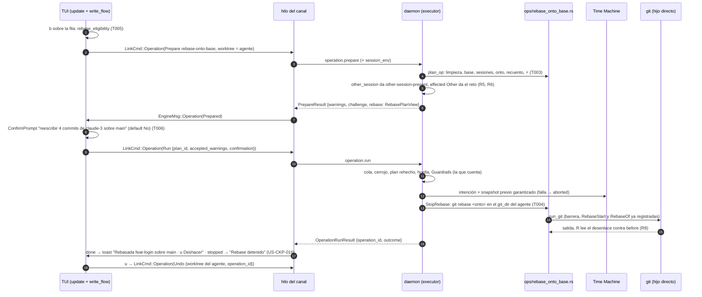

# DS-US-CKP-015 · Poner al día la rama de un agente sobre la base

## Contexto rápido

Al terminar, el desarrollador selecciona la fila de un agente que ya terminó, pulsa `b`, ve el plan "reescribir 4 commits de claude-3 sobre main", lo confirma y la rama del agente queda sobre la última punta de la base, con snapshot previo y un toast con Deshacer durante 5 s. Si el agente sigue en el directorio (Activo o Inactivo), si hay cambios sin commitear o si la base no está confirmada, "Rebasar" sale desactivado con el motivo y la acción que lo desbloquea. Con ⚡ entre la rama y la base, el mismo prompt avisa del conflicto previsto.

Es la segunda escritura del Cockpit y reutiliza entero el esqueleto de [DS-US-CKP-014](./US-CKP-014-integrar-rama-agente.md): preparar → confirmar el plan → ejecutar → Deshacer (`write_flow.rs`, `OpsContext`/`EngineFacts`, `view` en `OpPlan.expected`, desenlace por estado real, Deshacer desde el toast).

Hoy:
- `rebase-onto-base` está en el catálogo (`crates/api/src/catalog.rs:169-176`, `NoArgs`, gobernada como `Rebase`, marca Cockpit y MCP, dueña US-CKP-015). El catálogo de producción solo arma `snapshot` (`crates/core/src/executor/ops/mod.rs:22`, `ARMS`): `operation.prepare` de un rebase responde `-32004` con `implemented_by = US-CKP-015`.
- El único brazo de rebase es el de prueba (`test_arms.rs:290-316`): rebasa y, si falla, lanza `git rebase --abort` siempre, sin mirar la capa. De ahí sale el comentario de `OperationOutcome::ConflictReverted` (`catalog.rs:952`, "An atomic rebase hit a conflict and was aborted"). No es lógica de producto (DS-TS-CKP-003 D14).
- `crates/git` ya tiene `UserOp::RebaseOnto { onto }` con `--no-update-refs --no-autosquash --no-autostash` y `UserOp::RebaseAbort` (`crates/git/src/user_ops.rs:100-104`). `crates/policy` ya normaliza `PlanShape::Rebase` en `Operation::Rebase` más la transición de la rama, y registra `Expected::RebaseStart` y `Expected::RebaseOf` (`crates/policy/src/guard/plan.rs:187-214`).
- **DS-US-CKP-014 no está implementada en `main`**: no existen `crates/core/src/executor/ops/merge.rs`, `ops/context.rs` ni `apps/cli/src/tui/write_flow.rs`. Esta DS depende de ella como orden (G1).
- **DS-US-MCP-018** (draft) diseña el modo `atomic` del mismo brazo para la capa `mcp`, en `ops/rebase_onto_base.rs`, con un plan "layer-agnóstico, lo reutiliza US-CKP-015". Esta DS comparte ese archivo y su contrato (R2, R3, R7).

Sin `architecture-constitution.md` en la cascada: las restricciones activas salen de [AGENTS.md](../../../../../AGENTS.md) y de los ADR citados, igual que DS-US-CKP-014 (`unsafe_code = forbid` y escritura con la Git CLI del sistema, ADR-GRP-001; protocolo congelado y códigos en `-32016`, ADR-GRP-016; argv fijo y sin shell, NFR-02). Ninguna tarea las viola.

### Decisiones

Todas son **Decisión del orquestador (2026-10-28)**, pendiente de validar por Arquitecto y PO. Se reutilizan sin repetirlas I1, I2 (patrón de capacidad), I3 (patrón de motivos aditivos), I4, I8, I9, I10, I12, I13, I14 e I15 de DS-US-CKP-014, y L4/L5 de DS-US-CKP-024.

| ID | Decisión | Por qué / descartado |
|----|----------|----------------------|
| R1 | **Desde la TUI el rebase es siempre modo `stop`.** La capa `cockpit` fija el modo (ADR-CKP-002 § 9): si el rebase choca, el paso no aborta y el worktree del agente queda con el rebase en curso, como lo deja Git. Desenlace `stopped`. `conflict-reverted` (`catalog.rs:952`) solo existe en el modo `atomic` de la capa `mcp` (DS-US-MCP-018). El comentario de `catalog.rs:952` describe ese modo; el brazo de prueba que aborta siempre no es lógica de producto (D14) | Comprobado contra el código: el único aborto automático está en `test_arms.rs:307-316`. Descartado: abortar también en la TUI, que quita al humano la resolución en su editor (Q-CKP-11, BR-CKP-WF-003). Lo detenido, Abortar, Cancelar y el tiempo transcurrido son de US-CKP-016 (R14) |
| R2 | **Un solo brazo para los dos modos**: `crates/core/src/executor/ops/rebase_onto_base.rs`, el archivo que fija DS-US-MCP-018 T004. Su `plan_op` es común. Esta DS añade el paso `StopRebase` (capa `cockpit`). Con `Layer::Mcp`, `step()` devuelve error antes de la operación protegida hasta que entre `AtomicRebase` de DS-US-MCP-018, que hace lo simétrico con `Layer::Cockpit`. La primera historia que entre crea el archivo y su línea en `ARMS`; la segunda añade su paso | `StepPlan.layer` (`executor/mod.rs:115`) ya lleva la capa; `plan_op` no la recibe y no la necesita. Descartado: un archivo por modo, que duplica el plan y su orden de rechazos |
| R3 | **El contexto del plan es `OpsContext`/`EngineFacts` de DS-US-CKP-014 (I1)**, con un método nuevo: `EngineFacts::base_change_pending(repo_id) -> bool`, de la misma fuente que el diagnóstico `base-change-pending` del nivel del equipo. Nunca un segundo mecanismo para la base y las sesiones | DS-US-CKP-014 está aprobada y fija `EngineFacts` como la vía de los datos del motor a los brazos. DS-US-MCP-018 T002 propone `ProtectedBackend::plan_context` para los mismos datos: dos fuentes de la base confirmada y de las sesiones darían respuestas distintas entre el merge y el rebase. Se propone a DS-US-MCP-018 que reutilice `EngineFacts` ([Enmiendas que implica](#enmiendas-que-implica), Q-CKP-41) |
| R4 | **Orden de rechazos de `plan_op`** (tras `check_common`, `facts.rs:72`, que ya da `operation-in-progress`, `detached-head`, `git-busy`, `worktree-locked`, `branch-checked-out-elsewhere` y `grafts`): contexto adjunto o `NotImplemented` → `dirty-worktree` (algo preparado o sin preparar en archivos seguidos, `Status::has_tracked_changes()` de I6) → `base-unconfirmed` (base no `Confirmed` o sin nombre) → `base-change-pending` → sesiones (R5) | Es el orden de DS-US-MCP-018 T004, con la base leída de `EngineFacts`. Los archivos sin seguimiento no bloquean (Q-CKP-37 para el merge, D6 de DS-US-MCP-018): Git no los toca salvo que el rebase fuera a sobrescribir uno, y entonces se niega (`failed-unchanged`); el snapshot previo los guarda. Validación del PO: Q-CKP-40 |
| R5 | **Sesión presente = rechazo con las dos capas.** El brazo pone `other_session = true` si `EngineFacts::present_sessions` del worktree del agente no está vacío (Activas e Inactivas). La regla de `executor/mod.rs:521` pierde la condición `layer == Layer::Mcp`: con `rebase-onto-base`, `other_session` da `other-session-present` en las dos capas. Con capa `cockpit` el solicitante nunca es un agente, así que toda sesión presente es "otra"; DS-US-MCP-018 T002 sigue excluyendo la del solicitante con capa `mcp` | BR-CKP-ELIG-003 y BR-CKP-ELIG-001 (rebase "No" con sesión Activa o Inactiva) y BR-CKP-EDGE-004 (manda la más restrictiva, que con "cualquier sesión presente" se cumple sola). Hoy, con capa `cockpit`, `other_session` solo da el aviso `active-session` (`executor/mod.rs:583`), que se acepta: el rebase reescribiría la rama bajo un agente vivo. Descartado: un motivo nuevo, porque `other-session-present` ya dice esto (Q-MCP-21) |
| R6 | **Trabajo afectado = `Affected::Other`** (I4): los commits reescritos son del agente y sin DEP-CKP-2 no se atribuyen. Con capa `cockpit` da el reto ligado a la huella: es la confirmación del plan de la historia (BR-CKP-AUTH-003, que incluye el rebase). En Windows, `confirmation-unavailable` con texto propio (como Q-CKP-36). La relajación de D13 de DS-US-MCP-018 (`Nobody` con capa `mcp`) pasa del brazo al ejecutor: una regla en `plan()` junto a la de R5 | `permission` (`executor/mod.rs:198`) con `Other` y capa `mcp` daría `foreign-work` a todo agente. El brazo no conoce la capa; el ejecutor sí. Así el valor conservador lo declara el brazo y la excepción por capa queda explícita y auditable en un solo sitio. Descartado: `Nobody` en el brazo, que quita la confirmación de BR-CKP-AUTH-003 en la TUI |
| R7 | **Capacidad `operation.rebase`** (D1 de DS-US-MCP-018) para toda la forma nueva del rebase, también la de la TUI: `PrepareResult.rebase: Option<RebasePlanView>`, copiada de `OpPlan.expected["view"]` (I14) en `conn.rs` solo para `rebase-onto-base` y una conexión con la capacidad. Sin ella, la regla 1.1 del paso 2 de T001 de DS-US-MCP-018: `not-available-for-layer`, sin plan. `RebasePlanView` vive en `crates/api/src/rebase.rs` (archivo de DS-US-MCP-018 T001; lo crea quien entre primero) | Una capacidad por operación (patrón de I2). La TUI pide toda capacidad que conoce (ADR-GRP-016) |
| R8 | **El paso `StopRebase` rebasa en el `git_dir` propio del worktree del agente** (patrón de I15): `RepoTarget { git_dir: facts.git_dir, work_tree: Some(facts.root) }` con `UserOp::RebaseOnto { onto }`. El desenlace se lee después y se compara con lo leído antes de lanzar (I8): éxito, sin rebase en curso, HEAD en la rama y nueva punta descendiente de `onto` → `done`; rebase en curso → `stopped`; sin rebase en curso, rama en `old_tip` y estado igual a `before` → `failed-unchanged`; cualquier otra cosa → `failed-changed` (Deshacer) | Con el directorio común Git usaría el HEAD y el índice del worktree principal y rebasaría otra rama. Clasificar contra `before` y no contra el plan evita que un cambio ajeno entre el cerrojo y el lanzamiento salga como `failed-changed` |
| R9 | **"Ya al día" se decide en la TUI**, no en el plan: con `behind = 0` contra la base (`DivergenceView::Counted`), "Rebasar" sale desactivado con "ya está al día con <base>". El daemon no rechaza un rebase sin nada que hacer: `git rebase` termina sin cambios y el desenlace es `done` con la misma punta | El plan es común con el modo `atomic`, que devuelve `done` con `up_to_date` (DS-US-MCP-018). Descartado: un motivo `up-to-date` en el plan, que rompe esa forma |
| R10 | **Elegibilidad de "Rebasar" en la TUI**: función pura `rebase_eligibility` en `tui/rebase.rs`, con el orden de T005. El worktree principal y la fila con HEAD separado salen desactivados en la TUI; el daemon solo revalida lo que `check_common` y el plan miden | BR-CKP-ELIG-001: son precondiciones de presentación. El worktree principal ("No" en la matriz) no se rechaza en el plan porque el plan es común con la capa `mcp`, donde un agente puede trabajar en el principal |
| R11 | **Tecla `b`** ("rebasar sobre la base"), fila nueva en `keymap.rs`. Libre en el código y en las Dev Specs del Cockpit | `r` es Reintentar (`keymap.rs:90`); `m`, `u`, `o`, `d`, `f`, `y`, `s`, `n`, `j`, `k`, `q` y `?` están tomadas (DS-012, DS-014). Descartado: `R`, que se confunde con Reintentar, y `p`, que sugiere push (BR-CKP-CONS-002) |
| R12 | **⚡ en el plan** con `EngineFacts::predicted_conflict(repo_id, worktree, base)` (L4 de DS-US-CKP-024): con `true`, `OpPlan.warnings` lleva `PredictedConflict` y entra en la huella (L5). La TUI pinta la línea solo si el plan trae el aviso; nunca lo deduce de su modelo de predicción. Si dice No, nada cambia | Mismo mecanismo y misma dependencia (G2) que el merge. Un aviso es UX (ADR-CKP-002 § 2, paso 3): sin predictor, `false` no abre ninguna escritura |
| R13 | **Deshacer** = `timemachine.undo {worktree: raíz del worktree del agente, operation_id}` (I12). El ámbito del oplog es el worktree del agente y `refs/heads/<rama>`, así que Deshacer devuelve la rama a `old_tip` y el working tree a su estado previo. Con `stopped` no hay Deshacer hasta abortar (BR-CKP-WF-003, BR-TMC-EDGE-004) | `undo.rs` de DS-US-CKP-014 se reutiliza sin cambios: solo cambia el texto del toast |
| R14 | **Frontera con US-CKP-016**: esta historia lanza el rebase, clasifica `stopped` en el paso y lo presenta con el texto genérico de DS-US-CKP-014 ("Rebase detenido"). Mientras corre, la TUI está en `Running` de `write_flow` ("Rebasando…"). US-CKP-016 añade la fila "Rebase en curso" con rutas sin fusionar, Abortar (`abort-in-progress`), Abrir en el editor, Cancelar (`operation.cancel`) y el tiempo transcurrido, y decide cómo se presenta un rebase cancelado que deja el rebase en curso (hoy el ejecutor fuerza `cancelled` con `Interrupt::Cancelled`, `executor/mod.rs:1041-1043`) | El paso tiene que clasificar bien desde el primer día; la salida del conflicto es de otra historia. Coordinado con DS-US-CKP-016, que asume que el rebase lanzado desde la TUI puede quedar "Rebase en curso" y Cancelarse: es exactamente lo que deja R1 |

## ⚠️ Gaps y violaciones de la constitución

| ID | Qué falta | Severidad | Alcance | Acción | Owner |
|----|-----------|-----------|---------|--------|-------|
| G1 | **Dependencia de orden**: DS-US-CKP-014 implementada (`OpsContext`, `EngineFacts`, `OperationCatalog::attach`, `Prepared.view`, `write_flow.rs`, `undo.rs`, `present/write_text.rs`, `Status::has_tracked_changes()`) y el cursor de fila de T006 de DS-US-CKP-012 (G3 de DS-US-CKP-014). Comprobado en `main` (2026-10-28): no existen `ops/merge.rs`, `ops/context.rs` ni `tui/write_flow.rs` | Bloqueante | T002, T003, T005, T006 | Mezclar DS-US-CKP-014 antes. T001 (tests en rojo con stubs propios) puede ir antes | Orquestador |
| G2 | El predictor no publica su estado (PR-B de DS-TS-CKP-001 y `PredictionReader`, L6 de DS-US-CKP-024). Sin él, `predicted_conflict` da siempre `false` | Bloqueante | T007 | Cerrar G2 de DS-US-CKP-024 | Orquestador |
| G3 | Coordinación con DS-US-MCP-018 (draft): archivo del brazo, capacidad `operation.rebase`, `crates/api/src/rebase.rs` y los motivos `dirty-worktree`, `base-unconfirmed` y `base-change-pending` son compartidos; su T002 propone otra fuente del contexto (R3) y su D13 pone `Nobody` en el brazo (R6). Quien entre primero crea; el segundo integra | Informativo |  | Q-CKP-41 y [Enmiendas que implica](#enmiendas-que-implica) | Arquitecto |
| G4 | La TUI no distingue un **cambio de base pendiente** (base confirmada con otra declarada por el equipo): `BaseStatusView` (`crates/api/src/messages.rs:237`) solo tiene `confirmed`, `unconfirmed` e `invalid`. El escenario "base pendiente de confirmar" de la historia es `unconfirmed` y queda cubierto; con un cambio pendiente, "Rebasar" sale ofrecido y el daemon rechaza con `base-change-pending` y su texto | Bloquea liberación |  | Publicar el cambio pendiente en la instantánea con US-CKP-009 y desactivarlo en T005 | Orquestador |

Ninguna violación: sin constitución, ver Contexto rápido.

## 🔭 La forma



---

## 🚀 Plan de implementación

### El trabajo de un vistazo

| # | Tarea | Depende | Aterriza en |
|---|---|---|---|
| T001 | Escribir en rojo los tests de contrato del daemon y de la TUI | — | `crates/core/tests/us_ckp_015_rebase.rs`, `apps/cli/tests/tui_rebase.rs`, stubs |
| T002 | Crear el contrato (capacidad, motivos, `RebasePlanView`) y el dato de la base pendiente | T001 | `crates/api/src/rebase.rs`, `catalog.rs`, `methods/operation.rs`, `ops/context.rs`, `daemon/operation_facts.rs` |
| T003 | Crear el plan común de `rebase-onto-base` y las dos reglas del ejecutor | T002 | `ops/rebase_onto_base.rs`, `ops/mod.rs`, `executor/mod.rs`, `channel/conn.rs` |
| T004 | Crear el paso `StopRebase` y su desenlace | T003 | `ops/rebase_onto_base.rs` |
| T005 | Crear la elegibilidad de "Rebasar" en la TUI | T002 | `apps/cli/src/tui/rebase.rs` |
| T006 | Pintar la acción, el prompt, el resultado y Deshacer, con textos en/es | T005 | `tui/{update,view,help,keymap,mod}.rs`, `present/rebase_text.rs` |
| T007 | Añadir ⚡ al plan y al prompt | T003, T006, G2 | `ops/rebase_onto_base.rs`, `present/rebase_text.rs` |
| T008 | Cerrar la historia | T001–T007 | `docs` |

T004 y T005–T006 van en paralelo una vez está T003 (T005 solo necesita T002).

### T001 — Escribir en rojo los tests de contrato

**Objetivo.** Los seis escenarios de la historia, en rojo, contra el daemon real con repos y perfil temporales (NFR-01) y contra la `App` real sobre `TestBackend`.

**Ubicación.**
- `crates/core/tests/us_ckp_015_rebase.rs` (**CREATE**): daemon en proceso con `OperationsWiring::production()` y el contexto adjunto (I1), Git real del sistema.
- `apps/cli/tests/tui_rebase.rs` (**CREATE**): el arnés de `apps/cli/tests/live_fleet.rs` (macOS, debug, `gitraptor_testkit::Fixture`, `raptor-fake-agent`).
- Stubs que compilan (`todo!()` o `PlanError::NotImplemented`) en los archivos de T002 a T006.

**Reglas**
- Los tests rojos van en su archivo propio y no se editan durante la implementación (R4 de `/implement`).
- Nunca este repo ni el perfil real. `GITRAPTOR_PROFILE_DIR` solo en depuración.
- La capa `cockpit` sale de la resolución real del solicitante, nunca de `test_layer_override` en los de punta a punta.

- **Depende:** —
- **Refs:** DS-US-CKP-014 T001, ADR-CKP-002 Validación
- **Aceptación:** `cargo test -p gitraptor-core --test us_ckp_015_rebase` y `cargo test -p gitraptor-cli --test tui_rebase` compilan y fallan por la razón esperada

### T002 — Crear el contrato y el dato de la base pendiente

**Objetivo.** El daemon sabe describir un plan de rebase a una conexión que lo entiende.

**Ubicación.**
- `crates/api/src/rebase.rs` (**CREATE** si DS-US-MCP-018 no lo creó; si existe, **MODIFY**): `RebasePlanView`. Una línea `pub mod rebase;` en `crates/api/src/lib.rs`.
- `crates/api/src/catalog.rs` (**MODIFY**): `PrepareResult.rebase: Option<RebasePlanView>` con `#[serde(default, skip_serializing_if = "Option::is_none")]`; en `RejectReason`, las variantes que falten de `DirtyWorktree`, `BaseUnconfirmed` (DS-US-CKP-014) y `BaseChangePending` (DS-US-MCP-018), una línea por entrada.
- `crates/api/src/methods/operation.rs` (**MODIFY** si falta): `CAP_OPERATION_REBASE = Capability::new("operation.rebase")` en el `GROUP` (hoy solo hay `operation.snapshot` en `:29` y `operation.guardrails` en `:33`).
- `crates/core/src/executor/ops/context.rs` (**MODIFY**): `EngineFacts::base_change_pending(&self, repo_id: &str) -> bool`.
- `crates/core/src/daemon/operation_facts.rs` (**MODIFY**): la implementación de producción, de la misma fuente que el diagnóstico `base-change-pending` del nivel del equipo (`TeamLoader::load`, `crates/policy/src/team.rs`).

**Reglas**
- Los motivos nuevos solo llegan a una conexión con `operation.rebase` (patrón de I3).
- `RebasePlanView` sale de datos que ya están en la huella: no cambia lo que la huella compara (I14).
- `base_change_pending` sin poder leer el nivel del equipo → `true` (falla cerrado: rechazo con motivo, nunca un rebase sobre una base dudosa).

**Criterios de aceptación de la tarea**
- [ ] `describe` y el esquema de `RejectReason` incluyen los motivos; `crates/api/tests/architecture.rs` sigue en verde (sin códigos nuevos).
- [ ] Un cliente sin `operation.rebase` recibe `not-available-for-layer` sin plan (test en `conn.rs`; es el guard de la regla 1.1 de T001 de DS-US-MCP-018).

- **Depende:** T001
- **Refs:** I2, I3 e I14 de DS-US-CKP-014; D1 y T001 de DS-US-MCP-018; ADR-GRP-016
- **Aceptación:** `cargo test -p gitraptor-api` y `cargo test -p gitraptor-core channel::conn` en verde

### T003 — Crear el plan común y las dos reglas del ejecutor

**Objetivo.** El daemon prepara un rebase con las precondiciones de BR-CKP-ELIG-003, igual para las dos capas.

**Ubicación.**
- `crates/core/src/executor/ops/rebase_onto_base.rs` (**CREATE** si DS-US-MCP-018 no lo creó): `plan_op`.
- `crates/core/src/executor/ops/mod.rs` (**MODIFY**): `OperationId::RebaseOntoBase` en `ARMS` (`:22`) y su brazo en `plan_op` y `step`; `RebaseOntoBase` sale de `TEST_ARMS` (`test_arms.rs`) cuando entra el de producción.
- `crates/core/src/executor/mod.rs` (**MODIFY**): la regla de `:521` sin `layer == Layer::Mcp` (R5).
- `crates/core/src/channel/conn.rs` (**MODIFY**): `PrepareResult.rebase` desde `Prepared.view` (R7).

**Reglas**

De `plan_op`, en orden (lo común ya pasó por `check_common`):
1. Contexto adjunto, o `NotImplemented`.
2. `status.has_tracked_changes()` del worktree del agente → `dirty-worktree` (R4).
3. `EngineFacts::base`: si no es `Confirmed` o no tiene nombre → `base-unconfirmed`. `EngineFacts::base_change_pending` → `base-change-pending`.
4. `onto` = punta de `refs/heads/<base>` leída del directorio común; nunca `resolve_main_branch` (lo que hace el brazo de prueba, `test_arms.rs:95-97`).
5. Rama = `facts.head_branch` (HEAD separado ya cayó en `check_common`, `facts.rs:84`); `old_tip` = `facts.head_commit`.
6. Recuento: `RepoReader::ahead_behind_commits` de `old_tip` frente a `onto` (los `ahead`), acotado (`Count::AtLeast` → `commits_capped = true`).
7. `other_session` = `EngineFacts::present_sessions(repo_id, raíz del agente)` no vacío (R5).
8. `OpPlan`:
   - `expected`: `{branch: "refs/heads/<rama>", old_tip, base: "refs/heads/<base>", onto, commits, mode: "stop", view}`. `onto` y `old_tip` en la huella: un commit del agente o de la base entre preparar y ejecutar da `state-changed`.
   - `warnings`: vacío hasta T007.
   - `affected`: `Affected::Other` (R6).
   - `governed`: `Some(PlanShape::Rebase { branch, upstream: "refs/heads/<base>", old_tip, onto })` (`plan.rs:23`).
9. `RebasePlanView` en `expected["view"]`: nombre corto de la rama y de la base, `old_tip`, `onto`, recuento y tope.

**Reglas del ejecutor**
- `executor/mod.rs:521`: `if op_plan.other_session && op == OperationId::RebaseOntoBase` → `OtherSessionPresent`, sin mirar la capa. El resto del ejecutor no cambia.
- La relajación de `affected` con capa `mcp` (R6) no es de esta historia: la añade DS-US-MCP-018 junto a esa regla. Sin ella, un agente recibe `foreign-work`, que es el valor seguro.

**Criterios de aceptación de la tarea**
- [ ] `ops::tests::production_wiring_has_no_governed_arm_without_guardrails` sigue en verde: `RebaseOntoBase` se arma solo si la puerta decide.
- [ ] Tests unitarios de `rebase_onto_base.rs` para cada motivo y su orden, con repos temporales.
- [ ] Un repo con `refs/replace` que sustituye la punta del agente rebasa el commit real (L-04).

- **Depende:** T002
- **Refs:** BR-CKP-ELIG-003, ADR-CKP-002 § 1, § 3 y § 9; R4 a R7
- **Aceptación:** `cargo test -p gitraptor-core executor::ops` en verde

### T004 — Crear el paso `StopRebase`

**Objetivo.** El ejecutor de producción rebasa la rama del agente dentro de la operación protegida y deja el conflicto como lo deja Git.

**Ubicación.** `crates/core/src/executor/ops/rebase_onto_base.rs` (**MODIFY**): `StopRebase` (`ProtectedStep`) y `classify_after`.

**Reglas**
- `step()` construye `StopRebase` solo con `Layer::Cockpit`. Con `Layer::Mcp`, error antes de la operación protegida (sin intención ni previo) hasta `AtomicRebase` (R2).
- `scope()`: `worktrees = [raíz del agente]`, `refs = ["refs/heads/<rama>"]`. `subtype()`: `"rebase-onto-base"`.
- `run()`: lee `before` (punta de la rama, HEAD simbólico, operación en curso y estado del worktree del agente) y luego `UserGitCommand::new(git, RepoTarget { git_dir: facts.git_dir, work_tree: Some(facts.root) }, UserOp::RebaseOnto { onto }, None, session_env, rejecting_editor(None), home)` y `run_git(ctx, cmd, &plan.cancel)` (R8, I15). Sin transiciones propias: `RebaseStart` y `RebaseOf` ya las registra la ligadura de Guardrails (DS-TS-CKP-003 T006).
- El Git y el `HOME` salen de `OpsContext`.
- `classify_after` (R8) relee con la capa de lectura y compara con `before`:
  - éxito, sin operación en curso, HEAD simbólico a la rama y `merge_bases(nueva punta, onto) == [onto]` → `done`, `changed_refs = ["refs/heads/<rama>"]` si la punta cambió;
  - `InProgress::Rebase` en el `git_dir` del agente → `stopped`;
  - sin operación en curso, rama en `old_tip` y estado igual a `before` → `failed-unchanged`;
  - cualquier otra cosa → `failed-changed`.
- Nada de `git rebase --abort` (R1). El paso nunca devuelve `Err` después de lanzar `git`: un `Err` se registra como `failed-changed` (`executor/mod.rs:1050-1055`).

**Criterios de aceptación de la tarea**
- [ ] `rebase_onto_base::tests::classify_compares_with_before_not_with_the_plan`.
- [ ] `rebase_onto_base::tests::a_conflict_is_left_as_git_leaves_it`: `stopped`, `rebase-merge` presente, ningún `RebaseAbort`.

- **Depende:** T003
- **Refs:** R1, R8; I8 e I15 de DS-US-CKP-014; ADR-CKP-002 § 9
- **Aceptación:** `cargo test -p gitraptor-core --test us_ckp_015_rebase` en verde salvo el escenario ⚡ (T007)

### T005 — Crear la elegibilidad de "Rebasar" en la TUI

**Objetivo.** La columna "Rebase" de BR-CKP-ELIG-001, como función pura, con el motivo y la acción que desbloquea.

**Ubicación.** `apps/cli/src/tui/rebase.rs` (**CREATE**), una línea en `tui/mod.rs`.

**Reglas**
- `rebase_eligibility(repo: &RepoView, row: &WorktreeRow, layer: Option<Layer>, live: bool) -> Eligibility<RebaseBlock>`. `Eligibility` es la de `tui/merge.rs` de DS-US-CKP-014; si allí no es genérica, se generaliza con un parámetro de tipo al entrar esta historia. Orden (el primero que falla manda):
  1. Conexión fuera de "En vivo" → `NotLive`.
  2. Capa distinta de `cockpit` → `AgentLayer` ("actúas como <agente>").
  3. Worktree no disponible → `Unavailable` (BR-CKP-EDGE-003).
  4. Worktree principal → `MainWorktree`.
  5. HEAD separado → `Detached`, con "crea una rama o cámbiate a una" (Q-MCP-30).
  6. Base no confirmada o inválida → `BaseUnconfirmed`, con "confirma la rama base" y cómo (BR-CKP-WF-005; misma fuente que la regla 5 de T004 de DS-US-CKP-014).
  7. Operación en curso en la fila → `InProgress` (BR-CKP-EDGE-002).
  8. Alguna sesión presente (Activa o Inactiva) en el worktree → `SessionPresent`, con "el agente sigue en este directorio; espera a que termine". Con varias sesiones basta una (BR-CKP-EDGE-004).
  9. Cambios preparados o sin preparar en archivos seguidos → `Dirty`, con "hay cambios sin commitear" (criterio de I6; el recuento de sin seguimiento no cuenta). Si `WorktreeState::Ready` aún lleva solo el total (`changes`, `model.rs:392`), la separación la añade T004 de DS-US-CKP-014; si no la añadió, esta tarea la añade en `present/ingest.rs` desde `staged` y `unstaged` de la instantánea (`messages.rs:337-338`).
  10. `behind = 0` contra la base → `UpToDate`, con "ya está al día con <base>" (R9).
- La sesión va antes que los cambios: con un agente vivo, sus cambios sin commitear son trabajo en curso y el motivo útil es esperar.
- Sin texto: devuelve códigos; los textos son de T006.

- **Depende:** T002
- **Refs:** BR-CKP-ELIG-001, BR-CKP-ELIG-003, BR-CKP-EDGE-004, BR-CKP-WF-005, DS-US-CKP-014 T004
- **Aceptación:** `cargo test -p gitraptor-cli tui::rebase` en verde

### T006 — Pintar la acción, el prompt, el resultado y Deshacer

**Objetivo.** El desarrollador ve "Rebasar" en la fila (o desactivado con su motivo), confirma el plan y recibe el resultado con Deshacer.

**Ubicación.**
- `apps/cli/src/tui/keymap.rs` (**MODIFY**): `Action::Rebase` (`b`) en la tabla única.
- `apps/cli/src/tui/update.rs` (**MODIFY**): despacha `Rebase` a `write_flow` con `OpRequest::Prepare { operation: RebaseOntoBase, worktree: raíz de la fila, session_env }`.
- `apps/cli/src/tui/view.rs`, `tui/help.rs` (**MODIFY**): la acción en `KeyHints` (desactivada con su motivo) y en la ayuda.
- `apps/cli/src/present/rebase_text.rs` (**CREATE**): textos en/es del plan, de los bloqueos de T005 y de los toasts. Una línea en `present/mod.rs`. Los motivos de rechazo nuevos (`dirty-worktree`, `base-change-pending`) van en `present/write_text.rs` (el `match` exhaustivo obliga).

**Reglas**
- ConfirmPrompt (`widgets/confirm.rs`, default No): título "Rebasar", pregunta "reescribir <n> commits de <actor> sobre <base>". El actor es el de la fila (I13); `commits_capped` → "<n>+ commits". Todos los avisos van en el mismo prompt (ADR-CKP-002 § 3).
- Toast al terminar (5 s): `done` → "Rebasada <rama> sobre <base> · u Deshacer"; `done` con la misma punta → "<rama> ya estaba al día con <base>"; `aborted` → "no se pudo tomar el snapshot previo; no se rebasó nada"; `failed-unchanged` → el motivo y "no cambió nada"; `failed-changed` → el motivo y "u Deshacer"; `stopped` → "Rebase detenido" sin Deshacer (US-CKP-016 añade rutas, Abortar, editor y Cancelar); `rejected` → el texto de `write_text.rs`.
- En Windows, `confirmation-unavailable` → "en Windows todavía no se puede confirmar un rebase desde GitRaptor" (R6).
- Deshacer: `undo.rs` sin cambios (R13); toast "Deshecho: <rama> vuelve a <oid7>".
- La salida de Git se ve con `o` sobre el toast (I11). Ningún push en ningún estado (BR-CKP-CONS-002). Plegado ASCII y sin color (DS-US-CKP-005).

- **Depende:** T005
- **Refs:** DS-US-CKP-014 T006 y T007, BR-CKP-WF-002, BR-CKP-AUTH-003
- **Aceptación:** `cargo test -p gitraptor-cli` en verde, con los snapshots nuevos aceptados

### T007 — Añadir ⚡ al plan y al prompt

**Objetivo.** Con ⚡ entre la rama y la base, el mismo prompt avisa del conflicto previsto antes de confirmar.

**Ubicación.**
- `crates/core/src/executor/ops/rebase_onto_base.rs` (**MODIFY**): `warnings.push(WarningCode::PredictedConflict)` si `EngineFacts::predicted_conflict(repo_id, raíz del agente, base)` (R12).
- `apps/cli/src/present/rebase_text.rs` (**MODIFY**): línea "⚡ conflicto previsto entre <rama> y <base>" antes de la pregunta, con plegado ASCII.

**Reglas**
- La TUI pinta la línea solo si el plan trae `predicted-conflict`.
- Con capa `mcp` el aviso no sale (ADR-MCP-001 § 4.3, DS-US-MCP-018): el brazo lo calcula, y DS-US-MCP-018 lo filtra con su capa.

- **Depende:** T003, T006, G2
- **Refs:** L4 y L5 de DS-US-CKP-024
- **Aceptación:** `cargo test -p gitraptor-core --test us_ckp_015_rebase a_predicted_conflict_is_a_warning_of_the_plan` en verde. Si G2 tarda, el test queda `#[ignore = "G2"]` y la historia `partially-implemented`

### T008 — Cerrar la historia

**Objetivo.** La historia queda `implemented` con su PR y sus enmiendas.

**Ubicación.** `docs/requirements/features/cockpit/user-stories/US-CKP-015-rebasar-rama-agente.md` (**MODIFY**), esta DS (**MODIFY**), `docs/requirements/release-plan.md` (**MODIFY**).

**Reglas**
- `cargo clippy` y `cargo test` (o `nx affected -t lint test`) en verde; contrato de `/implement` con `node tools/test/nextest-junit.mjs`.
- La historia pasa a `implemented` y enlaza el PR; esta DS añade `## Estado de la implementación`.
- Las enmiendas de [Enmiendas que implica](#enmiendas-que-implica) se aplican en el mismo PR o quedan anotadas en él.

- **Depende:** T001–T007
- **Refs:** AGENTS.md (Reglas de calidad)
- **Aceptación:** `cargo clippy --workspace -- -D warnings` y `node tools/test/nextest-junit.mjs` en verde

---

## Estructura de ficheros

| Archivo | Acción | Tarea |
|---|---|---|
| `crates/api/src/rebase.rs` | CREATE o MODIFY (`RebasePlanView`) | T002 |
| `crates/api/src/lib.rs` | MODIFY (1 línea `pub mod`, si no está) | T002 |
| `crates/api/src/catalog.rs` | MODIFY (motivos, campo `rebase`) | T002 |
| `crates/api/src/methods/operation.rs` | MODIFY (capacidad, si no está) | T002 |
| `crates/core/src/executor/ops/context.rs` | MODIFY (`base_change_pending`) | T002 |
| `crates/core/src/daemon/operation_facts.rs` | MODIFY | T002 |
| `crates/core/src/executor/ops/rebase_onto_base.rs` | CREATE o MODIFY (plan, `StopRebase`) | T003, T004, T007 |
| `crates/core/src/executor/ops/mod.rs` | MODIFY (`ARMS` y despacho) | T003 |
| `crates/core/src/executor/ops/test_arms.rs` | MODIFY (sale `RebaseOntoBase` de `TEST_ARMS`) | T003 |
| `crates/core/src/executor/mod.rs` | MODIFY (regla de `:521`) | T003 |
| `crates/core/src/channel/conn.rs` | MODIFY (`PrepareResult.rebase`) | T003 |
| `crates/core/tests/us_ckp_015_rebase.rs` | CREATE | T001 |
| `apps/cli/src/tui/rebase.rs` | CREATE | T005 |
| `apps/cli/src/present/ingest.rs` | MODIFY (solo si falta el recuento de seguidos) | T005 |
| `apps/cli/src/tui/{update,view,help,keymap,mod}.rs` | MODIFY | T006 |
| `apps/cli/src/present/{rebase_text,write_text}.rs` | CREATE / MODIFY | T006, T007 |
| `apps/cli/tests/tui_rebase.rs` | CREATE | T001 |

## Contratos compartidos

### Tipos y datos compartidos

```rust
// crates/api/src/rebase.rs (T002) — a crear (o junto a los tipos de DS-US-MCP-018)
#[derive(Debug, Clone, PartialEq, Eq, Serialize, Deserialize, JsonSchema)]
#[serde(deny_unknown_fields)]
pub struct RebasePlanView {
    pub branch: UntrustedName, // nombre corto de la rama del agente
    pub base: UntrustedName,   // nombre corto de la base
    pub old_tip: String,       // oid completo (hex)
    pub onto: String,          // oid completo (hex)
    pub commits: u32,
    pub commits_capped: bool,
}

// crates/api/src/catalog.rs (T002) — PrepareResult, campo nuevo (solo con operation.rebase)
#[serde(default, skip_serializing_if = "Option::is_none")]
pub rebase: Option<crate::rebase::RebasePlanView>,
// RejectReason, las que falten (aditivas): DirtyWorktree, BaseUnconfirmed, BaseChangePending

// crates/core/src/executor/ops/context.rs (T002) — método nuevo de EngineFacts (DS-US-CKP-014)
fn base_change_pending(&self, repo_id: &str) -> bool;

// apps/cli/src/tui/rebase.rs (T005) — a crear
pub enum RebaseBlock {
    NotLive, AgentLayer, Unavailable, MainWorktree, Detached,
    BaseUnconfirmed, InProgress, SessionPresent, Dirty, UpToDate,
}
```

Lo que ya existe y se usa tal cual: `OperationId::RebaseOntoBase`, `OperationArgs::RebaseOntoBase` (`catalog.rs:313`), `UserOp::RebaseOnto` (`user_ops.rs:101`), `PlanShape::Rebase` (`plan.rs:23`), `Expected::{RebaseStart, RebaseOf}`, `RejectReason::{OtherSessionPresent, OperationInProgress, DetachedHead, ConfirmationUnavailable}`, `WarningCode::{PredictedConflict, OtherActorsWork}`, `OperationOutcome::{Done, Stopped, FailedUnchanged, FailedChanged, Aborted}`, `run_git`, `RepoReader::{status, merge_bases, ahead_behind_commits, resolve_ref}`, `InProgress` de `crates/git/src/reader.rs`. De DS-US-CKP-014 (a crear allí): `OpsContext`, `EngineFacts`, `Prepared.view`, `WriteFlow`, `OpRequest`, `OpReply`, `Eligibility`, `undo.rs`, `Status::has_tracked_changes()`.

### Ciclos de vida (DI)

- `OpsContext`: el de DS-US-CKP-014, uno por daemon. Sin contexto, el rebase no se sirve.
- `StopRebase`: uno por ejecución, creado por `step()`.
- `WriteFlow`: uno por `App`; una sola escritura a la vez por TUI (DS-US-CKP-014 T005).

### Firmas del stack

```rust
// crates/core/src/executor/ops/rebase_onto_base.rs (T003, T004)
pub(super) fn plan_op(ctx: &OpsContext, repo: &RepoHandle, facts: &RepoFacts) -> Result<OpPlan, PlanError>;
pub(super) struct StopRebase { /* git_dir, root, branch, old_tip, onto, git, home, session_env */ }
impl ProtectedStep for StopRebase { /* scope(), subtype() = "rebase-onto-base", run() */ }
fn classify_after(before: &Before, after: &After, onto: &str) -> OperationOutcome;

// crates/core/src/executor/ops/context.rs (T002), método nuevo de EngineFacts
fn base_change_pending(&self, repo_id: &str) -> bool;

// apps/cli/src/tui/rebase.rs (T005)
pub fn rebase_eligibility(repo: &RepoView, row: &WorktreeRow, layer: Option<Layer>, live: bool) -> Eligibility<RebaseBlock>;
```

## Contrato de API

| Método | Cambio | Con `operation.rebase` | Sin ella |
|---|---|---|---|
| `operation.prepare {operation: "rebase-onto-base", worktree: <raíz del agente>, args: {}, session_env}` | Forma: `rebase` y motivos nuevos | `PrepareResult` con `rebase`, `warnings`, `challenge` | `not-available-for-layer`, sin plan (regla 1.1 de T001 de DS-US-MCP-018) |
| `operation.run {plan_id, accepted_warnings, confirmation}` | Ninguno | `OperationRunResult` con `outcome` y `git_output` (capa `cockpit`) | — |
| `timemachine.undo {worktree, operation_id}` | Ninguno | `UndoResult` | — |

### Forma del error y del cuerpo de respuesta

Un rechazo es `-32014 OPERATION_REJECTED` con `data.reason` (`RejectedData`), como en DS-US-CKP-014. No hay códigos nuevos.

### Forma de la configuración

_No aplica — no hay clave de perfil ni de repo nueva; los flags del rebase son fijos (`user_ops.rs:65-67`)._

### Valores numéricos

| Valor | Cifra | Fuente |
|---|---|---|
| Caducidad del plan | 60 s | `PLAN_TTL_MS`, DS-TS-CKP-002 D8 |
| Toast con Deshacer | 5 s | BR-CKP-WF-002 |
| Espera de la barrera | 2 s | `REGISTRATION_WAIT`, I9 de DS-US-CKP-014 |
| Tope del recuento de commits | el de `ahead_behind_commits` | `crates/git/src/reader.rs` |
| Tiempo máximo del rebase con capa `cockpit` | ninguno: solo Cancelar | BR-CKP-WF-008 |

## Modelo de datos

_No aplica — nada nuevo se persiste: el plan vive en el ejecutor hasta caducar y el oplog de la Time Machine guarda la operación con su forma actual._

## Estrategia de pruebas y cobertura

### 9.1 Pirámide de pruebas

| Nivel | Dónde | Qué |
|---|---|---|
| Unit | `ops/rebase_onto_base.rs`, `tui/rebase.rs`, `present/rebase_text.rs` | Motivos y su orden, desenlace, elegibilidad, idiomas |
| Integración (daemon + Git real) | `crates/core/tests/us_ckp_015_rebase.rs` | Escenarios del daemon |
| E2E (TUI + daemon) | `apps/cli/tests/tui_rebase.rs` (macOS, debug) | Escenarios de la historia de punta a punta |
| Snapshots | `apps/cli/src/tui/snapshots/` | Prompt, acción desactivada, toasts, en/es |

### 9.2 Umbrales de cobertura

Toda regla de `plan_op`, de `classify_after` y de `rebase_eligibility` con su test. Sin cifra de cobertura de líneas en el repo.

### 9.3 Datos de prueba

Repos temporales con `gitraptor_testkit::Fixture`: `main` confirmada como base y sacada en el worktree principal; `feat-login` en un worktree enlazado con 4 commits; `main` con 2 commits nuevos que no tocan los archivos de `feat-login`. Sesión de `raptor-fake-agent` como "claude-3" terminada, y "claude-2" Inactiva en `feat-pagos`. Para el conflicto, un commit de `main` que cambia las mismas líneas que `feat-login`. Nunca este repo (NFR-01).

### 9.4 Comportamientos críticos verificados

| Escenario de la historia | Test |
|---|---|
| Rebase de una rama terminada y Deshacer | `tui_rebase::rebase_confirm_and_undo` (E2E): prompt "reescribir 4 commits de claude-3 sobre main"; tras `y`, `feat-login` desciende de la punta de `main`, snapshot previo en el oplog y toast con Deshacer; tras `u`, `feat-login` = commit anterior. `us_ckp_015_rebase::a_rebase_runs_in_the_agent_worktree_with_a_prior_snapshot` (daemon) |
| Agente presente, rebase bloqueado | `tui::rebase::tests::an_inactive_session_disables_rebase` y `us_ckp_015_rebase::a_present_session_is_refused_in_the_cockpit_layer` (`other-session-present`, R5) |
| Compartido, manda la más restrictiva | `tui::rebase::tests::a_shared_worktree_is_blocked_by_its_inactive_session` (claude-1 Terminado, claude-2 Inactivo) |
| Cambios sin commitear, rebase bloqueado | `tui::rebase::tests::tracked_changes_disable_rebase` y `us_ckp_015_rebase::a_dirty_worktree_is_refused` (`dirty-worktree`); `us_ckp_015_rebase::an_untracked_file_does_not_block` (R4, Q-CKP-40) |
| Base pendiente, rebase desactivado | `tui::rebase::tests::an_unconfirmed_base_disables_rebase` y `us_ckp_015_rebase::an_unconfirmed_base_is_refused` (`base-unconfirmed`) |
| Con ⚡ contra la base, aviso y confirmación | `us_ckp_015_rebase::a_predicted_conflict_is_a_warning_of_the_plan` y `tui_rebase::predicted_conflict_and_plan_share_one_prompt`; tras No, la punta de `feat-login` igual y ninguna intención en el oplog. Bloqueado por G2 (T007) |

Además:
- `us_ckp_015_rebase::a_conflicting_rebase_stops_as_git_leaves_it` (R1): `outcome = stopped`, `rebase-merge` en el `git_dir` del agente, nada abortado; Deshacer se rechaza mientras siga en curso (lo amplía US-CKP-016).
- `us_ckp_015_rebase::a_linked_worktree_rebases_its_own_head` (R8): el HEAD y el índice del worktree principal quedan iguales.
- `us_ckp_015_rebase::an_agent_commit_between_prepare_and_run_is_state_changed`: `rejected` con `state-changed`, sin cambios (Validación 3 de ADR-CKP-002).
- `us_ckp_015_rebase::other_branches_never_move`: con `rebase.updateRefs=true` y `rebase.autoStash=true` en la config, ninguna otra rama se mueve y no hay autostash (Validación 9 de ADR-CKP-002).
- `us_ckp_015_rebase::a_real_rebase_matches_the_registered_transitions`: con una regla de Guardrails que deja rebasar a la capa `cockpit`, el `pre-rebase` casa con `RebaseStart` y la actualización final de la rama con `RebaseOf`, junto a las de `HEAD` y `ORIG_HEAD` que escribe `git rebase`. El brazo de prueba no lo había probado con Guardrails real.
- `us_ckp_015_rebase::an_mcp_layer_never_gets_the_stop_mode`: capa `mcp` sin `AtomicRebase` → error antes de la operación protegida, sin intención en el oplog.
- `us_ckp_015_rebase::the_remote_refs_never_change`: `refs/remotes/origin/*` iguales tras el rebase.
- `tui::rebase::tests::an_up_to_date_branch_disables_rebase` (R9).

### 9.5 Plataformas

Se ejecuta en macOS. Linux y Windows: **Pendiente: etapa de validación multiplataforma** ([`xplat-pendientes.md`](../../../../architecture/xplat-pendientes.md)). En Windows el rebase se rechaza con `confirmation-unavailable` por R6 hasta que exista la confirmación de trabajo ajeno (TQ-14 b), y no se libera hasta la validación de la barrera (I9, disparador (c)); falla cerrado.

## Gate de seguridad

- [ ] **NFR-02, sin shell**: el único lanzamiento es `run_git` con `UserOp::RebaseOnto`; `onto` sale del plan, nunca de texto libre; sin `--exec`, sin `--update-refs`, sin autostash ni autosquash (`user_ops.rs:65-67`, `:100`). `crates/core/tests/executor_boundary.rs` en verde.
- [ ] **Entradas validadas**: `rebase-onto-base` sigue con `NoArgs` y `deny_unknown_fields`; el worktree pedido debe ser la raíz de un worktree observado.
- [ ] **Texto no confiable**: nombres de rama y salida de Git pasan por `UntrustedName`/`Untrusted` en el contrato y por `SafeText` en la TUI. La salida de Git solo va a capa `cockpit`.
- [ ] **NFR-01**: sin snapshot previo no hay rebase (`aborted`); Deshacer devuelve la rama y el working tree; un conflicto deja el rebase en curso con el previo intacto; los tests usan repos temporales.
- [ ] **Capa**: el modo `stop` nunca se sirve a la capa `mcp`.
- [ ] **Nunca red**: ningún `fetch` ni `push`.

## Cómo extender

- **Modo `atomic` (US-MCP-018)**: su paso `AtomicRebase` en el mismo `rebase_onto_base.rs`; `step()` elige por `StepPlan.layer`. El plan no cambia.
- **Rutas en conflicto, Abortar y Cancelar (US-CKP-016)**: leen el `stopped` que deja `StopRebase` y el oplog de esta operación; no tocan el paso.
- **Un motivo nuevo**: variante aditiva en `RejectReason` detrás de `operation.rebase` y su texto en `present/write_text.rs`.

## Enmiendas que implica

No aplicadas por esta DS; las aplica el PR de la historia o quedan anotadas en él.

- **DS-US-MCP-018 T002** (R3): el contexto del plan sale de `EngineFacts` (DS-US-CKP-014 I1), con métodos nuevos para lo que falte (`base_change_pending`, protección del force-push), en lugar de `ProtectedBackend::plan_context`.
- **DS-US-MCP-018 D13** (R6): el brazo declara `Affected::Other`; la relajación a `Nobody` con capa `mcp` va en `plan()` del ejecutor, junto a la regla de `:521`, con el mismo comentario `TRADEOFF`.
- **DS-US-MCP-018 T004, regla "otra sesión (`:514`, solo capa `mcp`)"** (R5): la regla vale para las dos capas; con capa `cockpit` toda sesión presente cuenta.
- **ADR-CKP-003 § 2** (Acciones según la capa): "el rebase usa el modo `atomic`" en una TUI abierta por un agente queda sin ofrecer hasta US-MCP-018; mientras, "Rebasar" sale desactivado con `AgentLayer` (T005, regla 2). Q-CKP-41.
- **Comentario de `OperationOutcome::ConflictReverted`** (`catalog.rs:952`): precisar "only in mode `atomic` (layer `mcp`)". Es documentación del código: va en el PR de la historia.

## Fuera de alcance

| Qué | Dueño |
|---|---|
| Fila "Rebase en curso", rutas en conflicto, Abortar, Abrir en el editor, Cancelar y tiempo transcurrido | US-CKP-016 (y US-CKP-013) |
| Modo `atomic` y `safe_rebase` | US-MCP-018 |
| Excepción consciente en el rebase (I-01) | US-CKP-019 |
| Deshacer desde el historial | US-CKP-021 |
| Cambio de base pendiente en la instantánea | US-CKP-009 (G4) |
| Atribución commit→evento para el trabajo afectado | DEP-CKP-2 (motor-local) |

## Notas del autor

- Riesgo: un `pre-rebase` o `post-rewrite` del usuario corre bajo el ejecutor y retiene el cerrojo del repo mientras dure; Cancelar llega con US-CKP-016.
- Riesgo: durante un rebase Git escribe `HEAD` separado muchas veces. Si la ligadura de Guardrails no las reconoce, el rebase se evalúa otra vez y puede negarse; lo cubre `a_real_rebase_matches_the_registered_transitions`.
- `stopped` aparece en esta historia aunque su presentación completa sea de US-CKP-016: el paso tiene que clasificarlo bien desde el primer día.

### Preguntas abiertas

| ID | Pregunta | Para |
|----|----------|------|
| Q-CKP-40 | ¿Un archivo sin seguimiento en el worktree del agente debe bloquear el rebase (R4), o solo los cambios en archivos seguidos, como el merge (Q-CKP-37) y `safe_rebase` (D6 de DS-US-MCP-018)? Propuesta: solo los seguidos. El escenario de la historia ("un archivo sin commitear") se lee como archivo seguido modificado | PO |
| Q-CKP-41 | Coordinación con DS-US-MCP-018 (R2, R3, R5, R6): un solo brazo con dos pasos, `EngineFacts` como única fuente del contexto, `Affected::Other` en el brazo con la relajación de la capa `mcp` en el ejecutor, y `other-session-present` en las dos capas. ¿Se ratifica y se enmienda DS-US-MCP-018? ¿Se acepta "Rebasar" desactivado en una TUI de agente hasta US-MCP-018, frente a ADR-CKP-003 § 2? | Arquitecto |
| Q-CKP-42 | `git rebase` sin `--rebase-merges` aplana los commits de merge de la rama del agente, y el plan cuenta los `ahead` con ellos. ¿Se avisa en el prompt cuando la rama tiene merges ("se aplanan N merges"), o basta con el recuento y Deshacer? Propuesta: aviso sin bloqueo, con un recuento de merges a crear en la capa de lectura | PO / Arquitecto |

## Estado

- Borrador. Pendiente de validar por Arquitecto y PO (R1 a R14, Q-CKP-40 a Q-CKP-42).
- Implementable cuando entre DS-US-CKP-014 (G1); T007 espera a G2.
