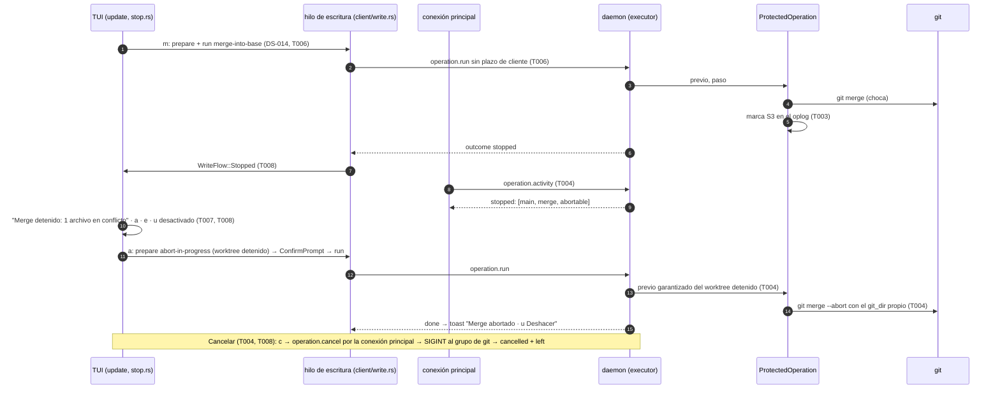

# DS-US-CKP-016 · Merge o rebase detenido, Abortar, Cancelar y operaciones a medias en la TUI

## Contexto rápido

Al terminar, un merge o un rebase lanzado desde la TUI que choca queda como lo deja Git y la TUI lo muestra: "Merge detenido: 1 archivo en conflicto", las rutas, `a` Abortar y `e` Abrir en el editor. Abortar es una operación protegida con su snapshot previo; después, Deshacer vuelve. Mientras la operación siga a medias, Deshacer aparece desactivado con "aborta primero el merge en curso". Una operación del ejecutor que tarda muestra "Rebase en curso · 2:00" y `c` Cancelar, que la interrumpe como un Ctrl-C; se puede cancelar desde otra TUI si la que la lanzó se cerró. Nunca se corta sola por tiempo. Un merge o rebase a medias hecho con Git directo por un agente se ve ("rebase en curso"), pero no ofrece Abortar ni Cancelar. Un HEAD separado se ve como "HEAD separado".

Hoy, comprobado contra `main` (0d5214fc):
- `abort-in-progress` está en el catálogo (`crates/api/src/catalog.rs:209`, `NoArgs`, destructiva, no gobernada, solo capa `cockpit`, dueña US-CKP-016). Sin brazo: `operation.prepare` responde `-32004` con `implemented_by = US-CKP-016`. `check_common` ya deja pasar la operación en curso solo para ella (`crates/core/src/executor/facts.rs:81`).
- `UserOp::MergeAbort` y `UserOp::RebaseAbort` existen (`crates/git/src/user_ops.rs:99` y `:104`).
- `operation.cancel` existe (`crates/api/src/methods/operation.rs:24`, `conn.rs:3554`, `Executor::cancel` en `executor/mod.rs:1101`). Interrumpe con `SIGINT` al grupo de procesos de `git` (`executor/git.rs:89`), solo capa `cockpit`, nunca un descendiente del ejecutor. **No comprueba quién la pidió**: cualquier conexión `cockpit` cancela cualquier operación en marcha. Y el desenlace de una operación cancelada es siempre `cancelled` (`executor/mod.rs:1042` y `:1053`): se pierde lo que dejó Git.
- El tiempo máximo solo rige en la capa `mcp` (`ExecStep.time_limit`, `executor/mod.rs:963`). La capa `cockpit` no tiene corte automático.
- DEP-CKP-14 **ya está en main**: `WorktreeView.operation` (`OperationKindView`), `unmerged_paths` y las rutas con `ChangeKindView::Conflicted` en `changes` (`crates/api/src/messages.rs:384` a `:391`), detrás de `observation.special-states`, que el cliente ya pide porque pide toda capacidad que conoce (`crates/api/src/client/mod.rs:168`). La TUI los descarta al ingerir (`WorktreeState::Ready` no tiene esos campos, `apps/cli/src/model.rs:389`).
- El oplog **no** registra que una operación terminó `stopped`: `ProtectedOperation` cierra con `OperationTransition::Finished` sin detalle (`timemachine/protected/mod.rs:686`).
- La TUI pinta un HEAD separado como "39e852f (sin rama)" (`apps/cli/src/present/i18n.rs:678`).
- **DS-US-CKP-014 no está implementada**: no existen `executor/ops/merge.rs`, `tui/write_flow.rs` ni `tui/undo.rs`. Esta DS se apoya en ellos (G1).

Sin `architecture-constitution.md` en la cascada: rigen [AGENTS.md](../../../../../AGENTS.md) y los ADR citados (`unsafe_code = forbid`, escritura con la Git CLI del sistema, ADR-GRP-001; protocolo congelado en 9 y códigos en `-32016`, ADR-GRP-016; argv fijo y sin shell, NFR-02). Ninguna tarea las viola.

Se reutiliza tal cual lo que fija DS-US-CKP-014: `write_flow.rs` y su estado `Stopped` (I10), `OpsContext` adjunto (I1), `expected["view"]` (I14), capacidad aditiva por operación (I2), motivos aditivos (I3), `Affected::Other` sin DEP-CKP-2 (I4), desenlace leído por estado real (I8), Deshacer por `operation_id` (I12), el `git_dir` propio del worktree (I15) y los textos de `write_text.rs`.

### Decisiones

Todas son **Decisión del orquestador (2026-10-28)**, pendiente de validar por Arquitecto y PO.

| ID | Decisión | Por qué / descartado |
|----|----------|----------------------|
| S1 | **DEP-CKP-14 se cumple con lo que ya publica el motor** y no es condición de arranque. La TUI ingiere `operation`, `unmerged_paths` y las rutas `Conflicted` de `changes`. Si la lista viene truncada (`MAX_WORKTREE_CHANGES`, o el daemon soltó las listas por presupuesto) se muestran las que haya y "y N más", con N = `unmerged_paths` menos las mostradas | El dato existe desde US-GRP-003. Descartado: un método propio de rutas en conflicto, que duplica el estado de `worktree.state` |
| S2 | **Capacidad `operation.stop`** en `methods/operation.rs`. Solo con ella el daemon prepara `abort-in-progress`, devuelve `PrepareResult.abort`, los motivos de S6 y `OperationRunResult.left` (S10). Sin ella: `-32004` con `implemented_by = US-CKP-016` al preparar, y `cancelled` a secas | Cambio de forma de métodos que ya existen (ADR-GRP-016, "Añadir una capacidad"). Mismo patrón que `operation.merge` (DS-014 I2) |
| S3 | **Marca de detención en el oplog.** Cuando un paso protegido termina con `StepOutput.outcome == Some(Stopped)`, `ProtectedOperation` cierra con `OperationTransition::FinishedStopped { detail }` (nueva). Su estado es `Finished`, así que `OperationState` y el undo no cambian. El `detail` del journal lleva `{"stopped":[{"worktree":<raíz>,"kind":"merge"|"rebase","head":<oid>}]}`, uno por worktree del ámbito con un marcador `MERGE_HEAD`, `rebase-merge/` o `rebase-apply/` al terminar. `head` es el contenido de `MERGE_HEAD` o de `<dir de rebase>/orig-head`. Vale para todo brazo: el merge (DS-014), el rebase en modo `stop` (DS-015) y el abort fallido del rebase atómico | ADR-CKP-002 § 9 exige que "el oplog registre que el ejecutor la dejó detenida". `journal.detail` ya existe (`oplog/schema.rs:63`): no hay migración. Descartados: un estado `Stopped` nuevo en `OperationState`, que toca la máquina de estados de la Time Machine y el undo; un campo en `StepOutput`, que rompe sus 8 construcciones literales |
| S4 | **Abortar = `abort-in-progress` sobre el worktree detenido** (el destino del merge, el worktree del rebase). Se ofrece solo si el worktree tiene un merge o un rebase en curso, el oplog tiene marca S3 para ese worktree en la **última** operación protegida cuyo ámbito lo contiene, y el estado coincide: mismo tipo y el `head` de la marca igual al `MERGE_HEAD` u `orig-head` de ahora. Lanza `UserOp::MergeAbort` o `UserOp::RebaseAbort` con el `git_dir` propio del worktree (DS-014 I15) | BR-CKP-EDGE-002 y ADR-CKP-002 § 9: nunca abortar un Git ajeno. Comparar el `head` distingue el merge del ejecutor de uno que un agente empezó con Git directo después de abortar el nuestro |
| S5 | **Trabajo afectado de Abortar = `Affected::Other` siempre**, como DS-014 I4: lo que deja la operación detenida (resoluciones a medias) no tiene atribución. Con capa `cockpit` es el reto ligado a la huella, así que Abortar pide confirmación (ConfirmPrompt, default No). En Windows, `confirmation-unavailable` (Q-CKP-44) | ADR-CKP-002 § 3: "`abort-in-progress`, lo que dejó la operación detenida"; sin atribución, otro actor |
| S6 | **Tres motivos nuevos en `RejectReason`**, aditivos, solo con `operation.stop`: `nothing-to-abort` (sin merge ni rebase en curso en el worktree), `not-left-by-executor` (sin marca S3, o marca que no coincide) y `cancel-not-owner` (S9) | La TUI necesita el motivo exacto. Patrón de DS-014 I3 |
| S7 | **Abortar es recuperable por su snapshot previo.** El previo garantizado de la operación protegida `abort-in-progress` (ámbito: el worktree detenido) guarda los archivos con marcas de conflicto y las resoluciones a medias, como archivos. El previo de la operación que se detuvo (el merge de DS-014) sigue en el oplog para volver a antes del merge. Los pseudo-refs (`MERGE_HEAD`) no están en ningún snapshot: Deshacer nunca reabre la operación (DS-US-TMC-015 B6) | NFR-01 y ADR-CKP-002 § 9. Sin previo no se aborta nada (`aborted`), como toda operación protegida |
| S8 | **Deshacer con operación en curso, desactivado en la TUI** con "aborta primero el <merge\|rebase> en curso" si algún worktree del ámbito de la operación a deshacer tiene `operation` presente. El daemon lo revalida: la Time Machine ya rechaza con `git-operation-in-progress` (`TmRejectReason::GitOperationInProgress`, `crates/api/src/timemachine.rs:213`), y DS-014 T007 ya fija ese texto. No se duplica la detección de marcadores: la TUI lee el `operation` que publica el motor y el daemon usa la de la Time Machine (`IN_PROGRESS_MARKERS`, `crates/git/src/tm_write/worktree.rs:12`). Tras Abortar, el toast ofrece Deshacer **del abort** (Q-CKP-45) | BR-CKP-WF-003, BR-TMC-EDGE-004. El detalle `in_progress` de DS-US-TMC-015 D1, cuando exista, solo mejora el texto; no es dependencia |
| S9 | **Quién cancela, por proceso.** `Executor::cancel` recibe el `Caller`. Cancela si el llamante es el mismo proceso que ejecutó la operación (`pid` y `start_us` del `Caller` del plan) **o** si ese proceso ya no existe. Si no: `cancel-not-owner`. Sigue la regla de hoy: solo capa `cockpit` y nunca un descendiente del ejecutor. Una operación de capa `mcp` se puede cancelar desde la TUI cuando el proceso de `raptor-mcp` que la pidió terminó (Q-CKP-43) | ADR-CKP-002 § 6 y BR-CKP-WF-008: la conexión solicitante o, si se cerró, cualquier TUI. El daemon atiende cada conexión en serie (`conn.rs:752`): mientras `operation.run` corre, el cierre de esa conexión no se ve hasta el final, así que "conexión cerrada" no se puede comprobar en vivo; el proceso sí |
| S10 | **El desenlace de una cancelación dice lo que dejó Git.** `outcome` sigue siendo `cancelled` (lo afirman `channel_protected::cancel_reaches_the_running_operation` y la auditoría). Con `operation.stop`, `OperationRunResult.left: Option<OperationOutcome>` lleva la clasificación del paso (`stopped`, `failed-unchanged` o `failed-changed`, DS-014 I8), solo cuando el paso dio una. La TUI presenta por `left`; sin `left`, "Cancelado" y el estado de la fila | BR-CKP-WF-008 ("detenido, fallido con cambios o sin cambios") sin romper el contrato de hoy. Descartado: que `left` sustituya a `cancelled`, que borraría la cancelación del registro |
| S11 | **Consulta de actividad `operation.activity`** (método nuevo del módulo `operation`, no reservado, no ofrecido a `raptor-mcp`, capa `cockpit` para los campos de ruta). Devuelve `running` (operaciones del ejecutor en marcha: id, operación, repo, worktree, capa, inicio y si este llamante puede cancelarla) y `stopped` (worktrees con marca S3 que coincide, es decir, abortables). La TUI la pide al conectar y reconectar, al recibir `operation.started` u `operation.finished`, y cuando cambia el `operation` de una fila | Una TUI abierta después del inicio no vio `operation.started`, y ese evento no lleva worktree ni hora (`OperationEventData`, `catalog.rs:1047`). Descartado: ampliar el evento, que cambia su forma para todos los clientes y aun así no sirve a una TUI que conecta tarde |
| S12 | **La TUI ejecuta en una conexión propia de escritura.** `operation.prepare` y `operation.run` de una acción viajan por un hilo y una conexión dedicados (`client/write.rs`), y `operation.run` espera sin plazo de cliente. `operation.cancel` y `operation.activity` van por la conexión principal | En la conexión principal, un `operation.run` de 2 minutos bloquea los eventos de la flota, y `WRITE_CALL_TIMEOUT` (120 s, `crates/api/src/client/mod.rs:45`) cortaría el escenario de "2:00". El plan se liga a la conexión, así que preparar y ejecutar van juntos. Enmienda a DS-014 T005 ([Enmiendas que implica](#enmiendas-que-implica)) |
| S13 | **Teclas**: `a` Abortar y `c` Cancelar, con ConfirmPrompt default No. `e` es de US-CKP-013 (el ejemplo de BR-CKP-WF-003 ya usa `[a]` y `[e]`). Abortar y Cancelar se **ocultan** cuando no aplican (no hay "desactivado con motivo"): son acciones de contexto, como dice BR-CKP-EDGE-002 ("solo se ofrecen ver diff, abrir en el editor y, si lo inició el Cockpit, Abortar") | `a`, `c` y `e` están libres en `keymap.rs` (hoy: `q`, `Ctrl-c`, `r`, `k`/`j`, `Enter`, `Ctrl-z`, `y`/`s`, `n`, `Esc`, `?`, `f`) y en DS-012 (`d`) y DS-014 (`m`, `u`, `o`). La confirmación de `c` evita que un `c` suelto, al lado de `Ctrl-c`, corte un hook |
| S14 | **HEAD separado**: el texto de `Text::NoBranch` pasa a "<oid7> (HEAD separado)" / "<oid7> (detached HEAD)", y sin commit "HEAD separado" / "detached HEAD" | El escenario pide "HEAD separado" en lugar de una rama. El dato ya llega (`HeadView::Detached`, `detached_at`) |
| S15 | **Casos de rebase** (fijados aquí; la forma del brazo es de DS-015). Ver la tabla [Rebase: qué queda detenido](#rebase-qué-queda-detenido) | `ConflictReverted` solo existe para el modo `atomic` de la capa `mcp` (`catalog.rs:952`, ADR-CKP-002 § 9): el rebase lanzado desde la TUI nunca se aborta solo |

### Rebase: qué queda detenido

| Caso | Capa / modo | Desenlace | ¿Detenido en el Cockpit? | Abortar | Cancelar |
|---|---|---|---|---|---|
| RB1 · El rebase lanzado desde la TUI choca | `cockpit` / `stop` | `stopped`, marca S3 | Sí, "Rebase detenido: N archivos en conflicto" | Sí | — |
| RB2 · El rebase de la TUI tarda (hook lento) | `cockpit` / `stop` | En marcha; tras Cancelar, `cancelled` con `left` | Si `left = stopped` | Si `left = stopped` | Sí, hasta que termine |
| RB3 · `safe_rebase` del agente choca y el abort sale bien | `mcp` / `atomic` | `conflict-reverted` | No: el repo queda como antes | — | — |
| RB4 · `safe_rebase` choca y el abort falla | `mcp` / `atomic` | `stopped`, marca S3 | Sí, en la fila del agente | Sí (S4) | — |
| RB5 · `safe_rebase` vence el tiempo máximo | `mcp` / `atomic` | Interrupción + abort: `conflict-reverted` (`time-limit`) o RB4 | Solo como RB4 | Solo como RB4 | Desde la TUI, si `raptor-mcp` terminó (S9) |
| RB6 · Rebase con Git directo de un agente | — | No es del ejecutor | Se ve "rebase en curso" | No | No |

Regla para DS-015 (y todo brazo que lance `git`): el paso devuelve `Ok(StepOutput)` con su clasificación, como DS-014 I8, también al fallar. Un paso que devuelve `Err` deja la operación `interrupted`, sin marca S3, y el Cockpit no ofrecería Abortar.

## ⚠️ Gaps y violaciones de la constitución

| ID | Qué falta | Severidad | Alcance | Acción | Owner |
|----|-----------|-----------|---------|--------|-------|
| G1 | **Dependencia de orden**: DS-US-CKP-014 sin implementar en `main` (no existen `crates/core/src/executor/ops/merge.rs`, `apps/cli/src/tui/write_flow.rs` ni `apps/cli/src/tui/undo.rs`; tampoco `OpsContext`), y con ella el cursor de fila de DS-US-CKP-012 T006 (DS-014 G3) | Bloqueante | T006 | Mezclar DS-014 antes. T001 a T005 pueden empezar | Orquestador |
| G2 | **Escenario "Cancelar una operación lenta" con rebase**: necesita el brazo `rebase-onto-base` de DS-US-CKP-015. Mientras tanto, el mismo comportamiento se prueba con un merge y un `pre-merge-commit` lento | Bloquea liberación | — | Añadir `tui_stop::cancel_a_slow_rebase` al cerrar DS-015 | Orquestador |
| G3 | **Abrir en el editor** (escenario 1) depende de US-CKP-013 (Should), sin Dev Spec. Hasta que exista, el panel de detenido no muestra `e` | Bloquea liberación | — | Cerrar con US-CKP-013 | Orquestador |

Ninguna violación: sin constitución, ver Contexto rápido.

## 🔭 La forma



---

## 🚀 Plan de implementación

### El trabajo de un vistazo

| # | Tarea | Depende | Aterriza en |
|---|---|---|---|
| T001 | Escribir en rojo los tests de contrato del daemon y de la TUI | — | `crates/core/tests/us_ckp_016_stop.rs`, `apps/cli/tests/tui_stop.rs`, stubs |
| T002 | Crear el contrato: capacidad, motivos, vistas, `left` y `operation.activity` | T001 | `crates/api/src/stop.rs`, `catalog.rs`, `timemachine.rs`, `methods/operation.rs` |
| T003 | Registrar la marca de detención en el oplog | T001 | `timemachine/protected/mod.rs`, `timemachine/oplog/{mod,query}.rs`, `crates/git/src/tm_write/worktree.rs` |
| T004 | Crear el brazo `abort-in-progress`, la regla de Cancelar y la consulta de actividad | T002, T003 | `executor/ops/abort.rs`, `ops/mod.rs`, `executor/mod.rs`, `executor/activity.rs`, `channel/conn.rs` |
| T005 | Ingerir el estado en conflicto y mostrar HEAD separado | T001 | `present/ingest.rs`, `model.rs`, `present/i18n.rs` |
| T006 | Crear la conexión de escritura y la actividad en la TUI | T002, G1 | `apps/cli/src/client/write.rs`, `client/mod.rs`, `crates/api/src/client/mod.rs` |
| T007 | Crear la elegibilidad de Abortar, Cancelar y Deshacer | T005, T006 | `apps/cli/src/tui/stop.rs` |
| T008 | Pintar el detenido, el tiempo, Abortar, Cancelar y sus textos | T007 | `tui/{update,view,help,keymap}.rs`, `present/stop_text.rs` |
| T009 | Cerrar la historia | T001–T008 | `docs` |

### En qué orden

T002, T003 y T005 van en paralelo tras T001. T004 espera a T002 y T003. La TUI (T006 a T008) espera a DS-014 (G1).

### T001 — Escribir en rojo los tests de contrato

**Objetivo.** Los ocho escenarios de la historia, en rojo, contra el daemon real con repos y perfil temporales (NFR-01) y contra la `App` real sobre `TestBackend`.

**Ubicación.**
- `crates/core/tests/us_ckp_016_stop.rs` (**CREATE**)
- `apps/cli/tests/tui_stop.rs` (**CREATE**): el arnés de `apps/cli/tests/live_fleet.rs` (`#![cfg(all(target_os = "macos", debug_assertions))]`), como `tui_merge.rs` de DS-014.
- Stubs que compilan (`todo!()` o `PlanError::NotImplemented`) en los archivos de T002 a T008.

**Reglas**
- Los tests rojos van en su archivo propio y no se editan durante la implementación (regla R4 de `/implement`).
- Nunca este repo ni el perfil real. `GITRAPTOR_PROFILE_DIR` solo en depuración.
- Un hook lento se simula con un `pre-merge-commit` que espera a un archivo testigo (nunca un `sleep` fijo largo): el test lo libera o cancela.

- **Depende:** —
- **Refs:** DS-014 T001
- **Aceptación:** los tests de [§ 9.4](#94-comportamientos-críticos-verificados) existen, compilan y fallan por la razón esperada.

### T002 — Crear el contrato

**Objetivo.** Las formas nuevas, detrás de `operation.stop`, y el método de actividad. Sin lógica.

**Ubicación.**
- `crates/api/src/stop.rs` (**CREATE**): `AbortPlanView`, `StoppedKind`, `ActivityParams`, `ActivityResult`, `RunningOpView`, `StoppedOpView`. Una línea `pub mod stop;` en `crates/api/src/lib.rs`.
- `crates/api/src/catalog.rs` (**MODIFY**): `RejectReason::{NothingToAbort, NotLeftByExecutor, CancelNotOwner}`; `PrepareResult.abort: Option<AbortPlanView>` con `#[serde(default, skip_serializing_if = "Option::is_none")]`.
- `crates/api/src/timemachine.rs` (**MODIFY**): `OperationRunResult.left: Option<OperationOutcome>`, igual de opcional. `McpOperationRunResult` no cambia.
- `crates/api/src/methods/operation.rs` (**MODIFY**): `CAP_OPERATION_STOP = Capability::new("operation.stop")` y `OPERATION_ACTIVITY = "operation.activity"` con `method(OPERATION_ACTIVITY, false, false)` en el `GROUP`.

**Reglas**
- `RunningOpView.worktree` y `StoppedOpView.worktree` son la raíz (`Untrusted`) para que la TUI case la fila por su clave; solo van a capa `cockpit`. Una conexión de capa `mcp` recibe `ActivityResult` vacío.
- `RunningOpView.cancellable` lo calcula el daemon con la regla de S9 para el llamante; la TUI no la repite.
- `left` solo toma `stopped`, `failed-unchanged` o `failed-changed`.

> **Nota técnica.** `OperationRunResult` y `RejectReason` llevan `deny_unknown_fields` o son enums cerrados en el cliente: un cliente viejo falla al leer un campo o una variante nuevos. Por eso todo va detrás de la capacidad, y el método nuevo no la necesita porque un cliente viejo no lo llama.

- **Depende:** T001
- **Refs:** S2, S6, S10, S11; ADR-GRP-016 "Añadir un método" y "Añadir una capacidad"
- **Aceptación:** `describe` y el esquema incluyen los motivos y el método; `crates/api/tests/architecture.rs` sigue en verde (protocolo 9, sin códigos nuevos); `stop::tests::wire_forms` fija el JSON de cada vista.

### T003 — Registrar la marca de detención en el oplog

**Objetivo.** El oplog sabe qué worktrees dejó detenidos el ejecutor y con qué `head`.

**Ubicación.**
- `crates/git/src/tm_write/worktree.rs` (**MODIFY**): `WriteWorktree::stopped_head() -> Option<(StoppedMarker, String)>`, nueva.
- `crates/core/src/timemachine/oplog/mod.rs` (**MODIFY**): `OperationTransition::FinishedStopped { detail: &'a str }`, con `state() = Finished`; `advance` escribe `detail` en la fila del journal.
- `crates/core/src/timemachine/oplog/query.rs` (**MODIFY**): `Oplog::stopped_mark(worktree: &Path) -> Result<Option<StoppedMark>>`, nueva.
- `crates/core/src/timemachine/protected/mod.rs` (**MODIFY**): en el paso (5), con `output.outcome == Some(Stopped)`, lee `stopped_head()` de cada worktree de `req.worktree_paths` y cierra con `FinishedStopped`.

**Reglas**
- `stopped_head` lee `MERGE_HEAD` (merge) o `rebase-merge/orig-head`, si no `rebase-apply/orig-head` (rebase), del `git_dir` propio del worktree. Sin seguir enlaces, como mucho 1 KiB, y solo un oid hexadecimal de 40 o 64 caracteres; cualquier otra cosa da `None`. Es texto del repo (SEC-12).
- `stopped_mark(w)`: la **última** operación de tipo `protected` cuyo `scope.worktrees` contiene `w` (por `seq`). Devuelve su marca solo si esa operación está `finished` con un `detail` que nombra `w`. Una operación protegida posterior en `w` (también un abort o un undo) apaga la marca.
- Sin marcador en ningún worktree, `FinishedStopped` no se usa: se cierra con `Finished`, como hoy.
- Ninguna escritura en el repo: la tarea solo lee el repo y escribe en el oplog.

> **Nota técnica.** El journal ya tiene la columna `detail TEXT` (`oplog/schema.rs:63`) y la columna `state` no lleva `CHECK`, así que no hay migración. El oplog es de solo añadir: la marca se escribe una vez, al cerrar la operación.

- **Depende:** T001
- **Refs:** S3; ADR-TMC-003 § 3; ADR-CKP-002 § 9
- **Aceptación:** `oplog::tests::a_stopped_operation_leaves_its_mark`, `oplog::tests::a_later_protected_operation_clears_the_mark` y `tm_write::worktree::tests::stopped_head_reads_merge_and_rebase`.

### T004 — Crear el brazo `abort-in-progress`, la regla de Cancelar y la consulta de actividad

**Objetivo.** El ejecutor aborta lo que dejó detenido, cancela solo lo que le toca al llamante y dice qué está en marcha y qué es abortable.

**Ubicación.**
- `crates/core/src/executor/ops/abort.rs` (**CREATE**): `plan_op`, `AbortStep` y su clasificación.
- `crates/core/src/executor/ops/mod.rs` (**MODIFY**): `OperationId::AbortInProgress` en `ARMS`, en el orden de `OperationId`.
- `crates/core/src/executor/mod.rs` (**MODIFY**): `RunningOp` gana `owner: Caller`, `operation`, `repo_id`, `worktree` y `started_ms`; `cancel` recibe `&Caller`; `left` en el resultado (S10).
- `crates/core/src/executor/activity.rs` (**CREATE**): `Executor::activity(caller, layer, repos) -> ActivityResult`. Una línea `mod activity;` en `executor/mod.rs`.
- `crates/core/src/channel/conn.rs` (**MODIFY**): brazo de `operation.activity` junto a los de `operation`; `operation_cancel` pasa el `Caller`; `abort-in-progress` sin `operation.stop` → `-32004` con `implemented_by = US-CKP-016` antes del ejecutor; `left` y los motivos nuevos solo con la capacidad.

**Reglas**
- El brazo, Cancelar y la actividad siguen las cuatro listas de abajo; ninguna regla común se repite fuera de `check_common`.

**Reglas de `plan_op`** (orden fijo; `check_common` ya pasó: identidad, locks, worktree bloqueado, rama en otro worktree, grafts)
1. Contexto adjunto (DS-014 I1), o `NotImplemented`.
2. `facts.in_progress` es `Merge` o `Rebase` (incluidas sus variantes interactiva y de buzón) → si no, `nothing-to-abort`.
3. `stopped_mark(facts.root)` existe, su `kind` coincide con la operación en curso y su `head` es igual al `stopped_head()` de ahora → si no, `not-left-by-executor`.
4. `OpPlan`:
   - `expected`: `{worktree: {root, root_id, dot_git_id, gitdir_linked_back}, kind, head, stopped_operation_id, unmerged}` (en la huella: si alguien aborta o termina entre preparar y ejecutar, `state-changed`).
   - `affected`: `Affected::Other` (S5). `governed`: `None`. `warnings`: vacío. `other_session`: sesiones presentes en el worktree, por `EngineFacts::present_sessions` (DS-014 T002).
   - `AbortPlanView` en `expected["view"]` (DS-014 I14): tipo, carpeta del worktree (nunca su ruta), rama (`None` con HEAD separado), `unmerged` y `stopped_operation_id`.

**Reglas del paso (`AbortStep`)**
- `scope()`: `worktrees = [raíz]`; `refs` = la rama de `head-name` en un rebase (`RepoReader::rebase_branch`, `crates/git/src/reader.rs:352`), vacío en un merge. `subtype()`: `"abort-in-progress"`.
- `run()`: lee `before` (tipo en curso, HEAD, rama) y lanza `UserGitCommand::new(git, RepoTarget { git_dir: git_dir propio, work_tree: Some(raíz) }, UserOp::MergeAbort | UserOp::RebaseAbort, None, session_env, rejecting_editor(None), home)` con `run_git(ctx, cmd, cancel)` (DS-014 I15).
- Clasificación por estado real (DS-014 I8): sin operación en curso → `done`; igual que `before` → `failed-unchanged`; otro cambio → `failed-changed`. Nunca `stopped`.

**Reglas de Cancelar** (`Executor::cancel`, S9)
- Orden: descendiente del ejecutor → `executor-descendant`; capa distinta de `cockpit` → `not-available-for-layer`; no está en marcha → `Ok(false)`; llamante con el mismo `pid` y `start_us` que `owner` → cancela; proceso de `owner` vivo (`procs.read(pid)` con la misma hora de inicio) → `cancel-not-owner`; si no → cancela.
- Sin `operation.stop`, `cancel-not-owner` se responde como `requested: false`.
- `left`: con `Interrupt::Cancelled` y un `StepOutput.outcome` del paso en `{Stopped, FailedUnchanged, FailedChanged}`, `left = ese`; si no, `None`.

**Reglas de `activity`**
- `running`: lo de `RunningOp`, solo de repos que la conexión ve. `cancellable` = la regla de Cancelar dice que sí para este `Caller`.
- `stopped`: por cada worktree con `operation` `Merge` o `Rebase` en el último estado del motor, `stopped_mark` + la comprobación de la regla 3. Solo los que pasan. Nunca abre gitoxide por worktree sin operación en curso.

- **Depende:** T002, T003
- **Refs:** S4 a S6, S9 a S11; ADR-CKP-002 § 6 y § 9
- **Aceptación:** tests unitarios de `abort.rs` para cada motivo, de `cancel` para cada rama del orden, y los de daemon de § 9.4.

### T005 — Ingerir el estado en conflicto y mostrar HEAD separado

**Objetivo.** El modelo de la TUI tiene la operación en curso, el recuento y las rutas en conflicto de cada worktree, y un HEAD separado se lee como tal.

**Ubicación.**
- `apps/cli/src/model.rs` (**MODIFY**): `WorktreeState::Ready` gana `operation: Option<InProgressKind>`, `unmerged: u32` y `conflicted: Vec<SafeText>`.
- `apps/cli/src/present/ingest.rs` (**MODIFY**): los copia de `WorktreeView` (`operation`, `unmerged_paths`, `changes` con `kind == Conflicted`), saneados con `SafeText`.
- `apps/cli/src/present/i18n.rs` (**MODIFY**): `Text::NoBranch` (S14) y `Text::InProgress(kind)` ("merge en curso", "rebase en curso", …).

**Reglas**
- La fila con `operation` muestra "<tipo> en curso" y, con `unmerged > 0`, "· N en conflicto", en el color de aviso.
- `conflicted` guarda como mucho 5 rutas para el panel; el resto se cuenta (S1).

- **Depende:** T001
- **Refs:** S1, S14; BR-CKP-EDGE-002
- **Aceptación:** `ingest::tests::conflicted_paths_reach_the_row`; snapshots en/es de la fila con "rebase en curso" y con "HEAD separado".

### T006 — Crear la conexión de escritura y la actividad en la TUI

**Objetivo.** Una acción de escritura corre sin congelar la flota, y la TUI sabe qué está en marcha y qué es abortable.

**Ubicación.**
- `apps/cli/src/client/write.rs` (**CREATE**): el hilo de escritura. Una línea en `client/mod.rs`.
- `apps/cli/src/client/mod.rs` (**MODIFY**): `LinkCmd::Operation(OpRequest)` (DS-014 T005) pasa al hilo de escritura para `Prepare` y `Run`; `Cancel { operation_id }` y `Activity` se atienden en la conexión principal.
- `crates/api/src/client/mod.rs` (**MODIFY**): `Client::call_with_timeout(method, params, Option<Duration>)`, nueva; `call` la usa con `call_timeout(method)`.

**Reglas**
- `OpRequest` gana `Cancel { operation_id }`; `OpReply` gana `Activity(Box<ActivityResult>)` y `Cancelled { requested }`.
- El hilo de escritura abre su conexión con el mismo `ClientKind` y las mismas capacidades que la principal, prepara y ejecuta en ella, y la cierra al terminar o al salir la TUI. `operation.run` espera sin plazo (`None`); un EOF da `OpReply::Failed`.
- La actividad se pide al conectar, al reconectar, con cada `operation.started` u `operation.finished` del repo y cuando cambia el `operation` de una fila. Una petición en vuelo absorbe las siguientes.

- **Depende:** T002, G1
- **Refs:** S11, S12; ADR-CKP-003 § 3
- **Aceptación:** `client::write::tests::run_waits_past_the_write_timeout` (un `operation.run` de más de 120 s con un reloj inyectado) y `tui_stop::the_fleet_keeps_updating_during_a_slow_merge`.

### T007 — Crear la elegibilidad de Abortar, Cancelar y Deshacer

**Objetivo.** Funciones puras que dicen qué se ofrece en cada fila y en el panel.

**Ubicación.** `apps/cli/src/tui/stop.rs` (**CREATE**), una línea en `tui/mod.rs`.

**Reglas**
- `abort_offered(row, activity, layer, live) -> bool`: en vivo, capa `cockpit`, worktree disponible y la fila en `activity.stopped`. Si no, oculto (S13).
- `cancel_offered(row, activity, layer, live) -> Option<RunningOp>`: en vivo, capa `cockpit` y una operación de `activity.running` sobre ese worktree con `cancellable`. Si no, oculto.
- `undo_block(op_scope_rows) -> Option<InProgressKind>`: el primer worktree del ámbito con `operation`; con valor, Deshacer desactivado con "aborta primero el <tipo> en curso" (S8). Lo usa `undo.rs` de DS-014.
- Una fila con `operation` desactiva además integrar, rebasar y descartar con "operación en curso" (BR-CKP-EDGE-002); integrar ya lo hace DS-014 T004 regla 6.
- Ver diff (`d`) y abrir en el editor (`e`) siguen ofrecidos con operación en curso (BR-CKP-ELIG-006).

- **Depende:** T005, T006
- **Refs:** S8, S13; BR-CKP-WF-003, BR-CKP-EDGE-002
- **Aceptación:** tests unitarios de `tui/stop.rs`, uno por regla.

### T008 — Pintar el detenido, el tiempo, Abortar, Cancelar y sus textos

**Objetivo.** El usuario ve el detenido con sus rutas, el tiempo de una operación en marcha y las acciones Abortar y Cancelar, con sus textos en/es.

**Ubicación.**
- `apps/cli/src/tui/keymap.rs` (**MODIFY**): `Action::Abort` (`a`) y `Action::Cancel` (`c`).
- `apps/cli/src/tui/update.rs` (**MODIFY**): despacha `Abort` (prepara `abort-in-progress` sobre el worktree de la fila) y `Cancel` (ConfirmPrompt y `OpRequest::Cancel`); `OpReply::Activity` actualiza el modelo.
- `apps/cli/src/tui/view.rs`, `tui/help.rs` (**MODIFY**): panel de detenido, tiempo en la fila, pistas.
- `apps/cli/src/present/stop_text.rs` (**CREATE**): textos en/es. Una línea en `present/mod.rs`.
- `apps/cli/src/present/write_text.rs` (**MODIFY**, de DS-014): los tres motivos de S6 en el `match` exhaustivo.

**Reglas**
- `WriteFlow::Stopped` (DS-014) es un panel que se queda, no un toast: "Merge detenido: N archivo(s) en conflicto" (o "Rebase detenido"), hasta 5 rutas y "y N más", y las pistas `a Abortar`, `e Editor` (si US-CKP-013 está, G3) y `u Deshacer` desactivado con "aborta primero el merge en curso". Se cierra con `Esc`; el estado sigue en la fila.
- ConfirmPrompt de Abortar (default No): "Abortar el <merge|rebase> en <carpeta>: se descartan las resoluciones a medias; quedan en el snapshot previo". Con `done`, toast "Merge abortado · u Deshacer" (5 s), que deshace el abort (S8, Q-CKP-45).
- Una fila con una operación de `activity.running` muestra "<Operación> en curso · m:ss" desde `started_utc_ms`, refrescado por `Msg::Tick` (1 Hz, `tui/app.rs:30`); `h:mm:ss` a partir de una hora. Con `cancellable`, la pista `c Cancelar`.
- ConfirmPrompt de Cancelar (default No): "Cancelar el <operación> de <rama>: Git se interrumpe como con Ctrl-C".
- Tras cancelar, por `left`: `stopped` → panel de detenido; `failed-changed` → toast "Cancelado; quedaron cambios · u Deshacer"; `failed-unchanged` → "Cancelado; no cambió nada". Sin `left` (otra TUI, o un brazo sin clasificación) → "Cancelado" y la fila dice el resto.
- `cancel-not-owner` → "la operación es de otra TUI abierta; cancélala desde ahí".
- Ninguna acción se dispara sola: la TUI nunca aborta ni cancela por tiempo (BR-CKP-WF-003, BR-CKP-WF-008).
- Plegado ASCII y sin color como el resto de la TUI (DS-US-CKP-005).

- **Depende:** T007
- **Refs:** S12 a S14; DSYS-GRP-001 (ConfirmPrompt, Notification)
- **Aceptación:** snapshots en/es del panel de detenido, de la fila con tiempo y `c`, de los prompts y de cada toast, en `apps/cli/src/tui/snapshots/`.

### T009 — Cerrar la historia

**Objetivo.** La historia queda `implemented` con sus verificaciones en verde.

**Ubicación.** Ninguna: solo corre verificaciones y actualiza `docs`.

**Reglas**
- `cargo clippy` y `cargo test` (o `nx affected -t lint test`) en verde; contrato de `/implement` con `node tools/test/nextest-junit.mjs`.
- La historia pasa a `implemented` y enlaza el PR; esta DS añade `## Estado de la implementación`.
- Las enmiendas de [Enmiendas que implica](#enmiendas-que-implica) se aplican en el mismo PR o quedan anotadas en él.

- **Depende:** T001–T008
- **Refs:** AGENTS.md
- **Aceptación:** los tests de § 9.4 en verde.

---

## Estructura de ficheros

| Archivo | Acción | Tarea |
|---|---|---|
| `crates/api/src/stop.rs` | CREATE | T002 |
| `crates/api/src/lib.rs` | MODIFY (1 línea `pub mod`) | T002 |
| `crates/api/src/catalog.rs` | MODIFY (motivos, `PrepareResult.abort`) | T002 |
| `crates/api/src/timemachine.rs` | MODIFY (`OperationRunResult.left`) | T002 |
| `crates/api/src/methods/operation.rs` | MODIFY (capacidad y método) | T002 |
| `crates/api/src/client/mod.rs` | MODIFY (`call_with_timeout`) | T006 |
| `crates/git/src/tm_write/worktree.rs` | MODIFY (`stopped_head`) | T003 |
| `crates/core/src/timemachine/oplog/mod.rs` | MODIFY (`FinishedStopped`) | T003 |
| `crates/core/src/timemachine/oplog/query.rs` | MODIFY (`stopped_mark`) | T003 |
| `crates/core/src/timemachine/protected/mod.rs` | MODIFY (cierre con marca) | T003 |
| `crates/core/src/executor/ops/abort.rs` | CREATE | T004 |
| `crates/core/src/executor/ops/mod.rs` | MODIFY (1 línea en `ARMS` y despacho) | T004 |
| `crates/core/src/executor/mod.rs` | MODIFY (`RunningOp`, `cancel`, `left`) | T004 |
| `crates/core/src/executor/activity.rs` | CREATE | T004 |
| `crates/core/src/channel/conn.rs` | MODIFY (brazo de actividad, capacidad) | T004 |
| `crates/core/tests/us_ckp_016_stop.rs` | CREATE | T001 |
| `apps/cli/src/model.rs` | MODIFY (`WorktreeState::Ready`) | T005 |
| `apps/cli/src/present/ingest.rs` | MODIFY | T005 |
| `apps/cli/src/present/i18n.rs` | MODIFY (`NoBranch`, `InProgress`) | T005 |
| `apps/cli/src/client/write.rs` | CREATE | T006 |
| `apps/cli/src/client/mod.rs` | MODIFY | T006 |
| `apps/cli/src/tui/stop.rs` | CREATE | T007 |
| `apps/cli/src/tui/{update,view,help,keymap,mod}.rs` | MODIFY | T008 |
| `apps/cli/src/present/stop_text.rs` | CREATE | T008 |
| `apps/cli/src/present/write_text.rs` | MODIFY (de DS-014) | T008 |
| `apps/cli/tests/tui_stop.rs` | CREATE | T001 |

## Contratos compartidos

### Tipos y datos compartidos

```rust
// crates/api/src/stop.rs (T002) — a crear
#[derive(Debug, Clone, Copy, PartialEq, Eq, Serialize, Deserialize, JsonSchema)]
#[serde(rename_all = "kebab-case")]
pub enum StoppedKind { Merge, Rebase }

#[derive(Debug, Clone, PartialEq, Eq, Serialize, Deserialize, JsonSchema)]
#[serde(deny_unknown_fields)]
pub struct AbortPlanView {
    pub kind: StoppedKind,
    pub worktree: UntrustedName,         // carpeta, nunca la ruta
    pub branch: Option<UntrustedName>,   // None con HEAD separado
    pub unmerged: u32,
    pub stopped_operation_id: String,
}

#[derive(Debug, Clone, Default, PartialEq, Eq, Serialize, Deserialize, JsonSchema)]
#[serde(deny_unknown_fields)]
pub struct ActivityParams { #[serde(default)] pub repo_id: Option<String> }

#[derive(Debug, Clone, Default, PartialEq, Eq, Serialize, Deserialize, JsonSchema)]
#[serde(deny_unknown_fields)]
pub struct ActivityResult { pub running: Vec<RunningOpView>, pub stopped: Vec<StoppedOpView> }

#[derive(Debug, Clone, PartialEq, Eq, Serialize, Deserialize, JsonSchema)]
#[serde(deny_unknown_fields)]
pub struct RunningOpView {
    pub operation_id: String,
    pub operation: OperationId,
    pub repo_id: String,
    pub worktree: Untrusted,             // raíz; solo capa cockpit
    pub layer: Layer,
    pub started_utc_ms: i64,
    pub cancellable: bool,               // regla S9 para este llamante
}

#[derive(Debug, Clone, PartialEq, Eq, Serialize, Deserialize, JsonSchema)]
#[serde(deny_unknown_fields)]
pub struct StoppedOpView {
    pub repo_id: String,
    pub worktree: Untrusted,             // raíz; solo capa cockpit
    pub kind: StoppedKind,
    pub stopped_operation_id: String,
}

// crates/api/src/catalog.rs (T002) — variantes nuevas, solo con operation.stop
NothingToAbort, NotLeftByExecutor, CancelNotOwner,
// PrepareResult, campo nuevo
#[serde(default, skip_serializing_if = "Option::is_none")]
pub abort: Option<crate::stop::AbortPlanView>,

// crates/api/src/timemachine.rs (T002) — OperationRunResult, campo nuevo
#[serde(default, skip_serializing_if = "Option::is_none")]
pub left: Option<OperationOutcome>,

// crates/core/src/timemachine/oplog (T003) — a crear
pub struct StoppedMark { pub operation_id: String, pub kind: StoppedKind, pub head: String }
```

Lo que ya existe y se usa tal cual: `OperationId::AbortInProgress`, `OperationArgs::AbortInProgress`, `CancelParams`, `CancelResult`, `OperationOutcome::{Stopped, Cancelled, FailedUnchanged, FailedChanged}`, `UserOp::{MergeAbort, RebaseAbort}`, `run_git`, `CancelToken`, `Interrupt`, `Caller`, `check_common`, `RepoReader::rebase_branch`, `WriteWorktree`, `IN_PROGRESS_MARKERS`, `TmRejectReason::GitOperationInProgress`, `WorktreeView::{operation, unmerged_paths}`, `ChangeKindView::Conflicted`, `HeadView::Detached`.

### Ciclos de vida (DI)

- `RunningOp`: uno por operación en marcha, en `Executor.running`, desde que el paso empieza hasta que termina.
- La marca S3: una vez, al cerrar la operación; nunca se reescribe (oplog de solo añadir).
- Conexión de escritura: una por acción de escritura de la TUI, viva mientras la acción dura.
- `ActivityResult` en el modelo de la TUI: se reemplaza entero con cada respuesta.

### Firmas del stack

```rust
// crates/core/src/executor/mod.rs (T004) — cambia la firma
pub fn cancel(&self, resolution: &Resolution, layer: Layer, caller: &Caller, operation_id: &str)
    -> Result<bool, ExecError>;
// crates/core/src/executor/activity.rs (T004) — a crear
pub fn activity(&self, caller: &Caller, layer: Layer, repos: &[RepoHandle]) -> ActivityResult;
// crates/core/src/timemachine/oplog/query.rs (T003) — a crear
pub fn stopped_mark(&self, worktree: &Path) -> Result<Option<StoppedMark>>;
// crates/git/src/tm_write/worktree.rs (T003) — a crear
pub fn stopped_head(&self) -> Option<(StoppedKind, String)>;
// crates/api/src/client/mod.rs (T006) — a crear
pub fn call_with_timeout<P: Serialize, R: DeserializeOwned>(&mut self, method: &str, params: P, timeout: Option<Duration>) -> Result<R, ClientError>;
```

## Contrato de API

| Método | Cambio | Con `operation.stop` | Sin ella |
|---|---|---|---|
| `operation.prepare {operation: "abort-in-progress", worktree: <raíz detenida>, args: {}, session_env}` | Forma: `abort` y motivos nuevos | `PrepareResult` con `abort`, `challenge` | `-32004`, `implemented_by = US-CKP-016` |
| `operation.run {plan_id, accepted_warnings, confirmation}` | Forma: `left` | `OperationRunResult` con `left` si se canceló | Igual que hoy |
| `operation.cancel {operation_id}` | Regla S9 | `cancel-not-owner` | `requested: false` |
| `operation.activity {repo_id?}` | Método nuevo | `ActivityResult` | (método nuevo: lo descubre en `hello.methods`) |

### Forma del error y del cuerpo de respuesta

Un rechazo es `-32014 OPERATION_REJECTED` con `data.reason` (`RejectedData`). No hay códigos nuevos (`rpc.rs` congelado).

### Forma de la configuración

_No aplica — la historia no añade claves de configuración; el editor y su tipo son de US-CKP-013 (`cockpit.editor`, `cockpit.editorKind`)._

### Valores numéricos

| Valor | Cifra | Fuente |
|---|---|---|
| Corte automático por tiempo, capa `cockpit` | ninguno | ADR-CKP-002 § 6 |
| Plazo de cliente de `operation.run` en la conexión de escritura | ninguno | S12 |
| Refresco del tiempo transcurrido | 1 Hz | `TICK`, `apps/cli/src/tui/app.rs:30` |
| Rutas en conflicto en el panel | 5 | S1 |
| Lectura de `MERGE_HEAD` / `orig-head` | ≤ 1 KiB | T003 |
| Toast con Deshacer | 5 s | BR-CKP-WF-002 |

## Modelo de datos

Sin tablas ni migraciones. La marca S3 vive en la columna `detail` de la fila `operation-state` / `finished` del journal (`oplog/schema.rs:51`):

```json
{"stopped":[{"worktree":"/…/shop","kind":"merge","head":"a1b2c3…"}]}
```

## Estrategia de pruebas y cobertura

### 9.1 Pirámide de pruebas

| Nivel | Dónde | Qué |
|---|---|---|
| Unit | `ops/abort.rs`, `executor/mod.rs` (`cancel`), `oplog`, `tm_write/worktree.rs`, `tui/stop.rs`, `present/*` | Motivos, orden, marca, elegibilidad, textos |
| Integración (daemon + Git real) | `crates/core/tests/us_ckp_016_stop.rs` | Escenarios del daemon |
| E2E (TUI + daemon) | `apps/cli/tests/tui_stop.rs` (macOS, debug) | Escenarios de la historia |
| Snapshots | `apps/cli/src/tui/snapshots/` | Panel, fila, prompts y toasts en/es |

### 9.2 Umbrales de cobertura

Toda regla de `plan_op`, de `cancel` y de `tui/stop.rs` con su test. Sin cifra de cobertura de líneas en el repo.

### 9.3 Datos de prueba

Repos temporales con `gitraptor_testkit::Fixture`: `main` en el worktree principal y `feat-pagos` en un worktree enlazado, con cambios que chocan en `src/api.rs`; `feat-login` con un rebase a medias hecho con `git` directo por una sesión de `raptor-fake-agent` como "claude-3"; `feat-tmp` con HEAD separado. Hook lento: `pre-merge-commit` que espera a un archivo testigo. Nunca este repo (NFR-01).

### 9.4 Comportamientos críticos verificados

| Escenario de la historia | Test |
|---|---|
| El merge choca y queda detenido | `tui_stop::a_conflicting_merge_stops_with_its_paths`: panel "Merge detenido: 1 archivo en conflicto" con `src/api.rs`, pista `a`; `MERGE_HEAD` presente y nada abortado. `us_ckp_016_stop::a_stopped_merge_leaves_its_mark` (S3) |
| Abortar devuelve el estado previo y habilita Deshacer | `tui_stop::abort_returns_main_and_enables_undo`: tras `a` y `y`, `main` en el commit previo, sin `MERGE_HEAD`, toast con `u`. `us_ckp_016_stop::abort_keeps_the_half_resolution_in_its_prior` (S7): una resolución a medias de `src/api.rs` está en el previo del abort, y deshacer el abort la devuelve sin reabrir el merge |
| Deshacer no se ofrece con la operación en curso | `tui::stop::tests::undo_is_disabled_with_an_operation_in_progress` y `tui_stop::undo_says_abort_first`: "aborta primero el merge en curso". `us_ckp_016_stop::the_daemon_refuses_undo_in_progress` (`git-operation-in-progress`) |
| Operación de Git a medias hecha por el agente | `tui_stop::an_agents_rebase_offers_only_diff_and_editor`: "rebase en curso"; sin `a` ni `c`. `us_ckp_016_stop::a_foreign_rebase_is_not_left_by_executor` (`not-left-by-executor`) |
| HEAD separado | snapshot `fleet_detached_head_{en,es}`: "HEAD separado" en lugar de la rama |
| Cancelar una operación lenta | `tui_stop::cancel_a_slow_merge`: la fila muestra "Merge en curso · 2:00" con reloj inyectado y `c`; tras `c` y `y`, `cancelled` con `left` y la TUI lo presenta; nada se cancela antes. Con rebase: `tui_stop::cancel_a_slow_rebase` (G2) |
| Cancelar desde otra TUI si la que la lanzó se cerró | `us_ckp_016_stop::another_client_cancels_when_the_owner_is_gone`: el proceso dueño termina y otro cliente `cockpit` cancela; con el dueño vivo, `cancel-not-owner` |
| Cancelar no se ofrece sobre un Git ajeno | `tui::stop::tests::cancel_is_hidden_without_an_executor_operation` y `us_ckp_016_stop::activity_lists_only_executor_operations` |

Además:
- `us_ckp_016_stop::a_client_without_the_capability_gets_not_implemented` (`abort-in-progress` sin `operation.stop`).
- `us_ckp_016_stop::a_merge_started_again_by_an_agent_is_not_abortable` (S4): tras abortar con Git directo y volver a mezclar otro oid, `not-left-by-executor`.
- `us_ckp_016_stop::a_later_operation_clears_the_mark`.
- `us_ckp_016_stop::an_agent_layer_cannot_abort_or_cancel` (`not-available-for-layer`).
- `us_ckp_016_stop::abort_without_a_prior_snapshot_changes_nothing` (`aborted`, `MERGE_HEAD` sigue).
- `us_ckp_016_stop::a_cockpit_operation_never_times_out`: un hook de capa `cockpit` sigue corriendo pasado el tiempo máximo de la capa `mcp`.
- `channel_protected::cancel_reaches_the_running_operation` sigue en verde con `outcome = cancelled`.
- RB4 (abort fallido del rebase atómico, marca S3) entra con DS-015 y su test de abort fallido inyectado.

### 9.5 Plataformas

Se ejecuta en macOS. Linux y Windows: **Pendiente: etapa de validación multiplataforma** ([`xplat-pendientes.md`](../../../../architecture/xplat-pendientes.md)). En Windows `interrupt_group` no hace nada (`executor/git.rs:100`), así que Cancelar no interrumpe; y Abortar se rechaza con `confirmation-unavailable` por S5 (Q-CKP-44), como el merge (DS-014 Q-CKP-36).

## Gate de seguridad

- [ ] **NFR-02, sin shell**: el único lanzamiento es `run_git` con `UserOp::MergeAbort` o `UserOp::RebaseAbort`; sin argumentos variables. `crates/core/tests/executor_boundary.rs` en verde.
- [ ] **Nunca sobre Git ajeno**: Abortar exige la marca S3 que coincide (S4); Cancelar solo actúa sobre `RunningOp` del ejecutor.
- [ ] **Capa**: Abortar, Cancelar y `operation.activity` con rutas solo para capa `cockpit`; nunca un descendiente del ejecutor (`executor-descendant`).
- [ ] **Texto no confiable**: rutas en conflicto, nombres y salida de Git pasan por `Untrusted`/`UntrustedName` y por `SafeText`. `stopped_head` solo acepta un oid hexadecimal.
- [ ] **NFR-01**: sin previo no se aborta (`aborted`); deshacer el abort devuelve las resoluciones sin reabrir el merge; los tests usan repos temporales.

## Cómo extender

- **Otra operación que pueda quedar a medias** (cherry-pick): un `StoppedKind` nuevo detrás de la capacidad, su marcador en `stopped_head` y su `UserOp` de abort en `abort.rs`.
- **Otra vista de actividad** (cola de espera): un campo opcional en `ActivityResult` detrás de una capacidad.

## Enmiendas que implica

No aplicadas por esta DS; las aplica el PR de la historia o quedan anotadas en él.

- **DS-US-CKP-014 T005** (S12): "`operation.prepare` y `operation.run` viajan por un hilo y una conexión de escritura propios (`client/write.rs`), y `operation.run` espera sin plazo de cliente; la conexión principal solo lleva `operation.cancel`, `operation.activity` y `timemachine.undo`". Si DS-014 se implementa antes, este cambio entra en T006 de esta DS.
- **DS-US-CKP-014 T006** (S10): el toast de `stopped` lo sustituye el panel de T008.
- **ADR-CKP-002 § 6**: "Lo puede pedir el proceso que pidió la operación o, si terminó, cualquier cliente CLI/TUI del usuario con capa `cockpit`" (S9, en lugar de "la conexión solicitante … si se cerró"), y "el resultado de una cancelación es `cancelled`, con lo que dejó Git en `left`" (S10).
- **ADR-CKP-002 § 9**: "el oplog registra que el ejecutor la dejó detenida con la marca del journal (`detail` del cierre `finished`), y Abortar exige que coincidan el tipo y el `head`" (S3, S4).

## Fuera de alcance

| Qué | Dueño |
|---|---|
| El brazo `rebase-onto-base` y su clasificación | US-CKP-015 |
| Abrir en el editor | US-CKP-013 |
| Deshacer desde el historial | US-CKP-021 |
| Resolver conflictos en la TUI | Nunca (BR-CKP-WF-003) |
| Detalle `in_progress` en los rechazos de la Time Machine | US-TMC-015 |
| Abortar por MCP como operación suelta | Fuera del MVP (ADR-CKP-002 § 12) |

## Notas del autor

- Riesgo: un `git` interrumpido con `SIGINT` en mitad de un hook puede dejar un `index.lock`. El previo garantizado lo cubre y la siguiente escritura responde `git-busy`; GitRaptor nunca borra un lock ajeno.
- Riesgo: la regla de Cancelar por proceso deja una operación de capa `mcp` sin cancelar mientras `raptor-mcp` siga vivo. Es lo que pregunta Q-CKP-43.
- ⚠️ **ASSUMPTION**: `git merge --abort` y `git rebase --abort` con `--no-update-refs` no mueven más ref que `HEAD` (y la rama del rebase a su valor previo), así que un abort no gobernado no choca con una regla de Guardrails sobre ramas. Lo verifica `us_ckp_016_stop::abort_is_not_denied_by_branch_rules`.

### Preguntas abiertas

| ID | Pregunta | Por defecto mientras tanto | Para |
|----|----------|----------------------------|------|
| Q-CKP-43 | ¿Vale "mismo proceso o proceso terminado" como regla de quién cancela (S9), en lugar de "conexión cerrada" de ADR-CKP-002 § 6? Con ella, una operación de capa `mcp` no se cancela desde la TUI mientras `raptor-mcp` siga vivo | S9 | Arquitecto / PO |
| Q-CKP-44 | Abortar siempre pide confirmación (S5) y en Windows se rechaza con `confirmation-unavailable` hasta TQ-14 b. ¿Aceptable para el MVP, o Abortar debe contar como trabajo propio cuando la operación detenida la pidió el mismo humano y no hay sesión en el worktree? | S5 | PO |
| Q-CKP-45 | Tras Abortar, el toast deshace **el abort** (devuelve las resoluciones a medias como archivos, sin reabrir el merge), no el merge. ¿Es lo que espera el usuario de "Deshacer vuelve a estar disponible"? | Deshacer del abort; volver a antes del merge se hace desde el historial (US-CKP-021) | PO |

## Estado

- Borrador pendiente de validar por Arquitecto y PO.
- T006 a T009 bloqueadas por G1 (DS-US-CKP-014). T001 a T005 pueden empezar.
