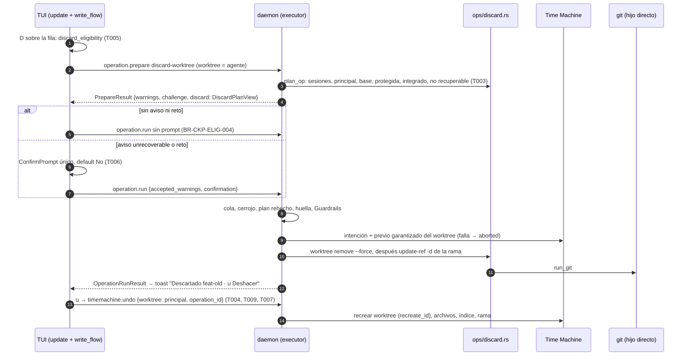

# DS-US-CKP-017 · Descartar el worktree y la rama de un agente con Deshacer

## Contexto rápido

El desarrollador selecciona la fila de un agente, pulsa `D` y GitRaptor borra el worktree y su rama. Si todo lo de la rama ya está en la base y no hay cambios, lo hace sin preguntar. Si hay trabajo sin integrar, pide confirmación con default No. Si hay contenido que el snapshot no guarda (ignorados, credenciales, submódulos, repos anidados), la confirmación es obligatoria y lo nombra. Un toast ofrece Deshacer durante 5 s con `u`, y Deshacer devuelve worktree, rama, índice y archivos, salvo lo nombrado.

Es la segunda operación del Cockpit que lanza `git` en producción. Reutiliza el esqueleto de [DS-US-CKP-014](./US-CKP-014-integrar-rama-agente.md): preparar → confirmar → ejecutar → Deshacer.

Hoy:
- `discard-worktree` está en el catálogo (`crates/api/src/catalog.rs:178`, `NoArgs`, destructiva, gobernada como `DeleteWorktree`, marca Cockpit, `implemented_by = US-CKP-017`). El catálogo de producción no la arma (`executor/ops/mod.rs`, `ARMS`): `operation.prepare` responde `-32004`.
- El brazo de prueba (`executor/ops/test_arms.rs:121` y `:331`) hace `worktree remove --force` y `update-ref -d`, sin precondiciones ni lista de lo no recuperable (DS-TS-CKP-003 D14). No es lógica de producto.
- `git worktree remove --force` (un solo `--force`) y `update-ref -d <ref> <old>` ya existen en `UserOp` (`crates/git/src/user_ops.rs:118` y `:128`).
- **Deshacer de un descarte no funciona hoy.** `timemachine.undo` exige nombrar un worktree observado (`TimeMachineBackend::repo_of`, `protected/backend.rs:386`), y el del agente ya no existe. El plan del undo rechaza todo worktree del ámbito que ya no está registrado (`undo.rs`, "Removed, moved or foreign: not recreated yet", `WorktreeUnavailable`). El selector `operation_id` responde `NOT_IMPLEMENTED` (`channel/conn.rs:3583`, "unassigned"; D7 de DS-US-TMC-002).
- La Time Machine ya sabe recrear un worktree enlazado borrado sin `git worktree add`: `tm_write::recreate` (`crates/git/src/tm_write/recreate.rs`) y `PlanWorktree.recreate_id` del aplicador (`timemachine/apply/mod.rs:89`), que usa `restore` (`restore.rs:520`).
- **DS-US-CKP-014 no está en `main`**: no existen `executor/ops/merge.rs`, `ops/context.rs` ni `apps/cli/src/tui/write_flow.rs`. Esta DS depende de su T002, T005 y T007 (G1).

Sin `architecture-constitution.md` en la cascada: las restricciones activas salen de [AGENTS.md](../../../../../AGENTS.md) y de los ADR citados (`unsafe_code = forbid` y escritura con la Git CLI del sistema, ADR-GRP-001; protocolo congelado y códigos en `-32016`, ADR-GRP-016; argv fijo y sin shell, NFR-02; la capa de escritura de la Time Machine no usa porcelana, SEC-TMC-02). Ninguna tarea las viola.

### Decisiones

Se reutiliza sin repetir lo que fija DS-US-CKP-014: contexto adjunto `OpsContext`/`EngineFacts` (I1), capacidad aditiva por operación (I2), `Affected::Other` sin DEP-CKP-2 (I4), desenlace por estado real (I8), barrera del lector solo en capa `cockpit` (I9), `write_flow` y la vía genérica del canal (I10), Deshacer desde el toast (I12), vista genérica en `OpPlan.expected["view"]` (I14) y `git_dir` propio del destino (I15).

Revisión del Arquitecto y del PO (2026-10-28): ratificadas X1 a X3, X5 a X8, X11, X12, X14 y X15; cambiadas X4, X9, X10 y X13; X16 es nueva, ratificada por el Arquitecto con un cambio y por el PO (Q-CKP-47). Cada fila lleva su marca.

| ID | Decisión | Por qué / descartado |
|----|----------|----------------------|
| X1 | **Capacidad `operation.discard`** en `methods/operation.rs`. Solo con ella el daemon prepara `discard-worktree`, devuelve `PrepareResult.discard` y los motivos de X2. Sin ella, `-32004` con `implemented_by = US-CKP-017` | Patrón de I2 (ADR-GRP-016, "Añadir una capacidad"). Un cliente viejo ve lo que veía. **Decisión del orquestador (2026-10-28), validada por Arquitecto y PO** |
| X2 | **Motivos de rechazo.** Se reutilizan los que ya existen: `operation-in-progress`, `git-busy`, `worktree-locked` y `branch-checked-out-elsewhere` (`check_common`, `executor/facts.rs:72`), `other-session-present` (`catalog.rs:992`) y `main-worktree` (lo crea DS-014 I3; su compuerta pasa a "con `operation.merge` **o** `operation.discard`"). Dos nuevos, aditivos y solo con `operation.discard`: `base-branch` y `protected-branch` | La TUI necesita el motivo exacto para el texto. Un worktree bloqueado nunca se desbloquea: `check_common` ya lo rechaza antes que nada, y `UserOp::WorktreeRemove` lleva un solo `--force` (ADR-CKP-002 § 8). **Decisión del orquestador (2026-10-28), validada por Arquitecto y PO** |
| X3 | **"Integrado" = base confirmada y HEAD del worktree antepasado de la punta de la base, o igual a ella** (todos los commits alcanzables desde la base confirmada). **Trabajo afectado = `Affected::Nobody`** si está integrado **y** el worktree no tiene cambios: nada preparado, modificado, borrado ni sin seguimiento (no ignorado). En cualquier otro caso, `Affected::Other`. Base no confirmada → no integrado | Resuelve el choque con DS-014 I4. I4 cuenta como ajeno el trabajo que **entra** porque no sabe de quién es. Aquí, si no se pierde nada que no esté en la base, no hay trabajo afectado y `Nobody` es exacto, no una atribución adivinada (ADR-CKP-002 § 3: "si no hay nada, no afecta a nadie"). Con algo que se pierde, sin DEP-CKP-2, cuenta como ajeno (I4). Descartados: alcanzable desde cualquier rama (otra rama puede borrarse después) y contar solo commits (los sin seguimiento también son trabajo; el snapshot los guarda, pero el humano debe saberlo). **Decisión del orquestador (2026-10-28), validada por Arquitecto y PO** |
| X4 | **Lo no recuperable lo calcula el daemon al preparar**, con una lectura nueva de `crates/git` (a crear): ignorados (directorios plegados), repos anidados sin seguimiento, submódulos con contenido y archivos de credenciales sin seguimiento (`is_credential`, `timemachine/store/capture.rs:237`) salvo con `timeMachine.includeCredentialFiles`. Acotada: ⚠️ **ASSUMPTION**: 2 s y 10 000 entradas recorridas. Si no termina, `truncated = true`. Lista no vacía o truncada → aviso `unrecoverable` (`WarningCode::Unrecoverable`, ya existe en `catalog.rs:796`) | Es lo que el snapshot excluye en el código: los ignorados nunca se emiten (`emit_ignored(None)`, `crates/git/src/capture.rs:295`); `nested-repo`, `submodule` y `credential` son las exclusiones de `store/capture.rs` (`:944`, `:1029`, `:981`). `too-large` no entra: el previo garantizado no tiene tope (`capture.rs:1120`, BR-CKP-EDGE-008). Al ser aviso, `accepted_warnings` debe enumerarlo: el daemon impone la confirmación, no la TUI. Descartado: leer las exclusiones del último snapshot (no lista ignorados y puede estar viejo). Revisión: si se agota el presupuesto del matcher de ignorados, el resultado también es `truncated` (falla cerrado). **Decisión del orquestador (2026-10-28), validada por Arquitecto y PO (revisión, con cambios)** |
| X5 | **La huella incluye la lista**: rutas, tipo y `truncated`; no tamaños ni recuentos. También el HEAD, la rama, su punta, la punta de la base y el estado del worktree | Un archivo nuevo en `node_modules/` entre preparar y ejecutar no debe dar `state-changed`; un ignorado nuevo en la raíz, sí. ADR-CKP-002 § 8 pide la lista en la huella. **Decisión del orquestador (2026-10-28), validada por Arquitecto y PO** |
| X6 | **Ejecución**: `UserOp::WorktreeRemove { path }` con el directorio común y sin `work_tree` (como el brazo de prueba), y después `UserOp::DeleteRef { name: refs/heads/<rama>, old: punta }`. Con HEAD separado, solo lo primero. La config `branch.<rama>.*` no se toca | ADR-CKP-002 § 8. El borrado de la ref con valor viejo falla entero si la rama se movió. **Decisión del orquestador (2026-10-28), validada por Arquitecto y PO** |
| X7 | **Forma de Guardrails con HEAD separado**: variante nueva `PlanShape::RemoveWorktree { head }` en `crates/policy/src/guard/plan.rs`, sin transiciones evaluadas ni registradas. Con rama, `PlanShape::DeleteWorktree { branch, tip }` (ya existe, `plan.rs:34`) | El gate niega todo plan gobernado sin forma (`plan_gate.rs:260`, `InternalError`), así que el HEAD separado necesita una. Descartado: hacer `branch` opcional en `DeleteWorktree`, que rompe el brazo de prueba y la normalización existente. **Decisión del orquestador (2026-10-28), validada por Arquitecto y PO** |
| X8 | **Desenlace por estado real** (I8). `before` = worktree registrado, raíz presente, punta de la rama. Éxito de los dos pasos → `done`. Fallo con los tres iguales → `failed-unchanged`. Cualquier otro fallo (p. ej. worktree quitado y `update-ref -d` fallido) → `failed-changed`, con Deshacer | Nunca se clasifica por el plan: un cambio ajeno entre el cerrojo y el lanzamiento no debe salir como `failed-changed`. **Decisión del orquestador (2026-10-28), validada por Arquitecto y PO** |
| X9 | **Deshacer = `timemachine.undo { worktree, operation_id }`** con el selector `Selection::Operation(id)` (T004). Regla del selector: si el worktree nombrado está en `scope.worktrees` de la operación, se usa la pila del worktree nombrado (lo de hoy; en eso se apoya DS-014 I12). Si no, solo se acepta si `subtype == discard-worktree` y su raíz no está registrada ni presente; entonces se usa la pila de esa raíz. En los dos casos la operación debe ser `last_operation()` de esa pila; si no, `not-last-operation` (`TmRejectReason` aditivo y sin capacidad: solo lo recibe un cliente que manda `operation_id`, que antes recibía `NOT_IMPLEMENTED`; criterio de DS-TMC-006 D5 aplicado en DS-TMC-010 D5). Para un descarte, la TUI nombra la raíz del worktree principal, o la del primer worktree disponible si el repo es *bare* | El worktree del agente ya no existe y `repo_of` solo abre worktrees observados (SEC-TMC-07). Descartada "la pila del primer worktree del ámbito": el ámbito del merge es [destino, agente] con el destino primero (DS-014 T003) y rompería I12. Descartado aceptar la ruta borrada y buscar su repo en el oplog. **Decisión del orquestador (2026-10-28), validada por Arquitecto y PO (revisión, con cambios)** |
| X10 | **Deshacer recrea el worktree con la Time Machine**, no con `git worktree add` (T009). En el plan del undo, un worktree del ámbito que ya no está registrado se acepta solo si la operación deshecha es `discard-worktree` y la ruta no existe. Entra con `recreate_id` como en `restore` (`restore.rs:520–552`); el aplicador lo recrea (`tm_write::recreate`) y escribe archivos e índice del previo; la rama vuelve a su punta. Cuatro reglas: (a) **captura previa del undo**: hoy `undo_last` arma `worktree_paths` desde `planned.scope.worktrees` (`undo.rs:829`) y el previo intentaría capturar la raíz borrada y acabaría `aborted`; como `restore` (`restore.rs:786-788`), el previo cubre el worktree nombrado y los que existen, y la raíz recreada queda en el `scope` **registrado** del undo, así `StackItem::Undo` marca el descarte como deshecho (`oplog/stack.rs:120-140`). (b) **Clave e id** de la raíz borrada salen de la meta del previo verificado (`meta.worktrees[].key`, `meta.registered`), nunca de `worktree_key` (`protected/mod.rs:191`), que cae a `wt0` para una raíz no registrada. (c) **Raíz desde datos verificados** (SEC-TMC-09): raíz e id de la meta que verifica `store.verify`; el `scope` del oplog solo se intersecta con ella (`restore.rs:24-27`). (d) **Motor**: `settle` y `raw_events` corren sobre el worktree nombrado; una raíz desconocida no da `repo-busy`. El undo anota `recreated-worktree:<key>` y `recreated-worktree-root:<root>`, y deshacerlo conserva el worktree. **No vuelven**: el reflog de la rama y el del worktree, y su `config.worktree` | `git worktree add` es porcelana (SEC-TMC-02), corre `post-checkout`, crea otro id administrativo y no devuelve índice ni sin seguimiento. Ruta ocupada, `worktrees/<id>` ocupado por otro worktree o rama reusada con otra punta → rechazo sin escribir (NFR-01). **Decisión del orquestador (2026-10-28), validada por Arquitecto y PO (revisión, con cambios)** |
| X11 | **Sin cuarentena.** ADR-CKP-002 § 8 la descarta en el MVP (credenciales copiadas al perfil contra SEC-TMC-06, cuotas). Lo ignorado se pierde solo tras una confirmación que lo nombra (BR-CKP-EDGE-008) | NFR-01 queda cubierto por el previo garantizado más esa confirmación. Revisión tras el dogfooding, como dice el ADR. **Decisión del orquestador (2026-10-28), validada por Arquitecto y PO** |
| X12 | **Tecla `D`** (mayúscula). `d` es "ver diff" (D11 de DS-US-CKP-012), `x` la excepción consciente (ejemplo de BR-CKP-AUTH-001, US-CKP-019), `r` Reintentar, `m` integrar, `u` deshacer, `o` salida de Git, `?` Ayuda | Una mayúscula para la acción que borra: no se pulsa por error al ir a ver el diff. **Decisión del orquestador (2026-10-28), validada por Arquitecto y PO**. Riesgo anotado por el PO en Notas del autor (Bloq Mayús) |
| X13 | **La TUI decide con lo que ve, y ve todo lo que bloquea.** La elegibilidad cubre conexión, capa, worktree no disponible, principal, rama base, sesión presente, operación en curso, worktree bloqueado y rama protegida, estos dos con los campos nuevos de `WorktreeView` (X16). "Descartar" sale desactivado al seleccionar la fila (escenario 4). El daemon revalida todo al preparar | El PO exige el desactivado al seleccionar (Q-CKP-47); la vía la fija X16. **Decisión del orquestador (2026-10-28), validada por Arquitecto y PO (revisión, con cambios)** |
| X14 | **"Rama protegida" = alguna regla de ramas protegidas del repo casa con la rama, sea cual sea su alcance de actor.** Lo responde `EngineFacts::protected_branch(repo_id, branch)` (a crear), con la misma fuente de políticas que la puerta del plan. **"Rama base"** = el nombre de `BaseBranch`, confirmada o pendiente | Es más estricto que Guardrails, que solo niega si la regla gobierna al actor. BR-CKP-ELIG-004 bloquea sin distinguir. La rama base pendiente también bloquea: es lo conservador. Ver Q-CKP-48. **Decisión del orquestador (2026-10-28), validada por Arquitecto y PO** |
| X15 | **Cualquier sesión presente bloquea** (Activa o Inactiva), con `EngineFacts::present_sessions` (DS-014 T002). Con worktree compartido, la más restrictiva (BR-CKP-EDGE-004) | BR-CKP-ELIG-004 y la matriz de BR-CKP-ELIG-001. **Decisión del orquestador (2026-10-28), validada por Arquitecto y PO** |
| X16 | **`WorktreeView` gana dos campos aditivos tras la capacidad `observation.worktree-guards`**: `locked: bool` (existe `worktrees/<id>/locked`; la misma lectura que `preflight`, `RepoFacts.locked`) y `protected_branch: Option<ProtectedBranchView { level: Level, pattern: Option<UntrustedName> }>` (la primera regla que casa con la rama según el predicado de X14; `pattern: None` = no se pudo evaluar, cuenta como protegida). Los calcula el motor al publicar la fila, y los recalcula cuando cambia el HEAD de la fila, cuando cambia `.git/worktrees/<id>/locked` (`git worktree lock` y `unlock` no tocan ni el HEAD ni las políticas) o cuando cambian las políticas. "Las políticas" son todos los niveles de configuración (ADR-GRP-007), con la misma carga y el mismo evento de recarga que `plan_gate`, nunca un segundo lector. El campo es una pista de presentación: `operation.prepare` sigue decidiendo y vuelve a comprobar el bloqueo y la protección al preparar (X2), así que un valor desactualizado nunca deja pasar un descarte. Sin la capacidad no viajan y la TUI vieja no cambia | Es la vía mínima que cumple "desactivado al seleccionar" sin efectos: un `stat` por worktree y un predicado puro por rama. Descartada la preparación en silencio al mover el cursor: cada movimiento recorrería lo no recuperable (hasta 2 s), crearía planes y retos, ocuparía la cola del repo y daría el motivo tarde. Descartado "desactivado tras el primer intento": el PO lo rechazó (Q-CKP-47). **Decisión del orquestador (2026-10-28), validada por Arquitecto (revisión, con cambios) y PO (Q-CKP-47)** |

## ⚠️ Gaps y violaciones de la constitución

| ID | Qué falta | Severidad | Alcance | Acción | Owner |
|----|-----------|-----------|---------|--------|-------|
| G1 | **Dependencia de orden**: `OpsContext`, `EngineFacts`, `ProductionCatalog::attach`, `Prepared.view`, `RejectReason::MainWorktree`, `write_flow.rs`, `OpRequest`/`OpReply` y `tui/undo.rs` los crea DS-US-CKP-014 (T002, T005, T007). Ninguno está en `main` (comprobado el 2026-10-28) | Bloqueante | T001, T002, T003, T005, T006, T007 | Mezclar T002, T005 y T007 de DS-US-CKP-014 antes. G3 de DS-014 (cursor de fila de DS-US-CKP-012 T006) también aplica a `D` | Orquestador |
| G2 | **Selector `operation_id` de `timemachine.undo`**: hoy `NOT_IMPLEMENTED` (`conn.rs:3583`); DS-014 I12 lo usa y su Contrato de API dice "Ninguno" para él. Lo crea esta DS en T004, como PR propio (Q-CKP-46, cerrada) | Informativo | — | T004 entra en `main` antes que T007 de DS-US-CKP-014 | Orquestador |
| G3 | G1 de DS-US-CKP-014 (avisos de `timemachine.notices` tras el Deshacer, US-TMC-019) aplica igual | Bloquea liberación | — | Cerrar con US-TMC-019 | Orquestador |

Ninguna violación: sin constitución, ver Contexto rápido.

## 🔭 La forma



---

## 🚀 Plan de implementación

### El trabajo de un vistazo

| # | Tarea | Depende | Aterriza en |
|---|---|---|---|
| T001 | Escribir en rojo los tests de contrato del daemon, de la Time Machine y de la TUI | G1 | `crates/core/tests/us_ckp_017_discard.rs`, `apps/cli/tests/tui_discard.rs`, stubs |
| T002 | Crear el contrato (capacidad, motivos, `DiscardPlanView`) y la lectura de lo no recuperable | T001 | `crates/api/src/discard.rs`, `catalog.rs`, `methods/operation.rs`, `crates/git/src/unrecoverable.rs`, `ops/context.rs`, `daemon/operation_facts.rs` |
| T003 | Crear el brazo `discard-worktree` y la forma de Guardrails sin rama | T002 | `crates/core/src/executor/ops/discard.rs`, `ops/mod.rs`, `crates/policy/src/guard/plan.rs`, `channel/conn.rs` |
| T004 | Crear el selector `operation_id` de `timemachine.undo` (PR propio) | — | `crates/api/src/timemachine.rs`, `crates/core/src/channel/conn.rs`, `crates/core/src/timemachine/undo.rs` |
| T009 | Deshacer un descarte: recrear el worktree | T004 | `crates/core/src/timemachine/undo.rs` |
| T005 | Crear la elegibilidad de "Descartar" en la TUI | T002 | `apps/cli/src/tui/discard.rs` |
| T006 | Pintar la acción, el prompt y el resultado, con textos en/es | T005 | `tui/{update,view,help,keymap,mod}.rs`, `present/discard_text.rs`, `present/write_text.rs` |
| T007 | Deshacer desde el toast con el worktree que existe | T009, T006 | `apps/cli/src/tui/undo.rs` |
| T008 | Cerrar la historia | T001–T007 | `docs` |

T004 no depende de nada y entra antes que T007 de DS-014 (Q-CKP-46); T009 le sigue. Las dos solo tocan la Time Machine. T003 y T005 van en paralelo una vez está T002.

### T001 — Escribir en rojo los tests de contrato

**Objetivo.** Los cinco escenarios de la historia, en rojo, contra el daemon real con repos y perfil temporales, y contra la `App` real sobre `TestBackend`.

**Ubicación.**
- `crates/core/tests/us_ckp_017_discard.rs` (**CREATE**): daemon en proceso con `OperationsWiring::production()` y el contexto adjunto, Git real.
- `apps/cli/tests/tui_discard.rs` (**CREATE**): arnés de `apps/cli/tests/live_fleet.rs` (`#![cfg(all(target_os = "macos", debug_assertions))]`, `gitraptor_testkit::Fixture`, `raptor-fake-agent`).
- Stubs que compilan (`todo!()` o `PlanError::NotImplemented`) en los archivos de T002 a T007.

**Reglas**
- Los tests rojos van en su archivo y no se editan durante la implementación (R4 de `/implement`).
- Nunca este repo ni el perfil real (NFR-01).
- La capa `cockpit` sale de la resolución real del solicitante, nunca de `test_layer_override` en los tests de punta a punta.

- **Depende:** G1
- **Refs:** US-CKP-017 escenarios 1 a 5; § 9.4
- **Aceptación:** `cargo test -p gitraptor-core --test us_ckp_017_discard` y `cargo test -p gitraptor-cli --test tui_discard` compilan y fallan por "no implementado"

### T002 — Crear el contrato y la lectura de lo no recuperable

**Objetivo.** El daemon sabe preparar un descarte para una conexión que lo entiende y sabe qué no recupera el snapshot.

**Ubicación.**
- `crates/api/src/discard.rs` (**CREATE**): `DiscardPlanView`, `UnrecoverableView`, `UnrecoverableKind`. Una línea `pub mod discard;` en `crates/api/src/lib.rs`.
- `crates/api/src/catalog.rs` (**MODIFY**): `RejectReason::{BaseBranch, ProtectedBranch}` con su doc; `PrepareResult.discard: Option<DiscardPlanView>` con `#[serde(default, skip_serializing_if = "Option::is_none")]`.
- `crates/api/src/methods/operation.rs` (**MODIFY**): `CAP_OPERATION_DISCARD = Capability::new("operation.discard")` en el `GROUP` (hoy `:53`).
- `crates/git/src/unrecoverable.rs` (**CREATE**, una línea en `crates/git/src/lib.rs`): `RepoReader::unrecoverable(&self, opts: UnrecoverableOpts) -> Result<Unrecoverable, ReadError>`.
- `crates/core/src/executor/ops/context.rs` (**MODIFY**, creado por DS-014): `EngineFacts::protected_branch` y `OpsContext.include_credentials`.
- `crates/core/src/daemon/operation_facts.rs` (**MODIFY**, creado por DS-014): su implementación.
- Cliente de `crates/core`: pide `operation.discard` y `observation.worktree-guards` en `connection.accept`.
- `crates/api/src/messages.rs` (**MODIFY**): `WorktreeView.locked` y `WorktreeView.protected_branch` con `#[serde(default, skip_serializing_if = …)]`; `ProtectedBranchView`. `crates/api/src/methods/observation.rs` (**MODIFY**): `CAP_OBSERVATION_WORKTREE_GUARDS = Capability::new("observation.worktree-guards")` (X16).
- `crates/core/src/observe.rs` (**MODIFY**): rellena los dos campos al construir la fila, solo para una conexión con la capacidad; se recalculan cuando cambia el HEAD de la fila, el marcador `worktrees/<id>/locked` o las políticas (todos los niveles, misma carga y evento de recarga que `plan_gate`).

**Reglas** — `unrecoverable`
- Un `dirwalk` de gix con `emit_ignored(Some(CollapseDirectory))`, `recurse_repositories(false)` y `classify_untracked_bare_repositories(true)`, como `untracked()` de `capture.rs:290`.
- Tipos: `Ignored` (archivo o directorio plegado), `NestedRepo`, `Submodule` (entrada `Gitlink` del índice con carpeta poblada) y `Credential` (sin seguimiento, no ignorado, `is_credential`; solo si `include_credentials == false`). Un ignorado que además es credencial cuenta una vez, como `Ignored`.
- Tope por tiempo y por entradas (X4). Al pasarlo, devuelve lo leído con `truncated = true`. Nunca devuelve "vacío" si no terminó.
- Tamaño y recuento por directorio plegado, también acotados; si no se pudieron medir, `None`.
- Solo lectura: nada de `git` CLI, nada de escribir.
- `is_credential` se mueve de `crates/core/src/timemachine/store/capture.rs:237` a `crates/git` (lo reexporta `capture.rs`), para que la captura y esta lectura usen la misma lista cerrada (SEC-TMC-06).

**Reglas** — contexto
- `EngineFacts::protected_branch(repo_id, branch) -> bool`: verdadero si alguna regla de ramas protegidas de las políticas del repo casa con la rama, sin filtrar por actor (X14). La misma carga de políticas que usa la puerta del plan (`guardrails/plan_gate.rs`). **A crear**: un predicado puro en `crates/policy` junto a `policies::protected_branch` (`guard/policies.rs:177`) que recorra `policies.branches` y `matches_branch` sin el filtro `scope.governs(actor)`. Con políticas ilegibles → `true` (falla cerrado).
- `OpsContext.include_credentials`: el valor de `include_credential_files` del perfil (`crate::profile::settings`), leído al adjuntar.
- `channel/conn.rs`: `operation.prepare` de `discard-worktree` en una conexión sin `operation.discard` responde `-32004` con `implemented_by = US-CKP-017` antes de llamar al ejecutor.

- **Depende:** T001, G1
- **Refs:** X1, X2, X4, X14, X16; DS-014 I1, I2
- **Aceptación:** `cargo test -p gitraptor-api`, `cargo test -p gitraptor-git --lib unrecoverable` y `cargo test -p gitraptor-policy` en verde, con:
- [ ] `describe` y el esquema incluyen los motivos nuevos; `crates/api/tests/architecture.rs` en verde (sin códigos nuevos).
- [ ] Tests unitarios de `unrecoverable.rs` con repos temporales: ignorado suelto, `node_modules/` plegado, repo anidado, submódulo poblado, `.env.local` sin seguimiento con y sin la opción, tope alcanzado → `truncated`.

### T003 — Crear el brazo `discard-worktree`

**Objetivo.** El ejecutor de producción borra el worktree y su rama dentro de la operación protegida.

**Ubicación.**
- `crates/core/src/executor/ops/discard.rs` (**CREATE**): `plan_op`, `DiscardStep` (`ProtectedStep`) y `classify_after`.
- `crates/core/src/executor/ops/mod.rs` (**MODIFY**): `OperationId::DiscardWorktree` en `ARMS` y su despacho en `plan_op` y `step`.
- `crates/policy/src/guard/plan.rs` (**MODIFY**): `PlanShape::RemoveWorktree { head: String }`, normalizada sin transiciones (X7).

**Reglas** — `plan_op` (orden fijo; `check_common` ya pasó: identidad, operación en curso, HEAD separado solo para commit y rebase, locks de Git, worktree bloqueado, rama sacada en otro worktree, grafts)
1. Contexto adjunto, o `NotImplemented`.
2. `facts.linked == false` → `main-worktree`.
3. `EngineFacts::present_sessions` del worktree no vacío → `other-session-present` (X15).
4. Rama (`facts.head_branch`) igual al nombre de `EngineFacts::base`, confirmada o pendiente → `base-branch`.
5. `EngineFacts::protected_branch` de la rama → `protected-branch`. Con HEAD separado, 4 y 5 no aplican.
6. Integrado (X3): `BaseStatus::Confirmed`, punta de `refs/heads/<base>` leída del directorio común y `facts.head_commit` antepasado o igual (`RepoReader::merge_bases`). Commits sin integrar: `RepoReader::ahead_behind_commits` del HEAD frente a la punta, acotado (`commits_capped`). Base no confirmada → `commits: None`.
7. Cambios: `RepoReader::status` del worktree; staged, unstaged y untracked cuentan. Los ignorados no salen en `status`.
8. No recuperable: `RepoReader::unrecoverable` (T002).
9. `OpPlan`:
   - `expected`: `{worktree: {root, root_id, dot_git_id, gitdir_linked_back}, head, branch, tip, base, base_tip, changes: {staged, unstaged, untracked}, unrecoverable: [{path, kind}], truncated, view}` (X5; `view` = `DiscardPlanView`, I14).
   - `warnings`: `[Unrecoverable]` si la lista no está vacía o `truncated`; si no, vacío.
   - `affected`: `Nobody` o `Other` (X3).
   - `other_session`: `false` (la regla 3 ya rechazó).
   - `governed`: `DeleteWorktree { branch: refs/heads/<rama>, tip }`, o `RemoveWorktree { head }` con HEAD separado.

**Reglas** — paso `DiscardStep`
- `scope()`: `worktrees = [raíz del worktree]`, `refs = ["refs/heads/<rama>"]` (vacío con HEAD separado). El previo garantizado cubre ese worktree entero, sin tope de tamaño.
- `subtype()`: `"discard-worktree"`. Lo lee T004.
- `run()`: lee `before` (X8) y lanza `UserOp::WorktreeRemove { path }` con `RepoTarget { git_dir: directorio común, work_tree: None }`; si va bien y hay rama, `UserOp::DeleteRef { name, old: tip }`. Los dos con `run_git`, el Git y el `HOME` de `OpsContext`, `session_env` validado y `rejecting_editor(None)`.
- Sin transiciones propias: las registra la ligadura de Guardrails desde la forma (DS-TS-CKP-003 T006).
- `classify_after` relee con la capa de lectura si el worktree sigue registrado, si su raíz existe y la punta de la rama, y compara con `before` (X8). `changed_refs = ["refs/heads/<rama>"]` si se borró.

- **Depende:** T002, G1
- **Refs:** X3, X5 a X8, X15; DS-014 I8, I9, I14
- **Aceptación:** `cargo test -p gitraptor-core --lib executor::ops::discard` y `cargo test -p gitraptor-core --test us_ckp_017_discard` en verde, con:
- [ ] `ops::tests::production_wiring_has_no_governed_arm_without_guardrails` cubre `DiscardWorktree`.
- [ ] Un test unitario por regla del orden de `plan_op`, con repos temporales.
- [ ] `plan_gate`: `RemoveWorktree` con una regla de ramas protegidas que casa con todo → la decisión no deniega por la rama (no hay ref) y deja una sola entrada como mucho.
- [ ] ⚠️ **ASSUMPTION** a confirmar con Git real: `git worktree remove --force` sobre un worktree con un submódulo poblado. Si Git lo rechaza, el desenlace es `failed-unchanged` con su salida y el test lo fija; si lo borra, el submódulo sale en la lista.

### T004 — Crear el selector `operation_id` de `timemachine.undo`

**Objetivo.** `timemachine.undo { worktree, operation_id }` deshace esa operación si es la última de su pila, con la regla de X9. PR propio, antes que T007 de DS-US-CKP-014.

**Ubicación.**
- `crates/api/src/timemachine.rs` (**MODIFY**): `TmRejectReason::NotLastOperation` (`not-last-operation`), aditivo y sin capacidad.
- `crates/core/src/channel/conn.rs` (**MODIFY**): en `tm_undo`, `operation_id` deja de ir a `tm_command("unassigned")`.
- `crates/core/src/timemachine/undo.rs` (**MODIFY**): `Selection { Last, Operation(String) }` y `undo_selected(…, selection)`; `undo_last` queda como envoltorio con `Selection::Last` y **no cambia de firma**.

**Reglas**
- Coordinación con DS-US-TMC-010 (su `undo_selected`): quien entre primero en `main` crea `Selection` y `undo_selected`; el otro añade su variante (`Since` o `Operation`).
- `operation_id` con `since` o `agent` → parámetros inválidos, como hoy. Por MCP, sin cambios: `tm_command`.
- El repo sale de `worktree`, raíz de un worktree observado (`repo_of`, sin cambios). Una operación de otro repo → `target-unavailable`.
- Pila (X9): la del worktree nombrado si está en `scope.worktrees` de la operación; si no, solo para `discard-worktree` con la raíz ni registrada ni presente, la de esa raíz. Si la operación no es `last_operation()` de esa pila → `not-last-operation`, sin efectos.
- Regla de permiso: la de siempre sobre el solicitante congelado.

- **Depende:** — (solo toca la Time Machine; sus tests unitarios van en rojo al empezar la tarea)
- **Refs:** X9; DS-US-TMC-002 D7; DS-US-TMC-010 D5; DS-014 I12
- **Aceptación:** `cargo test -p gitraptor-core --lib timemachine::undo` en verde, con:
- [ ] Merge deshecho nombrando el worktree del agente (está en el ámbito) → se deshace (I12).
- [ ] Operación que no es la última de su pila → `not-last-operation`.
- [ ] `crates/api/tests/architecture.rs` en verde (sin códigos nuevos).

### T009 — Deshacer un descarte: recrear el worktree

**Objetivo.** El undo de un `discard-worktree` devuelve el worktree, su rama, su índice y sus archivos, salvo lo listado al confirmar.

**Ubicación.**
- `crates/core/src/timemachine/undo.rs` (**MODIFY**): el plan acepta la raíz borrada por un descarte; la captura previa y el motor del undo, con las reglas (a) a (d) de X10.

**Reglas**
- En `plan` (bucle sobre `scope.worktrees`): una raíz no registrada se acepta **solo** si `undone.subtype == "discard-worktree"`, la ruta no existe (`symlink_metadata` falla) y la meta del previo verificado tiene su clave y su id (X10 b, c). Entra como `PlanWorktree { key, root, recreate_id: Some(id) }`, como en `restore.rs:520–552`. Cualquier otro caso → `worktree-unavailable`, como hoy. `worktrees/<id>` ocupado por otro worktree → `worktree-unavailable`.
- Captura previa (X10 a): el previo cubre el worktree nombrado y los que existen; la raíz recreada va en el `scope` registrado del undo.
- Motor (X10 d): `settle` y `raw_events` sobre el worktree nombrado.
- `refs`: la rama del ámbito vuelve a su punta. Si `refs/heads/<rama>` existe con otra punta, se rechaza sin escribir.
- Advertencias: `recreated-worktree:<key>` y `recreated-worktree-root:<root>` (`restore.rs:65`, `:69`). Su lectura en `undo.rs:460` pasa de "solo `OperationKind::Restore`" a "`Restore`, o un undo que las lleve": deshacer el undo conserva el worktree recreado y su rama.
- No vuelven: reflog de la rama y del worktree, `config.worktree` (X10).

- **Depende:** T004
- **Refs:** X10; `restore.rs:520`, `:786`; `oplog/stack.rs:120`
- **Aceptación:** `cargo test -p gitraptor-core --lib timemachine::undo` en verde, con:
- [ ] Plan de un descarte → un `PlanWorktree` con `recreate_id` y la clave de la meta; plan de un merge con el worktree borrado a mano → `worktree-unavailable`.
- [ ] `undo_of_a_discard_is_not_repo_busy_nor_raw_git_not_covered`.
- [ ] Un segundo undo tras el del descarte → `nothing-to-undo` o `not-last-operation`, nunca un segundo apply.
- [ ] `worktrees/<id>` reutilizado por otro worktree → `worktree-unavailable`, nada escrito.
- [ ] ⚠️ **ASSUMPTION** a confirmar con test: el aplicador recrea una ref borrada que está en `RefScope` (lo dice `restore.rs`: una rama del punto que ya no está y que el plan tocó vuelve).

### T005 — Crear la elegibilidad de "Descartar" en la TUI

**Objetivo.** La columna "Descartar" de BR-CKP-ELIG-001 como función pura, con el motivo.

**Ubicación.** `apps/cli/src/tui/discard.rs` (**CREATE**), una línea en `tui/mod.rs`.

**Reglas**
- `discard_eligibility(repo: &RepoView, row: &WorktreeRow, layer: Option<Layer>, live: bool) -> Eligibility`, con el `Eligibility` de DS-014 T004. Orden (el primero que falla manda):
  1. Fuera de "En vivo" → `NotLive`.
  2. Capa distinta de `cockpit` → `AgentLayer`.
  3. Worktree no disponible → `Unavailable` (BR-CKP-EDGE-003).
  4. Worktree principal → `MainWorktree`.
  5. Rama = nombre de la base (confirmada o pendiente) → `BaseBranch`.
  6. Alguna sesión presente → `SessionPresent`, con "espera a que termine".
  7. Operación en curso → `InProgress`.
  8. `row.locked` → `Locked` (X16).
  9. `row.protected_branch` presente → `Protected`, con su nivel y su patrón (X16).
- HEAD separado se ofrece; el texto dice "solo el worktree".
- Sin texto: devuelve códigos.

- **Depende:** T002, G1
- **Refs:** X12, X13, X14, X15, X16; BR-CKP-ELIG-004; DS-014 T004
- **Aceptación:** `cargo test -p gitraptor-cli --lib tui::discard`: un test por regla y uno del orden

### T006 — Pintar la acción, el prompt y el resultado

**Objetivo.** `D` pide el plan, muestra un solo prompt cuando hace falta y el toast con Deshacer.

**Ubicación.**
- `apps/cli/src/tui/keymap.rs` (**MODIFY**): `Action::Discard` en `D` (X12).
- `apps/cli/src/tui/update.rs` (**MODIFY**): despacha `Discard` a `write_flow`; un rechazo al preparar (carrera con la instantánea) se pinta con su texto.
- `apps/cli/src/tui/{view,help}.rs` (**MODIFY**): la acción en `KeyHints`, desactivada con su motivo.
- `apps/cli/src/present/discard_text.rs` (**CREATE**): textos en/es. `present/write_text.rs` (**MODIFY**): `base-branch` y `protected-branch` en su `match` exhaustivo.

**Reglas**
- Tras `Prepared`: sin `warnings` y sin `challenge` → `Run` directo, sin prompt (BR-CKP-ELIG-004). Con cualquiera de los dos → **un solo** ConfirmPrompt (`widgets/confirm.rs`, default No):
  - Título "Descartar". Plan: "borrar worktree <carpeta> y rama <rama>"; con HEAD separado, "borrar worktree <carpeta> (HEAD separado: ninguna rama)".
  - Con reto: "Se perderán <n> commits sin integrar de <actor> (recuperables con Deshacer)"; `commits_capped` → "<n>+"; base sin confirmar → "la base no está confirmada: no se sabe qué está integrado". Con cambios, otra línea: "y <k> cambios sin commitear (recuperables con Deshacer)". El actor es el de la fila (I13).
  - Con `unrecoverable`: "No se podrán recuperar: .env.local, node_modules/, vendor/lib", hasta 5 entradas y "y <n> más"; con `truncated`, "puede haber más contenido no recuperable".
- `accepted_warnings` y `confirmation` salen del plan (DS-014 T005).
- Motivos de "Descartar" desactivado (PO, 2026-10-28): bloqueado → "el worktree está bloqueado; desbloquéalo tú si quieres descartarlo"; protegida → nombra la regla que lo impide, como PolicyBanner (su glifo de peligro y "<rama> es rama protegida (<nivel>)"); operación en curso → "hay un <merge|rebase> en curso; abórtalo o termínalo primero" (texto único con DS-015 T005 y DS-016 T007).
- Toast (5 s): `done` → "Descartado <rama> · u Deshacer"; con lista, "· u Deshacer (recupera todo salvo lo listado)". `aborted` → "no se pudo tomar el snapshot previo; no se borró nada". `failed-unchanged` → motivo y "no cambió nada". `failed-changed` → motivo y "u Deshacer".
- Nombres y rutas por `SafeText`. Plegado ASCII y sin color (DS-US-CKP-005).

- **Depende:** T005, G1
- **Refs:** X12, X13, X16; BR-CKP-ELIG-004, BR-CKP-EDGE-008, BR-CKP-WF-002
- **Aceptación:** `cargo test -p gitraptor-cli --lib tui` con snapshots en/es del prompt con y sin lista, de "Descartar" desactivado por cada motivo y de cada toast

### T007 — Deshacer desde el toast

**Objetivo.** `u` sobre el toast de un descarte devuelve worktree y rama.

**Ubicación.** `apps/cli/src/tui/undo.rs` (**MODIFY**, creado por DS-014 T007).

**Reglas**
- Para un `discard-worktree`, `OpRequest::Undo { worktree, operation_id }` lleva la raíz del worktree principal de la fila del repo, o la del primer worktree disponible si no hay principal (X9). Sin ninguno disponible, `u` no hace nada y el toast remite a `raptor undo`.
- `UndoResult` hecho → "Deshecho: <rama> recuperada en <carpeta>" (con HEAD separado, "Deshecho: worktree <carpeta> recuperado"); con lista al confirmar, "salvo lo listado". `not-last-operation` → "ya hubo otra operación después: usa raptor undo". `worktree-unavailable` → "la carpeta <carpeta> ya existe: muévela para recuperar".

- **Depende:** T009, T006, G1
- **Refs:** X9; DS-014 I12, T007
- **Aceptación:** `cargo test -p gitraptor-cli --test tui_discard integrated_work_is_discarded_without_asking_and_undone` en verde

### T008 — Cerrar la historia

**Objetivo.** La historia queda implementada, verificada y enlazada.

**Ubicación.** `docs/requirements/features/cockpit/user-stories/US-CKP-017-descartar-worktree.md` (**MODIFY**) y `docs/requirements/features/cockpit/dev-specs/US-CKP-017-descartar-worktree.md` (**MODIFY**).

**Reglas**
- La historia pasa a `implemented` y enlaza el PR; esta DS añade `## Estado de la implementación`.
- Las [Enmiendas que implica](#enmiendas-que-implica) se aplican en el mismo PR o quedan anotadas en él.

- **Depende:** T001, T002, T003, T004, T009, T005, T006, T007
- **Refs:** AGENTS.md (reglas de calidad); Enmiendas que implica
- **Aceptación:** `cargo clippy --workspace` y `node tools/test/nextest-junit.mjs` en verde

---

## Estructura de ficheros

| Archivo | Acción | Tarea |
|---|---|---|
| `crates/api/src/discard.rs` | CREATE | T002 |
| `crates/api/src/lib.rs` | MODIFY (1 línea `pub mod`) | T002 |
| `crates/api/src/catalog.rs` | MODIFY (2 motivos, campo `discard`) | T002 |
| `crates/api/src/methods/operation.rs` | MODIFY (capacidad) | T002 |
| `crates/git/src/unrecoverable.rs`, `crates/git/src/lib.rs` | CREATE, MODIFY (1 línea) | T002 |
| `crates/core/src/timemachine/store/capture.rs` | MODIFY (`is_credential` reexportado) | T002 |
| `crates/policy/src/guard/policies.rs` | MODIFY (predicado sin filtro de actor) | T002 |
| `crates/core/src/executor/ops/context.rs`, `daemon/operation_facts.rs` | MODIFY | T002 |
| `crates/core/src/executor/ops/discard.rs` | CREATE | T003 |
| `crates/core/src/executor/ops/mod.rs` | MODIFY (brazo) | T003 |
| `crates/policy/src/guard/plan.rs` | MODIFY (`RemoveWorktree`) | T003 |
| `crates/core/src/channel/conn.rs` | MODIFY (capacidad; selector `operation_id`) | T002, T004 |
| `crates/core/src/timemachine/undo.rs` | MODIFY (`Selection`, `undo_selected`; recreación) | T004, T009 |
| `crates/api/src/timemachine.rs` | MODIFY (`not-last-operation`) | T004 |
| `crates/api/src/messages.rs`, `crates/api/src/methods/observation.rs` | MODIFY (X16) | T002 |
| `crates/core/src/observe.rs` | MODIFY (X16) | T002 |
| `crates/core/tests/us_ckp_017_discard.rs` | CREATE | T001 |
| `apps/cli/src/tui/discard.rs` | CREATE | T005 |
| `apps/cli/src/tui/{update,view,help,keymap,mod,undo}.rs` | MODIFY | T006, T007 |
| `apps/cli/src/present/discard_text.rs` | CREATE | T006 |
| `apps/cli/src/present/write_text.rs` | MODIFY | T006 |
| `apps/cli/tests/tui_discard.rs` | CREATE | T001 |

## Contratos compartidos

### Tipos y datos compartidos

```rust
// crates/api/src/discard.rs (T002) — a crear
#[derive(Debug, Clone, PartialEq, Eq, Serialize, Deserialize, JsonSchema)]
#[serde(deny_unknown_fields)]
pub struct DiscardPlanView {
    pub worktree: UntrustedName,           // carpeta, nunca la ruta
    pub branch: Option<UntrustedName>,     // None con HEAD separado
    pub head: String,                      // oid completo (hex)
    pub base_confirmed: bool,
    pub commits: Option<u32>,              // sin integrar; None con base no confirmada
    pub commits_capped: bool,
    pub staged: u32,
    pub unstaged: u32,
    pub untracked: u32,
    pub unrecoverable: Vec<UnrecoverableView>, // resumida, ya acotada por el daemon
    pub unrecoverable_more: u32,           // entradas no listadas
    pub truncated: bool,                   // el recorrido no terminó
}
#[derive(Debug, Clone, PartialEq, Eq, Serialize, Deserialize, JsonSchema)]
#[serde(deny_unknown_fields)]
pub struct UnrecoverableView {
    pub path: Untrusted,                   // relativa a la raíz; directorio con "/" final
    pub kind: UnrecoverableKind,
    pub files: Option<u32>,
    pub bytes: Option<u64>,
}
#[derive(Debug, Clone, Copy, PartialEq, Eq, Serialize, Deserialize, JsonSchema)]
#[serde(rename_all = "kebab-case")]
pub enum UnrecoverableKind { Ignored, Credential, Submodule, NestedRepo }

// crates/api/src/catalog.rs (T002) — RejectReason, variantes nuevas (solo con operation.discard)
BaseBranch, ProtectedBranch,
// PrepareResult, campo nuevo
#[serde(default, skip_serializing_if = "Option::is_none")]
pub discard: Option<crate::discard::DiscardPlanView>,

// crates/policy/src/guard/plan.rs (T003) — variante nueva
RemoveWorktree { head: String },

// crates/core/src/executor/ops/context.rs (T002) — añadido a lo de DS-014
pub trait EngineFacts: Send + Sync {
    // … base, present_sessions (DS-014)
    fn protected_branch(&self, repo_id: &str, branch: &str) -> bool;
}
// OpsContext gana: pub include_credentials: bool

// apps/cli/src/tui/discard.rs (T005) — a crear
pub enum DiscardBlock { NotLive, AgentLayer, Unavailable, MainWorktree, BaseBranch, SessionPresent, InProgress, Locked, Protected }
```

Lo que ya existe y se usa tal cual: `OperationId::DiscardWorktree`, `OperationArgs::DiscardWorktree`, `WarningCode::{Unrecoverable, OtherActorsWork}`, `RejectReason::{OperationInProgress, GitBusy, WorktreeLocked, BranchCheckedOutElsewhere, OtherSessionPresent}`, `GovernedAs::DeleteWorktree`, `PlanShape::DeleteWorktree`, `UserOp::{WorktreeRemove, DeleteRef}`, `run_git`, `RepoReader::{status, merge_bases, ahead_behind_commits}`, `UndoParams.operation_id`, `PlanWorktree.recreate_id`, `tm_write::recreate`, `RECREATED_WORKTREE_WARNING`, `RECREATED_WORKTREE_ROOT_WARNING`.

### Ciclos de vida (DI)

- `OpsContext` y `EngineFacts`: los de DS-014 I1; `include_credentials` se lee una vez al adjuntar.
- Motivo recordado por fila (X13): en `Model.ui`, por clave de worktree; se borra cuando cambia la instantánea de la fila.

### Firmas del stack

```rust
// crates/git/src/unrecoverable.rs (T002) — a crear
pub struct UnrecoverableOpts { pub include_credentials: bool, pub budget: std::time::Duration, pub max_entries: usize }
pub struct Unrecoverable { pub entries: Vec<UnrecoverableEntry>, pub truncated: bool }
pub struct UnrecoverableEntry { pub path: BString, pub kind: UnrecoverableKind, pub files: Option<u32>, pub bytes: Option<u64> }
impl RepoReader { pub fn unrecoverable(&self, opts: UnrecoverableOpts) -> Result<Unrecoverable, ReadError>; }

// crates/core/src/executor/ops/discard.rs (T003) — a crear
pub(super) fn plan_op(ctx: &OpsContext, repo: &RepoHandle, facts: &RepoFacts) -> Result<OpPlan, PlanError>;
pub(super) struct DiscardStep { /* … */ }   // impl ProtectedStep
fn classify_after(before: &Before, after: &Before, ran: bool) -> OperationOutcome;

// crates/core/src/timemachine/undo.rs (T004) — a crear; undo_last no cambia de firma
pub enum Selection { Last, Operation(String) }   // DS-TMC-010 añade Since, o lo crea primero
pub fn undo_selected(repo: &TmRepoHandle, who: &Who, channel: Channel, confirm: &Confirmation<'_>,
                     env: &UndoEnv<'_>, selection: Selection) -> Result<UndoDone, UndoError>;

// crates/api/src/messages.rs (T002, X16) — campos aditivos de WorktreeView
#[serde(default, skip_serializing_if = "is_false")] pub locked: bool,
#[serde(default, skip_serializing_if = "Option::is_none")] pub protected_branch: Option<ProtectedBranchView>,
pub struct ProtectedBranchView { pub level: crate::guard::Level, pub pattern: Option<UntrustedName> }

// apps/cli/src/tui/discard.rs (T005) — a crear
pub fn discard_eligibility(repo: &RepoView, row: &WorktreeRow, layer: Option<Layer>, live: bool,
                           refused: Option<DiscardBlock>) -> Eligibility;
```

## Contrato de API

| Método | Cambio | Con la capacidad | Sin ella |
|---|---|---|---|
| `operation.prepare {operation: "discard-worktree", worktree: <raíz del agente>, args: {}, session_env}` | `discard` y dos motivos | `PrepareResult` con `discard`, `warnings`, `challenge` | `-32004`, `implemented_by = US-CKP-017` |
| `operation.run {plan_id, accepted_warnings, confirmation}` | Ninguno | `OperationRunResult` | — |
| `timemachine.undo {worktree: <raíz de un worktree existente>, operation_id}` | El selector deja de ser `NOT_IMPLEMENTED` (X9); motivo aditivo `not-last-operation` | `UndoResult` | — (sin capacidad: la forma de `UndoParams` ya lo tenía) |
| `fleet` / instantánea (`WorktreeView`) | `locked` y `protected_branch` (X16) | Con `observation.worktree-guards` | No viajan |

### Forma del error y del cuerpo de respuesta

Un rechazo es `-32014 OPERATION_REJECTED` con `data.reason`; el de la Time Machine, `TmRejectedData`. No hay códigos nuevos.

### Forma de la configuración

_No aplica — se lee la opción de perfil que ya existe, `timeMachine.includeCredentialFiles` (`crate::profile::settings::include_credential_files`); los topes de X4 son constantes de GitRaptor (§ Valores numéricos)._

### Valores numéricos

| Valor | Cifra | Fuente |
|---|---|---|
| Tope de tiempo del recorrido de lo no recuperable | 2 s | ⚠️ **ASSUMPTION** (X4) |
| Tope de entradas recorridas | 10 000 | ⚠️ **ASSUMPTION** (X4) |
| Entradas listadas en el prompt | 5 | Esta DS (T006) |
| Toast con Deshacer | 5 s | BR-CKP-WF-002 |
| Caducidad del plan | 60 s | `PLAN_TTL_MS`, DS-TS-CKP-002 D8 |

## Modelo de datos

_No aplica — nada nuevo se persiste. El descarte queda en el oplog con su subtipo `discard-worktree` y su previo garantizado (esquema existente, ADR-TMC-003); el undo anota las advertencias `recreated-worktree:*` que ya existen._

## Estrategia de pruebas y cobertura

### 9.1 Pirámide de pruebas

| Nivel | Dónde | Qué |
|---|---|---|
| Unit | `ops/discard.rs`, `git/unrecoverable.rs`, `timemachine/undo.rs`, `tui/discard.rs`, `present/discard_text.rs` | Motivos y su orden, lista, plan del undo, elegibilidad, idiomas |
| Integración (daemon + Git real) | `crates/core/tests/us_ckp_017_discard.rs` | Escenarios del daemon y Deshacer |
| E2E (TUI + daemon) | `apps/cli/tests/tui_discard.rs` (macOS, debug) | Escenarios de la historia |
| Snapshots | `apps/cli/src/tui/snapshots/` | Prompt, acción desactivada, toasts, en/es |

### 9.2 Umbrales de cobertura

Toda regla de `plan_op`, de `unrecoverable` y de `discard_eligibility` con su test. Sin cifra de cobertura de líneas en el repo.

### 9.3 Datos de prueba

`gitraptor_testkit::Fixture`: `main` en el worktree principal; `feat-old` integrado en `main`; `feat-wip` con 2 commits fuera de `main`, `.env.local` y `node_modules/` ignorados y un repo anidado en `vendor/lib`; `feat-tmp` con HEAD separado; un worktree bloqueado con `git worktree lock`; una regla de rama protegida. Sesiones de `raptor-fake-agent` como "claude-2". Nunca este repo.

### 9.4 Comportamientos críticos verificados

| Escenario de la historia | Test |
|---|---|
| Trabajo ya integrado, sin preguntar y con Deshacer | `tui_discard::integrated_work_is_discarded_without_asking_and_undone`: sin prompt; worktree y `refs/heads/feat-old` borrados; previo en el oplog; tras `u`, worktree en la misma ruta, misma punta, mismo índice y mismos archivos (con uno sin seguimiento). `us_ckp_017_discard::integrated_and_clean_affects_nobody` (`challenge = None`, `warnings = []`) |
| Trabajo sin integrar, confirmación con default No | `tui_discard::unintegrated_work_asks_and_enter_keeps_everything`: un solo prompt con el plan y "Se perderán 2 commits sin integrar de claude-2 (recuperables con Deshacer)"; `Intro` → nada borrado, ningún `operation.run`. `us_ckp_017_discard::unintegrated_work_needs_the_challenge` |
| Lo que el snapshot no guarda se nombra antes | `tui_discard::unrecoverable_content_is_named_and_undo_recovers_the_rest`: prompt obligatorio con `.env.local`, `node_modules/` y `vendor/lib`; tras `y` y `u`, todo vuelve salvo esas tres rutas. `us_ckp_017_discard::accepted_warnings_must_list_unrecoverable` (`warnings-mismatch` sin el aviso) |
| No se ofrece donde no procede | `tui::discard::tests::*` por cada motivo; `us_ckp_017_discard::{main_worktree_is_refused, base_branch_is_refused, protected_branch_is_refused, a_present_session_is_refused, a_locked_worktree_is_refused_and_stays_locked}`. El bloqueado: `locked` sigue en `worktrees/<id>/` después |
| HEAD separado, solo el worktree | `us_ckp_017_discard::a_detached_head_removes_only_the_worktree`: worktree borrado, ninguna ref cambia, forma `RemoveWorktree` |

Además:
- `us_ckp_017_discard::a_client_without_the_capability_gets_not_implemented`.
- `us_ckp_017_discard::without_a_prior_snapshot_nothing_is_removed` (`prior_layer` que falla; `aborted`; worktree y rama intactos).
- `us_ckp_017_discard::a_moved_branch_between_prepare_and_run_is_state_changed`.
- `us_ckp_017_discard::a_failed_ref_delete_after_removal_is_failed_changed_and_undoable` (X8).
- `us_ckp_017_discard::undo_refuses_when_the_path_is_taken` (`worktree-unavailable`, nada escrito).
- `us_ckp_017_discard::undo_refuses_when_the_branch_name_was_reused`.
- `us_ckp_017_discard::undoing_the_undo_keeps_the_recreated_worktree`.
- `us_ckp_017_discard::undo_of_an_operation_that_is_not_last_is_refused` (X9, `not-last-operation`).
- `us_ckp_017_discard::undo_of_a_discard_is_not_repo_busy_nor_raw_git_not_covered` (X10 d).
- `us_ckp_017_discard::a_second_undo_never_applies_twice` (X10 a).
- `us_ckp_017_discard::a_reused_admin_id_refuses_the_undo` (`worktree-unavailable`).
- `observe::locked_flips_in_the_snapshot_after_git_worktree_lock_and_unlock` (X16): tras `git worktree lock` y `unlock`, `locked` cambia en la instantánea dentro del presupuesto de frescura de ADR-GRP-011.
- `tui_discard::locked_and_protected_rows_are_disabled_on_selection` (X16, escenario 4, sin `operation.prepare`).
- `us_ckp_017_discard::an_agent_layer_cannot_discard` (capa `mcp` → `not-available-for-layer`).
- `us_ckp_017_discard::credentials_are_unrecoverable_only_without_the_profile_option`.
- `us_ckp_017_discard::a_truncated_walk_never_says_nothing` (tope inyectado en depuración → `unrecoverable` y `truncated = true`).

### 9.5 Plataformas

Se ejecuta en macOS. Linux y Windows: **Pendiente: etapa de validación multiplataforma** ([`xplat-pendientes.md`](../../../../architecture/xplat-pendientes.md)). En Windows, un descarte con `Affected::Other` se rechaza con `confirmation-unavailable` (BR-CKP-AUTH-003); uno integrado y limpio se ofrece, porque `Nobody` no pide reto. El texto lo dice de forma explícita, como en DS-014 9.5. La barrera de arranque en Windows sigue el disparador (c) de DS-014 I9: falla cerrado.

## Gate de seguridad

- [ ] **NFR-02, sin shell**: solo `run_git` con `UserOp::WorktreeRemove` y `UserOp::DeleteRef`; la rama pasa por `RefName`; la ruta es la raíz validada del worktree observado. `crates/core/tests/executor_boundary.rs` en verde.
- [ ] **Bloqueo respetado**: nunca `--force --force` ni `worktree unlock` (ADR-CKP-002 § 8).
- [ ] **NFR-01**: sin previo no hay descarte (`aborted`); Deshacer recrea worktree, índice, archivos y rama; lo que no recupera se nombra antes y exige aceptar el aviso.
- [ ] **Recreación segura**: solo por `tm_write::recreate` (SEC-TMC-04, H-01 de US-TMC-009): ruta absoluta, libre, fuera del perfil y de todo `.git`.
- [ ] **Credenciales**: la lista cerrada nunca se copia al perfil (SEC-TMC-06); sin cuarentena (X11).
- [ ] **Texto no confiable**: rutas y nombres por `Untrusted`/`UntrustedName` y `SafeText`.
- [ ] **Capa**: un agente (capa `mcp`) nunca descarta.

## Cómo extender

- **Otro tipo de contenido no recuperable**: una variante de `UnrecoverableKind` y su texto en `present/discard_text.rs`; la lectura en `crates/git/src/unrecoverable.rs`.
- **Otra operación que borra un worktree** y se deshace: subtipo en la condición de recreación de `undo.rs` (T009), con su test.
- El resto, como en [Cómo extender de DS-014](./US-CKP-014-integrar-rama-agente.md#cómo-extender).

## Enmiendas que implica

No aplicadas por esta DS; las aplica el PR de la historia o quedan anotadas en él.

- **ADR-CKP-002 § 8**: añadir "Deshacer recrea el worktree con la capa de escritura de la Time Machine (`tm_write::recreate`, sin `git worktree add`) y devuelve la rama a su punta; se pide con `timemachine.undo` y `operation_id`, nombrando un worktree que existe. Integrado = alcanzable desde la base confirmada; sin trabajo sin integrar ni cambios, el trabajo afectado es nadie".
- **DS-US-TMC-002 D7**: el selector `operation_id` deja de estar sin historia: lo crea US-CKP-017 (T004) con la regla de X9 y el motivo aditivo `not-last-operation`. Validada por Arquitecto (Q-CKP-46).
- **DS-US-CKP-014 I3**: la compuerta de `main-worktree` pasa a "con `operation.merge` **o** `operation.discard`" (X2).
- **DS-US-CKP-014 I12 y Contrato de API**: `timemachine.undo {worktree, operation_id}` no es "Ninguno": hoy responde `NOT_IMPLEMENTED` y depende de T004 de esta DS, que entra antes que su T007 (G2).
- **DS-US-TMC-010 (`undo_selected`)**: regla de `Selection`: quien entre primero crea `Selection { Last, Operation(id) }` y `undo_selected`; el otro añade su variante (`Since`). `undo_last` no cambia de firma.
- **Contrato de observación (`WorktreeView`)**: campos aditivos `locked` y `protected_branch` tras `observation.worktree-guards` (X16).
- **ADR-GRP-010 § 2**: `worktrees/<id>/locked` entra en los marcadores vigilados, para que `git worktree lock` y `unlock` refresquen la fila (X16).
- **BR-CKP-ELIG-004**: "rama protegida" = cualquier regla que casa con la rama, sin mirar el actor (X14; Q-CKP-48 cerrada).

## Fuera de alcance

| Qué | Dueño |
|---|---|
| Descartar por MCP | Fuera del MVP (Q-MCP-1) |
| Cuarentena de lo ignorado | ADR-CKP-002 § 8, tras el dogfooding |
| Rehacer un descarte | US-TMC-003 |
| Deshacer desde el historial | US-CKP-021 |
| Atribución commit→evento | DEP-CKP-2 (motor-local) |

## Notas del autor

- Riesgo: un `node_modules/` grande hace lento el recorrido; el tope de X4 lo acota y la lista se marca truncada, nunca vacía.
- Riesgo: el previo garantizado de un worktree con archivos grandes sin seguimiento tarda; es el coste de poder deshacer (ADR-TMC-001).
- `D` en mayúscula deja `d` para el diff. Riesgo (PO): con Bloq Mayús activado, `d` llega como `D` y descarta en vez de ver el diff; un descarte sin trabajo sin integrar no pregunta, pero se recupera con Deshacer.

### Preguntas abiertas

| ID | Pregunta | Para |
|----|----------|------|
| ~~Q-CKP-46~~ | ~~El Deshacer de un descarte necesita el selector `operation_id` de `timemachine.undo` y que el undo recree un worktree borrado. ¿Lo implementa esta historia o una de la Time Machine?~~ **Cerrada.** Decisión del orquestador (2026-10-28), validada por Arquitecto y PO: lo implementa esta historia, como PR propio que entra antes que T007 de DS-014 (T004 selector, T009 recreación). Sin historia nueva de la Time Machine. `not-last-operation` es aditivo y sin capacidad. Se enmienda DS-TMC-002 D7 | Arquitecto |
| ~~Q-CKP-47~~ | ~~"Bloqueado" y "protegida" no están en la instantánea. ¿Vale desactivado tras el primer intento, o se amplía `WorktreeView`?~~ **Cerrada** en lo de producto. Decisión del orquestador (2026-10-28), validada por PO: "Descartar" sale desactivado **al seleccionar** la fila (escenario 4); el cómo lo decide el Arquitecto. La vía técnica es X16 (campos aditivos en `WorktreeView`), validada por Arquitecto (revisión, con cambios) | PO |
| ~~Q-CKP-48~~ | ~~"Rama protegida" en BR-CKP-ELIG-004: ¿cualquier regla que case, o solo las que gobiernan al humano?~~ **Cerrada.** Decisión del orquestador (2026-10-28), validada por Arquitecto y PO: cualquier regla de rama protegida que case con la rama (X14). Predicado puro en `crates/policy`; agotar el `Budget` da protegida. Preparar es más estricto que ejecutar, que es la dirección segura | PO / Arquitecto |

## Estado

- Bloqueada por G1 (DS-014 T002, T005 y T007) para T001 a T003 y T005 a T007; T004 y T009 pueden empezar ya.
- Validada por Arquitecto y PO (2026-10-28); nada pendiente de validar.
