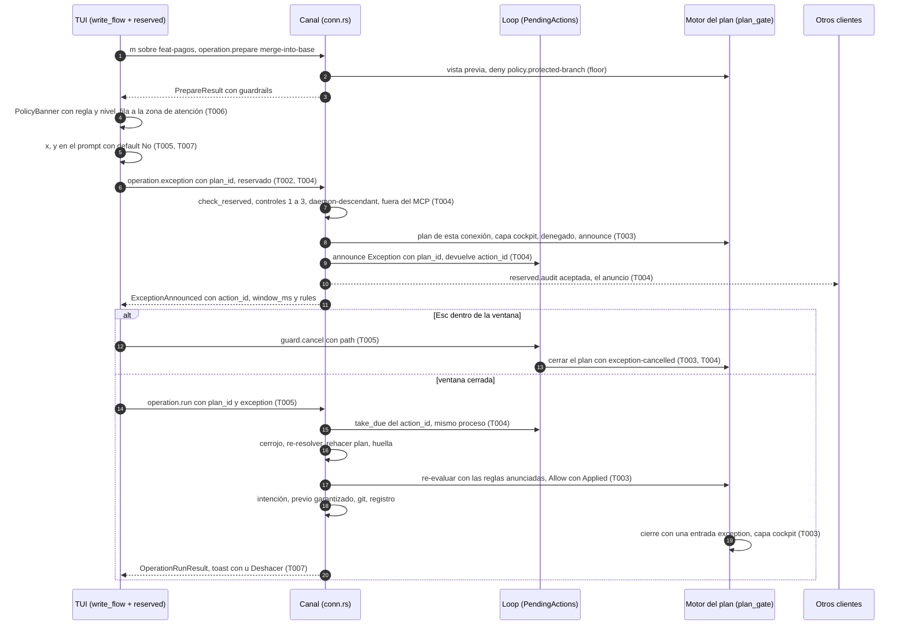

# DS-US-CKP-019 · Denegación con regla y nivel, y excepción consciente desde la TUI

## Contexto rápido

Cuando Guardrails deniega una acción de escritura del Cockpit, la TUI pinta un PolicyBanner ⛔ con la regla y el nivel ("⛔ main es rama protegida (equipo)"), el repo no cambia y la fila de la acción sube a la zona de atención. Con `x`, el desarrollador pide la excepción consciente: un prompt con default No, un comando reservado que el daemon autoriza por ascendencia, un anuncio en todos los clientes y una ventana de 10 s que se cancela con `Esc`. Al cerrarse la ventana, la TUI ejecuta el mismo plan por el flujo normal (snapshot previo y Deshacer) y el registro deja una sola entrada `exception`. Una TUI lanzada desde el terminal de un agente dice "actúas como claude-1" y no ofrece ni la excepción ni las acciones que exigen la capa `cockpit`.

El mecanismo lo fijan [ADR-GRD-007](../../../../architecture/decisions/ADR-GRD-007-acciones-reservadas-excepcion.md) (D5, D10 y la Enmienda (2026-10-04, Cockpit): sin token, ligada al plan) y [ADR-CKP-002](../../../../architecture/decisions/ADR-CKP-002-catalogo-operaciones-ejecutor.md) § 4 (capa, registro único y "Orden": controles, anuncio y ventana antes del cerrojo). Esta DS fija el **contrato del comando reservado lanzado desde la TUI**, que reutilizarán las demás acciones reservadas de la TUI.

Hoy:
- **PolicyBanner existe** (`apps/cli/src/tui/widgets/policy_banner.rs`, `PolicyKind::{Blocked, Pending, Expired}`, `PolicyBannerModel {title, rule_label, rule, reason, alternative, countdown, actions}`) y pinta su glifo con `SymbolToken::Blocked` (`⛔`, ASCII `[blocked]`, anchura 2; `crates/theme/src/generated.rs:473`). Nadie lo usa fuera de la galería.
- **La cabecera ya dice quién actúa**: `view.rs:247` pinta `Text::ActingAsAgent(name)` ("actúas como claude-1", `present/i18n.rs:733`) desde `requester.resolve` del handshake (`client/mod.rs:300`, `ConnectionRequester::Resolved {actor, layer, confirmable}`, `crates/api/src/scope.rs:231`; `model::Requester::{Unattributed{layer}, Agent{name, layer}, Unverified}`, `model.rs:449`).
- **La fila tiene el hueco de ⛔**: `AgentRowModel.blocked` siempre `false` (`view.rs:578`, "Published by the predictor and Guardrails … not before"), y `fleet_order::group(main, conflict || blocked, lead)` (`fleet_order.rs:134`) ya la sube a `Group::Attention`.
- **La denegación viaja tipada** con `operation.guardrails`: `PrepareResult.guardrails: Option<GuardrailsDenial {decision_id, effect, applied_effect, reasons}>` (`catalog.rs:855`, `:878`) y `RejectReason::{GuardrailsDenied, GuardrailsConfirmationRequired}` (`catalog.rs:1018`, `:1022`; DS-TS-CKP-003 D10).
- **El motor del plan** (`guardrails/plan_gate.rs`): `view_of` distingue `GateDecision::{Allow, Ask, Deny}` (`:146`), guarda una `PlanState` por `plan_id` (`MAX_PLANS = 1024`) y escribe como mucho una entrada al cerrar (`closing_entry`: `denial` o `notice`). No conoce la excepción.
- **La ventana de las acciones que relajan** existe: `guardrails/pending.rs` (`WINDOW = 10 s`, `GRACE = 60 s`, `GITRAPTOR_TEST_GUARD_WINDOW_MS`, un pendiente por repo, `PendingActions::{announce, take_due, cancel, sweep_expired}`), con `guard.cancel` no reservado (`methods/guard.rs:29`) y el brazo `GuardRequest::Cancel` del loop (`daemon/guard.rs:382`). El anuncio a todos los clientes es la entrada `reserved.audit` aceptada (DS-US-GRD-006 D7).
- **La autorización reservada** existe: `Connection::reserved` (`channel/conn.rs:2740`) con `check_reserved` (`channel/authz.rs:279`): controles 1 a 3, `daemon-descendant` y rechazo desde el MCP.
- **Lo que salta una excepción** lo decide `policy::guard::exception::{exceptable, announce, covers}` (y sus motivos `ExceptionRefusal`), del PR-A de US-GRD-006 (rama `feat/US-GRD-006-pra`, en curso; no está en `main`).
- **No existen** `tui/write_flow.rs`, `OpRequest`/`OpReply`, `Eligibility` ni `present/write_text.rs`: los crea DS-US-CKP-014 (T004 a T006), que no está en `main` (comprobado el 2026-10-28; G1).

Sin `architecture-constitution.md` en la cascada: las restricciones activas salen de [AGENTS.md](../../../../../AGENTS.md) y de los ADR citados (`unsafe_code = forbid`, ADR-GRP-001; protocolo congelado en 9, métodos y códigos por módulo, ADR-GRP-016; comandos reservados solo en el daemon, ADR-GRP-005 § 6; texto no confiable saneado en un solo punto, ADR-CKP-003 § 8). Ninguna tarea las viola.

### Decisiones

Lo que fija un ADR o una DS hermana se cita. Lo que nadie había decidido es **Decisión del orquestador (2026-10-28), validada por el Arquitecto y el PO** (marca **(O)**). E11 y E12 cierran Q-CKP-52 y Q-CKP-53.

| ID | Decisión | Por qué / descartado |
|----|----------|----------------------|
| E1 | **Método reservado nuevo `operation.exception {plan_id}`** en `methods/operation.rs`: `method(OPERATION_EXCEPTION, true, false)` (reservado, fuera del MCP). Pide la excepción de un plan **preparado por la misma conexión**, vivo y denegado. Responde `ExceptionAnnounced {action_id, window_ms, rules}`. (O) | ADR-CKP-002 § 4, "Orden": la petición va ligada al `planId` y a la huella. Descartado reutilizar `guard.exception` (DS-US-GRD-006 D6): recibe un argv, lo normaliza y emite un token; el Cockpit no tiene argv ni token (ADR-GRD-007, Enmienda Cockpit). Cambiar su forma pediría capacidad y mezclaría dos ligaduras |
| E2 | **Rechazos del método**: error nuevo `OPERATION_EXCEPTION_REFUSED` (`BLOCK - 2` del bloque `operation`) con `data = OperationExceptionRefusedData {reason: OperationExceptionRefusal, remaining_ms}`. El enumerado es propio de este método y usa los mismos nombres en el cable que `ExceptionRefusal` de DS-US-GRD-006 D20 para los motivos compartidos (`already-pending`, `window-open`, `no-pending`, `not-the-requester`, `not-denied`, `not-exceptable`), más `unknown-plan` (no es de esta conexión, caducó o ya se cerró) y `not-cockpit` (la capa del plan no es `cockpit`). Un agente o un descendiente del daemon nunca llega: lo rechaza `Connection::reserved` con su error de siempre. (O) | Un método nuevo con código propio no cambia la forma de nada (ADR-GRP-016). Mismos nombres para que el cliente los pinte igual; enumerado propio para no editar el de `guard.exception` (PR-A en curso) ni depender de él en el contrato |
| E3 | **Qué salta la excepción del Cockpit**: las reglas que `exceptable` admite (DS-US-GRD-006 D5), sin `system.snapshot-failed`. El ejecutor exige siempre el previo garantizado y, si falla, `aborted` (D-TMC-10, BR-CKP-WF-002); eso no es una regla de Guardrails. El anuncio lleva `announce(reasons, wants_prior = false)`. Una razón no saltable → `not-exceptable`, y la TUI ni ofrece `x`. (O) | La historia promete "snapshot previo y Deshacer" tras la excepción; saltarse el previo lo rompería |
| E4 | **Pendiente compartido con `guard exec` y `uninstall`**: la excepción del Cockpit ocupa el pendiente del repo en `PendingActions` con `PendingKind::Exception` (DS-US-GRD-006) y un campo nuevo `Entry.plan_id: Option<String>`. Un solo pendiente por repo: otra acción reservada pendiente → `already-pending`. El anuncio es el `reserved.audit` aceptado (D7 de DS-US-GRD-006); `GuardStatus.pending` muestra `ExceptionPlanView {operation, rules}` con `guard.exception`. Se cancela con `guard.cancel {path}`, de cualquier cliente del usuario (ADR-GRD-007 § 1). (O) | Un solo mecanismo de anuncio y ventana para todas las acciones que relajan; `raptor guard cancel` y la TUI cancelan lo mismo. Descartado un almacén del Cockpit aparte, que permitiría dos pendientes en un repo |
| E5 | **Ejecutar tras la ventana = `operation.run {plan_id, accepted_warnings, confirmation, exception: action_id}`** por la misma conexión. `RunParams.exception` es un campo aditivo detrás de la capacidad nueva `operation.exception` (`RunParams` es `deny_unknown_fields`: sin la capacidad, un daemon viejo lo rechazaría). Antes del cerrojo, el daemon pide al loop `take_due` de ese pendiente (mismo proceso, ventana cerrada, sin cancelar ni caducar, mismo `plan_id`); si no, `OPERATION_EXCEPTION_REFUSED` con su motivo y nada se evalúa. Bajo el cerrojo, el § 2 paso 4 de ADR-CKP-002 sin cambios: re-resolver el solicitante, rehacer el plan, comparar la huella (`state-changed` → `exception-rejected`) y re-evaluar Guardrails. (O) | ADR-CKP-002 § 4: "Al vencer la ventana, la TUI pide ejecutar ese plan por la misma conexión". La caducidad del plan (60 s) se cuenta desde el cierre de la ventana: el anuncio alarga `expires` del plan a `applies_at + PLAN_TTL_MS` |
| E6 | **Excepción aplicada en el motor del plan.** `GateRequest` gana `exception: Option<Vec<Rule>>` (las reglas anunciadas). Si la decisión re-evaluada no permite y `covers(anunciadas, razones)`, el veredicto pasa a `Allow` con `Decision.exception = Applied` y `applied_effect = allow`; `effect` y `reasons` no cambian, así que la entrada conserva las reglas saltadas. Si no las cubre (una regla nueva entre el anuncio y la ejecución), deniega como siempre y el plan cierra con `exception-rejected`. La ligadura (`PlanBinding`) lleva esa decisión: el hijo directo la hereda en sus hooks (DS-TS-CKP-003 D5), un nieto no. (O) | ADR-GRD-007 § 3 paso 8 y Enmienda Cockpit ("la ligadura la dan el registro del hijo y la huella del plan"). La regla "nunca salta lo que el humano no vio" de DS-US-GRD-006 D5, sin token |
| E7 | **Una sola entrada por plan, con el `kind` de la excepción**: `PlanState` gana `exception: Option<ExceptionMark {action_id, rules, state}>` con `state ∈ {Announced, Cancelled{by}, Rejected, Applied}`. Al cerrar: `Applied` → `exception`; `Rejected` → `exception-rejected`; `Cancelled` → `exception-cancelled` (con el actor que canceló, DS-US-GRD-006 D8); `Announced` sin ejecutar (caducó o la TUI murió) → `denial`, como un plan denegado que el humano no siguió. Capa `cockpit`; ninguna cuenta en el KPI. Cancelar cierra el plan: el motor guarda su `plan_id` en una lista de cerrados (acotada a `MAX_PLANS`, FIFO) y un `operation.run` posterior de ese plan deniega sin otra entrada. (O) | ADR-CKP-002 § 4, "Registro único", y ADR-GRD-006 (Enmienda Cockpit). Descartado escribir al anunciar: el desenlace aún no existe |
| E8 | **Rebase con excepción (I-01).** Si el plan aplicado es `rebase-onto-base`, la ligadura es `(ref, punta del plan, onto)`, la del plan; al terminar, el ejecutor comprueba que la nueva punta desciende de `onto` y tiene el número de commits del plan. Si no, `failed-changed` con el motivo `exception-mismatch` y Deshacer. (O) | ADR-CKP-002 § 4 y ADR-GRD-007 Enmienda Cockpit. DS-US-CKP-015 lo deja a esta historia |
| E9 | **Contrato del comando reservado lanzado desde la TUI** (`apps/cli/src/tui/reserved.rs`): máquina de estados genérica `ReservedFlow` = `Idle → Confirming(qué) → Announcing → Window {action_id, until, rules} → Applying → Done | Cancelled{by_me} | Refused(motivo)`. Reglas que heredan las demás acciones reservadas: (1) se ofrece solo con `Requester::Unattributed { layer: Cockpit }`; (2) un ConfirmPrompt con default No que dice qué se relaja, que se anuncia a todos los clientes, la ventana y que queda auditado; (3) la ventana la impone el daemon: la TUI pinta la cuenta atrás desde `window_ms` con su reloj monotónico y nunca ejecuta antes; un `window-open` reprograma con `remaining_ms`; (4) `Esc` en la ventana cancela con `guard.cancel {path}`; salir con `q` o `Ctrl-C` durante la ventana cancela primero; (5) un `no-pending` al ejecutar es "cancelada desde otro cliente o caducada" y no se ejecuta nada; (6) una sola acción reservada a la vez por TUI. Cada acción aporta su petición (`ReservedRequest::Exception {plan_id}`; después `Uninstall`, `ConfirmTeam`, `QueueApprove`…) y sus textos. (O) | La historia lo pide como contrato reutilizable. Mismas reglas que `raptor guard exec` y `uninstall` (DS-US-GRD-006 D8), para que cancelar signifique lo mismo en todas partes |
| E10 | **"Actúas como <agente>" y acciones desactivadas.** La TUI no calcula el solicitante: lo lee del handshake (`requester.resolve`, ADR-CKP-003 § 4 N5) y el daemon lo re-resuelve en cada petición (ADR-CKP-002 § 3). Cabecera sin cambios (`Text::ActingAsAgent`). Una función pura `layer_block(&Option<Requester>) -> Option<LayerBlock>` da `AgentLayer` con `Agent {..}`, `UnverifiedLayer` con `Unattributed { layer: Mcp }` o `Unverified`, y `None` con `Unattributed { layer: Cockpit }`. Integrar, Descartar, Cancelar y la excepción usan **un único texto** por motivo, en `present/layer_text.rs`. (O) | Hoy cada DS de escritura (014, 015, 016, 017) pinta su `AgentLayer`; un texto por DS divergiría del de la historia. La cabecera conserva su forma de etiqueta en minúscula dentro de la línea con separadores ("… · actúas como claude-1"); el escenario se comprueba con ese texto |
| E11 | **La fila sube mientras la denegación siga vigente**: `Model.ui.denials: BTreeMap<u64 /*worktree key*/, DenialMark {plan_id, decision_id, until_ms}>`, local a la TUI. La fila es la del worktree desde el que se lanzó la acción (el del agente en integrar, rebasar y descartar). Vigente = el plan sigue vivo en el daemon (`expires_in_ms`, alargado por E5) y no se ejecutó ni se canceló. `view::row` pone `blocked = true`, y `fleet_order::group` la sube sin tocar su lógica. `Esc` cierra el banner pero no la marca; `x` sobre la fila marcada lo reabre. ⚠️ **ASSUMPTION**: 60 s de vida del plan (`PLAN_TTL_MS`, 60 s tras la ventana con E5). Cierra Q-CKP-53. (O) | BR-CKP-WF-001 (⛔ en la zona de atención). El recuento ⛔ de la cabecera (`attention.denials` del motor) es otro dato y no cambia |
| E12 | **"Pedir confirmación" sin cola, por solicitante** (escenario 5 como esquema; Q-CKP-52, Q-GRD-46). En ningún caso se crea petición: no hay cola (US-GRD-015, bloqueada por SPIKE-GRD-002). **Agente** (TUI con capa `mcp`): `GuardrailsDenial` con `effect = ask` y `applied_effect = deny` (razones con `cause: ask-unavailable`) se pinta como denegada, con la regla y el nivel, sin `x`. **Persona** (capa `cockpit`): el motor aplica `allow` con las razones del `ask` como avisos (`decision_for`, `evaluate.rs:212`); la TUI no pinta ⛔ ni marca la fila, sigue el flujo normal (snapshot previo y Deshacer) y muestra el aviso "<operación> pide confirmación humana; se ejecuta porque la haces tú": como línea del ConfirmPrompt de la operación si lo hay, y si no como Notification `ℹ` junto al toast del resultado. Los avisos llegan en `PrepareResult.guardrails_notices` (E15). Hoy el plan del ejecutor no evalúa permisos (`RuleSet::all().permissions = false`, `evaluate.rs:410`) hasta US-GRD-016 (G3). (O) | Mismo reparto que la capa de hooks (DS-US-GRD-007 D19): la acción de la persona es la confirmación. Se construye ahora para no cambiarla cuando lleguen US-GRD-016 y la cola |
| E15 | **Avisos de Guardrails en `prepare`**: `PrepareResult.guardrails_notices: Vec<Reason>` (los `Decision.notices` de la vista previa, solo con `applied_effect = allow`), aditivo detrás de la capacidad nueva `operation.guardrails-notices`, con `#[serde(default, skip_serializing_if = "Vec::is_empty")]`. `PrepareResult::for_mcp` no lo copia. (O) | Hoy `prepare` solo devuelve `DecisionView::Allow` y la TUI no sabría qué avisar. Descartado mandarlo en `OperationRunResult`: el aviso debe verse antes de confirmar |
| E13 | **Textos fijos en/es** en `present/policy_text.rs` (catálogo tipado, `match` exhaustivo, ADR-CKP-003 § 10). La plantilla del titular lleva la regla y el nivel; los parámetros (`Reason.params`) pasan por `SafeText`. Los textos exactos están en [Contratos compartidos](#textos). (O) | DSYS-GRP-001 § 5: qué pasó → por qué → qué hacer, sin concatenar |
| E14 | **Tecla `x`** (ejemplo de BR-CKP-AUTH-001, reservada en DS-US-CKP-017 X12) sobre el banner o sobre una fila con la marca de E11. `Esc` cierra el banner o cancela la ventana. `y`/`n` en el prompt, como `widgets/confirm.rs` | `x` está libre en `keymap.rs` |

## ⚠️ Gaps y violaciones de la constitución

| ID | Qué falta | Severidad | Alcance | Acción | Owner |
|----|-----------|-----------|---------|--------|-------|
| G1 | **Dependencias de orden.** De DS-US-CKP-014: `write_flow.rs`, `OpRequest`/`OpReply`/`RefusalView`, `Eligibility`, `present/write_text.rs` y la capacidad `operation.merge` (T004 a T006). De DS-US-GRD-006: `policy::guard::exception::{exceptable, announce, covers}`, `ExceptionPlanView`, `PendingKind::Exception`, `Entry.exception` (PR-A, `feat/US-GRD-006-pra`) y `LogKind::{Exception, ExceptionRejected, ExceptionCancelled}` con el brazo `Cancel` que escribe `exception-cancelled` (PR-B). Nada está en `main` (2026-10-28) | Bloqueante | T003, T004, T005, T006, T007 | Mezclar antes DS-014 T004 a T006 y DS-GRD-006 PR-A. Si PR-B no ha entrado, quien entre primero crea los `LogKind` (regla de coordinación de [Cómo extender](#cómo-extender)) | Orquestador |
| G2 | **Escenario 6 en la TUI**: "Rebasar" sale desactivado con `AgentLayer` en una TUI de agente hasta US-MCP-018 (DS-US-CKP-015 R2, Q-CKP-41). La invariante del escenario ("confirmar no cambia quién pide") se prueba en el daemon con el brazo de prueba de rebase; la prueba de la TUI queda pendiente de US-MCP-018 | Bloquea liberación | Escenario 6 | Cerrar con US-MCP-018; mientras, `us_ckp_019::a_confirmation_never_changes_the_requester` | Orquestador |
| G3 | **Escenario 5 de punta a punta**: depende de US-GRD-016 (D2 de DS-US-GRD-016: los permisos del equipo se aplican a todos los planes del ejecutor). Hasta entonces ningún plan del Cockpit produce `ask` | Bloquea liberación | Escenario 5 (su E2E en T001 y T007) | Cerrar con US-GRD-016; las dos filas de E12 se construyen y se prueban ahora con snapshots y tests de `update` | Orquestador |

Ninguna violación: sin constitución, ver Contexto rápido.

## 🔭 La forma



---

## 🚀 Plan de implementación

### El trabajo de un vistazo

| # | Tarea | Depende | Aterriza en |
|---|---|---|---|
| T001 | Escribir en rojo los tests de contrato del daemon y de la TUI | G1 | `crates/core/tests/us_ckp_019_exception.rs`, `apps/cli/tests/tui_exception.rs`, stubs |
| T002 | Crear el contrato: método, error, capacidad, campo de `run` | T001 | `crates/api/src/exception.rs`, `methods/operation.rs`, `catalog.rs` |
| T003 | Aplicar la excepción en el motor del plan y cerrar con su `kind` | T002 | `crates/core/src/guardrails/plan_exception.rs`, `plan_gate.rs`, `executor/mod.rs` |
| T004 | Atender `operation.exception` y la ejecución con excepción | T003 | `crates/core/src/channel/conn.rs`, `daemon/guard.rs`, `guardrails/pending.rs`, `daemon/operation_exception.rs` |
| T005 | Crear el flujo reservado genérico de la TUI | T002 | `apps/cli/src/tui/reserved.rs`, `model.rs`, `client/mod.rs` |
| T006 | Pintar la denegación, la marca de la fila y el motivo de capa | T005 | `tui/policy.rs`, `tui/view.rs`, `present/policy_text.rs`, `present/layer_text.rs` |
| T007 | Conectar `x`, la ventana y la cancelación | T004, T006 | `tui/{keymap,update,help}.rs` |
| T008 | Cerrar la historia | T001–T007 | `docs` |

T003 y T005 van en paralelo una vez está T002. La parte de la TUI (T005 a T007) no toca `crates/core`.

### T001 — Escribir en rojo los tests de contrato

**Objetivo.** Los seis escenarios de la historia en rojo, contra el daemon real con repos y perfil temporales, y contra la `App` real sobre `TestBackend`.

**Ubicación.**
- `crates/core/tests/us_ckp_019_exception.rs` (**CREATE**): daemon en proceso con `OperationsWiring::production()`, Git real, ventana corta (`GITRAPTOR_TEST_GUARD_WINDOW_MS=300`).
- `apps/cli/tests/tui_exception.rs` (**CREATE**): arnés de `apps/cli/tests/live_fleet.rs` (`#![cfg(all(target_os = "macos", debug_assertions))]`, `gitraptor_testkit::Fixture`, `raptor-fake-agent`).
- Stubs que compilan (`todo!()`) en los archivos de T002 a T007.

**Reglas**
- Los tests rojos van en su archivo y no se editan durante la implementación (R4 de `/implement`).
- Nunca este repo ni el perfil real (NFR-01).
- La capa sale de la resolución real del solicitante, nunca de `test_layer_override`. El escenario 4 lanza la TUI como hija de `raptor-fake-agent` "claude-1".
- Los tests solo mandan teclas y métodos por nombre y leen el buffer y el registro: compilan sin DS-014 ni DS-GRD-006.

- **Depende:** —
- **Refs:** US-CKP-019 escenarios 1 a 6; § 9.4
- **Aceptación:** `cargo test -p gitraptor-core --test us_ckp_019_exception` y `cargo test -p gitraptor-cli --test tui_exception` compilan y fallan por "no implementado"

### T002 — Crear el contrato

**Objetivo.** Un cliente con la capacidad puede pedir la excepción de su plan y ejecutarlo con ella.

**Ubicación.**
- `crates/api/src/exception.rs` (**CREATE**, una línea `pub mod exception;` en `lib.rs`): `OperationExceptionParams`, `ExceptionAnnounced`, `OperationExceptionRefusedData`.
- `crates/api/src/methods/operation.rs` (**MODIFY**): `OPERATION_EXCEPTION = "operation.exception"` con `method(OPERATION_EXCEPTION, true, false)` (reservado, sin `.since`); `CAP_OPERATION_EXCEPTION = Capability::new("operation.exception")`; `OPERATION_EXCEPTION_REFUSED = ErrorSpec::new(BLOCK - 2, "operation-exception-refused")` en `errors`.
- `crates/api/src/catalog.rs` (**MODIFY**): `PrepareResult.guardrails_notices` y su capacidad `CAP_OPERATION_GUARDRAILS_NOTICES` en `methods/operation.rs` (E15); `RunParams.exception: Option<String>` con `#[serde(default, skip_serializing_if = "Option::is_none")]`; `OperationOutcome` sin cambios; motivo de fallo `exception-mismatch` (E8) en el enumerado de motivos del desenlace.
- `OperationExceptionRefusal` en `crates/api/src/exception.rs`, con `#[serde(rename_all = "kebab-case")]`.

**Reglas**
- `operation.exception` no se ofrece a `raptor-mcp` (`mcp: false`) y el canal lo rechaza desde su conexión (BR-AUTH-004).
- Sin `operation.exception`, `RunParams` no lleva `exception` y el cliente no muestra `x`.
- Mensajes `error.operation-exception-refused` en `apps/cli/i18n/{en,es}/contract.txt` (ADR-GRP-016, "Añadir un código de error").

- **Depende:** T001, G1
- **Refs:** E1, E2, E5
- **Aceptación:** `cargo test -p gitraptor-api` en verde, con `crates/api/tests/architecture.rs` (código en el bloque del módulo, nada en `rpc.rs`) y el esquema de `describe` con el método y la capacidad

### T003 — Aplicar la excepción en el motor del plan

**Objetivo.** El motor permite un plan denegado solo con la excepción anunciada que lo cubre, y deja una sola entrada con su `kind`.

**Ubicación.**
- `crates/core/src/guardrails/plan_exception.rs` (**CREATE**, una línea `mod` en `guardrails/mod.rs`): `ExceptionMark`, `ExceptionState`, `apply(decision, &rules) -> Decision` y el `kind` de cierre.
- `crates/core/src/guardrails/plan_gate.rs` (**MODIFY**): `PlanState.exception`; `GuardrailsEngine::{announce_exception, cancel_exception, reject_exception}`; `closing_entry` lee la marca (E7); lista de planes cerrados.
- `crates/core/src/executor/mod.rs` (**MODIFY**): `GateRequest.exception: Option<Vec<Rule>>`; la comprobación posterior del rebase (E8) tras el paso, solo con `Decision.exception == Applied`.

**Reglas**
- `apply`: si `decision.applied_effect != Allow` y `covers(rules, razones)` → `applied_effect = Allow`, `exception = Applied`, `notices` vacíos; si no, la decisión sin cambios.
- `announce_exception(plan_id, action_id, rules)` falla si el plan no tiene estado, si ya tiene marca o si su capa no es `cockpit`.
- Cierre: `Applied` → `LogKind::Exception`; `Rejected` → `ExceptionRejected`; `Cancelled { by }` → `ExceptionCancelled` con `actor = by`; `Announced` → `Denial`. Una sola entrada, capa `cockpit`.
- La lista de cerrados guarda solo `plan_id` (acotada a `MAX_PLANS`); `evaluate_detailed` de un plan cerrado devuelve `Deny` sin estado ni entrada.
- Rebase (E8): punta nueva descendiente de `onto` y `ahead == commits del plan` (`RepoReader::ahead_behind_commits`); si no, `failed-changed` con `exception-mismatch`.

- **Depende:** T002, G1
- **Refs:** E6, E7, E8; DS-TS-CKP-003 D5, D8
- **Aceptación:** `cargo test -p gitraptor-core --lib guardrails::plan_exception guardrails::plan_gate` en verde, con:
- [ ] `a_plan_leaves_at_most_one_entry` ampliado: aplicada → una `exception`; cancelada → una `exception-cancelled`; huella cambiada → una `exception-rejected`; anunciada y caducada → una `denial`.
- [ ] Una razón nueva entre el anuncio y la ejecución → `deny` y `exception-rejected`.
- [ ] Un nieto bajo un plan con excepción se evalúa con su propia entrada (H-01).

### T004 — Atender `operation.exception` y la ejecución con excepción

**Objetivo.** El daemon autoriza, anuncia, abre la ventana, la deja cancelar y ejecuta el plan solo al cerrarse.

**Ubicación.**
- `crates/core/src/daemon/operation_exception.rs` (**CREATE**, `impl Daemon`, una línea en `daemon/mod.rs`): anunciar en `PendingActions` y `take_due` para la ejecución.
- `crates/core/src/daemon/shutdown.rs` (**MODIFY**): variantes de `GuardRequest`/`GuardReply` para anunciar y tomar.
- `crates/core/src/guardrails/pending.rs` (**MODIFY**): `Entry.plan_id: Option<String>`.
- `crates/core/src/daemon/guard.rs` (**MODIFY**): el brazo `Cancel` (`:382`), con un pendiente que lleva `plan_id`, llama a `cancel_exception(plan_id, actor)` del motor.
- `crates/core/src/channel/conn.rs` (**MODIFY**): brazo de `OPERATION_EXCEPTION` junto a los de `operation.*`; `operation.run` con `exception`.

**Reglas** — `operation.exception {plan_id}`, en este orden
1. `Connection::reserved` (`conn.rs:2740`): controles 1 a 3, `daemon-descendant`, fuera del MCP; audita con la cadena completa. Rechazado y el plan es de esta conexión → `reject_exception` (el plan cierra con `exception-rejected`, capa del plan). Si no, solo la auditoría.
2. Plan de esta conexión y vivo → si no, `unknown-plan`. Capa del plan `cockpit` → si no, `not-cockpit`.
3. Vista previa del plan sin `Allow` → si no, `not-denied`. `announce(razones, false)` → `not-exceptable` o las reglas.
4. `PendingActions::announce(repo, Exception, solicitante, ventana)` con `plan_id` y `ExceptionPlanView` → `already-pending` si hay otro.
5. `announce_exception` en el motor; `expires` del plan = `applies_at + PLAN_TTL_MS`.
6. `reserved.audit` aceptada con la aceptación del riesgo por acción (`RISK_ACCEPTED`, `daemon/guard.rs`), que es el anuncio.

**Reglas** — `operation.run` con `exception`
- Sin `operation.exception` en la conexión, el campo se rechaza como hoy (`deny_unknown_fields`).
- Antes del cerrojo: `take_due(repo, action_id, solicitante)`. `window-open` → `OPERATION_EXCEPTION_REFUSED` con `remaining_ms`; `no-pending` (cancelada o caducada) y `not-the-requester` → su motivo; nada se evalúa.
- Después, ADR-CKP-002 § 2 paso 4 sin cambios, con `GateRequest.exception = Some(reglas)`.
- La salida de Git y el resultado, como cualquier `operation.run`.

- **Depende:** T003, G1
- **Refs:** E1 a E5; ADR-CKP-002 § 4 "Orden"; DS-US-GRD-006 D4, D7, D8
- **Aceptación:** `cargo test -p gitraptor-core --test us_ckp_019_exception` en verde

### T005 — Crear el flujo reservado genérico de la TUI

**Objetivo.** Una máquina de estados reutilizable para toda acción reservada lanzada desde la TUI (E9).

**Ubicación.**
- `apps/cli/src/tui/reserved.rs` (**CREATE**, una línea en `tui/mod.rs`): `ReservedFlow`, `ReservedRequest`, `ReservedEvent`.
- `apps/cli/src/model.rs` (**MODIFY**): `Model.ui.reserved: ReservedFlow`, `Model.ui.denials` (E11).
- `apps/cli/src/client/mod.rs` (**MODIFY**): `OpRequest` de DS-014 gana `Exception { plan_id }` y `CancelPending { path }`; `OpReply` gana `Announced(ExceptionAnnounced)` y `ReservedRefused(OperationExceptionRefusedData)`. Pide `operation.exception` y `guard.exception` en `connection.accept`.

**Reglas**
- Estados de E9. `Confirming` reutiliza `widgets/confirm.rs` (default No). `Window { until }` con el reloj monotónico de la TUI (`model.now_ms`); al llegar a `until`, `Applying` envía el `Run` de `write_flow` con `exception`.
- Una sola acción reservada a la vez; con otra en curso, `x` muestra "hay una acción en curso".
- `Esc` en `Window` → `CancelPending { path: raíz del repo }`; respuesta → `Cancelled { by_me: true }`. Un `no-pending` al ejecutar → `Cancelled { by_me: false }`.
- `q`/`Ctrl-C` en `Window` → `CancelPending` y después salir.
- Nada espera en el hilo principal (ADR-CKP-003 § 3).

- **Depende:** T002, G1
- **Refs:** E9; DS-014 I10, T005
- **Aceptación:** `cargo test -p gitraptor-cli --lib tui::reserved`: transiciones, "No no anuncia", "Esc cancela", "salir cancela", "una a la vez", `window-open` reprograma

### T006 — Pintar la denegación, la marca de la fila y el motivo de capa

**Objetivo.** El banner con regla y nivel, la fila en la zona de atención y un único texto por motivo de capa.

**Ubicación.**
- `apps/cli/src/tui/policy.rs` (**CREATE**): `banner(&GuardrailsDenial, &ReservedFlow, &Option<Requester>, say) -> PolicyBannerModel`; `exception_eligibility`.
- `apps/cli/src/present/policy_text.rs` (**CREATE**): titulares por regla, nivel corto, textos del banner, del prompt, de la ventana y de los toasts ([Textos en/es](#textos)).
- `apps/cli/src/present/layer_text.rs` (**CREATE**): `layer_block` y sus textos (E10).
- `apps/cli/src/tui/view.rs` (**MODIFY**): el banner como modal (`modal_area`); `row.blocked` desde `Model.ui.denials` (E11).

**Reglas**
- `exception_eligibility`: `layer_block` presente → desactivada con su texto; alguna razón no saltable (`exceptable`) → sin `x` y la línea "Esta regla no admite excepción"; `effect = ask` → sin `x` (E12); sin `operation.exception` → sin `x`.
- Titular = la primera razón; con más de una, la línea de regla las lista hasta 3 y "y <n> más".
- `PolicyKind::Blocked` antes de pedir; `Pending` en la ventana, con `countdown`; `Expired` no se usa.
- Todo parámetro de `Reason.params` y todo nombre pasa por `SafeText` (ADR-CKP-003 § 8). ASCII y sin color como DS-US-CKP-005.

- **Depende:** T005, G1
- **Refs:** E10 a E13; DSYS-GRP-001 § 3; BR-CKP-AUTH-001, BR-CKP-WF-001
- **Aceptación:** snapshots `insta` en `apps/cli/src/tui/snapshots/`: banner bloqueado (con y sin `x`, no saltable, `ask`), ventana a 7 s, desactivado por capa; en/es, 80×24 y 120×40, Unicode y ASCII

### T007 — Conectar `x`, la ventana y la cancelación

**Objetivo.** `x` pide la excepción desde el banner o la fila marcada, la ventana se ve y `Esc` la cancela.

**Ubicación.** `apps/cli/src/tui/keymap.rs` (**MODIFY**): `Action::Exception` en `x`. `apps/cli/src/tui/update.rs` (**MODIFY**): `x` sobre el banner o sobre una fila marcada → `reserved`; `Esc` según el estado. `apps/cli/src/tui/help.rs` (**MODIFY**): la acción en la ayuda y en `KeyHints`.

**Reglas**
- `Prepared` con `guardrails` → marca de la fila (E11) y banner; ningún `Run`.
- `Prepared` sin `guardrails` y con `guardrails_notices` de un `permission.*` (persona, E12) → flujo normal de la operación, sin marca ni banner de bloqueo, con el aviso en el ConfirmPrompt o en una Notification `ℹ` junto al toast.
- Toasts: cancelada por mí → "Excepción cancelada · no se ejecutó nada"; por otro → "La excepción se canceló desde otro cliente o caducó · no se ejecutó nada"; huella cambiada → "El estado cambió durante la cuenta atrás · no se ejecutó nada"; ejecutada → el toast normal de la operación (DS-014 T006).
- La marca se borra al ejecutar, al cancelar y al caducar el plan.

- **Depende:** T004, T006
- **Refs:** E9, E11, E14
- **Aceptación:** `cargo test -p gitraptor-cli --test tui_exception` en verde

### T008 — Cerrar la historia

**Objetivo.** La historia queda implementada, verificada y enlazada.

**Ubicación.** `docs/requirements/features/cockpit/user-stories/US-CKP-019-denegada-excepcion-consciente.md` y esta DS (**MODIFY**).

**Reglas**
- La historia pasa a `implemented` y enlaza el PR; esta DS añade `## Estado de la implementación`.
- Las [Enmiendas que implica](#enmiendas-que-implica) se aplican en el mismo PR o quedan anotadas en él.

- **Depende:** T001 a T007
- **Refs:** AGENTS.md (reglas de calidad); Enmiendas que implica
- **Aceptación:** `cargo clippy --workspace` y `node tools/test/nextest-junit.mjs` en verde

---

## Estructura de ficheros

| Archivo | Acción | Tarea |
|---|---|---|
| `crates/api/src/exception.rs`, `crates/api/src/lib.rs` | CREATE, MODIFY (1 línea) | T002 |
| `crates/api/src/methods/operation.rs` | MODIFY (método, capacidad, error) | T002 |
| `crates/api/src/catalog.rs` | MODIFY (`RunParams.exception`, `exception-mismatch`) | T002 |
| `apps/cli/i18n/{en,es}/contract.txt` | MODIFY (1 clave) | T002 |
| `crates/core/src/guardrails/plan_exception.rs`, `guardrails/mod.rs` | CREATE, MODIFY (1 línea) | T003 |
| `crates/core/src/guardrails/plan_gate.rs` | MODIFY | T003 |
| `crates/core/src/executor/mod.rs` | MODIFY (`GateRequest.exception`, comprobación del rebase) | T003 |
| `crates/core/src/daemon/operation_exception.rs`, `daemon/mod.rs` | CREATE, MODIFY (1 línea) | T004 |
| `crates/core/src/daemon/shutdown.rs`, `daemon/guard.rs` | MODIFY | T004 |
| `crates/core/src/guardrails/pending.rs` | MODIFY (`Entry.plan_id`) | T004 |
| `crates/core/src/channel/conn.rs` | MODIFY (brazo y `run`) | T004 |
| `crates/core/tests/us_ckp_019_exception.rs` | CREATE | T001 |
| `apps/cli/src/tui/reserved.rs`, `tui/policy.rs` | CREATE | T005, T006 |
| `apps/cli/src/present/policy_text.rs`, `present/layer_text.rs` | CREATE | T006 |
| `apps/cli/src/model.rs`, `apps/cli/src/client/mod.rs` | MODIFY | T005 |
| `apps/cli/src/tui/{view,update,keymap,help,mod}.rs`, `present/mod.rs` | MODIFY | T006, T007 |
| `apps/cli/tests/tui_exception.rs` | CREATE | T001 |

## Contratos compartidos

### Tipos y datos compartidos

```rust
// crates/api/src/exception.rs (T002) — a crear
#[derive(Debug, Clone, PartialEq, Eq, Serialize, Deserialize, JsonSchema)]
#[serde(rename_all = "camelCase", deny_unknown_fields)]
pub struct OperationExceptionParams { pub plan_id: String }

#[derive(Debug, Clone, PartialEq, Eq, Serialize, Deserialize, JsonSchema)]
#[serde(rename_all = "camelCase", deny_unknown_fields)]
pub struct ExceptionAnnounced {
    pub action_id: String,
    pub window_ms: u64,                 // 10 000 (pending::WINDOW)
    pub rules: Vec<crate::guard::Rule>, // las que se saltarán, en orden de aparición
}

#[derive(Debug, Clone, PartialEq, Eq, Serialize, Deserialize, JsonSchema)]
#[serde(rename_all = "camelCase", deny_unknown_fields)]
pub struct OperationExceptionRefusedData {
    pub reason: OperationExceptionRefusal,
    #[serde(default, skip_serializing_if = "Option::is_none")]
    pub remaining_ms: Option<u64>,
}

#[derive(Debug, Clone, Copy, PartialEq, Eq, Serialize, Deserialize, JsonSchema)]
#[serde(rename_all = "kebab-case")]
pub enum OperationExceptionRefusal {
    AlreadyPending, WindowOpen, NoPending, NotTheRequester, NotDenied, NotExceptable, // mismos nombres que DS-GRD-006 D20
    UnknownPlan, NotCockpit,
}

// crates/api/src/catalog.rs (T002) — RunParams, campo nuevo (solo con operation.exception)
#[serde(default, skip_serializing_if = "Option::is_none")]
pub exception: Option<String>,   // action_id de ExceptionAnnounced

// crates/core/src/guardrails/plan_exception.rs (T003) — a crear
pub struct ExceptionMark { pub action_id: String, pub rules: Vec<Rule>, pub state: ExceptionState }
pub enum ExceptionState { Announced, Cancelled { by: Option<AgentKind> }, Rejected, Applied }

// apps/cli/src/present/layer_text.rs (T006) — a crear
pub enum LayerBlock { AgentLayer, UnverifiedLayer }
pub fn layer_block(requester: &Option<Requester>) -> Option<LayerBlock>;

// apps/cli/src/model.rs (T005)
pub struct DenialMark { pub plan_id: String, pub decision_id: String, pub until_ms: i64 }
```

Lo que ya existe y se usa tal cual: `PolicyBannerModel`, `PolicyKind`, `SymbolToken::Blocked`, `Text::ActingAsAgent`, `model::Requester`, `ConnectionRequester`, `GuardrailsDenial`, `Reason {rule, level, params, cause}`, `Level`, `Effect`, `ExceptionState` del contrato (`guard.rs:220`, `Decision.exception`), `GateDecision`, `PlanBinding`, `PendingActions`, `pending::{WINDOW, GRACE, WINDOW_ENV}`, `GUARD_CANCEL`, `Connection::reserved`, `check_reserved`, `fleet_order::group`, `PLAN_TTL_MS`. De DS-US-GRD-006 (a crear allí): `exceptable`, `announce`, `covers`, `ExceptionPlanView`, `PendingKind::Exception`, `LogKind::Exception*`. De DS-US-CKP-014: `WriteFlow`, `OpRequest`, `OpReply`, `RefusalView`.

### Textos

`<rama>`, `<ruta>`, `<operación>` y `<agente>` llegan saneados. `<nivel>` es el nivel corto.

| Clave | es | en |
|---|---|---|
| Nivel `minimum` / `floor` / `worktree` / `profile` / `local` / `system` | mínimo / equipo / equipo, esta rama / personal / local / por defecto | minimum / team / team, this branch / personal / local / default |
| Titular `policy.protected-branch` | `<rama>` es rama protegida (`<nivel>`) | `<branch>` is a protected branch (`<level>`) |
| Titular `policy.forbidden-path` | `<ruta>` es una ruta prohibida (`<nivel>`) | `<path>` is a forbidden path (`<level>`) |
| Titular `minimum.base-branch-delete` | no se puede borrar la rama base `<rama>` (mínimo) | the base branch `<branch>` cannot be deleted (minimum) |
| Titular `permission.*`, `deny` | `<operación>` está denegada en este repo (`<nivel>`) | `<operation>` is denied in this repo (`<level>`) |
| Titular `permission.*`, `ask` (E12) | `<operación>` pide confirmación humana (`<nivel>`) | `<operation>` asks for human confirmation (`<level>`) |
| Titular `system.*` | Guardrails no pudo decidir; no se ejecutó nada | Guardrails could not decide; nothing ran |
| Etiqueta de regla | Regla | Rule |
| Razón (denegada) | `<acción>` no se ejecutó; `<rama base>` no cambia. | `<action>` did not run; `<base branch>` is unchanged. |
| Razón (`ask`) | La confirmación aún no está disponible: no se creó ninguna petición. | Confirmation is not available yet: no request was created. |
| Alternativa con `x` | x Excepción consciente: se anuncia a todos los clientes, puedes cancelarla durante 10 s y queda auditada. | x Conscious exception: announced to every client, you can cancel it for 10 s and it is audited. |
| No saltable | Esta regla no admite excepción. | This rule admits no exception. |
| Motivo `AgentLayer` (E10) | una TUI lanzada por un agente actúa como ese agente | a TUI launched by an agent acts as that agent |
| Motivo `UnverifiedLayer` (E10) | no se pudo verificar que esta TUI no la lanzó un agente | it could not be verified that no agent launched this TUI |
| Prompt, título | Excepción consciente | Conscious exception |
| Prompt, pregunta | ¿Saltar `<regla>` (`<nivel>`) para `<acción>`? Se anunciará a todos los clientes y quedará auditada. | Skip `<rule>` (`<level>`) to `<action>`? It will be announced to every client and audited. |
| Ventana, título | Excepción consciente anunciada | Conscious exception announced |
| Ventana, cuenta atrás | se ejecuta en `<n>` s · Esc Cancelar | runs in `<n>` s · Esc Cancel |
| Toast, cancelada por mí | Excepción cancelada · no se ejecutó nada | Exception cancelled · nothing ran |
| Toast, cancelada fuera | La excepción se canceló desde otro cliente o caducó · no se ejecutó nada | The exception was cancelled from another client or expired · nothing ran |
| Aviso, `ask` de la persona (E12) | `<operación>` pide confirmación humana; se ejecuta porque la haces tú | `<operation>` asks for human confirmation; it runs because you are doing it |
| Toast, huella cambiada | El estado cambió durante la cuenta atrás · no se ejecutó nada | The state changed during the countdown · nothing ran |
| Otra acción pendiente | Ya hay otra acción reservada pendiente en este repo | Another reserved action is already pending in this repo |

El panel pinta el glifo de `SymbolToken::Blocked` delante del titular: "⛔ main es rama protegida (equipo)" (ASCII: "[blocked] main es rama protegida (equipo)"). `<acción>` es la etiqueta de la operación de su DS ("integrar feat-pagos en main").

### Ciclos de vida (DI)

- `ExceptionMark` vive en la `PlanState` del motor hasta el cierre del plan.
- El pendiente vive en `PendingActions` del loop (memoria; un reinicio lo pierde y el plan cierra con `denial`).
- `ReservedFlow` y `denials` viven en `Model.ui`; la marca se borra al ejecutar, cancelar o caducar.

### Firmas del stack

```rust
// crates/core/src/guardrails/plan_gate.rs (T003)
impl GuardrailsEngine {
    pub fn announce_exception(&self, plan_id: &str, action_id: &str, rules: Vec<Rule>) -> Result<(), OperationExceptionRefusal>;
    pub fn cancel_exception(&self, plan_id: &str, by: Option<AgentKind>);
    pub fn reject_exception(&self, plan_id: &str);
}
// crates/core/src/guardrails/plan_exception.rs (T003)
pub fn apply(decision: Decision, announced: &[Rule]) -> Decision;
pub fn closing_kind(mark: Option<&ExceptionMark>, decision: &Decision, ran: bool) -> Option<LogKind>;

// apps/cli/src/tui/policy.rs (T006)
pub fn banner(denial: &GuardrailsDenial, flow: &ReservedFlow, requester: &Option<Requester>, say: Say) -> PolicyBannerModel;
pub fn exception_eligibility(denial: &GuardrailsDenial, requester: &Option<Requester>, offered: bool) -> Eligibility<ExceptionBlock>;
```

## Contrato de API

| Método | Cambio | Con la capacidad | Sin ella |
|---|---|---|---|
| `operation.exception {planId}` | Nuevo, reservado, fuera del MCP | `ExceptionAnnounced` o `OPERATION_EXCEPTION_REFUSED` | Se descubre en `hello.methods` |
| `operation.run {planId, acceptedWarnings, confirmation, exception}` | Campo `exception` | Con `operation.exception` | El campo no existe (`deny_unknown_fields`) |
| `operation.prepare` | Campo `guardrailsNotices` (E15) | Con `operation.guardrails-notices` | El campo no viaja; la persona pasa igual, sin aviso en la TUI |
| `guard.cancel {path}` | Ninguno de forma; cancela también la excepción del Cockpit | — | — |
| `guard.status` | `pending` con `PendingKind::Exception` y `ExceptionPlanView` (DS-US-GRD-006) | Con `guard.exception` | No se muestra |

### Forma del error y del cuerpo de respuesta

```json
{ "code": -33062, "message": "operation exception refused",
  "data": { "reason": "window-open", "remainingMs": 4200 } }
```

El código es `BLOCK - 2` del bloque `operation` (`BLOCK = -33060`, `methods/operation.rs:41`). Un rechazo de `Connection::reserved` es el error reservado de siempre. Un `operation.run` cuya huella cambió es `-32014 OPERATION_REJECTED` con `state-changed`.

### Forma de la configuración

_No aplica — ninguna clave nueva. La ventana es `pending::WINDOW` y en pruebas `GITRAPTOR_TEST_GUARD_WINDOW_MS` (solo depuración)._

### Valores numéricos

| Valor | Cifra | Fuente |
|---|---|---|
| Ventana cancelable | 10 s | ⚠️ **ASSUMPTION** heredada (ADR-GRD-007 D5, S-CKP-3), `pending::WINDOW` |
| Gracia para ejecutar tras la ventana | 60 s | `pending::GRACE` |
| Caducidad del plan tras la ventana | 60 s desde `applies_at` | `PLAN_TTL_MS`, E5 |
| Planes cerrados recordados | 1 024 | `MAX_PLANS`, E7 |
| Reglas listadas en la línea de regla | 3 | Esta DS (T006) |

## Modelo de datos

_No aplica — nada nuevo se persiste. Las entradas `exception`, `exception-rejected` y `exception-cancelled` ya las admite el esquema (`profile/schema.rs`, DS-US-GRD-006 D16) con la columna `layer = cockpit` (DS-TS-CKP-003 D9). El pendiente vive en memoria._

## Estrategia de pruebas y cobertura

### 9.1 Pirámide de pruebas

| Nivel | Dónde | Qué |
|---|---|---|
| Unit | `guardrails/plan_exception.rs`, `plan_gate.rs`, `tui/reserved.rs`, `tui/policy.rs`, `present/{policy_text,layer_text}.rs` | Aplicación, `kind` de cierre, máquina de estados, elegibilidad, idiomas |
| Integración (daemon + Git real) | `crates/core/tests/us_ckp_019_exception.rs` | Escenarios 1 a 4 y 6 en el daemon, registro, auditoría |
| E2E (TUI + daemon) | `apps/cli/tests/tui_exception.rs` (macOS, debug) | Escenarios 1 a 4 de punta a punta |
| Snapshots (`TestBackend` + `insta`) | `apps/cli/src/tui/snapshots/` | Banner, ventana, desactivado por capa, en/es, ASCII |

### 9.2 Umbrales de cobertura

Cada regla de `operation.exception`, de `apply`, de `closing_kind` y de `ReservedFlow` con su test. Sin cifra de cobertura de líneas en el repo.

### 9.3 Datos de prueba

`gitraptor_testkit::Fixture`: `main` en el worktree principal; `feat-pagos` con 2 commits fuera de `main`; `feat-login`; configuración del equipo commiteada y confirmada con `policies.protectedBranches: [{pattern: main, appliesTo: everyone}]` (nivel `floor`, DS-US-GRD-008). Sesiones de `raptor-fake-agent` como "claude-1". Ventana de 300 ms (`GITRAPTOR_TEST_GUARD_WINDOW_MS`). Nunca este repo.

### 9.4 Comportamientos críticos verificados

| Escenario de la historia | Test |
|---|---|
| 1 · Denegada, con regla y nivel | `tui_exception::a_denied_merge_shows_rule_and_level_and_rises`: el buffer contiene "⛔ main es rama protegida (equipo)" y "x Excepción consciente"; `refs/heads/main` igual; la fila de `feat-pagos` es la segunda (zona de atención). `us_ckp_019_exception::a_denied_plan_carries_rule_and_level` (`guardrails.reasons[0] = {rule: policy.protected-branch, level: floor}`) |
| 2 · Excepción con ventana | `tui_exception::the_exception_runs_after_the_window_with_undo`: `x`, `y`; banner `Pending` con cuenta atrás; tras la ventana, `main` integrada, previo en el oplog, toast "Integrado feat-pagos en main · u Deshacer". `us_ckp_019_exception::an_applied_exception_leaves_one_exception_entry` (una entrada `exception` con capa `cockpit`, la regla y el `action_id`; auditoría con la operación, la regla y el solicitante; otro cliente recibe el `reserved.audit`) |
| 3 · Cancelar en la ventana | `tui_exception::esc_in_the_window_runs_nothing`: `Esc` → toast "Excepción cancelada · no se ejecutó nada"; `main` igual; sin intención en el oplog. `us_ckp_019_exception::a_cancelled_exception_leaves_exception_cancelled` (también cancelada con `raptor guard cancel` desde otro cliente) |
| 4 · TUI lanzada por un agente | `tui_exception::an_agent_tui_acts_as_the_agent`: TUI hija de `raptor-fake-agent` "claude-1"; cabecera "actúas como claude-1"; Integrar, Descartar y Cancelar desactivados con "una TUI lanzada por un agente actúa como ese agente"; sin `x`. `us_ckp_019_exception::an_agent_asking_by_the_channel_is_refused` (JSON-RPC directo desde el árbol del agente → rechazo reservado, `exception-rejected` con capa `mcp`, auditoría) |
| 5 · "Pedir confirmación" sin cola, TUI de un agente | Snapshot `policy_ask_banner_{en,es}` (⛔ con regla y nivel, sin `x`); `tui::policy::tests::ask_never_offers_the_exception`; `tui::update::tests::agent_ask_creates_no_request` (ningún `operation.exception` ni `Run`). E2E `tui_exception::ask_is_denied_to_an_agent_tui`, pendiente de G3 |
| 5 · "Pedir confirmación" sin cola, persona | Snapshots `policy_ask_person_prompt_{en,es}` y `policy_ask_person_notice_{en,es}` (aviso sin ⛔); `tui::update::tests::person_ask_runs_the_normal_flow_with_the_notice` (sin marca de fila, `Run` normal, aviso en el prompt o en la Notification); `catalog::tests::guardrails_notices_only_with_the_capability` (T002). E2E `tui_exception::ask_lets_the_person_through_with_a_notice` (snapshot previo, Deshacer, sin entrada `denial`), pendiente de G3 |
| 6 · Confirmar no cambia quién pide | `us_ckp_019_exception::a_confirmation_never_changes_the_requester`: con el brazo de prueba de rebase (`GITRAPTOR_TEST_EXECUTOR_ARMS=1`), un cliente del árbol de claude-1 prepara y ejecuta con el reto; la decisión y la entrada llevan actor `claude-code` y capa `mcp`. ⚠️ **ASSUMPTION** a confirmar en T001: el brazo de prueba admite la capa `mcp`. TUI pendiente de G2 |

Además:
- `us_ckp_019_exception::the_plan_changing_in_the_window_rejects_the_exception` (commit en `feat-pagos` durante la ventana → `state-changed`, `exception-rejected`, nada escrito).
- `us_ckp_019_exception::running_before_the_window_closes_is_refused` (`window-open` con `remaining_ms`).
- `us_ckp_019_exception::another_pending_action_refuses` (`raptor guard uninstall` pendiente → `already-pending`).
- `us_ckp_019_exception::an_unskippable_reason_is_not_exceptable` (`system.repo-mismatch` → `not-exceptable`).
- `us_ckp_019_exception::a_new_rule_after_the_announcement_denies` (E6).
- `us_ckp_019_exception::the_mcp_catalog_never_offers_it` (BR-AUTH-004).
- `us_ckp_019_exception::a_rebase_exception_checks_onto_and_count` (E8).
- `us_ckp_019_exception::an_exception_never_skips_the_prior_snapshot` (previo fallido inyectado → `aborted`, nada escrito; la entrada única es `exception`, porque la decisión se aplicó, y el desenlace queda en el oplog) (E3).
- `tui::reserved::tests::quitting_in_the_window_cancels_first`.

### 9.5 Plataformas

Se ejecuta en macOS. La ascendencia que decide "actúas como claude-1" y los controles 1 a 3 en Linux y Windows: **Pendiente: etapa de validación multiplataforma** ([`xplat-pendientes.md`](../../../../architecture/xplat-pendientes.md)). En Windows no hay capa `cockpit` (ADR-CKP-002 § 4, TQ-14), así que la TUI nunca ofrece `x` y toda denegación queda sin excepción, con el motivo `UnverifiedLayer`.

## Gate de seguridad

- [ ] **Reservado**: `operation.exception` pasa `Connection::reserved` (controles 1 a 3, `daemon-descendant`, fuera del MCP) y audita con la cadena completa y la aceptación del riesgo por acción (ADR-GRD-007 D5).
- [ ] **D10**: no hay excepción sin anuncio ni ventana; el daemon impone la ventana (`take_due`), no la TUI.
- [ ] **Ligadura**: la excepción vale solo para el plan anunciado y su huella; una transición distinta del hijo se re-evalúa (DS-TS-CKP-003 D6); un nieto no la hereda (H-01).
- [ ] **Nunca salta lo no visto**: `covers(anunciadas, razones)`; ninguna regla `system.*` ni el previo garantizado.
- [ ] **Capa**: un agente (capa `mcp`) nunca recibe `x` ni pasa el método; la TUI lo desactiva y el daemon lo rechaza.
- [ ] **Mensajes al agente**: la proyección MCP de `GuardrailsDenial` sigue sin campos de excepción (DS-TS-CKP-003 D10).
- [ ] **Texto no confiable**: ramas, rutas y nombres por `SafeText`.

## Cómo extender

- **Otra acción reservada en la TUI** (desinstalar, confirmar la base del equipo, aprobar en la cola): una variante de `ReservedRequest`, sus textos y su llamada; el resto de E9 se hereda.
- **Otra regla en el banner**: su titular en `present/policy_text.rs` (el `match` exhaustivo sobre `Rule` obliga).
- **Coordinación con DS-US-GRD-006**: quien entre primero en `main` crea `LogKind::{Exception, ExceptionRejected, ExceptionCancelled}` y `PendingKind::Exception`; el otro los usa.

## Enmiendas que implica

No aplicadas por esta DS; las aplica el PR de la historia o quedan anotadas en él.

- **ADR-CKP-002 § 4**: "la petición de excepción" es el método reservado `operation.exception {planId}`; la ejecución tras la ventana es `operation.run` con `exception` (capacidad `operation.exception`); cancelar es `guard.cancel`; un plan anunciado y no ejecutado cierra con `denial` (E5, E7).
- **ADR-GRD-007, Enmienda Cockpit**: el anuncio es el `reserved.audit` aceptada, como en DS-US-GRD-006 D7 (la misma enmienda del nombre `reserved-action-pending`). La excepción del Cockpit no salta el previo garantizado (E3).
- **DS-US-GRD-006 D21**: la excepción del Cockpit comparte el pendiente del repo (`PendingKind::Exception`) y su `Entry` lleva `plan_id` (E4).
- **DS-US-CKP-014 T006, DS-US-CKP-015 T005, DS-US-CKP-016 y DS-US-CKP-017 T005**: el motivo `AgentLayer` usa el texto único de `present/layer_text.rs` (E10).
- **DS-US-CKP-015**: la comprobación posterior del rebase con excepción (I-01) la hace esta historia (E8).

## Fuera de alcance

| Qué | Dueño |
|---|---|
| Pintar en la TUI las acciones reservadas pendientes de **otros** clientes y cancelarlas | Sin historia (DS-US-GRD-006 D21) |
| Cola de confirmación ("pedir confirmación" con petición) | US-GRD-015 (SPIKE-GRD-002) |
| Permisos por operación en el plan del ejecutor | US-GRD-016 |
| Rebase desde una TUI de agente (modo `atomic`) | US-MCP-018 |
| Factor fuera de banda antes de la ventana | ADR-GRD-008 (OQ-GRD-008-3) |
| Excepción por la CLI (`raptor guard exec`) | US-GRD-006 |

## Notas del autor

- Riesgo: la ventana de 10 s se paga en cada excepción (ADR-GRD-007, Consecuencias). R-CKP-3: todo merge a una base protegida pasa por aquí.
- La marca de E11 es local: otra TUI no ve la fila subir. El recuento ⛔ de la cabecera viene del motor y sí lo ven todas.
- Un reinicio del daemon en la ventana pierde el pendiente: al ejecutar, `no-pending` y nada se ejecuta (falla cerrado).

### Preguntas abiertas

| ID | Pregunta | Para |
|----|----------|------|
| ~~Q-CKP-52~~ | ~~El escenario 5 dice que "pedir confirmación" sin cola se presenta como denegada al desarrollador. Q-GRD-46 (Rene, 2026-10-17) deja pasar a la persona con un aviso y deniega solo al agente. ¿Se reescribe el escenario para la TUI de un agente (denegada con la regla, sin petición) y se añade el caso de la persona (pasa con el aviso "pide confirmación humana; se ejecuta porque la haces tú")?~~ **Cerrada.** Decisión del orquestador (2026-10-28), validada por el Arquitecto y el PO: escenario 5 reescrito como esquema por solicitante (E12) | PO |
| ~~Q-CKP-53~~ | ~~La fila con ⛔ sube solo en la TUI que pidió la acción y mientras su plan siga vivo (60 s, o 60 s tras la ventana). ¿Vale, o la denegación debe verse en todos los clientes y durar hasta otra acción?~~ **Cerrada.** Decisión del orquestador (2026-10-28), validada por el Arquitecto y el PO: E11 sin cambios; los 60 s quedan como ⚠️ **ASSUMPTION** | PO |

## Estado

- Bloqueada por G1 (DS-014 T004 a T006; DS-GRD-006 PR-A) para T003 a T008; T001 y T002 pueden empezar ya. G2 (US-MCP-018) y G3 (US-GRD-016) bloquean la liberación.
- Validada por el Arquitecto y el PO (2026-10-28); Q-CKP-52 y Q-CKP-53 cerradas.
