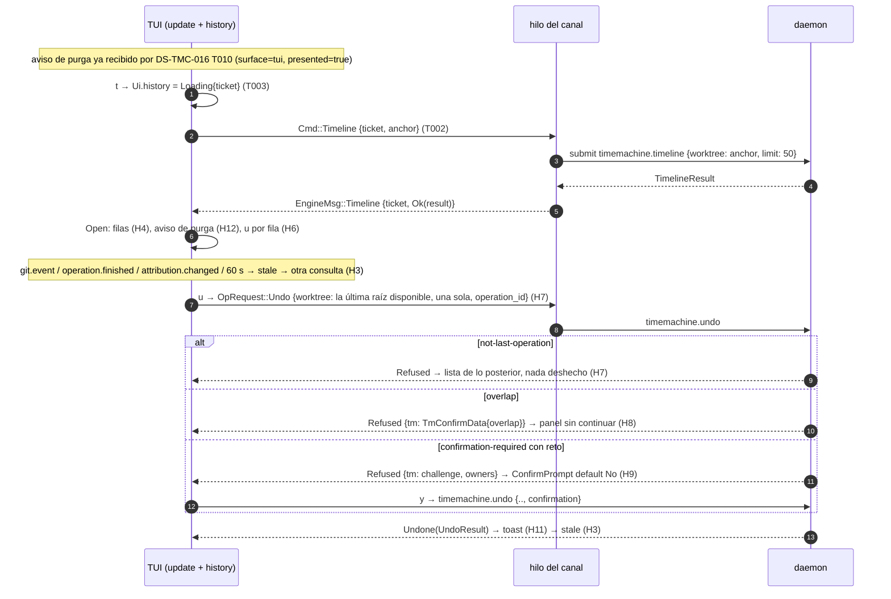

# DS-US-CKP-021 · Historial de operaciones y aviso de purga en la TUI

## Contexto rápido

El desarrollador pulsa `t` y la TUI abre a pantalla completa el historial del repo: cada operación y cada evento de Git, con su hora, su actor y qué hizo. Sobre una operación pulsa `u` y la deshace, pasados o no los 5 s del toast. Si otro actor cambió después lo que Deshacer devolvería, la TUI enseña el solape y no deshace nada. Si la Time Machine tiene un aviso de purga vigente, el historial lo muestra en su línea de aviso.

La TUI solo pinta y pide; el daemon decide todo. Esta DS no añade nada al daemon ni al protocolo.

Hoy:
- `timemachine.timeline` existe y devuelve `TimelineResult` del repo entero (`crates/api/src/timemachine.rs:591`, brazo `conn.rs:3931`), con `actor`, `origin`, `protection`, `files`, `attribution` e `inferred` por entrada (`timemachine.rs:606`). `raptor timeline` lo pinta con el formato de US-TMC-023 (`apps/cli/src/commands/timeline_compact.rs`, `what` en `:478`, `who` en `:541`; commit 8e21a741).
- El widget `TimelineList` existe pero no está cableado: solo lo usan la galería y sus snapshots (`apps/cli/src/tui/widgets/timeline.rs:15-48`, `gallery/stories.rs:427-518`). Su modelo ya tiene `undoable`, `TimelineNotice::{Purge, UndoDisabled}` y las acciones al pie. La columna de actor mide 12 (`timeline.rs:48`), menos que "Tú u otro (sin atribuir)".
- `timemachine.undo` con `operation_id` responde `NOT_IMPLEMENTED` ("unassigned", `conn.rs:3770`). Lo crea DS-US-CKP-017 T004 (X9), con el motivo `not-last-operation`.
- La pila del undo mezcla operaciones del oplog y eventos de Git crudos del worktree (`oplog/stack.rs:80`, `undo.rs:416-440`): un commit posterior en el mismo worktree pasa a ser lo último de la pila.
- El solape con otro actor (`overlap`, `TmOverlap`) no existe en `main`: lo crea DS-US-TMC-012 T001. `TmConfirmData` ya trae `challenge`, `cannot_confirm` y `owners` (`timemachine.rs:306`).
- El aviso de purga no existe en `main`: `TmNoticeKind` solo tiene `Interruption` (`timemachine.rs:989`). Lo crean DS-US-TMC-016 (T001, T008, T010, entrega en la TUI con `surface = tui` y `presented = true`) y DS-US-TMC-022 (T008, causas tope y cuota).
- La TUI no tiene consultas bajo demanda (`LinkCmd`, `client/mod.rs:128`: sin `submit`) ni flujo de escritura (`Cmd`, `model.rs:572`). Los crean DS-US-CKP-012 (D13, `Link::submit`, `Incoming::Reply`) y DS-US-CKP-014 (I10, `OpRequest`/`OpReply`; T007, `tui/undo.rs`).
- Un cliente pide en `connection.accept` toda capacidad posterior al 9 que conoce (`crates/api/src/client/mod.rs:379`): la TUI recibe `timemachine.confirmation`, `timemachine.timeline-inferred` y, cuando existan, `timemachine.overlap`, `timemachine.purge-notices` y `timemachine.disk-limit` sin código propio.

Sin `architecture-constitution.md` en la cascada: rigen [AGENTS.md](../../../../../AGENTS.md) y los ADR citados (NFR-01, NFR-02, SEC-12, ADR-GRP-016), como en las Dev Specs hermanas. Ninguna tarea los viola.

### Decisiones

Se reutiliza sin repetir: la consulta bajo demanda con ticket de DS-012 (D13, D14), el flujo de escritura y `OpRequest::Undo` de DS-014 (I10, I12), el selector `operation_id` de DS-017 (X9), el solape de DS-TMC-012 (D8, D-TMC-27) y la entrega del aviso de purga de DS-TMC-016 (D7, D8, D12) y DS-TMC-022 (D6).

| ID | Decisión | Por qué / descartado |
|----|----------|----------------------|
| H1 | **Vista a pantalla completa con `t`.** `t` la abre y la cierra; `Esc` la cierra; `↑`/`↓` (`k`/`j`) mueven el cursor; `u` deshace la entrada del cursor; `q` sale, como en las demás vistas. En la ayuda `?`: "t historial" / "t history". Teclas ocupadas (lista común del cockpit): `a`, `c` (DS-016), `d` (DS-012), `D` (DS-017), `e` (DS-013), `m`, `o`/`u` (DS-014), `r`, `t` (esta DS), `w` (DS-018), `x` (DS-019), `?`; además `f` (DS-002), `g` (DS-022), `b` (DS-015), `y`/`s`, `n` y `q` | ADR-CKP-003 § 7: el detalle pasa a pantalla completa bajo demanda, como el diff (DS-012 D12) y el grafo (DS-022 D11). Descartado un panel lateral: a 80×24 no cabe hora, actor y qué junto a la flota. **Decisión del orquestador (2026-10-28), validada por Arquitecto y PO (revisión, con cambios)** |
| H2 | **Una sola fuente: `timemachine.timeline` del repo entero.** Parámetros: `worktree` = raíz del worktree principal si es una fila disponible, si no la de la primera fila disponible (`WorktreeRow.root`, DS-012 D14); `limit` = 50 (`TIMELINE_DEFAULT_LIMIT`); sin `only_worktree`, `since` ni `agent`. Se pide con `Link::submit` y ticket (DS-012 D13). Sin `query.cancel`: el método responde en el brazo del canal, acotado a 50 entradas, y una respuesta de un ticket viejo se descarta | Es el contrato de US-TMC-006 que ya usa la CLI; la TUI no reconstruye el timeline (ADR-CKP-003 § 2: "ningún campo se calcula desde Git"). Descartado pasar el timeline por el `QueryPool` de DS-012: cambiaría el daemon para una respuesta que ya es corta. **Decisión del orquestador (2026-10-28), validada por Arquitecto y PO** |
| H3 | **En vivo por re-consulta.** Con la vista abierta, se marca desactualizada con un `git.event`, un `operation.finished` o un `attribution.changed` del repo, con un `resync`, con la respuesta de un Deshacer propio y, sin ninguno de esos, cada 60 s mientras está abierta (refresco lento). Una vista desactualizada vuelve a pedir: una petición en vuelo como máximo y ⚠️ **ASSUMPTION** 1 s como mínimo entre dos. El cursor guarda el `id` de la entrada (`operation:<id>` o `event:<seq>`) y sobrevive al refresco; si su entrada desaparece, pasa a la más cercana | Mismo patrón que DS-022 D9. Un undo, un restore o un merge mueven refs o archivos, y el motor los publica como `git.event` (el eco de ADR-TMC-003, Enmienda 2026-10-06). Lo que no llega así (un snapshot manual, un punto purgado) aparece en el siguiente refresco, como tarde a los 60 s. Con la re-consulta y el refresco lento, DEP-CKP-5 queda cerrado en el MVP sin evento propio (Q-CKP-60, cerrada). **Decisión del orquestador (2026-10-28), validada por Arquitecto y PO (revisión, con cambios)** |
| H4 | **Cómo se pinta una entrada.** La más reciente arriba. Hora local de la entrada (`utc_offset_s`): `HH:MM` si es de hoy, si no `dd mmm` (`Model.now`, nunca el reloj en `view`). Actor según BR-CKP-CONS-003: un agente con su nombre declarado o, sin él, con el nombre de su tipo (la misma regla que la flota, `view.rs:430`); `unattributed` siempre "Tú u otro (sin atribuir)", también con `inferred` (es una pista, no cambia el actor) y sin detección de agentes. Sin color de agente: `Actor` no lleva la sesión. Qué: las mismas palabras que `raptor timeline` (`what`, `timeline_compact.rs:478`), con los subtipos del catálogo legibles (`merge-into-base` → "integración", `discard-worktree` → "descarte", `rebase-onto-base` → "rebase") y las carpetas de `worktrees`. Sufijo "(aplicándose)" o "(interrumpida)" por `state`, y "deshecha" si una entrada `undo` posterior la nombra en `acted_on` sin un `redo` después | El texto de la CLI es el contrato visible de US-TMC-023; la TUI tiene su propio catálogo tipado (ADR-CKP-003 § 10), así que un test de paridad compara las dos. **Decisión del orquestador (2026-10-28), validada por Arquitecto y PO** |
| H5 | **La columna de actor se ajusta.** `TimelineModel::render` mide el actor más largo de las filas visibles y usa ese ancho, entre 12 y 26 columnas. El resto es para el qué | "Tú u otro (sin atribuir)" mide 24; cortarlo rompe BR-CKP-CONS-003. Descartado un campo nuevo en `TimelineModel`: rompería los literales de la galería sin ganar nada. **Decisión del orquestador (2026-10-28), validada por Arquitecto y PO** |
| H6 | **Qué se ofrece deshacer.** Solo entradas `operation` de tipo `protected` o `restore`, en estado `finished` o `interrupted`, con punto (nivel distinto de `none` y de `purged`) y no deshechas (H4). Un evento de Git crudo, un snapshot manual, un `undo` o un `redo` salen con `u` desactivado y su motivo. Una entrada `protected` con subtipo `create-worktree` también, con "se deshace descartando el worktree: D en su fila" / "undo it by discarding the worktree: D on its row" (Q-CKP-58: su Deshacer vale solo en el panel de resultado de DS-018 y lanza `discard-worktree`). El daemon revalida todo | Un `timemachine.undo` sin `operation_id` deshace lo último de la pila, sea lo que sea: con un historial desactualizado deshará otra cosa (NFR-01). Para un evento crudo no hay selector (X9 solo acepta operaciones del oplog). Un `undo` nunca es `last_operation()` (`stack.rs:63-66`). Q-CKP-59 cerrada: fuera del MVP. **Decisión del orquestador (2026-10-28), validada por Arquitecto y PO (revisión, con cambios)** |
| H7 | **Qué worktree se nombra al deshacer: una sola raíz.** `timemachine.undo {worktree, operation_id}` por `OpRequest::Undo` de DS-014, con la **última** raíz de `entry.worktrees` que sea una fila disponible (como el Deshacer del toast, DS-014 I12). Si ninguna está disponible y el subtipo es `discard-worktree`, se nombra la del worktree principal o, si el repo es *bare*, la del primer worktree disponible (X9 de DS-017). Con `not-last-operation` la TUI no deshace, no prueba otra raíz y lista hasta 3 entradas posteriores del historial cargado que comparten worktree: "No se deshizo nada: hay trabajo posterior (commit en main de claude-3 a las 10:12). Revisa ese trabajo antes; `raptor undo` en esa carpeta deshace lo más reciente" / "Nothing was undone: there is later work (commit on main by claude-3 at 10:12). Review it first; `raptor undo` in that folder undoes the most recent change" | El orden del ámbito es el del oplog (`timeline.rs:458`): en un merge, [destino, agente] (DS-014 T003). La última raíz es el worktree del agente, así que el commit posterior de otro actor sobre la base llega como `overlap` (DS-TMC-012 D3, ramas). Descartado probar varias raíces (versión inicial): la pila se elegiría según lo que responda el daemon, fuera de la regla de X9. **Decisión del orquestador (2026-10-28), validada por Arquitecto y PO (revisión, con cambios)** |
| H8 | **Solape.** `overlap` con `TmOverlap` → panel que dice "No se deshizo nada" y lista hasta 5 conflictos (rama o ruta, carpeta, actor, hora en que se vio) más "y N más" con `total`, y termina con "revisa el trabajo de claude-3 o habla con quien lo hizo" / "review claude-3's work or talk to whoever did it". Solo se cierra con `Esc`: no hay opción de continuar. `overlap-unverified` → "No se pudo comprobar si alguien cambió algo después; no se deshizo nada" | D-TMC-27 (DS-TMC-012): tras un solape no se continúa y el repo no cambia; el desarrollador decide fuera del Deshacer. Es el "sin su decisión" del escenario 3. **Decisión del orquestador (2026-10-28), validada por Arquitecto y PO (revisión, con cambios)** |
| H9 | **Confirmación de trabajo de un agente** (ADR-TMC-005 § 3, US-TMC-013). `confirmation-required` con `challenge` → `ConfirmPrompt` con default No que nombra a los `owners`: "Deshacer devuelve trabajo de claude-1. ¿Deshacer igualmente? [y/N]". `y` repite la petición con `confirmation` en la misma conexión, con la misma raíz. Con `cannot_confirm` → el motivo y "usa `raptor undo` en tu terminal". `confirmation-unavailable` → su texto. `challenge-invalid` (caducó, o hubo reconexión) → "La confirmación caducó; pulsa `u` otra vez" | La TUI corre en la terminal de la persona, así que puede recibir el reto. ADR-CKP-003 § 2 lista la "confirmación de trabajo ajeno" entre los flujos de la TUI, y DS-014 I12 la dejaba fuera del toast. Pide dos enmiendas aditivas a DS-014 (§ Enmiendas). **Decisión del orquestador (2026-10-28), validada por Arquitecto y PO** |
| H10 | **Una escritura a la vez por TUI.** `u` del historial sale desactivado ("hay otra acción en curso") si `Ui.write` (DS-014) no está en `Idle` o hay un Deshacer del historial pendiente. Con el historial abierto, `u` actúa sobre la entrada del cursor y el toast no ofrece su `u`. Así la respuesta `EngineMsg::Operation(OpReply::Undone | Refused)` tiene un único dueño | `OpReply` no lleva correlación. Descartado añadir un ticket a `OpRequest`: es un cambio de DS-014 sin necesidad, porque el canal de la TUI ya es serie. **Decisión del orquestador (2026-10-28), validada por Arquitecto y PO** |
| H11 | **Resultado del Deshacer.** Sin UI optimista (ADR-CKP-003 § 2): la entrada muestra "deshaciendo…" hasta la respuesta. `UndoResult` → toast de éxito "Deshecho: integración en main" más, si los hay, "se conservaron N rutas cambiadas por otros" (`kept`, DS-TMC-012), "N rutas no se restauraron" (`not_restored`) y los `warnings`. Después, el historial se marca desactualizado (H3) | Lo que el undo dejó intacto se dice siempre (NFR-01: nada se pierde sin decirlo). **Decisión del orquestador (2026-10-28), validada por Arquitecto y PO** |
| H12 | **El aviso de purga se pinta, no se pide.** Esta DS no llama a `timemachine.notices` ni marca nada como visto: eso es de DS-TMC-016 T010 (`surface = tui`, `presented = true`, al conectar y en cada refresco) y de DS-TMC-022 T008 (tope y cuota). Los avisos de purga recibidos se guardan en el modelo hasta que pasa su `purge_from_utc_ms`, y el historial muestra el más próximo en `TimelineNotice::Purge` con el mismo texto que su toast. Si T010 no los guarda, esta DS añade `EngineReplica.purge_notices` (T007) | El brief y BR-CKP-TIME-004: la TUI presenta lo que publica la Time Machine; la regla "visto + 24 h" la aplica el daemon. Descartado volver a pedir los avisos al abrir el historial: un aviso se entrega una vez y la segunda llamada no lo trae. ⚠️ **ASSUMPTION**: un aviso deja de mostrarse cuando pasa su `purge_from_utc_ms`. **Decisión del orquestador (2026-10-28), validada por Arquitecto y PO** |
| H13 | **Texto del aviso en la TUI**, compacto y con fecha relativa: "{count} snapshots de más de {days} días se purgarán a partir de {when}", con `when` = "hoy a las HH:MM", "mañana a las HH:MM" o "el dd mmm a las HH:MM"; en inglés "{count} snapshots older than {days} days will be purged from {when}", con "today at HH:MM", "tomorrow at HH:MM" u "on dd mmm at HH:MM". Es la forma del escenario 4 (literal cambiado por el PO en la historia, 2026-10-28), en una línea de 80 columnas. El rango y el tamaño se quedan en la CLI (`tm-notice.purge-age`) | La clave de la CLI ("del {when}") no admite "mañana" y no cabe en una línea. Pide una enmienda a DS-TMC-016 T010 (§ Enmiendas). Las causas tope y cuota usan los textos que fije DS-TMC-022 T008 con la misma fecha relativa. **Decisión del orquestador (2026-10-28), validada por Arquitecto y PO (revisión, con cambios)** |
| H14 | **Lo que falta se dice.** El título lleva "50 más recientes" si `truncated`, "sin eventos de Git: no se pudieron leer" u "sin operaciones: no se pudieron leer" por cada `unavailable`, y "detección de agentes no disponible" si `detection_available = false`. Un historial vacío con una fuente caída nunca dice "sin actividad" | Contrato de US-TMC-006 (`TimelineSource`: "never reported as no activity"). **Decisión del orquestador (2026-10-28), validada por Arquitecto y PO** |
| H15 | **Motor viejo.** Sin `timemachine.timeline` en la conexión (`link.offers`) → nota "el motor no ofrece el historial; reinícialo" y nada se abre. `NOT_IMPLEMENTED` en `timemachine.undo` con `operation_id` → "este motor no deshace desde el historial; actualízalo" | Mismo trato que el diff con un motor sin `diff.worktree` (DS-012 T006). **Decisión del orquestador (2026-10-28), validada por Arquitecto y PO** |

## ⚠️ Gaps y violaciones de la constitución

| ID | Qué falta | Severidad | Alcance | Acción | Owner |
|----|-----------|-----------|---------|--------|-------|
| G1 | **Dependencias de orden en la TUI y el canal**: `Link::submit`, `Incoming::Reply`, tabla `ticket → id` y `WorktreeRow.root` (DS-012 T004, T005, D14); `OpRequest`/`OpReply`, `LinkCmd::Operation`, `Ui.write` y `tui/undo.rs` (DS-014 T005, T007); selector `operation_id` y `not-last-operation` (DS-017 T004). Nada de eso está en `main` (comprobado en `origin/main` el 2026-10-28) | Bloqueante | T001 a T006 | Mezclar antes DS-012 T004/T005, DS-014 T005/T007 y DS-017 T004 | Orquestador |
| G2 | **Solape**: `overlap`, `overlap-unverified`, `TmOverlap` y `timemachine.overlap` los crea DS-US-TMC-012 T001 a T005; no están en `main` | Bloqueante | T006 (escenario 3) | Mezclar DS-TMC-012 antes de T006 | Orquestador |
| G3 | **Aviso de purga**: `TmNoticeKind::Purge`, `PurgeNoticeView`, `timemachine.purge-notices` y su entrega en la TUI son de DS-US-TMC-016 T001, T008 y T010; el aviso real necesita su T007 (módulo de la pasada). Nada está en `main` | Bloqueante | T007 (escenario 4) | Mezclar DS-TMC-016 T001, T007, T008 y T010 antes de T007 | Orquestador |
| G4 | **DEP-CKP-5**: sin evento propio de timeline en vivo. Cerrado en el MVP con la re-consulta y el refresco lento de H3 (Q-CKP-60, cerrada); la enmienda a ADR-TMC-003 lo registra | Informativo | — | Enmienda a ADR-TMC-003 (§ Enmiendas) | Orquestador |
| G5 | G1 de DS-US-CKP-014 (avisos de interrupción de `timemachine.notices` tras un Deshacer, US-TMC-019) aplica igual al Deshacer del historial | Bloquea liberación | — | Cerrar con US-TMC-019 | Orquestador |

Ninguna violación: sin constitución, ver Contexto rápido.

## 🔭 La forma



Estados de `Ui.history` (ADR-CKP-003 § 2, sin estados imposibles):

```
Cerrado → Cargando(ticket) → Abierto{resultado, cursor, desactualizado, deshacer}
deshacer: Inactivo → Pidiendo{entrada, raíz, token?} → Confirmando{reto, dueños}
          → Pidiendo{.., token} → Hecho | Solape(TmOverlap) | Posterior(entradas) | Rechazado(motivo)
```

---

## 🚀 Plan de implementación

### El trabajo de un vistazo

| # | Tarea | Depende | Aterriza en |
|---|---|---|---|
| T001 | Escribir en rojo los tests de contrato | G1 | `apps/cli/tests/tui_history.rs`, stubs |
| T002 | Cablear la consulta del historial en el canal y el modelo | T001 | `apps/cli/src/client/mod.rs`, `model.rs`, `tui/app.rs` |
| T003 | Crear el estado y las reglas puras del historial | T002 | `apps/cli/src/tui/history.rs` |
| T004 | Crear los textos del historial | T003 | `apps/cli/src/present/history_text.rs`, `tui/view.rs` (1 visibilidad) |
| T005 | Pintar la vista, la tecla y la ayuda | T003, T004 | `tui/{view,update,keymap,help,mod}.rs`, `tui/widgets/timeline.rs`, `tui/gallery/stories.rs` |
| T006 | Deshacer desde el historial | T005, G2 | `tui/history.rs`, `tui/write_flow.rs`, `client/mod.rs` |
| T007 | Pintar el aviso de purga en el historial | T005, G3 | `tui/history.rs`, `model.rs` (si falta) |
| T008 | Cerrar la historia | T001–T007 | `docs` |

T006 y T007 van en paralelo una vez está T005.

### T001 — Escribir en rojo los tests de contrato

**Objetivo.** Los cuatro escenarios de la historia, en rojo, contra la `App` real sobre `TestBackend` y el daemon en proceso con repos y perfil temporales.

**Ubicación.**
- `apps/cli/tests/tui_history.rs` (**CREATE**): arnés de `apps/cli/tests/live_fleet.rs` (`#![cfg(all(target_os = "macos", debug_assertions))]`, `gitraptor_testkit::Fixture`, `raptor-fake-agent` con nombres declarados "claude-2" y "claude-3").
- Stubs que compilan (`todo!()`) en los archivos de T002 a T007.

**Reglas**
- Los tests rojos van en su archivo y no se editan durante la implementación (R4 de `/implement`).
- Nunca este repo ni el perfil real (NFR-01).
- El escenario 4 necesita puntos de más de 30 días: se anuncian con el reloj inyectable de la pasada de DS-TMC-016 (T007 de esa DS), nunca tocando fechas del sistema.

- **Depende:** G1
- **Refs:** US-CKP-021 escenarios 1 a 4; § 9.4
- **Aceptación:** `cargo test -p gitraptor-cli --test tui_history` compila y falla por "no implementado"

### T002 — Cablear la consulta del historial en el canal y el modelo

**Objetivo.** La TUI puede pedir el timeline sin bloquear el bucle y recibe la respuesta con su ticket.

**Ubicación.**
- `apps/cli/src/client/mod.rs` (**MODIFY**): `LinkCmd::Timeline { ticket: u64, anchor: PathBuf }` junto a `LinkCmd::Diff` (DS-012 T005). El hilo llama a `link.submit(TM_TIMELINE, TimelineParams { worktree: Some(anchor), limit: Some(TIMELINE_DEFAULT_LIMIT), .. })`, guarda `ticket → id` y entrega `EngineMsg::Timeline { ticket, result }`. Al empezar la sesión, `ConnEvent::Timeline(link.offers(TM_TIMELINE))`. Una reconexión entrega `Err(TimelineFailure::Lost)` por cada ticket en vuelo.
- `apps/cli/src/model.rs` (**MODIFY**): `Cmd::Timeline { ticket, anchor }`, `EngineMsg::Timeline { ticket, result: Result<Box<TimelineResult>, TimelineFailure> }`, `ConnEvent::Timeline(bool)`, `EngineReplica.timeline: bool`, `Ui.history: HistoryState` (por defecto `Closed`), `Notice::TimelineUnsupported`.
- `apps/cli/src/tui/app.rs` (**MODIFY**): `Cmd::Timeline` → `LinkCmd::Timeline`.

**Reglas**
- `TimelineFailure { Lost, Refused(i64), Failed }`: el código del error del canal, nunca su `message`.
- `TimelineParams` se arma con `..Default`-equivalente explícito: `only_worktree: None` y `short_ids: false` no viajan (un daemon viejo rechaza campos desconocidos, `timemachine.rs:556-575`).

- **Depende:** T001, G1
- **Refs:** H2, H15; DS-012 D13, T005
- **Aceptación:** `client::tests::timeline_reply_reaches_its_ticket`, `client::tests::a_reconnection_loses_the_timeline_in_flight`

### T003 — Crear el estado y las reglas puras del historial

**Objetivo.** Todo lo que decide la TUI, como funciones puras sobre el modelo y probadas sin pantalla.

**Ubicación.** `apps/cli/src/tui/history.rs` (**CREATE**), una línea en `tui/mod.rs`.

**Reglas**
- `open(model) -> Vec<Cmd>`: motor sin timeline → `Notice::TimelineUnsupported` y ningún `Cmd` (H15); si no, `Loading { ticket }` y `Cmd::Timeline` con el ancla de H2. Sin ninguna fila disponible → nota "no hay ningún worktree disponible" y nada se pide.
- `apply_reply(model, ticket, result)`: un ticket que no es el vigente se descarta. Conserva el cursor por `id` (H3).
- `mark_stale(model, event)`: solo con la vista abierta y solo para `git.event`, `operation.finished` y `attribution.changed` del repo mostrado, y `resync` (H3). `tick(now)`: marca desactualizada la vista abierta cada 60 s; si está desactualizada, no hay petición en vuelo y pasó el intervalo de 1 s, otra consulta.
- `undo_eligibility(entry, ctx) -> Eligibility`, con el `Eligibility` de DS-014 T004. Orden (el primero que falla manda): fuera de "En vivo" → `NotLive`; no es una operación `protected`/`restore` → `NotUndoable(kind)`; subtipo `create-worktree` → `CreatedWorktree` (H6, Q-CKP-58); `applying` → `Applying`; deshecha → `AlreadyUndone`; nivel `none` → `NoPoint`; nivel `purged` → `Purged`; una operación de Git en curso en alguna fila de sus worktrees → `GitInProgress` (BR-CKP-EDGE-002); `Ui.write` no `Idle` o Deshacer pendiente → `Busy` (H10).
- `undo_root(entry, rows, main) -> Option<PathBuf>`: la única raíz de H7.
- `undone(entries) -> BTreeSet<String>`: operaciones deshechas según `acted_on` de `undo` y `redo` (H4).
- `later_work(entries, entry) -> Vec<&TimelineEntry>`: hasta 3 entradas posteriores que comparten worktree (H7).
- Sin texto: devuelve códigos.

- **Depende:** T002
- **Refs:** H2, H3, H6, H7, H10
- **Aceptación:** `cargo test -p gitraptor-cli --lib tui::history`: un test por regla de elegibilidad, uno del orden, `the_last_available_root_is_named`, `a_discard_names_the_main_worktree`, `a_discard_in_a_bare_repo_names_the_first_available`, `a_create_worktree_entry_is_not_undone`, `an_old_ticket_is_dropped`, `the_cursor_follows_its_entry_after_a_refresh`, `stale_only_on_the_three_events_of_this_repo`, `stale_every_60_s_while_open`

### T004 — Crear los textos del historial

**Objetivo.** Todo lo que el historial dice, en/es, con el catálogo tipado de la TUI.

**Ubicación.**
- `apps/cli/src/present/history_text.rs` (**CREATE**), una línea en `present/mod.rs`: `HistoryText` con un `match` exhaustivo por idioma (ADR-CKP-003 § 10), igual que `present/discard_text.rs` de DS-017.
- `apps/cli/src/tui/view.rs` (**MODIFY**, 1 línea): `kind_name` (`:437`) pasa a `pub(crate)` para nombrar un actor sin nombre declarado igual que la flota.

**Reglas**
- `actor_text(&Actor)`: H4. Nunca "humano".
- `what_text(&EntryOrigin, &[Untrusted])`: H4. Todo lo que viene del repo (subtipo, rama, etiqueta, carpetas) pasa por `SafeText` (SEC-12).
- `when_text(utc_ms, offset_s, now_ms)`: H4. `relative_day(utc_ms, now_ms)` para H13.
- Ayuda: "t historial" / "t history". Motivos de `undo_eligibility` (con el de `create-worktree` de H6), de `TmRejectReason` (incluidos `overlap`, `overlap-unverified`, `not-last-operation`, `confirmation-unavailable`, `challenge-invalid`), de `cannot_confirm` (`RefusalReason`), títulos de H14 y textos de H7 a H11.
- Paridad: `history_wording_matches_raptor_timeline` compara, en en y es, las etiquetas de operación, evento y "Tú u otro" con `apps/cli/i18n/{en,es}/timemachine.txt` leídas con `Tr`.

- **Depende:** T003
- **Refs:** H4, H7, H8, H9, H11, H13, H14; BR-CKP-CONS-003
- **Aceptación:** `cargo test -p gitraptor-cli --lib present::history_text`: un test por motivo y por idioma, la paridad y `unattributed_is_never_human`

### T005 — Pintar la vista, la tecla y la ayuda

**Objetivo.** `t` abre el historial a pantalla completa con sus filas, su aviso y sus acciones.

**Ubicación.**
- `apps/cli/src/tui/keymap.rs` (**MODIFY**): `Action::History` con `Key::Char('t')`, fila en `BINDINGS` (alimenta la ayuda `?` y `KeyHints`).
- `apps/cli/src/tui/update.rs` (**MODIFY**): `Action::History` → `history::open` o `history::close`; con la vista abierta, `Up`/`Down`/`Esc`/`History`/`Undo` van a `history`; `EngineMsg::Timeline` a `history::apply_reply`; `EngineMsg::{Event, Snapshot}` del repo a `history::mark_stale`; `Msg::Tick` a `history::tick`.
- `apps/cli/src/tui/view.rs` (**MODIFY**): con `Ui.history` abierta, el cuerpo es un `TimelineModel` construido por `history::timeline_model(&Model) -> TimelineModel` (en `history.rs`), con `undoable` = `undo_eligibility` ofrecida y la acción `u Deshacer`, desactivada con su motivo (`KeyHint::disabled`, `key_hints.rs:33`) para la fila del cursor.
- `apps/cli/src/tui/widgets/timeline.rs` (**MODIFY**): ancho del actor de H5 dentro de `render`.
- `apps/cli/src/tui/gallery/stories.rs` (**MODIFY**): historia `TimelineList` "long actor" para el snapshot de H5.

**Reglas**
- 80×24: cabecera de una línea, panel con título (H14), filas, línea de aviso y línea de acciones; `KeyHints` abajo. Por debajo de 80×24, el mensaje de tamaño mínimo de siempre.
- Mientras carga, el panel dice "cargando el historial…"; vacío y sin fuentes caídas, "sin actividad en este repo".
- La vista nunca lee el reloj (`Model.now`).

- **Depende:** T003, T004
- **Refs:** H1, H4, H5, H14; ADR-CKP-003 § 7; DSYS-GRP-001 (TimelineList)
- **Aceptación:** snapshots en `apps/cli/src/tui/snapshots/` (vista con entradas, vacía, cargando, fuente caída, actor largo; en y es); `a11y_tests` sin regresión; `keymap::tests::t_opens_the_history`

### T006 — Deshacer desde el historial

**Objetivo.** `u` sobre una entrada la deshace, se detiene ante un solape y pide la confirmación cuando la Time Machine la exige.

**Ubicación.**
- `apps/cli/src/tui/history.rs` (**MODIFY**): `HistoryUndo` y sus transiciones; `on_reply(model, OpReply)`.
- `apps/cli/src/tui/write_flow.rs` (**MODIFY**, de DS-014): `OpRequest::Undo` gana `confirmation: Option<ConfirmationToken>`; `RefusalView` gana `tm: Option<Box<TmConfirmData>>`, el `data` de un rechazo de la Time Machine leído como `TmConfirmData` (superconjunto de `TmRejectedData`, `timemachine.rs:300-306`). Ver § Enmiendas.
- `apps/cli/src/client/mod.rs` (**MODIFY**): el brazo de `OpRequest::Undo` pasa `confirmation` a `UndoParams` y rellena `RefusalView.tm`.

**Reglas**
- `u` con la elegibilidad ofrecida → `Pidiendo { entrada, raíz: undo_root(..), token: None }` y `Cmd::Operation(OpRequest::Undo { worktree: raíz, operation_id, confirmation: None })`.
- `not-last-operation` → `Posterior(later_work(..))`, sin probar otra raíz (H7).
- `overlap` → `Solape(TmOverlap)`; `overlap-unverified` → `Rechazado` (H8). Ninguno ofrece continuar.
- `confirmation-required` con `challenge` → `Confirmando` sobre `ConfirmModel` (`widgets/confirm.rs:22`) con `Choice` por defecto No; `y` → misma raíz con `confirmation`; `n`, `Esc` o `Intro` → `Inactivo`, sin petición. Sin `challenge` → `Rechazado` con `cannot_confirm` (H9).
- `Undone(UndoResult)` → toast (H11), `Inactivo`, vista desactualizada.
- El token nunca entra en un `Debug` ni en un log (`TmChallenge` ya lo oculta, `timemachine.rs:291`) y se olvida al salir de `Confirmando` o al reconectar.

- **Depende:** T005, G2
- **Refs:** H6 a H11; ADR-TMC-005 § 3; DS-014 I12; DS-017 X9; DS-TMC-012 D8
- **Aceptación:** escenarios 2 y 3 de § 9.4; `history::tests::{not_last_on_the_named_root_tries_no_other_root, overlap_offers_no_way_to_continue, confirmation_defaults_to_no, a_stale_challenge_asks_to_press_u_again, the_token_never_reaches_debug}`

### T007 — Pintar el aviso de purga en el historial

**Objetivo.** El historial muestra el aviso de purga vigente que la TUI ya recibió.

**Ubicación.** `apps/cli/src/tui/history.rs` (**MODIFY**); `apps/cli/src/model.rs` (**MODIFY**, solo si DS-TMC-016 T010 no guarda los avisos: `EngineReplica.purge_notices: Vec<PurgeNoticeView>`, rellenado donde T010 recibe `timemachine.notices`).

**Reglas**
- Ninguna llamada a `timemachine.notices` y ningún `presented` desde esta tarea (H12).
- `TimelineNotice::Purge` con el aviso de `purge_from_utc_ms` más próximo que aún no pasó, con el texto de H13 (el mismo `Text` que pinta el toast de T010).
- Un aviso de tope o de cuota (DS-TMC-022) se muestra igual, con su texto.

- **Depende:** T005, G3
- **Refs:** H12, H13; BR-CKP-TIME-004; DS-TMC-016 D7, D8, D12, T010; DS-TMC-022 T008
- **Aceptación:** escenario 4 de § 9.4; `history::tests::{the_nearest_purge_notice_is_shown, an_expired_notice_is_not_shown, opening_the_history_never_calls_notices}`

### T008 — Cerrar la historia

**Objetivo.** La historia queda implementada, verificada y enlazada.

**Ubicación.** `docs/requirements/features/cockpit/user-stories/US-CKP-021-historial-aviso-purga.md` (**MODIFY**) y esta DS (**MODIFY**).

**Reglas**
- La historia pasa a `implemented` y enlaza el PR; esta DS añade `## Estado de la implementación`.
- Las [Enmiendas que implica](#enmiendas-que-implica) se aplican en el mismo PR o quedan anotadas en él.

- **Depende:** T001 a T007
- **Refs:** AGENTS.md (reglas de calidad); Enmiendas que implica
- **Aceptación:** `cargo clippy --workspace` y `node tools/test/nextest-junit.mjs` en verde

---

## Estructura de ficheros

| Archivo | Acción | Tarea |
|---|---|---|
| `apps/cli/tests/tui_history.rs` | CREATE | T001 |
| `apps/cli/src/client/mod.rs` | MODIFY (`LinkCmd::Timeline`; `confirmation` y `RefusalView.tm` del undo) | T002, T006 |
| `apps/cli/src/model.rs` | MODIFY (`Cmd`, `EngineMsg`, `ConnEvent`, `EngineReplica.timeline`, `Ui.history`, `Notice`; `purge_notices` si falta) | T002, T007 |
| `apps/cli/src/tui/app.rs` | MODIFY (1 brazo) | T002 |
| `apps/cli/src/tui/history.rs`, `apps/cli/src/tui/mod.rs` | CREATE, MODIFY (1 línea) | T003, T006, T007 |
| `apps/cli/src/present/history_text.rs`, `apps/cli/src/present/mod.rs` | CREATE, MODIFY (1 línea) | T004 |
| `apps/cli/src/tui/view.rs` | MODIFY (`kind_name` visible; cuerpo del historial) | T004, T005 |
| `apps/cli/src/tui/{update,keymap,help}.rs` | MODIFY | T005 |
| `apps/cli/src/tui/widgets/timeline.rs` | MODIFY (ancho del actor) | T005 |
| `apps/cli/src/tui/gallery/stories.rs` | MODIFY (1 historia) | T005 |
| `apps/cli/src/tui/write_flow.rs` | MODIFY (de DS-014) | T006 |

Ningún archivo de `crates/`: el daemon y el protocolo no cambian.

## Contratos compartidos

### Tipos y datos compartidos

_No aplica — esta DS no añade tipos al protocolo. Consume `TimelineResult`, `TimelineEntry`, `EntryOrigin`, `Actor`, `Protection`, `UndoParams`, `UndoResult`, `TmConfirmData` y `TmChallenge` tal como están (`crates/api/src/timemachine.rs`) y, cuando existan, `TmOverlap` (DS-TMC-012 T001), `TmRejectReason::NotLastOperation` (DS-017 T004) y `PurgeNoticeView` (DS-TMC-016 T001)._

### Ciclos de vida (DI)

- `Ui.history` vive mientras corre la TUI; se vacía al cerrar la vista y al cambiar de repo. No se persiste.
- El reto de confirmación vive solo en `HistoryUndo::Confirmando` y se descarta al salir de ese estado o al reconectar.
- Los avisos de purga del modelo los escribe quien llama a `timemachine.notices` (DS-TMC-016 T010); el historial solo los lee.

### Firmas del stack

```rust
// apps/cli/src/tui/history.rs (T003, T006, T007) — a crear
pub enum HistoryState { Closed, Loading { ticket: u64 }, Open(Box<HistoryView>) }
pub struct HistoryView { pub result: TimelineResult, pub cursor: Option<String>, pub offset: usize,
                         pub stale: bool, pub in_flight: Option<u64>, pub last_ms: i64, pub undo: HistoryUndo }
pub enum HistoryUndo {
    Idle,
    Requesting { entry: String, operation_id: String, root: PathBuf, token: Option<ConfirmationToken> },
    Confirming { entry: String, operation_id: String, root: PathBuf, challenge: TmChallenge, owners: Vec<Actor> },
    Overlap(Box<TmOverlap>),
    Later(Vec<String>),            // ids de las entradas posteriores (H7)
    Rejected(TmRejectReason, Option<RefusalReason>),
}
pub enum UndoBlock { NotLive, NotUndoable(EntryKindTag), CreatedWorktree, Applying, AlreadyUndone, NoPoint, Purged, GitInProgress, Busy }
pub fn open(model: &mut Model) -> Vec<Cmd>;
pub fn close(model: &mut Model);
pub fn apply_reply(model: &mut Model, ticket: u64, result: Result<Box<TimelineResult>, TimelineFailure>);
pub fn mark_stale(model: &mut Model, repo_id: &str, kind: &str);
pub fn tick(model: &mut Model, now_ms: i64) -> Vec<Cmd>;
pub fn undo_eligibility(entry: &TimelineEntry, ctx: &UndoCtx<'_>) -> Eligibility;
pub fn undo_root(entry: &TimelineEntry, rows: &[WorktreeRow], main: Option<&WorktreeRow>) -> Option<PathBuf>;
pub fn on_reply(model: &mut Model, reply: OpReply) -> Vec<Cmd>;
pub fn timeline_model(model: &Model) -> TimelineModel;

// apps/cli/src/tui/write_flow.rs (DS-014 T005; T006 lo amplía)
pub enum OpRequest { /* … */ Undo { worktree: PathBuf, operation_id: String, confirmation: Option<ConfirmationToken> } }
pub struct RefusalView { /* … */ pub tm: Option<Box<TmConfirmData>> }

// apps/cli/src/model.rs (T002)
pub enum TimelineFailure { Lost, Refused(i64), Failed }
```

## Contrato de API

| Método | Cambio | Uso |
|---|---|---|
| `timemachine.timeline {worktree, limit}` | Ninguno | H2 |
| `timemachine.undo {worktree, operation_id, surface: tui, confirmation?}` | Ninguno en esta DS (el selector lo crea DS-017 T004; `overlap` DS-TMC-012) | H7 a H11 |
| `timemachine.notices` | Ninguno; no lo llama esta DS | H12 (DS-TMC-016 T010) |
| Eventos `git.event`, `operation.finished`, `attribution.changed` | Ninguno | H3 |

### Forma del error y del cuerpo de respuesta

Un rechazo del undo es `-32014 OPERATION_REJECTED` con `data` = `TmConfirmData` (con `overlap` si hay `timemachine.overlap`). Un selector sin implementar es `NOT_IMPLEMENTED` (H15). No hay códigos nuevos.

### Forma de la configuración

_No aplica — sin claves nuevas; la retención y el tope son de DS-TMC-016 y DS-TMC-022._

### Valores numéricos

| Valor | Cifra | Fuente |
|---|---|---|
| Entradas pedidas | 50 | `TIMELINE_DEFAULT_LIMIT` (`timemachine.rs:546`) |
| Intervalo mínimo entre dos refrescos | 1 s | ⚠️ **ASSUMPTION** (H3) |
| Refresco lento con la vista abierta | 60 s | Revisión del Arquitecto (H3) |
| Peticiones del historial en vuelo | 1 | H3 |
| Conflictos listados en el panel de solape | 5 | Esta DS (H8); `MAX_OVERLAP_CONFLICTS` = 50 (DS-TMC-012) |
| Entradas posteriores listadas | 3 | Esta DS (H7) |
| Ancho de la columna de actor | 12 a 26 | H5 |
| Toast | 5 s | BR-CKP-WF-002 |
| Presupuesto de pintado | 100 ms p95 | ADR-CKP-003 § 6 |

## Modelo de datos

_No aplica — nada se persiste. Lo que se muestra es el oplog y el almacén de eventos que ya existen (ADR-TMC-003)._

## Estrategia de pruebas y cobertura

### 9.1 Pirámide de pruebas

| Nivel | Dónde | Qué |
|---|---|---|
| Unit | `tui/history.rs`, `present/history_text.rs`, `client/mod.rs`, `tui/keymap.rs` | Elegibilidad y su orden, raíces, estado, tickets, textos y paridad |
| E2E (TUI + daemon) | `apps/cli/tests/tui_history.rs` (macOS, debug) | Escenarios de la historia |
| Snapshots | `apps/cli/src/tui/snapshots/`, `tui/widgets/snapshots/` | Vista, panel de solape, prompt de confirmación, aviso de purga, actor largo; en/es |

### 9.2 Umbrales de cobertura

Toda regla de `undo_eligibility`, `undo_root`, `later_work`, `undone` y `mark_stale` con su test. Sin cifra de cobertura de líneas en el repo.

### 9.3 Datos de prueba

`gitraptor_testkit::Fixture`: `main` en el worktree principal; `feat-pagos` con 2 commits; agentes de `raptor-fake-agent` registrados como "claude-2" y "claude-3". Integración de `feat-pagos` desde la TUI con el flujo de DS-014. Un commit de "claude-2" con Git directo en `feat-pagos`. Para el escenario 3, un commit de "claude-3" sobre `main` tras la integración. Para el escenario 4, la pasada de DS-TMC-016 con reloj inyectado y 3 puntos de más de 30 días. Nunca este repo.

### 9.4 Comportamientos críticos verificados

| Escenario de la historia | Test |
|---|---|
| El historial muestra las operaciones con su actor | `tui_history::the_history_lists_operations_with_their_actor`: tras `t`, dos filas con hora `HH:MM`: "integración … main" con "Tú u otro (sin atribuir)" y "commit en feat-pagos" con "claude-2"; ningún "humano" |
| Deshacer desde el historial tras los 5 s | `tui_history::undo_from_the_history_after_the_toast`: integración hecha y toast vencido (reloj del modelo +10 min); `t`, cursor en la integración, `u` → `refs/heads/main` vuelve al commit anterior a la integración; toast "Deshecho"; la fila sale "deshecha" tras el refresco |
| Deshacer se detiene ante trabajo posterior de otro actor | `tui_history::later_work_of_another_actor_stops_the_undo`: integración y después commit de "claude-3" sobre `main`; `u` nombra el worktree del agente → panel con "main", "claude-3" y "revisa el trabajo de claude-3 o habla con quien lo hizo"; `main`, el índice y los archivos iguales que antes; ningún reto ni opción de continuar; `Esc` cierra y nada cambió |
| Aviso de purga visto | `tui_history::the_purge_notice_is_shown_and_seen`: 3 puntos de más de 30 días anunciados; al abrir la TUI se ve "3 snapshots de más de 30 días se purgarán a partir de mañana a las 10:00" (en es; en en, "3 snapshots older than 30 days will be purged from tomorrow at 10:00"); `first_interactive_delivery_ms` queda fijado con canal `tui`; tras `t`, la misma línea en el aviso del historial |

Además:
- `tui_history::not_last_on_the_named_root_tries_no_other_root`: integración y después commit de "claude-3" en el worktree del agente → un solo `timemachine.undo`, "No se deshizo nada: hay trabajo posterior…" con ese commit, nada deshecho.
- `tui_history::undo_of_a_discard_names_the_main_worktree` (X9 de DS-017): deshacer un `discard-worktree` desde el historial nombra la raíz del principal y recrea el worktree.
- `tui_history::a_create_worktree_entry_is_not_undone_from_the_history` (Q-CKP-58): `u` desactivado con "se deshace descartando el worktree: D en su fila"; ningún `timemachine.undo`.
- `tui_history::the_history_refreshes_every_60_s_while_open` (H3, reloj del modelo).
- `tui_history::an_agent_undo_asks_for_confirmation_with_default_no`: deshacer una operación de "claude-2" → prompt con "claude-2"; `Intro` → nada cambia; `u` y `y` → deshecha.
- `tui_history::git_events_are_not_undone_from_the_history`: `u` sobre un commit sale desactivado con su motivo y no envía nada.
- `tui_history::a_git_operation_in_progress_disables_undo` (BR-CKP-EDGE-002).
- `tui_history::the_history_refreshes_on_a_new_commit` (H3), sin una segunda petición en vuelo.
- `tui_history::an_old_engine_says_it_cannot`: daemon sin `timemachine.timeline` → nota y nada abierto.
- `tui_history::a_source_that_failed_is_never_no_activity` (H14).

### 9.5 Plataformas

Se ejecuta en macOS. Linux y Windows: **Pendiente: etapa de validación multiplataforma** ([`xplat-pendientes.md`](../../../../architecture/xplat-pendientes.md), XP-59). En Windows el canal todavía no tiene transporte (DS-TS-GRP-004 § 5), así que la TUI no conecta; cuando lo tenga, confirmar trabajo de otro agente responde `confirmation-unavailable` (BR-TMC-AUTH-001) y H9 lo dice así.

## Gate de seguridad

- [ ] **NFR-01**: la TUI nunca escribe en el repo; todo Deshacer va por `timemachine.undo` con su previo. Un solape, un `not-last-operation` o una confirmación negada dejan el repo igual.
- [ ] **Sin deshacer a ciegas**: nunca `timemachine.undo` sin `operation_id` desde el historial (H6).
- [ ] **Confirmación**: default No; el token nunca entra en `Debug` ni en un log y no sobrevive a una reconexión.
- [ ] **NFR-02**: ningún proceso hijo ni `git` desde la TUI.
- [ ] **Texto no confiable (SEC-12)**: subtipos, ramas, rutas, carpetas, nombres de agente y etiquetas por `Untrusted`/`UntrustedName` y `SafeText`.
- [ ] **Avisos de purga**: la gracia solo la arranca la entrega de DS-TMC-016 T010; abrir el historial no marca nada (H12).

## Cómo extender

- **Otro subtipo del catálogo con nombre propio** en el historial: su etiqueta en `present/history_text.rs` y su fila en el test de paridad.
- **Deshacer eventos de Git crudos desde el historial** (si Q-CKP-59 lo pide): un selector del daemon por `event:<seq>` con su capacidad, y una rama más en `undo_eligibility`.
- **Restaurar un punto desde el historial**: otra acción en `history.rs` con `timemachine.restore` y su confirmación (H9 sirve igual).
- El resto, como en [Cómo extender de DS-014](./US-CKP-014-integrar-rama-agente.md#cómo-extender).

## Enmiendas que implica

No aplicadas por esta DS; las aplica el PR de la historia o quedan anotadas en él.

- **DS-US-CKP-014 T005 (`write_flow.rs`)**: `OpRequest::Undo` gana `confirmation: Option<ConfirmationToken>` y `RefusalView` gana `tm: Option<Box<TmConfirmData>>` (H9). El toast de DS-014 sigue mandando `None` y remitiendo a `raptor undo` (I12).
- **DS-US-CKP-014 I12**: "después de los 5 s, Deshacer vive en el historial (US-CKP-021)" se concreta: el historial nombra una sola raíz, la última del ámbito que sea fila disponible, como el toast (H7), y sí ofrece la confirmación de trabajo de un agente (H9).
- **DS-US-TMC-016 T010**: (a) la TUI guarda en el modelo los avisos de purga vigentes hasta su `purge_from_utc_ms`, además del toast, para que el historial los pinte (H12); (b) el texto de la TUI es el compacto de H13, con fecha relativa.
- **DS-US-TMC-022 T008**: los textos de tope y cuota en la TUI llevan la misma fecha relativa de H13.
- **TS-CKP-005 (`TimelineList`)**: la columna de actor se ajusta entre 12 y 26 (H5).
- **ADR-TMC-003, Enmienda (2026-10-04)**: DEP-CKP-5 se cierra en el MVP sin evento propio: la TUI refresca el historial con `git.event`, `operation.finished` y `attribution.changed` y cada 60 s con la vista abierta (H3; Q-CKP-60, cerrada).
- **BR-CKP-WF-002**: "Deshacer desde el historial" = operaciones del oplog (`protected` y `restore`), no eventos de Git crudos ni `create-worktree` (H6; Q-CKP-59, Q-CKP-58).
- **US-CKP-021, escenario 4** (aplicada en la historia, cambio del PO, 2026-10-28): el literal pasa a "3 snapshots de más de 30 días se purgarán a partir de mañana a las 10:00" (H13).

## Fuera de alcance

| Qué | Dueño |
|---|---|
| Entregar el aviso de purga y marcarlo como visto | DS-US-TMC-016 T010; DS-US-TMC-022 T008 |
| Estado del disco (`TmDiskView`) y captura en pausa en la TUI | DS-US-TMC-022 T008 |
| Deshacer un evento de Git crudo desde la TUI | Fuera del MVP (Q-CKP-59) |
| Deshacer una creación de worktree desde el historial | Panel de resultado de DS-018 y `D` (Q-CKP-58) |
| Rehacer y restaurar desde la TUI | US-TMC-003, US-TMC-009 (la CLI ya los tiene) |
| Filtros del historial (por agente, por worktree, desde) | `raptor timeline` (US-TMC-006, US-TMC-007) |
| Paginar más allá de 50 entradas | `raptor timeline --limit` |
| Evento propio de timeline en vivo (DEP-CKP-5) | Después del MVP (Q-CKP-60) |

## Notas del autor

- Riesgo: con muchos agentes, 50 entradas pueden cubrir solo unos minutos. El título lo dice ("50 más recientes") y la CLI pagina; si el dogfooding lo pide, el límite sube hasta `TIMELINE_MAX_LIMIT` sin tocar el daemon.
- Riesgo: el escenario 3 depende de que el commit de "claude-3" sobre `main` llegue como `overlap` (DS-TMC-012 D3, ramas). Si llegara como `not-last-operation`, la TUI muestra igual el trabajo posterior de "claude-3" y no deshace nada (H7): el escenario se cumple por las dos vías.
- El texto del aviso (H13) dice "snapshots", como BR-CKP-TIME-004 y la historia; la CLI dice "puntos de la Time Machine". El PO se quedó con la forma de H13 y cambió el literal del escenario 4 (2026-10-28).

### Preguntas abiertas

| ID | Pregunta | Para |
|----|----------|------|
| ~~Q-CKP-59~~ | ~~¿Deshacer un evento de Git crudo (un commit de un agente) desde el historial entra en el MVP?~~ **Cerrada.** Decisión del orquestador (2026-10-28), validada por Arquitecto y PO: fuera del MVP; solo operaciones del oplog con `operation_id` (H6) | PO |
| ~~Q-CKP-60~~ | ~~DEP-CKP-5: ¿evento propio de timeline en vivo o bastan los disparadores de H3?~~ **Cerrada.** Decisión del orquestador (2026-10-28), validada por Arquitecto y PO: bastan la re-consulta y el refresco lento de 60 s en el MVP; se registra con la enmienda a ADR-TMC-003 | Arquitecto |

## Estado de la implementación`.
- Las [Enmiendas que implica](#enmiendas-que-implica) se aplican en el mismo PR o quedan anotadas en él.

- **Depende:** T001 a T007
- **Refs:** AGENTS.md (reglas de calidad); Enmiendas que implica
- **Aceptación:** `cargo clippy --workspace` y `node tools/test/nextest-junit.mjs` en verde

---

## Estructura de ficheros

| Archivo | Acción | Tarea |
|---|---|---|
| `apps/cli/tests/tui_history.rs` | CREATE | T001 |
| `apps/cli/src/client/mod.rs` | MODIFY (`LinkCmd::Timeline`; `confirmation` y `RefusalView.tm` del undo) | T002, T006 |
| `apps/cli/src/model.rs` | MODIFY (`Cmd`, `EngineMsg`, `ConnEvent`, `EngineReplica.timeline`, `Ui.history`, `Notice`; `purge_notices` si falta) | T002, T007 |
| `apps/cli/src/tui/app.rs` | MODIFY (1 brazo) | T002 |
| `apps/cli/src/tui/history.rs`, `apps/cli/src/tui/mod.rs` | CREATE, MODIFY (1 línea) | T003, T006, T007 |
| `apps/cli/src/present/history_text.rs`, `apps/cli/src/present/mod.rs` | CREATE, MODIFY (1 línea) | T004 |
| `apps/cli/src/tui/view.rs` | MODIFY (`kind_name` visible; cuerpo del historial) | T004, T005 |
| `apps/cli/src/tui/{update,keymap,help}.rs` | MODIFY | T005 |
| `apps/cli/src/tui/widgets/timeline.rs` | MODIFY (ancho del actor) | T005 |
| `apps/cli/src/tui/gallery/stories.rs` | MODIFY (1 historia) | T005 |
| `apps/cli/src/tui/write_flow.rs` | MODIFY (de DS-014) | T006 |

Ningún archivo de `crates/`: el daemon y el protocolo no cambian.

## Contratos compartidos

### Tipos y datos compartidos

_No aplica — esta DS no añade tipos al protocolo. Consume `TimelineResult`, `TimelineEntry`, `EntryOrigin`, `Actor`, `Protection`, `UndoParams`, `UndoResult`, `TmConfirmData` y `TmChallenge` tal como están (`crates/api/src/timemachine.rs`) y, cuando existan, `TmOverlap` (DS-TMC-012 T001), `TmRejectReason::NotLastOperation` (DS-017 T004) y `PurgeNoticeView` (DS-TMC-016 T001)._

### Ciclos de vida (DI)

- `Ui.history` vive mientras corre la TUI; se vacía al cerrar la vista y al cambiar de repo. No se persiste.
- El reto de confirmación vive solo en `HistoryUndo::Confirmando` y se descarta al salir de ese estado o al reconectar.
- Los avisos de purga del modelo los escribe quien llama a `timemachine.notices` (DS-TMC-016 T010); el historial solo los lee.

### Firmas del stack

```rust
// apps/cli/src/tui/history.rs (T003, T006, T007) — a crear
pub enum HistoryState { Closed, Loading { ticket: u64 }, Open(Box<HistoryView>) }
pub struct HistoryView { pub result: TimelineResult, pub cursor: Option<String>, pub offset: usize,
                         pub stale: bool, pub in_flight: Option<u64>, pub last_ms: i64, pub undo: HistoryUndo }
pub enum HistoryUndo {
    Idle,
    Requesting { entry: String, operation_id: String, root: PathBuf, token: Option<ConfirmationToken> },
    Confirming { entry: String, operation_id: String, root: PathBuf, challenge: TmChallenge, owners: Vec<Actor> },
    Overlap(Box<TmOverlap>),
    Later(Vec<String>),            // ids de las entradas posteriores (H7)
    Rejected(TmRejectReason, Option<RefusalReason>),
}
pub enum UndoBlock { NotLive, NotUndoable(EntryKindTag), CreatedWorktree, Applying, AlreadyUndone, NoPoint, Purged, GitInProgress, Busy }
pub fn open(model: &mut Model) -> Vec<Cmd>;
pub fn close(model: &mut Model);
pub fn apply_reply(model: &mut Model, ticket: u64, result: Result<Box<TimelineResult>, TimelineFailure>);
pub fn mark_stale(model: &mut Model, repo_id: &str, kind: &str);
pub fn tick(model: &mut Model, now_ms: i64) -> Vec<Cmd>;
pub fn undo_eligibility(entry: &TimelineEntry, ctx: &UndoCtx<'_>) -> Eligibility;
pub fn undo_root(entry: &TimelineEntry, rows: &[WorktreeRow], main: Option<&WorktreeRow>) -> Option<PathBuf>;
pub fn on_reply(model: &mut Model, reply: OpReply) -> Vec<Cmd>;
pub fn timeline_model(model: &Model) -> TimelineModel;

// apps/cli/src/tui/write_flow.rs (DS-014 T005; T006 lo amplía)
pub enum OpRequest { /* … */ Undo { worktree: PathBuf, operation_id: String, confirmation: Option<ConfirmationToken> } }
pub struct RefusalView { /* … */ pub tm: Option<Box<TmConfirmData>> }

// apps/cli/src/model.rs (T002)
pub enum TimelineFailure { Lost, Refused(i64), Failed }
```

## Contrato de API

| Método | Cambio | Uso |
|---|---|---|
| `timemachine.timeline {worktree, limit}` | Ninguno | H2 |
| `timemachine.undo {worktree, operation_id, surface: tui, confirmation?}` | Ninguno en esta DS (el selector lo crea DS-017 T004; `overlap` DS-TMC-012) | H7 a H11 |
| `timemachine.notices` | Ninguno; no lo llama esta DS | H12 (DS-TMC-016 T010) |
| Eventos `git.event`, `operation.finished`, `attribution.changed` | Ninguno | H3 |

### Forma del error y del cuerpo de respuesta

Un rechazo del undo es `-32014 OPERATION_REJECTED` con `data` = `TmConfirmData` (con `overlap` si hay `timemachine.overlap`). Un selector sin implementar es `NOT_IMPLEMENTED` (H15). No hay códigos nuevos.

### Forma de la configuración

_No aplica — sin claves nuevas; la retención y el tope son de DS-TMC-016 y DS-TMC-022._

### Valores numéricos

| Valor | Cifra | Fuente |
|---|---|---|
| Entradas pedidas | 50 | `TIMELINE_DEFAULT_LIMIT` (`timemachine.rs:546`) |
| Intervalo mínimo entre dos refrescos | 1 s | ⚠️ **ASSUMPTION** (H3) |
| Refresco lento con la vista abierta | 60 s | Revisión del Arquitecto (H3) |
| Peticiones del historial en vuelo | 1 | H3 |
| Conflictos listados en el panel de solape | 5 | Esta DS (H8); `MAX_OVERLAP_CONFLICTS` = 50 (DS-TMC-012) |
| Entradas posteriores listadas | 3 | Esta DS (H7) |
| Ancho de la columna de actor | 12 a 26 | H5 |
| Toast | 5 s | BR-CKP-WF-002 |
| Presupuesto de pintado | 100 ms p95 | ADR-CKP-003 § 6 |

## Modelo de datos

_No aplica — nada se persiste. Lo que se muestra es el oplog y el almacén de eventos que ya existen (ADR-TMC-003)._

## Estrategia de pruebas y cobertura

### 9.1 Pirámide de pruebas

| Nivel | Dónde | Qué |
|---|---|---|
| Unit | `tui/history.rs`, `present/history_text.rs`, `client/mod.rs`, `tui/keymap.rs` | Elegibilidad y su orden, raíces, estado, tickets, textos y paridad |
| E2E (TUI + daemon) | `apps/cli/tests/tui_history.rs` (macOS, debug) | Escenarios de la historia |
| Snapshots | `apps/cli/src/tui/snapshots/`, `tui/widgets/snapshots/` | Vista, panel de solape, prompt de confirmación, aviso de purga, actor largo; en/es |

### 9.2 Umbrales de cobertura

Toda regla de `undo_eligibility`, `undo_root`, `later_work`, `undone` y `mark_stale` con su test. Sin cifra de cobertura de líneas en el repo.

### 9.3 Datos de prueba

`gitraptor_testkit::Fixture`: `main` en el worktree principal; `feat-pagos` con 2 commits; agentes de `raptor-fake-agent` registrados como "claude-2" y "claude-3". Integración de `feat-pagos` desde la TUI con el flujo de DS-014. Un commit de "claude-2" con Git directo en `feat-pagos`. Para el escenario 3, un commit de "claude-3" sobre `main` tras la integración. Para el escenario 4, la pasada de DS-TMC-016 con reloj inyectado y 3 puntos de más de 30 días. Nunca este repo.

### 9.4 Comportamientos críticos verificados

| Escenario de la historia | Test |
|---|---|
| El historial muestra las operaciones con su actor | `tui_history::the_history_lists_operations_with_their_actor`: tras `t`, dos filas con hora `HH:MM`: "integración … main" con "Tú u otro (sin atribuir)" y "commit en feat-pagos" con "claude-2"; ningún "humano" |
| Deshacer desde el historial tras los 5 s | `tui_history::undo_from_the_history_after_the_toast`: integración hecha y toast vencido (reloj del modelo +10 min); `t`, cursor en la integración, `u` → `refs/heads/main` vuelve al commit anterior a la integración; toast "Deshecho"; la fila sale "deshecha" tras el refresco |
| Deshacer se detiene ante trabajo posterior de otro actor | `tui_history::later_work_of_another_actor_stops_the_undo`: integración y después commit de "claude-3" sobre `main`; `u` nombra el worktree del agente → panel con "main", "claude-3" y "revisa el trabajo de claude-3 o habla con quien lo hizo"; `main`, el índice y los archivos iguales que antes; ningún reto ni opción de continuar; `Esc` cierra y nada cambió |
| Aviso de purga visto | `tui_history::the_purge_notice_is_shown_and_seen`: 3 puntos de más de 30 días anunciados; al abrir la TUI se ve "3 snapshots de más de 30 días se purgarán a partir de mañana a las 10:00" (en es; en en, "3 snapshots older than 30 days will be purged from tomorrow at 10:00"); `first_interactive_delivery_ms` queda fijado con canal `tui`; tras `t`, la misma línea en el aviso del historial |

Además:
- `tui_history::not_last_on_the_named_root_tries_no_other_root`: integración y después commit de "claude-3" en el worktree del agente → un solo `timemachine.undo`, "No se deshizo nada: hay trabajo posterior…" con ese commit, nada deshecho.
- `tui_history::undo_of_a_discard_names_the_main_worktree` (X9 de DS-017): deshacer un `discard-worktree` desde el historial nombra la raíz del principal y recrea el worktree.
- `tui_history::a_create_worktree_entry_is_not_undone_from_the_history` (Q-CKP-58): `u` desactivado con "se deshace descartando el worktree: D en su fila"; ningún `timemachine.undo`.
- `tui_history::the_history_refreshes_every_60_s_while_open` (H3, reloj del modelo).
- `tui_history::an_agent_undo_asks_for_confirmation_with_default_no`: deshacer una operación de "claude-2" → prompt con "claude-2"; `Intro` → nada cambia; `u` y `y` → deshecha.
- `tui_history::git_events_are_not_undone_from_the_history`: `u` sobre un commit sale desactivado con su motivo y no envía nada.
- `tui_history::a_git_operation_in_progress_disables_undo` (BR-CKP-EDGE-002).
- `tui_history::the_history_refreshes_on_a_new_commit` (H3), sin una segunda petición en vuelo.
- `tui_history::an_old_engine_says_it_cannot`: daemon sin `timemachine.timeline` → nota y nada abierto.
- `tui_history::a_source_that_failed_is_never_no_activity` (H14).

### 9.5 Plataformas

Se ejecuta en macOS. Linux y Windows: **Pendiente: etapa de validación multiplataforma** ([`xplat-pendientes.md`](../../../../architecture/xplat-pendientes.md), XP-59). En Windows el canal todavía no tiene transporte (DS-TS-GRP-004 § 5), así que la TUI no conecta; cuando lo tenga, confirmar trabajo de otro agente responde `confirmation-unavailable` (BR-TMC-AUTH-001) y H9 lo dice así.

## Gate de seguridad

- [ ] **NFR-01**: la TUI nunca escribe en el repo; todo Deshacer va por `timemachine.undo` con su previo. Un solape, un `not-last-operation` o una confirmación negada dejan el repo igual.
- [ ] **Sin deshacer a ciegas**: nunca `timemachine.undo` sin `operation_id` desde el historial (H6).
- [ ] **Confirmación**: default No; el token nunca entra en `Debug` ni en un log y no sobrevive a una reconexión.
- [ ] **NFR-02**: ningún proceso hijo ni `git` desde la TUI.
- [ ] **Texto no confiable (SEC-12)**: subtipos, ramas, rutas, carpetas, nombres de agente y etiquetas por `Untrusted`/`UntrustedName` y `SafeText`.
- [ ] **Avisos de purga**: la gracia solo la arranca la entrega de DS-TMC-016 T010; abrir el historial no marca nada (H12).

## Cómo extender

- **Otro subtipo del catálogo con nombre propio** en el historial: su etiqueta en `present/history_text.rs` y su fila en el test de paridad.
- **Deshacer eventos de Git crudos desde el historial** (si Q-CKP-59 lo pide): un selector del daemon por `event:<seq>` con su capacidad, y una rama más en `undo_eligibility`.
- **Restaurar un punto desde el historial**: otra acción en `history.rs` con `timemachine.restore` y su confirmación (H9 sirve igual).
- El resto, como en [Cómo extender de DS-014](./US-CKP-014-integrar-rama-agente.md#cómo-extender).

## Enmiendas que implica

No aplicadas por esta DS; las aplica el PR de la historia o quedan anotadas en él.

- **DS-US-CKP-014 T005 (`write_flow.rs`)**: `OpRequest::Undo` gana `confirmation: Option<ConfirmationToken>` y `RefusalView` gana `tm: Option<Box<TmConfirmData>>` (H9). El toast de DS-014 sigue mandando `None` y remitiendo a `raptor undo` (I12).
- **DS-US-CKP-014 I12**: "después de los 5 s, Deshacer vive en el historial (US-CKP-021)" se concreta: el historial nombra una sola raíz, la última del ámbito que sea fila disponible, como el toast (H7), y sí ofrece la confirmación de trabajo de un agente (H9).
- **DS-US-TMC-016 T010**: (a) la TUI guarda en el modelo los avisos de purga vigentes hasta su `purge_from_utc_ms`, además del toast, para que el historial los pinte (H12); (b) el texto de la TUI es el compacto de H13, con fecha relativa.
- **DS-US-TMC-022 T008**: los textos de tope y cuota en la TUI llevan la misma fecha relativa de H13.
- **TS-CKP-005 (`TimelineList`)**: la columna de actor se ajusta entre 12 y 26 (H5).
- **ADR-TMC-003, Enmienda (2026-10-04)**: DEP-CKP-5 se cierra en el MVP sin evento propio: la TUI refresca el historial con `git.event`, `operation.finished` y `attribution.changed` y cada 60 s con la vista abierta (H3; Q-CKP-60, cerrada).
- **BR-CKP-WF-002**: "Deshacer desde el historial" = operaciones del oplog (`protected` y `restore`), no eventos de Git crudos ni `create-worktree` (H6; Q-CKP-59, Q-CKP-58).
- **US-CKP-021, escenario 4** (aplicada en la historia, cambio del PO, 2026-10-28): el literal pasa a "3 snapshots de más de 30 días se purgarán a partir de mañana a las 10:00" (H13).

## Fuera de alcance

| Qué | Dueño |
|---|---|
| Entregar el aviso de purga y marcarlo como visto | DS-US-TMC-016 T010; DS-US-TMC-022 T008 |
| Estado del disco (`TmDiskView`) y captura en pausa en la TUI | DS-US-TMC-022 T008 |
| Deshacer un evento de Git crudo desde la TUI | Fuera del MVP (Q-CKP-59) |
| Deshacer una creación de worktree desde el historial | Panel de resultado de DS-018 y `D` (Q-CKP-58) |
| Rehacer y restaurar desde la TUI | US-TMC-003, US-TMC-009 (la CLI ya los tiene) |
| Filtros del historial (por agente, por worktree, desde) | `raptor timeline` (US-TMC-006, US-TMC-007) |
| Paginar más allá de 50 entradas | `raptor timeline --limit` |
| Evento propio de timeline en vivo (DEP-CKP-5) | Después del MVP (Q-CKP-60) |

## Notas del autor

- Riesgo: con muchos agentes, 50 entradas pueden cubrir solo unos minutos. El título lo dice ("50 más recientes") y la CLI pagina; si el dogfooding lo pide, el límite sube hasta `TIMELINE_MAX_LIMIT` sin tocar el daemon.
- Riesgo: el escenario 3 depende de que el commit de "claude-3" sobre `main` llegue como `overlap` (DS-TMC-012 D3, ramas). Si llegara como `not-last-operation`, la TUI muestra igual el trabajo posterior de "claude-3" y no deshace nada (H7): el escenario se cumple por las dos vías.
- El texto del aviso (H13) dice "snapshots", como BR-CKP-TIME-004 y la historia; la CLI dice "puntos de la Time Machine". El PO se quedó con la forma de H13 y cambió el literal del escenario 4 (2026-10-28).

### Preguntas abiertas

| ID | Pregunta | Para |
|----|----------|------|
| Q-CKP-59 | ¿Deshacer un evento de Git crudo (un commit de un agente) desde el historial entra en el MVP? Hoy solo se puede con `raptor undo` en su worktree, porque no hay selector por evento y un undo sin selector deshace "lo último", que puede haber cambiado (H6). Propuesta: fuera del MVP; si entra, historia de la Time Machine con selector `event:<seq>` y capacidad | PO |
| Q-CKP-60 | DEP-CKP-5: ¿se crea el evento de timeline en vivo (forma pendiente en ADR-TMC-003, dueño TS-GRP-004), o bastan los disparadores de H3 en el MVP? Sin él, un snapshot manual o una purga aparecen en el siguiente refresco, no al instante | Arquitecto |

## Estado

- Bloqueada por G1 (DS-012 T004/T005, DS-014 T005/T007, DS-017 T004) para todas las tareas; además por G2 para T006 y por G3 para T007.
- Validada por Arquitecto y PO (2026-10-28): H1, H3, H6, H7, H8 y H13 con cambios; el resto ratificado. Q-CKP-59 y Q-CKP-60 cerradas; nada pendiente de validar.
