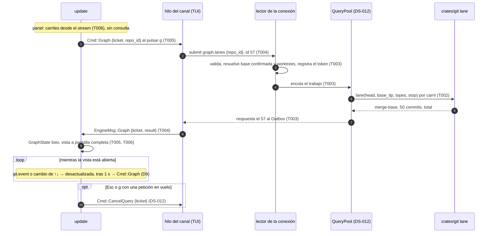

# DS-US-CKP-022 · Ver crecer la rama de cada agente sobre la base

## Contexto rápido

Al terminar, el desarrollador ve bajo la flota un carril por rama de agente, con su color y su ↑↓ frente a la base confirmada, que se actualiza solo. Con `g` abre el grafo a pantalla completa: por carril, los 50 commits más recientes desde su merge-base, cada uno con su hash corto, su asunto, su hora y "sin atribuir", y "22 más" para el resto. Si la base no existe, no hay carriles y la vista lo dice. En 80×24 el panel del grafo es lo primero que desaparece, y `g` sigue funcionando. Hoy no puede: `view.rs:75` llama a `layout` con `BodyPlan::default()` (sin grafo), el widget `GraphLanes` (`tui/widgets/graph_lanes.rs`) no tiene quien lo alimente y el protocolo no tiene consulta de commits de una rama (DEP-CKP-2).

Es solo lectura: no hay operación del catálogo, ni Guardrails, ni snapshot. La consulta reutiliza la forma de las consultas bajo demanda que fija DS-US-CKP-012 (N8 de ADR-CKP-003 § 4): `QueryPool`, `query.cancel`, `query-busy`, `query-cancelled`, `Link::submit` e `Incoming::Reply`. Ninguna se redefine aquí.

El repo no tiene `architecture-constitution.md` en la cascada. Las restricciones activas son las de [AGENTS.md](../../../../../AGENTS.md) y los ADRs: `unsafe_code = forbid` (ADR-GRP-001), métodos en el archivo de su módulo y capacidades aditivas (ADR-GRP-016), lecturas solo con `gix` sin filtros (ADR-GRP-009 § 1) y texto del repo como `Untrusted` hasta `SafeText` (ADR-CKP-003 § 8). Ninguna tarea las viola.

| Término | Qué es aquí |
|---|---|
| Carril | La rama de un worktree dibujada desde su merge-base con la base confirmada (glosario de [context.md](../context.md)) |
| Panel del grafo | La región del cuerpo con un carril por fila, alimentada por el stream; colapsa primero |
| Vista del grafo | La pantalla completa que abre `g`, alimentada por la consulta `graph.lanes` |
| Ventana | Los commits de un carril que se muestran: los 50 más recientes (S-CKP-2) |

### Decisiones

Cada decisión es **Decisión del orquestador (2026-10-28)**, pendiente de validar por Arquitecto y PO.

| # | Decisión | Alternativa descartada y por qué |
|---|---|---|
| D1 | **Dos niveles.** El *panel* del cuerpo pinta un carril por fila con lo que ya publica el stream: rama, sesión y `DivergenceView` (`messages.rs:254`). No hace consulta y es en vivo por construcción. La *vista* a pantalla completa (`g`) pide los commits con `graph.lanes`. El panel es la región que cede espacio (D10); la vista no depende del tamaño | Un solo nivel con la consulta: el panel tendría que pedir commits con cada evento de cualquier agente, y en 80×24 no habría dónde mirar un commit |
| D2 | **DEP-CKP-2 no existe en `main`: se crea.** El lector solo cuenta commits (`ahead_behind_commits`, `reader.rs:562`) y ningún método del protocolo los lista. Módulo `graph` con el método `graph.lanes` en `crates/api/src/methods/graph.rs` y sus tipos en `crates/api/src/graph.rs`. Método nuevo = capacidad aditiva que el cliente descubre en `hello.methods` (ADR-GRP-016 § 1); ninguna forma existente cambia. `mcp: false`. **Sin bloque de errores propio**: todo lo "no calculable" va en el resultado (D5, D3), y la cancelación y el exceso de consultas son los códigos del módulo `query` de DS-US-CKP-012 D1 | Un código `graph-unavailable`: tomaría el bloque `-33180` de la lista compartida por un caso que el resultado ya expresa |
| D3 | **Qué es un carril.** Cada worktree del repo, salvo el que tiene sacada la rama base (ese es el tronco). Rama → carril con su nombre; `HEAD` separado → carril con el nombre de la carpeta; rama sin commits → carril "sin commits"; worktree no disponible → carril con su motivo y sin commits. Mismo orden que la flota (`fleet_order::order_key`, DS-US-CKP-002), así cada carril queda a la altura de su fila | Solo worktrees de agentes: una rama humana que se aleja también decide cuándo integrar, y la historia pide "un carril por worktree" |
| D4 | **Commits de un carril.** `rev_walk([HEAD]).with_hidden([punta de la base])`, el mismo conjunto que cuenta `ahead` en `count_only_in` (`reader.rs:584`), así el total de la vista coincide con el ↑ del panel. Del más reciente al más antiguo por fecha de commit. Los primeros 50; el total se sigue contando hasta `MAX_DIVERGENCE_WALK` (10.000, `messages.rs:248`) con `exact`. El merge-base que se muestra es el primero de `merge_bases` (`reader.rs:530`). Sin `commit-graph` (`use_commit_graph(false)`, como `guard_paths.rs:208`): ese archivo lo puede escribir un agente | Orden topológico con líneas de merge: es un cliente Git completo, que BR-CKP-CALC-004 excluye |
| D5 | **Base.** Solo la base confirmada (BR-CKP-CALC-004), con la misma fuente que `repo_base` (`daemon/mod.rs:1293`). Sin confirmar → sin carriles, "Base main sin confirmar: no calculable" (Q-CKP-49). Base inválida → "Sin rama base: no calculable". Rama base sin ref → "Rama base develop no encontrada: no calculable". Nunca se usa otra rama (BR-CKP-EDGE-001). El panel aplica la misma regla con lo que publica el stream (`DivergenceView::BaseMissing`, `NoBase` y el estado de la base) | Dibujar contra la base resuelta sin confirmar: el ↑ mezclaría commits de una rama que el desarrollador no eligió, y DS-US-CKP-012 D5 ya trata la base sin confirmar como "no calculable" |
| D6 | **Datos de cada commit.** `oid` (40 hex; la TUI muestra 7), `summary` (primera línea del mensaje, hasta 256 bytes, como `Untrusted`), `committed_utc_ms` y `merge` (dos o más padres). Ni autor ni correo: la flota se mira en pantalla compartida (`model.rs:408-410`) y la autoría declarada tiene su capacidad (`events.authorship`, ADR-GRP-013 Enmienda). Sin campo de actor (D7) | Sin asunto: un carril de hashes no deja reconocer un commit; el asunto ya se lee con `git log` en el mismo worktree y `graph.lanes` no sale al MCP |
| D7 | **Actor por commit: "sin atribuir" en el MVP.** La relación commit→evento está "pendiente de motor-local" (ADR-GRP-013, línea de DEP-CKP-2). La respuesta no lleva actor y la vista escribe "sin atribuir" en cada commit. Cuando motor-local la publique, entra como campo opcional `actor` detrás de la capacidad `graph.commit-actor` (aditiva, ADR-GRP-016 § 1) sin tocar el resto (Q-CKP-50) | Unir ya los commits con los eventos `commit` por `new_commit` (`messages.rs:580`): un rebase o un `--amend` solo deja evento de la punta, y los intermedios saldrían sin atribuir sin decir por qué; esa decisión es de motor-local |
| D8 | **Color por carril, nunca por commit.** El del primer agente de la sesión del worktree, con el mismo `AgentColors` (`model/agent_colors.rs`) y la misma elección que la fila de la flota (`view.rs:540`). Sin sesión → `LaneOwner::Unattributed` en tenue con "carpeta · sin agente". La paleta es `agent.1`…`agent.8` de DSYS-GRP-001 (Okabe-Ito, variante clara y oscura) | Un color por commit según su actor: con D7 todos serían tenues y se perdería quién lleva cada rama |
| D9 | **Vista en vivo.** Abierta, la vista se marca desactualizada con cada `git.event` del repo, con cada snapshot y con cada cambio de cabeza, ↑↓ o base de sus worktrees en el stream. Desactualizada, se vuelve a pedir si no hay otra en vuelo y pasó 1 s desde la última petición; mientras llega, se ve la anterior con "actualizando…". El desplazamiento se ancla al primer commit visible (`oid`); si desapareció, a la cabecera de su carril | La foto de DS-US-CKP-012 D9: la historia es "ver crecer la rama"; el diff se lee línea a línea y salta, el grafo crece por arriba y el ancla lo evita |
| D10 | **Espacio** (BR-CKP-EDGE-005). `view` pasa `BodyPlan { graph: true, .. }` cuando el repo tiene al menos un carril o un mensaje de base. `layout` no cambia (DS-US-CKP-005 D2, `layout.rs:91-99`): el grafo es la primera región que cede. Sin región, la pista `g grafo` sigue en la barra y abre la vista a pantalla completa | Mostrar siempre una línea mínima del grafo: en 80×24 con alertas se la quitaría a la lista |
| D11 | **Tecla `g`** (libre en `keymap.rs:84-135` y en las DS de cockpit: `d`, `m`, `u`, `o`, `r`, `f`, `?` ya están tomadas). Abre y cierra la vista; `Esc` también la cierra; `↑`/`↓` (`k`/`j`) desplazan una línea; `q` sale de la TUI. Con la vista abierta, las teclas de fila no actúan. Motor sin `graph.lanes` → nota "el motor no ofrece el grafo; reinícialo" y ningún `Cmd` | Reutilizar `Enter`: abre el repo en el selector (DS-US-CKP-012 D11) |
| D12 | **Topes** (⚠️ **ASSUMPTION**, § Valores numéricos). 32 carriles (`lanes_total` y `cut: lanes`), 50 commits por carril, plazo de 2 s (el de DS-US-CKP-012 D4), 256 bytes de asunto, respuesta ≤ 768 KiB. Un carril que no termina en plazo sale `too-slow`; un tope nunca es un error. Peor caso: 32 × 50 × ~350 B ≈ 560 KiB | Error al pasar un tope: el desarrollador no vería nada justo con la flota grande |
| D13 | **"N más" no se despliega en el MVP.** El carril termina en una fila tenue "22 más"; con total no exacto, "al menos 9.950 más". No hay paginación (Q-CKP-51) | Paginar con cursor: otro parámetro y otro estado en la TUI para un caso que la historia no pide |

## 📋 Índice

> **Para aprobar:** [Contexto rápido](#contexto-rápido) · [⚠️ Gaps](#️-gaps-y-violaciones-de-la-constitución) · [🔭 La forma](#-la-forma) · [El trabajo de un vistazo](#el-trabajo-de-un-vistazo).
> **Para implementar:** [🚀 Plan](#-plan-de-implementación), en orden. Las secciones `_(ref)_` se abren desde la tarea que las cita.

| Sección | Propósito |
|---------|-----------|
| [Contexto rápido](#contexto-rápido) | Qué se construye, por qué y las decisiones |
| [⚠️ Gaps](#️-gaps-y-violaciones-de-la-constitución) | Qué impide empezar |
| [🔭 La forma](#-la-forma) | Piezas y flujo |
| [🚀 Plan de implementación](#-plan-de-implementación) | T001…T007 |
| [Estructura de ficheros](#estructura-de-ficheros) _(ref)_ | Qué se crea y qué se toca |
| [Contratos compartidos](#contratos-compartidos) _(ref)_ | Tipos y firmas |
| [Contrato de API](#contrato-de-api) _(ref)_ | Método, cable, errores y topes |
| [Estrategia de pruebas y cobertura](#estrategia-de-pruebas-y-cobertura) _(ref)_ | Escenario → test |
| [Gate de seguridad](#gate-de-seguridad) | Texto no confiable, solo lectura, MCP |
| [Cómo extender](#cómo-extender) | Actor por commit, más datos por commit |
| [Enmiendas que implica](#enmiendas-que-implica) | ADR-CKP-003 N8 y DEP-CKP-2 |
| [Fuera de alcance](#fuera-de-alcance) | Lo diferido y su dueño |
| [Notas del autor](#notas-del-autor) _(ref)_ | Riesgos y preguntas abiertas |

---

## ⚠️ Gaps y violaciones de la constitución

| ID | Qué falta | Severidad | Alcance | Acción | Owner |
|----|-----------|-----------|---------|--------|-------|
| G1 | **Dependencia de orden con DS-US-CKP-012**: `QueryPool`, `QueryTable` y `query.cancel` (T003 de DS-012), `Client::submit`/`settle` e `Incoming::Reply` (T004), `Link::submit`/`offers` y `Cmd::CancelQuery` (T005). En `main` no existen (`crates/api/src/methods/` sin `query.rs` ni `diff.rs`) | Bloqueante | T003, T004 | T003 y T004 de esta DS empiezan cuando T003, T004 y T005 de DS-012 estén en `main`. T001, T002 y T006 (panel) pueden ir antes | Orquestador |
| G2 | **Alertas sin cablear en la vista** (US-CKP-008): hoy no hay región de alertas real, así que el escenario 5 de punta a punta solo puede comprobar lista y grafo | Informativo | — | El reparto con alertas ya lo prueba `layout` (DS-US-CKP-005, `the_body_goes_by_priority_at_the_reference_sizes`). La historia que llegue la última a `main` (US-CKP-008 o esta) añade las alertas a `tui_graph::the_graph_yields_space_first_at_80x24` | Worker de la segunda historia |
| G3 | **Perfil `mcp` por solicitante** (S-01): igual que G1 de DS-012, una TUI lanzada por un agente ve el asunto de los commits. Se acepta como el residuo de DS-012 G1: el agente ya lee esos asuntos con `git log` en el worktree, y Q-CKP-8 solo prohíbe el MCP | Informativo | — | `mcp: false` cierra `graph.lanes` en cuanto el canal aplique S-01, sin tocar esta DS | Worker del canal (TS-GRP-004) |

G1 bloquea T003, T004 y T007 (`blocked_tasks`); T001, T002, T005 y T006 se pueden construir ya. Todo lo demás existe en `main`: `rev_walk` con ocultos (`reader.rs:584`, `guard_paths.rs:204`), `merge_bases`, `resolve_ref` (`reader.rs:458`), `repo_base`, `GraphLanes`, `layout`, `AgentColors`, `Glyphs` de carril y `Text::Ago`.

---

## 🔭 La forma



---

## 🚀 Plan de implementación

### El trabajo de un vistazo

| # | Tarea | Depende | Aterriza en |
|---|---|---|---|
| T001 | Escribir en rojo las pruebas de la historia y los stubs del contrato | — | `crates/api/src/{graph,methods/graph}.rs`, `apps/cli/tests/tui_graph.rs`, `crates/core/tests/graph_query.rs` |
| T002 | Leer los commits de un carril con `gix`, sin filtros y con topes | T001 | `crates/git/src/lane.rs` |
| T003 | Servir `graph.lanes` desde el pool de consultas | T001, T002, G1 | `crates/core/src/channel/graph.rs`, `conn.rs` |
| T004 | Pedir y cancelar el grafo desde el hilo del canal de la TUI | T001, G1 | `apps/cli/src/client/{mod,engine}.rs`, `tui/app.rs` |
| T005 | Añadir la tecla `g`, el estado de la vista y su refresco | T001 | `apps/cli/src/tui/{graph,update,keymap}.rs`, `model.rs`, `present/{ingest,i18n}.rs` |
| T006 | Pintar el panel y la vista del grafo con textos en/es | T005 | `apps/cli/src/present/{graph,graph_text}.rs`, `tui/{view,help}.rs` |
| T007 | Cerrar la historia | T003, T004, T006 | `docs` |

### En qué orden

T001 → {T002, T005} → T006 (tras T005) → T003 (tras T002 y G1), T004 (tras G1) → T007. El panel (T006 sin la vista) no necesita la consulta y puede entrar antes que DS-012.

### T001 — Escribir en rojo las pruebas de la historia y los stubs del contrato

**Objetivo.** Los cinco escenarios de la historia, en rojo, contra tipos del contrato que ya compilan.

**Ubicación.**
- `crates/api/src/graph.rs` (**CREATE**): los tipos de § Contratos compartidos
- `crates/api/src/methods/graph.rs` (**CREATE**): `GRAPH_LANES`, `GROUP` sin `error_block`
- `crates/api/src/methods/mod.rs` (**MODIFY**): `mod graph;`, `pub use graph::*;` y `&graph::GROUP` en `GROUPS` (3 líneas, ADR-GRP-016)
- `crates/api/src/lib.rs` (**MODIFY**): `pub mod graph;`
- `apps/cli/tests/tui_graph.rs` y `crates/core/tests/graph_query.rs` (**CREATE**)

**Reglas**
- `method(GRAPH_LANES, false, false)` sin `.since(...)`, como los de DS-012 T001.
- Arnés de `apps/cli/tests/live_fleet.rs` (`#![cfg(all(target_os = "macos", debug_assertions))]`, `gitraptor_testkit::Fixture`, `raptor-fake-agent`, `App` sobre `TestBackend`). Nunca este repo ni el perfil real (NFR-01).
- Datos de § 9.3.

- **Depende:** —
- **Refs:** US-CKP-022 escenarios 1 a 5; D2
- **Aceptación:** `cargo test -p gitraptor-api` en verde (`architecture.rs` incluido) y `cargo test -p gitraptor-cli --test tui_graph` compila y falla por "no implementado"

### T002 — Leer los commits de un carril con `gix`, sin filtros y con topes

**Objetivo.** `RepoReader::lane` devuelve el merge-base, la ventana de commits y el total de una rama frente a la base, sin escribir nada.

**Ubicación.**
- `crates/git/src/lane.rs` (**CREATE**): `LaneLimits`, `GitLane`, `GitLaneCommit`, `impl RepoReader { pub fn lane(..) }`
- `crates/git/src/lib.rs` (**MODIFY**): `pub mod lane;` y una línea en el doc comment de la frontera ("[`lane`] lista los commits de una rama sobre la base, para el grafo")

**Reglas**
- Recorrido según D4: `rev_walk([head]).with_hidden([base_tip]).use_commit_graph(false)`, ordenado por fecha de commit, más reciente primero. Se guardan los primeros `max_commits`; el resto solo se cuenta hasta `max_walk` (`Count::Exact` o `Count::AtLeast`, `reader.rs:148`).
- `merge_base`: el primero de `merge_bases(head, base_tip)`. Vacío → `Err(LaneGap::NoMergeBase)`; no se recorre nada.
- Por commit: `summary` = bytes del mensaje hasta el primer `\n`, cortados a `max_summary_bytes` en límite de carácter UTF-8 tras `from_utf8_lossy`; `committed_s` de la firma del committer; `merge` = dos o más padres. Nunca autor ni correo (D6).
- `stop()` se mira cada 64 commits; si devuelve `true`, `Err(LaneGap::TooSlow)`: nunca una ventana parcial presentada como completa.
- Ningún `Command::new`: `crates/git/tests/static_check.rs` sigue en verde.

- **Depende:** T001
- **Refs:** D4, D6, D12; ADR-GRP-009 § 1
- **Aceptación:** `cargo test -p gitraptor-git --lib lane` y `cargo test -p gitraptor-git --test repo_intact`

### T003 — Servir `graph.lanes` desde el pool de consultas

**Objetivo.** El daemon responde los carriles de un repo a la conexión que los pidió, sin bloquear su lector ni el stream.

**Ubicación.**
- `crates/core/src/channel/graph.rs` (**CREATE**): resolver repo, base y worktrees en el estado del motor; llamar a `lane` por carril; mapear a `gitraptor_api::graph`
- `crates/core/src/channel/mod.rs` (**MODIFY**): `mod graph;`
- `crates/core/src/channel/conn.rs` (**MODIFY**): brazo `GRAPH_LANES` en `dispatch` (`:703`), junto a los de DS-012

**Reglas**
- El brazo: `repo_id` desconocido → `NOT_FOUND`. Si no, registra el token en `conn.queries` y encola en `ctx.query` (DS-012 D2, D3); en vuelo o cola llena → `query-busy`. Conexión MCP → `not_found` por `mcp: false` (`offered`, `conn.rs:674`).
- El trabajo: base con la fuente de `repo_base` (`daemon/mod.rs:1293`). No confirmada, inválida o sin ref → `base: NotComputable {reason}` y `lanes` vacío (D5). Si no, `base_tip` con `resolve_ref`. Repo no listo → `NotComputable {reason: repo-unavailable}`.
- Carriles según D3, en el orden de `engine.snapshot`; la TUI los reordena (D3). Hasta 32 (`cut: lanes`, `lanes_total`). Cada uno abre su worktree con `RepoReader::open` (sin descubrimiento hacia arriba) y lee `head()`. Worktree no disponible → `LaneState::NotComputable {reason: worktree-unavailable}`; rama sin commits → `no-commits`; `LaneGap` → su motivo; `ReadError` → `unreadable`.
- Plazo de 2 s desde que empieza el trabajo; pasado, los carriles que faltan salen `too-slow`. Tamaño serializado ≤ 768 KiB: si no cabe, se quitan commits del final de los carriles más largos y `cut: bytes`.
- Al terminar: token cancelado → `query-cancelled`; si no, `Response::ok(id, GraphLanes)` al `Outbox`. La respuesta no pasa por el logger ni por la auditoría (como DS-012 T003). Los logs llevan `repo_id`, duración, carriles y `cut`.

- **Depende:** T001, T002, G1
- **Refs:** D2 a D5, D12; DS-US-CKP-012 D1 a D4
- **Aceptación:** `cargo test -p gitraptor-core --test graph_query`

### T004 — Pedir y cancelar el grafo desde el hilo del canal de la TUI

**Objetivo.** El hilo del canal envía `graph.lanes`, sigue con el stream y entrega la respuesta a `update`.

**Ubicación.**
- `apps/cli/src/client/mod.rs` (**MODIFY**): `LinkCmd::Graph { ticket, repo_id }` junto al brazo de `Observe` (`:392`); al empezar la sesión, `ConnEvent::Graph(link.offers(GRAPH_LANES))`
- `apps/cli/src/tui/app.rs` (**MODIFY**): `Cmd::Graph` → `LinkCmd::Graph`

**Reglas**
- Mismo mecanismo que `LinkCmd::Diff` de DS-012 T005: tabla `ticket → id`, `Incoming::Reply` o `Frame` del id → `EngineMsg::Graph { ticket, result }` con `Ok(Box<GraphLanes>)` o `Err(QueryFailure)`. La cancelación es el `Cmd::CancelQuery` de DS-012, sin cambio.
- Una reconexión entrega `Err(QueryFailure::Lost)` por cada petición en vuelo.
- El hilo no sanea: entrega el contrato y la ingesta (T006) lo convierte en `SafeText`.

- **Depende:** T001, G1
- **Refs:** D2; DS-US-CKP-012 D13, T005
- **Aceptación:** `cargo test -p gitraptor-cli --lib client::tests::graph`

### T005 — Añadir la tecla `g`, el estado de la vista y su refresco

**Objetivo.** El desarrollador pulsa `g` y `update` pide el grafo, lo mantiene al día mientras está abierto y lo cierra con `Esc` o `g`.

**Ubicación.**
- `apps/cli/src/tui/graph.rs` (**CREATE**): `GraphState`, `open`, `close`, `apply_reply`, `scroll`, `mark_stale`, `tick`
- `apps/cli/src/tui/mod.rs` (**MODIFY**): `pub mod graph;`
- `apps/cli/src/tui/keymap.rs` (**MODIFY**): `Action::Graph` con `Key::Char('g')` y `Text::KeyGraph`
- `apps/cli/src/model.rs` (**MODIFY**): `Ui.graph: Option<GraphState>`, `RepoView.base_confirmed: bool`, `EngineReplica.graph: bool`, `ConnEvent::Graph(bool)`, `EngineMsg::Graph`, `Cmd::Graph`, `Notice::GraphUnsupported`
- `apps/cli/src/present/ingest.rs` (**MODIFY**): `repo()` (`:53`) rellena `base_confirmed` con `snapshot.repo.base.status == BaseStatusView::Confirmed`
- `apps/cli/src/present/i18n.rs` (**MODIFY**): `Text::KeyGraph` y el texto de `GraphUnsupported`, en en y es
- `apps/cli/src/tui/update.rs` (**MODIFY**): `Action::Graph`; con `Ui.graph` abierto, `Up`/`Down`/`Later`/`Graph` van a `graph::scroll`/`graph::close`; `EngineMsg::Graph` a `graph::apply_reply`; `EngineMsg::{Snapshot, Event}` del repo a `graph::mark_stale` (D9)

**Reglas**
- `g` sin repo en pantalla no hace nada. Motor sin `graph.lanes` → `Notice::GraphUnsupported` y ningún `Cmd` (D11). Si no, `Ui.graph = Some(Loading { ticket })` y `Cmd::Graph`.
- `Esc` o `g` con la vista abierta: `Ui.graph = None` y, si hay petición en vuelo, `Cmd::CancelQuery`.
- `mark_stale` marca `stale`. `tick` (en cada `update`, con el reloj monótono de la TUI) emite `Cmd::Graph` si `stale`, no hay petición en vuelo y pasó `REFRESH_MIN` desde la última (D9).
- `apply_reply`: un `ticket` que no es el actual se descarta; `Ok` sustituye el resultado y conserva el ancla de D9; `busy` deja `stale` para el siguiente `tick`; `lost` y `refused` muestran su mensaje y conservan el último resultado si lo hay.
- `q` sigue saliendo con la vista abierta.

- **Depende:** T001
- **Refs:** D9, D11; DS-US-CKP-012 D11, T006
- **Aceptación:** `cargo test -p gitraptor-cli --lib tui::graph`

### T006 — Pintar el panel y la vista del grafo con textos en/es

**Objetivo.** El panel en vivo en su región y la vista a pantalla completa de D1, con la pista `g` en la barra y en `?`.

**Ubicación.**
- `apps/cli/src/present/graph.rs` (**CREATE**): `panel(model, say) -> Option<GraphModel>` desde el stream; `rows(state, model, say) -> Vec<GraphRow>` desde `GraphLanes`
- `apps/cli/src/present/graph_text.rs` (**CREATE**): `GraphText`, `render(self, lang)` con `match` exhaustivo en/es y `every()`, el patrón de `present/prediction_text.rs`
- `apps/cli/src/present/mod.rs` (**MODIFY**): `pub mod graph; pub mod graph_text;`
- `apps/cli/src/tui/view.rs` (**MODIFY**): `body_plan(model)` sustituye a `BodyPlan::default()` en `:75` con `graph` según D10; pinta `GraphModel` en `regions.graph`; con `Ui.graph` abierto, el cuerpo entero es la vista
- `apps/cli/src/tui/help.rs` (**MODIFY**): `g grafo` en el grupo de la flota; `↑↓ desplazar · Esc cerrar` en el de la vista
- `apps/cli/src/tui/snapshots/graph_{panel_100x30,view_80x24}_{en,es,ascii}.snap` (**CREATE**)

**Reglas**
- **Panel**: un `LaneModel` por carril (D3) en el orden de la flota. `owner` según D8; `ahead`/`behind` de `DivergenceView::Counted` (con `exact: false`, la cifra con `+`); `conflict: false` (lo cablea US-CKP-006). `base`: `Base::Found(nombre)` con base confirmada; si no, `Base::Missing(mensaje de D5)` y `lanes` vacío. `GraphModel` y `graph_lanes.rs` no cambian.
- **Vista**: título "grafo de shop sobre main · a las 14:03:12" y, con `stale` o petición en vuelo, "actualizando…". Por carril, una cabecera con el glifo de carril en su color, "feat-pagos · claude-1" y "72 commits desde a1b2c3d"; luego una fila por commit: nodo en el color del carril, hash de 7, asunto, "sin atribuir" en tenue (D7) y la hora relativa con `Text::Ago`; `merge` → "(merge)". Al final, "22 más" o "al menos N más" en tenue (D13). Carril no calculable → su cabecera y el motivo ("no disponible", "sin commits", "sin merge-base con main", "tardó demasiado", "no se pudo leer"). `cut` → "truncado: más de 32 carriles" / "truncado: respuesta demasiado grande".
- Base no calculable: ningún carril, solo el mensaje de D5, exacto: "Rama base develop no encontrada: no calculable".
- Rutas, ramas y asuntos solo como `SafeText` (`SafeText::from_untrusted`, SEC-12). Cadenas enteras en el catálogo, sin concatenar frases. Solo tokens (`agent.n`, `git.branch.base`, `text.muted`, `status.warning`) y glifos de `Glyphs`.

- **Depende:** T005
- **Refs:** D1, D3, D5, D7, D8, D10, D13; DSYS-GRP-001 § 3 (GraphLanes)
- **Aceptación:** `cargo test -p gitraptor-cli --lib tui::view::tests::graph`, `cargo test -p gitraptor-cli --lib present::graph_text` y `cargo test -p gitraptor-cli --test tui_graph`

### T007 — Cerrar la historia

**Objetivo.** La historia apunta a lo implementado y esta DS pasa a `implemented`.

**Ubicación.** `docs/requirements/features/cockpit/user-stories/US-CKP-022-grafo-carriles.md` (**MODIFY**), esta DS (**MODIFY**) y las líneas de § Enmiendas que implica

**Reglas**
- La historia pasa a `implemented` solo con los cinco escenarios en verde.
- No se edita `docs/ARTIFACTS.md` ni el backlog a mano.

- **Depende:** T003, T004, T006
- **Refs:** N8; DEP-CKP-2
- **Aceptación:** `cargo fmt --all --check`, `cargo clippy --all-targets -- -D warnings` y `cargo test --workspace` en verde

---

## Estructura de ficheros

| Archivo | Acción | Tarea |
|---|---|---|
| `crates/api/src/graph.rs` | CREATE | T001 |
| `crates/api/src/methods/graph.rs` | CREATE | T001 |
| `crates/api/src/methods/mod.rs`, `lib.rs` | MODIFY (3 líneas y 1 línea) | T001 |
| `crates/git/src/lane.rs` | CREATE | T002 |
| `crates/git/src/lib.rs` | MODIFY (1 línea `pub mod` y 1 de doc) | T002 |
| `crates/core/src/channel/graph.rs` | CREATE | T003 |
| `crates/core/src/channel/{mod,conn}.rs` | MODIFY (1 línea `mod`, 1 brazo) | T003 |
| `apps/cli/src/client/mod.rs`, `tui/app.rs` | MODIFY (1 variante y su brazo) | T004 |
| `apps/cli/src/tui/graph.rs` | CREATE | T005 |
| `apps/cli/src/model.rs`, `present/{ingest,i18n}.rs`, `tui/{mod,keymap,update}.rs` | MODIFY | T005 |
| `apps/cli/src/present/{graph,graph_text}.rs` | CREATE | T006 |
| `apps/cli/src/tui/{view,help}.rs`, `present/mod.rs` | MODIFY | T006 |
| `apps/cli/tests/tui_graph.rs`, `crates/core/tests/graph_query.rs` | CREATE | T001 |

---

## Contratos compartidos

### Tipos y datos compartidos

```rust
// crates/api/src/graph.rs (CREATE)
pub struct GraphParams { pub repo_id: String }
pub struct GraphLanes {
    pub computed_at_utc_ms: i64,
    pub base: GraphBase,
    pub lanes: Vec<Lane>,                 // vacío si la base no es Ready
    pub lanes_total: u32,
    pub cut: Option<GraphCut>,
}
pub enum GraphBase {
    Ready { name: UntrustedName },
    NotComputable { reason: BaseGap },
}
pub enum BaseGap {
    BaseUnconfirmed { name: UntrustedName },
    NoBase,
    BaseMissing { name: UntrustedName },
    RepoUnavailable,
}
pub enum GraphCut { Lanes, Bytes }
pub struct Lane {
    pub worktree: Untrusted,              // raíz, para casar con WorktreeRow.key en la TUI
    pub head: LaneHead,
    pub state: LaneState,
}
pub enum LaneHead { Branch { name: UntrustedName }, Detached }
pub enum LaneState {
    Ready { merge_base: String, commits: Vec<LaneCommit>, total: CommitCountView },
    NotComputable { reason: LaneGap },
}
pub enum LaneGap { WorktreeUnavailable, NoCommits, NoMergeBase, TooSlow, Unreadable }
pub struct LaneCommit {
    pub oid: String,                      // 40 hex
    pub summary: Untrusted,               // primera línea, ≤ 256 bytes
    pub committed_utc_ms: i64,
    pub merge: bool,
}
```

Todos `Serialize, Deserialize, JsonSchema` con `deny_unknown_fields`; los enums con `rename_all = "kebab-case"`. `CommitCountView` es el de `messages.rs:271`. `Untrusted` y `UntrustedName` son los de `untrusted.rs`. Ningún tipo lleva actor, sesión, autor ni correo (D6, D7).

```rust
// crates/git/src/lane.rs (CREATE)
pub struct LaneLimits { pub max_commits: usize, pub max_walk: u64, pub max_summary_bytes: usize }
pub struct GitLane { pub merge_base: String, pub commits: Vec<GitLaneCommit>, pub total: Count }
pub struct GitLaneCommit { pub id: String, pub summary: String, pub committed_s: i64, pub merge: bool }
pub enum LaneGap { NoMergeBase, TooSlow }
impl RepoReader {
    pub fn lane(&self, head: &str, base_tip: &str, limits: &LaneLimits, stop: &dyn Fn() -> bool)
        -> Result<Result<GitLane, LaneGap>, ReadError>;
}
```

### Ciclos de vida (DI)

_No aplica — Rust sin contenedor de dependencias._ El trabajo de `graph.lanes` vive en el `QueryPool` de DS-012 mientras dura la consulta. `GraphState` vive en `Model.ui` mientras la vista está abierta; no se guarda entre ejecuciones. El panel se recalcula en cada `view` desde el modelo.

### Firmas del stack

```rust
// apps/cli/src/model.rs (MODIFY)
pub struct Ui { /* … */ pub graph: Option<GraphState> }
pub struct RepoView { /* … */ pub base_confirmed: bool }
pub enum Cmd { /* … */ Graph { ticket: u64, repo_id: String } }
pub enum EngineMsg { /* … */ Graph { ticket: u64, result: Result<Box<GraphLanes>, QueryFailure> } }
// QueryFailure: el DiffFailure de DS-012 sin Unavailable; si DS-012 lo nombra genérico, se reutiliza

// apps/cli/src/tui/graph.rs (CREATE)
pub const REFRESH_MIN: std::time::Duration = std::time::Duration::from_secs(1);
pub struct GraphState {
    pub in_flight: Option<u64>,           // ticket
    pub last_request: Option<std::time::Instant>,
    pub stale: bool,
    pub shown: Option<Shown>,             // último resultado, ya saneado
    pub failure: Option<QueryFailure>,
    pub anchor: Anchor,                   // D9
}
pub enum Anchor { Top, Commit { lane: u64, oid: String }, Lane(u64) }
pub fn open(model: &mut Model) -> Vec<Cmd>;
pub fn close(model: &mut Model) -> Vec<Cmd>;
pub fn mark_stale(model: &mut Model);
pub fn tick(model: &mut Model, now: std::time::Instant) -> Vec<Cmd>;
pub fn apply_reply(model: &mut Model, ticket: u64, result: Result<Box<GraphLanes>, QueryFailure>);

// apps/cli/src/present/graph.rs (CREATE)
pub fn panel(model: &Model, say: Say) -> Option<GraphModel>;   // None: sin carriles ni mensaje
```

---

## Contrato de API

| Pieza | Nombre | Dónde | Notas |
|---|---|---|---|
| Método | `graph.lanes` | `crates/api/src/methods/graph.rs` (**CREATE**): `pub const GRAPH_LANES: &str = "graph.lanes"` | `GraphParams` → `GraphLanes`; respuesta asíncrona (DS-012 D2); `mcp: false` |
| Cancelación | `query.cancel` | DS-US-CKP-012 | Sin cambio |
| Códigos | `query-busy`, `query-cancelled` | bloque de `query` (DS-012) | Sin códigos propios (D2) |
| Capacidad | — | — | Método nuevo: se descubre en `hello.methods`. El actor por commit futuro irá tras `graph.commit-actor` (D7) |

```json
→ {"jsonrpc": "2.0", "id": 57, "method": "graph.lanes", "params": {"repo_id": "r1"}}
← {"jsonrpc": "2.0", "id": 57, "result": {
    "computed_at_utc_ms": 1793091600000,
    "base": {"ready": {"name": {"untrusted": "main"}}},
    "lanes_total": 2,
    "lanes": [
      {"worktree": {"untrusted": "/w/feat-pagos"}, "head": {"branch": {"name": {"untrusted": "feat-pagos"}}},
       "state": {"ready": {"merge_base": "a1b2c3d…", "total": {"count": 72, "exact": true},
         "commits": [{"oid": "9f8e7d6…", "summary": {"untrusted": "Add payment retry"},
                      "committed_utc_ms": 1793091500000, "merge": false}]}}},
      {"worktree": {"untrusted": "/w/feat-login"}, "head": {"branch": {"name": {"untrusted": "feat-login"}}},
       "state": {"not-computable": {"reason": "no-merge-base"}}}]}}

← {"jsonrpc": "2.0", "id": 58, "result": {"computed_at_utc_ms": 1793091600000,
    "base": {"not-computable": {"reason": {"base-missing": {"name": {"untrusted": "develop"}}}}},
    "lanes_total": 0, "lanes": []}}
```

**Reglas del contrato**
- La respuesta solo va a la conexión que la pidió: nunca al bus, a otra conexión ni a `raptor-mcp`. No se registra ni se persiste.
- Un tope superado nunca es un error: `cut` y `lanes_total` lo dicen; un carril sin terminar es `too-slow`.
- `total` cuenta el mismo conjunto que `DivergenceView.ahead` contra la misma base (D4).

### Forma del error y del cuerpo de respuesta

| Causa | Respuesta | Cuándo |
|---|---|---|
| Parámetros mal formados | `INVALID_PARAMS` (-32602) | al momento |
| `repo_id` desconocido | `NOT_FOUND` (-32009) | al momento |
| 1 en vuelo en la conexión o cola llena | `query-busy {limit}` | al momento |
| Cancelada por `query.cancel` o cierre de la conexión | `query-cancelled` | al terminar el trabajo |
| Conexión MCP | `METHOD_NOT_FOUND` (`mcp: false`) | al momento |
| `ReadError` al abrir el repo común | `INTERNAL` "graph failed"; el texto no se publica | al terminar |
| Rate limit de la conexión | `RATE_LIMITED` (-32005) | al momento |
| Base sin confirmar, sin base, sin ref, repo no listo | `result` con `base: not-computable` | al terminar |
| Worktree no disponible, sin commits, sin merge-base, plazo, lectura | `result` con el carril `not-computable` | al terminar |

La TUI presenta cada caso por su clave en `GraphText`, nunca el `message` del daemon (N7).

### Forma de la configuración

_No aplica — los topes son constantes de GitRaptor (§ Valores numéricos); no hay clave de perfil ni de repo nueva._

### Valores numéricos

| Concepto | Valor | Fuente |
|---------|-------|--------|
| Commits visibles por carril | 50 | ⚠️ **ASSUMPTION** S-CKP-2; lo afina diseño (Q-CKP-51) |
| Recorrido máximo para el total | 10.000 | `MAX_DIVERGENCE_WALK` (`messages.rs:248`) |
| Carriles por respuesta | 32 | ⚠️ **ASSUMPTION** (D12) |
| Asunto por commit | ≤ 256 bytes | ⚠️ **ASSUMPTION** (D6) |
| Plazo por consulta | 2 s | DS-US-CKP-012 D4 |
| Respuesta serializada | ≤ 768 KiB | DS-US-CKP-012 D4; `MAX_MESSAGE_BYTES` 1 MiB |
| Refresco mínimo de la vista | 1 s | ⚠️ **ASSUMPTION** (D9); el orden de NFR-04 (500 ms p95) |
| Comprobación del token | cada 64 commits | ⚠️ **ASSUMPTION** |
| Nodos por carril en el panel | 6 | `MAX_NODES` (`graph_lanes.rs:51`), sin cambio |
| Altura mínima del panel | 6 filas | `GRAPH_MIN` (`layout.rs:23`), sin cambio |

---

## Modelo de datos

_No aplica — nada se persiste: los carriles viven en la respuesta y en `Model.ui.graph` mientras la vista está abierta._

---

## Estrategia de pruebas y cobertura

### 9.1 Pirámide de pruebas

| Nivel | Dónde | Qué |
|---|---|---|
| Unit | `crates/git/src/lane.rs`, `tui/graph.rs`, `present/graph{,_text}.rs` | Recorrido, topes, refresco, ancla, textos |
| Integración (daemon + Git real) | `crates/core/tests/graph_query.rs` | Base, carriles, cancelación, MCP |
| E2E (TUI + daemon) | `apps/cli/tests/tui_graph.rs` (macOS, debug) | Escenarios de la historia |
| Snapshots | `apps/cli/src/tui/snapshots/` | Panel 100×30 y vista 80×24, en/es/ASCII |

### 9.2 Umbrales de cobertura

Cada variante de `BaseGap`, `LaneGap` y `GraphCut` con su test y su texto (`every()` en `graph_text`). Sin cifra de cobertura de líneas en el repo.

### 9.3 Datos de prueba

Repo `shop` con `gitraptor_testkit::Fixture`: `main` confirmada y sacada en el worktree principal; `feat-pagos` (sesión de `raptor-fake-agent` como claude-1) con 72 commits desde su merge-base; `feat-login` (claude-2) con 3. Para el escenario 4, base del equipo `develop` sin esa rama. Nunca este repo (NFR-01).

### 9.4 Comportamientos críticos verificados

| Escenario | Test | Nivel |
|---|---|---|
| 1 Un carril por worktree | `tui_graph::one_lane_per_worktree_from_its_merge_base`: dos carriles con "claude-1" y "claude-2", cada uno en su `agent.n` (el mismo índice que su fila), sin carril para `main` | E2E |
| 2 Ventana acotada | `tui_graph::a_lane_shows_50_commits_and_22_more`: 50 filas de commit de `feat-pagos` y "22 más" | E2E |
| 3 Sin commit→evento | `tui_graph::every_commit_is_unattributed_and_keeps_the_lane_color`: cada fila dice "sin atribuir"; el nodo lleva el color del carril | E2E |
| 4 Base que no existe | `tui_graph::missing_base_shows_no_lanes_and_says_why`: ningún carril, "Rama base develop no encontrada: no calculable" en la vista y en el panel | E2E |
| 5 El grafo cede primero | `tui_graph::the_graph_yields_space_first_at_80x24`: a 80×24 con 12 filas en la flota, sin región de grafo, la lista con al menos `LIST_MIN` filas y `g` en la barra; `g` abre la vista. Alertas: G2 | E2E |

**Daemon (`crates/core/tests/graph_query.rs`):** `lanes_total_matches_the_ahead_of_the_stream`; `unconfirmed_base_has_no_lanes`; `the_base_worktree_is_not_a_lane`; `unavailable_and_unborn_worktrees_are_lanes_with_a_reason`; `cancel_answers_query_cancelled`; `mcp_connection_does_not_see_graph_lanes`; `responses_are_never_logged_nor_persisted` (asuntos con un token plantado; gitleaks sobre perfil y logs con 0 hallazgos); `limits_cut_and_never_fail` (`lanes`, `bytes`, plazo → `too-slow`).

**Git (`crates/git`):** `lane_walks_head_minus_base_newest_first`, `lane_total_is_exact_until_the_walk_limit`, `lane_without_merge_base_is_a_gap`, `summary_is_the_first_line_cut_on_a_char_boundary`, `commit_graph_file_is_not_used` (un `commit-graph` falso en `objects/info` no cambia el resultado), `repo_intact::lane_writes_nothing`.

**TUI (unidad):** `tui::graph::tests::refresh_waits_one_second_and_one_in_flight`, `tui::graph::tests::anchor_survives_new_commits_on_top`, `tui::graph::tests::a_reply_for_an_old_ticket_is_dropped`, `tui::graph::tests::closing_while_loading_cancels`, `present::graph::tests::panel_follows_fleet_order_and_session_color`, `present::graph::tests::summaries_with_controls_are_sanitized` (`\x1b]52;…`, RLO, U+2028), `present::graph_text::tests::every_text_has_both_languages`.

### 9.5 Plataformas

macOS en el PR. Linux y Windows: *Pendiente: etapa de validación multiplataforma* ([`xplat-pendientes.md`](../../../../architecture/xplat-pendientes.md)).

---

## Gate de seguridad

- [ ] **Texto no confiable (SEC-12, NFR-02)**: rutas, ramas y asuntos llegan como `Untrusted`/`UntrustedName` y se pintan solo como `SafeText` tras el saneado de ADR-CKP-003 § 8. El modelo y la vista no tienen `Untrusted` (`tui_boundaries.rs`).
- [ ] **Sin ejecución (NFR-02, SEC-09)**: ni shell ni `git` hijo; `gix` sin filtros y sin `commit-graph` (D4). El único parámetro es un `repo_id` opaco.
- [ ] **Solo lectura (NFR-01)**: el lector no escribe índice, refs, config ni objetos; `repo_intact::lane_writes_nothing`.
- [ ] **Fuera del MCP**: `graph.lanes` con `mcp: false`; no pasa por el bus, el logger, la auditoría ni el perfil. Residuo G3.
- [ ] **Denegación de servicio (SEC-08)**: la consulta comparte la cuota de DS-012 (1 en vuelo por conexión, cola de 4), plazo de 2 s, topes de D12, refresco ≥ 1 s y el rate limit de la conexión.

---

## Cómo extender

- **Actor por commit** (cuando motor-local publique commit→evento): campo opcional `actor: Option<Actor>` en `LaneCommit` con `skip_serializing_if`, capacidad `graph.commit-actor` en `methods/graph.rs` y su texto en `GraphText`. Sin la capacidad, el daemon omite el campo (patrón de `without_authorship`, `messages.rs:625`).
- **Otro dato por commit** (autoría declarada): igual, detrás de `events.authorship`; nunca correos.
- **Otra consulta bajo demanda** (timeline de US-CKP-021): la receta de DS-US-CKP-012 § Cómo extender.

## Enmiendas que implica

No aplicadas por esta DS; las aplica T007.

- **ADR-CKP-003 § 4, N8**: "DEP-CKP-2 aplicado por DS-US-CKP-022 (`graph.lanes`), con la forma de DS-US-CKP-012".
- **ADR-GRP-005 (Enmienda 2026-10-04, Cockpit)**: "consulta de commits base..rama: DS-US-CKP-022 § Contrato de API".
- **ADR-GRP-013, línea de DEP-CKP-2**: sin cambio de fondo; añadir "el grafo muestra 'sin atribuir' y reserva la capacidad `graph.commit-actor` (DS-US-CKP-022 D7)".

## Fuera de alcance

| Ítem | Dónde se cubre | Gate |
|---|---|---|
| Actor por commit | Motor-local (DEP-CKP-2 opcional, ADR-GRP-013); Q-CKP-50 | D7 |
| ⚡ de conflicto previsto en el carril | US-CKP-006 (cablea `LaneModel.conflict`) | — |
| Región de alertas en la vista | US-CKP-008 (G2) | — |
| Desplegar "N más" o paginar | Sin historia (D13, Q-CKP-51) | — |
| Ver el diff de un commit del carril | US-CKP-016 | — |
| Grafo por el MCP o la CLI | Sin historia; nunca contenido al MCP (Q-CKP-8) | `mcp_connection_does_not_see_graph_lanes` |

## Notas del autor

| ID | Nota | Acción | Owner |
|----|------|--------|-------|
| N1 | El panel cuenta desde el stream y la vista desde la consulta: pueden diferir un instante tras un commit. El ↑ del panel y el total de la vista cuentan el mismo conjunto (D4), así que convergen en el siguiente refresco | Ninguna | — |
| N2 | El dispatch de `conn.rs` es compartido (guía, § Qué sigue siendo compartido): T003 añade un brazo junto a los de DS-012 | Rebasar con cuidado | Orquestador |
| N3 | `QueryFailure`: si DS-012 deja `DiffFailure` con `Unavailable(DiffUnavailable)`, T004 lo generaliza o crea su enum; decidir al rebasar sobre DS-012 sin cambiar el comportamiento | Ninguna | Worker de T004 |
| N4 | Los topes de D12 no están medidos; si INF-GRP-002 muestra que 32 × 50 filas pasan el presupuesto de pintado (100 ms p95), se bajan aquí | Medir en el banco | Arquitecto |

### Preguntas abiertas

| ID | Pregunta | Por qué importa | Para |
|----|----------|-----------------|------|
| Q-CKP-49 | Con la base sin confirmar, ¿el grafo no muestra carriles ("Base main sin confirmar: no calculable", D5) o los dibuja contra la base resuelta marcada "sin confirmar"? | BR-CKP-CALC-004 dice "base confirmada" y DS-012 D5 hace lo mismo con el diff; la fila de la flota sí muestra ↑↓ contra la base resuelta, y el panel vacío puede extrañar en un repo recién observado | PO |
| Q-CKP-50 | ¿Se espera a que motor-local publique commit→evento (D7) o se une ya cada commit con el evento `commit` de su `new_commit`, sabiendo que los commits intermedios de un rebase o un `--amend` quedarían "sin atribuir"? | Con la unión, la mayoría de commits de un agente saldrían con su actor desde el MVP; sin ella, todos dicen "sin atribuir", que es lo que pide el escenario 3 | PO y Arquitecto |
| Q-CKP-51 | ¿Valen 50 commits por carril (S-CKP-2) y "N más" sin desplegar (D13)? | Un agente con 200 commits solo enseña una cuarta parte; desplegar obliga a paginar la consulta | PO (diseño) |

## Estado

- Hecho: Dev Spec en `draft` con T001 a T007; decisiones D1 a D13 pendientes de validar por Arquitecto y PO.
- Pendiente: G1 (DS-US-CKP-012 T003 a T005 en `main`) para T003 y T004; Q-CKP-49 a Q-CKP-51.
- Siguiente paso: T001 en rojo; T002 y T005/T006 (panel) pueden ir antes que DS-012.
