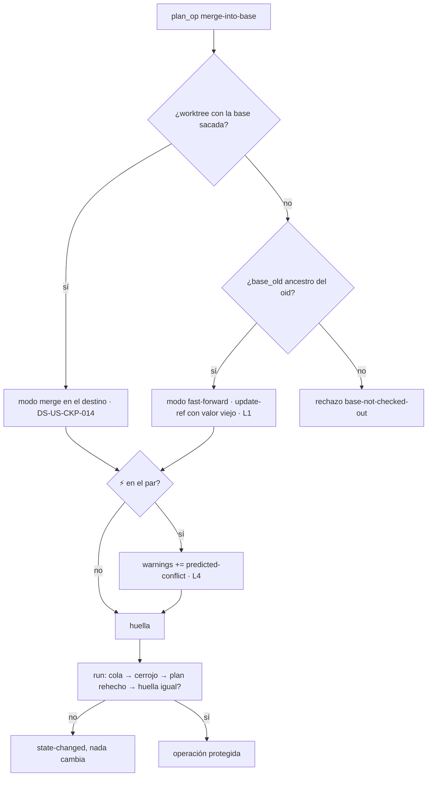

# DS-US-CKP-024 · Integrar sigue siendo seguro cuando el estado cambia, choca o la base no está sacada

## Contexto rápido

Al terminar, la tecla de integrar de DS-US-CKP-014 aguanta el caos de diez agentes:
- con ⚡ en el par (rama, base), el mismo ConfirmPrompt reúne el conflicto previsto y el plan; si el desarrollador dice No, nada cambia;
- con una sesión en el worktree de destino, "Integrar" sale desactivado con "hay un agente en el worktree de destino";
- un commit del agente entre preparar y ejecutar, o una segunda TUI que integra lo mismo a la vez, dan "el estado cambió" sin tocar nada;
- si ningún worktree tiene la base sacada, se integra por avance rápido de la ref cuando se puede, y si no, se rechaza con "saca main en un worktree para integrar".

Casi todo el mecanismo ya existe y esta historia lo ejercita y lo cierra:
- **Revalidación bajo el cerrojo**: el ejecutor rehace el plan con el cerrojo del repo y compara la huella; si difiere, `state-changed` sin intención en el oplog (DS-TS-CKP-002 § 4). La cola por repo es FIFO de 8 (`crates/core/src/repo_lock.rs`).
- **Sesión en el destino**: el brazo de DS-US-CKP-014 ya rechaza con `target-session-present` (T003, regla 6) y la TUI ya lo desactiva (`MergeBlock::TargetSession`). Aquí se prueba de punta a punta.
- **Lo que falta**: el camino de avance rápido sin worktree (hoy `base-not-checked-out` para todo caso sin destino) y el aviso ⚡ en el plan, que necesita que el predictor publique su estado. Hoy el módulo `daemon/modules/predict.rs` guarda los pares en su hilo y "nothing is published yet".

Sin `architecture-constitution.md`: mismas restricciones que DS-US-CKP-014 (AGENTS.md, ADR-GRP-001, ADR-GRP-016, NFR-02).

### Decisiones

Todas son **Decisión del orquestador (2026-10-27), validada por Arquitecto**. Validadas por PO el 2026-10-27, sin cambios (L5: ver Q-CKP-39).

**Revisión de arquitectura (2026-10-27)**, contra el código de `main`. Lo que sigue queda como **Decisión del orquestador (2026-10-27), validada por Arquitecto (revisión)**:
- Ratificadas: L2, L3, L4, L5 y L7.
  - L3: `ProtectedRequest::for_step` añade siempre el worktree pedido al ámbito, así que el previo cubre el del agente y la ref.
  - L4: `false` por defecto no abre nada, y `PairKey { a: worktree, b: PairSide::Base }` existe.
  - L5: la huella ya incluye `OpPlan` entero (`executor/mod.rs`, `fingerprint`), avisos incluidos.
  - L7: un rechazo al rehacer el plan bajo el cerrojo ya se convierte en `state-changed` (`executor/mod.rs`).
- L1 precisada: la base en rebase o bisect cuenta como sacada.
- L6 precisada: `OnceLock` para el lector.
- T002: el desenlace se compara con lo leído antes del lanzamiento.
- Fixture y aserciones de § 9.3 y § 9.4 ajustadas para que sean deterministas.

| ID | Decisión | Por qué / descartado |
|----|----------|----------------------|
| L1 | **Avance rápido sin worktree** en `ops/merge.rs`: sin destino y con la punta de la base ancestro del oid (`RepoReader::merge_bases(oid, base_old) == [base_old]`), modo `fast-forward`: `UserOp::UpdateRef { name: refs/heads/<base>, new: oid, old: base_old }` sin `work_tree`. `MergeTargetView::RefOnly`. Sin avance rápido, `base-not-checked-out` como hasta ahora. "Sin destino" usa la regla 5 de DS-US-CKP-014: un worktree que está rebasando o bisecando la base la tiene sacada (da `operation-in-progress`), y nunca se avanza la ref por debajo de ese rebase | ADR-CKP-002 § 7 tal cual. `update-ref` con el valor viejo falla entero si la ref se movió por fuera del cerrojo. Mover la base por debajo de un rebase en curso haría fallar el final de ese rebase, que escribe la rama con su valor viejo. Precisado en la revisión de arquitectura (2026-10-27) |
| L2 | **La ausencia de destino entra en la huella**: `expected.target = null` y `expected.mode = "fast-forward"`. Bajo el cerrojo se vuelve a listar los worktrees; si alguno sacó la base entre fases, el plan rehecho cambia y da `state-changed` | ADR-CKP-002 § 7 exige comprobar bajo el cerrojo que ningún worktree tiene la base sacada; rehacer el plan lo cumple sin código aparte |
| L3 | **Ámbito del avance rápido**: `StepScope { worktrees: [], refs: ["refs/heads/<base>"] }`. El snapshot previo guarda la ref; Deshacer la devuelve a `base_old` | Ningún working tree cambia. `reference-transaction` corre y Guardrails ve la transición `MergeInto` (nuevo = integrado), sin `post-merge` (desviación declarada de NFR-07, ADR-CKP-002 Consecuencias) |
| L4 | **⚡ en el plan**: `EngineFacts::predicted_conflict(repo_id, worktree, base) -> bool`, método nuevo con implementación por defecto `false`. `true` solo si el par `(worktree, PairSide::Base)` tiene nivel ⚡ en estado `current` o `recalculating`, los dos en los que existe nivel (A2 de DS-US-CKP-006). Con `true`, `OpPlan.warnings` lleva `PredictedConflict` | Los avisos son UX (ADR-CKP-002 § 2, paso 3): por defecto `false` no abre ninguna escritura. El daemon es la fuente: la TUI no recalcula ⚡ |
| L5 | **⚡ entra en la huella**, porque los avisos son parte del `OpPlan`. Si ⚡ aparece o desaparece entre preparar y ejecutar, `state-changed` | El usuario confirmó con lo que veía. Descartado: excluir los avisos de la huella, que cambia `fingerprint` para todas las operaciones. Riesgo de rechazos por predicción que oscila: Q-CKP-39 |
| L6 | **Lectura de la predicción desde el ejecutor**: un accesor compartido de solo lectura, `PredictionReader`, que el módulo `predict` publica al adjuntarse (lo pide el mismo PR-B de TS-CKP-001 que publica `prediction.changed`). `DaemonEngineFacts` lo consulta sin esperar al hilo del predictor. Lo guarda en un `OnceLock<PredictionReader>` propio: si el módulo `predict` se adjunta después de `serve_channel`, o no se adjunta, `predicted_conflict` da `false` | El ejecutor prepara en el hilo de la conexión; un mensaje al hilo del predictor con respuesta metería latencia y un punto de bloqueo. El `OnceLock` quita la dependencia del orden de arranque entre el módulo y el canal (revisión de arquitectura, 2026-10-27) |
| L7 | **Dos TUIs**: no se añade nada al ejecutor. La segunda petición espera en la cola; al tomar el cerrojo rehace el plan, la punta de la base ya no es `base_old`, y recibe `state-changed`. Las dos TUIs ven el resultado por el snapshot y los eventos del motor | BR-CKP-CONS-004; mecanismo probado con dobles en DS-TS-CKP-002, aquí con Git real y dos `App` |

## ⚠️ Gaps y violaciones de la constitución

| ID | Qué falta | Severidad | Acción | Owner |
|----|-----------|-----------|--------|-------|
| G1 | DS-US-CKP-014 implementada: brazo `merge-into-base`, `EngineFacts`, `write_flow` y la elegibilidad. Todo esta DS se apoya en ellos | Bloqueante | Implementar DS-US-CKP-014 primero | Orquestador |
| G2 | El predictor no publica su estado (PR-B de [DS-TS-CKP-001](./TS-CKP-001-predictor-conflictos.md): T009 y lo que depende de G5). Sin él, `predicted_conflict` no tiene de dónde leer | Bloqueante solo para T003 (`blocked_tasks`) | Cerrar el PR-B de TS-CKP-001 y añadir `PredictionReader` (L6) | Orquestador |

Ninguna violación.

## 🔭 La forma



---

## 🚀 Plan de implementación

### El trabajo de un vistazo

| # | Tarea | Depende | Aterriza en |
|---|---|---|---|
| T001 | Escribir en rojo los tests de los seis escenarios | G1 | `crates/core/tests/us_ckp_024_merge_edges.rs`, `apps/cli/tests/tui_merge_edges.rs` |
| T002 | Añadir el avance rápido sin worktree | T001 | `crates/core/src/executor/ops/merge.rs` |
| T003 | Añadir ⚡ al plan y al prompt | T001, G2 | `ops/context.rs`, `daemon/operation_facts.rs`, `ops/merge.rs`, `present/merge_text.rs` |
| T004 | Presentar "el estado cambió" y el destino con sesión | T001 | `present/merge_text.rs`, `present/write_text.rs` |
| T005 | Cerrar la historia | T001–T004 | `docs` |

### T001 — Escribir en rojo los tests

**Ubicación.**
- `crates/core/tests/us_ckp_024_merge_edges.rs` (**CREATE**): daemon en proceso con `OperationsWiring::production()` y el contexto adjunto, Git real, repos y perfil temporales.
- `apps/cli/tests/tui_merge_edges.rs` (**CREATE**): arnés de `apps/cli/tests/live_fleet.rs` (macOS, depuración), dos `App` sobre `TestBackend` contra el mismo daemon.

**Reglas**
- Los mismos de DS-US-CKP-014 T001: archivo propio, regla R4, nunca este repo ni el perfil real.
- Para "un commit entre preparar y ejecutar", el test prepara, hace un commit real en el worktree del agente con el `git` del sistema y luego ejecuta. Nada de dobles de `facts`.
- Para "dos TUIs", las dos preparan antes de que ninguna ejecute, y las dos ejecutan sin esperarse (dos hilos).
- Para ⚡, el test fija el estado de la predicción con el accesor de pruebas que añada el PR-B de TS-CKP-001; si no lo hay, el test de T003 queda marcado `#[ignore = "G2"]` y se cuenta en el PR.

### T002 — Avance rápido sin worktree

**Ubicación.** `crates/core/src/executor/ops/merge.rs` (**MODIFY**).

**Reglas**
- En `plan_op`, regla 5 de DS-US-CKP-014: sin destino, se lee `RepoReader::merge_bases(oid, base_old)`. Si es exactamente `[base_old]`, modo `fast-forward` (L1); si no, `base-not-checked-out`.
- `expected`: `{base, base_old, integrated, target: null, mode: "fast-forward", commits, base_worktrees: []}` (L2). `base_worktrees` es la lista de raíces con la base sacada, vacía; al rehacer el plan bajo el cerrojo se vuelve a leer.
- `MergeStep` en modo `fast-forward`: `RepoTarget { git_dir: directorio común, work_tree: None }`, `UserOp::UpdateRef { name, new: oid, old: base_old }`, `run_git`. `scope()` según L3.
- `classify_after` (I8 de DS-US-CKP-014): el paso lee la ref justo antes de lanzar `update-ref`, ya con el snapshot previo tomado (`before`). Éxito y la ref en `oid` → `done`; fallo con la ref igual a `before` → `failed-unchanged`; cualquier otro → `failed-changed`. Nunca se compara con `base_old` del plan: una ref movida por otro antes del lanzamiento no es un cambio de esta operación, y Deshacer la revertiría.
- `merge.ff=only` del usuario no aplica (no hay `git merge`); `merge.ff=false` tampoco: la ref avanza sin commit de merge, como fija ADR-CKP-002 § 7.

**Criterios de aceptación de la tarea:** tests unitarios de `merge.rs` para "avance rápido", "divergente" y "la base sacada entre fases".

### T003 — ⚡ en el plan y en el prompt

**Bloqueada por G2.**

**Ubicación.**
- `crates/core/src/executor/ops/context.rs` (**MODIFY**): `EngineFacts::predicted_conflict` con implementación por defecto `false` (L4).
- `crates/core/src/daemon/operation_facts.rs` (**MODIFY**): implementación con `PredictionReader` (L6).
- `crates/core/src/executor/ops/merge.rs` (**MODIFY**): `warnings.push(WarningCode::PredictedConflict)` cuando toca.
- `apps/cli/src/present/merge_text.rs` (**MODIFY**): línea "⚡ conflicto previsto entre <rama> y <base>" en el prompt, con plegado ASCII de `Glyphs`.

**Reglas**
- La TUI pinta la línea solo si el plan trae `predicted-conflict`; nunca la deduce de su propio modelo de predicción.
- Rechazar el prompt vuelve a `Idle` sin `operation.run` (DS-US-CKP-014 T005); el plan caduca en el daemon.
- El aviso viaja en `PrepareResult.warnings`, sin rutas ni rangos: el detalle del par lo da el panel de DS-US-CKP-006.

### T004 — Textos de los rechazos de este caso

**Ubicación.** `apps/cli/src/present/write_text.rs` y `present/merge_text.rs` (**MODIFY**).

**Reglas**
- `state-changed` → "el estado cambió; vuelve a pedirlo". El flujo pasa a `Rejected` y la fila se repinta con la instantánea nueva.
- `target-session-present` y `MergeBlock::TargetSession` → "hay un agente en el worktree de destino".
- `base-not-checked-out` → "saca <base> en un worktree para integrar".
- `queue-full` → "hay demasiadas operaciones en cola en este repo; espera".

### T005 — Cerrar la historia

Como DS-US-CKP-014 T008.

---

## Estructura de ficheros

| Archivo | Acción | Tarea |
|---|---|---|
| `crates/core/tests/us_ckp_024_merge_edges.rs` | CREATE | T001 |
| `apps/cli/tests/tui_merge_edges.rs` | CREATE | T001 |
| `crates/core/src/executor/ops/merge.rs` | MODIFY | T002, T003 |
| `crates/core/src/executor/ops/context.rs` | MODIFY | T003 |
| `crates/core/src/daemon/operation_facts.rs` | MODIFY | T003 |
| `apps/cli/src/present/{merge_text,write_text}.rs` | MODIFY | T003, T004 |

Ningún archivo compartido de la tabla de ADR-GRP-016.

## Contratos compartidos

### Tipos y datos compartidos

```rust
// crates/core/src/executor/ops/context.rs (T003) — método nuevo del trait de DS-US-CKP-014
pub trait EngineFacts: Send + Sync {
    // … base, present_sessions (DS-US-CKP-014)
    fn predicted_conflict(&self, repo_id: &str, worktree: &std::path::Path, base: &str) -> bool {
        let _ = (repo_id, worktree, base);
        false
    }
}

// crates/core/src/predict/ (PR-B de TS-CKP-001, L6) — a crear
pub struct PredictionReader { /* Arc compartido con el módulo predict, solo lectura */ }
impl PredictionReader {
    pub fn base_pair_conflict(&self, repo_id: &str, worktree: &std::path::Path) -> Option<bool>;
}
```

Lo que ya existe y se usa: `MergeTargetView::RefOnly` (DS-US-CKP-014), `WarningCode::PredictedConflict`, `UserOp::UpdateRef`, `RepoReader::merge_bases`, `PairKey { a, b: PairSide::Base }`, `PairState`, `RejectReason::{StateChanged, QueueFull}`.

### Ciclos de vida (DI)

`PredictionReader`: uno por daemon, creado por el módulo `predict` y entregado a `DaemonEngineFacts` al montar el canal, como el resto de `OpsContext`.

## Contrato de API

Sin cambios de forma sobre DS-US-CKP-014: `MergeTargetView::RefOnly` y `predicted-conflict` ya existen en el contrato y viajan con la capacidad `operation.merge`.

### Valores numéricos

| Valor | Cifra | Fuente |
|---|---|---|
| Cola por repo | 8 en espera; la novena, `queue-full` | DS-TS-CKP-002 D4 |
| Caducidad del plan | 60 s | DS-TS-CKP-002 D8 |

## Estrategia de pruebas y cobertura

### 9.1 Pirámide de pruebas

| Nivel | Dónde | Qué |
|---|---|---|
| Unit | `ops/merge.rs` | Avance rápido, divergente, base sacada entre fases, ⚡ |
| Integración | `crates/core/tests/us_ckp_024_merge_edges.rs` | Los seis escenarios contra el daemon con Git real |
| E2E | `apps/cli/tests/tui_merge_edges.rs` (macOS) | Prompt con ⚡, acción desactivada, dos TUIs |

### 9.2 Umbrales de cobertura

Cada escenario de la historia con un test de integración y, si tiene pantalla, uno E2E.

### 9.3 Datos de prueba

Los de DS-US-CKP-014 (`gitraptor_testkit::Fixture`), más: un repo cuyo worktree principal está en `feat-x` y ningún worktree tiene `main` sacada; `feat-pagos` que desciende de la punta de `main`, y `feat-div` divergente. Una sesión Inactiva de `raptor-fake-agent` como "claude-5" en el worktree principal del repo de DS-US-CKP-014 (el que tiene `main` sacada), para el escenario del destino con sesión. Para el escenario ⚡, el worktree del agente queda sin sesión, así que el plan no lleva `active-session`.

### 9.4 Comportamientos críticos verificados

| Escenario de la historia | Test |
|---|---|
| Con ⚡ en el par, aviso y confirmación | `us_ckp_024_merge_edges::a_predicted_conflict_is_a_warning_of_the_plan` (sin sesión en el worktree del agente, § 9.3: warnings = `[predicted-conflict, other-actors-work]`, el orden de `WarningCode`) y `tui_merge_edges::predicted_conflict_and_plan_share_one_prompt`; tras No, la punta de `main` igual y ninguna intención en el oplog. Bloqueado por G2 |
| Destino con sesión presente | `tui_merge_edges::a_session_in_the_target_disables_integrate` ("hay un agente en el worktree de destino") y `us_ckp_024_merge_edges::a_session_in_the_target_is_refused` (`target-session-present`) |
| Un commit entre preparar y ejecutar | `us_ckp_024_merge_edges::a_commit_between_prepare_and_run_changes_the_state`: `state-changed`, `main` igual, oplog sin intención nueva |
| Dos TUIs a la vez, una sola ejecución | `us_ckp_024_merge_edges::two_runs_of_the_same_plan_shape_run_once` (dos conexiones, dos hilos: una `done`, otra `state-changed`; un solo merge en `main`) y `tui_merge_edges::two_tuis_see_one_integration` (las dos `App` muestran `main` con el merge; la segunda, "el estado cambió") |
| Sin worktree con la base sacada, avance rápido | `us_ckp_024_merge_edges::without_the_base_checked_out_a_fast_forward_moves_only_the_ref`: `refs/heads/main` = punta de `feat-pagos`, ningún working tree cambia (estado de cada worktree igual), `reference-transaction` corrió; Deshacer devuelve la ref |
| Sin worktree con la base sacada y sin avance rápido | `us_ckp_024_merge_edges::without_the_base_checked_out_a_divergent_branch_is_refused` (`base-not-checked-out`, nada cambia) y su texto en `tui_merge_edges` |

Además: `us_ckp_024_merge_edges::checking_out_the_base_between_phases_changes_the_state` (L2) y `a_ref_moved_outside_the_lock_fails_whole`: un `prior_layer` de pruebas (solo depuración) mueve `refs/heads/main` con el `git` del sistema antes de delegar en el snapshotter real; `update-ref` con el valor viejo falla entero, la ref queda en el valor ajeno y el desenlace es `failed-unchanged` (el previo ya vio la ref movida). Además: `a_base_being_rebased_is_never_fast_forwarded` (L1): un worktree rebasando `main` → `operation-in-progress` y la ref igual.

### 9.5 Plataformas

macOS. Linux y Windows: **Pendiente: etapa de validación multiplataforma**.

## Gate de seguridad

- [ ] El avance rápido usa `UserOp::UpdateRef` con el nombre completo `refs/heads/<base>` y el valor viejo; nunca `--force` ni un nombre corto.
- [ ] Sin worktrees temporales ni objetos escritos fuera de Git (ADR-CKP-002 § 7).
- [ ] La predicción solo añade un aviso; nunca abre una escritura (L4).
- [ ] NFR-01: snapshot previo también en el avance rápido (la ref); tests con repos temporales.

## Cómo extender

- **Otro aviso del plan de merge**: un método de `EngineFacts` con implementación por defecto que no abre nada, y su `WarningCode` (variante aditiva detrás de `operation.merge`).
- **Otro modo de integración** (por ejemplo, *squash*): no se añade aquí; cambiaría la semántica del catálogo y sube su versión mayor (ADR-CKP-002 § 1).

## Fuera de alcance

| Qué | Dueño |
|---|---|
| Merge que choca de verdad: rutas, Abortar, editor, Cancelar | US-CKP-016 |
| Panel de pares ⚡/⚠ en la TUI | US-CKP-006 |
| Cancelar una petición que espera en la cola | US-CKP-023 |

## Notas del autor

- La mayor parte del valor de esta historia está en las pruebas: el mecanismo lo puso TS-CKP-002 y DS-US-CKP-014 añade el brazo.
- Si G2 tarda, T001, T002 y T004 se entregan con T003 bloqueada; el escenario ⚡ queda `#[ignore = "G2"]` y la historia `partially-implemented`.

### Preguntas abiertas

| ID | Pregunta | Para |
|----|----------|------|
| ~~Q-CKP-39~~ | ~~Con ⚡ dentro de la huella (L5), una predicción que oscila entre preparar y ejecutar da "el estado cambió". ¿Se acepta, o el aviso ⚡ debe quedar fuera de la huella?~~ **Cerrada.** Decisión del orquestador (2026-10-27), validada por PO: se acepta para el MVP. Si ⚡ aparece después de confirmar, el usuario no consintió un conflicto previsto, y rechazar es lo que pide la historia ("si la rechaza, nada cambia"). Además, el caso es raro: lo que decide ⚡ (el HEAD de la rama y la punta de la base) ya está en la huella, así que solo oscila cuando el predictor termina un cálculo entre preparar y ejecutar. Volver a pedirlo es una tecla ("el estado cambió; vuelve a pedirlo", T004). Se revisa si el dogfooding muestra rechazos frecuentes por esta causa | Arquitecto / PO |

## Estado

- Lista para implementar tras DS-US-CKP-014; T003 bloqueada por G2.
