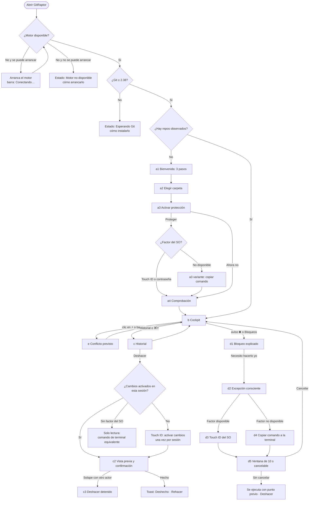

# Design Flow: App de escritorio (UI-1)

**Contexto**: [`../context.md`](../context.md) (lo escribe el PO en paralelo). Este flujo no depende de sus ids: las pantallas se nombran por letra (a–e) y se alimentan de historias que ya existen.
**Diseñador**: Diseñador UX (agente). **Estado**: draft.
**Referencias de experiencia**: GitKraken Desktop (layout, grafo, undo de un botón) y GitHub Desktop (lenguaje sencillo, acciones con verbo concreto). Patrones para novatos: § 3 del [benchmark de GUIs de Git](../research/benchmark-2026-10.md) (RES-DSK-BENCH-2026-10), citados como **B-P1** … **B-P10**. Mercado: [RES-GRP-COMP-2026-10](../../../../business/research/competitive-2026-10.md).

> Flujo de UX y comportamiento de pantalla, con mockups de baja fidelidad en ASCII. Sin Figma y sin píxeles. Los tokens que se nombran son los semánticos de DSYS-GRP-001; los que faltan para la app se listan en § 8 como hueco.

---

## 0. Alcance de UI-1

UI-1 es la primera versión útil de la app de escritorio (Tauri + React), unas 3 semanas, **macOS primero**. Consume el mismo motor (daemon) que la TUI; la app no calcula nada que el motor no publique (BR-CKP-CALC-001).

| Pantalla | Qué resuelve para un novato | Historias que la alimentan |
|---|---|---|
| **a. Bienvenida** | Añadir un repo y protegerlo sin abrir la terminal | US-CKP-003 (estados del motor, sin repos), US-GRD-001 (proteger con permiso), US-GRD-003 (retirar sin rastro), US-GRD-004 (qué no se puede impedir) |
| **b. Cockpit** | Ver qué hace cada agente, sus ramas y qué va a chocar | US-CKP-001, US-CKP-002, US-CKP-003, US-CKP-022, US-CKP-006, US-CKP-007, US-CKP-008 |
| **c. Historial** | Deshacer con un botón, con vista previa, y rehacer | US-CKP-021, US-TMC-002, US-TMC-003, US-TMC-006, US-TMC-009, US-TMC-012, US-TMC-014, US-TMC-023 |
| **d. Bloqueo** | Entender qué frenó Guardrails y, si hace falta, hacer una excepción consciente | US-CKP-019, US-GRD-005, US-GRD-006; ADR-GRD-007, ADR-GRD-008 |
| **e. Conflicto previsto** | Saber qué archivos y qué agentes van a chocar y qué hacer | US-CKP-006, US-CKP-007, US-CKP-008 |

**Fuera de UI-1** (van a UI-2, § 6): diff y staging, editor de conflictos, integrar y rebasar desde la app (US-CKP-014, US-CKP-015), crear y descartar worktrees (US-CKP-017, US-CKP-018), aprobar la cola de confirmación (US-GRD-015) y editar la configuración de Guardrails (US-GRD-013). Lanzar agentes sigue fuera de alcance del producto (BRD § 6.4).

---

## 1. Principios de UX para novatos

| # | Principio | Cómo se aplica en UI-1 |
|---|---|---|
| P1 | **Sin jerga, o con su glosario a mano** | Cada término de Git aparece la primera vez con una explicación corta y un tooltip del glosario (§ 12): "rama (branch)", "copia de trabajo (worktree)". El comando exacto de Git se ve solo al desplegar "Detalles técnicos". |
| P2 | **Lo seguro es lo predeterminado** | El botón principal de cada aviso es la acción que no cambia nada ("Entendido", "Cancelar"). Lo que relaja una protección es un botón secundario, nunca el que recibe el foco ni el de `Enter`. |
| P3 | **Siempre hay un "Deshacer" visible** | Botón fijo "Deshacer" en la barra superior y toast con "Deshacer" tras cada operación hecha desde la app (ADR-GRP-004 § 3). Se dice "recuperable" y nunca "todo es reversible": con Git directo se recupera hasta el último estado capturado (RES-GRP-COMP-2026-10, R1). |
| P4 | **Revelado progresivo** | Tres capas por cada cosa: el titular en lenguaje llano, el porqué en una frase y los detalles técnicos plegados (comando, regla, nivel, hash). |
| P5 | **Qué pasó → por qué → qué hacer** | Todo aviso sigue el formato de errores de DSYS-GRP-001 § 4, con un verbo concreto en el botón ("Restaurar", "Copiar comando", nunca "OK"). |
| P6 | **La app nunca miente sobre su estado** | La barra de estado del motor dice siempre si los datos están en vivo, reconectando o parados. Un dato que el motor no publica se pinta "no disponible", no cero (US-CKP-003, BR-CKP-CALC-001). |
| P7 | **El color nunca va solo** | Cada estado lleva símbolo y texto (DSYS-GRP-001 § 2.2): ● Activo, ◐ Inactivo, ○ Terminado, ⚡ conflicto previsto, ⚠ solape, ⛔ bloqueado, ⟲ recuperable. |
| P8 | **Lo que hace el humano lo confirma el humano** | Las acciones reservadas (añadir y proteger un repo, restaurar sobre trabajo ajeno, excepción consciente) se confirman con un factor del sistema operativo que un agente no puede automatizar, uno por acción. Las escrituras normales (Deshacer de trabajo propio) piden el factor una vez por sesión ("Activar cambios"). Sin factor, la app solo lee y enseña el comando de terminal equivalente (§ 4.d; ADR-GRD-008; ADR-GRP-017 § 4 y § 5, proposed). |

**Correspondencia con los patrones del benchmark** (RES-DSK-BENCH-2026-10 § 3):

| Patrón del benchmark | Dónde está en UI-1 |
|---|---|
| B-P1 Deshacer visible, con `Cmd+Z` y rehacer (GitKraken, Tower) | Botón "Deshacer" fijo, `Cmd+Z` con vista previa y "Rehacer" en el toast (P3, c, § 5, D-2) |
| B-P2 Cada restauración es una entrada nueva y también se deshace (GitButler) | La entrada del undo aparece en el historial con "Rehacer" (c4) |
| B-P3 Lenguaje no técnico y pocas decisiones (GitHub Desktop) | P1, P4, D-4 y el glosario de § 12 |
| B-P4 Tarjetas de sesión con estado y acciones de un clic (GitKraken) | Fila de agente en la barra lateral y su tarjeta en el panel de detalle (b) |
| B-P5 Crear el worktree en un paso sin decir "worktree" | UI-2; en UI-1 la palabra va siempre con su glosa ("copia de trabajo", D-4) |
| B-P6 Comentarios de revisión que llegan al agente (Warp) | Fuera de UI-1; "Copiar aviso para los agentes" (e, H-5) es el paso previo |
| B-P7 Avisos proactivos de solape con acciones (GitKraken Conflict Prevention) | Banda ⚡ entre carriles, toast y pantalla e |
| B-P8 Lista de archivos en conflicto con "Continuar merge" (GitHub Desktop) | UI-2, editor de conflictos (§ 6.2) |
| B-P9 Ajustes por repositorio (GitKraken) | La protección se activa y se quita por repo (a3) |
| B-P10 No instalar nada sin permiso, y poder revertirlo | a3 explica qué se instala, cómo se quita y pide permiso; "Ahora no" no instala nada ni vuelve a preguntar (US-GRD-001, US-GRD-003) |

---

## 2. Layout general y navegación

### 2.1 Mapa de navegación



La barra lateral y la barra de estado están en todas las vistas de la app; el mapa solo muestra las transiciones de la zona central y los diálogos.

### 2.2 Layout tipo GitKraken (tres paneles)

```text
+--------------------------------------------------------------------------------------------+
| (o) GitRaptor   [ shop v ]  base: main            [ Cmd+K  Buscar acción ]  [⟲ Deshacer] ? |
+-------------------+--------------------------------------------------+---------------------+
| REPOS             |  Cockpit    Historial    Bloqueos (1)            | DETALLE             |
| > shop     ⛔1 ⚡1 |                                                  |                     |
|   blog            |  zona central: grafo con carriles por agente     | lo seleccionado en  |
|   + Añadir repo   |  (b), lista del historial (c) o lista de         | el centro: agente,  |
|                   |  bloqueos (d)                                    | commit, par en      |
| AGENTES           |                                                  | conflicto o bloqueo |
|  ● claude-1  ⚡   |                                                  |                     |
|  ● claude-2  ⚡   |                                                  | acciones de lo      |
|  ◐ claude-3       |                                                  | seleccionado        |
|  · Sin agente     |                                                  |                     |
|                   |                                                  |                     |
| RAMAS             |                                                  |                     |
|  main  (base)     |                                                  |                     |
|  feat-pagos       |                                                  |                     |
|  feat-login       |                                                  |                     |
+-------------------+--------------------------------------------------+---------------------+
| ● En vivo · motor 0.1.0 · Protección: activa · Conflictos: hace 40 s · 3 agentes   ES | ☾  |
+--------------------------------------------------------------------------------------------+
```

| Región | Contenido | Comportamiento |
|---|---|---|
| **Barra superior** | Selector de repo, base confirmada, paleta de comandos (`Cmd+K`), botón "Deshacer" fijo, ayuda `?` | "Deshacer" se desactiva con motivo en tooltip cuando no hay nada que deshacer en el worktree seleccionado (US-TMC-002, "No hay nada que deshacer"). |
| **Barra lateral** | Tres secciones plegables: **Repos** (con contadores ⛔ y ⚡), **Agentes** (copias de trabajo y su agente, en orden de atención de US-CKP-002) y **Ramas** | Seleccionar un agente lo resalta en el grafo y abre su detalle a la derecha. Los contadores que el motor no publica se pintan `–` (DSYS-GRP-001, enmienda US-CKP-001). |
| **Zona central** | Pestañas **Cockpit**, **Historial**, **Bloqueos** | La pestaña activa vive en la URL (`/repo/:id/cockpit`, ADR-GRP-004 § 1) y se restaura al reabrir. |
| **Panel derecho (detalle)** | Lo seleccionado en el centro | Se cierra con `Esc` o con su botón; por debajo de 1100 px se abre como cajón superpuesto (§ 2.4). |
| **Barra de estado del motor** | Conexión, versión, protección, frescura de la predicción, número de agentes, idioma, tema | Siempre visible; es la fuente de verdad sobre si lo que se ve está al día (§ 2.3). |

⚠️ **Pendiente de Rene**: tres paneles (lateral + centro + detalle) o dos (lateral + centro, con el detalle como cajón). Ver § 10, R-1.

### 2.3 Barra de estado del motor

Mapea los estados de US-CKP-003 a la app. Un estado distinto de "En vivo" pinta además una banda fina sobre la zona central con la acción que lo resuelve.

| Estado del motor | Barra de estado (es / en) | Banda en la zona central | Qué pasa con los datos |
|---|---|---|---|
| En vivo | `● En vivo` / `● Live` | — | Se actualizan solos (< 500 ms p95, US-CKP-001) |
| Conectando o arrancando | `◌ Conectando con el motor…` / `◌ Connecting to the engine…` | — | Esqueleto de carga; sin "vacío" |
| Reconciliando o resync | `◐ Poniéndose al día…` / `◐ Catching up…` | "Revisando cambios recientes; la vista puede tardar unos segundos." | Se muestran los últimos datos con el aviso |
| Dormido | `◐ En reposo` / `◐ Idle` | — | Datos al día; se despierta con el próximo cambio |
| Desconectado (se perdió la conexión) | `✖ Sin conexión · reintentando en 5 s` | "Se perdió la conexión con el motor. Lo que ves puede estar desactualizado." + [Reintentar ahora] | Todo se atenúa (`text.muted`) y las acciones se desactivan con motivo |
| Motor no disponible | `✖ Motor parado` | "El motor de GitRaptor no está en marcha." + [Arrancar motor] | Nada en vivo; la app no observa el repo por su cuenta (US-CKP-003) |
| Motor incompatible | `✖ Versión del motor no compatible` | "La app y el motor no son de la misma versión." + [Cómo actualizar] | Igual que parado |
| Esperando Git | `⚠ Falta Git 2.38 o superior` | Pantalla completa (a0) con cómo instalarlo; gana a "sin repos" | — |
| Solo lectura (cambios sin activar) | `◇ Solo lectura · [Activar cambios]` / `◇ Read-only · [Enable changes]` | — | En vivo. La primera escritura de la sesión pide Touch ID una vez (presencia de sesión, ADR-GRP-017 § 4); caduca al cerrar la app o tras un rato sin escribir |
| Solo lectura (sin factor del SO) | `◇ Solo lectura en esta versión` | "Para hacer cambios, usa los comandos de terminal que te mostramos en cada acción." | En vivo; cada acción enseña su comando con "Copiar" (ADR-GRP-017 § 5) |
| Abierta por un agente | `◇ Abierta por un agente: vista restringida` | "Esta ventana la abrió un agente. Ves lo mismo que él y no puedes hacer cambios desde aquí." | Vista acotada (perfil `mcp`, ADR-GRP-017 § 3) |
| Protección inactiva (US-GRD-004) | `⚠ Protección: inactiva en shop` | "Otra herramienta reemplazó la protección de shop. Ahora no se frena ningún force-push." + [Volver a proteger] [Por qué pasó] | Datos en vivo; el contador ⛔ del repo se sustituye por ⚠ |

### 2.4 Tamaño de ventana

| Anchura de la ventana | Layout |
|---|---|
| ≥ 1280 px | Tres paneles: lateral 240 px, detalle 320 px, el centro ocupa el resto |
| 1100–1279 px | Lateral 200 px; el detalle se mantiene |
| 800–1099 px | El detalle pasa a cajón superpuesto desde la derecha, con foco atrapado y `Esc` para cerrar |
| < 800 px (mínimo 720 × 560) | La barra lateral se pliega a iconos con contadores; el grafo cede espacio antes que la lista de agentes y los avisos (US-CKP-022, "El grafo cede espacio primero") |

⚠️ **ASSUMPTION**: los anchos (240, 320 px y los cortes) son de partida y se afinan en el primer prototipo.

---

## 3. Flujos de usuario

| # | Flujo | Actor | Historias | Pasos (intención) |
|---|---|---|---|---|
| F1 | Primer arranque: añadir y proteger un repo | Desarrollador novato | US-CKP-003, US-GRD-001 | entender qué hace GitRaptor → elegir la carpeta del repo → leer qué se instala → confirmar con el SO → ver que todo está en verde |
| F2 | Vigilar la flota | Desarrollador | US-CKP-001, US-CKP-002, US-CKP-022 | abrir la app → ver los agentes y sus carriles → seleccionar uno → ver su detalle |
| F3 | Enterarse de un conflicto antes del merge | Desarrollador | US-CKP-006, US-CKP-007, US-CKP-008 | recibir el aviso → abrir el par → ver archivos, frescura y qué hacer |
| F4 | Deshacer lo que salió mal | Desarrollador | US-CKP-021, US-TMC-002, US-TMC-012, US-TMC-014 | pulsar Deshacer (o elegir una entrada del historial) → ver qué se restaura → confirmar → poder rehacer |
| F5 | Rehacer lo deshecho | Desarrollador | US-TMC-003 | pulsar Rehacer en el toast o en el historial → ver el resultado |
| F6 | Entender un bloqueo | Desarrollador | US-CKP-019, US-GRD-005 | ver el aviso ⛔ → leer qué intentó el agente, por qué es peligroso y qué protege → cerrarlo sin cambiar nada |
| F7 | Hacer una excepción consciente | Desarrollador | US-CKP-019, US-GRD-006 | pedir hacerlo él → leer la operación exacta y sus consecuencias → confirmar con Touch ID (o comando en su terminal) → esperar o cancelar en 10 s → ver el resultado con Deshacer |
| F8 | Recuperarse de un motor parado | Desarrollador | US-CKP-003 | ver la barra en rojo → arrancar el motor o seguir las instrucciones → volver a "En vivo" |

---

## 4. Pantallas de UI-1

Convenciones de los mockups: `[ Botón ]` es un botón; `[[ Botón ]]` es el botón con el foco inicial; `( )` y `(o)` son opciones; `v` despliega; `>` marca la fila seleccionada. Los textos van en español; la tabla de copy de cada pantalla da el inglés.

### a. Bienvenida y onboarding

**Objetivo**: que alguien que nunca abrió una terminal tenga un repo observado y protegido, y sepa que el motor funciona, en menos de 2 minutos.

**Historias**: US-CKP-003 (sin repos, esperando Git, motor no disponible), US-GRD-001 (proteger con permiso explícito, qué se instala, cómo se revierte, qué no puede impedir, rama base confirmada), US-GRD-003 (retirar sin rastro), US-GRD-004 (lista de lo que no se puede impedir).

#### a1. Qué hace GitRaptor (3 pasos)

```text
+--------------------------------------------------------------------------------------------+
|                                                                                            |
|                      Trabaja con agentes de IA sin miedo a perder tu código                |
|                                                                                            |
|   +--------------------------+  +--------------------------+  +--------------------------+ |
|   | 1  Ve a tus agentes      |  | 2  Recupera lo que       |  | 3  Frena lo peligroso    | |
|   |                          |  |    salió mal             |  |                          | |
|   | Qué hace cada agente,    |  | GitRaptor guarda puntos  |  | Si un agente intenta     | |
|   | en qué rama, y qué       |  | de restauración. Con un  |  | borrar o reescribir tu   | |
|   | cambios van a chocar     |  | botón vuelves atrás.     |  | rama principal, se       | |
|   | antes de que choquen.    |  |                          |  | frena y te lo explica.   | |
|   +--------------------------+  +--------------------------+  +--------------------------+ |
|                                                                                            |
|   Todo pasa en tu equipo. Sin cuenta y sin enviar tu código a ningún sitio.                |
|                                                                                            |
|                                [[ Añadir mi primer repo ]]                                 |
|                                                                                            |
|   Comprobaciones:  ✔ Motor en marcha   ✔ Git 2.47 encontrado                               |
+--------------------------------------------------------------------------------------------+
```

#### a2. Elegir carpeta

```text
+--------------------------------------------------------------------------------------------+
|  Paso 1 de 3 · Elige tu repo                                                    [ Cerrar ] |
|                                                                                            |
|  Un repo es la carpeta de tu proyecto que usa Git (tiene una carpeta oculta .git).         |
|                                                                                            |
|   +------------------------------------------------------------------------------------+   |
|   |  ~/code/shop                                                    [[ Elegir... ]]    |   |
|   +------------------------------------------------------------------------------------+   |
|   ✔ Es un repo de Git · rama actual: main · 3 copias de trabajo (worktrees) (?)            |
|                                                                                            |
|   Arrastra aquí la carpeta, o elígela con el botón.                                        |
|                                                                                            |
|                                                     [ Atrás ]   [[ Continuar ]]            |
+--------------------------------------------------------------------------------------------+
```

#### a3. Activar protección

```text
+--------------------------------------------------------------------------------------------+
|  Paso 2 de 3 · ¿Protegemos shop?                                                           |
|                                                                                            |
|  Con la protección activa, nadie (tampoco un agente) puede:                                |
|    ⛔ reescribir el historial del servidor con un push forzado                              |
|    ⛔ borrar tu rama principal: main                                                        |
|                                                                                            |
|  Qué se instala   Unos "hooks" de Git en este repo (?). Nada fuera de shop.                |
|  Cómo se quita    Ajustes > shop > Quitar protección. El repo queda exactamente igual.     |
|  Rama principal   main  (la confirmas ahora; puedes cambiarla después)          [Cambiar]  |
|                                                                                            |
|  > Lo que esta protección no puede impedir (4)                                    [ver v]  |
|                                                                                            |
|  Una sola confirmación con Touch ID (o tu contraseña del Mac) añade shop y lo protege.     |
|                                                                                            |
|                            [ Añadir sin proteger ]   [[ Añadir y proteger con Touch ID ]]  |
+--------------------------------------------------------------------------------------------+
```

Variante sin factor del SO (versión sin el módulo de presencia, sesión sin interfaz gráfica, diálogo bloqueado por intentos fallidos o SO sin soporte):

```text
|  Ahora no podemos pedir Touch ID: {motivo}.                                                |
|  Para confirmar que eres tú, ejecuta estos comandos en tu terminal:                        |
|                                                                                            |
|   +------------------------------------------------------------------------------------+   |
|   |  /Applications/GitRaptor.app/Contents/MacOS/raptor repo add ~/code/shop            |   |
|   |  /Applications/GitRaptor.app/Contents/MacOS/raptor guard install ~/code/shop       |   |
|   |                                                                  [[ Copiar ]]      |   |
|   +------------------------------------------------------------------------------------+   |
|   ¿Dónde está la terminal? Pulsa Cmd+Espacio y escribe "Terminal".                         |
|   ◌ Esperando a que lo ejecutes…        (esta pantalla avanza sola cuando termine)         |
|                                                                                            |
|                                                                   [ Ahora no ]             |
```

El comando lleva la ruta absoluta del `raptor` que sirve al daemon (ADR-GRP-017 § 5). La app no abre la Terminal ni escribe en ella: no tiene permiso para lanzar procesos (ADR-GRP-017 § 2), y así ningún clic de la app ejecuta nada por el usuario.

#### a4. Comprobación

```text
+--------------------------------------------------------------------------------------------+
|  Paso 3 de 3 · Todo listo                                                                  |
|                                                                                            |
|    ✔ Motor en marcha                         versión 0.1.0                                 |
|    ✔ Git encontrado                          2.47                                          |
|    ✔ shop observado                          3 copias de trabajo                           |
|    ✔ Protección activa                       force-push y borrar main: bloqueados          |
|    ◌ Calculando conflictos previstos…        2 de 3 pares                                  |
|                                                                                            |
|  Consejo: si algo sale mal, pulsa ⟲ Deshacer arriba a la derecha.                          |
|                                                                                            |
|                                                        [[ Ir al Cockpit ]]                 |
+--------------------------------------------------------------------------------------------+
```

| Estado | Cuándo | Historia / regla | Comportamiento |
|---|---|---|---|
| default | Primer arranque sin repos observados | US-CKP-003 "Sin repos, un vacío que guía" | a1; equivale en la app a la guía `raptor repo add <ruta>` |
| cargando | Comprobando motor y Git | US-CKP-003 | Las comprobaciones de a1 muestran `◌` hasta tener resultado; el botón principal no se desactiva |
| vacío | No aplica: a1 es el estado vacío de la app | — | — |
| error · carpeta no es repo | La carpeta elegida no tiene `.git` | — | "Esta carpeta no es un repo de Git. Elige la carpeta raíz de tu proyecto." y el campo queda con borde `status.danger` + `✖` |
| error · repo ya observado | La carpeta ya está en GitRaptor | — | "shop ya está en GitRaptor." + [Ir a shop] |
| error · protección fallida | La instalación se interrumpe | US-GRD-003 "Una instalación interrumpida no deja el repo a medias" | "No se pudo terminar la protección. shop quedó como estaba." + [Reintentar] |
| error · otro gestor de hooks | El repo ya tiene hooks de otra herramienta | US-GRD-002 | ⚠️ **ASSUMPTION**: a3 muestra "shop ya usa hooks de otra herramienta (husky). GitRaptor los respeta y los sigue ejecutando." antes de proteger; el PO lo confirma con US-GRD-002 |
| factor rechazado | El usuario cancela Touch ID o falla | ADR-GRD-008 § 3.5 | Vuelve a a3 con "No se confirmó. shop sigue sin protección." Nada instalado |
| "Añadir sin proteger" | El usuario no protege | US-GRD-001 "Sin permiso no se instala nada ni se vuelve a preguntar" | Añadir el repo también es reservado: pide el factor igual, con el texto "GitRaptor: observar shop". Pasa a a4 con "○ Protección: no activada · Activar en Ajustes". No se vuelve a preguntar en cada arranque |
| motor parado | El motor no responde en a1 | US-CKP-003 | a1 cambia la comprobación a "✖ Motor parado" y el botón principal pasa a [Arrancar motor] |
| esperando Git | No hay Git o es anterior a 2.38 | US-CKP-003 "Esperando Git tiene prioridad" | a0: "GitRaptor necesita Git 2.38 o superior." + [Cómo instalar Git] (abre la guía); no se ofrece añadir repo |
| sin color / lector de pantalla | — | § 7 | Las comprobaciones se leen como lista: "Motor en marcha: correcto". Los pasos de a1 son una lista ordenada |

| Clave de copy | es | en |
|---|---|---|
| `onb.hero` | Trabaja con agentes de IA sin miedo a perder tu código | Work with AI agents without fear of losing your code |
| `onb.step1` | Ve a tus agentes | See your agents |
| `onb.step2` | Recupera lo que salió mal | Recover what went wrong |
| `onb.step3` | Frena lo peligroso | Stop the dangerous stuff |
| `onb.local` | Todo pasa en tu equipo. Sin cuenta y sin enviar tu código a ningún sitio. | Everything stays on your machine. No account, and your code goes nowhere. |
| `onb.cta` | Añadir mi primer repo | Add my first repo |
| `onb.protect.cta` | Añadir y proteger con Touch ID | Add and protect with Touch ID |
| `onb.protect.cta.password` | Añadir y proteger (te pediremos tu contraseña del Mac) | Add and protect (we'll ask for your Mac password) |
| `onb.protect.later` | Añadir sin proteger | Add without protection |
| `onb.terminal.where` | ¿Dónde está la terminal? Pulsa Cmd+Espacio y escribe "Terminal". | Where's the terminal? Press Cmd+Space and type "Terminal". |
| `onb.protect.cannot` | Lo que esta protección no puede impedir | What this protection can't stop |
| `onb.cmd.wait` | Esperando a que lo ejecutes… | Waiting for you to run it… |

---

### b. Cockpit

**Objetivo**: en un vistazo, saber qué hace cada agente, cuánto se aleja su rama de la base y qué pares van a chocar.

**Historias**: US-CKP-001 (flota en vivo), US-CKP-002 (orden por atención, terminadas, más de 8 agentes), US-CKP-003 (estados del motor), US-CKP-022 (carriles), US-CKP-006 (⚡ y ⚠), US-CKP-007 (frescura), US-CKP-008 (aviso de conflicto nuevo).

```text
+-------------------+--------------------------------------------------+---------------------+
| AGENTES        ▾  |  Cockpit    Historial    Bloqueos (1)            | claude-1            |
|  ⛔ feat-x         |                                                  | ● Activo · hace 12 s|
|     claude-4 ●    |  main ─●────●────────●──────────────────● base   | feat-pagos          |
|  ⚡ feat-pagos     |         \                                        | ↑3 ↓1 respecto a    |
|   > claude-1 ●    |          ●──●──● feat-pagos  claude-1 ●   ⚡1     |   main              |
|  ⚡ feat-login     |          ┆  ⚡ conflicto previsto · src/api.rs  | 2 archivos sin      |
|     claude-2 ●    |          ┆     hace 40 s              [ Ver ]     |   guardar en commit |
|  ◐ feat-docs      |          ●──●──●──● feat-login  claude-2 ●  ⚡1   |                     |
|     claude-3      |               \                                  | ⚡ 1 conflicto      |
|  · feat-old       |                ●─● feat-docs  claude-3 ◐  ⚠1     |   previsto          |
|     Sin agente    |                                                  |   con claude-2      |
|                   |  + 22 commits más en feat-login        [Mostrar] |   [ Ver conflicto ] |
|  Ver terminadas ( )|                                                 |                     |
+-------------------+--------------------------------------------------+ ⟲ Último punto:    |
| ● En vivo · Protección: activa · Conflictos: hace 40 s · 4 agentes   |   hace 2 min        |
+----------------------------------------------------------------------+---------------------+
```

**Contenido**

- **Lista de agentes** (barra lateral): una fila por copia de trabajo con su agente, símbolo de estado y color `agent.n`, en el orden de atención de US-CKP-002 (principal, luego lo que pide atención: ⛔, ⚡, hueco de observación; después Activo, Inactivo, Terminado y sin agente). "Sin agente" se escribe atenuado y nunca "humano" (BR-CKP-CONS-003). Un worktree con dos o más sesiones presentes lleva la marca "compartido".
- **Grafo con carriles** (centro): un carril por rama de agente desde su merge-base con la base confirmada, con el nombre y el color de su agente (US-CKP-022). Se ven los 50 commits más recientes y "N commits más" plegados. Un commit sin relación commit→evento dice "sin atribuir" en su tooltip.
- **Conflictos entre carriles**: un ⚡ se pinta como **banda** en el canal entre los dos carriles del par (línea `┆` en `git.conflict` con la insignia "⚡ conflicto previsto · archivo · frescura"); si los carriles no son contiguos, la banda cruza los intermedios en trazo discontinuo y cada carril lleva su insignia `⚡N`. Un ⚠ (solape de lo sin commitear) es solo insignia en los carriles, sin banda. Un par contra la base pone la insignia sobre la línea de `main`.
- **Detalle** (derecha): estado, rama, ahead/behind, archivos sin commitear, conflictos del agente, último punto recuperable.
- **Línea de límites**: al pie del grafo, siempre visible, "La predicción incluye lo sin commitear como solape; el conflicto previsto solo usa lo commiteado. [?]" (US-CKP-006 "La vista declara sus límites").

**Acciones**: seleccionar agente o carril; abrir el conflicto (→ e); abrir el bloqueo (→ d); "Ver terminadas" (US-CKP-002); "Mostrar" commits plegados; abrir el historial del worktree (→ c filtrado); "Deshacer" (barra superior).

| Estado | Cuándo | Historia / regla | Comportamiento |
|---|---|---|---|
| default | Motor en vivo con worktrees | US-CKP-001, US-CKP-022 | Como el mockup; cambios en < 500 ms p95 |
| cargando | Primera instantánea | US-CKP-001 | Esqueleto de lista y carriles; nunca "sin agentes" mientras carga |
| calculando predicción | Daemon recién arrancado | US-CKP-007 "Calculando en el cálculo inicial" | Barra: "Conflictos: calculando 3 de 6 pares". Ningún par dice "sin conflictos" |
| predicción desactualizada | Un worktree commiteó | US-CKP-007 | Insignia del par "desactualizado · hace 40 s · recalculando" en `text.muted`; la banda pasa a trazo discontinuo |
| sin conflictos | Todos los pares al día y sin ⚡ ni ⚠ | US-CKP-007 | Barra: "✔ Sin conflictos previstos · hace 1 min". Nada en el grafo |
| conflicto nuevo | Un par pasa a ⚡ | US-CKP-008 | Toast 5 s "⚡ Conflicto previsto: claude-1 ↔ claude-2 en src/api.rs [Ver]" (queda en el centro de avisos); las dos filas suben a la zona de atención; un ⚡ ya alertado no se repite |
| vacío · sin agentes | Repo observado sin sesiones | ADR-GRP-004 § 3 "Vacíos útiles" | "Aún no hay agentes trabajando en shop. Cuando abras Claude Code en una copia de trabajo, aparecerá aquí." + [Qué es una copia de trabajo] |
| vacío · sin carriles | Ninguna rama con commits propios | US-CKP-006 (worktree sin trabajo propio) | Solo la línea de la base con "Las ramas de tus agentes aparecerán cuando hagan su primer commit." |
| error · base no encontrada | La base configurada no existe | US-CKP-022, US-CKP-003 | Sin carriles; "Rama principal develop no encontrada: no se puede calcular cuánto se alejan las ramas." + [Elegir rama principal]; nunca se calcula contra otra rama |
| worktree no disponible | Carpeta borrada a mano | US-CKP-003 | Fila "no disponible: la carpeta ya no existe", sin acciones |
| más de 8 agentes | 9 o más sesiones | US-CKP-002 | El color se repite; el nombre y el símbolo siempre están en la fila y en el carril |
| app abierta por un agente | Hay un agente en la ascendencia de la app | US-CKP-019; ADR-GRP-017 § 3 | Banda "Abierta por un agente: vista restringida". Todas las acciones de escritura desactivadas con ese motivo |
| motor parado / desconectado | — | US-CKP-003 | § 2.3; el grafo se atenúa y muestra la hora del último dato |
| sin color / lector de pantalla | — | § 7 | El grafo tiene una vista alternativa en tabla (`Cmd+Opción+T`): rama, agente, estado, commits por delante y por detrás, conflictos. Cada insignia tiene texto |

| Clave de copy | es | en |
|---|---|---|
| `ckp.empty.agents` | Aún no hay agentes trabajando en {repo}. Cuando abras Claude Code en una copia de trabajo, aparecerá aquí. | No agents are working in {repo} yet. Open Claude Code in a worktree and it shows up here. |
| `ckp.noagent` | Sin agente | No agent |
| `ckp.noagent.legend` | sin agente: cambios tuyos o de otra herramienta | no agent: changes by you or another tool |
| `ckp.conflict.badge` | ⚡ conflicto previsto · {file} · hace {age} | ⚡ predicted conflict · {file} · {age} ago |
| `ckp.overlap.badge` | ⚠ mismos archivos sin guardar en commit | ⚠ same files, not committed yet |
| `ckp.stale` | desactualizado · hace {age} · recalculando | outdated · {age} ago · recalculating |
| `ckp.none` | Sin conflictos previstos · hace {age} | No predicted conflicts · {age} ago |
| `ckp.limits` | La predicción incluye lo sin commitear como solape; el conflicto previsto solo usa lo commiteado. | Uncommitted work counts as overlap; predicted conflicts only use committed work. |
| `ckp.base.missing` | Rama principal {base} no encontrada: no se puede calcular. | Main branch {base} not found: can't calculate. |
| `ckp.more` | {n} commits más | {n} more commits |

---

### c. Historial (Time Machine)

**Objetivo**: ver qué cambió, cuándo y quién lo hizo, y volver atrás con un botón, sabiendo antes qué se restaura.

**Historias**: US-CKP-021 (historial con actor, deshacer desde el historial, aviso de purga), US-TMC-002 (deshacer), US-TMC-003 (rehacer), US-TMC-006 (qué, cuándo, quién, nivel de protección), US-TMC-009 (restaurar a un punto), US-TMC-012 (solape con otro actor), US-TMC-014 (ya empujado), US-TMC-023 (una línea por evento, resúmenes).

#### c1. Lista del historial

```text
+-------------------+--------------------------------------------------+---------------------+
| AGENTES           |  Cockpit   [Historial]   Bloqueos                | 10:42 · claude-2    |
|  ...              |  Copia: [ Todas v ]  Quién: [ Todos v ]          | Commit en feat-login|
|                   |                                                  | "Add login form"    |
|                   |  ⚠ 3 puntos de más de 30 días se borrarán mañana |                     |
|                   |    a las 10:00.                       [ Ver ]    | Archivos (3)        |
|                   |                                                  |  M src/login.rs     |
|                   |  HOY                                             |  A src/form.rs      |
|                   | >10:42 feat-login  Commit "Add login..." claude-2|  M README.md        |
|                   |        ⟲ punto seguro              [ Deshacer ]  |                     |
|                   |  10:31 main        Integró feat-pagos     Tú     | ⟲ Punto seguro:     |
|                   |        ⟲ punto seguro              [ Deshacer ]  |   se guardó antes   |
|                   |  10:15 feat-pagos  Reset (x3)  Sin agente        |                     |
|                   |        ◌ visto después             [Restaurar]   | [[ Deshacer esto ]] |
|                   |  09:58 feat-old    Borró 2 ramas   claude-4      | [ Restaurar a este  |
|                   |        ⟲ punto seguro              [Restaurar]   |   momento ]         |
+-------------------+--------------------------------------------------+---------------------+
```

Cada entrada ocupa una línea con hora, copia de trabajo, qué pasó, quién y el nivel de protección (US-TMC-023). Lo de poco valor se resume ("Reset (x3)") y lo recuperable nunca. El nivel de protección se dice en llano: **"punto seguro"** = snapshot previo; **"visto después"** = se recupera hasta el último estado capturado (US-TMC-006).

#### c2. Vista previa y confirmación de "Deshacer"

```text
+------------------------------------------------------------------------------+
|  ¿Deshacer el commit de claude-2 en feat-login?                              |
|                                                                              |
|  feat-login vuelve a como estaba a las 10:41, antes del commit.              |
|                                                                              |
|  Qué cambia                                                                  |
|    ↺ src/login.rs   vuelve a la versión anterior                             |
|    ✖ src/form.rs    deja de existir (se creó en este commit)                 |
|    ↺ README.md      vuelve a la versión anterior                             |
|                                                                              |
|  ✔ Antes de deshacer guardamos un punto: podrás rehacerlo.                   |
|  ℹ Este commit ya está en el servidor (origin). Se deshace solo en tu        |
|    equipo; GitRaptor nunca envía cambios al servidor.                        |
|                                                                              |
|  > Detalles técnicos                                                [ver v]  |
|                                                                              |
|                                      [ Cancelar ]   [[ Deshacer commit ]]    |
+------------------------------------------------------------------------------+
```

El botón principal nombra lo que deshace ("Deshacer commit", "Deshacer integración"). `Esc` cancela. La línea ℹ del servidor solo aparece si el commit ya se empujó (US-TMC-014).

Si es la primera escritura de la sesión, al pulsar el botón principal el daemon pide Touch ID una vez con el texto "GitRaptor: activar cambios desde la app" (presencia de sesión, ADR-GRP-017 § 4); los siguientes "Deshacer" de la sesión ya no lo piden. Sin factor del SO, c2 sustituye el botón por el comando equivalente con "Copiar" (`raptor undo` con la ruta absoluta del bundle).

#### c3. Deshacer detenido por trabajo de otro actor

```text
+------------------------------------------------------------------------------+
|  ✖ No se deshizo nada                                                        |
|                                                                              |
|  Después de esa integración, claude-3 hizo un commit en main que toca los    |
|  mismos archivos. Deshacer ahora borraría su trabajo.                        |
|                                                                              |
|    src/api.rs   cambiado por claude-3 a las 10:52                            |
|                                                                              |
|  Qué puedes hacer                                                            |
|    · Pedir a claude-3 que termine y deshacer después.                        |
|    · Restaurar main a las 10:30 (también quita el commit de claude-3).       |
|                                                                              |
|                       [ Restaurar a las 10:30... ]   [[ Entendido ]]         |
+------------------------------------------------------------------------------+
```

"Restaurar a las 10:30..." abre otra vista previa que lista lo que se pierde de claude-3 y pide confirmación con Touch ID para esa acción concreta: sobrescribir trabajo ajeno es una confirmación reservada (US-TMC-009, US-TMC-013; ADR-TMC-005 § 3; ADR-GRP-017 § 4). Si el solicitante resuelto es otro agente, se rechaza sin pedir confirmación.

#### c4. Toast tras deshacer

```text
+-------------------------------------------------------------+
| ✔ Deshecho: commit de claude-2 en feat-login   [ Rehacer ]  |
+-------------------------------------------------------------+
```

El toast dura 5 s y queda en el centro de avisos (DSYS-GRP-001 § 3, Notification). "Rehacer" también está en la entrada del undo dentro del historial mientras siga siendo válido (US-TMC-003).

| Estado | Cuándo | Historia / regla | Comportamiento |
|---|---|---|---|
| default | Hay actividad | US-TMC-006, US-TMC-023 | Lista agrupada por día, una línea por entrada |
| cargando | Pidiendo el historial | US-CKP-021 | Esqueleto de 6 líneas |
| vacío | Sin actividad en la ventana | US-TMC-006, US-TMC-023 | "Aún no hay cambios guardados en shop en los últimos 7 días." No afirma que el repo no tenga actividad. [Ver todo el historial] ⚠️ **ASSUMPTION**: ventana por defecto de 7 días, la que fije US-TMC-023 |
| nada que deshacer | Botón Deshacer sin entradas | US-TMC-002 | Botón desactivado con tooltip "No hay nada que deshacer en feat-login" |
| éxito | Undo hecho | US-TMC-002 | c4; la entrada del undo aparece arriba con su solicitante |
| éxito · ya empujado | El commit estaba en el remoto | US-TMC-014 | c2 con la línea ℹ; el toast repite "Sigue en el servidor" |
| error · solape | Otro actor tocó lo mismo después | US-TMC-012, US-CKP-021 | c3; el repo no cambia |
| error · punto previo falló | No se pudo guardar el punto del undo | US-TMC-002 | "No se deshizo nada: no pudimos guardar el punto de seguridad antes. [Reintentar]" |
| error · punto incompleto | Restaurar a un punto dentro de un hueco | US-TMC-009 | "Este punto no está completo y no se puede restaurar." con el motivo; el botón no se ofrece en esa fila |
| redo invalidado | Hubo una operación nueva después del undo | US-TMC-003 | "Rehacer" desaparece de la entrada con tooltip "Ya no se puede rehacer: hubo cambios después" |
| operación de Git en curso | Rebase o merge a medias | US-TMC-015 | "Hay un rebase sin terminar en feat-login. Termínalo o cancélalo antes de deshacer." |
| aviso de purga | Snapshots que caducan | US-CKP-021 | Banda ⚠ con el texto de la historia; al verla, la Time Machine la registra como vista |
| motor parado | — | US-CKP-003 | Lista atenuada y botones desactivados con "El motor está parado" |
| sin color / lector de pantalla | — | § 7 | Cada fila es un elemento de lista con la frase completa: "10:42, feat-login, commit de claude-2, punto seguro" |

| Clave de copy | es | en |
|---|---|---|
| `tm.level.snapshot` | punto seguro | safe point |
| `tm.level.snapshot.tip` | Guardamos el estado justo antes de esta operación. | We saved the state right before this operation. |
| `tm.level.observed` | visto después | seen after |
| `tm.level.observed.tip` | Lo vimos después de que pasara; se recupera hasta lo último que vimos. | We saw it after it happened; you can recover up to the last state we saw. |
| `tm.undo.title` | ¿Deshacer {what} de {actor} en {worktree}? | Undo {what} by {actor} in {worktree}? |
| `tm.undo.safe` | Antes de deshacer guardamos un punto: podrás rehacerlo. | We save a point before undoing, so you can redo it. |
| `tm.undo.pushed` | Esto ya está en el servidor ({remote}). Se deshace solo en tu equipo; GitRaptor nunca envía cambios al servidor. | This is already on the server ({remote}). It's undone only on your machine; GitRaptor never pushes. |
| `tm.undo.overlap` | No se deshizo nada. Después, {actor} cambió los mismos archivos; deshacer ahora borraría su trabajo. | Nothing was undone. {actor} changed the same files afterwards; undoing now would erase their work. |
| `tm.undo.done` | Deshecho: {what} de {actor} en {worktree} | Undone: {what} by {actor} in {worktree} |
| `tm.redo` | Rehacer | Redo |
| `tm.empty` | Aún no hay cambios guardados en {repo} en los últimos {n} días. | No saved changes in {repo} in the last {n} days. |

---

### d. Bloqueo de Guardrails y excepción consciente

**Objetivo**: que el novato entienda en 10 segundos qué intentó el agente, por qué era peligroso y que no pasó nada; y que, si de verdad necesita hacerlo, lo haga él con una confirmación que un agente no puede dar.

**Historias y decisiones**: US-CKP-019 (denegada con regla y nivel, ventana cancelable de 10 s, "Actúas como"), US-GRD-005 (registro de bloqueos), US-GRD-006 (excepción consciente: una sola operación, un agente no la puede usar, alcance push, borrar rama local y rebase no interactivo), ADR-GRD-007 (comando reservado, anuncio y ventana), ADR-GRD-008 (factor del SO invocado por el daemon, fail-closed, 60 s para responder, un diálogo a la vez, limitación por fatiga).

**Regla de diseño**: el humano confirma la excepción **fuera de la app**. Un clic o una tecla dentro de la ventana de la app se puede automatizar (`osascript` con permiso de Accesibilidad; ADR-GRD-007 § 2), así que la app nunca tiene un botón que por sí solo ejecute la excepción. Hay dos vías, y las dos las verifica el daemon:

1. **Factor del SO** (preferente): el daemon abre el diálogo de LocalAuthentication (Touch ID, Apple Watch o contraseña del Mac). El diálogo lo dibuja macOS con un texto que arma el daemon; la app solo muestra "Esperando a que confirmes en el diálogo del sistema".
2. **Comando en la terminal del humano** (degradada): `raptor guard exec -- <operación>`, el mecanismo MVP de D5 que hoy ya funciona (US-GRD-006). La app enseña el comando para copiarlo y espera el anuncio del daemon. Mientras el módulo de presencia no exista (lo gatea SPIKE-GRD-002), esta es la única vía (ADR-GRP-017 § 5).

#### d1. Bloqueo explicado

```text
+--------------------------------------------------------------------------------------------+
|  ⛔ Bloqueado: claude-4 intentó reescribir el historial de main en el servidor             |
|                                                                                            |
|  No pasó nada. main sigue igual en tu equipo y en el servidor.                             |
|                                                                                            |
|  Qué intentó        Un "push forzado" (?) de feat-x sobre main en origin, a las 10:58.     |
|  Por qué es         Reemplaza el historial del servidor. Los commits que otras personas    |
|  peligroso          subieron y no están en tu equipo se perderían para todos.              |
|  Qué lo frenó       Protección mínima de shop: "push forzado denegado".                    |
|                                                                                            |
|  > Detalles técnicos                                                              [ver v]  |
|      git push --force origin feat-x:main                                                   |
|      regla: force-push · nivel: por defecto · capa: hooks · actor: claude-4 (detectado)    |
|                                                                                            |
|  Qué puedes hacer                                                                          |
|    · Nada: la protección hizo su trabajo. Puedes decirle al agente que use otra rama.      |
|    · Si eres tú quien necesita hacerlo, puedes hacer una excepción para esta vez.          |
|                                                                                            |
|                       [ Ver en el registro ]   [ Lo haré yo... ]   [[ Entendido ]]         |
+--------------------------------------------------------------------------------------------+
```

#### d2. Excepción consciente: qué vas a hacer

```text
+--------------------------------------------------------------------------------------------+
|  Excepción consciente · solo esta vez                                                      |
|                                                                                            |
|  La harás tú, no claude-4. Se ejecuta una sola vez; la regla sigue activa después.         |
|                                                                                            |
|   +------------------------------------------------------------------------------------+   |
|   |  git push --force origin feat-x:main                                               |   |
|   |  repo: shop · copia: feat-x · regla que se salta: push forzado denegado            |   |
|   +------------------------------------------------------------------------------------+   |
|                                                                                            |
|  ⚠ En el servidor no hay vuelta atrás desde GitRaptor: puede borrar commits de otros.      |
|  ✔ En tu equipo guardamos un punto antes de ejecutar.                                      |
|  ℹ Queda anotado en el registro de shop: quién, qué regla y cuándo.                        |
|                                                                                            |
|                                       [[ Cancelar ]]   [ Confirmar con Touch ID ]          |
+--------------------------------------------------------------------------------------------+
```

El foco inicial está en "Cancelar" y `Enter` no confirma (P2). "Confirmar con Touch ID" solo **pide** al daemon que abra el diálogo del sistema; no ejecuta nada.

#### d3. Esperando el diálogo del sistema

```text
+--------------------------------------------------------------------------------------------+
|  Confirma en el diálogo del sistema                                                        |
|                                                                                            |
|  macOS te pide Touch ID o tu contraseña. El diálogo lo muestra el sistema, no GitRaptor.   |
|  Comprueba que dice: "GitRaptor: push forzado de feat-x a main en shop".                   |
|                                                                                            |
|   ◌ Esperando… (se cancela solo en 0:52)                                [ Cancelar ]       |
+--------------------------------------------------------------------------------------------+
```

#### d4. Variante degradada: copiar el comando

```text
+--------------------------------------------------------------------------------------------+
|  Confirma desde tu terminal                                                                |
|                                                                                            |
|  Ahora no podemos pedir Touch ID: {motivo}. Para demostrar que eres tú y no un agente,     |
|  ejecuta este comando en tu propia terminal (no en la de un agente):                       |
|                                                                                            |
|   +------------------------------------------------------------------------------------+   |
|   |  /Applications/GitRaptor.app/Contents/MacOS/raptor guard exec --                   |   |
|   |      git push --force origin feat-x:main                         [[ Copiar ]]      |   |
|   +------------------------------------------------------------------------------------+   |
|   ¿Dónde está la terminal? Pulsa Cmd+Espacio y escribe "Terminal".                         |
|                                                                                            |
|  ◌ Esperando a que lo ejecutes… Cuando lo hagas, verás aquí la cuenta atrás.               |
|                                                                                            |
|                                                                   [ Cancelar ]             |
+--------------------------------------------------------------------------------------------+
```

`{motivo}` sale del daemon: esta versión aún no tiene la confirmación del sistema, sesión sin interfaz gráfica, demasiados intentos (espera N min), otro diálogo abierto o SO sin soporte. "Copiar" copia el comando en una sola línea. La app no abre la Terminal ni escribe en ella (ADR-GRP-017 § 2).

#### d5. Ventana cancelable (10 s)

```text
+--------------------------------------------------------------------------------------------+
|  ✔ Confirmado. Se ejecuta en  7 s                                                          |
|  [=================================-----------------]                                       |
|  git push --force origin feat-x:main                                                       |
|                                                                   [[ Cancelar ahora ]]     |
+--------------------------------------------------------------------------------------------+
```

La ventana es la de D5: se anuncia en todos los clientes (app, TUI) y cualquiera la cancela. Al terminar: toast "✔ Hecho con excepción: push forzado de feat-x [Ver en el registro]" y, en el equipo local, "Deshacer" disponible para lo que sea recuperable.

| Estado | Cuándo | Historia / regla | Comportamiento |
|---|---|---|---|
| default · bloqueo | El motor publica una denegación | US-CKP-019, US-GRD-005 | Aviso ⛔ en la pestaña Bloqueos y toast persistente hasta que se lee; la fila sube a la zona de atención mientras la denegación siga vigente |
| lista de bloqueos | Pestaña "Bloqueos" | US-GRD-005 | Una línea por denegación (hora, actor, operación, regla); las entradas que no se pudieron verificar van en un grupo aparte; caducan a los 90 días |
| vacío | Sin bloqueos | US-GRD-005 | "Nada bloqueado en shop. La protección está activa." (o, sin protección, "shop no está protegido. [Proteger]") |
| fuera de alcance | La operación no admite excepción (p. ej. commit) | US-GRD-006 "La excepción no cubre…" | d1 sin "Lo haré yo…"; texto "La excepción solo sirve para push, borrar una rama local y rebase." |
| abierta por un agente | Hay un agente en la ascendencia de la app | US-CKP-019, US-GRD-006; ADR-GRP-017 § 3 | "Lo haré yo…" desactivado con "Esta ventana la abrió un agente; un agente no puede hacer excepciones." |
| factor esperando | Diálogo abierto | ADR-GRD-008 § 3 | d3 con cuenta atrás de 60 s |
| factor rechazado o cancelado | El usuario cancela o falla | ADR-GRD-008 § 3.5 | "No se confirmó. No se ejecutó nada." Vuelve a d2 |
| factor ocupado | Ya hay un diálogo abierto | ADR-GRD-008 (`factor-busy`) | "Ya hay una confirmación del sistema abierta. Termínala primero." |
| factor limitado | Varios intentos fallidos seguidos | ADR-GRD-008 (`factor-throttled`) | "Demasiados intentos. Podrás volver a intentarlo en 10 min." + ofrece d4 |
| factor no disponible | Sin sesión gráfica, sin soporte | ADR-GRD-008 (fail-closed) | d4 directamente |
| plan cambió | El estado cambió durante la ventana | ADR-GRD-008 (`factor-stale`) | "No se ejecutó: feat-x cambió mientras esperabas. Vuelve a intentarlo si aún lo necesitas." |
| cancelado | Cancelar en la ventana | US-CKP-019, US-GRD-006 | "Cancelado. No se ejecutó nada." Queda en el registro |
| error de la operación | Git falla al ejecutar | — | "El push falló: {motivo de Git}. Tu equipo quedó como antes." |
| motor parado | — | US-CKP-003 | "Lo haré yo…" desactivado con "El motor está parado" |
| sin color / lector de pantalla | — | § 7 | El aviso ⛔ se anuncia con región `alert`; la cuenta atrás se anuncia cada 5 s, no cada segundo |

| Clave de copy | es | en |
|---|---|---|
| `grd.block.title` | Bloqueado: {actor} intentó {operación en llano} | Blocked: {actor} tried to {plain operation} |
| `grd.block.nothing` | No pasó nada. {ref} sigue igual en tu equipo y en el servidor. | Nothing happened. {ref} is unchanged on your machine and on the server. |
| `grd.block.why.forcepush` | Reemplaza el historial del servidor. Los commits que otras personas subieron y no están en tu equipo se perderían para todos. | It replaces the server's history. Commits others pushed that aren't on your machine would be lost for everyone. |
| `grd.block.why.deletebase` | Borra tu rama principal. Todo el equipo la usa como punto de partida. | It deletes your main branch, the starting point for everyone. |
| `grd.exc.cta` | Lo haré yo… | I'll do it myself… |
| `grd.exc.who` | La harás tú, no {actor}. Se ejecuta una sola vez; la regla sigue activa después. | You do it, not {actor}. It runs once; the rule stays on afterwards. |
| `grd.exc.remote` | En el servidor no hay vuelta atrás desde GitRaptor: puede borrar commits de otros. | GitRaptor can't undo this on the server: it may delete other people's commits. |
| `grd.exc.factor` | Confirmar con Touch ID | Confirm with Touch ID |
| `grd.exc.factor.password` | Confirmar con la contraseña del Mac | Confirm with your Mac password |
| `grd.exc.os` | El diálogo lo muestra el sistema, no GitRaptor. | The system shows this dialog, not GitRaptor. |
| `grd.exc.terminal` | Para demostrar que eres tú y no un agente, ejecuta este comando en tu propia terminal: | To prove it's you and not an agent, run this command in your own terminal: |
| `grd.exc.window` | Confirmado. Se ejecuta en {n} s | Confirmed. Runs in {n} s |
| `grd.exc.cancel` | Cancelar ahora | Cancel now |

---

### e. Detalle de conflicto previsto

**Objetivo**: saber qué dos agentes van a chocar, en qué archivos y líneas, si la predicción está al día, y qué hacer antes del merge.

**Historias**: US-CKP-006 (pares ⚡ y ⚠, contra la base, límites declarados), US-CKP-007 (frescura), US-CKP-008 (aviso del par nuevo).

```text
+-------------------+--------------------------------------------------+---------------------+
|                   |  ⚡ claude-1 ↔ claude-2 van a chocar              | Qué hacer           |
|                   |  feat-pagos ↔ feat-login · calculado hace 40 s   |                     |
|                   |                                                  | Lo más sencillo:    |
|                   |  Conflicto previsto (trabajo ya en commits)      | integra una rama    |
|                   |    src/api.rs                                    | primero y que el    |
|                   |      claude-1  líneas 40-58  fn create_order     | otro agente se      |
|                   |      claude-2  líneas 44-61  fn create_order     | actualice después.  |
|                   |      Los dos cambiaron la misma función.         |                     |
|                   |                                                  | [ Copiar aviso para |
|                   |  Solape (cambios aún sin commit)                 |   los agentes ]     |
|                   |    README.md    los dos lo están editando        |                     |
|                   |                                                  | [ Ver en el grafo ] |
|                   |  ℹ Esto es una predicción. No usa tus reglas de  |                     |
|                   |    merge ni .gitattributes.     [ Límites (?) ]  |                     |
+-------------------+--------------------------------------------------+---------------------+
```

**Contenido**: el par con el nombre de cada lado (agente y rama, o la base), la frescura, los ⚡ con archivo y rango de líneas por lado, los ⚠ con los archivos en común, la línea de límites y el texto completo de los 8 límites en `?` (US-CKP-006).

**Acciones en UI-1**: "Copiar aviso para los agentes" (texto listo para pegar en el chat de cada agente: "claude-2 está cambiando fn create_order en src/api.rs (líneas 44-61); evita tocarla hasta que se integre feat-pagos"), "Ver en el grafo" y abrir el archivo en el editor. ⚠️ Ver hallazgo H-5 (§ 11): "Copiar aviso" es nuevo y lo valida el PO. Integrar y rebasar desde aquí llegan con UI-2.

| Estado | Cuándo | Historia / regla | Comportamiento |
|---|---|---|---|
| default | Par ⚡ al día | US-CKP-006 | Como el mockup |
| solo solape | Par con ⚠ y sin ⚡ | US-CKP-006 "Lo sin commitear solo cuenta como solape" | Título "⚠ claude-3 y claude-4 están editando los mismos archivos"; sin sección de conflicto |
| contra la base | Un lado es la base | US-CKP-006 | "⚡ feat-pagos va a chocar con main"; el lado de la base dice "main (rama principal)" |
| cargando detalle | Pidiendo los hunks | US-CKP-006 (`prediction.list`) | Esqueleto en la lista de archivos; la cabecera ya muestra el par |
| desactualizado | Un lado commiteó | US-CKP-007 | Banda "desactualizado · hace 40 s · recalculando"; los rangos se atenúan |
| calculando | Sin resultado aún | US-CKP-007 | "Calculando…"; nunca "sin conflictos" |
| resuelto | El par deja de tener ⚡ | US-CKP-008 | "✔ Ya no se prevé conflicto entre claude-1 y claude-2 (hace 5 s)." + [Volver al Cockpit] |
| detalle desfasado | El `rev` del detalle no es el del resumen | US-CKP-006 (A2) | No se muestra el detalle viejo; se vuelve a pedir |
| motor parado | — | US-CKP-003 | Atenuado con la hora del último cálculo |
| sin color / lector de pantalla | — | § 7 | Los lados se leen "claude-1, líneas 40 a 58"; `↔` se lee "y" |

| Clave de copy | es | en |
|---|---|---|
| `cnf.title` | {a} ↔ {b} van a chocar | {a} ↔ {b} are going to collide |
| `cnf.conflict` | Conflicto previsto (trabajo ya en commits) | Predicted conflict (committed work) |
| `cnf.overlap` | Solape (cambios aún sin commit) | Overlap (uncommitted changes) |
| `cnf.same.fn` | Los dos cambiaron la misma parte del archivo. | Both changed the same part of the file. |
| `cnf.todo` | Lo más sencillo: integra una rama primero y que el otro agente se actualice después. | Simplest fix: merge one branch first, then have the other agent update. |
| `cnf.copy` | Copiar aviso para los agentes | Copy a note for the agents |
| `cnf.prediction` | Esto es una predicción. No usa tus reglas de merge ni .gitattributes. | This is a prediction. It doesn't use your merge rules or .gitattributes. |
| `cnf.resolved` | Ya no se prevé conflicto entre {a} y {b}. | No conflict predicted between {a} and {b} anymore. |

---

## 5. Intención de interacción y teclado

| Vista | Elemento | Intención | Respuesta del sistema |
|---|---|---|---|
| Global | `Cmd+K` | Encontrar una acción sin buscarla en menús | Paleta de comandos con las acciones del contexto (ADR-GRP-004 § 3) |
| Global | `Cmd+Z` fuera de un campo de texto | Deshacer la última operación de la copia seleccionada | Abre c2 (vista previa); **no** deshace sin vista previa. Dentro de un campo de texto, `Cmd+Z` es el deshacer del texto |
| Global | `Cmd+Shift+Z` | Rehacer | Rehace si es válido; si no, tooltip con el motivo |
| Global | `Cmd+1` / `Cmd+2` / `Cmd+3` | Cambiar de pestaña | Cockpit, Historial, Bloqueos |
| Global | `F6` | Saltar entre regiones | Barra lateral → centro → detalle → barra de estado |
| Global | `?` | Ver atajos y leyenda de símbolos | Panel de ayuda (como la ayuda `?` de la TUI) |
| b | Flechas en la lista de agentes o en los carriles | Moverse por agentes y commits | Selección y detalle a la derecha |
| b | `Enter` sobre una insignia ⚡ | Abrir el conflicto | e |
| c | `Enter` sobre una entrada | Ver su detalle | Panel derecho |
| c2, d2 | `Esc` | Salir sin cambiar nada | Cierra el diálogo y devuelve el foco a quien lo abrió |
| d2 | `Enter` | — | No confirma; el foco inicial está en Cancelar |
| d5 | `Esc` | Cancelar la excepción | Cancela dentro de la ventana |

---

## 6. UI-2: hacia GitKraken (esbozo)

UI-2 añade lo que un novato espera de un cliente Git completo. Solo esbozo; se diseña después de UI-1.

### 6.1 Diff y staging

```text
+-------------------+--------------------------------------------------+---------------------+
| CAMBIOS (3)       |  src/login.rs                  Unificado | Dividido | Mensaje del commit  |
|  Sin preparar     |  @@ 40,6 +40,9 @@ fn login                        | +-----------------+ |
|  [+] M src/a.rs   |   40   let user = find(id);                      | | Add login form  | |
|  [+] A src/b.rs   |   41 - if user.is_none() { return; }             | +-----------------+ |
|  Preparados       |   41 + let Some(user) = user else {              | Descripción (opc.)  |
|  [-] M login.rs   |   42 +     return Err(NotFound);                 |                     |
|                   |   43 + };                                        | Autor: Tú           |
|  [Preparar todo]  |                    [ Preparar este bloque ]      | Co-autor: claude-1  |
|                   |                                                  | [[ Hacer commit ]]  |
+-------------------+--------------------------------------------------+---------------------+
```

"Preparar" (stage) por archivo, por bloque y por línea; el panel derecho es el commit con autoría persona + agente (US-GRD-018). Cada commit hecho desde la app deja punto seguro y toast con "Deshacer".

### 6.2 Editor de conflictos

```text
+--------------------------------------------------------------------------------------------+
|  Conflicto en src/api.rs (2 de 3)                         [ < Anterior ]   [ Siguiente > ] |
+-------------------------------------------+------------------------------------------------+
|  Lo de feat-pagos (claude-1)  [Usar esto] |  Lo de main                     [Usar esto]   |
|  44  fn create_order(cart: Cart) {        |  44  fn create_order(cart: &Cart) {            |
|  45      validate(&cart)?;                |  45      let total = cart.total();             |
+-------------------------------------------+------------------------------------------------+
|  Resultado (editable)                                    [ Usar los dos ]  [ Deshacer ]    |
|  44  fn create_order(cart: &Cart) {                                                        |
|  45      validate(cart)?;                                                                  |
|  46      let total = cart.total();                                                         |
+--------------------------------------------------------------------------------------------+
|  [ Cancelar la integración ]                         [[ Marcar como resuelto ]]            |
+--------------------------------------------------------------------------------------------+
```

"Cancelar la integración" vuelve al estado previo (punto seguro). Cada lado se nombra por su agente y su rama, nunca "ours/theirs".

---

## 7. Accesibilidad (WCAG 2.2 AA)

| Criterio | Cómo se cumple en UI-1 |
|---|---|
| 1.4.1 Uso del color | Todo estado lleva símbolo y texto (P7). Los carriles se distinguen por nombre además de color; con más de 8 agentes el color se repite y el nombre no (US-CKP-002) |
| 1.4.3 / 1.4.11 Contraste | Texto ≥ 4.5:1 y componentes y foco ≥ 3:1 en claro, oscuro y alto contraste. El gate de contraste de `crates/theme` se extiende a la salida CSS (§ 8) |
| 2.1.1 Teclado | Todo con teclado (§ 5); el grafo es navegable con flechas y tiene vista en tabla equivalente |
| 2.4.3 Orden del foco | Barra superior → lateral → centro → detalle → barra de estado; `F6` salta entre regiones |
| 2.4.7 / 2.4.11 Foco visible y no tapado | Anillo de 2 px con `focus.default` más contorno por forma (como el borde grueso de la TUI). Los toasts y el cajón de detalle nunca tapan el elemento con foco |
| 2.5.8 Tamaño del objetivo | Objetivos ≥ 24 × 24 px; los botones de acción, 32 px de alto |
| 3.3.8 Autenticación accesible | La confirmación usa el diálogo del SO (Touch ID, Apple Watch o contraseña con gestor de contraseñas); la variante de terminal tiene botón "Copiar" y nunca obliga a teclear de memoria |
| 4.1.3 Mensajes de estado | Avisos ⛔ con `role="alert"`; ⚡ nuevo, toasts y barra del motor con `aria-live="polite"`; la cuenta atrás de la ventana se anuncia cada 5 s |
| Diálogos | Radix Dialog: foco atrapado, `Esc` cierra, el foco vuelve a quien abrió; título y descripción enlazados con `aria-labelledby` y `aria-describedby` |
| Movimiento | `prefers-reduced-motion`: sin animación del grafo creciendo ni barras animadas; la cuenta atrás se muestra en número |
| Lector de pantalla (VoiceOver) | Cada fila de agente, entrada del historial e insignia tiene una frase completa como nombre accesible ("claude-1, activo, rama feat-pagos, 3 por delante, 1 conflicto previsto") |
| Idioma | `lang` del documento según el idioma de la app (en/es); el comando de Git se marca como código |

---

## 8. Tokens a usar

La app usa los tokens semánticos de DSYS-GRP-001 (paleta A, «Grafito y teal», variantes clara y oscura y alto contraste). Ningún componente usa valores literales (ADR-GRP-003).

| Uso en la app | Token |
|---|---|
| Texto y texto secundario | `text.default`, `text.muted` |
| Selección de fila, barra de estado | `bg.selected`, `bg.highlight` |
| Marca, botón principal, enlaces | `accent.default` |
| Anillo de foco | `focus.default` |
| Éxito, aviso, peligro, información | `status.success`, `status.warning`, `status.danger`, `status.info` |
| Bloqueo ⛔ | `status.danger` + símbolo `⛔` |
| Conflicto previsto ⚡ y banda entre carriles | `git.conflict` + símbolo `⚡` |
| Solape ⚠ | `status.warning` + símbolo `⚠` |
| Línea de la base | `git.branch.base` |
| Carriles y puntos de agente | `agent.1` … `agent.8` |
| Estados de agente | `agent.state.active`, `agent.state.idle`, `agent.state.done` con `●` `◐` `○` |
| Diff (UI-2) | `git.added`, `git.removed`, `git.modified` |

**Hueco (ticket para el design system)**: DSYS-GRP-001 v0.8 no tiene lo que una ventana propia necesita: en la TUI, `bg.default` es el fondo de la terminal. Faltan `surface`, `surface.raised` y `border` por tema, la escala de espaciado de 4 px, la tipografía (Inter o Geist, JetBrains Mono o Geist Mono), radios, elevación y la salida CSS de Style Dictionary (DSYS-GRP-001 § 9, ADR-GRP-003). Hasta que existan, ningún valor visual de la app está fijado. Ver H-1.

---

## 9. Cobertura historias ↔ pantallas

| Historia | Pantallas | Estados cubiertos | ¿Completa en UI-1? |
|---|---|---|:-:|
| US-CKP-001 | b | default, cargando, sin agente, motor parado | ✅ |
| US-CKP-002 | b | orden por atención, terminadas, compartido, > 8 agentes | ✅ |
| US-CKP-003 | a, b, § 2.3 | motor parado, incompatible, esperando Git, sin repos, reconciliando, no disponible, base no encontrada | ✅ |
| US-CKP-006 | b, e | ⚡, ⚠, contra la base, límites, sin trabajo propio | ✅ |
| US-CKP-007 | b, e | calculando, desactualizado, antigüedad, sin conflictos | ✅ |
| US-CKP-008 | b | aviso nuevo, sin repetición, sin notificación del SO (ver R-3) | ✅ |
| US-CKP-019 | d | denegada con regla y nivel, ventana, cancelar, actúas como agente | ✅ (con H-2 y H-3) |
| US-CKP-021 | c | historial con actor, deshacer desde el historial, solape, purga | ✅ |
| US-CKP-022 | b | carriles, ventana de 50, sin atribuir, base inexistente, cede espacio | ✅ |
| US-TMC-002, 003 | c | deshacer, rehacer, nada que deshacer, redo invalidado, punto previo fallido | ✅ |
| US-TMC-006, 023 | c | qué, cuándo, quién, nivel, resúmenes, vacío | ✅ |
| US-TMC-009, 012, 014 | c | restaurar, solape, ya empujado | ✅ |
| US-GRD-001, 003, 004 | a, § 2.3 | proteger con permiso, ahora no, interrumpida, protección inactiva, lo no impedible | ✅ (con H-2) |
| US-GRD-005 | d | registro, no verificadas aparte | ✅ |
| US-GRD-006 | d | excepción, cancelar, una sola vez, agente no puede, fuera de alcance | ✅ (con H-2) |

- [x] Cada flujo de § 3 tiene al menos una pantalla.
- [x] Cada pantalla referencia historias existentes.
- [ ] Cruce con el `context.md` y las US-DSK del PO cuando estén escritos.

---

## 10. Decisiones y pendientes

### Decisiones del orquestador (2026-10-28), validadas por Diseñador UX

| # | Decisión | Motivo |
|---|---|---|
| D-1 | La excepción consciente nunca se confirma con un clic en la app: factor del SO invocado por el daemon, o comando en la terminal del humano cuando el factor no está disponible | Un clic en la app se automatiza con `osascript` (ADR-GRD-007 § 2); el diálogo del SO no (ADR-GRD-008 § 1) |
| D-2 | "Deshacer" siempre pasa por una vista previa de un paso (c2), también con `Cmd+Z` | Para un novato, ver qué se restaura antes evita sorpresas; deshacer es recuperable con "Rehacer", así que la vista previa es ligera y no un aviso de peligro |
| D-3 | En la excepción, el foco inicial está en "Cancelar" y `Enter` no confirma | Lo seguro es lo predeterminado (P2) |
| D-4 | Los términos de Git se muestran con su forma estándar y una glosa en llano la primera vez ("copia de trabajo (worktree)"), con tooltip del glosario | Mantiene los términos estándar de DSYS-GRP-001 § 5 y los hace legibles para novatos |
| D-5 | El nivel de protección del historial se dice "punto seguro" (snapshot previo) y "visto después" (último estado capturado) | Cumple "recuperable, no todo reversible" (R1 de la investigación) sin jerga |
| D-6 | En UI-1, el grafo muestra solo los carriles de los agentes sobre la base (US-CKP-022); el grafo completo de commits es de UI-2 | Cabe en 3 semanas y se apoya en lo que el motor ya publica |
| D-7 | Añadir y proteger el repo desde la app es una sola pantalla de permiso (la de US-GRD-001) con una sola confirmación del SO; sin factor, se enseñan los comandos `raptor repo add` y `raptor guard install` con la ruta del bundle | Añadir e instalar son acciones reservadas al humano (BR-AUTH-001) y la app no tiene terminal que el daemon pueda comprobar; un solo plan evita dos diálogos seguidos (ADR-GRP-017 § 4, "Acción compuesta") |
| D-9 | "Deshacer" de trabajo propio pide Touch ID una vez por sesión ("Activar cambios"), no en cada uso; la barra de estado dice si la app está en solo lectura | Pedir el factor en cada Deshacer acostumbra a aprobar por reflejo (ADR-GRP-017, alternativas) |
| D-10 | La app nunca abre la Terminal ni escribe en ella; la variante degradada enseña el comando con "Copiar" y una pista para encontrar la Terminal | La app no puede lanzar procesos (ADR-GRP-017 § 2) y un clic de la app no debe ejecutar nada en nombre del humano |
| D-8 | Los conflictos se pintan como banda entre carriles (⚡) e insignia en cada carril; el solape (⚠) solo como insignia | Diferencia visual entre "va a chocar" y "están tocando lo mismo" sin depender del color |

### Pendiente de Rene

| # | Decisión | Opciones | Recomendación |
|---|---|---|---|
| R-1 | **Layout de 3 paneles o de 2** | (a) 3 paneles como GitKraken; (b) 2 paneles con el detalle como cajón | (a), con el detalle plegable: el detalle explica cada cosa al novato sin perder el grafo de vista |
| R-2 | **Tema por defecto** | (a) seguir el del sistema; (b) oscuro siempre | (a): un novato espera que la app se vea como el resto de su Mac; la paleta A ya tiene claro y oscuro |
| R-3 | **Notificaciones del sistema** para ⚡ y ⛔ | (a) ninguna, como la TUI (US-CKP-008); (b) opcionales, apagadas por defecto; (c) encendidas para ⛔ | (b): una app de escritorio en segundo plano no se ve; US-CKP-008 se escribió para la TUI |
| R-4 | **Idioma por defecto** | (a) el del sistema; (b) inglés | (a) |
| R-5 | **Arranque del motor desde la app** | (a) la app arranca el daemon si no está; (b) solo lo pide al usuario | (a), como el autoarranque de US-CKP-003 y el arranque bajo demanda del bundle de ADR-GRP-017 § 6, con un aviso si falla |

---

## 11. Huecos y hallazgos (para el PO y el Arquitecto)

| # | Tipo | Hallazgo | Dueño propuesto |
|---|---|---|---|
| H-1 | Hueco | El design system no tiene tokens de superficie, tipografía, espaciado, radios ni salida CSS para la app (§ 8). Bloquea cualquier handoff visual | Design system (enmienda de DSYS-GRP-001, § 9) |
| H-2 | Riesgo | Toda escritura desde la app depende del módulo de presencia de ADR-GRD-008 § 6, que aún no existe y gatea SPIKE-GRD-002 (ADR-GRP-017 § 5). Si no llega en las 3 semanas, UI-1 sale en **solo lectura** y el onboarding "sin terminal" (a) no se cumple: añadir, proteger, deshacer y la excepción pasan a "copia este comando". Es la mayor amenaza para la promesa a novatos | Orquestador y Arquitecto (priorizar SPIKE-GRD-002 dentro de UI-1) |
| H-3 | Resuelto en propuesta | El solicitante de la app (abierta con `open -a` por un agente, `osascript`) lo resuelve ADR-GRP-017 § 3 y § 4 (proposed): ascendencia + identidad de app + factor. Este flujo ya usa sus estados ("Abierta por un agente", "Solo lectura", "Activar cambios"). Si el ADR cambia al aceptarse, se revisan § 2.3, a, c y d | Arquitecto (aceptar ADR-GRP-017) |
| H-4 | Conflicto | AGENTS.md, DSYS-GRP-001 § 0 y el BRD (BR-22, Should, Fase 3) aún dicen que la app de escritorio no se construye en el MVP. La decisión de Rene del 2026-10-28 la mete en el MVP | PO y orquestador (actualizar esos documentos) |
| H-5 | Descubrimiento | "Copiar aviso para los agentes" (e) no está en ninguna historia. Para un novato es la acción más útil ante un conflicto previsto cuando aún no puede integrar desde la app | PO |
| H-6 | Hueco | El aviso de US-CKP-008 prohíbe notificaciones del SO pensando en la TUI; la app necesita su propia regla (R-3) | PO tras la decisión de Rene |
| H-7 | Hueco | `Cmd+Z` global para deshacer una operación de Git no está en ADR-GRP-004; hay que fijarlo con la vista previa (D-2) para no chocar con el deshacer de texto | Arquitecto (enmienda de ADR-GRP-004 § 3) |
| H-8 | Supuesto | Ventana por defecto del historial (7 días) y anchos del layout | PO y prototipo |
| H-9 | Enlace roto | El benchmark (RES-DSK-BENCH-2026-10 § 3, fila P3) enlaza `../design-flow.md`; con la ruta canónica debe ser `../design/design-flow.md` | Autor del benchmark |

---

## 12. Glosario de tooltips (en/es)

| Término | Tooltip es | Tooltip en |
|---|---|---|
| Repo | La carpeta de tu proyecto que usa Git. | Your project folder that uses Git. |
| Rama (branch) | Una línea de trabajo separada. Cada agente trabaja en la suya. | A separate line of work. Each agent works on its own. |
| Rama principal (base) | La rama de la que salen todas y a la que vuelven, normalmente main. | The branch everything starts from and returns to, usually main. |
| Copia de trabajo (worktree) | Otra carpeta del mismo repo, con su propia rama, para que un agente trabaje sin pisar a otro. | Another folder of the same repo with its own branch, so agents don't step on each other. |
| Commit | Un cambio guardado en el historial con un mensaje. | A change saved to history with a message. |
| Sin commitear | Cambios en archivos que aún no se guardaron en un commit. | File changes not saved in a commit yet. |
| Integrar (merge) | Juntar el trabajo de una rama en otra. | Bring one branch's work into another. |
| Rebasar (rebase) | Poner los commits de una rama encima de la versión más nueva de otra. | Replay a branch's commits on top of the newest version of another. |
| Push forzado (force-push) | Enviar al servidor reemplazando su historial. Puede borrar trabajo de otros. | Push to the server replacing its history. It can delete other people's work. |
| Servidor (remoto) | La copia del repo en GitHub, GitLab u otro sitio. | The repo copy on GitHub, GitLab or similar. |
| Conflicto previsto ⚡ | Dos ramas cambiaron la misma parte de un archivo; al integrarlas, Git pedirá elegir. | Two branches changed the same part of a file; merging them will need a choice. |
| Solape ⚠ | Dos agentes están editando el mismo archivo, aún sin commit. | Two agents are editing the same file, not committed yet. |
| Punto seguro ⟲ | Estado guardado justo antes de una operación; puedes volver a él. | State saved right before an operation; you can go back to it. |
| Protección | Reglas que frenan operaciones peligrosas de Git en este repo. | Rules that stop dangerous Git operations in this repo. |
| Excepción consciente | Hacer tú, una sola vez y quedando anotado, algo que la protección frena. | Doing, once and on record, something the protection blocks. |
| Hooks | Pequeños programas que Git ejecuta antes de ciertas operaciones; así se frena lo peligroso. | Small programs Git runs before some operations; that's how risky ones are stopped. |
| Motor | El proceso de GitRaptor que observa tus repos en segundo plano. | The GitRaptor process that watches your repos in the background. |
