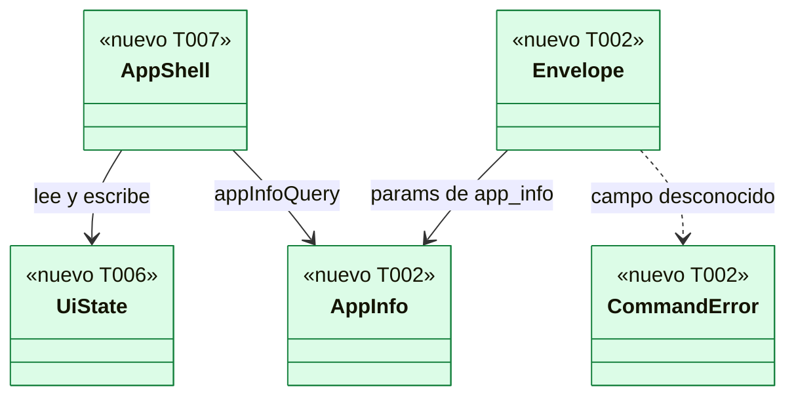
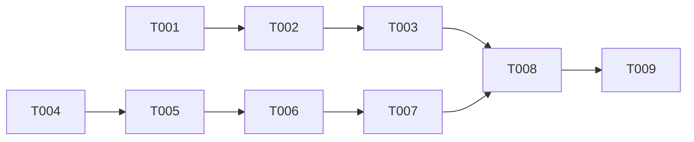

# DS-TS-DSK-001 · Andamiaje de apps/desktop

## Contexto rápido

Al terminar, un desarrollador abre la app de escritorio con `pnpm nx run @gitraptor/desktop:tauri:dev` y ve la ventana B1 vacía, con sus paneles, atajos y tema, y cada historia de la app añade su vista sobre una base que el CI ya vigila. Hoy no puede: `apps/desktop` no existe.

Para eso: el crate `gitraptor-desktop` con la superficie de Tauri cerrada, el frontend React con estado, i18n y tokens, y el job de CI `desktop`. Las decisiones son de ADR-GRP-017, ADR-GRP-002/003/004 (enmiendas) y de § Decisiones de esta Dev Spec; aquí no se reabren.

| Término | Qué es aquí |
|---|---|
| Backend | El proceso Rust de Tauri (`apps/desktop/src-tauri`). Es el único que hablará con el daemon (TS-DSK-002) |
| Webview | El frontend React dentro de la ventana. Solo habla con el backend por comandos IPC |
| Comando IPC | Función Rust marcada `#[tauri::command]` que el webview llama con `invoke`. La lista es cerrada |
| Capability | Archivo de Tauri v2 que dice qué comandos y permisos tiene una ventana |
| B1 | Layout «grafito glass» elegido por Rene (DSF-DSK-001 § 2.2): barra lateral, centro y detalle |

**Decisiones de esta Dev Spec**: todas son **Decisión del orquestador (2026-11-08), validada por Arquitecto**.

| # | Decisión | Por qué |
|---|---|---|
| D1 | El backend depende solo de `gitraptor-api` con la feature `client`; **no** de `gitraptor-core` | `gitraptor-core` arrastra `gitraptor-git` y `gitraptor-policy` y V1 fallaría. El cliente del canal ya vive en `gitraptor_api::client` (Enmienda 2026-10-08 de ADR-CKP-003); ADR-GRP-017 § 1 lo anticipaba |
| D2 | Un solo comando en el andamiaje: `app_info` (versión y protocolo). Ninguna llamada al canal | La ventana vacía no necesita datos; establece el patrón y el enlace con `gitraptor-api` |
| D3 | Los comandos leen el cuerpo crudo del `invoke` y exigen `{"params": {…}}` con `deny_unknown_fields` en los dos niveles | Tauri ignora en silencio los argumentos de nivel superior que no conoce; así ningún campo desconocido pasa (ADR-GRP-017 § 1) |
| D4 | `apps/desktop/src-tauri/commands.json` es la fuente única de la lista: la leen `build.rs` (manifiesto de la app), los tests de Rust y el test del frontend | Tres copias que no pueden divergir sin romper un test |
| D5 | `devUrl`, `beforeDevCommand` y `devCsp` viven solo en `tauri.dev.conf.json`, que pasa `tauri dev --config` | V2 comprueba que la configuración base no tiene `devUrl` (ADR-GRP-017 § 2) |
| D6 | i18n con `i18next` + `react-i18next`, catálogos JSON por idioma y tipos derivados del catálogo `en` | Pluralización e interpolación probadas; tipos sin generador propio |
| D7 | La salida CSS se commitea en `packages/design-tokens/css/glass.css` (ADR-GRP-003, Enmienda 2026-11-08) | La app y su CI no dependen del orden de build |
| D8 | El job `desktop` es un workflow propio (`desktop.yml`) y **se marca como check obligatorio** | Siempre reporta (éxito si no aplica), como `tokens`; sin él, una PR podría romper V1/V2 sin bloquear |
| D9 | `repo-intact.yml` filtra `apps/cli/**` y `apps/mcp/**` en lugar de `apps/**` | Una PR solo de la app no debe ocupar runners de macOS y Windows (los de macOS escasean) |
| D10 | Ventana opaca, `titleBarStyle: "Overlay"`, sin transparencia ni `macOSPrivateApi` | ADR-GRP-003, Enmienda 2026-11-08 (fondo `surface.wall` pintado por CSS) |

---

## 📋 Índice

> **Para aprobar:** [Contexto rápido](#contexto-rápido) · [⚠️ Gaps](#gaps-y-violaciones-de-la-constitución) · [🔭 La forma](#la-forma) · [El trabajo de un vistazo](#el-trabajo-de-un-vistazo).
> **Para implementar:** [🚀 Plan](#plan-de-implementación), en orden. Las `_(ref)_` se abren desde la tarea que las cita.

| Sección | Propósito |
|---------|-----------|
| [Contexto rápido](#contexto-rápido) | Qué se construye, glosario y decisiones |
| [⚠️ Gaps y violaciones de la constitución](#gaps-y-violaciones-de-la-constitución) | Qué impide empezar |
| [🔭 La forma](#la-forma) | Piezas y relaciones |
| [🚀 Plan de implementación](#plan-de-implementación) | T001…T009, en orden |
| ↳ [El trabajo de un vistazo](#el-trabajo-de-un-vistazo) | Tareas en tabla y su orden |
| [Estructura de ficheros](#estructura-de-ficheros) _(ref)_ | Árbol anotado |
| [Contratos compartidos](#contratos-compartidos) _(ref)_ | Tipos, ciclos de vida y firmas |
| [Estrategia de pruebas y cobertura](#estrategia-de-pruebas-y-cobertura) _(ref)_ | Pirámide y comportamientos críticos |
| [Gate de seguridad](#gate-de-seguridad) | Checklist pre-merge |
| [Fuera de alcance](#fuera-de-alcance) | Lo que esta entrega no toca |
| [Notas del autor](#notas-del-autor) _(ref)_ | Lo que no bloquea |

---

## ⚠️ Gaps y violaciones de la constitución

_No gaps. Ready to implement._

No hay `architecture-constitution.md` en la cascada: rigen `AGENTS.md` y los ADRs citados, como en las Dev Specs hermanas. Lo que no bloquea va en [Notas del autor](#notas-del-autor).

---

## 🔭 La forma

Al terminar quedan dos proyectos Nx anidados (el frontend y su crate de Tauri), una salida CSS nueva en el paquete de tokens y un workflow de CI.



El webview (`AppShell`, `UiState`) solo llega al backend por `call` → `invoke`; el backend valida el `Envelope` y responde `AppInfo` o `CommandError`. La capability (`capabilities/main.json`) y `commands.json` cierran la lista; V1 cierra las dependencias del backend a `gitraptor-api`.

---

## 🚀 Plan de implementación

> Orden topológico (`Depende:`). Las rutas son relativas a la raíz del repo.

### El trabajo de un vistazo

Tres frentes y un cierre: backend (T001-T003), frontend (T004-T007), CI (T008) y verificación (T009).

| # | Tarea | Depende | Aterriza en |
|---|---|---|---|
| T001 | Crear el crate `gitraptor-desktop` y la configuración de Tauri | — | `apps/desktop/src-tauri`, `Cargo.toml` |
| T002 | Crear la lista cerrada de comandos y `app_info` | T001 | `apps/desktop/src-tauri/src` |
| T003 | Crear las pruebas de frontera V1, V2 y V7 | T002 | `apps/desktop/src-tauri/tests` |
| T004 | Generar la salida CSS de «grafito glass» | — | `packages/design-tokens` |
| T005 | Crear el proyecto frontend `@gitraptor/desktop` | T004 | `apps/desktop` |
| T006 | Crear el cliente IPC, el estado y la i18n | T005 | `apps/desktop/src/{client,state,i18n}` |
| T007 | Crear la ventana B1 vacía | T006 | `apps/desktop/src/shell` |
| T008 | Añadir el job `desktop` y excluir el crate de los jobs generales | T003, T007 | `.github/workflows`, `tools` |
| T009 | Verificar de punta a punta | T008 | — |

### En qué orden

Dos frentes paralelos (backend y frontend) que se juntan en el CI.



### T001 — Crear el crate `gitraptor-desktop` y la configuración de Tauri

**Objetivo.** Un crate que compila la ventana sin plugins, con la configuración endurecida. Sin comandos todavía (T002).

**Ubicación.**
- `Cargo.toml` (**MODIFY**)
- `apps/desktop/src-tauri/Cargo.toml` (**CREATE**)
- `apps/desktop/src-tauri/build.rs` (**CREATE**)
- `apps/desktop/src-tauri/src/main.rs` (**CREATE**)
- `apps/desktop/src-tauri/src/lib.rs` (**CREATE**)
- `apps/desktop/src-tauri/src/window.rs` (**CREATE**)
- `apps/desktop/src-tauri/tauri.conf.json` (**CREATE**)
- `apps/desktop/src-tauri/tauri.dev.conf.json` (**CREATE**)
- `apps/desktop/src-tauri/capabilities/main.json` (**CREATE**)
- `apps/desktop/src-tauri/icons/` (**CREATE**)

**Reglas**
- `Cargo.toml` raíz: `members = ["crates/*", "apps/cli", "apps/mcp", "apps/desktop/src-tauri"]` y `default-members = ["crates/*", "apps/cli", "apps/mcp"]`. En `[workspace.dependencies]`: `tauri = "=2.12.5"` (features por defecto, **sin** `devtools`) y `tauri-build = "=2.7.4"`.
- `apps/desktop/src-tauri/Cargo.toml`: `name = "gitraptor-desktop"`, `description = "GitRaptor desktop app (Tauri backend)"`, `version`, `edition`, `rust-version`, `license` y `publish` con `.workspace = true`; `[lib] name = "gitraptor_desktop"`; `[[bin]] name = "gitraptor-desktop"`; `[lints] workspace = true`.
- Dependencias normales, y ninguna más: `tauri.workspace = true`, `gitraptor-api = { workspace = true, features = ["client"] }`, `serde = { version = "1.0.229", features = ["derive"] }`, `serde_json = "1.0.151"`. Build: `tauri-build.workspace = true`, `serde_json = "1.0.151"`. Dev: `serde_json.workspace = true`.
- `main.rs`: `#![cfg_attr(not(debug_assertions), windows_subsystem = "windows")]` y `fn main() { gitraptor_desktop::run() }`. No lee `std::env::args`.
- `lib.rs`: `pub fn run()` construye `tauri::Builder::default()`, registra `commands::handler()` (T002), crea la ventana en `.setup(|app| { window::create(app)?; Ok(()) })` y llama `.run(tauri::generate_context!())`. Ningún `.plugin(...)`; el `setup` no lee el entorno.
- `window.rs` (M-3, Ajuste tras la revisión de seguridad (2026-11-08), validado por security-expert): `pub fn create(app: &tauri::App) -> tauri::Result<()>` construye la ventana con `tauri::WebviewWindowBuilder::new(app, "main", tauri::WebviewUrl::App("index.html".into()))` y `.title("GitRaptor")`, `.inner_size(1440.0, 900.0)`, `.min_inner_size(720.0, 560.0)`, `.content_protected(true)`, en macOS `.title_bar_style(tauri::TitleBarStyle::Overlay)` y `.hidden_title(true)`, `.on_navigation(|url| is_allowed_navigation(url))` y `.on_new_window(|_, _| tauri::webview::NewWindowResponse::Deny)`. `pub fn is_allowed_navigation(url: &tauri::Url) -> bool` acepta solo los orígenes de `frontendDist` (`tauri://localhost` y `http://tauri.localhost`, con cualquier ruta) y, solo con `cfg!(debug_assertions)`, `http://localhost:1420`; todo lo demás (otro esquema, host o puerto, `about:`, `file:`, `data:`) devuelve `false`. API verificada en docs.rs de tauri 2.12.5: `on_navigation<F: Fn(&Url) -> bool>` y `on_new_window<F: Fn(Url, NewWindowFeatures) -> NewWindowResponse<R>>`, con las variantes `Allow`, `Create { window }` y `Deny`.
- `tauri.conf.json` exactamente con: `"productName": "GitRaptor"`, `"identifier": "dev.gitraptor.app"`, sin `version` (toma la del crate, ADR-GRP-014 Enmienda DEP-DSK-5, D8); `build`: `"frontendDist": "../dist"`, `"beforeBuildCommand": "pnpm run build"`, sin `devUrl`; `app.withGlobalTauri: false`; `app.windows: []` (la ventana la crea `window.rs`, M-3); `app.security`: `"csp"` con la cadena exacta de abajo, `"freezePrototype": true`, `"dangerousDisableAssetCspModification": false`, `"assetProtocol": {"enable": false}`, `"capabilities": ["main"]` (solo el identificador, nunca una capability en línea, M-2); `bundle`: `"active": true`, `"targets": ["app"]`, `"icon": ["icons/32x32.png", "icons/128x128.png", "icons/128x128@2x.png", "icons/icon.icns", "icons/icon.png"]`; sin `plugins`, sin `fileAssociations`, sin esquemas de URL.
- CSP exacta (ADR-GRP-017 § 2): `default-src 'self'; script-src 'self'; style-src 'self'; img-src 'self' data:; font-src 'self'; connect-src ipc: http://ipc.localhost; object-src 'none'; base-uri 'none'; frame-src 'none'; form-action 'none'`.
- `tauri.dev.conf.json`: `build.devUrl = "http://localhost:1420"`, `build.beforeDevCommand = "pnpm run dev"` y `app.security.devCsp` = la CSP de arriba con `script-src 'self' 'unsafe-inline'`, `style-src 'self' 'unsafe-inline'` y `connect-src ipc: http://ipc.localhost ws://localhost:1420`.
- `capabilities/main.json`: `{"identifier": "main", "description": "Main window: own commands only (ADR-GRP-017 § 2)", "windows": ["main"], "permissions": ["core:window:allow-start-dragging", "allow-app-info"]}`. Nunca `core:default`, `remote`, `webviews` ni `platforms` (M-2).
- Iconos: `apps/desktop/src-tauri/icons/app-icon.svg` (**CREATE**), un cuadrado de 1024 × 1024 con radio 224, relleno `#26282d` y un círculo centrado de radio 256 en `#2a6be0`; los PNG, `.icns` y `.ico` salen de `pnpm --filter @gitraptor/desktop exec tauri icon src-tauri/icons/app-icon.svg` y se commitean.

> **Nota técnica.** `default-members` no afecta a `--workspace`: por eso T008 añade `--exclude gitraptor-desktop` a los jobs generales. `generate_context!` embebe `frontendDist`, así que `cargo build -p gitraptor-desktop` necesita `apps/desktop/dist` construido antes (T005). `core:window:allow-start-dragging` es el único permiso de núcleo: lo usa `data-tauri-drag-region` de la barra de título. La CSP no impide la navegación de nivel superior (`location.href`) ni `window.open`: por eso la ventana se crea en código con los dos manejadores (M-3).

- **Depende:** —
- **Refs:** ADR-GRP-017 § 1, § 2; ADR-GRP-002, Enmienda 2026-10-28
- **Aceptación:** `pnpm --filter @gitraptor/desktop build && cargo build -p gitraptor-desktop` termina en 0 en macOS, `cargo metadata --no-deps --format-version 1 | jq -r '.workspace_default_members[]'` no lista `gitraptor-desktop`, y `cargo test -p gitraptor-desktop --lib window` está en verde: `https://example.com` → `false`; `tauri://localhost/index.html` y `http://tauri.localhost/` → `true`; `http://localhost:1420/` → `cfg!(debug_assertions)`; `http://localhost:1421/`, `file:///etc/passwd` y `about:blank` → `false`.

### T002 — Crear la lista cerrada de comandos y `app_info`

**Objetivo.** El patrón de comando que copiará cada historia, con su primer comando. Sin llamadas al canal.

**Ubicación.**
- `apps/desktop/src-tauri/commands.json` (**CREATE**)
- `apps/desktop/src-tauri/build.rs` (**MODIFY**)
- `apps/desktop/src-tauri/src/commands/mod.rs` (**CREATE**)
- `apps/desktop/src-tauri/src/commands/app_info.rs` (**CREATE**)
- `apps/desktop/src-tauri/src/ipc.rs` (**CREATE**)
- `apps/desktop/src-tauri/tests/commands.rs` (**CREATE**)

**Reglas**
- `commands.json` = `["app_info"]`. Nombres en `snake_case`.
- `build.rs` lee `commands.json` con `serde_json`, emite `cargo:rerun-if-changed=commands.json` y llama `tauri_build::try_build(tauri_build::Attributes::new().app_manifest(tauri_build::AppManifest::new().commands(names)))`, con `names: &'static [&'static str]` obtenido con `Box::leak`.
- `ipc.rs`: `pub fn parse<P: DeserializeOwned>(body: &serde_json::Value) -> Result<P, CommandError>` deserializa `Envelope<P> { params: P }` con `#[serde(deny_unknown_fields)]`; `pub fn params<P>(request: &tauri::ipc::Request<'_>) -> Result<P, CommandError>` acepta solo `InvokeBody::Json` y delega en `parse`.
- `CommandError` en `ipc.rs` (§ Tipos y datos compartidos): se serializa `{"code": "<kebab>"}` y nunca lleva texto del motor ni rutas.
- Cada comando vive en `src/commands/<nombre>.rs`: `#[tauri::command] pub fn <nombre>(request: tauri::ipc::Request<'_>) -> Result<<Nombre>Result, CommandError>`, con su `<Nombre>Params` (`#[serde(deny_unknown_fields, rename_all = "camelCase")]`, aunque esté vacío) y su resultado `#[serde(rename_all = "camelCase")]`.
- `app_info`: `AppInfoParams {}`; devuelve `AppInfo { version: env!("CARGO_PKG_VERSION"), protocol: gitraptor_api::PROTOCOL_VERSION }`.
- `commands/mod.rs`: `pub fn handler() -> impl Fn(tauri::ipc::Invoke) -> bool + Send + Sync + 'static { tauri::generate_handler![app_info::app_info] }`.
- **Añadir un comando** (lo que copia cada historia): una línea en `commands.json`, su archivo en `src/commands/`, su entrada en `generate_handler!`, `allow-<nombre-en-kebab>` en `capabilities/main.json`, su tipo en `apps/desktop/src/client/commands.ts` y sus tests (campo desconocido rechazado en `params` y fuera de `params`, y caso feliz). Nunca un comando genérico que reciba un nombre de método del canal.

> **Nota técnica.** Con un manifiesto de app (`AppManifest::commands`), Tauri v2 exige el permiso `allow-<comando>` en la capability; sin él, el `invoke` se rechaza. Los argumentos con nombre de un `#[tauri::command]` ignoran claves extra, por eso el cuerpo crudo (D3).

- **Depende:** T001
- **Refs:** ADR-GRP-017 § 1; D2, D3, D4
- **Aceptación:** `cargo test -p gitraptor-desktop --lib ipc` y `--test commands` en verde: `{"params":{}}` → `Ok`; `{"params":{"x":1}}` y `{"params":{},"extra":1}` → `invalid-params`; cuerpo no JSON → `invalid-params`; `app_info` devuelve `CARGO_PKG_VERSION` y `PROTOCOL_VERSION`; las funciones `#[tauri::command]` de `src/commands/` coinciden con `commands.json`.

### T003 — Crear las pruebas de frontera V1, V2 y V7

**Objetivo.** Las funciones de fitness de ADR-GRP-017 que corresponden al andamiaje, como tests de `cargo test -p gitraptor-desktop`.

**Ubicación.**
- `apps/desktop/src-tauri/tests/boundaries.rs` (**CREATE**)
- `apps/desktop/src-tauri/tests/tauri_surface.rs` (**CREATE**)
- `apps/desktop/src-tauri/tests/environment.rs` (**CREATE**)

**Reglas**
- `boundaries.rs` (V1): ejecuta `cargo metadata --format-version 1 --locked` con `env!("CARGO")` sobre el `Cargo.toml` raíz, recorre `resolve.nodes` desde `gitraptor-desktop` siguiendo solo dependencias de tipo normal (`dep_kinds[].kind == null`) y falla si alcanza `gitraptor-core`, `gitraptor-git` o `gitraptor-policy`. Comprueba además que `gitraptor-api` está alcanzado con la feature `client`.
- `tauri_surface.rs` (V2) lee **todos** los `tauri*.conf.json` de `src-tauri` (M-1), `capabilities/`, `commands.json`, `src/window.rs`, el `Cargo.toml` del crate y `apps/desktop/package.json`, y falla si: aparece un `tauri*.conf.json` distinto de `tauri.conf.json`, `tauri.dev.conf.json` y `tauri.release.conf.json`; `tauri.release.conf.json` (si existe; lo crea TS-DSK-002) tiene una clave distinta de `bundle.externalBin`, `bundle.targets` y `bundle.macOS.signingIdentity`; la base declara `bundle.externalBin`; la CSP no es la exacta; `withGlobalTauri`, `freezePrototype`, `assetProtocol.enable` o `dangerousDisableAssetCspModification` cambian; la base tiene `devUrl` o `devCsp`, o `app.windows` no vacío; `devUrl` del overlay no es `http://localhost:1420`; `app.security.capabilities` no es exactamente `["main"]` (M-2); hay clave `plugins` no vacía, `fileAssociations` o `deep-link`; hay más de un archivo en `capabilities/`; la capability tiene `remote`, `webviews` o `platforms` (M-2), otra ventana que `main`, `core:default`, un permiso `dialog:*` o un permiso fuera de `core:window:allow-start-dragging` ∪ `allow-<comando>` de `commands.json`, o le falta uno de esos; hay una dependencia `tauri-plugin-*` distinta de `tauri-plugin-dialog` (que solo usa el backend, B-2 de TS-DSK-002) o cualquier `@tauri-apps/plugin-*`; la dependencia `tauri` activa `devtools`; `window.rs` no contiene `content_protected(true)`, `on_navigation(` y `on_new_window(`. Las reglas M-1, M-2 y M-3 son Ajuste tras la revisión de seguridad (2026-11-08), validado por security-expert.
- `environment.rs` (V7, parte del andamiaje): recorre `src/**/*.rs` y falla con `std::env::var`, `env::var(`, `env::vars`, `var_os`, `env::args` o `args_os`; recorre las dependencias normales del crate en `cargo metadata` y falla con `env_logger`, `tracing-subscriber`, `log4rs`, `simplelog`, `pretty_env_logger` o `tauri-plugin-log`. `env!` y `option_env!` (tiempo de compilación) se permiten.

> **Nota técnica.** `std::env::remove_var` es `unsafe` en Rust 2024 y el workspace prohíbe `unsafe`: el backend no puede limpiar su entorno, así que V7 se garantiza no leyéndolo. Las variables que lean Tauri o WebKit por su cuenta quedan en las Notas del autor (G1).

- **Depende:** T002
- **Refs:** ADR-GRP-017, V1, V2, V7
- **Aceptación:** `cargo test -p gitraptor-desktop --test boundaries --test tauri_surface --test environment` en verde; cada test falla si se añade a mano `gitraptor-core` como dependencia, se cambia una letra de la CSP, se añade una clave a `tauri.release.conf.json`, se pone `remote` en la capability o se añade `std::env::var("RUST_LOG")` (comprobado en local y revertido).

### T004 — Generar la salida CSS de «grafito glass»

**Objetivo.** `@gitraptor/tokens/glass.css` con los temas oscuro y claro, generado y comprobado. `crates/theme` no cambia.

**Ubicación.**
- `packages/design-tokens/tokens/glass.json` (**CREATE**)
- `packages/design-tokens/scripts/css-format.mjs` (**CREATE**)
- `packages/design-tokens/scripts/build.mjs` (**MODIFY**)
- `packages/design-tokens/package.json` (**MODIFY**)
- `packages/design-tokens/css/glass.css` (**CREATE**, generado)
- `packages/design-tokens/test/glass.test.mjs` (**CREATE**)

**Pasos**
1. Transcribir a `glass.json` cada fila de las tablas de DSYS-GRP-002 § 2 a § 8, con raíz `glass`: valor oscuro (o único) en `$value` y claro en `$extensions["dev.gitraptor"].light`. `$type`: `color` para colores, `dimension` para radios, espaciado y tamaños; el resto (sombras, gradientes, pilas de fuentes, movimiento) sin `$type`. Un token que también es grupo (`glass.accent` y `glass.accent.text`) se escribe como `glass.accent.DEFAULT`.
2. Escribir `css-format.mjs` con `renderCss(dictionary)`: nombre `--gr-` + ruta sin la raíz en kebab, quitando un último segmento `DEFAULT`; valor `$value` literal. Emite la cabecera `/* Generated by @gitraptor/tokens from tokens/glass.json. Do not edit. */`, `:root { color-scheme: dark; … }` con todos los tokens, `:root[data-theme="light"] { color-scheme: light; … }` con los que tienen `light`, y `@media (prefers-color-scheme: light) { :root:not([data-theme="dark"]) { color-scheme: light; … } }` con los mismos, en el orden del JSON.
3. En `build.mjs`: plataforma `css` (formato `gitraptor/css-glass`, filtro `token.path[0] === 'glass'`, destino `css/glass.css`); la plataforma `rust` filtra `token.path[0] !== 'glass'`. `--check` compara también `css/glass.css` y su mensaje nombra el archivo desactualizado.
4. En `package.json`: `"exports": {"./glass.css": "./css/glass.css"}`, `"css"` en `files` y `{projectRoot}/css` en `outputs` del target `build`.
5. `glass.test.mjs`: cada color tiene `light`; `--gr-surface-window: #26282d` en `:root` y `#e6e8ec` en los dos bloques claros; los bloques claros son idénticos; ninguna variable sin valor; contraste WCAG ≥ 4,5:1 de `text.*` y `*.text` sobre `surface.window`, `panel`, `control`, `raised` y `hover` en los dos temas (salvo `text.faint` oscuro, DSYS-GRP-002 § 3) y ≥ 3:1 de los rellenos no textuales sobre `panel` y `control`, solo con colores hex opacos.

- **Depende:** —
- **Refs:** ADR-GRP-003, Enmienda 2026-11-08; DSYS-GRP-002 § 9 y § 10; D7
- **Aceptación:** `pnpm --filter @gitraptor/tokens check` y `pnpm --filter @gitraptor/tokens test` en verde; `git diff --exit-code crates/theme/src/generated.rs` tras `pnpm --filter @gitraptor/tokens build`; editar a mano un valor de `css/glass.css` hace fallar `check`.

### T005 — Crear el proyecto frontend `@gitraptor/desktop`

**Objetivo.** El paquete pnpm con Vite, TypeScript estricto, ESLint (V5) y Vitest, sin vistas todavía.

**Ubicación.**
- `apps/desktop/package.json` (**CREATE**)
- `apps/desktop/index.html` (**CREATE**)
- `apps/desktop/vite.config.ts` (**CREATE**)
- `apps/desktop/tsconfig.json` (**CREATE**)
- `apps/desktop/eslint.config.js` (**CREATE**)
- `apps/desktop/src/main.tsx` (**CREATE**)
- `apps/desktop/src/styles/app.css` (**CREATE**)
- `apps/desktop/tests/setup.ts` (**CREATE**)
- `apps/desktop/tests/eslint-v5.test.ts` (**CREATE**)
- `pnpm-lock.yaml` (**MODIFY**)

**Reglas**
- `package.json`: `"name": "@gitraptor/desktop"`, `"version": "0.0.0"`, `"private": true`, `"license": "FSL-1.1-ALv2"`, `"type": "module"`, `"nx": {"tags": ["scope:desktop", "type:app"]}`. Scripts: `"dev": "vite"`, `"build": "vite build"`, `"typecheck": "tsc --noEmit -p tsconfig.json"`, `"lint": "eslint ."`, `"test": "vitest run"`, `"tauri": "tauri"`, `"tauri:dev": "tauri dev --config src-tauri/tauri.dev.conf.json"`, `"tauri:build": "tauri build --no-bundle"`.
- Versiones exactas (sin `^` ni `~`, salvo TypeScript, que sigue la raíz). Cada versión tenía al menos 14 días publicada el 2026-11-08 y se comprobó en npm y crates.io, con sus pares compatibles (cuarentena contra paquetes recién publicados, R-2 de ADR-GRP-017; ajuste del orquestador del 2026-11-08). Si al implementar alguna falla, se sube a la siguiente con 14 días o más y se anota en el PR. `dependencies`: `react` 19.3.1, `react-dom` 19.3.1, `@tauri-apps/api` 2.12.4, `@tanstack/react-query` 5.104.5, `zustand` 5.0.16, `i18next` 26.5.10, `react-i18next` 17.1.8, `@gitraptor/tokens` `workspace:*`. `devDependencies`: `@tauri-apps/cli` 2.12.4, `vite` 8.3.5, `@vitejs/plugin-react` 6.1.2, `typescript` `~5.9.0`, `@types/react` 19.3.0, `@types/react-dom` 19.3.0, `@types/node` 22.20.5, `tailwindcss` 4.3.3, `@tailwindcss/vite` 4.3.3, `vitest` 4.1.12, `jsdom` 30.1.3, `@testing-library/react` 16.3.3, `@testing-library/jest-dom` 7.0.1, `@testing-library/dom` 10.4.2 (par obligatorio de jest-dom), `axe-core` 4.14.0, `eslint` 10.13.0, `@eslint/js` 10.0.1, `typescript-eslint` 8.72.0, `eslint-plugin-react-hooks` 7.1.1, `globals` 17.13.0.
- `vite.config.ts`: plugins `react()` y `tailwindcss()`; `server: { port: 1420, strictPort: true, host: "localhost" }`; `clearScreen: false`; `build: { target: "safari16", outDir: "dist", sourcemap: false }`; alias `@` → `src`; `test: { environment: "jsdom", setupFiles: ["tests/setup.ts"], include: ["src/**/*.test.{ts,tsx}", "tests/**/*.test.ts"] }`.
- `tsconfig.json`: `strict`, `noUncheckedIndexedAccess`, `exactOptionalPropertyTypes`, `jsx: "react-jsx"`, `moduleResolution: "bundler"`, `paths: {"@/*": ["src/*"]}`, `types: ["vite/client", "vitest/globals", "@testing-library/jest-dom"]`, `include: ["src", "tests", "vite.config.ts"]`.
- `index.html`: `<html lang="en">`, un `<div id="root">` y `<script type="module" src="/src/main.tsx">`. Sin `<style>` ni scripts en línea.
- `eslint.config.js` (flat): `@eslint/js` recomendado, `typescript-eslint` `strict`, el plugin `react-hooks` con `rules-of-hooks` y `exhaustive-deps` en `error`, `ignores: ["dist", "src-tauri", "tests/fixtures"]`, y las reglas V5 de § Firmas del stack.
- `app.css`: `@import "tailwindcss";`, `@import "@gitraptor/tokens/glass.css";`, un bloque `@theme inline` que crea `--color-<x>: var(--gr-<x>)` para cada color `--gr-*` y `--radius-<x>: var(--gr-radius-<x>)` para cada radio, y `body { background: var(--gr-surface-wall); color: var(--gr-text-main); font-family: var(--gr-font-ui); margin: 0; }` con `html, body, #root { height: 100%; }`.
- `tests/setup.ts`: `@testing-library/jest-dom/vitest`, un `matchMedia` simulado controlable por anchura y `localStorage.clear()` antes de cada test.
- `tests/eslint-v5.test.ts`: con la API `ESLint` y `lintText` sobre rutas virtuales, espera error en `src/ui/x.tsx` con `dangerouslySetInnerHTML`, `el.innerHTML = s`, `el.insertAdjacentHTML(...)`, `import Markdown from "react-markdown"`, `import { invoke } from "@tauri-apps/api/core"` y `import { x } from "@/client/ipc"`; en `src/shell/x.tsx` con `@tauri-apps/api/core`; y ningún error con `@tauri-apps/api/core` en `src/client/x.ts`.

- **Depende:** T004
- **Refs:** ADR-GRP-002, Enmienda 2026-10-28; ADR-GRP-017, V5; ADR-GRP-003 (Tailwind v4)
- **Aceptación:** en verde, tras commitear el lock: `pnpm install --frozen-lockfile --ignore-scripts`, `pnpm --filter @gitraptor/desktop run lint`, `pnpm --filter @gitraptor/desktop run typecheck`, `pnpm --filter @gitraptor/desktop run test` y `pnpm --filter @gitraptor/desktop run build`.

### T006 — Crear el cliente IPC, el estado y la i18n

**Objetivo.** Las piezas que usará cada vista: `call` tipado, `QueryClient`, el almacén de la ventana y los catálogos en/es.

**Ubicación.**
- `apps/desktop/src/client/commands.ts` (**CREATE**)
- `apps/desktop/src/client/ipc.ts` (**CREATE**)
- `apps/desktop/src/client/queries.ts` (**CREATE**)
- `apps/desktop/src/client/commands.test.ts` (**CREATE**)
- `apps/desktop/src/state/query-client.ts` (**CREATE**)
- `apps/desktop/src/state/ui-store.ts` (**CREATE**)
- `apps/desktop/src/state/ui-store.test.ts` (**CREATE**)
- `apps/desktop/src/i18n/index.ts` (**CREATE**)
- `apps/desktop/src/i18n/i18next.d.ts` (**CREATE**)
- `apps/desktop/src/i18n/locales/en.json` (**CREATE**)
- `apps/desktop/src/i18n/locales/es.json` (**CREATE**)
- `apps/desktop/src/i18n/catalog.test.ts` (**CREATE**)

**Reglas**
- `commands.ts`: `export const COMMANDS = ["app_info"] as const`, `type CommandName`, y el mapa de tipos `Commands = { app_info: { params: Record<string, never>; result: AppInfo } }`, con `AppInfo = { version: string; protocol: number }`.
- `ipc.ts`: `export function call<C extends CommandName>(name: C, params: Commands[C]["params"]): Promise<Commands[C]["result"]>` = `invoke(name, { params })`; si el backend rechaza, lanza `CommandFailure` con su `code`. Es el único archivo que importa `@tauri-apps/api/core`.
- `queries.ts`: `appInfoQuery = queryOptions({ queryKey: ["app", "info"], queryFn: () => call("app_info", {}) })`.
- `query-client.ts`: `new QueryClient({ defaultOptions: { queries: { staleTime: Infinity, retry: false, refetchOnWindowFocus: false, refetchOnReconnect: false } } })`. Los deltas del motor llegarán por `setQueryData` (ADR-GRP-004, Enmienda D7).
- `ui-store.ts` (Zustand con `persist`, clave `gitraptor.ui.v1`, versión 1): estado de § Tipos y datos compartidos; acciones `toggleSidebar`, `toggleDetail`, `cycleTheme` (`auto` → `light` → `dark` → `auto`) y `setLanguage`. Solo persiste `theme`, `language`, `sidebarOpen` y `detailOpen`.
- `i18n/index.ts`: `i18next` con `react-i18next`, recursos `en` y `es` en el bundle, `fallbackLng: "en"`, `interpolation.escapeValue: false` (React escapa), idioma = preferencia del almacén o, en `auto`, `es` si `navigator.languages[0]` empieza por `es` y `en` si no. Fija `document.documentElement.lang`.
- Claves: `<área>.<elemento>[.<variante>]` en `lowerCamel` por segmento (`shell.sidebar.label`, `shell.theme.toggle.dark`). Catálogos JSON anidados, sin texto vacío. `i18next.d.ts` declara `CustomTypeOptions` con `resources: { translation: typeof en }`.

- **Depende:** T005
- **Refs:** ADR-GRP-004, Enmienda 2026-10-28; DEP-DSK-7; D4, D6
- **Aceptación:** `commands.test.ts`: `COMMANDS` igual a `src-tauri/commands.json`, y `call("app_info", {})` con `mockIPC` de `@tauri-apps/api/mocks` envía `{ params: {} }`; `ui-store.test.ts`: el ciclo de tema, la persistencia de solo esas cuatro claves y la rehidratación; `catalog.test.ts`: `en` y `es` con el mismo conjunto de claves y ningún valor vacío.

### T007 — Crear la ventana B1 vacía

**Objetivo.** Barra de título, barra lateral, centro y detalle de DSF-DSK-001 § 2.2, vacíos, con atajos, tema y cortes de anchura. Sin datos del motor.

**Ubicación.**
- `apps/desktop/src/main.tsx` (**MODIFY**)
- `apps/desktop/src/app/App.tsx` (**CREATE**)
- `apps/desktop/src/shell/AppShell.tsx` (**CREATE**)
- `apps/desktop/src/shell/TitleBar.tsx` (**CREATE**)
- `apps/desktop/src/shell/useShortcuts.ts` (**CREATE**)
- `apps/desktop/src/shell/useTheme.ts` (**CREATE**)
- `apps/desktop/src/shell/useLayout.ts` (**CREATE**)
- `apps/desktop/src/ui/Panel.tsx` (**CREATE**)
- `apps/desktop/src/shell/AppShell.test.tsx` (**CREATE**)

**Reglas**
- `main.tsx` monta `<App/>` en `#root` con `StrictMode`; `App` envuelve `AppShell` en `QueryClientProvider` e inicializa la i18n antes del primer render.
- `TitleBar` (`<header>` con `data-tauri-drag-region`, `padding-left: 80px` para los semáforos de macOS): botón del panel izquierdo, botón de tema y botón del panel derecho, cada uno con `aria-label` del catálogo y `aria-pressed` o `aria-expanded`. Sin buscador ⌘K (US-DSK-018) ni píldora de estado (US-DSK-003).
- Regiones: barra lateral `<nav aria-label>`, centro `<main>`, detalle `<aside aria-label>`. Cada una es un `Panel` (`surface.panel`, `highlight`, radio de panel) separado por `glass.gutter` sobre el fondo `surface.window`. El centro muestra un texto neutro del catálogo (`shell.center.empty`); barra lateral y detalle, solo su título.
- Atajos (`useShortcuts`, en `window`, `preventDefault`): mod = `metaKey` si `navigator.userAgent` contiene `Mac`, si no `ctrlKey`. mod + `KeyB` sin Alt → `toggleSidebar`; mod + Alt + `KeyB` → detalle. Se compara `event.code`, porque ⌥ cambia `event.key`. `Escape` cierra el cajón del detalle.
- Anchura (`useLayout` con `matchMedia`): ≥ 1360 px, tres paneles (lateral 252 px, detalle 352 px); 1000–1359 px, el detalle es un cajón superpuesto cerrado al empezar, que ⌥⌘B abre con el foco dentro, `Tab` que no sale del cajón y `Esc` que lo cierra y devuelve el foco al botón; < 1000 px, igual, y la barra lateral sigue su preferencia. El estado del cajón no se persiste.
- Tema (`useTheme`): `auto` quita `data-theme` de `<html>`; `light` o `dark` lo fijan.
- Tras el primer `requestAnimationFrame` del montaje, `performance.mark("gr:shell-painted")` (NFR-13.6).
- Ningún color, radio ni tamaño literal: solo clases de Tailwind sobre las variables de T005 o `var(--gr-*)`.

- **Depende:** T006
- **Refs:** DSF-DSK-001 § 2.2 y § 2.4; ADR-GRP-003; NFR-09, NFR-13.6
- **Aceptación:** `AppShell.test.tsx` en verde: las tres regiones y la barra de título con nombres accesibles en `en` y en `es`; ⌘B oculta y muestra la barra lateral; ⌥⌘B el detalle; el botón de tema recorre `auto` → `light` → `dark` y deja `data-theme` y `localStorage` como corresponde; a 1200 px el detalle empieza cerrado, ⌥⌘B lo abre con el foco dentro y `Esc` lo cierra; `axe-core` sin violaciones en 1440 y 1200 px; existe la marca `gr:shell-painted`.

### T008 — Añadir el job `desktop` y excluir el crate de los jobs generales

**Objetivo.** La app se comprueba solo cuando cambia algo suyo, y el resto del CI no compila Tauri.

**Ubicación.**
- `.github/workflows/desktop.yml` (**CREATE**)
- `.github/workflows/repo-intact.yml` (**MODIFY**)
- `tools/ci/cargo-test-selection.sh` (**MODIFY**)
- `tools/ci/affected-tests.mjs` (**MODIFY**)
- `tools/test/nextest-junit.mjs` (**MODIFY**)

**Reglas**
- `desktop.yml`: `name: desktop`, disparo `pull_request` y `push` a `main`, `permissions: contents: read`, la misma `concurrency` que `tokens.yml` con prefijo `desktop-`, y un job `desktop` (`name: desktop`) en `ubuntu-latest` con `timeout-minutes: 45` y permisos `contents: read`, `pull-requests: read`. Mismas acciones y SHA que `tokens.yml` y `repo-intact.yml` (`dorny/paths-filter`, `checkout`, `pnpm/action-setup`, `setup-node` con Node 22 y caché `pnpm`, `Swatinem/rust-cache` con `save-if` solo en `main`).
- Filtro: `apps/desktop/**`, `packages/design-tokens/**`, `crates/api/**`, `Cargo.toml`, `Cargo.lock`, `rust-toolchain.toml`, `package.json`, `pnpm-lock.yaml`, `pnpm-workspace.yaml`, `.github/workflows/desktop.yml`. Sin cambios en esas rutas, un paso `::notice::` y éxito sin compilar; `push` a `main` y PRs de 3000 archivos o más, siempre.
- Pasos, en orden: `sudo apt-get update && sudo apt-get install -y libwebkit2gtk-4.1-dev libxdo-dev libssl-dev libayatana-appindicator3-dev librsvg2-dev build-essential` (`timeout-minutes: 5`); `rustup show`; `pnpm install --frozen-lockfile --ignore-scripts`; `pnpm audit`; `pnpm --filter @gitraptor/desktop lint`; `typecheck`; `test`; `build`; `cargo clippy -p gitraptor-desktop --all-targets -- -D warnings`; `cargo test -p gitraptor-desktop`.
- Sin variables `RUST_*` ni `CARGO_*` nuevas (la clave de `rust-cache` las incluye); solo `CARGO_TERM_COLOR: always`, como el resto.
- `repo-intact.yml`: en el filtro `rust`, `apps/**` pasa a `apps/cli/**` y `apps/mcp/**` (D9); `cargo clippy --workspace --exclude gitraptor-desktop --all-targets -- -D warnings`; las dos líneas de suites, `cargo test --workspace --exclude gitraptor-desktop --no-fail-fast -- repo_intact`; el respaldo del paso `test`, `'--workspace --exclude gitraptor-desktop'`.
- `cargo-test-selection.sh`: toda salida `--workspace` pasa a `--workspace --exclude gitraptor-desktop`; el bucle de miembros omite `gitraptor-desktop`, y `tree --workspace` lleva el mismo `--exclude`.
- `affected-tests.mjs`: quita `gitraptor-desktop` de la lista de afectados que emite.
- `nextest-junit.mjs`: los argumentos por defecto pasan a `["--workspace", "--exclude", "gitraptor-desktop"]`.

> **Nota técnica.** En ubuntu, compilar Tauri pide WebKitGTK 4.1 y sus cabeceras; sin `--exclude`, `cargo test --workspace` fallaría en los tres SO de `lint and test` o compilaría WebKit en macOS y Windows para cada historia (ADR-GRP-002, Enmienda 2026-10-28).

- **Depende:** T003, T007
- **Refs:** ADR-GRP-002, Enmienda 2026-10-28; ADR-GRP-014, Enmienda 2026-11-08 (punto 4); D8, D9
- **Aceptación:** `bash tools/ci/cargo-test-selection.sh` (sin `SCOPE`) imprime `args=--workspace --exclude gitraptor-desktop`; `SCOPE=affected PROJECTS="gitraptor-cli" bash tools/ci/cargo-test-selection.sh` incluye `--exclude gitraptor-desktop`; `node --test tools/test/nextest-junit.test.mjs` en verde; en la PR, el check `desktop` corre y pasa, y el job «lint and test» no compila `gitraptor-desktop` (no aparece en su log).

### T009 — Verificar de punta a punta

**Objetivo.** Comprobar en macOS lo que el CI de ubuntu no ve.

**Ubicación.** Ninguna: solo corre verificaciones.

**Pasos**
1. `pnpm nx run @gitraptor/desktop:tauri:dev`: la ventana abre, ⌘B y ⌥⌘B pliegan los paneles, el tema cambia y persiste al reabrir, y la ventana sale negra en una captura con `screencapture` (`contentProtected`).
2. `pnpm nx run @gitraptor/desktop:tauri:build` y abrir el binario de `target/release/`: sin inspector (clic derecho sin "Inspeccionar elemento").
3. `cargo test --workspace --exclude gitraptor-desktop` y `cargo clippy --workspace --exclude gitraptor-desktop --all-targets -- -D warnings` en verde, y `tools/check-license.sh` en verde.

- **Depende:** T008
- **Refs:** TS-DSK-001, Verificación manual
- **Aceptación:** los tres pasos, con su resultado en la descripción del PR.

---

## Estructura de ficheros

```text
apps/desktop/
├── package.json            # @gitraptor/desktop (T005)
├── index.html  vite.config.ts  tsconfig.json  eslint.config.js
├── src/
│   ├── main.tsx  app/App.tsx
│   ├── client/             # único importador de @tauri-apps/api (T006)
│   ├── state/              # QueryClient y almacén de la ventana (T006)
│   ├── i18n/               # catálogos en/es (T006)
│   ├── shell/              # ventana B1 (T007)
│   ├── ui/                 # componentes puros: sin Tauri ni client (T007)
│   └── styles/app.css      # Tailwind + glass.css (T005)
├── tests/                  # setup y V5 (T005)
└── src-tauri/
    ├── Cargo.toml  build.rs  commands.json
    ├── tauri.conf.json  tauri.dev.conf.json
    ├── capabilities/main.json
    ├── icons/
    ├── src/{main.rs,lib.rs,ipc.rs,commands/}
    └── tests/{commands,boundaries,tauri_surface,environment}.rs
packages/design-tokens/{tokens/glass.json,scripts/css-format.mjs,css/glass.css,test/glass.test.mjs}
.github/workflows/desktop.yml
```

`src/graph/` (US-DSK-005) y `src/client/generated/` (primera historia que use tipos del contrato) no se crean aquí.

---

## Contratos compartidos

### Tipos y datos compartidos

| Tipo | Dónde | Forma |
|---|---|---|
| `Envelope<P>` | `src-tauri/src/ipc.rs` | `{ params: P }`, `deny_unknown_fields` |
| `CommandError` | `src-tauri/src/ipc.rs` | `#[serde(tag = "code", rename_all = "kebab-case")]`; variantes del andamiaje: `InvalidParams`. Cada historia añade las suyas; el frontend las traduce con la clave `error.<code>` |
| `AppInfo` | `src-tauri/src/commands/app_info.rs` y `src/client/commands.ts` | `{ version: string, protocol: number }` |
| `UiState` | `src/state/ui-store.ts` | `{ theme: "auto" \| "light" \| "dark"; language: "auto" \| "en" \| "es"; sidebarOpen: boolean; detailOpen: boolean }`; por defecto `auto`, `auto`, `true`, `true` |

El almacén de la ventana guarda solo preferencias cosméticas: nada que autorice (ADR-GRP-017 § 1, M-3).

### Ciclos de vida (DI)

| Pieza | Ciclo |
|---|---|
| `QueryClient` | Uno por proceso del webview, creado en `query-client.ts` y pasado por `QueryClientProvider` |
| Almacén de la ventana | Singleton de módulo (`create` de Zustand); se rehidrata de `localStorage` al cargar |
| i18n | Instancia única de `i18next`, inicializada antes del primer render |
| Comandos IPC | Sin estado en el andamiaje. Cuando una historia necesite estado del backend (la conexión con el daemon, TS-DSK-002), lo registra con `tauri::Builder::manage` |

### Firmas del stack

```rust
// apps/desktop/src-tauri/src/ipc.rs
pub fn parse<P: serde::de::DeserializeOwned>(body: &serde_json::Value) -> Result<P, CommandError>;
pub fn params<P: serde::de::DeserializeOwned>(request: &tauri::ipc::Request<'_>) -> Result<P, CommandError>;
// apps/desktop/src-tauri/src/commands/app_info.rs
#[tauri::command]
pub fn app_info(request: tauri::ipc::Request<'_>) -> Result<AppInfo, CommandError>;
```

```ts
// apps/desktop/src/client/ipc.ts
export function call<C extends CommandName>(name: C, params: Commands[C]["params"]): Promise<Commands[C]["result"]>;
```

Reglas V5 de `eslint.config.js`:

- Global: `no-restricted-syntax` con `JSXAttribute[name.name='dangerouslySetInnerHTML']`, `AssignmentExpression > MemberExpression.left[property.name=/^(innerHTML|outerHTML)$/]`, `CallExpression[callee.property.name='insertAdjacentHTML']` y `CallExpression[callee.object.name='document'][callee.property.name='write']`.
- Global: `no-restricted-imports` con los patrones `react-markdown`, `marked`, `markdown-it`, `remark*`, `rehype*`, `micromark`, `showdown`, `dompurify` y `@tauri-apps/plugin-*`.
- Fuera de `src/client/**`: además, `@tauri-apps/api` y `@tauri-apps/api/*`.
- En `src/ui/**`: además, `@/client`, `@/client/*` y `**/client/**`.

---

## Estrategia de pruebas y cobertura

### 9.1 Pirámide de pruebas

| Nivel | Qué | Dónde |
|---|---|---|
| Unitarias Rust | `ipc::parse`, `app_info` | `src-tauri/src`, `tests/commands.rs` |
| Fitness | V1, V2, V7 | `src-tauri/tests/{boundaries,tauri_surface,environment}.rs` |
| Unitarias TS | almacén, catálogos, lista de comandos | `src/**/*.test.ts` |
| Componente | ventana B1 con Testing Library y axe | `src/shell/AppShell.test.tsx` |
| Lint como test | V5 | `tests/eslint-v5.test.ts` |
| Tokens | salida CSS y contraste | `packages/design-tokens/test/glass.test.mjs` |
| Manual | ventana real en macOS | T009 |

Sin E2E con WebDriver en UI-1 (ADR-GRP-002, Enmienda 2026-10-28).

### 9.2 Umbrales de cobertura

Sin umbral numérico en el andamiaje: hay poca lógica y las fitness functions son binarias. Cada archivo de `src/client`, `src/state` y `src/shell` tiene su test.

### 9.4 Comportamientos críticos verificados

| Comportamiento | Test |
|---|---|
| Campo desconocido rechazado | `tests/commands.rs` |
| El backend no enlaza el motor | `tests/boundaries.rs` |
| CSP, flags, capability y plugins exactos | `tests/tauri_surface.rs` |
| El backend no lee el entorno | `tests/environment.rs` |
| Sin HTML de texto no confiable | `tests/eslint-v5.test.ts` |
| Tema claro y oscuro generados y con contraste | `test/glass.test.mjs` |
| Atajos, cajón con foco atrapado y accesibilidad | `src/shell/AppShell.test.tsx` |

### 9.5 Plataformas

macOS (T009) y ubuntu (job `desktop`). Windows y Linux en máquina real: **Pendiente: etapa de validación multiplataforma**.

---

## Gate de seguridad

- V1, V2, V5 y V7 en verde en el job `desktop`.
- `pnpm install --frozen-lockfile --ignore-scripts` y `pnpm audit` sin vulnerabilidades conocidas.
- Ningún `unsafe` ni `#[allow(unsafe_code)]` en `gitraptor-desktop`. Si las macros de Tauri chocan con `unsafe_code = "forbid"`, la tarea se detiene y se pide la excepción con el patrón de `winsys` y `macsys` (ADR-GRP-002, Enmienda 2026-10-28) y revisión de seguridad; nunca un `allow` suelto.
- Corre `/security-review --scope devspec docs/requirements/features/desktop/dev-specs/TS-DSK-001-andamiaje-app-escritorio.md` antes de mezclar.

---

## Fuera de alcance

| Ítem / no-objetivo | Historia que lo cubre | Gate (cómo se verifica) |
|----------------|--------------------|-------------------------|
| Conectar con el daemon o arrancarlo | TS-DSK-002, US-DSK-003 | `commands.json` = `["app_info"]`; ningún uso de `gitraptor_api::client` en `src-tauri/src` |
| `externalBin` y `.dmg` | TS-DSK-002 | V2: la base no declara `externalBin` |
| Datos del motor, grafo y saneador SEC-12 compartido | US-DSK-004, US-DSK-005 | no existen `src/graph/` ni consultas distintas de `appInfoQuery` |
| Tipos generados desde `crates/api` | primera historia que los use | no existe `src/client/generated/` |
| TanStack Router | US-DSK-006 | `@tanstack/react-router` no está en `package.json` |
| Buscador ⌘K y píldora de estado | US-DSK-018, US-DSK-003 | la barra de título tiene tres botones |
| Updater | v0.1.0 | V2: sin plugins |

---

## Notas del autor

| ID | Nota | Acción | Owner |
|----|------|--------|-------|
| G1 | Tauri y WebKit leen algunas variables por su cuenta (`TAURI_WEBVIEW_AUTOMATION` en Linux y Windows, `WEBKIT_*` de WebKitGTK). En macOS, el inspector depende de la feature `devtools`, que no se activa. V7 en Linux y Windows necesita revisarlas | Revisar con el security-expert al abrir Windows (M3) | Arquitecto, security-expert |
| G2 | ADR-GRP-002 (Enmienda 2026-10-28) filtraba también por `crates/core/src/client/**`: el backend ya no depende de `gitraptor-core` (D1), así que el filtro usa `crates/api/**` | Ninguna | — |
| G3 | AGENTS.md dice que `cargo test --workspace` debe pasar; ahora es `--workspace --exclude gitraptor-desktop` fuera del job `desktop` | El worker de TS-DSK-001 actualiza AGENTS.md (Reglas de calidad y cargo-nextest) en el mismo PR que añade el crate, porque antes de ese PR la regla no existe. Decisión del orquestador (2026-11-08) | Worker de TS-DSK-001 |
| G4 | Marcar `desktop` como check obligatorio en la protección de `main` (D8) es un ajuste del repositorio, no del código | Añadirlo tras el primer verde en `main` | Rene / orquestador |
| G5 | Añadir un comando toca `commands.json`, `commands/mod.rs` y `capabilities/main.json`, tres archivos compartidos (ADR-GRP-016). Con varias historias de la app en paralelo, rebasar es mecánico | Si se vuelve un cuello de botella, generar el `generate_handler!` y la capability desde `commands.json` en `build.rs` | Arquitecto |
