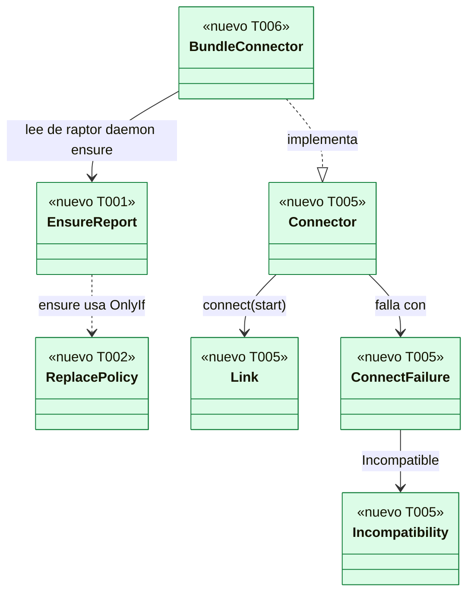
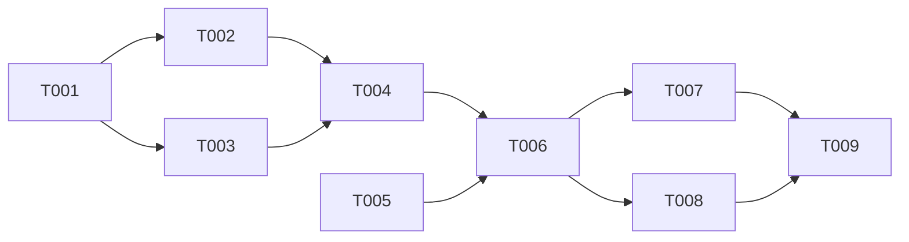

# DS-TS-DSK-002 · Arranque del motor desde la app y binarios del motor en el bundle

## Contexto rápido

Al terminar, la app se conecta al motor y lo arranca con el `raptor` de su propio bundle, nunca reemplaza el motor de otra instalación, y la alpha publica `GitRaptor-<versión>-aarch64-apple-darwin.dmg` con `raptor` y `raptor-mcp` dentro. Hoy no puede: la app no sabe arrancar el motor y el bundle no lleva sus binarios.

Para eso: el subcomando `raptor daemon ensure` con un informe JSON fijo, la costura `engine::link` y su `BundleConnector` en el backend de la app, la comprobación B-3 del daemon, el diálogo nativo del autoarranque y el job del `.dmg`. Las decisiones son de [ADR-GRP-014, Enmienda DEP-DSK-5](../../../../architecture/decisions/ADR-GRP-014-pipeline-release-distribucion.md#enmienda-2026-11-08-dep-dsk-5-arranque-del-motor-desde-la-app); aquí no se reabren.

| Término | Qué es aquí |
|---|---|
| `ensure` | `raptor daemon ensure --json`: arranca el motor si hace falta y dice en una línea JSON dónde está y quién lo sirve |
| `Connector` | Costura del backend de la app: abre una conexión (`Link`) con el daemon, arrancándolo o no. La usa el supervisor de US-DSK-003 |
| `BundleConnector` | El `Connector` real: ejecuta el `raptor` del bundle y conecta con la verificación B-3 |
| B-3 | Comprobación de ADR-GRP-017 § 1: el socket lo sirve un `raptor` instalado del mismo usuario |
| Mismo binario | La ruta canónica del ejecutable del daemon es la del `raptor` que corre `ensure` (SEC-13) |

**Decisiones de esta Dev Spec**: todas son **Ajuste tras la revisión de arquitectura (2026-11-08), validado por Arquitecto**, salvo D7, que además cumple B-2 de la revisión de seguridad.

| # | Decisión | Por qué |
|---|---|---|
| D1 | La app **no** usa `Launch` ni `ensure_daemon_with`: implementa `Connector` con `BundleConnector`, que ejecuta `ensure` y conecta con `Client::connect_runtime` y la verificación B-3 | El arranque sigue siendo de `crates/core` (vía la CLI); la app solo conecta (ADR-GRP-014, Enmienda DEP-DSK-5, D1) |
| D2 | `ensure` **no** reutiliza `ensure_daemon_with` tal cual (reemplaza cualquier daemon). `gitraptor-api` gana `ensure_daemon_policy` con `ReplacePolicy`; `ensure_daemon_with` pasa a ser `ReplacePolicy::Any` sin cambio de comportamiento | Un solo algoritmo de arranque; la regla "solo mi mismo binario" se inyecta (SEC-13) |
| D3 | Capacidades: `ensure --require <nombre>` (repetible). La app pasa exactamente `REQUIRED_CAPABILITIES`. Sin `--require`, `ensure` solo exige el protocolo | La lista es de la app (D7 de US-DSK-003); la CLI no la duplica |
| D4 | El informe es el tipo `gitraptor_api::client::ensure::EnsureReport` (serde, `deny_unknown_fields`); la CLI lo escribe y la app lo lee. Fixtures en `crates/api/tests/fixtures/ensure/`, leídas por los tests de api, de la CLI y de `src-tauri` | Un esquema, tres consumidores, sin copias |
| D5 | La costura (`Link`, `Connector`, `ConnectFailure`, `LinkError`, `Incompatibility`, `ClientLink`, `SocketConnector`, `REQUIRED_CAPABILITIES`) se crea **aquí**, en `engine/link.rs`, con las formas exactas de DS-US-DSK-003 § Firmas del stack. US-DSK-003 la usa sin redefinirla | El conector real y su costura van juntos |
| D6 | B-3 vive en `gitraptor_api::client::peer` (`installed_raptor_peer`); la ruta del ejecutable de un pid sale de `gitraptor-macsys` (nuevo `process::executable_path`, FFI privada `ffi_pidpath.rs`) en macOS y de `/proc/<pid>/exe` en Linux. La feature `client` de `gitraptor-api` gana `dep:gitraptor-macsys` (solo macOS). Nada de `unsafe` en `gitraptor-desktop`; V1 sigue en verde (`gitraptor-macsys` no está prohibido) | B-1 de la revisión de seguridad |
| D7 | Diálogo de confirmación del autoarranque: **`tauri-plugin-dialog` `=2.8.3`**, registrado con `.plugin(tauri_plugin_dialog::init())` porque su API de Rust (`DialogExt::dialog()`) necesita el plugin registrado. Es el único plugin; el webview no recibe ningún permiso `dialog:*` (V2 lo comprueba). Se descarta `rfd` directo: obliga a gestionar el hilo principal de macOS a mano y sería una segunda vía para el selector de carpeta de US-DSK-001 | B-2; ADR-GRP-017 § 2 (el selector lo abre el backend) |
| D8 | Comandos IPC nuevos: `engine_autostart_offer` y `engine_autostart`. "Arrancar motor" es `engine_retry { start: true }` de US-DSK-003 (su D8): aquí no se añade otro | Un solo camino para arrancar |
| D9 | El `BundleConnector` guarda la ruta del canal del último informe. Con `start = false` y ruta conocida, conecta directamente; sin ruta, ejecuta `ensure --no-start` | Una reconexión no lanza un proceso cada 250 ms |

---

## 📋 Índice

> **Para aprobar:** [Contexto rápido](#contexto-rápido) · [⚠️ Gaps](#gaps-y-violaciones-de-la-constitución) · [🔭 La forma](#la-forma) · [El trabajo de un vistazo](#el-trabajo-de-un-vistazo).
> **Para implementar:** [🚀 Plan](#plan-de-implementación), en orden. Las `_(ref)_` se abren desde la tarea que las cita.

| Sección | Propósito |
|---------|-----------|
| [Contexto rápido](#contexto-rápido) | Qué se construye, glosario y decisiones |
| [⚠️ Gaps y violaciones de la constitución](#gaps-y-violaciones-de-la-constitución) | Qué impide empezar |
| [🔭 La forma](#la-forma) | Piezas y relaciones |
| [🚀 Plan de implementación](#plan-de-implementación) | T001…T009, en orden |
| ↳ [El trabajo de un vistazo](#el-trabajo-de-un-vistazo) | Tareas en tabla y su orden |
| [Estructura de ficheros](#estructura-de-ficheros) _(ref)_ | Archivos nuevos y tocados |
| [Contratos compartidos](#contratos-compartidos) _(ref)_ | Informe de `ensure`, tipos y firmas |
| [Estrategia de pruebas y cobertura](#estrategia-de-pruebas-y-cobertura) _(ref)_ | Pirámide y comportamientos críticos |
| [Gate de seguridad](#gate-de-seguridad) | Checklist pre-merge |
| [Fuera de alcance](#fuera-de-alcance) | Lo que esta entrega no toca |
| [Notas del autor](#notas-del-autor) _(ref)_ | Lo que no bloquea |

---

## ⚠️ Gaps y violaciones de la constitución

_No gaps. Ready to implement._

Depende de TS-DSK-001 mezclada (proyecto, `commands.json`, V1, V2). No hay `architecture-constitution.md`: rigen `AGENTS.md` y los ADRs citados.

---

## 🔭 La forma

Quedan un informe compartido por la CLI y la app, una costura de conexión en la app con su implementación real, y el `.dmg` en el pipeline.



`BundleConnector` ejecuta el `raptor` del bundle (`ensure`), lee su `EnsureReport` y abre un `ClientLink` con `Client::connect_runtime` y `installed_raptor_peer` (B-3). La CLI decide si reemplaza con `ReplacePolicy::OnlyIf` (mismo binario).

---

## 🚀 Plan de implementación

> Orden topológico (`Depende:`). Rutas relativas a la raíz del repo. Requiere TS-DSK-001 en `main`.

### El trabajo de un vistazo

Tres frentes y un cierre: motor y CLI (T001-T004), backend de la app (T005-T007), release (T008) y verificación (T009).

| # | Tarea | Depende | Aterriza en |
|---|---|---|---|
| T001 | Crear `EnsureReport`, sus fixtures y la regla de binario instalado | — | `crates/api`, `crates/core` |
| T002 | Añadir `ensure_daemon_policy` y `ReplacePolicy` | T001 | `crates/api/src/client` |
| T003 | Añadir la ruta del ejecutable de un pid y la comprobación B-3 | T001 | `crates/macsys`, `crates/api/src/client` |
| T004 | Añadir la acción `raptor daemon ensure` | T002, T003 | `apps/cli` |
| T005 | Crear la costura `engine::link` | — | `apps/desktop/src-tauri/src/engine` |
| T006 | Crear `engine::launcher` con `BundleConnector` | T004, T005 | `apps/desktop/src-tauri/src/engine` |
| T007 | Añadir el diálogo nativo y los comandos de autoarranque | T006 | `apps/desktop/src-tauri` |
| T008 | Construir el `.dmg` de la alpha con los binarios del motor | T006 | `.github/workflows`, `tools`, `apps/desktop/src-tauri` |
| T009 | Verificar de punta a punta en macOS | T007, T008 | — |

### En qué orden

Dos frentes paralelos (motor y CLI; costura de la app) que se juntan en el `BundleConnector`.



### T001 — Crear `EnsureReport`, sus fixtures y la regla de binario instalado

**Objetivo.** El esquema del informe de `ensure` y la regla pura de "`raptor` instalado", una sola vez.

**Ubicación.**
- `crates/api/src/client/ensure.rs` (**CREATE**)
- `crates/api/src/client/installed.rs` (**CREATE**)
- `crates/api/src/client/mod.rs` (**MODIFY**: `pub mod ensure; pub mod installed;`)
- `crates/api/tests/fixtures/ensure/` (**CREATE**: `ready.json`, `ready-started.json`, `not-running.json`, `daemon-older.json`, `app-older.json`, `missing-capabilities.json`, `launch-failed.json`)
- `crates/api/tests/ensure_report.rs` (**CREATE**)
- `crates/core/src/autostart.rs` (**MODIFY**)

**Reglas**
- `EnsureReport` y sus tipos, exactamente como en § Informe de `ensure`.
- `installed::is_transient(path: &Path, temp: &[PathBuf]) -> bool`: la regla que hoy está dentro de `gitraptor_core::autostart::refuse_transient` (componentes `node_modules` y `_npx`, `bunx-*`, `dlx` tras un componente con `pnpm`, o bajo una carpeta de `temp`). `refuse_transient` pasa a llamarla; su comportamiento y sus tests no cambian.
- `installed::FIXED_TEMP: &[&str] = &["/tmp", "/private/tmp", "/var/tmp", "/private/var/tmp", "/var/folders", "/private/var/folders"]`, para quien no puede leer el entorno (la app, M-4).
- `installed::is_installed_raptor(path: &Path) -> bool`: nombre de archivo `raptor`; archivo regular (`symlink_metadata` sobre la ruta canónica); dueño el uid actual o 0; sin escritura de grupo ni de otros (`mode & 0o022 == 0`); y `!is_transient(path, FIXED_TEMP)`.
- `tests/ensure_report.rs`: cada fixture se deserializa y vuelve a serializar idéntica (`serde_json::Value`); un campo desconocido falla; `is_installed_raptor` acepta un `raptor` 0755 propio en una carpeta temporal **creada fuera** de `FIXED_TEMP` y rechaza: otro nombre, 0775, enlace simbólico, y rutas con `node_modules`, `_npx` o `/tmp`.

- **Depende:** —
- **Refs:** ADR-GRP-014, Enmienda DEP-DSK-5, D2 y D6; SEC-14; D4
- **Aceptación:** `cargo test -p gitraptor-api --test ensure_report` y `cargo test -p gitraptor-core autostart` en verde.

### T002 — Añadir `ensure_daemon_policy` y `ReplacePolicy`

**Objetivo.** El arranque bajo demanda con la regla de reemplazo inyectable. `ensure_daemon_with` no cambia de comportamiento.

**Ubicación.**
- `crates/api/src/client/mod.rs` (**MODIFY**)
- `crates/api/tests/client_policy.rs` (**CREATE**)

**Reglas**
- Firmas de § Firmas del stack. `ensure_daemon_with(connect, launch, on_launch)` = `ensure_daemon_policy(connect, launch, on_launch, ReplacePolicy::Any).map(|e| e.client)`.
- Con `ReplacePolicy::OnlyIf(f)`, antes de enviar `daemon.replace` (en `replace_same_protocol` y en `replace`) se llama `f(pid)` con el pid del par del socket (`peer::peer_cred`). Si devuelve `false`: con el mismo protocolo y capacidades que faltan, devuelve `Ok(Ensured { client, started: false, replaced: false })` con el cliente tal cual (quien llama ve las que faltan con `missing_capabilities`); con un protocolo anterior, `Err(ClientError::Incompatible(data))`. Nunca envía `daemon.replace`.
- `Ensured.started` es `true` si se llamó `launch.launch()`; `replaced`, si un daemon aceptó el reemplazo.
- `Client::peer_pid(&self) -> Option<u32>`: el pid del par del socket abierto.

- **Depende:** T001
- **Refs:** SEC-13; D2
- **Aceptación:** `cargo test -p gitraptor-api --test client_policy`: con un servidor de prueba de protocolo anterior y `OnlyIf(|_| false)`, el servidor no recibe `daemon.replace` y el resultado es `Incompatible`; con `OnlyIf(|_| true)`, lo recibe; con el mismo protocolo y una capacidad que falta y `OnlyIf(|_| false)`, devuelve el cliente sin reemplazar. Los tests existentes de `gitraptor-api` y `gitraptor-core` siguen en verde.

### T003 — Añadir la ruta del ejecutable de un pid y la comprobación B-3

**Objetivo.** Saber qué ejecutable sirve el socket sin `unsafe` fuera de `gitraptor-macsys`.

**Ubicación.**
- `crates/macsys/src/ffi_pidpath.rs` (**CREATE**)
- `crates/macsys/src/process.rs` (**MODIFY**)
- `crates/macsys/src/lib.rs` (**MODIFY**: `mod ffi_pidpath;` privado, solo macOS)
- `crates/api/Cargo.toml` (**MODIFY**)
- `crates/api/src/client/peer.rs` (**MODIFY**)
- `crates/api/tests/client_peer.rs` (**MODIFY**)

**Reglas**
- `ffi_pidpath.rs`: un solo bloque `unsafe` con `libc::proc_pidpath(pid, buf, PROC_PIDPATHINFO_MAXSIZE)` sobre un búfer de 4.096 bytes, con su comentario `// SAFETY:`; devuelve `Option<PathBuf>` (`None` si el resultado es ≤ 0).
- `process::executable_path(pid: u32) -> Option<PathBuf>` (macOS; en otros SO, `None`) envuelve la FFI.
- `crates/api/Cargo.toml`: en `[target."cfg(target_os = \"macos\")".dependencies]`, `gitraptor-macsys = { workspace = true, optional = true }`; la feature `client` añade `"dep:gitraptor-macsys"`.
- `peer::executable_of(pid: u32) -> Option<PathBuf>`: macOS, `gitraptor_macsys::process::executable_path`; Linux, `std::fs::read_link("/proc/<pid>/exe")`; resto, `None`.
- `peer::installed_raptor_peer(pid: u32) -> bool` = el pid es de `current_uid()` (`peer_cred` ya lo comprueba en L-06) y `executable_of(pid)` cumple `installed::is_installed_raptor`.

> **Nota técnica.** Entre leer el pid del par y resolver su ruta, el pid puede reutilizarse. Es el límite aceptado en ADR-GRP-014, Enmienda DEP-DSK-5, D6; la verificación por *audit token* (`LOCAL_PEERTOKEN`) la decide SPIKE-DSK-001.

- **Depende:** T001
- **Refs:** B-1 de la revisión de seguridad; ADR-GRP-017 § 1 (B-3); D6
- **Aceptación:** `cargo test -p gitraptor-macsys` (en macOS, `executable_path(std::process::id())` es `std::env::current_exe()` canonicalizado), `cargo test -p gitraptor-winsys --test unsafe_boundary` (la FFI nueva vive en un módulo `ffi_*` privado) y `cargo test -p gitraptor-api --test client_peer` (`installed_raptor_peer` rechaza el pid de un ejecutable que no se llama `raptor`) en verde.

### T004 — Añadir la acción `raptor daemon ensure`

**Objetivo.** El subcomando que usa la app, sin método del canal ni comando reservado.

**Ubicación.**
- `apps/cli/src/commands/daemon.rs` (**MODIFY**: variante y función propias)
- `apps/cli/tests/daemon_ensure.rs` (**CREATE**)

**Reglas**
- `DaemonAction::Ensure { json: bool, no_start: bool, require: Vec<String> }`, con `#[command(hide = true)]` y los flags `--json` (obligatorio; sin él sale con 2), `--no-start` y `--require <NAME>` (repetible). Es una variante nueva y una función nueva en el mismo archivo (ADR-GRP-016: no toca otro archivo compartido).
- Pasos: resuelve el perfil (`profile_dirs`); construye `ClientOptions` con `capabilities = require`; con `--no-start`, solo `Client::connect`; sin él, `ensure_daemon_policy(&options.connect()?, &mut options.launcher(), &mut || {}, ReplacePolicy::OnlyIf(&mut same_binary))`, donde `same_binary(pid)` compara `peer::executable_of(pid)` canonicalizado con `std::env::current_exe()` canonicalizado.
- Escribe **una** línea con `EnsureReport` y sale con el código de § Informe de `ensure`. Nada por stderr salvo un error de uso de `clap`. Rellena `autostart` con `gitraptor_core::autostart::Autostart::for_current_user()` (`is_registered`, `registered_exe`).
- Se ejecuta en el proceso de la CLI: no es comando reservado ni pasa por el MCP.

- **Depende:** T002, T003
- **Refs:** ADR-GRP-014, Enmienda DEP-DSK-5, D2; ADR-GRP-016; D3
- **Aceptación:** `cargo test -p gitraptor-cli --test daemon_ensure` en verde sobre perfiles temporales (`GITRAPTOR_PROFILE_DIR`, solo en debug, como el resto de tests de la CLI): motor parado + `--no-start` → `not-running`, salida 5; motor parado → `ready`, `started: true`; motor en marcha → `ready`, `started: false`; `--require` de una capacidad inexistente con un daemon de otra ruta → `incompatible` `missing-capabilities` y el daemon no recibió `daemon.replace`; la línea de salida tiene las mismas claves que la fixture correspondiente.

### T005 — Crear la costura `engine::link`

**Objetivo.** Los tipos que comparten el supervisor de US-DSK-003 y el `BundleConnector`, con las formas exactas de DS-US-DSK-003.

**Ubicación.**
- `apps/desktop/src-tauri/src/engine/mod.rs` (**CREATE**: `pub mod link; pub mod launcher; pub mod autostart;`)
- `apps/desktop/src-tauri/src/engine/link.rs` (**CREATE**)
- `apps/desktop/src-tauri/src/lib.rs` (**MODIFY**: `pub mod engine;`)
- `apps/desktop/src-tauri/tests/engine_link.rs` (**CREATE**)

**Reglas**
- `link.rs` define `Link`, `Connector`, `LinkError`, `ConnectFailure`, `Incompatibility`, `IncompatibilityKind` y `REQUIRED_CAPABILITIES` de § Firmas del stack, sin cambiar un nombre ni una variante.
- `ClientLink(gitraptor_api::client::Client)`: `hello` = `Client::hello`; `call` = `Client::call::<Value, Value>`; `next` = `Client::next_incoming` decodificado a `ServerMessage` con `serde_json::from_slice`, devolviendo solo notificaciones; un error de E/S es `LinkError::Lost`, un error RPC `LinkError::Refused { code }`.
- `SocketConnector { runtime: PathBuf }`: `Client::connect(&runtime, ClientKind::Cli, PROTOCOL_VERSION)`; con `start = true` hace lo mismo. Traduce `ClientError` con `map_client_error` (§ Firmas del stack), que también usa `BundleConnector`.
- `REQUIRED_CAPABILITIES` se escribe con las constantes `CAP_*` de `gitraptor_api::methods`.

- **Depende:** — (TS-DSK-001 en `main`)
- **Refs:** DS-US-DSK-003 § Firmas del stack y T002; D5
- **Aceptación:** `cargo test -p gitraptor-desktop --test engine_link` en verde: `map_client_error` cubre cada variante de `ClientError` con su `ConnectFailure`; `REQUIRED_CAPABILITIES` = `["scope.activity", "observation.tiers", "prediction.pairs"]`. V1 sigue en verde.

### T006 — Crear `engine::launcher` con `BundleConnector`

**Objetivo.** El `Connector` real de la app. Sin `Launch`, sin `ensure_daemon_with`.

**Ubicación.**
- `apps/desktop/src-tauri/src/engine/launcher.rs` (**CREATE**)
- `apps/desktop/src-tauri/tests/engine_launcher.rs` (**CREATE**)
- `apps/desktop/src-tauri/tests/support/fake_raptor.rs` (**CREATE**)

**Reglas**
- `BundleConnector::new() -> Self` (infalible): la ruta del `raptor` se resuelve en cada `connect` con `bundled_raptor()`.
- `bundled_raptor() -> Option<PathBuf>`: `std::env::current_exe()?.canonicalize()?`, el hermano `raptor`, canonicalizado, en la **misma** carpeta, y `installed::is_installed_raptor`. Nunca el `PATH`.
- `connect(start)`: (1) si `start == false` y hay ruta del canal guardada, va a (3); (2) ejecuta `run_ensure(raptor, start)` y guarda `report.runtime`; según `report.outcome`: `not-running` → `NotRunning`; `unavailable` → `LaunchFailed`, salvo `channel-rejected` → `Rejected` y `unsupported` → `Unsupported`; `incompatible` → `Incompatible(Incompatibility { which, daemon_version, daemon_path, missing })` con los valores del informe; (3) `Client::connect_runtime(runtime, ClientKind::Cli, PROTOCOL_VERSION, peer::installed_raptor_peer)` → `ClientLink`, o `map_client_error` (con `NotAuthentic` → `Rejected`). Sin `raptor` válido en el bundle → `LaunchFailed`.
- `run_ensure`: `Command::new(raptor)` con argv `["daemon", "ensure", "--json"]`, más `"--no-start"` si `!start`, más `"--require", <cap>` por cada `REQUIRED_CAPABILITIES`; `.env_clear().env("PATH", "/usr/bin:/bin:/usr/sbin:/sbin").current_dir("/")`, stdin nulo, stderr nulo, stdout por tubería. Un hilo lee stdout hasta 64 KiB; el principal sondea `try_wait` cada 20 ms y mata el proceso a los 10 s (`LaunchFailed`). La primera línea se deserializa a `EnsureReport`; otra cosa es `LaunchFailed`. Igual en debug y en release (M-4): el entorno nunca se lee.
- Costura de pruebas: `#[doc(hidden)] pub fn for_tests(raptor: PathBuf, verify_peer: fn(u32) -> bool) -> Self` sustituye `bundled_raptor()` y `installed_raptor_peer`. Ningún otro código la usa (lo comprueba un test que busca `for_tests(` fuera de `tests/`).
- `fake_raptor.rs`: escribe en una carpeta temporal un script `raptor` (0755) que imprime una fixture de `crates/api/tests/fixtures/ensure/` con `runtime` sustituido por la carpeta del daemon falso de US-DSK-003 (o un socket de prueba propio si aún no existe), y registra su argv y su entorno en un archivo.

- **Depende:** T004, T005
- **Refs:** ADR-GRP-014, Enmienda DEP-DSK-5, D1, D3, D4, D5; D1, D9
- **Aceptación:** `cargo test -p gitraptor-desktop --test engine_launcher` en verde: argv exacto con los tres `--require`; entorno registrado = solo `PATH`; `--no-start` cuando se conecta sin arrancar; con `ready`, conecta; con `daemon-older`, `Incompatible` con `daemon_path` de la fixture; con `not-running`, `NotRunning`; salida no JSON o script que duerme 11 s → `LaunchFailed`; sin `raptor` junto al ejecutable → `LaunchFailed`; una segunda conexión sin arrancar no ejecuta el script. V1 y V7 (`environment.rs`) siguen en verde.

### T007 — Añadir el diálogo nativo y los comandos de autoarranque

**Objetivo.** Registrar o quitar el autoarranque solo con un "Sí" del humano en un diálogo que el webview no controla.

**Ubicación.**
- `Cargo.toml` (**MODIFY**: `tauri-plugin-dialog = "=2.8.3"` en `[workspace.dependencies]`)
- `apps/desktop/src-tauri/Cargo.toml` (**MODIFY**)
- `apps/desktop/src-tauri/src/lib.rs` (**MODIFY**: `.plugin(tauri_plugin_dialog::init())`)
- `apps/desktop/src-tauri/src/engine/autostart.rs` (**CREATE**)
- `apps/desktop/src-tauri/src/commands/engine_autostart_offer.rs` (**CREATE**)
- `apps/desktop/src-tauri/src/commands/engine_autostart.rs` (**CREATE**)
- `apps/desktop/src-tauri/commands.json` (**MODIFY**)
- `apps/desktop/src-tauri/capabilities/main.json` (**MODIFY**)
- `apps/desktop/src-tauri/src/commands/mod.rs` (**MODIFY**)
- `apps/desktop/src/client/commands.ts` (**MODIFY**)
- `apps/desktop/src/i18n/locales/en.json` (**MODIFY**)
- `apps/desktop/src/i18n/locales/es.json` (**MODIFY**)
- `apps/desktop/src-tauri/tests/autostart.rs` (**CREATE**)

**Reglas**
- `autostart::offer(app_exe: &Path, report: &EnsureReport) -> Offer`: `Offered` si la ruta canónica empieza por `/Applications/` o por `<home>/Applications/` (home de `getpwuid` vía `rustix`, nunca `HOME`), no contiene `/AppTranslocation/` ni empieza por `/Volumes/`, y `report.autostart.registered == false`; si está registrado con el `raptor` del bundle, `Registered`; si no, `NotOffered { reason: Location | OtherBinary }`.
- `engine_autostart_offer` (params vacíos): ejecuta `ensure --no-start` y devuelve `{ offer: "offered" | "registered" | "not-offered", reason: "location" | "other-binary" | null }`.
- `engine_autostart` (`{ enable: boolean }`), `async`: recalcula la oferta; si no corresponde, error `not-offered`. Abre el diálogo con `app.dialog().message(<texto>).title(<título>).kind(MessageDialogKind::Warning).buttons(MessageDialogButtons::OkCancelCustom(<sí>, <cancelar>)).blocking_show()` dentro de `tauri::async_runtime::spawn_blocking`; los textos los da el backend en el idioma del SO (catálogo Rust pequeño en `autostart.rs`, en/es), nunca el webview. Con "Cancelar", error `cancelled` y no ejecuta nada. Con "Sí", ejecuta `raptor daemon enable` o `disable` con el mismo entorno y tiempo máximo que `run_ensure`; salida 0 → `{ registered: enable }`, otra → `failed`.
- Textos del diálogo: título "Arrancar GitRaptor al iniciar sesión" / "Start GitRaptor at login"; cuerpo "GitRaptor arrancará su motor cada vez que inicies sesión. Si no lo pediste tú, cancela." / "GitRaptor will start its engine every time you log in. If you did not ask for this, cancel."; botones "Activar" / "Enable" y "Cancelar" / "Cancel". Para `disable`, "Dejar de arrancar…" / "Stop starting…" con el mismo esquema.
- `commands.json` añade `engine_autostart_offer` y `engine_autostart`; la capability, `allow-engine-autostart-offer` y `allow-engine-autostart`, y **ningún** `dialog:*`.
- `CommandError` gana `NotOffered`, `Cancelled` y `Failed`; el catálogo del frontend, `error.not-offered`, `error.cancelled` y `error.failed` en en y es.

> **Nota técnica.** La API de Rust de `tauri-plugin-dialog` (`DialogExt::dialog`) lee el estado que registra `init()`; sin `.plugin(...)` no existe. Registrar el plugin no da nada al webview: sus comandos `plugin:dialog|*` exigen permisos `dialog:*` en la capability, y V2 los prohíbe. `blocking_show` no puede correr en el hilo principal: por eso el comando es `async` y usa `spawn_blocking`.

- **Depende:** T006
- **Refs:** B-2 de la revisión de seguridad; ADR-GRP-014, Enmienda DEP-DSK-5, D7; DS-TS-DSK-001 T002 (convención de comandos); D7, D8
- **Aceptación:** `cargo test -p gitraptor-desktop --test autostart --test tauri_surface --test commands` en verde: `offer` con `/Applications/GitRaptor.app/…`, `~/Applications/…`, `/Volumes/…`, una ruta con `/AppTranslocation/` y un registro con otro binario; con la decisión del diálogo inyectada en "Cancelar", `raptor` no se ejecuta (registro vacío del `fake_raptor`); V2 acepta `tauri-plugin-dialog` y falla si se añade `dialog:default` a la capability.

### T008 — Construir el `.dmg` de la alpha con los binarios del motor

**Objetivo.** El job de release que publica la app con `raptor` y `raptor-mcp` de la misma corrida.

**Ubicación.**
- `apps/desktop/src-tauri/tauri.release.conf.json` (**CREATE**)
- `tools/desktop/stage-sidecars.sh` (**CREATE**)
- `.gitignore` (**MODIFY**: `apps/desktop/src-tauri/binaries/`)
- `.github/workflows/release.yml` (**MODIFY**)
- `tools/release/select-assets.sh` (**MODIFY**)
- `tools/release/select-assets.test.sh` (**MODIFY**)

**Pasos**
1. `tauri.release.conf.json` exactamente: `{"bundle": {"externalBin": ["binaries/raptor", "binaries/raptor-mcp"], "targets": ["dmg"], "macOS": {"signingIdentity": "-"}}}`. Ninguna otra clave (V2, M-1).
2. `stage-sidecars.sh <target-triple> <carpeta-con-binarios>`: copia `raptor` y `raptor-mcp` a `apps/desktop/src-tauri/binaries/raptor-<triple>` y `raptor-mcp-<triple>`, con `chmod 755`; falla si falta alguno.
3. Job `desktop-app` en `release.yml` (`name: desktop app (aarch64-apple-darwin)`), `needs: [plan, build]`, `runs-on: macos-latest`, permisos `contents: read`, sin restaurar caché: `download-artifact` de `archive-aarch64-apple-darwin`; extraer `raptor` y `raptor-mcp` del `.tar.gz`; `stage-sidecars.sh aarch64-apple-darwin <carpeta>`; `pnpm/action-setup` y `setup-node` (Node 22, sin caché); `pnpm install --frozen-lockfile --ignore-scripts`; `pnpm audit`; `rustup show`; `pnpm --filter @gitraptor/desktop exec tauri build --target aarch64-apple-darwin --bundles dmg --config src-tauri/tauri.release.conf.json`; renombrar el `.dmg` a `GitRaptor-<versión>-aarch64-apple-darwin.dmg` (versión de `needs.plan.outputs`); `hdiutil attach -nobrowse -readonly`, comprobar que `GitRaptor.app/Contents/MacOS/raptor --version` y `raptor-mcp --version` dan la versión, `hdiutil detach`; `upload-artifact` `archive-desktop-aarch64-apple-darwin`.
4. `assemble` añade `desktop-app` a `needs`; su `download-artifact` ya baja todos los `archive-*`.
5. `select-assets.sh` adjunta en las alphas `GitRaptor-<versión>-aarch64-apple-darwin.dmg` y su `.sha256`; `select-assets.test.sh` lo cubre.

- **Depende:** T006
- **Refs:** ADR-GRP-014, Enmienda DEP-DSK-5, D8 y D9; Enmienda 2026-11-08: app de escritorio, punto 1
- **Aceptación:** `bash tools/release/select-assets.test.sh` en verde; `cargo test -p gitraptor-desktop --test tauri_surface` acepta `tauri.release.conf.json` y falla si se le añade una clave; un PR que toca `release.yml` corre el build de prueba con el job `desktop-app` en verde.

### T009 — Verificar de punta a punta en macOS

**Objetivo.** Lo que solo se ve con la app instalada.

**Ubicación.** Ninguna: solo corre verificaciones.

**Pasos**
1. Con el `.dmg` del build de prueba instalado en `/Applications` y sin otro `raptor`: abrir la app y pulsar "Arrancar motor" (US-DSK-003) arranca el motor; `ps` muestra el daemon con la ruta del bundle.
2. Con un daemon de `install.sh` de una versión anterior en marcha: la app muestra "Motor incompatible" con su ruta y no lo reemplaza.
3. Autoarranque desde la app: aparece el diálogo del sistema; "Cancelar" no crea `~/Library/LaunchAgents/dev.gitraptor.plist`; "Activar" lo crea con la ruta del bundle.
4. App abierta desde la imagen montada: `engine_autostart_offer` responde `not-offered` `location`.

- **Depende:** T007, T008
- **Refs:** TS-DSK-002, Verificación manual
- **Aceptación:** los cuatro pasos, con su resultado en la descripción del PR.

---

## Estructura de ficheros

```text
crates/api/src/client/{ensure.rs,installed.rs}      # T001
crates/api/tests/fixtures/ensure/*.json             # T001, compartidas
crates/macsys/src/ffi_pidpath.rs                    # T003
apps/cli/src/commands/daemon.rs                     # T004 (variante Ensure)
apps/desktop/src-tauri/src/engine/
├── mod.rs                                          # T005
├── link.rs                                         # T005: costura
├── launcher.rs                                     # T006: BundleConnector
└── autostart.rs                                    # T007
apps/desktop/src-tauri/src/commands/{engine_autostart_offer,engine_autostart}.rs
apps/desktop/src-tauri/tauri.release.conf.json      # T008
tools/desktop/stage-sidecars.sh                     # T008
```

---

## Contratos compartidos

### Tipos y datos compartidos

**Informe de `ensure`** (`gitraptor_api::client::ensure::EnsureReport`, una línea JSON, claves `snake_case`, `deny_unknown_fields`):

| Clave | Tipo | Valor |
|---|---|---|
| `schema` | número | `1` |
| `outcome` | texto | `"ready"` \| `"not-running"` \| `"incompatible"` \| `"unavailable"` |
| `runtime` | texto \| null | Carpeta del canal; `null` solo si el perfil no se resolvió |
| `daemon_pid` | número \| null | Pid del par del socket |
| `daemon_path` | texto \| null | Ruta del ejecutable del daemon (`peer::executable_of`), sin canonicalizar |
| `daemon_version` | texto \| null | `HelloResult.binary_version` o `IncompatibleData.binary_version` |
| `daemon_protocol` | número \| null | Protocolo del daemon |
| `started` | booleano | `ensure` lanzó un daemon |
| `replaced` | booleano | Un daemon de la misma ruta aceptó el reemplazo |
| `incompatible` | objeto \| null | `{ "which": "daemon-older" \| "app-older" \| "missing-capabilities", "missing": [texto] }`; no nulo solo con `outcome = "incompatible"` |
| `unavailable` | objeto \| null | `{ "reason": "launch-failed" \| "start-timeout" \| "channel-rejected" \| "unsupported" \| "profile" }`; no nulo solo con `outcome = "unavailable"` |
| `autostart` | objeto | `{ "registered": booleano, "binary": texto \| null }` |

**Códigos de salida**: `0` ready · `2` uso (`clap`, o falta `--json`) · `3` incompatible · `4` unavailable · `5` not-running (solo con `--no-start`). La app decide por `outcome`; el código solo sirve a quien lo use desde un script.

| Tipo de la app | Dónde | Forma |
|---|---|---|
| `ConnectFailure` | `engine/link.rs` | `NotRunning`, `LaunchFailed`, `Incompatible(Incompatibility)`, `Rejected`, `Unsupported`, `Lost` |
| `Incompatibility` | `engine/link.rs` | `{ which: IncompatibilityKind, daemon_version: Option<String>, daemon_path: Option<String>, missing: Vec<String> }`, crudo (US-DSK-003 lo sanea) |
| `IncompatibilityKind` | `engine/link.rs` | `DaemonOlder`, `AppOlder`, `MissingCapabilities` |
| `LinkError` | `engine/link.rs` | `Refused { code: i64 }`, `Lost` |
| `REQUIRED_CAPABILITIES` | `engine/link.rs` | `&[&str]` = `["scope.activity", "observation.tiers", "prediction.pairs"]` con las constantes `CAP_*` |
| `Offer` | `engine/autostart.rs` | `Offered`, `Registered`, `NotOffered { reason: Location \| OtherBinary }` |

### Ciclos de vida (DI)

| Pieza | Ciclo |
|---|---|
| `BundleConnector` | Uno por proceso, creado por US-DSK-003 en `lib.rs` (`EngineHub::new(Box::new(launcher::BundleConnector::new()))`); guarda la ruta del canal del último informe |
| Proceso `raptor daemon ensure` | Efímero, uno por `connect` que lo necesite (D9) y por comando de autoarranque |
| `tauri-plugin-dialog` | Registrado una vez en `lib.rs`; solo lo usa el backend |

### Firmas del stack

```rust
// crates/api/src/client/mod.rs
pub enum ReplacePolicy<'a> { Any, OnlyIf(&'a mut dyn FnMut(u32) -> bool) }
pub struct Ensured { pub client: Client, pub started: bool, pub replaced: bool }
pub fn ensure_daemon_policy(connect: &Connect, launch: &mut dyn Launch, on_launch: &mut dyn FnMut(), policy: ReplacePolicy<'_>) -> Result<Ensured, ClientError>;
impl Client { pub fn peer_pid(&self) -> Option<u32>; }
// crates/api/src/client/peer.rs
pub fn executable_of(pid: u32) -> Option<std::path::PathBuf>;
pub fn installed_raptor_peer(pid: u32) -> bool;
// crates/api/src/client/installed.rs
pub fn is_transient(path: &std::path::Path, temp: &[std::path::PathBuf]) -> bool;
pub fn is_installed_raptor(path: &std::path::Path) -> bool;
// crates/macsys/src/process.rs
pub fn executable_path(pid: u32) -> Option<std::path::PathBuf>;

// apps/desktop/src-tauri/src/engine/link.rs (formas de DS-US-DSK-003)
pub trait Link: Send {
    fn hello(&self) -> &gitraptor_api::messages::HelloResult;
    fn call(&mut self, method: &str, params: serde_json::Value) -> Result<serde_json::Value, LinkError>;
    fn next(&mut self, timeout: std::time::Duration) -> Result<Option<(u64, gitraptor_api::rpc::Notification)>, LinkError>;
}
pub trait Connector: Send + 'static {
    fn connect(&mut self, start: bool) -> Result<Box<dyn Link>, ConnectFailure>;
}
pub fn map_client_error(err: gitraptor_api::client::ClientError) -> ConnectFailure;
pub struct ClientLink(pub gitraptor_api::client::Client);
pub struct SocketConnector { pub runtime: std::path::PathBuf }
// apps/desktop/src-tauri/src/engine/launcher.rs
pub struct BundleConnector { /* raptor resuelto por connect; runtime: Option<PathBuf> */ }
impl BundleConnector { pub fn new() -> Self; #[doc(hidden)] pub fn for_tests(raptor: std::path::PathBuf, verify_peer: fn(u32) -> bool) -> Self; }
impl Connector for BundleConnector { /* … */ }
```

`map_client_error`: `NotRunning` → `NotRunning`; `Incompatible(d)` → `Incompatible { which: DaemonOlder, daemon_version: Some(d.binary_version), daemon_path: None, missing: [] }`; `ClientTooOld(d)` → `AppOlder` (ídem); `ChannelRejected` y `NotAuthentic` → `Rejected`; `TransportUnsupported` → `Unsupported`; `Launch(_)` y `StartTimeout` → `LaunchFailed`; el resto → `Lost`.

---

## Estrategia de pruebas y cobertura

### 9.1 Pirámide de pruebas

| Nivel | Qué | Dónde |
|---|---|---|
| Unitarias Rust | informe, regla de instalado, política de reemplazo, B-3 | `crates/api/tests`, `crates/macsys` |
| Integración CLI | `raptor daemon ensure` con perfiles temporales | `apps/cli/tests/daemon_ensure.rs` |
| Integración app | `BundleConnector` con `raptor` falso y fixtures | `apps/desktop/src-tauri/tests/engine_launcher.rs` |
| Fitness | V1, V2 (plugin y release), V7 | `src-tauri/tests` de TS-DSK-001 |
| Release | selección de assets y `.dmg` montado | `select-assets.test.sh`, job `desktop-app` |
| Manual | instalación real | T009 |

### 9.2 Umbrales de cobertura

Sin umbral numérico: cada `outcome`, cada variante de `ConnectFailure` y cada rama de `Offer` tiene un test con nombre.

### 9.4 Comportamientos críticos verificados

| Comportamiento | Test |
|---|---|
| `ensure` nunca reemplaza un daemon de otra ruta | `apps/cli/tests/daemon_ensure.rs`, `crates/api/tests/client_policy.rs` |
| El esquema del informe es el mismo en la CLI y en la app | fixtures de `crates/api/tests/fixtures/ensure/` en los tres tests |
| La app no lee el entorno ni lo pasa | `engine_launcher.rs` (entorno registrado), `environment.rs` |
| Un socket servido por algo que no es un `raptor` instalado se rechaza sin handshake | `crates/api/tests/client_peer.rs` |
| Sin "Sí" en el diálogo no se registra el autoarranque | `tests/autostart.rs` |
| El webview no puede abrir diálogos | V2 (`dialog:*` prohibido) |

### 9.5 Plataformas

macOS (T009, job `desktop-app`) y ubuntu (job `desktop`). `executable_of` en Linux con `/proc`; Windows: `Unsupported`. **Pendiente: etapa de validación multiplataforma**.

---

## Gate de seguridad

- Sin `unsafe` en `gitraptor-desktop`, `gitraptor-api` ni `apps/cli`; la FFI nueva solo en `crates/macsys/src/ffi_pidpath.rs` (`unsafe_boundary` en verde).
- Argv fijo, entorno vacío más `PATH`, sin shell ni plugin `shell`; `tauri-plugin-dialog` sin permisos para el webview.
- V1, V2 y V7 en verde.
- Corre `/security-review --scope devspec docs/requirements/features/desktop/dev-specs/TS-DSK-002-arranque-motor-binarios-bundle.md` antes de mezclar.

---

## Fuera de alcance

| Ítem / no-objetivo | Historia que lo cubre | Gate (cómo se verifica) |
|----------------|--------------------|-------------------------|
| Supervisor, estados y pantallas del motor, `engine_watch`, `engine_retry`, `EngineHub` | US-DSK-003 | no existen `engine/supervisor.rs` ni esos comandos en `commands.json` |
| Identidad firmada y *audit token* | SPIKE-DSK-001 | `peer.rs` no lee `LOCAL_PEERTOKEN` |
| Clase de cliente `desktop` | DEP-DSK-2 | `ClientKind` sin variante nueva |
| Firma Developer ID, notarización, cask y updater | v0.1.0 (ADR-GRP-014, Enmienda 2026-11-08) | `signingIdentity` = `"-"` |
| Intel, Windows y Linux | etapa de validación multiplataforma | el job construye solo `aarch64-apple-darwin` |

---

## Notas del autor

| ID | Nota | Acción | Owner |
|----|------|--------|-------|
| G1 | La Fuera de alcance de DS-US-DSK-003 comprueba que `src/engine` no lanza procesos; `engine/launcher.rs` y `engine/autostart.rs` sí lo hacen. Esa comprobación debe excluir esos dos archivos | Ajustar la puerta en DS-US-DSK-003 | Autor de US-DSK-003 |
| G2 | DS-US-DSK-003 T002 crea `engine/mod.rs` y `link.rs`; con esta Dev Spec pasan a `MODIFY` y US-DSK-003 solo añade `supervisor`, `wire`, `seq` y `EngineHub` | Ajustar sus rutas | Autor de US-DSK-003 |
| G3 | ~~Antigüedad de `tauri-plugin-dialog`~~. **Cerrado (2026-11-08, orquestador)**: 2.8.4 salió el 2026-10-28 (11 días, por debajo de la cuarentena de 14 días); se fija `=2.8.3` (2026-10-14), comprobado en crates.io | — | Orquestador |
