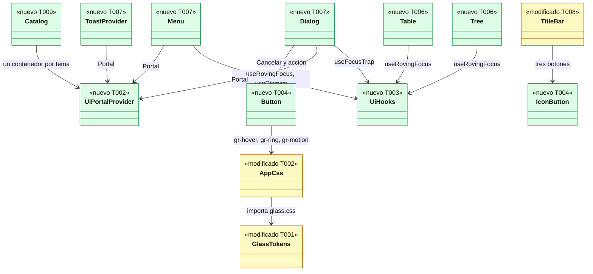
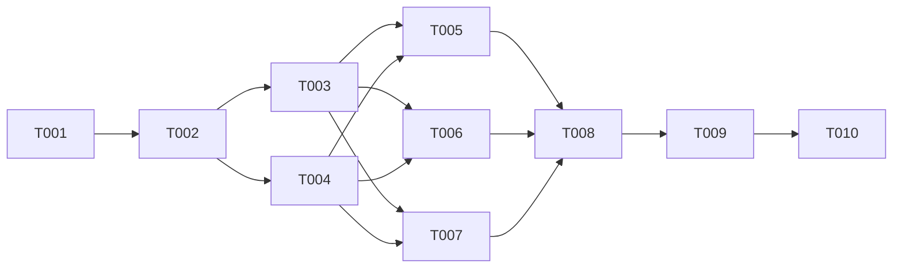

# DS-TS-DSK-003 · Primitivas del design system de la app de escritorio y catálogo de desarrollo

## Contexto rápido

Al terminar, quien implemente US-DSK-003 a US-DSK-008 compone sus pantallas importando `Button`, `Tree`, `Menu`, `Dialog`, `Toast` y el resto desde `@/ui`, y obtiene el aspecto, el teclado, los roles ARIA, los dos temas y los textos en/es ya resueltos y probados. Hoy `src/ui` solo tiene `Panel` y cada historia tendría que inventar sus controles.

Para eso: 14 primitivas propias en `apps/desktop/src/ui` sin dependencias nuevas, los tokens que faltaban en `glass.css`, las claves `ui.*`, un catálogo que solo vive en desarrollo y las pruebas que vigilan tokens, contraste, movimiento, accesibilidad y la exclusión del catálogo. El comportamiento y los valores visuales salen de la [spec de primitivas](../design/primitives-spec.md); las decisiones que dejaba abiertas están aquí y no se reabren al implementar.

| Término | Qué es aquí |
|---|---|
| Primitiva | Componente React puro de `src/ui`: sin Tauri, sin `@/client`, sin `@/state`. Recibe datos por props |
| Superficie (`*Surface`) | La parte visual de un overlay (Dialog, Menu, Popover, Toast, Tooltip) sin portal ni comportamiento. La usa el overlay real y el catálogo la pinta estática |
| Estado forzado | `data-force="hover" \| "pressed" \| "focus"` sobre una primitiva: el catálogo muestra el estado sin interacción con el mismo CSS que producción |
| Tema acotado | `data-theme="dark"` o `"light"` en un elemento cualquiera: su subárbol usa ese tema aunque `<html>` tenga otro |
| Catálogo | Vista de desarrollo (`?catalog`) con todas las primitivas en oscuro y claro lado a lado. No existe en el build de release |

**Decisiones de esta Dev Spec**: todas son **Decisión del orquestador (2026-11-09), validada por Arquitecto**, contrastadas con ADR-GRP-003 y ADR-GRP-004. Las que cambian ADR-GRP-003 están en su [Enmienda 2026-11-09](../../../../architecture/decisions/ADR-GRP-003-design-system.md#enmienda-2026-11-09-primitivas-de-ui-1-sin-dependencias-de-ui).

| # | Decisión | Por qué |
|---|---|---|
| D1 | **Sin dependencias de UI nuevas.** Ni Radix, ni CVA, ni `tailwind-merge`, ni Lucide, ni Motion. Foco, foco itinerante, cierre y posición con cinco hooks propios (§ Contratos); `useId` de React 19 sin envoltorio | Un solo consumidor, una plataforma (WebKit de macOS) y 14 piezas acotadas. Radix serían ~12 paquetes y sus transitivas (`react-remove-scroll`, `aria-hidden`, `@floating-ui/*`) bajo la cuarentena de 14 días de ADR-GRP-017 R-2, con `pnpm audit --prod` bloqueante. La extracción a `packages/ui-kit` en UI-2 puede reabrirlo con Storybook y un segundo consumidor |
| D2 | Variantes con mapas tipados (`Record<Variant, string>`) y `cx()` propio (une cadenas verdaderas). `className` de una primitiva solo añade layout externo (margen, ancho, posición); nunca cambia color, radio ni tipo, así que no hace falta `tailwind-merge` | TypeScript impide combinaciones inválidas igual que CVA (Definición de diseño, fila Variantes) sin la dependencia |
| D3 | Iconos SVG en línea propios en `src/ui/icons.tsx`, en `viewBox="0 0 16 16"`, trazo 1.5 y `currentColor`, como `TitleBar`. Ocho glifos: `ChevronRight`, `Close`, `Check`, `Undo`, `CircleAlert`, `OctagonX`, `Gear`, `Dot`. Dibujo propio, no copia de Lucide | Sin dependencia ni aviso de licencia de terceros; el set crece con cada historia en el mismo archivo |
| D4 | Tokens nuevos en `glass.json` en este trabajo: `surface.scrim`, `accent.hover`, `live.bg`, `size.ring`, `size.dialogWidth`, `z.*`. Interino: `surface-pressed` (= `surface-hover` sin `--gr-highlight`, spec § 3). Valores en § Tokens nuevos, con contraste calculado | El scrim bloquea Dialog; los demás eliminan literales que el lint de tokens prohíbe. `surface-pressed` no tiene valor de diseño y el interino ya es correcto |
| D5 | **Tema acotado por selector, sin iframes.** El generador añade dos bloques, `[data-theme="dark"]` y `[data-theme="light"]`, con solo los tokens que cambian por tema (los que tienen valor claro o referencian otra variable). Los tres bloques actuales no cambian | La CSP y la `devCsp` llevan `frame-src 'none'` (ADR-GRP-017 § 2), así que los iframes de la spec UX no cargan dentro de Tauri. El selector acotado no toca la CSP y sirve igual en el navegador |
| D6 | Portales con `UiPortalProvider` (contenedor por defecto: `document.body`). El catálogo da a cada panel de tema su propio contenedor; cada overlay exporta su `*Surface` para el catálogo estático | Un overlay en `body` heredaría el tema de `<html>`, no el del panel |
| D7 | Catálogo en `src/dev/catalog`, activado con `?catalog` **solo** bajo `import.meta.env.DEV` y por `import()` dinámico desde `main.tsx`. Tailwind no escanea `src/dev` (`@source not "../dev"`); el CSS del catálogo es un archivo propio que importa el catálogo. Un test construye con `vite build` y busca el centinela `gr-dev-catalog` | Sin router todavía (TanStack Router llega con US-DSK-006): `?catalog` sustituye a la ruta `/dev/ui` de la spec UX. Ninguna clase ni texto del catálogo llega al CSS o al JS de release |
| D8 | Estados: variantes `gr-hover` y `gr-pressed` (`@custom-variant`) y utilidades `gr-ring`, `gr-ring-inset`, `gr-motion` y `gr-motion-transform` (`@utility`), definidas una vez en `app.css`. Las primitivas no usan `hover:`, `active:`, `focus-visible:`, `transition-*` ni `duration-*` de Tailwind | Un solo sitio para foco, hover, pressed y movimiento, que el catálogo fuerza con `data-force` y que `prefers-reduced-motion` anula |
| D9 | Movimiento reducido: `@media (prefers-reduced-motion: reduce) { :root { --gr-motion-fast: 0s } }` en `app.css`. `--gr-motion-fast` no está en los bloques de tema acotado, así que el `0s` se hereda también dentro de ellos | Spec § 1.3; sustituye a `<MotionConfig reducedMotion="user">` de ADR-GRP-003 (no hay Motion) |
| D10 | Árbol y grilla **planos**: todas las filas visibles son hijas directas de `role="tree"` / `role="grid"`, con `aria-level`, `aria-setsize`, `aria-posinset` (árbol) y `aria-rowindex` (grilla). Sin `role="group"` anidado | La spec § 2.9 ya exige esos atributos «con virtualización»; plano es lo que virtualizarán US-DSK-004 y US-DSK-005 sin rehacer la primitiva. Es válido según APG y axe |
| D11 | Primitivas compuestas **dirigidas por datos**: `Tree` recibe `nodes`, `Table` recibe `rows` y `columns`, `Menu` recibe `entries`. El teclado vive en el contenedor | El teclado necesita conocer la estructura; con hijos libres cada pantalla recalcularía hermanos, niveles y orden |
| D12 | Tooltip: 500 ms al pasar el puntero; si otro Tooltip se cerró hace menos de 300 ms, abre al instante (ventana de salto); foco de teclado, al instante; 100 ms de gracia al pasar del disparador al contenido. `aria-describedby` solo si el disparador tiene `aria-disabled="true"` o `describes` | Concreta «grupos contiguos: 300 ms» de la spec § 2.14 |
| D13 | Menu: Tab cierra y devuelve el foco al disparador (`preventDefault`). Los ítems desactivados son enfocables y muestran su motivo con Tooltip | APG permite las dos salidas de Tab; devolver el foco evita perderlo en un ítem que se desmonta |
| D14 | Dialog propio, no `<dialog>` nativo: portal, scrim, `useFocusTrap` e `inert` en los hermanos del nodo del portal dentro de su contenedor; bloqueo del scroll solo si el contenedor es `document.body` | `showModal()` y `::backdrop` no se pueden probar en jsdom, y el top layer no respeta el contenedor del catálogo |
| D15 | `TitleBar` pasa a usar `IconButton` (default, md) sin cambiar su aspecto; `App` monta `ToastProvider`; el cajón de `AppShell` usa `z-(--gr-z-drawer)` | Una sola definición del botón de la barra (spec § 2.2) y el toast disponible para US-DSK-006 sin tocar `App` otra vez |
| D16 | Textos: claves `ui.*` de la spec § 4 en en y es. El catálogo **no** usa i18n: sus rótulos son literales en inglés de herramienta de desarrollo y no llegan al bundle de release | La paridad de `catalog.test.ts` se mantiene y no se envían claves que ningún usuario ve |

---

## 📋 Índice

> **Para aprobar:** [Contexto rápido](#contexto-rápido) · [⚠️ Gaps](#gaps-y-violaciones-de-la-constitución) · [🔭 La forma](#la-forma) · [El trabajo de un vistazo](#el-trabajo-de-un-vistazo).
> **Para implementar:** [🚀 Plan](#plan-de-implementación), en orden. Las `_(ref)_` se abren desde la tarea que las cita.

| Sección | Propósito |
|---------|-----------|
| [Contexto rápido](#contexto-rápido) | Qué se construye, glosario y decisiones |
| [⚠️ Gaps y violaciones de la constitución](#gaps-y-violaciones-de-la-constitución) | Qué impide empezar |
| [🔭 La forma](#la-forma) | Piezas y relaciones |
| [🚀 Plan de implementación](#plan-de-implementación) | T001…T010, en orden |
| ↳ [El trabajo de un vistazo](#el-trabajo-de-un-vistazo) | Tareas en tabla y su orden |
| [Estructura de ficheros](#estructura-de-ficheros) _(ref)_ | Árbol anotado |
| [Contratos compartidos](#contratos-compartidos) _(ref)_ | Tokens, API de cada primitiva, hooks, claves i18n |
| [Estrategia de pruebas y cobertura](#estrategia-de-pruebas-y-cobertura) _(ref)_ | Pirámide y comportamientos críticos |
| [Gate de seguridad](#gate-de-seguridad) | Checklist pre-merge |
| [Fuera de alcance](#fuera-de-alcance) | Lo que esta entrega no toca |
| [Notas del autor](#notas-del-autor) _(ref)_ | Lo que no bloquea |

---

## ⚠️ Gaps y violaciones de la constitución

_No gaps. Ready to implement._

No hay `architecture-constitution.md` en la cascada: rigen `AGENTS.md` y los ADRs citados, como en las Dev Specs hermanas. Las contradicciones con ADR-GRP-003 (Radix, CVA, `tailwind-merge`, Lucide, Motion, `forwardRef`, densidad) quedan resueltas en su Enmienda 2026-11-09. ADR-GRP-004 § 3 se cumple tal cual: `Dialog kind="confirm"` es el `ConfirmDialog`, el Toast con acción es el «Deshacer» y `pending` da el feedback inmediato. La CSP y la lista cerrada de comandos de ADR-GRP-017 no cambian. Lo que no bloquea va en [Notas del autor](#notas-del-autor).

---

## 🔭 La forma

Al terminar, `src/ui` tiene las primitivas sobre una base común de estilos, hooks y portal; el catálogo las consume desde fuera del bundle de release.



`Popover` y `Tooltip` siguen el patrón de `Menu` (portal, `useDismiss`, `useAnchoredPosition`); `Chip`, `Pill`, `StatusDot`, `RepoBadge`, `SegmentedControl` y `Toggle` solo dependen de `AppCss` (y `SegmentedControl` de `useRovingFocus`). El catálogo es el único que fija `data-theme` en un subárbol y el único que usa `data-force`.

---

## 🚀 Plan de implementación

> Orden topológico (`Depende:`). Las rutas son relativas a la raíz del repo. Pensado para un solo agente web-expert, tarea a tarea.

### El trabajo de un vistazo

Una base (T001-T003), las primitivas en tres tandas (T004-T007), la integración (T008), el catálogo (T009) y la verificación (T010).

| # | Tarea | Depende | Aterriza en |
|---|---|---|---|
| T001 | Añadir los tokens que faltan y el tema acotado | — | `packages/design-tokens`, `docs/design-system` |
| T002 | Crear la base de estilos, iconos, portal e i18n de `src/ui` | T001 | `apps/desktop/src/{styles,ui,i18n}`, `eslint.config.js`, `tests/` |
| T003 | Crear los hooks de foco, cierre y posición | T002 | `apps/desktop/src/ui/hooks` |
| T004 | Crear Button, IconButton, Chip, Pill, StatusDot y RepoBadge | T002 | `apps/desktop/src/ui` |
| T005 | Crear SegmentedControl y Toggle | T003, T004 | `apps/desktop/src/ui` |
| T006 | Crear Tree y Table | T003, T004 | `apps/desktop/src/ui` |
| T007 | Crear Tooltip, Menu, Popover, Dialog y Toast | T003, T004 | `apps/desktop/src/ui` |
| T008 | Integrar: barril, `TitleBar`, `App` y `AppShell` | T005, T006, T007 | `apps/desktop/src/{ui,shell,app}` |
| T009 | Crear el catálogo de desarrollo y su exclusión del build | T008 | `apps/desktop/src/{dev,main.tsx}`, `apps/desktop/tests` |
| T010 | Verificar de punta a punta | T009 | — |

### En qué orden

Una cadena con las tres tandas de primitivas en paralelo lógico; un solo agente las hace en el orden de la tabla.



### T001 — Añadir los tokens que faltan y el tema acotado

**Objetivo.** `glass.css` con los tokens nuevos de D4 y los bloques de tema acotado de D5, generado, comprobado y con los pares de contraste de la spec § 1.4 como test.

**Ubicación.**
- `packages/design-tokens/tokens/glass.json` (**MODIFY**)
- `packages/design-tokens/scripts/css-format.mjs` (**MODIFY**)
- `packages/design-tokens/css/glass.css` (**MODIFY**, generado)
- `packages/design-tokens/test/glass.test.mjs` (**MODIFY**)
- `packages/design-tokens/test/glass-pairs.test.mjs` (**CREATE**)
- `docs/design-system/tokens-web-grafito-glass.md` (**MODIFY**)

**Reglas**
- Tokens: exactamente los de [§ Tokens nuevos](#tokens-nuevos), en el grupo que indica su ruta. `glass.z` va al final del archivo, tras `glass.motion`. Los números de `z` son `$type: "number"` con valor numérico.
- `css-format.mjs`: tras el bloque `@media` actual, emite `[data-theme="dark"] { color-scheme: dark; … }` y `[data-theme="light"] { color-scheme: light; … }`, en ese orden y separados por una línea en blanco. Los dos contienen el mismo conjunto `THEMED` = tokens con valor claro ∪ tokens cuyo `$value` o valor claro contiene `var(`, en el orden del JSON. En el oscuro va `$value`; en el claro, el valor claro o, si no hay, `$value`. Los tres bloques actuales no cambian ni de orden ni de contenido. Actualiza el comentario de cabecera del archivo.
- `glass.test.mjs` añade: los dos bloques acotados existen (búscalos con `'\n[data-theme="dark"] {'` y `'\n[data-theme="light"] {'`, porque `indexOf('[data-theme="light"] {')` encontraría antes `:root[data-theme="light"] {`); tienen el mismo conjunto de nombres; cada valor coincide con el de `:root` (oscuro) o con el de `:root[data-theme="light"]` o `:root` (claro); `--gr-shadow-panel` está en los dos; ningún `--gr-motion-*`, `--gr-space-*`, `--gr-radius-*`, `--gr-size-*` ni `--gr-z-*` está en ellos.
- `glass-pairs.test.mjs`: lee `css/glass.css`, resuelve cada tema (claro = `:root` sobrescrito por `:root[data-theme="light"]`), compone los colores `rgba()` sobre su superficie con alfa (`c = a·fg + (1 − a)·bg` por canal) y comprueba los pares de [§ Pares de contraste](#pares-de-contraste) con su umbral, en los dos temas. El mensaje de fallo nombra el par (`C6 dark: text-main on accent-glow/panel is 4.31:1 (< 4.5)`).
- `tokens-web-grafito-glass.md` (DSYS-GRP-002): añade las filas de los tokens nuevos en sus tablas (superficies, acento, estados, tamaños) y una tabla «Capas (z)», con valor oscuro y claro y la referencia a esta Dev Spec. Así DSYS-GRP-002 sigue siendo la fuente que transcribe `glass.json`.

- **Depende:** —
- **Refs:** D4, D5; spec de primitivas § 1.4, § 1.5 y § 3; ADR-GRP-003, Enmienda 2026-11-08
- **Aceptación:** `pnpm --filter @gitraptor/tokens build`, `check` y `test` en verde; `git diff --exit-code crates/theme/src/generated.rs` tras el build; `glass.css` contiene `--gr-surface-scrim`, `--gr-accent-hover`, `--gr-live-bg`, `--gr-size-ring`, `--gr-size-dialog-width` y `--gr-z-tooltip: 70`; cambiar a mano `light` de `accent.hover` a `#2a6be0` hace fallar C1 claro (comprobado en local y revertido).

### T002 — Crear la base de estilos, iconos, portal e i18n de `src/ui`

**Objetivo.** Lo que comparten todas las primitivas, más los dos tests que vigilan los tokens y el movimiento.

**Ubicación.**
- `apps/desktop/src/styles/app.css` (**MODIFY**)
- `apps/desktop/src/ui/cx.ts` (**CREATE**)
- `apps/desktop/src/ui/refs.ts` (**CREATE**)
- `apps/desktop/src/ui/icons.tsx` (**CREATE**)
- `apps/desktop/src/ui/Portal.tsx` (**CREATE**)
- `apps/desktop/src/ui/tokens.ts` (**CREATE**)
- `apps/desktop/src/i18n/locales/en.json` (**MODIFY**)
- `apps/desktop/src/i18n/locales/es.json` (**MODIFY**)
- `apps/desktop/eslint.config.js` (**MODIFY**)
- `apps/desktop/src/i18n/catalog.test.ts` (**MODIFY**): además de la paridad, comprueba que existen las 21 claves `ui.*` de [§ Claves i18n](#claves-i18n) en en y es (la escribe el criterion-tester)
- `apps/desktop/tests/eslint-v5.test.ts` (**MODIFY**)
- `apps/desktop/tests/ui-tokens-lint.test.ts` (**CREATE**)
- `apps/desktop/tests/ui-motion.test.ts` (**CREATE**)

**Reglas**
- `app.css`, en este orden tras lo existente:
  1. En `@theme inline`, añade `--color-accent-hover: var(--gr-accent-hover);`, `--color-live-bg: var(--gr-live-bg);` y `--color-surface-scrim: var(--gr-surface-scrim);`.
  2. `@source not "../dev";` justo después de `@import "tailwindcss";`.
  3. Las variantes y utilidades de [§ CSS compartido](#css-compartido), literales.
  4. `@media (prefers-reduced-motion: reduce) { :root { --gr-motion-fast: 0s; } }`.
- `cx.ts`: `export function cx(...parts: Array<string | false | null | undefined>): string` (une con un espacio las partes verdaderas).
- `refs.ts`: `export function mergeRefs<T>(...refs: Array<Ref<T> | undefined>): RefCallback<T>`.
- `tokens.ts`: `export function readPx(name: "--gr-space-1" | "--gr-space-2" | "--gr-window-margin", el?: Element): number` = `parseFloat(getComputedStyle(el ?? document.documentElement).getPropertyValue(name)) || 0`. Es la única vía para que la posición en JS use un token.
- `icons.tsx`: los ocho glifos de D3, cada uno `({ size = "md" }: { size?: "sm" | "md" }) => <svg viewBox="0 0 16 16" fill="none" stroke="currentColor" strokeWidth={1.5} strokeLinecap="round" strokeLinejoin="round" aria-hidden="true" focusable="false" className={size === "md" ? "size-(--gr-space-4)" : "size-(--gr-space-3)"}>`. `Dot` es un círculo relleno de radio 4. Trazos propios y simples (chevron `M6 4l4 4-4 4`, cruz, check, flecha curva de deshacer, círculo con `!`, octógono con cruz, engranaje de 6 dientes).
- `Portal.tsx`: [§ Portal](#portal).
- Catálogos i18n: añade el objeto `ui` con las 21 claves de [§ Claves i18n](#claves-i18n) en los dos archivos, anidadas por segmento.
- `eslint.config.js`: en `src/ui/**`, añade al grupo prohibido `@/state`, `@/state/*`, `@/shell`, `@/shell/*`, `@/dev`, `@/dev/*`, `@/app/*`. Para todo `src/**` salvo `src/main.tsx` y `src/dev/**`, prohíbe `@/dev` y `@/dev/*` (mensaje: «The dev catalog is reachable only from main.tsx under import.meta.env.DEV (TS-DSK-003)»).
- `eslint-v5.test.ts`: añade que `src/ui/x.tsx` con `import { useUiStore } from "@/state/ui-store"` da error, que `src/shell/x.tsx` con `import "@/dev/catalog/Catalog"` da error y que `src/main.tsx` con ese import no lo da.
- `ui-tokens-lint.test.ts`: recorre `src/ui/**/*.{ts,tsx}` salvo `*.test.tsx` y falla, nombrando archivo, línea y patrón, con cualquiera de los patrones de [§ Lint de tokens](#lint-de-tokens). Un caso de control escribe en memoria un texto con `#fff` y otro con `size-8` y comprueba que la función de escaneo los detecta.
- `ui-motion.test.ts`: lee `src/styles/app.css` y comprueba que contiene la regla de movimiento reducido literal, que las utilidades `gr-motion` y `gr-motion-transform` solo usan `var(--gr-motion-fast)` como duración y que no hay `@keyframes` ni `animation`; lee `glass.css` y comprueba que `--gr-motion-fast` no está en los bloques `[data-theme=…]` (D9).

- **Depende:** T001
- **Refs:** D2, D3, D6, D8, D9, D16; spec de primitivas § 1.1 a § 1.3 y § 4
- **Aceptación:** `pnpm --filter @gitraptor/desktop lint`, `typecheck` y `test` en verde; `catalog.test.ts` en verde con las claves `ui.*`; `ui-tokens-lint.test.ts` y `ui-motion.test.ts` en verde, y `Panel.tsx` pasa el lint sin cambios.

### T003 — Crear los hooks de foco, cierre y posición

**Objetivo.** Los cinco hooks de [§ Hooks](#hooks), probados por separado, para que ninguna primitiva reimplemente teclado ni foco.

**Ubicación.**
- `apps/desktop/src/ui/hooks/useFocusTrap.ts` (**CREATE**)
- `apps/desktop/src/ui/hooks/useRovingFocus.ts` (**CREATE**)
- `apps/desktop/src/ui/hooks/useDismiss.ts` (**CREATE**)
- `apps/desktop/src/ui/hooks/useAnchoredPosition.ts` (**CREATE**)
- `apps/desktop/src/ui/hooks/useTypeahead.ts` (**CREATE**)
- `apps/desktop/src/ui/hooks/hooks.test.tsx` (**CREATE**)

**Reglas**
- Firmas y comportamiento: [§ Hooks](#hooks), exactos.
- Los hooks no pintan nada ni dependen de i18n. Los listeners de `document` y `window` se quitan al desmontar o al pasar `active` a `false`.

- **Depende:** T002
- **Refs:** D1, D12, D13, D14
- **Aceptación:** `hooks.test.tsx` en verde: el foco no sale del contenedor con Tab y Shift+Tab y vuelve al elemento previo al desactivar la trampa; el foco itinerante recorre con vuelta, salta desactivados cuando se pide y Home/End van a los extremos; `useDismiss` llama a `onDismiss` con Escape y con `pointerdown` fuera, y no con `pointerdown` dentro de un elemento excluido; `useTypeahead` encuentra «fe» con dos teclas en menos de 500 ms y reinicia después; `useAnchoredPosition` fija `position: fixed` y `data-side="bottom"`, o `"top"` si abajo no cabe (rectángulos simulados).

### T004 — Crear Button, IconButton, Chip, Pill, StatusDot y RepoBadge

**Objetivo.** Las seis primitivas sin overlay ni teclado compuesto.

**Ubicación.**
- `apps/desktop/src/ui/Button.tsx` · `Button.test.tsx` (**CREATE**)
- `apps/desktop/src/ui/IconButton.tsx` · `IconButton.test.tsx` (**CREATE**)
- `apps/desktop/src/ui/Chip.tsx` · `Chip.test.tsx` (**CREATE**)
- `apps/desktop/src/ui/Pill.tsx` · `Pill.test.tsx` (**CREATE**)
- `apps/desktop/src/ui/StatusDot.tsx` · `StatusDot.test.tsx` (**CREATE**)
- `apps/desktop/src/ui/RepoBadge.tsx` · `RepoBadge.test.tsx` (**CREATE**)

**Reglas**
- API: [§ API de las primitivas](#api-de-las-primitivas), exacta. Aspecto: spec de primitivas § 2.1 a § 2.6, traducido a clases con las reglas de [§ Cómo se escriben las clases](#cómo-se-escriben-las-clases).
- Desactivado y pending (spec § 1.2): `aria-disabled="true"` (y `aria-busy="true"` en pending), nunca el atributo `disabled`; el `onClick` del llamador no se ejecuta; `pending` añade un `<span className="sr-only">` con `t("ui.button.busy")`.
- `Button` con `href` pinta `<a href>` con el mismo estilo y las mismas reglas de desactivado (sin `href` mientras esté desactivado).
- `Chip`: estático = `<span>`; con `onToggle` = `<button aria-pressed>` con `Check` delante si está seleccionado; con `onRemove` = `<span>` que contiene el botón del chip (o un `<span>` con la etiqueta si no hay `onToggle`) y un `IconButton` ghost sm hermano con `label = t("ui.chip.remove", { label })`. Supr o Retroceso sobre el botón del chip llaman a `onRemove`.
- `Pill`: etiqueta `t("ui.pill.<kind>")` en `text-main`; glifo según la tabla de § 2.4 (`Undo`, `CircleAlert`, `OctagonX`, o `StatusDot tone="live" decorative`) en su color; `announce` pone `role="status"`.
- `StatusDot`: `role="img"` y `aria-label = t("ui.status.<tone>")`, o `aria-hidden="true"` con `decorative`. Rombo con `[clip-path:polygon(50%_0,100%_50%,50%_100%,0_50%)]` (porcentajes, no px).
- `RepoBadge`: lane por FNV-1a de 32 bits sobre las unidades UTF-16 de `repoId` (`h = 0x811c9dc5`; por cada unidad `h ^= c; h = Math.imul(h, 0x01000193) >>> 0`), índice `h % 6` sobre `[1, 2, 3, 4, 5, 7]`; exporta `laneFor(repoId: string): 1 | 2 | 3 | 4 | 5 | 7`. Inicial = primer *grapheme* de `name` en mayúsculas con `Intl.Segmenter` (`"es"`); `aria-hidden="true"`.

- **Depende:** T002
- **Refs:** spec de primitivas § 1.1, § 1.2, § 1.6, § 2.1 a § 2.6; ADR-GRP-004 § 3 (feedback < 100 ms)
- **Aceptación:** cada `*.test.tsx` en verde con los casos de [§ Pruebas por primitiva](#pruebas-por-primitiva) para estas seis, incluido axe sin violaciones en en y es.

### T005 — Crear SegmentedControl y Toggle

**Objetivo.** Los dos controles de selección.

**Ubicación.**
- `apps/desktop/src/ui/SegmentedControl.tsx` · `SegmentedControl.test.tsx` (**CREATE**)
- `apps/desktop/src/ui/Toggle.tsx` · `Toggle.test.tsx` (**CREATE**)

**Reglas**
- API: [§ API de las primitivas](#api-de-las-primitivas). Aspecto y teclado: spec § 2.7 y § 2.8.
- `SegmentedControl`: `role="radiogroup"` con `aria-label`; cada segmento `<button role="radio" aria-checked>`; `useRovingFocus` con `orientation: "both"`, `loop: true`, `skipDisabled: true`; mover el foco selecciona (`onChange`). Solo el seleccionado tiene `tabIndex=0`.
- `Toggle`: `<button role="switch" aria-checked id>` y `<label htmlFor>` con la etiqueta; la descripción opcional en `<span id>` enlazada con `aria-describedby`. El pulgar es un `<span aria-hidden>` con `gr-motion-transform` y `translate-x-(--gr-space-3)` cuando está encendido.

- **Depende:** T003, T004
- **Refs:** spec de primitivas § 2.7, § 2.8, C9, C10
- **Aceptación:** los casos de [§ Pruebas por primitiva](#pruebas-por-primitiva) para las dos, en verde.

### T006 — Crear Tree y Table

**Objetivo.** El árbol de la barra lateral y la grilla del grafo como contenedores con teclado APG y filas planas (D10, D11).

**Ubicación.**
- `apps/desktop/src/ui/Tree.tsx` · `Tree.test.tsx` (**CREATE**)
- `apps/desktop/src/ui/Table.tsx` · `Table.test.tsx` (**CREATE**)

**Reglas**
- API y teclado: [§ API de las primitivas](#api-de-las-primitivas) y las tablas de la spec § 2.9 y § 2.15.
- `Tree` calcula las filas visibles recorriendo `nodes` en profundidad con `expanded`; pinta cada una con `TreeRow` (exportado) como hija directa de `role="tree"`. Foco itinerante propio: el `id` enfocado vive en estado local (inicial: `selectedId` si está visible, si no la primera fila).
- Clic en el chevron alterna sin seleccionar (`stopPropagation`); clic en la fila selecciona y, en `repo` y `group`, alterna. Enter selecciona, llama a `onActivate` y en `repo` y `group` alterna. Espacio solo selecciona. `*` abre todos los hermanos de la fila enfocada.
- Líneas guía: por cada ancestro, un `<span aria-hidden>` absoluto `w-px` en `left: calc(<nivel> * var(--gr-space-4) + var(--gr-space-2) + var(--gr-space-2))`, con el nivel como variable CSS en `style` (`{"--gr-tree-level": n}`).
- `loading`: cuatro barras (`h-(--gr-size-tree-branch)`, `bg-surface-hover`, `rounded-sm`) en lugar de filas, `aria-busy="true"` en el árbol y `<span className="sr-only">` con `t("ui.tree.loading")`.
- `Table`: `role="grid"` con `aria-label`, `aria-rowcount = (totalRows ?? rows.length) + 1` y `aria-colcount = columns.length`; la plantilla de columnas es la propiedad `--gr-table-columns` en `style` (`columns.map(c => c.track).join(" ")`) y cada fila usa `grid-cols-(--gr-table-columns)`. Cabecera con `aria-rowindex=1`; fila i con `aria-rowindex = i + 2`.
- Foco por fila: una parada de Tab; Derecha entra en el primer elemento enfocable de la fila (los enfocables de las celdas llevan `tabIndex=-1` y el contenedor los recorre con Derecha/Izquierda); Izquierda en el primero o Escape vuelve a la fila. RePág/AvPág saltan 10 filas. Enter llama a `onSelect` y luego a `onActivate`; clic, a `onSelect`.
- `disabled` (motor parado): `aria-disabled="true"` en el grid, todo `text-text-muted`, sin hover; el teclado sigue moviendo el foco y no selecciona.
- `wipId`: esa fila con `bg-accent-glow` y la celda de la columna `primary` con `border border-dashed border-accent-border rounded-sm`.

- **Depende:** T003, T004
- **Refs:** D10, D11; spec de primitivas § 2.9, § 2.15, C4, C6, C7
- **Aceptación:** los casos de [§ Pruebas por primitiva](#pruebas-por-primitiva) para las dos, en verde, con un árbol de 3 niveles y una grilla de 6 columnas y 30 filas.

### T007 — Crear Tooltip, Menu, Popover, Dialog y Toast

**Objetivo.** Los cinco overlays, cada uno con su `*Surface` exportada.

**Ubicación.**
- `apps/desktop/src/ui/Tooltip.tsx` · `Tooltip.test.tsx` (**CREATE**)
- `apps/desktop/src/ui/Menu.tsx` · `Menu.test.tsx` (**CREATE**)
- `apps/desktop/src/ui/Popover.tsx` · `Popover.test.tsx` (**CREATE**)
- `apps/desktop/src/ui/Dialog.tsx` · `Dialog.test.tsx` (**CREATE**)
- `apps/desktop/src/ui/Toast.tsx` · `Toast.test.tsx` (**CREATE**)

**Reglas**
- API: [§ API de las primitivas](#api-de-las-primitivas). Aspecto, teclado y capas: spec § 1.5 y § 2.10 a § 2.14, con D12, D13 y D14.
- Todos se pintan con `Portal` (contenedor de `UiPortalProvider`) y su capa `z-(--gr-z-<capa>)`. Aparecen y desaparecen con `gr-motion` sobre la opacidad: montan con `opacity-0` y pasan a `opacity-100` en el siguiente `requestAnimationFrame`; se desmontan sin esperar la transición de salida (sin animación de salida en B1).
- Posición (`Menu`, `Popover`, `Tooltip`): `useAnchoredPosition` con desplazamiento `readPx("--gr-space-2")` y margen de colisión `readPx("--gr-window-margin")`.
- `Tooltip` clona su único hijo con `cloneElement` y combina sus manejadores (`onPointerEnter`, `onPointerLeave`, `onFocus`, `onBlur`, `onClick`, `onKeyDown`) y su `ref` con `mergeRefs`; añade `aria-keyshortcuts` si hay `shortcut` y `aria-describedby` según D12. El contenido muestra el texto, y el atajo en `type-mono` con `aria-hidden` más un `sr-only` con `t("ui.tooltip.shortcut", { keys })`.
- `Menu`: el disparador lo pinta el llamador con `trigger(props)`; Enter, Espacio o Abajo abren con el primer ítem enfocado y Arriba con el último; dentro, `useRovingFocus` (vertical, con vuelta, sin saltar desactivados) y `useTypeahead`; ítem y radio cierran, casilla no; Escape y Tab cierran y devuelven el foco al disparador (D13). El ítem enfocado lleva `data-highlighted`.
- `Popover`: al abrir, foco al primer enfocable del contenido; Escape cierra y devuelve el foco al disparador; clic fuera o foco fuera cierra sin devolverlo. No modal: sin trampa.
- `Dialog`: [§ Dialog](#dialog-comportamiento).
- `Toast`: `ToastProvider` con cola y viewport, `useToast()` y `ToastSurface`; [§ Toast](#toast-comportamiento).

- **Depende:** T003, T004
- **Refs:** D6, D12, D13, D14; spec de primitivas § 1.5, § 2.10 a § 2.14; ADR-GRP-004 § 3; design-flow § 5 y § 7
- **Aceptación:** los casos de [§ Pruebas por primitiva](#pruebas-por-primitiva) para los cinco, en verde; en particular, con el foco inicial en Cancelar, Enter no llama a `onConfirm`.

### T008 — Integrar: barril, `TitleBar`, `App` y `AppShell`

**Objetivo.** Un único punto de importación y la app usando ya las primitivas que le tocan.

**Ubicación.**
- `apps/desktop/src/ui/index.ts` (**CREATE**)
- `apps/desktop/src/shell/TitleBar.tsx` (**MODIFY**)
- `apps/desktop/src/shell/AppShell.tsx` (**MODIFY**)
- `apps/desktop/src/app/App.tsx` (**MODIFY**)

**Reglas**
- `index.ts` reexporta los componentes, tipos y hooks públicos de [§ API de las primitivas](#api-de-las-primitivas), `Panel`, `UiPortalProvider` y los iconos. Los hooks de `src/ui/hooks` no se reexportan (son internos de `src/ui`).
- `TitleBar`: los tres botones pasan a `IconButton` (`variant="default"`, `size="md"`), con los mismos `aria-label`, `aria-expanded` y `aria-controls`, y el `ref` del botón del detalle. Desaparece la constante `BUTTON`. Los glifos `PanelIcon` y `ThemeIcon` se quedan en `TitleBar` (son del shell).
- `AppShell`: `z-10` del cajón pasa a `z-(--gr-z-drawer)`.
- `App`: `<QueryClientProvider><ToastProvider><AppShell/></ToastProvider></QueryClientProvider>`.

- **Depende:** T005, T006, T007
- **Refs:** D15; spec de primitivas § 2.2
- **Aceptación:** `AppShell.test.tsx` en verde sin cambiar ninguna aserción; el `IconButton` de la barra tiene las mismas clases de aspecto que tenía `BUTTON` traducidas a tokens (`size-(--gr-size-target-action)` en lugar de `size-8`).

### T009 — Crear el catálogo de desarrollo y su exclusión del build

**Objetivo.** Ver todas las primitivas en oscuro y claro a la vez en `?catalog` durante el desarrollo, y probar que el build de release no lo contiene.

**Ubicación.**
- `apps/desktop/src/main.tsx` (**MODIFY**)
- `apps/desktop/src/dev/catalog/Catalog.tsx` (**CREATE**)
- `apps/desktop/src/dev/catalog/CatalogGrid.tsx` (**CREATE**)
- `apps/desktop/src/dev/catalog/catalog.css` (**CREATE**)
- `apps/desktop/src/dev/catalog/Catalog.test.tsx` (**CREATE**)
- `apps/desktop/tests/catalog-excluded.test.ts` (**CREATE**)

**Reglas**
- `main.tsx`:
  ```tsx
  async function boot(root: HTMLElement) {
    if (import.meta.env.DEV && new URLSearchParams(window.location.search).has("catalog")) {
      const { Catalog } = await import("./dev/catalog/Catalog");
      createRoot(root).render(<StrictMode><Catalog /></StrictMode>);
      return;
    }
    createRoot(root).render(<StrictMode><App /></StrictMode>);
  }
  void boot(root);
  ```
- `Catalog.tsx` importa `@/i18n`, `./catalog.css` y exporta `CATALOG_SENTINEL = "gr-dev-catalog"`. Raíz: `<div data-gr-dev-catalog={CATALOG_SENTINEL} data-gr-motion={reduced ? "reduce" : undefined}>`. Barra superior: selector de idioma (`SegmentedControl` en/es que llama a `i18n.changeLanguage`) y `Toggle` «Reduced motion». Debajo, dos paneles lado a lado: `<section data-theme="dark" aria-label="Dark theme">` y `<section data-theme="light" aria-label="Light theme">`, cada uno con `bg-surface-window`, su propio `<div>` contenedor de portal (`UiPortalProvider`) y un `ToastProvider` propio, y dentro `<CatalogGrid />`.
- `CatalogGrid.tsx`: una `<section>` por primitiva con `<h2>` (nombre en inglés); filas = variantes y tamaños; columnas = `rest`, `hover`, `focus`, `pressed`, `disabled`, `error` (solo donde aplique, spec § 1.2), pintadas con `data-force`. Casos límite de la spec § 5.4: etiqueta larga con elipsis, solo icono, con contador, 3 niveles de sangría, 6 y 3 columnas, un toast de cada tipo. Overlays: su `*Surface` estática (Dialog `confirm` e `info`, Menu con un ítem resaltado, Popover con tres `Toggle`, Tooltip con atajo, Toast de cada tipo) y un disparador real por overlay. Cada primitiva solo sobre sus superficies permitidas (`bg-surface-panel`, `bg-surface-control`, `bg-surface-raised`), sin fila «no usar» (Notas G3). Textos de ejemplo literales en inglés (D16).
- `catalog.css`: layout del catálogo con `display: grid` y variables `--gr-*` (sin hex ni px salvo anchos de columna de ejemplo de la grilla), y `[data-gr-motion="reduce"] { --gr-motion-fast: 0s; }`. Ningún panel crea contenedor de bloque para `position: fixed` (sin `transform`, `filter` ni `contain`), para que los overlays reales se posicionen sobre el viewport.
- `Catalog.test.tsx`: renderiza `Catalog`; los dos paneles existen con su `data-theme`; axe sobre cada panel sin violaciones (con `color-contrast` desactivado, como `AppShell.test.tsx`); el conmutador pone `data-gr-motion="reduce"`; cambiar a `es` cambia `ui.pill.reversible` de «Recoverable» a «Recuperable».
- `catalog-excluded.test.ts` (entorno jsdom por defecto, porque `tests/setup.ts` usa `window`; timeout 180 000 ms): `build()` de `vite` con `configFile` = `apps/desktop/vite.config.ts`, `root` = `apps/desktop`, `mode: "production"`, `logLevel: "silent"` y `build.outDir` en un directorio temporal (`mkdtemp`, `emptyOutDir: true`); recorre todos los archivos del resultado y falla si alguno contiene `gr-dev-catalog` o `data-gr-dev-catalog`, o si un nombre de archivo contiene `catalog`. Control positivo: `src/dev/catalog/Catalog.tsx` contiene `gr-dev-catalog` (el test no puede pasar en vacío). Borra el temporal al terminar.
- **Si el chunk del catálogo aparece en el build** (el empaquetador no elimina el `import()` de la rama muerta): en `vite.config.ts`, un plugin `{ name: "gr-dev-catalog-strip", apply: "build", resolveId(id) { … } }` que resuelve `./dev/catalog/Catalog` a un módulo virtual vacío (`export const Catalog = () => null;`). No hace falta decidir nada más: el test es el que manda.

- **Depende:** T008
- **Refs:** D5, D6, D7, D16; spec de primitivas § 5
- **Aceptación:** `pnpm --filter @gitraptor/desktop test` en verde con `Catalog.test.tsx` y `catalog-excluded.test.ts`, y `pnpm --filter @gitraptor/desktop build` en verde.

### T010 — Verificar de punta a punta

**Objetivo.** Comprobar en macOS lo que jsdom no ve: contraste real, foco visible, movimiento y lector de pantalla.

**Ubicación.** Ninguna: solo corre verificaciones.

**Pasos**
1. `pnpm --filter @gitraptor/tokens check` y `pnpm --filter @gitraptor/tokens test`.
2. `pnpm --filter @gitraptor/desktop lint`, `typecheck`, `test` y `build`.
3. `pnpm --filter @gitraptor/desktop dev` y `http://localhost:1420/?catalog` en Safari: los dos temas lado a lado; con «Reduced motion», los cambios de estado son instantáneos; con Ajustes del sistema → Accesibilidad → Reducir movimiento, igual en la app.
4. VoiceOver: un Menu, un Dialog `confirm` y el árbol de ejemplo anuncian rol, nombre y estado; en el Dialog, Enter con el foco en Cancelar no confirma.
5. `pnpm nx run @gitraptor/desktop:tauri:dev`: la barra de título se ve igual que antes (captura antes y después en el PR).

- **Depende:** T009
- **Refs:** TS-DSK-003, Verificación manual
- **Aceptación:** los cinco pasos, con su resultado en la descripción del PR. Sin Rust: este trabajo no toca `src-tauri` ni `crates/`.

---

## Estructura de ficheros

```text
packages/design-tokens/
├── tokens/glass.json             # + scrim, accent.hover, live.bg, size.ring, size.dialogWidth, z.* (T001)
├── scripts/css-format.mjs        # + bloques [data-theme=…] (T001)
├── css/glass.css                 # regenerado (T001)
└── test/{glass,glass-pairs}.test.mjs
apps/desktop/
├── eslint.config.js              # + fronteras de src/ui y src/dev (T002)
├── src/
│   ├── main.tsx                  # ?catalog solo en DEV (T009)
│   ├── app/App.tsx               # + ToastProvider (T008)
│   ├── styles/app.css            # + variantes, utilidades, reduced motion, @source not (T002)
│   ├── ui/
│   │   ├── index.ts              # barril público (T008)
│   │   ├── cx.ts  refs.ts  tokens.ts  icons.tsx  Portal.tsx   # base (T002)
│   │   ├── hooks/                # useFocusTrap, useRovingFocus, useDismiss, useAnchoredPosition, useTypeahead (T003)
│   │   ├── Panel.tsx             # existente, sin cambios
│   │   ├── Button.tsx  IconButton.tsx  Chip.tsx  Pill.tsx  StatusDot.tsx  RepoBadge.tsx    # T004
│   │   ├── SegmentedControl.tsx  Toggle.tsx                                                # T005
│   │   ├── Tree.tsx  Table.tsx                                                             # T006
│   │   ├── Tooltip.tsx  Menu.tsx  Popover.tsx  Dialog.tsx  Toast.tsx                       # T007
│   │   └── *.test.tsx            # uno por primitiva
│   ├── dev/catalog/              # solo desarrollo: Catalog, CatalogGrid, catalog.css (T009)
│   ├── shell/{TitleBar,AppShell}.tsx   # IconButton y z del cajón (T008)
│   └── i18n/locales/{en,es}.json # + ui.* (T002)
└── tests/{ui-tokens-lint,ui-motion,catalog-excluded}.test.ts
docs/design-system/tokens-web-grafito-glass.md   # filas de los tokens nuevos (T001)
```

No se crean `packages/ui`, `packages/ui-kit` ni configuración de Storybook.

---

## Contratos compartidos

### Tipos y datos compartidos

| Pieza | Dónde | Qué es |
|---|---|---|
| `GlassTokens` | `packages/design-tokens/tokens/glass.json` → `css/glass.css` | Los tokens `--gr-*`, con los nuevos de [§ Tokens nuevos](#tokens-nuevos) y los bloques de tema acotado (D5) |
| `AppCss` | `apps/desktop/src/styles/app.css` | `@theme inline`, las variantes y utilidades de [§ CSS compartido](#css-compartido) y la regla de movimiento reducido |
| `UiHooks` | `apps/desktop/src/ui/hooks/` | Los cinco hooks de [§ Hooks](#hooks) |
| `Placement`, `MenuEntry`, `TreeNode`, `TableColumn`, `ToastInput`, `SegmentOption` | `src/ui/*.tsx` | Tipos públicos de [§ API de las primitivas](#api-de-las-primitivas), reexportados por `src/ui/index.ts` |
| `Catalog` | `apps/desktop/src/dev/catalog/Catalog.tsx` | `export function Catalog(): JSX.Element` y `export const CATALOG_SENTINEL = "gr-dev-catalog"` (T009) |
| `TitleBar` | `apps/desktop/src/shell/TitleBar.tsx` | Mismas props que hoy (`TitleBarProps`); solo cambia por dentro a `IconButton` (T008) |

### Ciclos de vida (DI)

| Pieza | Ciclo |
|---|---|
| `UiPortalProvider` | Opcional. Sin proveedor, el contenedor es `document.body`. El catálogo monta uno por panel de tema |
| `ToastProvider` | Uno en `App` (alrededor de `AppShell`) y uno por panel del catálogo. `useToast()` fuera de un proveedor lanza `Error("useToast needs a ToastProvider")` |
| Ventana de salto del Tooltip | Variable de módulo en `Tooltip.tsx` con la hora del último cierre (D12); compartida por todos los Tooltip del webview |
| Portales | Cada overlay abierto crea su `<div data-gr-portal>` en el contenedor y lo quita al cerrar |
| i18n | La instancia única de `@/i18n`; las primitivas usan `useTranslation()` y nunca la inicializan |

### Tokens nuevos

| Ruta en `glass.json` | Variable | Oscuro (`$value`) | Claro (`light`) | `$type` | Uso |
|---|---|---|---|---|---|
| `glass.surface.scrim` | `--gr-surface-scrim` | `rgba(0, 0, 0, 0.55)` | `rgba(20, 24, 32, 0.35)` | `color` | Fondo del Dialog |
| `glass.accent.hover` | `--gr-accent-hover` | `#a3c4ff` | `#1f5bc4` | `color` | Hover y pressed del Button primary |
| `glass.live.bg` | `--gr-live-bg` | `rgba(245, 165, 36, 0.14)` | `rgba(194, 116, 6, 0.06)` | `color` | Fondo del Pill «en vivo» |
| `glass.size.ring` | `--gr-size-ring` | `2px` | — | `dimension` | Grosor y separación del anillo de foco; barra de selección |
| `glass.size.dialogWidth` | `--gr-size-dialog-width` | `480px` | — | `dimension` | Ancho del Dialog |
| `glass.z.sticky` · `drawer` · `popover` · `scrim` · `dialog` · `toast` · `tooltip` | `--gr-z-*` | `10` · `20` · `40` · `50` · `51` · `60` · `70` | — | `number` | Capas (spec § 1.5) |

Contraste calculado (WCAG, alfa compuesto): `text-on-accent` sobre `accent-hover` 9.70 oscuro / 6.27 claro; `accent-hover` sobre `panel` 7.29 / 5.64 y sobre `control` 6.36 / 6.27. `text-main` sobre `live-bg` compuesto: 8.49 (panel) y 7.52 (control) oscuro, 13.95 y 15.44 claro; `live` sobre `live-bg` compuesto: 4.83 y 4.28 oscuro, 3.06 y 3.39 claro. El claro de `live-bg` baja de 0.10 (propuesta UX) a 0.06 porque con 0.10 el punto `live` daba 2.93 sobre panel.

Interino sin token: pressed = hover sin `--gr-highlight` (`surface-pressed`, spec § 3).

### Pares de contraste

Los que comprueba `glass-pairs.test.mjs`. «sobre X/Y» = tinte compuesto sobre la superficie Y. Umbral: texto 4.5, no textual 3.

| # | Primer plano | Fondo | Umbral |
|---|---|---|---|
| C1 | `text-on-accent` | `accent`, `accent-hover` | 4.5 |
| C2 | `accent-text` | `window`, `panel`, `control`, `raised`, `hover` | 4.5 |
| C5 | `text-main` | `success-bg`, `warning-bg`, `danger-bg`, `live-bg` sobre `panel` y `control` | 4.5 |
| C5g | `success-text`, `warning-text`, `danger-text` | su `*-bg` sobre `panel` y `control` | 3 |
| C6 | `text-main` | `accent-glow` sobre `panel` y `control` | 4.5 |
| C7 | `text-muted` | `accent-glow` sobre `panel` | 4.5 |
| C8 | `danger-text` | `control`; `danger-bg` sobre `control` | 4.5 |
| C9 | `text-faint` | `panel`, `control`, `raised` | 3 |
| C10 | `accent` | `window`, `panel`, `control`, `raised`, `hover` | 3 |
| C11 | `text-on-accent` | `lane-1`, `lane-2`, `lane-3`, `lane-4`, `lane-5`, `lane-7` | 4.5 |
| C12 | `success`, `danger`, `text-muted`, `live` | `panel`, `control` | 3 |
| C12l | `live` | `live-bg` sobre `panel` y `control` | 3 |
| C14 | `text-main`, `text-muted` | `raised` | 4.5 |

C3 y C4 ya los cubre `glass.test.mjs` (TOK1). C13 y C15 son reglas de uso, no pares (RepoBadge solo sobre `panel`; `text-disabled` exento).

### CSS compartido

Literal en `app.css` (D8, D9):

```css
@custom-variant gr-hover (&:is(:hover, [data-force="hover"]):not([aria-disabled="true"]));
@custom-variant gr-pressed (&:is(:active, [data-force="pressed"]):not([aria-disabled="true"]));

@utility gr-ring {
  &:focus { outline: none; }
  &:is(:focus-visible, [data-force="focus"]) {
    outline: var(--gr-size-ring) solid var(--gr-accent);
    outline-offset: var(--gr-size-ring);
  }
}
@utility gr-ring-inset {
  &:focus { outline: none; }
  &:is(:focus-visible, [data-force="focus"]) {
    outline: var(--gr-size-ring) solid var(--gr-accent);
    outline-offset: calc(-1 * var(--gr-size-ring));
  }
}
@utility gr-motion {
  transition: background-color var(--gr-motion-fast), color var(--gr-motion-fast),
    border-color var(--gr-motion-fast), opacity var(--gr-motion-fast);
}
@utility gr-motion-transform {
  transition: transform var(--gr-motion-fast), background-color var(--gr-motion-fast),
    border-color var(--gr-motion-fast);
}
@media (prefers-reduced-motion: reduce) {
  :root { --gr-motion-fast: 0s; }
}
```

`gr-motion-transform` solo lo usan el chevron de `TreeRow` y el pulgar de `Toggle` (spec § 1.3, § 2.8, § 2.9). La CSP de release (`style-src 'self'`) no afecta a `style={…}` de React: se aplica por CSSOM, no como atributo en el HTML.

### Cómo se escriben las clases

- Colores: utilidades de `@theme inline` (`bg-surface-control`, `text-text-muted`, `border-border-strong`, `bg-accent-hover`, `bg-live-bg`, `bg-surface-scrim`).
- Medidas y espaciado: `h-(--gr-size-target-action)`, `px-(--gr-space-3)`, `gap-(--gr-space-2)`, `w-(--gr-size-dialog-width)`; 1 px con `border`, `w-px` o `h-px`; 2 px con `--gr-size-ring`.
- Radios: `rounded-xs`, `rounded-sm`, `rounded-md`, `rounded-lg`, `rounded-pill` (mapeados a `--gr-radius-*`).
- Tipo: `[font:var(--gr-type-body)]` (como `Panel`).
- Sombras: `shadow-(--gr-highlight)` o `shadow-(--gr-shadow-popover)`. Donde la spec pide las dos (Dialog), el contenedor lleva `shadow-(--gr-shadow-popover)` y un hijo interior `<span aria-hidden className="pointer-events-none absolute inset-0 rounded-lg shadow-(--gr-highlight)">`; sin valores arbitrarios entre corchetes.
- Capas: `z-(--gr-z-popover)` y similares.
- Estados: `gr-hover:`, `gr-pressed:`, `aria-disabled:`, `aria-pressed:`, `aria-checked:`, `aria-selected:`, `aria-expanded:`, `data-highlighted:`; foco con `gr-ring` o `gr-ring-inset`; movimiento con `gr-motion`.

### Lint de tokens

`ui-tokens-lint.test.ts` quita antes los comentarios (`// …` y `/* … */`) de cada archivo de `src/ui` (sin `*.test.tsx`). Las seis primeras filas se buscan en todo el código que queda; las cuatro últimas (clases de Tailwind), solo dentro de literales de cadena y de plantilla, para que una palabra como `transition` en un identificador no dispare el test. Falla si encuentra:

| Patrón | Qué prohíbe |
|---|---|
| `/#[0-9a-fA-F]{3,8}\b/` | Hex |
| `/\b(rgba?\|hsla?\|oklch\|oklab\|lab\|lch\|color-mix\|hwb)\(/` | Funciones de color |
| `/\d(\.\d+)?(px\|rem\|em)\b/` | Medidas literales |
| `/\bdark:/` | Rama por tema |
| `/\brounded(-[trblsexy]{1,2})?-(none\|xl\|2xl\|3xl\|4xl\|full\|\[)/` | Radios fuera de la escala |
| `/-\[[^\]]+\]/` | Valores arbitrarios entre corchetes (`w-[…]`, `bg-[…]`); se permiten propiedades arbitrarias `[font:var(--gr-…)]` y `[clip-path:polygon(…%…)]` |
| `/\b-?(p\|px\|py\|pt\|pr\|pb\|pl\|ps\|pe\|m\|mx\|my\|mt\|mr\|mb\|ml\|ms\|me\|gap\|gap-x\|gap-y\|size\|w\|h\|min-w\|min-h\|max-w\|max-h\|inset\|top\|right\|bottom\|left\|translate-x\|translate-y)-(0\.5\|[1-9]\d*(\.5)?)\b/` | Escala numérica de Tailwind (`size-8`, `p-4`); `-0` y `-px` se permiten |
| `/\b(bg\|text\|border\|outline\|ring\|fill\|stroke\|shadow\|divide\|caret\|accent\|decoration)-(slate\|gray\|zinc\|neutral\|stone\|red\|orange\|amber\|yellow\|lime\|green\|emerald\|teal\|cyan\|sky\|blue\|indigo\|violet\|purple\|fuchsia\|pink\|rose\|black\|white)\b/` | Paleta de Tailwind |
| `/\b(transition(-\w+)?\|duration-\d+\|ease-\w+\|delay-\d+\|animate-\w+)\b/` (como clase) | Movimiento fuera de `gr-motion*` |
| `/\bopacity-(?!0\b\|100\b)\d+/` | Opacidad como estado (desactivado sin `opacity`, spec § 1.2) |

### Firmas del stack

React 19 con TypeScript estricto (`exactOptionalPropertyTypes`: una prop opcional no recibe `undefined` explícito). Tres bloques: portal, hooks y primitivas.

#### Portal

```tsx
// apps/desktop/src/ui/Portal.tsx
export function UiPortalProvider(props: { container: HTMLElement | null; children: ReactNode }): JSX.Element;
export function usePortalContainer(): HTMLElement;            // el del proveedor o document.body
export function Portal(props: { children: ReactNode }): ReactPortal | null;  // createPortal en un <div data-gr-portal> propio dentro del contenedor
```

#### Hooks

```ts
// apps/desktop/src/ui/hooks/useFocusTrap.ts
// Tab y Shift+Tab ciclan dentro de `ref`; al activar enfoca `initialFocus()` o el primer
// elemento con [data-autofocus] o el primer enfocable; al desactivar devuelve el foco a
// `returnFocus` o al elemento activo en el momento de activar.
export function useFocusTrap(ref: RefObject<HTMLElement | null>, active: boolean,
  options?: { initialFocus?: () => HTMLElement | null; returnFocus?: RefObject<HTMLElement | null> }): void;

// apps/desktop/src/ui/hooks/useRovingFocus.ts
// Gestiona una sola parada de Tab entre `items` (enfocables en orden del DOM).
export interface RovingOptions {
  orientation: "vertical" | "horizontal" | "both";
  loop: boolean;
  skipDisabled: boolean;                 // salta los que tienen aria-disabled="true"
  onMove?: (index: number) => void;      // tras mover el foco
}
export function useRovingFocus(containerRef: RefObject<HTMLElement | null>, itemSelector: string,
  options: RovingOptions): { onKeyDown: (e: KeyboardEvent) => void; focusIndex: (i: number) => void; activeIndex: number };

// apps/desktop/src/ui/hooks/useDismiss.ts
// Escape (keydown en document) y pointerdown fuera de todos los `inside` llaman a onDismiss(reason).
// focusout hacia fuera de todos los `inside` → onDismiss("focus-outside") solo si `onFocusOutside` es true.
export function useDismiss(inside: Array<RefObject<HTMLElement | null>>, active: boolean,
  onDismiss: (reason: "escape" | "pointer-outside" | "focus-outside") => void,
  options?: { escape?: boolean; pointerOutside?: boolean; focusOutside?: boolean }): void;

// apps/desktop/src/ui/hooks/useAnchoredPosition.ts
// position: fixed respecto al rectángulo del ancla; voltea al lado contrario si no cabe; ajusta en
// horizontal dentro de [padding, innerWidth - padding]. Escribe top/left por CSSOM y data-side en el
// flotante. Recalcula al abrir, en scroll (captura, pasivo) y en resize.
export type Placement = "bottom-start" | "bottom-end" | "top-start" | "top-end" | "bottom" | "top";
export function useAnchoredPosition(anchor: RefObject<HTMLElement | null>, floating: RefObject<HTMLElement | null>,
  open: boolean, options: { placement: Placement; offset: number; padding: number }): void;

// apps/desktop/src/ui/hooks/useTypeahead.ts
// Acumula caracteres imprimibles durante 500 ms y devuelve el índice del primer label que empieza
// por el prefijo (sin distinguir mayúsculas), empezando tras `current`; null si no hay.
export function useTypeahead(labels: () => string[]): (key: string, current: number) => number | null;
```

#### API de las primitivas

Todas aceptan `className` (solo layout externo, D2) y, salvo las que lo dicen, reenvían el resto de props al elemento raíz. `ref` como prop (React 19, sin `forwardRef`). `data-force` pasa por `...rest`.

```ts
// Button.tsx
export type ButtonVariant = "primary" | "secondary" | "danger" | "link";
export type ButtonSize = "md" | "sm";
export interface ButtonProps extends Omit<ComponentPropsWithRef<"button">, "disabled"> {
  variant?: ButtonVariant;      // por defecto "secondary"
  size?: ButtonSize;            // por defecto "md"
  shape?: "pill";               // solo la CTA «Integrar cambios»
  disabled?: boolean;           // → aria-disabled, no el atributo
  pending?: boolean;            // → aria-busy + aria-disabled + sr-only ui.button.busy
  icon?: ReactNode;             // delante de la etiqueta
  href?: string;                // pinta <a> con el mismo estilo
}
export function Button(props: ButtonProps): JSX.Element;

// IconButton.tsx
export interface IconButtonProps extends Omit<ComponentPropsWithRef<"button">, "disabled" | "aria-label" | "children"> {
  label: string;                // aria-label obligatorio
  icon: ReactNode;
  variant?: "default" | "ghost"; // por defecto "default"
  size?: "md" | "sm";           // por defecto "md"
  disabled?: boolean;
}
export function IconButton(props: IconButtonProps): JSX.Element;

// Chip.tsx
export interface ChipProps {
  label: string;
  mono?: boolean;               // type-mono para datos (hash, ↑4)
  selected?: boolean;           // solo con onToggle
  onToggle?: (selected: boolean) => void;
  onRemove?: () => void;
  disabled?: boolean;
  className?: string;
}
export function Chip(props: ChipProps): JSX.Element;

// Pill.tsx
export type PillKind = "reversible" | "confirm" | "irreversible" | "live";
export function Pill(props: { kind: PillKind; announce?: boolean; className?: string }): JSX.Element;

// StatusDot.tsx
export type StatusTone = "active" | "inactive" | "conflict" | "live";
export function StatusDot(props: { tone: StatusTone; decorative?: boolean; className?: string }): JSX.Element;

// RepoBadge.tsx
export function laneFor(repoId: string): 1 | 2 | 3 | 4 | 5 | 7;
export function RepoBadge(props: { repoId: string; name: string; className?: string }): JSX.Element;

// SegmentedControl.tsx
export interface SegmentOption<T extends string> { value: T; label: string; disabled?: boolean }
export interface SegmentedControlProps<T extends string> {
  label: string;                // aria-label del radiogroup
  options: ReadonlyArray<SegmentOption<T>>;
  value: T;
  onChange: (value: T) => void;
  disabled?: boolean;
  className?: string;
}
export function SegmentedControl<T extends string>(props: SegmentedControlProps<T>): JSX.Element;

// Toggle.tsx
export interface ToggleProps {
  label: string;
  checked: boolean;
  onCheckedChange: (checked: boolean) => void;
  description?: string;         // type-meta text-muted, aria-describedby
  disabled?: boolean;
  labelPosition?: "start" | "end";  // por defecto "end"; Column settings usa "start"
  className?: string;
}
export function Toggle(props: ToggleProps): JSX.Element;

// Tree.tsx
export type TreeNodeKind = "repo" | "group" | "item";   // item = worktree, rama local o remota
export interface TreeNode {
  id: string;
  kind: TreeNodeKind;
  label: string;
  accessibleName?: string;      // frase completa (design-flow § 7); por defecto label
  leading?: ReactNode;          // RepoBadge (repo) o StatusDot (worktree)
  meta?: ReactNode;             // slot derecho: type-mono text-muted; ⚡ en danger-text; agentes en live-text
  disabled?: boolean;           // aria-disabled, texto text-muted, sin acciones
  children?: ReadonlyArray<TreeNode>;
}
export interface TreeProps {
  label: string;
  nodes: ReadonlyArray<TreeNode>;
  expanded: ReadonlySet<string>;
  onExpandedChange: (next: ReadonlySet<string>) => void;
  selectedId: string | null;
  onSelect: (id: string) => void;
  onActivate: (id: string) => void;
  loading?: boolean;
  className?: string;
}
export function Tree(props: TreeProps): JSX.Element;
export interface TreeRowProps {
  node: TreeNode; level: number; posInSet: number; setSize: number;
  expanded: boolean | undefined; selected: boolean; tabbable: boolean;
  onChevronClick: () => void; onRowClick: () => void;
  ref?: Ref<HTMLDivElement>;
}
export function TreeRow(props: TreeRowProps): JSX.Element;

// Table.tsx
export interface TableColumn {
  id: string;
  header: string;
  track: string;                // pista de grid-template-columns; la da la pantalla, no es token
  paintHover?: boolean;         // por defecto true; Graph = false
  primary?: boolean;            // la columna del mensaje (borde discontinuo en WIP)
}
export interface TableProps<Row> {
  label: string;
  columns: ReadonlyArray<TableColumn>;
  rows: ReadonlyArray<Row>;
  getRowId: (row: Row) => string;
  renderCell: (row: Row, columnId: string) => ReactNode;
  getRowLabel: (row: Row) => string;   // aria-label de la fila
  totalRows?: number;           // para aria-rowcount con virtualización
  selectedId: string | null;
  onSelect: (id: string) => void;
  onActivate: (id: string) => void;
  wipId?: string;
  loading?: boolean;
  disabled?: boolean;           // motor parado o desconectado
  settings?: ReactNode;         // el disparador del Popover de Column settings
  className?: string;
}
export function Table<Row>(props: TableProps<Row>): JSX.Element;
export function TableHeader(props: { columns: ReadonlyArray<TableColumn>; settings?: ReactNode }): JSX.Element;
export interface TableRowProps {
  id: string; label: string; rowIndex: number; selected: boolean; wip: boolean;
  tabbable: boolean; disabled: boolean; columns: ReadonlyArray<TableColumn>;
  children: (columnId: string) => ReactNode; onClick: () => void; ref?: Ref<HTMLDivElement>;
}
export function TableRow(props: TableRowProps): JSX.Element;

// Tooltip.tsx
export interface TooltipProps {
  content: string;
  shortcut?: { keys: string; aria: string };  // "⌘B" y "Meta+B"
  describes?: boolean;          // fuerza aria-describedby (D12)
  placement?: Placement;        // por defecto "bottom"
  children: ReactElement;       // un único elemento enfocable que acepta ref y manejadores
}
export function Tooltip(props: TooltipProps): JSX.Element;
export function TooltipSurface(props: { content: string; shortcut?: string; id?: string }): JSX.Element;

// Menu.tsx
export type MenuEntry =
  | { type: "item"; id: string; label: string; hint?: string; disabled?: boolean; disabledReason?: string; onSelect: () => void }
  | { type: "radio"; id: string; label: string; checked: boolean; hint?: string; disabled?: boolean; disabledReason?: string; onSelect: () => void }
  | { type: "checkbox"; id: string; label: string; checked: boolean; disabled?: boolean; disabledReason?: string; onCheckedChange: (checked: boolean) => void }
  | { type: "separator"; id: string }
  | { type: "group"; id: string; label: string; entries: ReadonlyArray<MenuEntry> };
export interface MenuTriggerProps {
  ref: RefCallback<HTMLElement>; id: string;
  "aria-haspopup": "menu"; "aria-expanded": boolean; "aria-controls": string | undefined;
  onClick: () => void; onKeyDown: (e: KeyboardEvent) => void;
}
export interface MenuProps {
  label: string;                // aria-label del menú
  entries: ReadonlyArray<MenuEntry>;
  trigger: (props: MenuTriggerProps) => ReactElement;
  placement?: Placement;        // por defecto "bottom-start"
}
export function Menu(props: MenuProps): JSX.Element;
export function MenuSurface(props: { label: string; entries: ReadonlyArray<MenuEntry>; highlightedId?: string; id?: string }): JSX.Element;

// Popover.tsx
export interface PopoverTriggerProps {
  ref: RefCallback<HTMLElement>; "aria-haspopup": "dialog"; "aria-expanded": boolean;
  "aria-controls": string | undefined; onClick: () => void;
}
export interface PopoverProps {
  label: string;                // aria-label del role="dialog"
  trigger: (props: PopoverTriggerProps) => ReactElement;
  children: ReactNode;
  placement?: Placement;        // por defecto "bottom-end"
  open?: boolean;               // controlado opcional
  onOpenChange?: (open: boolean) => void;
}
export function Popover(props: PopoverProps): JSX.Element;
export function PopoverSurface(props: { label: string; children: ReactNode; id?: string }): JSX.Element;

// Dialog.tsx
export interface DialogProps {
  open: boolean;
  onOpenChange: (open: boolean) => void;
  kind: "confirm" | "info";     // confirm → role="alertdialog"
  title: string;
  description: string;          // obligatoria
  children?: ReactNode;         // cuerpo adicional
  confirm?: { label: string; variant: "danger" | "secondary"; onConfirm: () => void; pending?: boolean };  // obligatorio en confirm
  acknowledge?: { label: string; onAcknowledge?: () => void };  // obligatorio en info («Entendido»)
  dismissible?: boolean;        // por defecto true
  showClose?: boolean;          // por defecto true en info, false en confirm
  returnFocusRef?: RefObject<HTMLElement | null>;
}
export function Dialog(props: DialogProps): JSX.Element | null;
export function DialogSurface(props: Omit<DialogProps, "open" | "onOpenChange" | "dismissible" | "returnFocusRef"> & { onCancel?: () => void; titleId?: string; descriptionId?: string }): JSX.Element;

// Toast.tsx
export type ToastKind = "success" | "info" | "warning" | "error";
export interface ToastInput { kind: ToastKind; message: string; action?: { label: string; onAction: () => void } }
export function ToastProvider(props: { children: ReactNode }): JSX.Element;
export function useToast(): { show: (toast: ToastInput) => string; dismiss: (id: string) => void };
export function ToastSurface(props: ToastInput & { onClose: () => void; id?: string }): JSX.Element;
```

Restricción de tipos: `Dialog` con `kind="confirm"` sin `confirm`, o `kind="info"` sin `acknowledge`, lanza en desarrollo (`if (import.meta.env.DEV) throw new Error(…)`) y su test lo comprueba; no se modela con uniones discriminadas para que la firma siga siendo legible en las pantallas.

### Dialog (comportamiento)

- Portal → `<div aria-hidden className="fixed inset-0 bg-surface-scrim z-(--gr-z-scrim) gr-motion">` + contenido `fixed` centrado `z-(--gr-z-dialog)`, `role` según `kind`, `aria-modal="true"`, `aria-labelledby` (título) y `aria-describedby` (descripción).
- Pie: Cancelar (`Button secondary`, `t("ui.common.cancel")`, `data-autofocus`) **antes** en el DOM que la acción en `confirm`; en `info`, solo el botón de `acknowledge` con `data-autofocus`. Alineados a la derecha.
- Al abrir: `useFocusTrap(content, true, { returnFocus: returnFocusRef })`; `inert` en cada hermano del nodo del portal dentro de su contenedor (guardando y restaurando el valor previo); si el contenedor es `document.body`, `overflow: hidden` en `body` mientras está abierto.
- Escape (en el contenido) y clic en el scrim llaman a `onOpenChange(false)` si `dismissible`; Cancelar siempre. Cerrar devuelve el foco por la trampa.
- Enter: nunca se intercepta; activa el botón enfocado (con el foco en Cancelar, cancela).

### Toast (comportamiento)

- Cola en `ToastProvider` (`useReducer`); visibles como máximo 3 (los más antiguos primero), el resto espera.
- `success`, `info`, `warning`: `role="status"`, se cierran a los 5000 ms; `error`: `role="alert"`, sin cierre automático. El temporizador se pausa con el puntero encima del viewport, con el foco dentro y con `window` sin foco (`blur`/`focus`), y reanuda con el tiempo que le quedaba.
- Viewport: `<section aria-label={t("ui.toast.region")}>` en portal, `fixed`, abajo al centro con margen `--gr-window-margin`, `z-(--gr-z-toast)`. F8 (keydown en `window`) enfoca el primer toast. Ningún toast toma foco al aparecer.
- `focusin` en `document`: si el rectángulo del elemento enfocado cruza el del viewport, el viewport pasa a arriba al centro con `top: calc(var(--gr-size-titlebar) + var(--gr-size-toolbar))` (`data-position="top"`) mientras dure ese foco.
- Cada toast: glifo (`Check` en `success-text`, `CircleAlert` en `warning-text`, `OctagonX` en `danger-text`, ninguno en `info`), prefijo `sr-only` `t("ui.toast.kind.<kind>")` salvo `info`, mensaje, acción (`Button secondary sm`, cierra el toast tras `onAction`) y cierre (`IconButton ghost sm`, `t("ui.common.close")`). Escape con el foco dentro cierra ese toast.

### Forma del error

_No aplica — las primitivas no llaman a nada que falle_: reciben datos por props y no hablan con el backend. Las dos únicas excepciones lanzan `Error` con un mensaje en inglés para el desarrollador y nunca llegan al usuario: `Dialog` sin `confirm` (en `confirm`) o sin `acknowledge` (en `info`), solo en desarrollo, y `useToast()` fuera de `ToastProvider`. El estado visual de error (Button `danger`, Pill, Toast `error`) es una variante, no un error.

### Valores numéricos

| Valor | Dónde | Origen |
|---|---|---|
| 500 ms | Retardo de apertura del Tooltip al pasar el puntero; ventana del type-ahead | Spec § 2.9 y § 2.14 |
| 300 ms | Ventana de salto entre Tooltip contiguos | D12 |
| 100 ms | Gracia del Tooltip al pasar del disparador al contenido | D12 |
| 5000 ms | Cierre automático de Toast `success`, `info` y `warning` | Spec § 2.12; design-flow (toast de 5 s) |
| 3 | Toast visibles a la vez | Spec § 2.12 |
| 10 | Filas que salta RePág/AvPág en `Table` | Esta Dev Spec |
| 4 | Barras de carga de `Tree` y filas de carga de `Table` | Spec § 2.9 («3–6») |
| `0x811c9dc5`, `0x01000193`, 6 | Base y primo de FNV-1a y número de lanes de `RepoBadge` | Esta Dev Spec |
| 10 · 20 · 40 · 50 · 51 · 60 · 70 | `--gr-z-*` | Spec § 1.5 |

Las medidas visuales no son números de código: son tokens (§ Tokens nuevos y `glass.css`).

### Claves i18n

Las 21 de la spec de primitivas § 4, exactas, en `en.json` y `es.json`:

`ui.common.close`, `ui.common.cancel`, `ui.common.loading`, `ui.button.busy`, `ui.chip.remove` (`{{label}}`), `ui.pill.reversible`, `ui.pill.confirm`, `ui.pill.irreversible`, `ui.pill.live`, `ui.status.active`, `ui.status.inactive`, `ui.status.conflict`, `ui.status.live`, `ui.tree.loading`, `ui.toast.region`, `ui.toast.kind.success`, `ui.toast.kind.warning`, `ui.toast.kind.error`, `ui.tooltip.shortcut` (`{{keys}}`), `ui.table.settings`, `ui.table.loading`.

Los textos de dominio (menú Fetch, Column settings, títulos de Dialog) los aporta cada pantalla con su espacio de nombres.

---

## Estrategia de pruebas y cobertura

### 9.1 Pirámide de pruebas

| Nivel | Qué | Dónde |
|---|---|---|
| Tokens | Tema acotado, tokens nuevos y pares de contraste | `packages/design-tokens/test/{glass,glass-pairs}.test.mjs` |
| Estáticas | Lint de tokens, movimiento, fronteras ESLint | `apps/desktop/tests/{ui-tokens-lint,ui-motion,eslint-v5}.test.ts` |
| Unitarias | Hooks | `src/ui/hooks/hooks.test.tsx` |
| Componente | Cada primitiva con Testing Library y axe | `src/ui/*.test.tsx` |
| Integración | Barra de título y ventana | `src/shell/AppShell.test.tsx` (sin cambios) |
| Catálogo | Dos temas, axe, idioma, movimiento | `src/dev/catalog/Catalog.test.tsx` |
| Build | Catálogo fuera del release | `tests/catalog-excluded.test.ts` |
| Manual | Contraste real, VoiceOver, movimiento del SO | T010 |

Sin regresión visual ni E2E en UI-1 (ADR-GRP-003, Enmienda 2026-10-28).

### 9.2 Umbrales de cobertura

Sin umbral numérico: cada primitiva y cada hook tiene su archivo de test con los casos de § 9.3, y las tablas de teclado de la spec son la lista de comprobación.

### Pruebas por primitiva

Común a todas: render en `en` y en `es` (con `i18n.changeLanguage`) y `axe.run(container, { rules: { "color-contrast": { enabled: false } } })` sin violaciones en cada variante y estado (los overlays, abiertos). jsdom no calcula contraste: lo cubre `glass-pairs.test.mjs`.

| Primitiva | Casos |
|---|---|
| Button | rol `button` y nombre; cada variante y tamaño; `disabled` → `aria-disabled`, sigue enfocable y el clic no llama a `onClick`; `pending` → `aria-busy` y texto «In progress»/«En curso»; `href` → `<a>`; tiene `gr-ring` y `gr-motion` |
| IconButton | `aria-label` = `label`; `aria-expanded` y `aria-pressed` del llamador llegan al botón; `ghost` sin fondo en reposo |
| Chip | estático sin rol; con `onToggle`, `aria-pressed` y `Check` al seleccionar; Enter y Espacio alternan; con `onRemove`, botón «Remove HEAD»/«Quitar HEAD» y Supr/Retroceso lo quitan |
| Pill | etiqueta de cada `kind` en en/es; `announce` → `role="status"`; sin `announce`, sin rol |
| StatusDot | `role="img"` con nombre por `tone`; `decorative` → `aria-hidden` |
| RepoBadge | `laneFor` determinista, nunca 6, y reparte 1000 ids aleatorios entre los 6 lanes; inicial de «ñandú» = «Ñ»; `aria-hidden` |
| SegmentedControl | `radiogroup` con nombre; una sola parada de Tab; Flechas mueven y seleccionan con vuelta; Home/End; salta desactivados |
| Toggle | `switch` con `aria-checked`; clic en la etiqueta alterna; Enter y Espacio alternan; desactivado no cambia; `aria-describedby` con descripción |
| Tree | la tabla de teclado de § 2.9 completa (Abajo/Arriba, Derecha abre y entra, Izquierda cierra y sube, Inicio/Fin, Enter activa y alterna en repo, Espacio solo selecciona, `*`, type-ahead); `aria-level`/`setsize`/`posinset` correctos con 3 niveles; clic en el chevron no selecciona; `loading` → `aria-busy` y texto |
| Table | `grid` con `aria-rowcount` y `aria-colcount`; Arriba/Abajo, Inicio/Fin, Ctrl+Inicio/Fin, RePág/AvPág; Enter selecciona y activa; Derecha entra en un botón de celda e Izquierda/Escape vuelven; `disabled` → `aria-disabled` y Enter no selecciona; `wipId` marca la fila |
| Tooltip | abre al enfocar con teclado; abre tras 500 ms de hover (temporizadores falsos) y al instante si otro cerró hace < 300 ms; Escape cierra; `aria-describedby` solo con `aria-disabled` o `describes`; `aria-keyshortcuts` |
| Menu | `aria-haspopup`/`aria-expanded`; Enter, Espacio y Abajo abren en el primero, Arriba en el último; Arriba/Abajo con vuelta, Inicio/Fin, type-ahead; ítem y radio cierran, casilla no; Escape y Tab cierran y devuelven el foco; ítem desactivado enfocable, no activa y describe su motivo |
| Popover | `role="dialog"` con nombre; al abrir el foco va al primer `Toggle`; Escape cierra y devuelve el foco; clic fuera cierra; Tab no queda atrapado |
| Dialog | `alertdialog` en `confirm`; foco inicial en Cancelar; **Enter con el foco en Cancelar no llama a `onConfirm`**; Tab y Shift+Tab ciclan dentro; Escape cierra y el foco vuelve al disparador; `dismissible={false}` ignora Escape y scrim; hermanos `inert` y restaurados al cerrar; `info` con foco en «Entendido»; falta de `confirm`/`acknowledge` lanza |
| Toast | `status` y `alert` según tipo; cierre a los 5 s salvo `error`; pausa con hover, con foco y con `blur` de `window`; máximo 3 visibles; F8 enfoca; no roba el foco; la acción se ejecuta y cierra |

### 9.4 Comportamientos críticos verificados

| Comportamiento | Test |
|---|---|
| Ningún color, medida o radio literal en `src/ui` | `tests/ui-tokens-lint.test.ts` |
| Movimiento reducido anula toda transición | `tests/ui-motion.test.ts` |
| Pares de contraste de la spec § 1.4 en los dos temas | `test/glass-pairs.test.mjs` |
| Tema acotado coherente con los bloques de `:root` | `test/glass.test.mjs` |
| Enter en Cancelar no confirma | `src/ui/Dialog.test.tsx` |
| El catálogo no existe en el release | `tests/catalog-excluded.test.ts` |
| `src/ui` sigue puro; `src/dev` solo desde `main.tsx` | `tests/eslint-v5.test.ts` |
| Paridad en/es y presencia de las 21 claves `ui.*` | `src/i18n/catalog.test.ts` |

### 9.5 Plataformas

macOS (T010) y ubuntu (job `desktop`). Windows y Linux en máquina real: **Pendiente: etapa de validación multiplataforma**.

---

## Gate de seguridad

- Sin dependencias nuevas en `apps/desktop/package.json` ni en `pnpm-lock.yaml` (`git diff --exit-code pnpm-lock.yaml`). Si una tarea las necesitara, se detiene y se pide decisión: versión exacta, 14 días o más publicada y licencia compatible (ADR-GRP-017 R-2).
- V5 sigue en verde: ninguna primitiva usa `dangerouslySetInnerHTML` ni pinta HTML de texto; todo texto llega por props como texto o por `t()`.
- `src-tauri` no cambia: misma CSP (sin `frame-src`), misma `capabilities/main.json` y misma `commands.json`.
- El catálogo no está en `dist` (test de T009).

---

## Fuera de alcance

| Ítem / no-objetivo | Historia que lo cubre | Gate (cómo se verifica) |
|---|---|---|
| `packages/ui-kit` y Storybook | UI-2 (ADR-GRP-003, Enmienda 2026-10-28) | no existen `packages/ui`, `packages/ui-kit` ni `.storybook` |
| Toolbar, botón vertical y `SplitButton` (Fetch) | historia que monte la toolbar | `src/ui` no exporta `SplitButton` |
| Virtualización de árbol y grilla | US-DSK-004, US-DSK-005 | `Tree` y `Table` pintan todas las filas que reciben |
| Plegado de columnas por anchura | US-DSK-005 (pantalla del grafo) | `Table` no lee `matchMedia` |
| Alto contraste web y densidad `compact` | UI-2 | sin variante `compact` ni `high-contrast` en `src/ui` |
| `Checkbox`, `Kbd`, `Spinner`, `EmptyState` y el resto del catálogo de ADR-GRP-003 | la historia que los use | no existen en `src/ui` |
| Selector de tema con `SegmentedControl` en la barra | historia de Ajustes | `TitleBar` mantiene el botón cíclico |

---

## Notas del autor

| ID | Nota | Acción | Owner |
|----|------|--------|-------|
| G1 | La spec UX (§ 5) pedía `/dev/ui` con dos iframes; aquí es `?catalog` con tema acotado (D5, D7). Pedido: iframes · Escrito: selector acotado · Por qué: `frame-src 'none'` en la CSP y en la `devCsp`, y no hay router | Ninguna; la spec UX puede actualizar su § 5 cuando pase a `approved` | Diseñador UX |
| G2 | La spec UX (§ 2.9) pedía hijos en `role="group"`; aquí el árbol es plano (D10) | Ninguna | — |
| G3 | El catálogo no pinta la fila «no usar» de la spec § 5.5: añadiría combinaciones que axe y el lint de contraste no deben aceptar | Si Diseño la quiere, una sección aparte fuera de las rejillas | Diseñador UX |
| G4 | `Menu` se abre en el catálogo dentro del panel del tema; dentro de Tauri el webview es único y no hay otra diferencia | Ninguna | — |
| G5 | El plan de la spec UX para el menú Fetch (tres ítems de Pull desactivados con «Disponible en UI-2») es de la historia de la toolbar; la primitiva ya soporta `disabledReason` | El PO lo decide con esa historia | PO |
| G6 | `glass.css` crece con dos bloques acotados (~45 variables cada uno). Es CSS estático, sin coste de ejecución apreciable | Ninguna | — |
| G7 | Si al implementar `@source not` o `@custom-variant` se comportan distinto en Tailwind 4.3.3 de lo descrito, el criterio es el resultado: el catálogo fuera del CSS de release y los estados forzados iguales a los reales. Se anota en el PR | Implementador | web-expert |
