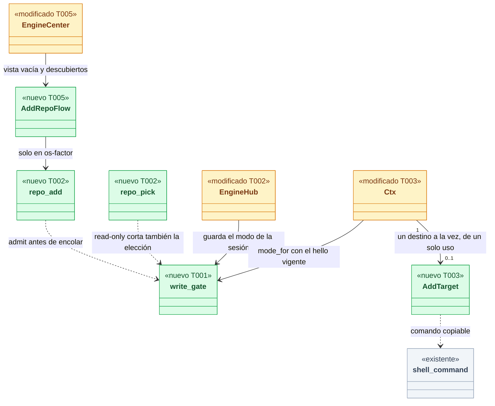
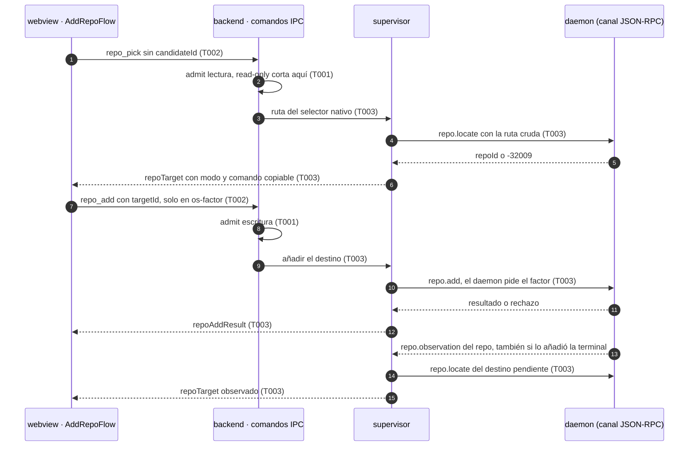
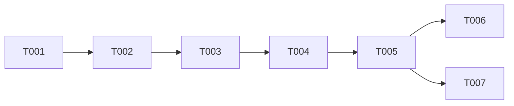

# DS-US-DSK-001 · Añadir un repo desde la app y la puerta de escritura del backend

## Contexto rápido

Al terminar, quien abre la app sin repos elige la carpeta de su proyecto con el selector de macOS, o uno de los repos que GitRaptor ya descubrió, y ese repo pasa a estar observado sin que la app pierda de vista lo que ocurre. Hoy no puede: la vista vacía solo enseña el texto `raptor repo add <ruta>` (`apps/desktop/src/engine/EngineCenter.tsx:97`) y la app no tiene ningún comando que escriba.

Para eso, la entrega tiene cuatro piezas:

- **La puerta de escritura del backend** (`engine/write_gate.rs`): decide con lo que dijo el daemon en el `hello` si la app puede pedir una escritura (`os-factor`), solo puede enseñar el comando (`copy-only`) o no puede hacer nada (`read-only`). Falla cerrado. US-DSK-002 y US-DSK-006 la reutilizan sin cambiarla de forma (P1).
- **Dos comandos IPC nuevos**: `repo_pick` (de lectura: el selector nativo o un candidato descubierto) y `repo_add` (de escritura, en `commands/write/`, detrás de la puerta).
- **El destino en el supervisor**: guarda la ruta cruda elegida, pregunta `repo.locate` si ya está observada, arma el comando copiable y, cuando el repo aparece observado (por la app o por la terminal), se lo dice al webview.
- **El flujo de la pantalla** (a1 y a2 de DSF-DSK-001) con todos sus estados, en en/es, con axe en tema claro y oscuro.

Hasta que exista el factor del SO (DEP-DSK-1, SPIKE-GRD-002), la app está en `copy-only`: enseña `'<raptor>' 'repo' 'add' '<ruta>'` con "Copiar" y detecta el repo cuando la terminal lo añade, como pide el escenario 4 y decidió Rene (Q-DSK-15). El camino con factor queda construido y probado contra el daemon falso; la parte que depende del contrato del factor en el cable (código de correlación, cancelado, denegado) es T006 y espera a G1.

| Término | Qué es aquí |
|---|---|
| Destino | La carpeta que el usuario eligió (o el candidato descubierto), guardada **en el backend** con su ruta cruda y un `targetId` de un solo uso. El webview solo ve el nombre y la ruta saneados |
| Modo de escritura | `read-only` · `copy-only` · `os-factor`. Lo calcula `write_gate::mode_for` con el `hello` de la conexión actual; por defecto `read-only` |
| Factor del SO | Touch ID o contraseña de macOS que **invoca el daemon** (ADR-GRD-008 § 3, ADR-GRP-017 § 4). La app nunca lo pide ni recibe la prueba |
| Factor por acción | Un diálogo del SO por cada comando reservado. `repo.add` siempre lo pide (ADR-GRP-017 § 4); la presencia de sesión no lo cubre |
| Comando copiable | Cadena POSIX con cada argumento entre comillas simples, armada en el backend con `shell_command::posix` y `shell_command::raptor_path` (ADR-GRP-017 § 5, M-1, V6) |
| Perfil `mcp` | Lo que el daemon fija en `hello.profile` para una ventana abierta por un agente (DS-TS-GRP-009 D3). Con él la app es `read-only` |
| DEP-DSK-1 | La prueba de presencia humana desde la app: el módulo de presencia del daemon (ADR-GRD-008 § 6), gateado por SPIKE-GRD-002 |

⚠️ **ASSUMPTION**: no hay `architecture-constitution.md` en la cascada; rigen `AGENTS.md` y los ADR de `must_read` (NFR-01, NFR-02, ADR-GRP-016, ADR-GRP-017), como en DS-US-DSK-007.

### Qué hay en el motor (verificado el 2026-11-10)

- `repo.add` es **reservado** y no está en el MCP (`crates/api/src/methods/repo.rs:12`). Parámetros `{ path }`, la raíz de un worktree o de un directorio Git, sin búsqueda hacia arriba (`crates/api/src/messages.rs:99-106`). Resultado `{ outcome: new | already-observed | reactivated, repo }` (`messages.rs:977-992`).
- El daemon **valida la ruta, autoriza y audita antes de leerla** (`crates/core/src/channel/conn.rs:1533-1536`: `validate::client_path`, después `self.reserved(...)`, después `observe::locate`). Sin terminal de control, hoy `reserved` rechaza con `RESERVED_REFUSED` (`-32003`, `crates/api/src/rpc.rs:31-32`) y `data.reason` `no-controlling-terminal` (`messages.rs:1211`), y deja una fila `rejected` en la auditoría (`conn.rs:3121-3146`).
- Una ruta que no es un repo da `REPO_REJECTED` (`-32013`, `rpc.rs:60`) con `data.reason` `not-a-repo`, `untrusted` o `unreadable` (`messages.rs:1005-1023`).
- `repo.locate` es de lectura, no reservado y fuera del MCP (`repo.rs:18`). `{ path }` → `{ repoId, worktree }` del repo observado más profundo que contiene la ruta; fuera de los observados, `-32009` (`conn.rs:2819-2835`; `api-contract-ipc.md:102`).
- **`repo.add` no modifica el repo**: registra la observación en el perfil de GitRaptor (`control.repo_add`, `conn.rs:1555-1563`), lee con `observe::reconcile` y no escribe en el repositorio (ADR-GRP-009, frontera de solo lectura). Los snapshots de la Time Machine viven en el perfil (ADR-TMC-001). Se revierte con `raptor repo retire <id>` (`repo.retire`, `repo.rs:15`); un repo retirado que se vuelve a añadir conserva su id y sus datos (`reactivated`, `messages.rs:984-985`). Por eso NFR-01 no exige snapshot previo: no hay estado del repo que recuperar.
- Los candidatos descubiertos ya llegan al webview (`EngineMessage::Discovered`, `apps/desktop/src-tauri/src/engine/wire.rs:45-48`), solo con nombre y ruta **saneados** (`ingest::candidate`, `ingest.rs:468-472`); el supervisor no guarda la ruta cruda.
- **No hay factor en el código**: ningún `presence`, `os-factor` ni capacidad de presencia en `crates/api` ni en `crates/core/src/channel` (búsqueda del 2026-11-10; el único `presence` de `authz.rs:270` es un comentario que remite a TS-GRP-007). La capacidad la nombra esta Dev Spec (P4) y la publica la historia de motor de DEP-DSK-1.
- `LinkError::Refused` solo guarda el código (`apps/desktop/src-tauri/src/engine/link.rs:47-52`, `:151-155`): el `data` del error se pierde y la app no puede distinguir `not-a-repo` de `untrusted`.
- La app saluda como `ClientKind::Cli` y no lo cambia (DS-TS-GRP-009 D1); la vista restringida se decide hoy con `is_restricted` (`supervisor.rs:492-503`): perfil `mcp`, actor agente o solicitante sin verificar.

### Decisión del orquestador pendiente

Decisiones de frontera (comandos IPC nuevos, uso del factor, qué se hace sin presencia humana). El orquestador dio su veredicto el 2026-11-10 tras la **revisión de seguridad 2026-11-10** (CHANGES REQUIRED, ya incorporada): la tabla de [veredicto](#veredicto-del-orquestador-2026-11-10) dice cuáles se aceptan y con qué cambios. Los textos de abajo ya llevan esos cambios.

| # | Decisión | Por qué |
|---|---|---|
| P1 | **Una sola puerta de escritura para toda la app**: `engine/write_gate.rs` con `WriteMode { ReadOnly, CopyOnly, OsFactor }`, `mode_for(&HelloResult, accepted)`, `WriteKind` y `admit(mode, kind) -> Result<WriteToken, CommandError>`. El modo vive en `EngineHub` como `AtomicU8` (por defecto y ante cualquier valor desconocido, `ReadOnly`; L-05), lo fija el supervisor al empezar cada sesión y lo vuelve a `ReadOnly` al terminarla. **La puerta no depende de convenciones** (M-02, revisión de seguridad 2026-11-10): `WriteToken` solo se construye dentro de `write_gate`, `admit` lo devuelve y toda variante de escritura de `HubCmd` lo exige (`RepoAdd { target_id, token }`); `HubCmd::is_write` es un `match` exhaustivo sin comodín, y el supervisor recalcula `mode_for` con el `hello` vigente en el despacho de toda variante de escritura, antes del handler. Fuera de una sesión, una orden de escritura se rechaza, nunca se aplaza a la siguiente (L-01). US-DSK-002 (`guard_install`, factor por acción, acción compuesta "añadir y proteger") y US-DSK-006 (Deshacer: `WriteKind::Session` con la capacidad de presencia de sesión) añaden su comando en `commands/write/` y, si hace falta, su variante de `WriteKind`; nunca otra puerta | Un único punto donde se decide si la app escribe, con un test que lo fija, evita que cada historia reimplemente el fallo cerrado. La doble comprobación (comando y supervisor) cierra la carrera entre una reconexión con otro perfil y la orden ya encolada |
| P2 | **Separación de lectura y escritura por módulo y por lista, no por un segundo archivo de capability**: los comandos de escritura viven en `src-tauri/src/commands/write/`; `write_gate::WRITE_COMMANDS` es su lista exacta; un test exige que las funciones `#[tauri::command]` de `commands/write/` sean exactamente esa lista, y otro fija la **lista cerrada de métodos del daemon que llama el backend** (`DAEMON_METHODS`): los reservados (hoy solo `repo.add`) solo aparecen en el handler de escritura del supervisor (revisión de seguridad 2026-11-10, en lugar del test por `grep` de la llamada a `admit`; el tipo `WriteToken` ya impide encolar sin pasar la puerta). El permiso `allow-repo-add` va en la capability única `main` | **Pedido**: "capacidad aparte" para la escritura · **Escrito**: capability única con módulo y lista aparte · **Por qué**: ADR-GRP-017 § 2 fija una "capability única para la ventana `main`" y V2 lo comprueba (`tests/tauri_surface.rs:219-228`, "exactly one capability file"). Un segundo archivo exige enmendar el ADR y V2. Alternativa si el orquestador la prefiere: un *permission set* `write` en `src-tauri/permissions/` referido desde `main.json`, con enmienda de V2 y de `ipc1_capability_allows_each_command` |
| P3 | **Dos comandos IPC nuevos**: `repo_pick { candidateId? }` (lectura: sin `candidateId` abre el selector nativo de carpetas en el backend; con él toma el candidato descubierto) y `repo_add { targetId }` (escritura). Los dos responden `{}` y el resultado llega por el `Channel` del supervisor, como `fleet_open` y `guard_blocks`. Revisión de seguridad 2026-11-10: `t<n>` y `c<n>` salen de un contador del proceso monotónico y nunca se reutilizan; el destino exige ruta absoluta; el comando copiable lleva `--` antes de la ruta (L-02); como mucho un `repo_add` en vuelo por sesión y 5 s entre dos, si no `expired` (L-03). `commands.json` pasa de cinco a siete y el test de lista exacta se actualiza a los siete; no se relaja a "contiene" | El webview nunca manda una ruta: elige con el selector del SO (que abre el backend, ADR-GRP-017 § 2) o con un id opaco que el backend asignó. Un comando de escritura separado del de elegir es lo que permite que 002 y 006 reutilicen la puerta sin heredar el selector |
| P4 | **Nombre de la capacidad del factor**: `presence.os-factor`, anunciada por el daemon en `hello.capabilities` (ADR-GRP-016) cuando el módulo de presencia existe y el SO lo ofrece. ADR-GRP-017 § 4 deja el nombre a la Dev Spec. La historia de motor de DEP-DSK-1 tiene que publicar exactamente este nombre (y `presence.session` para la presencia de sesión de US-DSK-006). **La capacidad es del daemon, no de la conexión** (M-01, revisión de seguridad 2026-11-10): `mode_for` da `OsFactor` solo si `presence.os-factor` está en las capacidades **aceptadas** de la conexión (las que la biblioteca cliente pide con `connection.accept`, `crates/api/src/client/mod.rs:398-416`) **y** `connection.desktop` está en `hello.methods` (la conexión es de la clase `desktop`, DS-TS-GRP-009 D2); si falta cualquiera, `CopyOnly`. El daemon solo sirve el factor cuando la decisión de DS-TS-GRP-009 D3 da identidad (filas 2 o 3); con perfil `mcp` o agente en la ascendencia rechaza sin diálogo (`precheck-denied`), requisito de G1 | Sin capacidad, un daemon actual o uno sin factor rechazaría igual con `no-controlling-terminal`; con ella la app sabe antes de pedir nada si ofrece el botón o el comando copiable. Que el daemon la anuncie no dice que **esta** conexión pueda usarla |
| P5 | **Sin la capacidad (modo `copy-only`), la app no manda `repo.add`**. Sin presencia humana la app solo puede: abrir el selector, preguntar `repo.locate`, abrir un repo ya observado, enseñar y copiar el comando `'<raptor>' 'repo' 'add' '<ruta>'` y detectar cuándo aparece observado. `repo_add` responde `presence-unavailable` sin llamar al daemon | Mandarlo solo produciría un rechazo `no-controlling-terminal` y una fila `rejected` en la auditoría por cada clic (`conn.rs:3131-3146`), ruido que un humano tendría que leer. El daemon sigue siendo la defensa: si la app se equivocara, rechaza igual |
| P6 | **Con perfil `mcp` (o vista restringida), modo `read-only`**: `repo_pick` y `repo_add` responden `read-only` en Rust sin abrir el selector ni llamar al daemon, y el supervisor descarta las órdenes. La UI no pinta el flujo de añadir (la vista restringida ya no muestra repos, DS-US-DSK-003 D6), pero la defensa está en el backend | ADR-GRP-017 § 3, fila 1: con un agente en la ascendencia la capa es `mcp`, que rechaza las escrituras. Ocultar el botón no basta: un webview comprometido puede invocar el comando (R-2) |
| P7 | **Sin comprobación previa de "es un repo"**: la app no enseña "✔ Es un repo de Git · rama · copias" antes de añadir (maqueta a2). El daemon no tiene un método de lectura que clasifique una ruta no observada, y el backend no puede leer repos (ADR-GRP-017 § 1). "No es un repo" llega de `repo.add` (`REPO_REJECTED`, con factor) o de la terminal (copia). Con factor, el diálogo del SO sale antes de saber si la carpeta es un repo, porque el daemon autoriza antes de leer la ruta (SEC-02) | Añadir un método `repo.probe` al daemon es trabajo de motor fuera de esta historia; leer `.git` desde el backend rompería la frontera. Si el orquestador quiere la comprobación previa, es una ficha de motor y una enmienda de esta Dev Spec |

#### Veredicto del orquestador (2026-11-10)

Tras la revisión de seguridad 2026-11-10 (opus, CHANGES REQUIRED). Los cambios ya están en el texto de cada decisión y en las tareas que se citan.

| # | Veredicto | Cambios incorporados | Tareas |
|---|---|---|---|
| P1 | Aceptar con cambios | M-02 (`WriteToken`, `HubCmd::is_write`, recálculo en el despacho), L-01 (sin aplazar órdenes entre sesiones), L-05 (modo envenenado o desconocido = `ReadOnly`) | T001, T002, T003 |
| P2 | Aceptar con cambios | El test por `grep` de `admit` pasa a la lista cerrada de métodos del daemon (`DAEMON_METHODS`) | T002 |
| P3 | Aceptar con cambios | L-02 (ids de un contador del proceso, ruta absoluta, `--` en el comando), L-03 (uno en vuelo, 5 s entre dos) | T003 |
| P4 | Aceptar con cambios | M-01 (capacidad aceptada + `connection.desktop`; el daemon sirve el factor solo con identidad) | T001, G1 |
| P5 | Aceptar | Con L-04 (log `desktop_write_refused`) | T001 |
| P6 | Aceptar | — | — |
| P7 | Aceptar | — | — |

---

## 📋 Índice

> **Para aprobar:** [Contexto rápido](#contexto-rápido) · [⚠️ Gaps](#gaps-y-violaciones-de-la-constitución) · [🔭 La forma](#la-forma) · [El trabajo de un vistazo](#el-trabajo-de-un-vistazo).
> **Para implementar:** [🚀 Plan](#plan-de-implementación), en orden. Las `_(ref)_` se abren desde la tarea que las cita.

| Sección | Propósito |
|---------|-----------|
| [Contexto rápido](#contexto-rápido) | Qué se construye, qué hay en el motor y decisiones pendientes |
| [⚠️ Gaps y violaciones de la constitución](#gaps-y-violaciones-de-la-constitución) | Qué impide empezar |
| [🔭 La forma](#la-forma) | Piezas y flujo |
| [🚀 Plan de implementación](#plan-de-implementación) | T001…T007, en orden |
| ↳ [El trabajo de un vistazo](#el-trabajo-de-un-vistazo) | Tareas en tabla y su orden |
| [Estructura de ficheros](#estructura-de-ficheros) _(ref)_ | Árbol anotado |
| [Contratos compartidos](#contratos-compartidos) _(ref)_ | DTO, mensajes, firmas y textos |
| [Contrato de API](#contrato-de-api) _(ref)_ | Comandos IPC y lo que se consume del canal |
| [Estrategia de pruebas y cobertura](#estrategia-de-pruebas-y-cobertura) _(ref)_ | Escenarios → tests |
| [Gate de seguridad](#gate-de-seguridad) | Checklist pre-merge |
| [Fuera de alcance](#fuera-de-alcance) | Lo que esta entrega no toca |
| [Notas del autor](#notas-del-autor) _(ref)_ | Lo que no bloquea |

---

## ⚠️ Gaps y violaciones de la constitución

| ID | Qué falta | Severidad | Alcance | Acción | Owner |
|----|-----------|-----------|---------|--------|-------|
| G1 | El contrato del factor en el cable no existe: cómo responde `repo.add` cuando el humano cancela, deniega o agota el plazo del diálogo, o cuando el daemon está ocupado o limitado por fatiga (ADR-GRD-008 § 4 nombra `denied`, `cancelled`, `timeout`, `unavailable`, `busy`, `throttled`, `stale`, `precheck-denied`, pero no su código ni su `data`); cómo recibe la app el código corto de correlación **antes** de que salga el diálogo (ADR-GRP-017 § 4), y cuánto bloquea la llamada (hasta 60 s, ADR-GRD-008 § 3). Ningún tipo en `crates/api` (búsqueda del 2026-11-10); SPIKE-GRD-002 sin ejecutar (`SPIKE-GRD-002-factor-so-daemon.md:5`, `status: ready`) | Bloqueante | T006 | Reservar la ficha de motor de DEP-DSK-1 (módulo de presencia de ADR-GRD-008 § 6 para la clase `desktop`) que fije los tres puntos y publique `presence.os-factor` (P4), con estos **requisitos obligatorios** (revisión de seguridad 2026-11-10): **(H-01)** lo que el humano aprueba tiene que ser lo que el daemon observa; hoy `repo.add` autoriza sin ruta canónica y `observe::locate` sigue enlaces simbólicos después (`conn.rs:1535-1538`). El daemon canonicaliza la ruta y toma `(dev, ino)` **antes** del diálogo; pone la ruta canónica saneada en `localizedReason`; ata el resumen del plan a `(ruta canónica, dev, ino)`; tras la aprobación y antes de `control.repo_add` lo vuelve a comprobar y, si no coincide, responde `stale` sin observar nada. **(M-01)** sirve el factor solo cuando la decisión de DS-TS-GRP-009 D3 da identidad (filas 2 o 3); con perfil `mcp` o agente en la ascendencia rechaza sin diálogo con `precheck-denied`. Al cerrarla, T006 escribe el mapeo y la pantalla d3 | Arquitecto (ficha) · Rene (spike) |

Sin violaciones de la constitución: la app no lee repos ni lanza procesos (ADR-GRP-017 § 1, § 2), no añade plugins salvo `tauri-plugin-dialog`, que V2 ya admite (`tests/tauri_surface.rs:262-275`, `:320-330`), y la única escritura pasa por el daemon con su autorización.

**Depende de**: TS-GRP-009 (`blocked_by`), que hace que `hello.profile` llegue `mcp` del daemon para una ventana abierta por un agente. T001 a T005 se escriben ya contra el `hello` que existe (`profile`, `requester`, `capabilities`); la verificación manual de la ventana abierta por un agente (T007) necesita TS-GRP-009 en `main`. Si DS-TS-DSK-002 T007 (registro de `tauri-plugin-dialog`) no está en `main` cuando empiece T003, T003 lo añade con la misma versión y forma (D7 de DS-TS-DSK-002) y la segunda historia que llegue se lo salta.

---

## 🔭 La forma

Al terminar, el backend tiene una puerta de escritura con su lista de comandos, un destino de un solo uso en el supervisor y dos comandos IPC; el webview tiene el flujo de añadir montado en la vista vacía, en la lista de descubiertos y al pie de la barra lateral.



🟩 nuevo · 🟨 modificado · ⬜ existente (contexto: no cambia). Cada pieza dice qué tarea la toca.

El supervisor tiene como mucho un destino: elegir otra carpeta sustituye al anterior, y añadir lo consume.

**Cómo fluye:**



El paso que decide es el 2 (y el 8): la puerta corta en Rust antes de abrir el selector o de encolar la escritura. El paso 10 es el único que escribe, y solo ocurre en `os-factor`; en `copy-only` el usuario ejecuta el comando en su terminal y el flujo sigue en el 12. El contrato publicado que cambia es la lista cerrada de comandos (siete) y `EngineMessage` (tres variantes nuevas).

---

## 🚀 Plan de implementación

> Orden topológico (`Depende:`). Una casilla se marca cuando su `Aceptación` está verificada. Las rutas son relativas a la raíz del repo.

### El trabajo de un vistazo

Tres frentes y un cierre: la puerta y los comandos en Rust (T001-T003), el webview (T004-T005), el factor cuando exista su contrato (T006) y la verificación en macOS (T007).

| # | Tarea | Depende | Aterriza en |
|---|---|---|---|
| T001 | Crear la puerta de escritura y sus tests | — | `apps/desktop/src-tauri/src/engine/write_gate.rs` |
| T002 | Añadir `repo_pick` y `repo_add` a la lista cerrada | T001 | `apps/desktop/src-tauri/src/commands`, `commands.json`, `capabilities/` |
| T003 | Resolver el destino y añadir en el supervisor | T002 | `apps/desktop/src-tauri/src/engine` |
| T004 | Guardar el destino y el resultado en la caché del webview | T003 | `apps/desktop/src/client`, `apps/desktop/src/state` |
| T005 | Pintar el flujo de añadir con todos sus estados | T004 | `apps/desktop/src/onboarding`, `apps/desktop/src/i18n` |
| T006 | Mostrar el factor del SO y sus desenlaces | T005 | `apps/desktop/src/onboarding`, `apps/desktop/src-tauri/src/engine` |
| T007 | Verificar de punta a punta en macOS | T005 | — |

### En qué orden

Cadena recta hasta T005 y un abanico al final: T006 espera a G1; T007 no espera a T006.



### T001 — Crear la puerta de escritura y sus tests

**Objetivo.** `write_gate` decide el modo y admite o rechaza, como funciones puras con sus tests. Fuera: llamar al daemon y cualquier comando IPC.

**Ubicación.**
- `apps/desktop/src-tauri/src/engine/write_gate.rs` (**CREATE**)
- `apps/desktop/src-tauri/src/engine/mod.rs` (**MODIFY**: `pub mod write_gate;`)
- `apps/desktop/src-tauri/src/ipc.rs` (**MODIFY**: variantes `ReadOnly` y `PresenceUnavailable` de `CommandError`)
- `apps/desktop/src-tauri/src/engine/supervisor.rs` (**MODIFY**: `is_restricted` pasa a `write_gate::restricted`)
- `apps/desktop/src-tauri/tests/write_gate.rs` (**CREATE**)

**Reglas**
- Declarar en `write_gate.rs` lo de § Firmas del stack: `WRITE_COMMANDS = ["repo_add"]`, `DAEMON_METHODS`, `RESERVED_DAEMON_METHODS = ["repo.add"]`, `CAP_OS_FACTOR = "presence.os-factor"` (P4), `WriteMode`, `WriteKind::PerAction`, `WriteToken`, `SharedMode`, `restricted`, `mode_for`, `admit` y `admit_read`.
- `restricted(hello)` es exactamente la regla de hoy de `supervisor.rs:492-503` (perfil `mcp`, actor agente, solicitante sin verificar o ausente), movida sin cambiarla; `supervisor.rs` la llama desde ahí.
- `mode_for(hello, accepted)`: `restricted` → `ReadOnly`; si no, `OsFactor` **solo si** `CAP_OS_FACTOR` está en `accepted` (las capacidades que la conexión aceptó con `connection.accept`) **y** `connection.desktop` está en `hello.methods`; si falta cualquiera, `CopyOnly` (M-01, revisión de seguridad 2026-11-10). Que `CAP_OS_FACTOR` esté en `hello.capabilities` no basta.
- `WriteToken` es un tipo sin campos públicos y con constructor privado del módulo (`WriteToken(())`); ni `Clone` ni `Default`. Solo `admit` lo crea (M-02).
- `admit(mode, WriteKind::PerAction, command) -> Result<WriteToken, CommandError>` (`command` es el nombre IPC, solo para el log): `ReadOnly` → `Err(CommandError::ReadOnly)`; `CopyOnly` → `Err(CommandError::PresenceUnavailable)`; `OsFactor` → `Ok(WriteToken)`.
- `admit_read(mode, command)` para `repo_pick`: `ReadOnly` → `Err(CommandError::ReadOnly)`; los otros dos → `Ok(())`.
- `SharedMode` envuelve un `AtomicU8`: `load()` traduce `0` → `ReadOnly`, `1` → `CopyOnly`, `2` → `OsFactor` y cualquier otro valor → `ReadOnly`; arranca en `ReadOnly` (L-05, revisión de seguridad 2026-11-10). Sin `Mutex`: no hay envenenamiento que pueda dejar un modo abierto.
- Todo rechazo de `admit` o `admit_read` deja una línea `desktop_write_refused` con `command` (`repo_pick` o `repo_add`) y `code` (`read-only` o `presence-unavailable`), vocabulario cerrado, sin rutas ni ids (L-04, revisión de seguridad 2026-11-10). La escribe `write_gate` al rechazar, con el nombre de comando que recibe, en una sola línea `key=value` por `stderr` (`eprintln!`; el backend no tiene otro registro hoy). Es telemetría local, no auditoría: la auditoría la lleva el daemon.
- `CommandError` gana `ReadOnly` (`"read-only"`) y `PresenceUnavailable` (`"presence-unavailable"`) al final del enum, con su brazo en `Display`.
- Ninguna variante `WriteKind::Session`: la añade US-DSK-006 con `presence.session` (P1). Sin código muerto.

> **Nota técnica.** `tests/commands.rs:286-292` (`fleet_open_verdict`) hace un `match` exhaustivo sobre `CommandError`; con dos variantes nuevas deja de compilar. T001 lo cambia a `.map_err(|e| e)` (o un brazo `other => other`) sin cambiar lo que comprueba.

- **Depende:** —
- **Refs:** P1, P4, P5, P6; revisión de seguridad 2026-11-10 (M-01, M-02, L-04, L-05); ADR-GRP-017 § 3 (fila 1) y § 5; DS-US-DSK-003 D6; DS-TS-GRP-009 D2
- **Aceptación:** `cargo test -p gitraptor-desktop --test write_gate` en verde (tests de § 9.4, fila "Puerta de escritura")
- **Guard M-01:** `os_factor_needs_the_accepted_capability_and_connection_desktop`
- **Guard L-05:** `a_poisoned_mode_is_read_only` (un valor fuera de `0..=2` en el `AtomicU8` se lee `ReadOnly`)

### T002 — Añadir `repo_pick` y `repo_add` a la lista cerrada

**Objetivo.** Los dos comandos existen, validan su entrada, pasan por la puerta en Rust y llegan al supervisor; la lista exacta pasa a siete. Fuera: lo que el supervisor hace con ellos (T003).

**Ubicación.**
- `apps/desktop/src-tauri/src/commands/repo_pick.rs` (**CREATE**)
- `apps/desktop/src-tauri/src/commands/write/mod.rs` (**CREATE**)
- `apps/desktop/src-tauri/src/commands/write/repo_add.rs` (**CREATE**)
- `apps/desktop/src-tauri/src/commands/mod.rs` (**MODIFY**)
- `apps/desktop/src-tauri/commands.json` (**MODIFY**)
- `apps/desktop/src-tauri/capabilities/main.json` (**MODIFY**)
- `apps/desktop/src-tauri/src/engine/mod.rs` (**MODIFY**: `EngineHub::{write_mode, pick, send_pick, repo_add}`)
- `apps/desktop/src-tauri/src/engine/supervisor.rs` (**MODIFY**: variantes de `HubCmd`, `spawn` recibe el modo compartido)
- `apps/desktop/src-tauri/tests/commands.rs` (**MODIFY**)

**Reglas**
- `commands.json` = `["app_info", "engine_watch", "engine_retry", "fleet_open", "guard_blocks", "repo_pick", "repo_add"]`; `capabilities/main.json` añade `allow-repo-pick` y `allow-repo-add`, sin ningún permiso `dialog:*`.
- `commands/mod.rs` declara `pub mod repo_pick;` y `pub mod write;` y registra `repo_pick::repo_pick` y `write::repo_add::repo_add` en `generate_handler!`; `write/mod.rs` solo declara `pub mod repo_add;`.
- `EngineHub` gana `write_mode: Arc<SharedMode>` (`ReadOnly` al crearse), que pasa a `supervisor::spawn`. `EngineHub::write_mode()` lo lee con `SharedMode::load`.
- **Dónde vive `admit`** (aclara la inconsistencia de la primera versión): la llaman los métodos de `EngineHub` (`pick` y `repo_add`), nunca los comandos directamente. Los comandos de `commands/` solo parsean el sobre y delegan en `EngineHub`; como `HubCmd::RepoAdd` exige un `WriteToken` y solo `admit` lo crea, `EngineHub::repo_add` es el único camino para encolar una escritura.
- `repo_pick` es `async` y recibe `app: tauri::AppHandle`. Orden: parsear `RepoPickParams`; `hub.pick(candidate_id)?` (valida `candidateId` si viene: no vacío, ≤ 128 bytes, sin caracteres de control, la regla de `valid_repo_id` de `engine/mod.rs:43-45`; después `admit_read`; después supervisor, si no `not-watching`). Con `PickRoute::Candidate` → `hub.send_pick(HubCmd::PickCandidate { candidate_id })`. Con `PickRoute::Folder` → abre `app.dialog().file().blocking_pick_folder()` en `tauri::async_runtime::spawn_blocking`; `None` (cancelado) → `HubCmd::PickCancelled`; una ruta → `HubCmd::Pick { path }` con la ruta como `String` (una ruta no UTF-8 se trata como `PickCancelled` con causa `unsupported-path`).
- `repo_add` es síncrono. Orden: parsear `RepoAddParams`; `hub.repo_add(target_id)?`, que valida `targetId` (la misma regla), llama `admit(hub.write_mode(), WriteKind::PerAction, "repo_add")?` y, con supervisor, manda `HubCmd::RepoAdd { target_id, token }`; sin supervisor → `not-watching`.
- `HubCmd` gana `fn is_write(&self) -> bool`: un `match` exhaustivo **sin comodín** sobre todas las variantes (`RepoAdd` → `true`; las demás → `false`). Una variante nueva no compila hasta que alguien decida si escribe (M-02).
- `tests/commands.rs`: las cuatro aserciones de lista exacta (`d3_cmds_engine_commands_are_listed_and_allowed`, `fleet_open_is_in_the_closed_list_and_the_capability`, `guard_blocks_is_in_the_closed_list_and_the_capability` y la nueva) pasan a los siete nombres, **iguales, nunca `contains`**; se añaden los tests de § 9.4 fila "Lista cerrada" y `the_guard_log_adds_no_ipc_command_other_than_guard_blocks` sigue igual.
- `tests/commands.rs` › `the_backend_calls_only_the_listed_daemon_methods`: recorre `src-tauri/src` y recoge cada constante `methods::*` que se pasa a `link.call` (o a `submit`); el conjunto tiene que ser igual a `write_gate::DAEMON_METHODS`. `reserved_methods_are_called_only_from_the_write_handler`: cada método de `RESERVED_DAEMON_METHODS` aparece solo en la función `write_repo_add` del supervisor. Sustituyen al test por `grep` de la llamada a `admit` (P2, revisión de seguridad 2026-11-10). `the_backend_never_listens_to_webview_events`: ningún `.listen(` ni `listen_any(` en `src-tauri/src` (I-01).

> **Nota técnica.** Un comando síncrono de Tauri v2 corre en el hilo principal, y `blocking_pick_folder` no puede bloquearlo en macOS: por eso `repo_pick` es `async` con `spawn_blocking`, la misma razón que la nota de T007 de DS-TS-DSK-002. La API Rust del diálogo no da nada al webview: sus comandos `plugin:dialog|*` piden permisos `dialog:*`, que V2 prohíbe.

- **Depende:** T001
- **Refs:** P2, P3, P6; revisión de seguridad 2026-11-10 (M-02); ADR-GRP-017 § 1 (lista cerrada) y § 2 (el selector lo abre el backend); DS-TS-DSK-002 D7
- **Aceptación:** `cargo test -p gitraptor-desktop --test commands --test tauri_surface` en verde
- **Guard ⛔ lista exacta:** `repo_commands_are_in_the_closed_list_and_the_capability` (igualdad con los siete)

### T003 — Resolver el destino y añadir en el supervisor

**Objetivo.** El supervisor guarda el destino, sabe si ya está observado, arma el comando copiable, añade con `repo.add` en `os-factor` y avisa cuando el repo aparece observado por cualquier vía. Fuera: los desenlaces del factor que dependen de G1 (T006).

**Ubicación.**
- `apps/desktop/src-tauri/src/engine/supervisor.rs` (**MODIFY**)
- `apps/desktop/src-tauri/src/engine/add_target.rs` (**CREATE**)
- `apps/desktop/src-tauri/src/engine/mod.rs` (**MODIFY**: `pub mod add_target;`)
- `apps/desktop/src-tauri/src/engine/link.rs` (**MODIFY**: `LinkError::Refused { code, data }`; `Link::accepted`)
- `crates/api/src/client/mod.rs` (**MODIFY**: guardar el `AcceptResult` de `accept_capabilities` y exponer `Client::accepted_capabilities`)
- `apps/desktop/src-tauri/src/engine/wire.rs` (**MODIFY**: variantes y DTO de § Tipos)
- `apps/desktop/src-tauri/src/engine/ingest.rs` (**MODIFY**: `candidate` con `candidateId`)
- `apps/desktop/src-tauri/src/lib.rs` (**MODIFY**, solo si DS-TS-DSK-002 T007 no está en `main`: `.plugin(tauri_plugin_dialog::init())`)
- `apps/desktop/src-tauri/Cargo.toml` y `Cargo.toml` (**MODIFY**, la misma condición: `tauri-plugin-dialog = "=2.8.3"`)
- `apps/desktop/src-tauri/tests/support/fake_daemon.rs` (**MODIFY**: guion "tienda" de § 9.3)
- `apps/desktop/src-tauri/tests/repo_add.rs` (**CREATE**)
- `apps/desktop/src-tauri/tests/engine_wire.rs` (**MODIFY**: fixture con las variantes nuevas)
- `apps/desktop/tests/fixtures/engine-messages.json` (**MODIFY**)

**Pasos**
1. Cambiar `LinkError::Refused` a `{ code: i64, data: Option<Value> }`; `link_error` copia `err.data`; los dos sitios que construyen o desestructuran sin `..` (`supervisor.rs:735` y `:957`, y `tests/fleet_supervisor_review.rs:29`) pasan a `data: None` o a `{ code, .. }`.
2. Exponer las capacidades aceptadas: `Client` guarda las `capabilities` del `AcceptResult` que hoy descarta (`crates/api/src/client/mod.rs:409-414`, `let _: AcceptResult`) y las da con `accepted_capabilities(&self) -> &[String]` (cambio aditivo; vacío si no hubo `connection.accept`). `Link` gana `fn accepted(&self) -> &[String]` con implementación por defecto `&[]` (falla cerrado: sin lista, `CopyOnly`); el `Link` real la toma del `Client`.
3. Fijar el modo al empezar cada sesión: en `session`, tras comprobar las capacidades, `write_mode.store(write_gate::mode_for(&hello, link.accepted()))`; en cualquier salida de `session`, `ReadOnly`. Añadir `mode: WriteMode` a `EngineMessage::Session`.
   3.1 ⛔3.1 El modo se pone a `ReadOnly` **antes** de reconectar, no después: si se dejara el de la sesión anterior, un `repo_add` encolado durante la reconexión pasaría la puerta con el modo de una conexión que ya no existe.
4. **Recalcular en el despacho** (M-02, revisión de seguridad 2026-11-10): en `stream`, antes de entrar al handler de cualquier orden con `cmd.is_write()`, calcular `mode_for(link.hello(), link.accepted())`; si no es `OsFactor`, responder `RepoAddResult { status: read-only | presence-unavailable }` sin entrar al handler. El handler de escritura se llama `write_repo_add` y es la única función que pasa un método de `RESERVED_DAEMON_METHODS` a `link.call`.
5. **Fuera de una sesión no se aplaza nada** (L-01, revisión de seguridad 2026-11-10): en `wait` y `wait_for_shutdown` (`supervisor.rs:411-432`), `RepoAdd` responde `RepoAddResult { status: read-only }` y `Pick`, `PickCandidate` y `PickCancelled` responden `RepoTargetNone { cause: no-session }`; ninguno se guarda para la sesión siguiente. Al salir de `session` por cualquier camino, `Ctx.target`, `Ctx.discovered_raw` y el estado de L-03 se vacían.
6. Guardar en `Ctx` los candidatos crudos: `discovered_raw: Vec<(String, String)>` (`candidateId`, ruta cruda); `ingest::candidate` recibe el id y lo pone en `CandidateDto`. Con `replace: true` se vacía como `discovered`.
   6.1 ⛔6.1 `c<n>` y `t<n>` salen de **un contador del proceso** (`static NEXT_ID: AtomicU64`, monotónico, compartido por los dos prefijos), nunca de uno por sesión: un id reutilizado tras reconectar haría que un `repo_add` viejo del webview apuntara a otro destino (L-02, revisión de seguridad 2026-11-10).
7. Crear en `add_target.rs` `AddTarget { id, raw_path, adding }` y `fn command(raptor: Option<&Path>, raw_path: &str) -> AddCommandDto` sobre `shell_command::posix(&[raptor, "repo", "add", "--", raw_path])`: ruta no absoluta (`!Path::new(raw_path).is_absolute()`) → `NotOffered { reason: Invalid }`; sin `raptor` → `NotOffered { reason: RaptorUnknown }`; `posix` → `None` → `NotOffered { reason: UnsafeText }`. Una ruta no absoluta tampoco puede ser destino de `repo_add`: el estado es `invalid` (L-02).
   7.1 El `--` antes de la ruta: verificado leyendo `apps/cli/src/commands/repo.rs:24-29` (sin compilar) que `Add { path: Option<PathBuf> }` es un posicional sin `last`, `trailing_var_arg` ni `allow_hyphen_values`, y clap acepta `--` antes de un posicional por defecto. **Pendiente de verificar ejecutándolo** en T007 (`raptor repo add -- /ruta`).
8. Atender `HubCmd::Pick { path }` y `HubCmd::PickCandidate { candidate_id }`: en vista restringida, descartar. Un `candidate_id` que no está en `discovered_raw` → `RepoTargetNone { cause: UnknownCandidate }`. Si no, sustituir el destino (`Ctx.target`, `targetId = "t<n>"` del contador de 6.1), llamar `repo.locate { path }` y mandar `RepoTarget` con `state` (`observed { repoId }` si respondió, `not-observed` si `-32009`, `invalid` si `-32602`), `mode` vigente y `command` (con `raptor = shell_command::raptor_path(link.daemon_exe(), own_raptor, &global_roots)`). `HubCmd::PickCancelled { cause }` → `RepoTargetNone { cause }`.
   8.1 ⛔8.1 La ruta cruda nunca sale del backend: `RepoTarget` lleva `name` (último componente, `display::visible` con `NAME_MAX_CHARS`, cortado antes de sanear) y `path` (`display::visible` con `TEXT_MAX_CHARS`). Un nombre o ruta con caracteres de `must_escape` se pinta escapado y el comando no se ofrece (`unsafe-text`).
9. `write_repo_add` (handler de `HubCmd::RepoAdd { target_id, token }`, ya pasado el recálculo del paso 4): si hay un `repo.add` en vuelo en esta sesión, o el anterior empezó hace menos de 5 s, → `expired` (L-03, revisión de seguridad 2026-11-10; el daemon sigue limitando por fatiga con `throttled`). Si `target_id` no es el destino actual o su estado es `invalid` → `expired`. Si lo es, consumirlo (queda marcado `adding`, un segundo `RepoAdd` del mismo id → `expired`) y llamar `repo.add { path: raw_path }`. El `token` se consume (se mueve) al entrar.
10. Mapear la respuesta de `repo.add`: `Ok` → `added { repoId, outcome }`; `-32013` con `data.reason` → `rejected { reason }` (`not-a-repo`, `untrusted`, `unreadable`; cualquier otro → `unreadable`); `-32003` con `data.reason` `no-controlling-terminal` o `unsupported` → `presence-unavailable`; `-32003` con otro motivo → `refused`; `-32602` → `rejected { reason: not-a-repo }`; otro código → `failed`; `LinkError::Lost` → reconexión como el resto del supervisor (el destino se pierde con la sesión).
   10.1 ⛔10.1 Un rechazo nunca se convierte en éxito ni en `presence-unavailable` por defecto: un código desconocido es `failed`. Si se mapeara a `presence-unavailable`, la app ofrecería el comando copiable para un rechazo que la terminal también daría.
11. Detectar el repo añadido por cualquier vía: tras aplicar un `repo.observation` con `observed: true` (`ingest.rs`, evento global ya suscrito), si hay destino en estado `not-observed`, llamar `repo.locate` con su ruta cruda y, si responde, mandar `RepoTarget` con el mismo `targetId` y `state: observed { repoId }`. Una sola llamada por evento.

> **Nota técnica.** `repo.add` lo atiende el supervisor en su hilo; con el factor, la llamada puede bloquear hasta 60 s (ADR-GRD-008 § 3) y en ese tiempo no se leen notificaciones. Hoy no pasa (en `copy-only` no se llama). Si G1 confirma la espera larga, T006 mueve la llamada a un `submit` asíncrono como el de `graph.lanes` de DS-US-DSK-005 (`Link::submit`), sin cambiar el contrato con el webview.

- **Depende:** T002
- **Refs:** P1, P3, P4, P5, P6, P7; revisión de seguridad 2026-11-10 (M-01, M-02, L-01, L-02, L-03); ADR-GRP-017 § 1, § 5 (M-1, L-02 del ADR); DS-US-DSK-007 D9 (ruta de `raptor`); DS-US-DSK-008 D21 (`shell_command`)
- **Aceptación:** `cargo test -p gitraptor-desktop --test repo_add --test engine_wire --test commands` en verde; `cargo test -p gitraptor-api --lib client` sigue en verde
- **Guard ⛔3.1:** `a_reconnection_resets_the_mode_to_read_only_before_the_next_session`
- **Guard ⛔6.1:** `ids_are_never_reused_across_sessions`
- **Guard ⛔8.1:** `the_raw_path_never_reaches_the_webview`
- **Guard ⛔10.1:** `an_unknown_refusal_is_failed_not_presence_unavailable`
- **Guard L-01:** `a_reconnection_drops_the_target`, `orders_outside_a_session_are_refused_not_deferred`
- **Guard M-02:** `the_supervisor_rechecks_the_mode_before_any_write_handler`
- **Guard L-03:** `a_second_repo_add_within_five_seconds_is_expired`

### T004 — Guardar el destino y el resultado en la caché del webview

**Objetivo.** El webview tiene los tipos, los comandos y la entrada de caché del flujo; ningún componente todavía.

**Ubicación.**
- `apps/desktop/src/client/engine-types.ts` (**MODIFY**)
- `apps/desktop/src/client/commands.ts` (**MODIFY**)
- `apps/desktop/src/client/commands.test.ts` (**MODIFY**)
- `apps/desktop/src/client/queries.ts` (**MODIFY**: `engineKeys.addRepo`)
- `apps/desktop/src/state/engine-cache.ts` (**MODIFY**)
- `apps/desktop/src/state/engine-cache.test.ts` (**MODIFY**)
- `apps/desktop/src/state/engine-store.ts` (**MODIFY**: `session.mode`)

**Reglas**
- `COMMANDS` pasa a los siete nombres en el orden de `commands.json`; `Commands` gana `repo_pick: { params: { candidateId?: string }; result: Record<string, never> }` y `repo_add: { params: { targetId: string }; result: Record<string, never> }`. `commands.test.ts` compara con igualdad.
- `engine-types.ts` copia los tipos de § Tipos y datos compartidos (`RepoTargetDto`, `RepoAddResultDto`, `TargetState`, `WriteMode`, `AddCommand`, `CandidateDto.candidateId`) y las variantes `repoTarget`, `repoTargetNone` y `repoAddResult` de `EngineMessage`.
- `applyEngineBatch`: `repoTarget` sustituye la entrada `engineKeys.addRepo` (`{ target, result: null }`); `repoAddResult` solo se guarda si su `targetId` es el del destino guardado; `repoTargetNone` deja `{ target: null, none: cause }`; un `session` nuevo vacía la entrada (el destino del backend se perdió con la sesión).
- Los errores del comando `read-only`, `presence-unavailable`, `not-watching` e `invalid-params` se traducen con `error.<code>` (claves en `onb.error.*`, § Textos).

- **Depende:** T003
- **Refs:** DS-US-DSK-003 (`applyEngineBatch`, fixture dorada); ADR-GRP-004 (estado del servidor en TanStack Query)
- **Aceptación:** `pnpm --filter @gitraptor/desktop test -- engine-cache commands` en verde; la fixture dorada de T003 la leen los dos lados

### T005 — Pintar el flujo de añadir con todos sus estados

**Objetivo.** El usuario añade un repo desde la vista vacía, desde la lista de descubiertos o desde la barra lateral, y ve cada estado de § Forma del error con texto en en/es, accesible y en los dos temas. Fuera: la pantalla d3 del factor (T006) y la protección (US-DSK-002).

**Ubicación.**
- `apps/desktop/src/onboarding/AddRepoFlow.tsx` (**CREATE**)
- `apps/desktop/src/onboarding/add-repo-model.ts` (**CREATE**)
- `apps/desktop/src/onboarding/useAddRepo.ts` (**CREATE**)
- `apps/desktop/src/onboarding/AddRepoFlow.test.tsx` (**CREATE**)
- `apps/desktop/src/onboarding/add-repo-model.test.ts` (**CREATE**)
- `apps/desktop/src/onboarding/boundaries.test.ts` (**CREATE**)
- `apps/desktop/src/engine/EngineCenter.tsx` (**MODIFY**: `NoRepos`)
- `apps/desktop/src/fleet/RepoTreeContainer.tsx` (**MODIFY**: botón "Añadir repo")
- `apps/desktop/src/i18n/locales/en.json` y `es.json` (**MODIFY**: `onb.*`)

**Reglas**
- `addRepoView(entry, mode)` en `add-repo-model.ts` es pura y devuelve uno de los estados de la tabla de § Forma del error con sus claves de texto; el componente solo pinta. Ningún texto se arma con concatenación: claves de § Textos con interpolación.
- `NoRepos` cambia la línea `empty.noRepos.howTo` + `<code>` por el botón `onb.cta` ("Añadir mi primer repo", `Button` primario, foco inicial de la vista vacía); cada candidato descubierto gana un `Button variant="secondary"` `onb.discovered.add` ("Observar"), con su nombre en el nombre accesible (`aria-label` con `{{name}}`). Con `mode: read-only` no se pintan ni el botón ni los de los candidatos.
- `RepoTreeContainer` pinta al pie de la lista un `Button variant="secondary" size="sm"` `onb.sidebar.add` ("Añadir repo") que abre el mismo flujo; no se pinta con `read-only`.
- El flujo es un `Dialog` de la primitiva (TS-DSK-003, sin primitiva nueva): título `onb.pick.title`, el destino en una fila (`name` y `path` como texto React), el botón "Elegir otra carpeta" (`repo_pick` sin `candidateId`) y el cuerpo según el estado. Con `os-factor`: `kind="confirm"` con `confirm = { label: onb.add.factor, variant: "secondary", pending }`. Con `copy-only`: `kind="info"` con el `CopyCommand` del destino, `onb.terminal.where`, `onb.cmd.wait` en una región `role="status"` y `acknowledge = onb.close` ("Cerrar": cerrar no cancela nada).
- Destino `observed` → texto `onb.state.observed` y botón `onb.state.open` que llama `selectRepo(repoId)` y cierra; si el destino pasa de `not-observed` a `observed` mientras el diálogo está abierto (la terminal lo añadió), el diálogo muestra `onb.state.added` y un toast `info` `onb.toast.added` al cerrarse; también abre el repo.
- `added` → cierra el diálogo, abre el repo (`selectRepo`) y muestra el toast `onb.toast.added` (o `onb.toast.reactivated` si `outcome: reactivated`). `already-observed` → `onb.state.observed`.
- `rejected` → `role="alert"` con `onb.error.notARepo` / `untrusted` / `unreadable` y el botón "Elegir otra carpeta" con el foco.
- `presence-unavailable` (el modo cambió entre elegir y añadir) → pasa al cuerpo de `copy-only` con `onb.factor.unavailable`. `read-only` → `onb.error.readOnly` y sin botones de escritura. `refused` → `onb.error.refused`. `failed` y `expired` → `onb.error.failed` con "Elegir otra carpeta".
- Accesibilidad: el `Dialog` de la primitiva atrapa el foco y lo devuelve al botón que lo abrió (`returnFocusRef`); los errores van en `role="alert"`, la espera en `role="status"`; el botón pendiente lleva `aria-busy`; el estado `observed` y los errores se dicen con texto, no solo con color ni con glifo.
- Temas: solo tokens de `tokens.ts` y clases ya usadas en `src/ui`; el test de lint de tokens (`tests/ui-tokens-lint.test.ts`) cubre los archivos nuevos.

- **Depende:** T004
- **Refs:** DSF-DSK-001 § 4.a (a1, a2, variante sin factor, tabla de estados, copy `onb.*`) y § 7; primitives-spec (`Dialog`, `CopyCommand`, `Button`, `Toast`); P5, P6, P7
- **Aceptación:** `pnpm --filter @gitraptor/desktop test -- onboarding EngineCenter RepoTree catalog` en verde, con axe sin violaciones en cada estado, en en y es, en tema claro y oscuro; `pnpm --filter @gitraptor/desktop typecheck` y `lint` en verde

### T006 — Mostrar el factor del SO y sus desenlaces

**Objetivo.** Espera a G1. Con el contrato del factor fijado, la app muestra el código de correlación mientras el SO pide Touch ID (d3) y cada desenlace del diálogo con su texto. Fuera: la presencia de sesión (US-DSK-006).

**Ubicación.**
- `apps/desktop/src-tauri/src/engine/supervisor.rs` (**MODIFY**)
- `apps/desktop/src-tauri/src/engine/wire.rs` (**MODIFY**)
- `apps/desktop/src-tauri/tests/repo_add.rs` (**MODIFY**)
- `apps/desktop/src/onboarding/AddRepoFlow.tsx` (**MODIFY**)
- `apps/desktop/src/onboarding/add-repo-model.ts` (**MODIFY**)
- `apps/desktop/src/i18n/locales/en.json` y `es.json` (**MODIFY**: `onb.factor.*`)

**Pasos**
1. Añadir a `RepoAddResultDto` las variantes `presence-denied`, `presence-cancelled`, `presence-timeout`, `presence-busy`, `presence-throttled { retryAfterS }` y `stale` con `<los códigos y el data que fije G1>`; `precheck-denied` → `refused`; `unavailable` → `presence-unavailable`. `stale` (la carpeta cambió entre la aprobación y la observación, H-01 de G1) → "La carpeta cambió mientras confirmabas: no se observó nada. Vuelve a elegirla" (`onb.factor.stale`) y el destino pasa a `expired`.
2. Mandar `RepoAddPending { targetId, correlation, path }` con `<el código de correlación y la ruta canónica saneada por el canal que fije G1>`, saneados con `display::visible` (código con tope de 16 caracteres).
   2.1 ⛔2.1 **La ruta que pinta d3 es la que el daemon puso en el diálogo del SO** (revisión de seguridad 2026-11-10, H-01): si G1 da al cliente la ruta canónica del plan, d3 pinta esa y no la del selector; si G1 no la da, d3 no pinta ninguna ruta propia y dice `onb.factor.trustDialog` ("Comprueba la carpeta en el diálogo del sistema: la que vale es la que dice macOS"). Pintar la ruta del selector junto a otra distinta en el diálogo enseñaría al humano a aprobar sin leer.
3. Pintar d3: "Confirma en el diálogo del sistema" con el código (`onb.factor.waiting`, `onb.factor.check`), la cuenta atrás de 60 s anunciada solo al aparecer y a los 30 s (como D16 de DS-US-DSK-007), y cada desenlace (`onb.factor.denied`, `.cancelled`, `.timeout`, `.busy`, `.throttled`, `.stale`) con "Nada cambió" y el botón para reintentar.
   3.1 ⛔3.1 El botón del webview nunca confirma: no hay "Confirmar" en d3, solo "Cerrar"; la única confirmación es el diálogo del SO (ADR-GRP-017 § 4).
4. Si G1 confirma que `repo.add` bloquea hasta 60 s, mover la llamada a un envío asíncrono (`Link::submit`) para que el supervisor siga leyendo notificaciones.

- **Depende:** T005
- **Refs:** G1; revisión de seguridad 2026-11-10 (H-01, M-01); ADR-GRP-017 § 4 (código de correlación, "el botón solo pide la acción"); ADR-GRD-008 § 3 y § 4; DSF-DSK-001 § 4.d (d3)
- **Aceptación:** `cargo test -p gitraptor-desktop --test repo_add` y `pnpm --filter @gitraptor/desktop test -- onboarding` en verde con los desenlaces de G1 + los campos de G1; verificación manual con Touch ID en macOS, incluida la sustitución de la carpeta por un enlace simbólico durante el diálogo
- **Guard ⛔2.1:** `d3_shows_the_dialog_path_or_says_to_trust_the_dialog`
- **Guard ⛔3.1:** `the_factor_step_has_no_confirm_button`
- **Guard H-01:** `a_swapped_path_after_approval_is_stale` (el daemon falso aprueba, la ruta cambia de `(dev, ino)` y `repo.add` responde `stale`: la app pinta `onb.factor.stale` y el repo no aparece observado)

### T007 — Verificar de punta a punta en macOS

**Objetivo.** Los cuatro escenarios de la historia con el motor real y la app del bundle, en la versión `copy-only` (la del factor la cierra T006). Fuera: Windows y Linux.

**Ubicación.** Ninguna: solo corre verificaciones.

**Pasos**
1. Con un perfil limpio y un repo temporal `~/tmp/tienda` (nunca este repo, NFR-01), abrir la app desde el Finder: la vista vacía ofrece "Añadir mi primer repo"; elegirlo, copiar el comando, pegarlo en Terminal.app y comprobar que la app pasa a "observado" y abre el repo sin reiniciarse (escenarios 1 y 4).
2. Declarar una raíz de descubrimiento con `raptor discovery root add` y un repo dentro; pulsar "Observar" en el candidato y repetir el paso 1 (escenario 2): el candidato deja de aparecer como descubierto.
3. Elegir `~/Descargas`: con el comando copiado, la terminal dice que no es un repo y la app no observa nada (escenario 3, versión `copy-only`).
4. Con TS-GRP-009 en `main`, abrir la app con `open -a GitRaptor` desde un proceso de Claude Code: vista restringida, sin botón de añadir; `repo_add` invocado desde las herramientas de desarrollo de una build de depuración responde `read-only`.
5. Cambiar el tema del sistema a claro y oscuro y el idioma a en y es en el paso 1.

- **Depende:** T005
- **Refs:** escenarios de US-DSK-001; AGENTS.md (repos temporales)
- **Aceptación:** los cinco pasos anotados en el PR con su resultado; lo no verificado, dicho

---

> Las secciones siguientes son de referencia: se abren desde la tarea que las cita.

## Estructura de ficheros

```text
apps/desktop/
├── src-tauri/
│   ├── commands.json                         ← MODIFY (T002)
│   ├── capabilities/main.json                ← MODIFY (T002)
│   ├── Cargo.toml                            ← MODIFY (T003, solo sin DS-TS-DSK-002 T007)
│   ├── src/
│   │   ├── ipc.rs                            ← MODIFY (T001)
│   │   ├── lib.rs                            ← MODIFY (T003, solo sin DS-TS-DSK-002 T007)
│   │   ├── commands/
│   │   │   ├── mod.rs                        ← MODIFY (T002)
│   │   │   ├── repo_pick.rs                  ← CREATE (T002)
│   │   │   └── write/                        #   comandos de escritura (P2)
│   │   │       ├── mod.rs                    ← CREATE (T002)
│   │   │       └── repo_add.rs               ← CREATE (T002)
│   │   └── engine/
│   │       ├── write_gate.rs                 ← CREATE (T001)
│   │       ├── add_target.rs                 ← CREATE (T003)
│   │       ├── mod.rs                        ← MODIFY (T001, T002, T003)
│   │       ├── supervisor.rs                 ← MODIFY (T001, T002, T003, T006)
│   │       ├── link.rs                       ← MODIFY (T003)
│   │       ├── wire.rs                       ← MODIFY (T003, T006)
│   │       └── ingest.rs                     ← MODIFY (T003)
│   └── tests/
│       ├── write_gate.rs                     ← CREATE (T001)
│       ├── repo_add.rs                       ← CREATE (T003)
│       ├── commands.rs                       ← MODIFY (T001, T002)
│       ├── engine_wire.rs                    ← MODIFY (T003)
│       ├── fleet_supervisor_review.rs        ← MODIFY (T003)
│       └── support/fake_daemon.rs            ← MODIFY (T003)
├── tests/fixtures/engine-messages.json       ← MODIFY (T003)
└── src/
    ├── client/{engine-types,commands,queries}.ts, commands.test.ts   ← MODIFY (T004)
    ├── state/{engine-cache,engine-store}.ts, engine-cache.test.ts    ← MODIFY (T004)
    ├── onboarding/                           ← CREATE (T005, T006)
    ├── engine/EngineCenter.tsx               ← MODIFY (T005)
    ├── fleet/RepoTreeContainer.tsx           ← MODIFY (T005)
    └── i18n/locales/{en,es}.json             ← MODIFY (T005, T006)
Cargo.toml                                    ← MODIFY (T003, solo sin DS-TS-DSK-002 T007)
crates/api/src/client/mod.rs                  ← MODIFY (T003: accepted_capabilities, aditivo)
```

`← CREATE`: fichero nuevo. `← MODIFY`: fichero existente. Lo nuevo va en archivos propios (`write_gate.rs`, `add_target.rs`, `commands/write/`, `src/onboarding/`); en los compartidos solo se añaden variantes, campos o líneas al final (ADR-GRP-016, `extender-sin-archivos-compartidos.md`).

---

## Contratos compartidos

### Tipos y datos compartidos

```rust
// apps/desktop/src-tauri/src/ipc.rs (T001): two variants appended
pub enum CommandError { InvalidParams, NotWatching, ReadOnly, PresenceUnavailable }
// serialises as {"code":"read-only"} / {"code":"presence-unavailable"}

// apps/desktop/src-tauri/src/commands/repo_pick.rs (T002)
#[derive(Debug, Deserialize)]
#[serde(deny_unknown_fields, rename_all = "camelCase")]
pub struct RepoPickParams { pub candidate_id: Option<String> }

// apps/desktop/src-tauri/src/commands/write/repo_add.rs (T002)
#[derive(Debug, Deserialize)]
#[serde(deny_unknown_fields, rename_all = "camelCase")]
pub struct RepoAddParams { pub target_id: String }

// apps/desktop/src-tauri/src/engine/supervisor.rs (T002): variants appended to HubCmd
Pick { path: String },
PickCandidate { candidate_id: String },
PickCancelled { cause: TargetNoneCause },
RepoAdd { target_id: String, token: WriteToken },   // M-02: no token, no write order
// impl HubCmd { pub fn is_write(&self) -> bool }    // exhaustive match, no wildcard

// apps/desktop/src-tauri/src/engine/wire.rs (T003): variants appended to EngineMessage
RepoTarget { target: RepoTargetDto },
RepoTargetNone { cause: TargetNoneCause },
RepoAddResult { target_id: String, result: RepoAddResultDto },
// and Session gains `mode: WriteMode`; CandidateDto gains `candidate_id: String` (camelCase on the wire)

#[derive(Debug, Clone, PartialEq, Eq, Serialize)]
#[serde(rename_all = "camelCase")]
pub struct RepoTargetDto {
    pub target_id: String,        // "t<n>", one use
    pub name: String,             // last component, display::visible, NAME_MAX_CHARS
    pub path: String,             // display::visible, TEXT_MAX_CHARS; never the raw path
    pub state: TargetState,
    pub mode: WriteMode,          // engine::write_gate::WriteMode
    pub command: AddCommandDto,
}

#[derive(Debug, Clone, PartialEq, Eq, Serialize)]
#[serde(tag = "state", rename_all = "kebab-case", rename_all_fields = "camelCase")]
pub enum TargetState { Observed { repo_id: String }, NotObserved, Invalid }

#[derive(Debug, Clone, PartialEq, Eq, Serialize)]
#[serde(tag = "state", rename_all = "kebab-case")]
pub enum AddCommandDto { Offered { command: String }, NotOffered { reason: AddNotOffered } }

#[derive(Debug, Clone, Copy, PartialEq, Eq, Serialize)]
#[serde(rename_all = "kebab-case")]
pub enum AddNotOffered { RaptorUnknown, UnsafeText, Invalid }   // Invalid: not an absolute path (L-02)

#[derive(Debug, Clone, Copy, PartialEq, Eq, Serialize)]
#[serde(rename_all = "kebab-case")]
pub enum TargetNoneCause { Cancelled, UnknownCandidate, UnsupportedPath, NoSession }   // NoSession: L-01

#[derive(Debug, Clone, PartialEq, Eq, Serialize)]
#[serde(tag = "status", rename_all = "kebab-case", rename_all_fields = "camelCase")]
pub enum RepoAddResultDto {
    Added { repo_id: String, outcome: AddOutcome },      // new | already-observed | reactivated
    Rejected { reason: AddRejection },                    // not-a-repo | untrusted | unreadable
    ReadOnly,
    PresenceUnavailable,
    Refused,
    Expired,
    Failed,
    // T006 appends the factor outcomes fixed by G1
}
```

```ts
// apps/desktop/src/client/engine-types.ts (T004): the same shapes, camelCase
export type WriteMode = "read-only" | "copy-only" | "os-factor";
export type TargetState = { state: "observed"; repoId: string } | { state: "not-observed" } | { state: "invalid" };
export type AddCommand = { state: "offered"; command: string } | { state: "not-offered"; reason: "raptor-unknown" | "unsafe-text" | "invalid" };
export interface RepoTargetDto { targetId: string; name: string; path: string; state: TargetState; mode: WriteMode; command: AddCommand }
export type RepoAddResultDto =
  | { status: "added"; repoId: string; outcome: "new" | "already-observed" | "reactivated" }
  | { status: "rejected"; reason: "not-a-repo" | "untrusted" | "unreadable" }
  | { status: "read-only" | "presence-unavailable" | "refused" | "expired" | "failed" };
```

### Ciclos de vida (DI)

| Servicio / componente | Ámbito / ciclo de vida | Razón |
|---------------------|------------------|--------|
| `EngineHub.write_mode` (`Arc<SharedMode>`, un `AtomicU8`) | Proceso; `ReadOnly` al crearse, al terminar cada sesión y antes de reconectar; un valor desconocido se lee `ReadOnly` (L-05) | El comando lo lee en el hilo de Tauri y el supervisor lo escribe en el suyo; sin `Mutex` no hay envenenamiento |
| `NEXT_ID` (`static AtomicU64`) | Proceso, monotónico; da `t<n>` y `c<n>` | Un id nunca se reutiliza entre sesiones (L-02) |
| `Ctx.target` (`Option<AddTarget>`) | Sesión del supervisor; se sustituye al elegir, se consume al añadir, se vacía al salir de `session` | La ruta cruda no sobrevive a una conexión con otro perfil (L-01) |
| `Ctx.discovered_raw` | Sesión; se vacía con `Discovered { replace: true }` y al salir de `session` | Los `candidateId` solo valen para la lista que el webview tiene |
| `Ctx.add_in_flight` y `Ctx.last_add_at` | Sesión; se vacían al salir de `session` | Uno en vuelo y 5 s entre dos (L-03) |
| `WriteToken` | Una orden: lo crea `admit`, viaja en `HubCmd::RepoAdd` y lo consume `write_repo_add` | Ninguna orden de escritura existe sin pasar la puerta (M-02) |
| Entrada `engineKeys.addRepo` de TanStack Query | Webview; se vacía con cada `session` | Refleja el destino del backend, no lo inventa |

### Firmas del stack

```rust
// apps/desktop/src-tauri/src/engine/write_gate.rs (T001)
/// The `#[tauri::command]` fns of `commands/write/`, exactly (P2).
pub const WRITE_COMMANDS: &[&str] = &["repo_add"];
/// Every daemon method the backend calls, exactly (P2; checked by a test over `src-tauri/src`).
/// The ones `main` calls on 2026-11-10 (grep of `methods::` in src-tauri/src, notifications excluded) plus the
/// two of this story. A story that calls another method appends it here (US-DSK-005: GRAPH_LANES).
pub const DAEMON_METHODS: &[&str] = &[
    methods::DISCOVERY_CANDIDATES, methods::ENGINE_SNAPSHOT, methods::EVENTS_UNSUBSCRIBE,
    methods::GUARD_LOG, methods::GUARD_STATUS, methods::PREDICTION_LIST, methods::SCOPE_SNAPSHOT,
    methods::SCOPE_SUBSCRIBE, methods::SESSIONS_LIST, methods::REPO_LOCATE, methods::REPO_ADD,
];
/// The reserved ones: only `write_repo_add` in the supervisor passes them to the link.
pub const RESERVED_DAEMON_METHODS: &[&str] = &[methods::REPO_ADD];
/// Capability the daemon announces when it has the OS factor (P4). Daemon-wide: it only counts
/// when this connection accepted it and is of the `desktop` class (M-01).
pub const CAP_OS_FACTOR: &str = "presence.os-factor";

#[derive(Debug, Clone, Copy, PartialEq, Eq, Serialize)]
#[serde(rename_all = "kebab-case")]
pub enum WriteMode { ReadOnly, CopyOnly, OsFactor }

/// How a write proves human presence. US-DSK-006 appends `Session`.
#[derive(Debug, Clone, Copy, PartialEq, Eq)]
pub enum WriteKind { PerAction }

/// Proof that `admit` let a write through. Private constructor; neither `Clone` nor `Default` (M-02).
#[derive(Debug)]
pub struct WriteToken(());

/// The mode shared by `EngineHub` and the supervisor: an `AtomicU8`, any unknown value reads `ReadOnly` (L-05).
pub struct SharedMode(AtomicU8);
impl SharedMode {
    pub fn new() -> Self;                 // ReadOnly
    pub fn load(&self) -> WriteMode;
    pub fn store(&self, mode: WriteMode);
}

/// The window must not show repos: profile `mcp`, an agent, or an unverified requester (moved from supervisor.rs).
pub fn restricted(hello: &HelloResult) -> bool;
/// `OsFactor` only with `CAP_OS_FACTOR` in `accepted` AND `connection.desktop` in `hello.methods` (M-01).
pub fn mode_for(hello: &HelloResult, accepted: &[String]) -> WriteMode;
/// Called by `EngineHub` before queueing a write; logs `desktop_write_refused { command, code }` on refusal (L-04).
pub fn admit(mode: WriteMode, kind: WriteKind, command: &'static str) -> Result<WriteToken, CommandError>;
/// `EngineHub::pick` calls this: only `ReadOnly` refuses (and logs, L-04).
pub fn admit_read(mode: WriteMode, command: &'static str) -> Result<(), CommandError>;

// apps/desktop/src-tauri/src/engine/add_target.rs (T003)
pub struct AddTarget { pub id: String, pub raw_path: String, pub adding: bool }
pub fn command(raptor: Option<&Path>, raw_path: &str) -> AddCommandDto;

// apps/desktop/src-tauri/src/engine/shell_command.rs (existing, unchanged; DS-US-DSK-008 D21)
pub fn posix(args: &[&str]) -> Option<String>;
pub fn raptor_path(daemon_exe: Option<&Path>, bundled: Option<&Path>, watched: &[&Path]) -> Option<PathBuf>;

// apps/desktop/src-tauri/src/engine/mod.rs (T002)
impl EngineHub {
    pub fn write_mode(&self) -> WriteMode;
    pub fn pick(&self, candidate_id: Option<String>) -> Result<PickRoute, CommandError>; // validate + admit_read + watching
    pub fn send_pick(&self, cmd: HubCmd) -> Result<(), CommandError>;
    pub fn repo_add(&self, target_id: String) -> Result<(), CommandError>;               // validate + admit + watching
}
pub enum PickRoute { Folder, Candidate(String) }

// apps/desktop/src-tauri/src/engine/link.rs (T003)
pub enum LinkError { Refused { code: i64, data: Option<Value> }, Lost }
// trait Link gains: fn accepted(&self) -> &[String] { &[] }   // default fails closed (CopyOnly)

// crates/api/src/client/mod.rs (T003, additive)
impl Client { pub fn accepted_capabilities(&self) -> &[String]; }   // the AcceptResult of connection.accept

// apps/desktop/src-tauri/src/engine/supervisor.rs (T003): the only fn that passes RESERVED_DAEMON_METHODS to the link
fn write_repo_add(link: &mut dyn Link, ctx: &mut Ctx, target_id: String, token: WriteToken);

// apps/desktop/src-tauri/src/commands/repo_pick.rs and write/repo_add.rs (T002)
#[tauri::command]
pub async fn repo_pick(request: tauri::ipc::Request<'_>, app: tauri::AppHandle, hub: tauri::State<'_, EngineHub>) -> Result<serde_json::Value, CommandError>;
#[tauri::command]
pub fn repo_add(request: tauri::ipc::Request<'_>, hub: tauri::State<'_, EngineHub>) -> Result<serde_json::Value, CommandError>;
```

```ts
// apps/desktop/src/onboarding/add-repo-model.ts (T005)
export type AddRepoState =
  | { kind: "idle" } | { kind: "picking" } | { kind: "target"; target: RepoTargetDto }
  | { kind: "adding"; target: RepoTargetDto } | { kind: "done"; repoId: string; outcome: string }
  | { kind: "error"; key: string; target: RepoTargetDto | null };
export function addRepoView(entry: AddRepoEntry | undefined, mode: WriteMode, pending: boolean): AddRepoState;
export interface AddRepoEntry { target: RepoTargetDto | null; result: RepoAddResultDto | null; none?: "cancelled" | "unknown-candidate" | "unsupported-path" | "no-session" }

// apps/desktop/src/onboarding/useAddRepo.ts (T005): reads engineKeys.addRepo and session.mode, calls repo_pick / repo_add
export function useAddRepo(): { state: AddRepoState; pick: (candidateId?: string) => void; add: () => void; reset: () => void };

// apps/desktop/src/onboarding/AddRepoFlow.tsx (T005): the Dialog of a2 and its opener
export interface AddRepoFlowProps { open: boolean; onOpenChange: (open: boolean) => void; candidateId?: string; returnFocusRef: RefObject<HTMLElement | null> }
export function AddRepoFlow(props: AddRepoFlowProps): JSX.Element;

// apps/desktop/src/engine/EngineCenter.tsx (T005): NoRepos mounts AddRepoFlow from onb.cta and from each candidate's Watch
```

### Textos del catálogo

Claves nuevas en `onb.*` de `en.json` y `es.json` (el test de catálogo exige las dos). Las de DSF-DSK-001 § 4.a se copian tal cual; las nuevas, aquí.

| Clave | es | en |
|---|---|---|
| `onb.cta` | Añadir mi primer repo | Add my first repo |
| `onb.sidebar.add` | Añadir repo | Add repo |
| `onb.discovered.add` | Observar | Watch |
| `onb.discovered.addLabel` | Observar {{name}} | Watch {{name}} |
| `onb.pick.title` | Elige tu repo | Choose your repo |
| `onb.pick.help` | Un repo es la carpeta de tu proyecto que usa Git. Elige su carpeta raíz. | A repo is your project's folder that uses Git. Choose its top folder. |
| `onb.pick.again` | Elegir otra carpeta | Choose another folder |
| `onb.add.factor` | Añadir con Touch ID | Add with Touch ID |
| `onb.factor.unavailable` | Ahora no podemos pedir Touch ID. Para confirmar que eres tú, ejecuta este comando en tu terminal: | We can't ask for Touch ID right now. To confirm it's you, run this command in your terminal: |
| `onb.terminal.where` | ¿Dónde está la terminal? Pulsa Cmd+Espacio y escribe "Terminal". | Where's the terminal? Press Cmd+Space and type "Terminal". |
| `onb.cmd.wait` | Esperando a que lo ejecutes… Esta ventana avanza sola cuando termine. | Waiting for you to run it… This window moves on by itself when it's done. |
| `onb.cmd.notOffered` | No podemos darte un comando seguro para esta carpeta: su nombre tiene caracteres que una terminal podría interpretar. | We can't give you a safe command for this folder: its name has characters a terminal could interpret. |
| `onb.cmd.raptorUnknown` | No encontramos el programa raptor de GitRaptor para darte el comando. Reinstala la app. | We couldn't find GitRaptor's raptor program to give you the command. Reinstall the app. |
| `onb.close` | Cerrar | Close |
| `onb.state.observed` | {{name}} ya está en GitRaptor. | {{name}} is already in GitRaptor. |
| `onb.state.open` | Ir a {{name}} | Go to {{name}} |
| `onb.state.added` | {{name}} ya está observado. | {{name}} is now being watched. |
| `onb.toast.added` | {{name}} añadido: GitRaptor ya guarda su historial. | {{name}} added: GitRaptor is now keeping its history. |
| `onb.toast.reactivated` | {{name}} vuelve a estar observado, con su historial de antes. | {{name}} is watched again, with its earlier history. |
| `onb.error.notARepo` | Esta carpeta no es un repo de Git. Elige la carpeta raíz de tu proyecto. | This folder isn't a Git repo. Choose your project's top folder. |
| `onb.error.untrusted` | Git no confía en esta carpeta porque es de otro usuario. | Git doesn't trust this folder because it belongs to another user. |
| `onb.error.unreadable` | Parece un repo, pero no se pudo leer. | It looks like a repo, but it couldn't be read. |
| `onb.error.readOnly` | Esta ventana es de solo lectura: la abrió un agente, o GitRaptor no puede confirmar quién la abrió. | This window is read-only: an agent opened it, or GitRaptor can't confirm who did. |
| `onb.error.refused` | GitRaptor no aceptó la petición: solo una persona puede añadir un repo. | GitRaptor refused the request: only a person can add a repo. |
| `onb.error.failed` | No se pudo añadir. No cambió nada; vuelve a elegir la carpeta. | It couldn't be added. Nothing changed; choose the folder again. |
| `onb.error.invalid` | Esa ruta no se puede usar. Elige otra carpeta. | That path can't be used. Choose another folder. |
| `error.read-only` | Solo lectura | Read-only |
| `error.presence-unavailable` | Hace falta confirmar desde la terminal | Needs confirming from the terminal |

---

## Contrato de API

### Comandos IPC que añade

| Comando | Módulo | `params` | Resultado | Errores (`code`) | Del canal |
|---|---|---|---|---|---|
| `repo_pick` | `commands/` (lectura) | `{ candidateId?: string }` | `{}`; por el `Channel`: `repoTarget` o `repoTargetNone` | `invalid-params` (campos desconocidos; `candidateId` vacío, > 128 bytes o con caracteres de control), `read-only`, `not-watching` | `repo.locate { path }` |
| `repo_add` | `commands/write/` (escritura, P2) | `{ targetId: string }` | `{}`; por el `Channel`: `repoAddResult` | `invalid-params` (misma regla), `read-only`, `presence-unavailable`, `not-watching` | `repo.add { path }` (reservado; el daemon pide el factor por acción) |

Orden de las comprobaciones de los dos: sobre, id, puerta, supervisor. Por eso un `repo_add` sin supervisor y sin sesión responde `read-only`, nunca `not-watching`: el modo por defecto es `ReadOnly` (falla cerrado). Rust: `RepoPickParams` y `RepoAddParams` de § Tipos, con `deny_unknown_fields`. TypeScript: las dos entradas de `Commands` de T004. Ninguna ruta viaja desde el webview.

`commands.json` tras esta historia: `["app_info", "engine_watch", "engine_retry", "fleet_open", "guard_blocks", "repo_pick", "repo_add"]`; `capabilities/main.json`: `core:window:allow-start-dragging` más `allow-<comando>` de los siete.

### Lo que se consume del canal

| Del canal | Dónde está | Uso |
|---|---|---|
| `repo.locate { path }` → `{ repoId, worktree }` o `-32009` | `crates/api/src/scope.rs:215-226`; `conn.rs:2819-2835`; no reservado | Saber si el destino ya está observado (también una subcarpeta de un repo observado) y detectar el repo que añadió la terminal |
| `repo.add { path }` → `RepoAddResult` | `messages.rs:99-106`, `:977-992`; reservado (`repo.rs:12`) | Añadir en `os-factor` |
| `REPO_REJECTED` (`-32013`) con `RepoRejectedData` | `rpc.rs:60`; `messages.rs:1005-1023` | `rejected { reason }` |
| `RESERVED_REFUSED` (`-32003`) con `RefusedData { reason }` | `rpc.rs:31-32`; `messages.rs:1203-1224`, `:1266` | `presence-unavailable` o `refused` |
| `repo.observation` (ámbito global, ya suscrito) | `messages.rs` `RepoObservationData`; `ingest.rs` | Dispara la relocalización del destino pendiente |
| `presence.os-factor` en las capacidades **aceptadas** por `connection.accept` y `connection.desktop` en `hello.methods` | P4 y M-01 (la capacidad la publica la ficha de motor de DEP-DSK-1, G1; `connection.desktop`, DS-TS-GRP-009 D2) | `mode_for` |

Sin métodos, eventos ni capacidades nuevos en el daemon por esta historia: `presence.os-factor` lo añade la ficha de motor de DEP-DSK-1.

### Forma del error y del cuerpo de respuesta

Un comando rechazado responde `{"code": "<kebab>"}` (`CommandError`, `ipc.rs:10-19`), sin texto del motor ni rutas. Los fallos del motor no son errores del comando: llegan como `repoAddResult` o `repoTargetNone`.

```json
// CommandError (sobre de los dos comandos)
{ "code": "read-only" }
// repoAddResult de un rechazo del daemon
{ "type": "repoAddResult", "targetId": "t3", "result": { "status": "rejected", "reason": "not-a-repo" } }
```

| Estado de la UI | Cuándo | Cómo se ve | Clave |
|---|---|---|---|
| Vacío | Sin repos observados | a1: botón primario `onb.cta`, candidatos con "Observar" | `onb.cta`, `onb.discovered.add` |
| Cargando | Selector abierto o `repo.locate` en curso | El botón que abrió el flujo `aria-busy`; el diálogo no se abre hasta tener destino | — |
| Destino nuevo, con factor | `not-observed` + `os-factor` | `Dialog kind="confirm"`, "Añadir con Touch ID" | `onb.add.factor` |
| Destino nuevo, sin factor | `not-observed` + `copy-only` | `Dialog kind="info"` con `CopyCommand`, dónde está la terminal y la espera en `role="status"` | `onb.factor.unavailable`, `onb.cmd.wait` |
| Comando no ofrecido | `not-offered` | Texto del motivo, sin `CopyCommand` | `onb.cmd.notOffered`, `onb.cmd.raptorUnknown` |
| Ya observado | `observed` al elegir, o `already-observed` | Texto y "Ir a {{name}}" | `onb.state.observed`, `onb.state.open` |
| Añadiendo | `repo_add` mandado | Botón `pending` (`aria-busy`) | — |
| Éxito | `added`, o el destino pasa a `observed` | Abre el repo; toast `info` | `onb.toast.added`, `onb.toast.reactivated`, `onb.state.added` |
| Error · no es un repo | `rejected` | `role="alert"`, foco en "Elegir otra carpeta" | `onb.error.notARepo`, `.untrusted`, `.unreadable` |
| Error · ruta inválida | `invalid` | `role="alert"` | `onb.error.invalid` |
| Sin permiso / perfil `mcp` | `read-only` | Sin botones de añadir; si el comando lo rechaza, `role="alert"` | `onb.error.readOnly` |
| Factor no disponible | `presence-unavailable` | Pasa al estado "sin factor" | `onb.factor.unavailable` |
| Factor cancelado o fallido | Desenlaces de G1 | T006 | `onb.factor.*` |
| Rechazado por el daemon | `refused` | `role="alert"` | `onb.error.refused` |
| Fallo | `failed`, `expired` | `role="alert"` con "Elegir otra carpeta" | `onb.error.failed` |

### Valores numéricos

| Concepto | Valor | Fuente |
|---------|-------|--------|
| Tope de `candidateId` y `targetId` | 128 bytes, sin caracteres de control | `engine/mod.rs:40-45` (`valid_repo_id`) |
| Tope del nombre mostrado | `NAME_MAX_CHARS` (100 caracteres) | SEC-12; `ingest.rs` |
| Tope de la ruta mostrada | `TEXT_MAX_CHARS` | `ingest.rs:471` |
| Destinos guardados a la vez | 1 | P3 |
| `repo_add` en vuelo por sesión | 1 | L-03, revisión de seguridad 2026-11-10 |
| Intervalo mínimo entre dos `repo.add` | 5 s (si no, `expired`) | L-03, revisión de seguridad 2026-11-10 |
| Contador de ids `t<n>` y `c<n>` | `u64` del proceso, monotónico, nunca reutilizado | L-02, revisión de seguridad 2026-11-10 |
| `repo.locate` por evento `repo.observation` | 1, solo con destino `not-observed` | T003 paso 8 |
| Vida del diálogo del factor | 60 s (lo impone el daemon) | ADR-GRD-008 § 3 |
| Tope del código de correlación mostrado | 16 caracteres (T006, provisional hasta G1) | ADR-GRP-017 § 4 |

---

## Estrategia de pruebas y cobertura

### 9.1 Pirámide de pruebas

| Tipo | Cantidad | Tareas dueñas | Herramientas | Cuándo |
|------|---------:|-------------|---------|------|
| Unit | 9 | T001 | `cargo test`, `HelloResult` construidos a mano | PR gate |
| Contract | 8 | T002, T003 | `cargo test` sobre `commands.json`, capability, sobre IPC y fixture dorada | PR gate |
| Integration | 12 | T003 | daemon falso de `tests/support/fake_daemon.rs` | PR gate |
| Unit TS | 6 | T004, T005 | Vitest | PR gate |
| Component | 12 | T005 | Testing Library + axe-core, en/es, claro/oscuro | PR gate |
| Security | 5 | T001, T002, T003, T005 | los de fallo cerrado, ruta cruda y fronteras | PR gate |
| E2E manual | 5 | T007 | macOS con el motor real | antes de cerrar la historia |

### 9.2 Umbrales de cobertura

| Capa | Línea | Rama | Mutación | Camino crítico 100% |
|-------|-----:|-------:|---------:|:------------------:|
| `engine/write_gate.rs` | — | — | — | ✅ cada modo × `admit`, `admit_read` y `mode_for` con su test |
| `engine/add_target.rs` y el mapeo de T003 paso 7 | — | — | — | ✅ cada código y motivo de rechazo con su test |
| `onboarding/add-repo-model.ts` | — | — | — | ✅ cada fila de la tabla de estados |

### 9.3 Datos de prueba

- Daemon falso, guion "tienda": `repo.locate` responde `{ repoId: "tienda", worktree }` para `/w/tienda` y sus subcarpetas, `-32009` para `/w/nuevo` y `/Users/x/Descargas`; `repo.add` responde `new` para `/w/nuevo`, `REPO_REJECTED not-a-repo` para `/Users/x/Descargas`, `RESERVED_REFUSED no-controlling-terminal` (guion `sin-factor`) y `RESERVED_REFUSED agent-ancestry` (guion `agente`); un `repo.observation` de `/w/nuevo` publicado tras una espera (la terminal lo añadió). `hello` en tres variantes: `profile: full` con y sin `presence.os-factor`, y `profile: mcp`.
- Corpus hostil de V6 para la ruta elegida: carpeta con `\u{1b}]52;c;…\u{7}`, con U+202E, con U+2028, con `'` y con espacios.
- Sin repos reales salvo T007 (repos temporales, NFR-01). Sin PII. Reloj: no interviene.

### 9.4 Comportamientos críticos verificados

| Escenario / regla | Test Rust | Test TS |
|---|---|---|
| **Escenario 1 · Añadir un repo elegido** (con factor) | `repo_add.rs` › `a_picked_folder_becomes_a_target_with_its_locate_state`, `with_the_os_factor_repo_add_reaches_the_daemon_and_reports_added` | `AddRepoFlow.test.tsx` › `with the factor, Add calls repo_add and opens the added repo` |
| **Escenario 2 · Añadir un repo descubierto** | `repo_add.rs` › `a_candidate_id_resolves_to_its_raw_path_in_the_backend`, `an_unknown_candidate_id_is_unknown_candidate` | `AddRepoFlow.test.tsx` › `Watch on a discovered repo asks repo_pick with its candidateId` |
| **Escenario 3 · La carpeta no es un repo** | `repo_add.rs` › `a_not_a_repo_refusal_is_rejected_with_its_reason` | `AddRepoFlow.test.tsx` › `not a repo says to choose the top folder and focuses Choose another folder` |
| **Escenario 4 · Sin prueba de presencia** | `repo_add.rs` › `without_the_capability_repo_add_never_reaches_the_daemon`, `the_copy_command_quotes_the_bundle_raptor_and_the_path`, `a_repo_added_by_the_terminal_turns_the_target_observed` | `AddRepoFlow.test.tsx` › `without the factor shows the command to copy and waits`, `moves on by itself when the terminal adds the repo` |
| Ya observado no se duplica | `repo_add.rs` › `a_folder_inside_an_observed_repo_is_observed` | `AddRepoFlow.test.tsx` › `an observed target offers Go to and never Add` |
| Puerta de escritura (P1, P5, P6) | `write_gate.rs` › `mcp_profile_is_read_only`, `an_agent_requester_is_read_only`, `an_unverified_requester_is_read_only`, `full_without_the_capability_is_copy_only`, `os_factor_needs_the_accepted_capability_and_connection_desktop` (M-01: anunciada pero no aceptada → `CopyOnly`; aceptada sin `connection.desktop` → `CopyOnly`; las dos → `OsFactor`), `read_only_refuses_writes_and_picks`, `copy_only_refuses_writes_with_presence_unavailable`, `os_factor_admits_per_action_with_a_token`, `restricted_is_the_rule_moved_from_the_supervisor`, `a_poisoned_mode_is_read_only` (L-05), `a_refusal_logs_desktop_write_refused_without_paths` (L-04) | `add-repo-model.test.ts` › `read-only shows no add button` |
| Fallo cerrado en Rust (P6, M-02) | `commands.rs` › `repo_add_without_a_session_is_read_only_not_not_watching`; `repo_add.rs` › `a_restricted_session_drops_picks_and_adds`, `the_supervisor_rechecks_the_mode_before_any_write_handler`, `is_write_marks_repo_add` | — |
| Lista cerrada y escritura aparte (P2, P3) | `commands.rs` › `repo_commands_are_in_the_closed_list_and_the_capability`, `write_commands_live_in_commands_write_and_match_write_commands`, `the_backend_calls_only_the_listed_daemon_methods`, `reserved_methods_are_called_only_from_the_write_handler`, `repo_pick_and_repo_add_reject_unknown_fields_and_bad_ids`; `tauri_surface.rs` (V2, sin cambios) | `commands.test.ts` › `COMMANDS equals commands.json` |
| Destino de un solo uso, ids y ritmo (L-02, L-03) | `repo_add.rs` › `a_second_repo_add_of_the_same_target_is_expired`, `a_new_pick_replaces_the_target`, `ids_are_never_reused_across_sessions`, `a_relative_path_is_invalid_and_gets_no_command`, `the_copy_command_puts_double_dash_before_the_path`, `a_second_repo_add_within_five_seconds_is_expired` | `engine-cache.test.ts` › `a result of another target is ignored` |
| Mapeo de rechazos | `repo_add.rs` › `no_controlling_terminal_is_presence_unavailable`, `agent_ancestry_is_refused`, `an_unknown_refusal_is_failed_not_presence_unavailable` | `add-repo-model.test.ts` › `each result status maps to its state and key` |
| Reconexión (L-01) | `repo_add.rs` › `a_reconnection_resets_the_mode_to_read_only_before_the_next_session`, `a_reconnection_drops_the_target`, `orders_outside_a_session_are_refused_not_deferred` | `engine-cache.test.ts` › `a new session clears the add entry` |
| Ruta aprobada = ruta observada (H-01) | T006 › `a_swapped_path_after_approval_is_stale` | T006 › `d3 shows the dialog path or says to trust the dialog` |
| Texto no confiable (SEC-12, V6) | `repo_add.rs` › `the_raw_path_never_reaches_the_webview`, `hostile_folder_names_get_no_command` | `AddRepoFlow.test.tsx` › `untrusted names render as text` |
| El webview nunca manda una ruta ni ejecuta el comando | — | `boundaries.test.ts` › `no invoke of repo_pick or repo_add carries a path`, `the app never reads the clipboard` |
| Accesibilidad (WCAG 2.2 AA, NFR-09) y temas | — | `AddRepoFlow.test.tsx` › axe sin violaciones en vacío, destino con factor, destino sin factor, comando no ofrecido, ya observado, éxito, cada error y `read-only`, en en y es y en `data-theme` claro y oscuro (como `GuardrailsView.test.tsx:257-273`); `focus returns to the opener on close`; `errors are alerts and the wait is a status` |
| i18n | — | `catalog.test.ts` (existente) › `en and es have the same keys` con `onb.*` |
| Factor del SO (G1) | T006 › `the_factor_outcomes_map_to_their_status`, `the_correlation_code_reaches_the_webview_escaped` | T006 › `the factor step has no confirm button`, `each outcome says nothing changed` |

### 9.5 Plataformas

| Plataforma | Cómo se verifica | Pendiente |
|---|---|---|
| macOS | T007 en la máquina de Rene, motor real | El camino con factor, tras G1 (T006) |
| Linux | CI `ubuntu-latest`, job `desktop` (tests de Rust y Vitest) | Factor con polkit: **Pendiente: etapa de validación multiplataforma** |
| Windows | — | Factor con Windows Hello (TS-GRP-007): **Pendiente: etapa de validación multiplataforma** |

---

## Gate de seguridad

- V1, V2, V5, V6 y V7 de ADR-GRP-017 en verde en el job `desktop`; V2 sin cambios: capability única, sin `dialog:*`, solo `tauri-plugin-dialog`.
- `repo_add` y `repo_pick` fallan cerrado en Rust: modo `ReadOnly` por defecto, con perfil `mcp` y en vista restringida; el supervisor revalida el modo antes de `repo.add` (P1, P6).
- Sin `presence.os-factor`, `repo.add` nunca llega al daemon (P5); con ella, el daemon sigue decidiendo y auditando (ADR-GRP-005 § 6, ADR-GRD-008 § 3).
- El webview nunca manda una ruta: elige con el selector del backend o con un id opaco; la ruta cruda nunca sale del backend; nombres y rutas pasan por `display::visible`.
- El comando copiable sale de `shell_command::posix` y `raptor_path` (comillas simples POSIX, sin caracteres de `must_escape`, nunca el `raptor` de un repo observado, nunca `PATH`); el portapapeles se escribe desde `CopyCommand` y nunca se lee.
- La app no ejecuta el comando ni abre la Terminal (ADR-GRP-017 § 2).
- La capability no lleva ningún permiso `core:event:*` y el backend no registra `listen` de eventos del webview: el único camino del webview al backend son los siete comandos (I-01, revisión de seguridad 2026-11-10). `tauri_surface.rs` lo comprueba en la lista exacta de permisos; T002 añade `the_backend_never_listens_to_webview_events` (sin `.listen(` ni `listen_any(` en `src-tauri/src`).
- `WriteToken` con constructor privado, `HubCmd::is_write` exhaustivo y recálculo del modo en el despacho de toda escritura (M-02); `mode_for` exige la capacidad aceptada y `connection.desktop` (M-01); ninguna orden de escritura sobrevive a una reconexión (L-01); ids de proceso, ruta absoluta y `--` (L-02); uno en vuelo y 5 s (L-03); `desktop_write_refused` sin rutas (L-04); modo desconocido = `ReadOnly` (L-05).
- Antes de T006: la ficha de DEP-DSK-1 cumple H-01 (ruta canónica y `(dev, ino)` atados al plan, `stale` si cambian) y M-01 (factor solo con identidad, `precheck-denied` sin diálogo).
- Revisión de `security-expert`: **hecha el 2026-11-10** (revisión de seguridad 2026-11-10, opus, CHANGES REQUIRED). H-01, M-01, M-02, L-01 a L-05 e I-01 incorporados; H-01 y la parte de daemon de M-01 son requisitos de G1.

Corre `/security-review --scope devspec docs/requirements/features/desktop/dev-specs/US-DSK-001-anadir-repo-sin-terminal.md` antes de mezclar.

---

## Fuera de alcance

| Ítem / no-objetivo | Historia que lo cubre | Gate (cómo se verifica) |
|----------------|--------------------|-------------------------|
| Proteger el repo y la acción compuesta "Añadir y proteger" con un solo factor (a3) | US-DSK-002 (reutiliza `write_gate` y `commands/write/`) | `WRITE_COMMANDS == ["repo_add"]` en `write_gate.rs` |
| Presencia de sesión ("Activar cambios") y `WriteKind::Session` | US-DSK-006 | `WriteKind` solo tiene `PerAction` (test) |
| Retirar un repo desde la app (`repo.retire`) | Historia de la app que lo pida | `repo.retire` no aparece en `apps/desktop/src-tauri/src` (`grep`) |
| Comprobación previa de "es un repo" con rama y copias (a2) | Ficha de motor `repo.probe`, si el orquestador la quiere (P7) | Ningún método nuevo en `crates/api` por esta historia |
| Arrastrar la carpeta sobre la ventana (a2) | Historia de UI-2 | Sin manejador de *drag and drop* en `src/onboarding` |
| Declarar raíces de descubrimiento y descartar candidatos (`discovery.root.add`, `discovery.dismiss`) | Historia de la app que lo pida | Los métodos `discovery.root.*` y `discovery.dismiss` no aparecen en `apps/desktop/src-tauri/src` |
| Windows y Linux | TS-GRP-007 y la parte Linux de SPIKE-GRD-002 | — |

---

## Notas del autor

| ID | Nota | Acción | Owner |
|----|------|--------|-------|
| G2 | Con el factor, el diálogo del SO sale antes de saber si la carpeta es un repo, porque `repo_add` autoriza antes de leer la ruta (`conn.rs:1535-1536`, SEC-02). Un novato que elige mal confirma Touch ID y luego lee "no es un repo". Es el precio de no dejar a un agente sondear rutas sin autorización (P7) | Ninguna en esta historia; la reabre P7 si el orquestador quiere `repo.probe` | Orquestador |
| G3 | `Dialog` de la primitiva solo admite `confirm.variant` `danger` o `secondary` (`apps/desktop/src/ui/Dialog.tsx:22`): "Añadir con Touch ID" sale como `secondary`. No se amplía la primitiva por un caso (como D14 de DS-US-DSK-007) | Si el diseño quiere el botón primario, enmienda aditiva de la primitiva en otra historia | Diseñador UX |
| G4 | La maqueta a2 dice "Paso 1 de 3" y a3 es de US-DSK-002. Hasta que 002 entre, el flujo de 001 es de un paso (elegir y añadir); 002 inserta a3 entre la elección y el factor y convierte el plan en compuesto (ADR-GRP-017 § 4, "Acción compuesta"; DSF D-7) | 002 cambia `onb.pick.title` por la numeración de pasos | US-DSK-002 |
| G5 | La vista vacía de US-DSK-003 enseñaba `raptor repo add <ruta>` con un marcador `<ruta>` (`EngineCenter.tsx:97`). Se retira: pegado en una shell, `<` es una redirección; el comando copiable siempre lleva la ruta real del destino | Ninguna | — |
| G6 | `LinkError::Refused` gana `data` (T003 paso 1). DS-US-DSK-005 añade `Link::submit` en el mismo archivo; las dos son aditivas, pero `Refused { code }` sin `..` deja de compilar en cualquier rama que no se haya rebasado | Integrar después de 005 o rebasar; avisar al worker que vaya segundo | Orquestador |
| G7 | La ruta de `raptor` del comando copiable usa `global_roots` (repos observados) para descartar un `raptor` que cuelgue de uno (L-02, ADR-GRP-017 § 5). El destino todavía no está observado, así que un `raptor` dentro de la carpeta elegida no se descarta por esa regla; `raptor_path` solo acepta el ejecutable que sirve al daemon o el del bundle, nunca uno de la carpeta elegida, así que no cambia la seguridad | Ninguna | — |
| G8 | La puerta de escritura (P1) y el patrón `commands/write/` se diseñaron para 002 y 006: 002 añade `guard_install` (factor por acción, y la acción compuesta con `repo_add`), 006 añade `undo` con `WriteKind::Session` y la capacidad `presence.session`. Ninguna de las dos necesita otra puerta ni otro módulo | Citar esta Dev Spec en DS-US-DSK-002 y DS-US-DSK-006 | Arquitecto |
