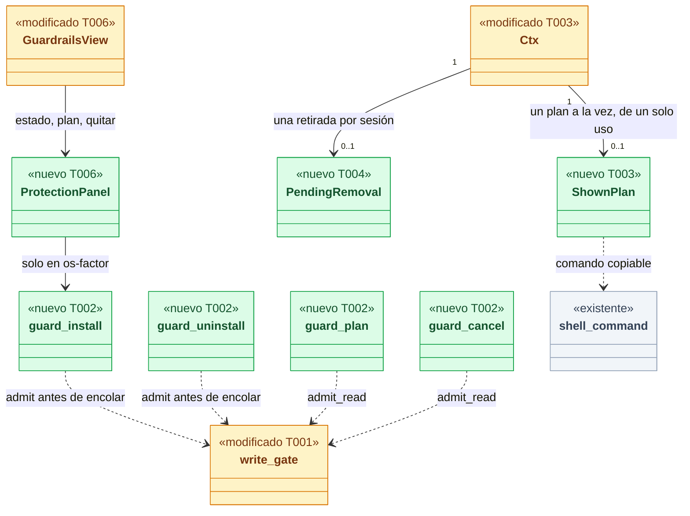
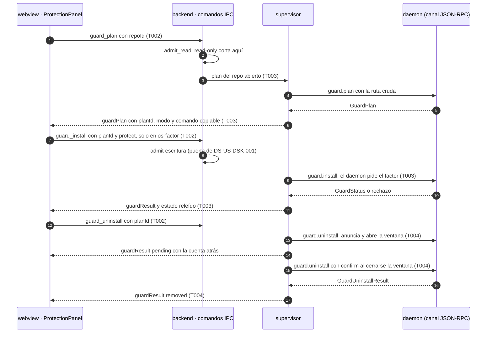
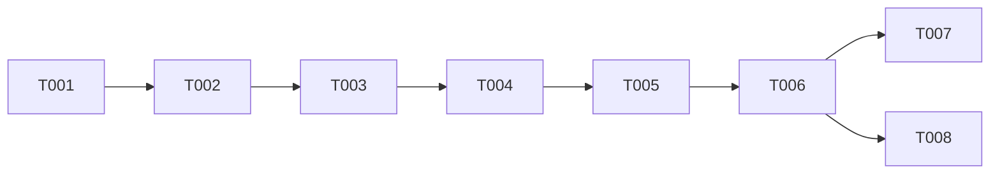

# DS-US-DSK-002 · Proteger un repo desde la app, ver qué se instaló y quitarlo, por la puerta de escritura

## Contexto rápido

Al terminar, quien tiene un repo observado en la app ve si está protegido, lee **antes** qué instala la protección, la activa, sabe después qué quedó instalado y puede quitarla dejando el repo como estaba. Hoy la app solo lee el estado (`guard.status`, `apps/desktop/src-tauri/src/engine/supervisor.rs:936-947`) para la vista de Guardrails de DS-US-DSK-007 y dice "no está protegido" sin ofrecer nada (`apps/desktop/src/guardrails/GuardrailsView.tsx:131-134`).

Esta Dev Spec **no crea otra puerta**. Parte de lo que fijó DS-US-DSK-001 (validado por el orquestador y por la revisión de seguridad del 2026-11-10) y lo cita sin redefinirlo: `engine/write_gate.rs` con sus tres modos, `WriteToken` de constructor privado, `HubCmd::is_write` exhaustivo, el recálculo del modo en el supervisor antes de todo handler de escritura (P1, M-02), el módulo `commands/write/` con `WRITE_COMMANDS` en la capability única (P2), la capacidad `presence.os-factor` aceptada con `connection.accept` y `connection.desktop` en `hello.methods` (P4, M-01), `DAEMON_METHODS` y `RESERVED_DAEMON_METHODS`, el log `desktop_write_refused` (L-04) y G1 de DEP-DSK-1 con H-01. Lo que esta entrega **añade** a esa misma puerta:

- **Dos comandos de escritura en `commands/write/`**: `guard_install` (proteger, o "no volver a ofrecer", que el daemon llama `guard.decline`) y `guard_uninstall` (quitar). Los dos con `WriteKind::PerAction`, el que ya existe.
- **Dos comandos de lectura en `commands/`**: `guard_plan` (qué se instalará, o qué está instalado y qué se quitará) y `guard_cancel` (cancelar la ventana de 10 s de una retirada, que ADR-GRP-017 § 4 deja sin presencia).
- **El plan mostrado en el supervisor**: guarda el plan que vio el webview con un `planId` de un solo uso, arma los comandos copiables (`raptor guard install -- <ruta>` y `raptor guard uninstall -- <ruta>`, sin `--yes`), aplica la retirada cuando su ventana se cierra y vuelve a leer el estado.
- **El panel de protección** en la vista de Guardrails y el paso a3 del onboarding (DSF-DSK-001 § 4.a) con todos sus estados, en en/es, con axe en tema claro y oscuro.

Hasta que exista el factor del SO (DEP-DSK-1), la app está en `copy-only`: enseña el plan real del daemon, el comando para copiar y detecta cuándo la terminal protegió o quitó la protección. El camino con factor queda construido y probado contra el daemon falso; lo que depende del contrato del factor en el cable es T007 y espera a G1.

| Término | Qué es aquí |
|---|---|
| Plan mostrado | El `guard.plan` que el webview está enseñando, guardado **en el backend** con su `planId` (`p<n>`, del contador del proceso de DS-US-DSK-001 T003 6.1), el `repoId`, la ruta cruda y lo que dice el plan (instalable, bloqueado, instalado, reparación). Un solo plan a la vez; proteger o quitar lo consume |
| Proteger | `guard.install` (reservado, `RepoWrite::Guardrails`, `crates/api/src/methods/guard.rs:137-139`) |
| No volver a ofrecer | `guard.decline` (reservado, `guard.rs:140`): guarda `permission: denied` en el perfil; no toca el repo (`install.rs:1297-1300`) |
| Quitar | `guard.uninstall` (reservado, `guard.rs:144-146`) en dos llamadas: la primera anuncia y abre una ventana de 10 s cancelable; la segunda, del mismo proceso, aplica (DS-US-GRD-003 D6) |
| Ventana | Los 10 s entre anunciar la retirada y aplicarla, impuestos por el daemon (`crates/core/src/guardrails/pending.rs:11-12`). `guard.cancel` la cancela y no es reservado (DS-US-GRD-003 D6; ADR-GRP-017 § 4) |
| Modo de escritura | `read-only` · `copy-only` · `os-factor`, de `write_gate::mode_for` (DS-US-DSK-001 P1, P4) |

⚠️ **ASSUMPTION**: no hay `architecture-constitution.md` en la cascada; rigen `AGENTS.md` y los ADR de `must_read` (NFR-01, NFR-02, ADR-GRP-016, ADR-GRP-017), como en DS-US-DSK-001.

⚠️ **ASSUMPTION**: DS-US-DSK-001 está `spec-ready` y **no está en `main`** (ni su código: `apps/desktop/src-tauri/commands.json` tiene hoy cinco comandos, 2026-11-10). Todo número de esta Dev Spec (comandos, métodos del daemon) es relativo a DS-US-DSK-001 entregada.

### Qué hay en el motor (verificado el 2026-11-10)

- **Ningún método de la familia `guard` se ofrece a `raptor-mcp`** (`crates/api/src/methods/guard.rs:133-135`). `guard.plan` y `guard.status` son de lectura y no reservados; `guard.install`, `guard.decline` y `guard.uninstall` son **reservados**; `guard.cancel` no lo es (`guard.rs:136-148`).
- Todos reciben `{ path }` (`GuardRepoParams`, `crates/api/src/guard.rs:603-605`); `guard.uninstall` recibe además `confirm: <actionId>` en su segunda llamada (`GuardUninstallParams`, `guard.rs:665-669`). El daemon valida la ruta, autoriza los reservados y después localiza el repo (`crates/core/src/channel/conn.rs:1707-1714`).
- **Todos exigen un repo observado**: con el repo sin observar responden `REPO_REJECTED` `not-observed` (`crates/core/src/daemon/guard.rs:55-58`; `conn.rs:1767`). Por eso `guard.plan` no se puede pedir antes de `repo.add` (P12).
- `guard.plan` → `GuardPlan` (`guard.rs:858-887`): ganchos que se escribirían, carpeta (`<common>/gitraptor/hooks`), worktrees, lo no impedible, ramas base protegidas, rama que confirma, **bloqueos** (vacío = instalable), el estado completo, los hooks previos que se encadenan (`prior`, con `guard.prior-hooks`) y la **reparación** de una protección caída (`repair`, con `guard.protection`).
- `guard.status` → `GuardStatus` (`guard.rs:905-952`): `state` (`unprotected`, `hooks-only`, `mcp-only`, `full`), `permission`, `offer` (falso tras una negativa), `lastRefusal`, `pending` (retirada esperando su ventana), `hooks` (`active`, `inactive` con causa, `not-installed`, `orphaned`), `diagnostics` (`leftover-folder`, `config-unreadable`…).
- `guard.install` rechaza con `GUARD_REJECTED` (`-32016`, `crates/api/src/rpc.rs:70`) y `data.blockers` (`conn.rs:1768-1773`); falla en un paso con `guard-failed` y `data { step, protection: in-place | absent }` (`guard.rs:1124-1128`, con `guard.recovery`; sin ella, `INTERNAL`).
- `guard.uninstall` rechaza con `guard-uninstall-refused` y `data { reason: not-installed | already-pending | window-open | no-pending | not-the-requester, remainingMs? }` (`guard.rs:690-711`).
- **La biblioteca cliente acepta todas las capacidades que el daemon sirve** (`crates/api/src/client/mod.rs:398-416`): la app tiene `guard.prior-hooks`, `guard.protection`, `guard.pending-action`, `guard.recovery` y `guard.protection-layers`. Con `guard.protection`, el daemon **repara** al instalar sobre una protección caída (`conn.rs:1722-1724`, `install.rs:597-603`), así que la app tiene que enseñar `plan.repair` antes (US-GRD-004, D9; P14).
- **La CLI no tiene `raptor guard decline`**: la negativa es responder "n" a `raptor guard install` (`apps/cli/src/guard.rs:983-989`). `raptor guard install` y `raptor guard uninstall` explican y preguntan; `--yes` responde por el usuario (`apps/cli/src/commands/guard.rs:21-36`).
- Sin factor: los reservados se rechazan con `RESERVED_REFUSED` `no-controlling-terminal`, como `repo.add` (DS-US-DSK-001, § Qué hay en el motor).

### NFR-01: qué guarda `guard.install` antes de escribir y cómo se quita

- **No toma snapshot de la Time Machine.** No toca el árbol de trabajo, el índice ni las referencias. Su punto de recuperación es el **diario** (`Journal`) que escribe en el perfil de GitRaptor con `stage: installing` **antes** de escribir nada en el repo (`crates/core/src/guardrails/install.rs:618-640`; ADR-GRD-001 § 4). El diario guarda:
  - el `core.hooksPath` previo: valor, nivel y carpeta;
  - la lista de archivos que escribirá en `<common>/gitraptor/` con el `sha256` de cada uno;
  - la identidad de la carpeta, la ruta de `raptor` y la rama base que confirma.
- El `Snapshot` de `install.rs:1217-1243` no es un snapshot del repo: es la copia de solo lectura del registro para el modo degradado.
- **Qué escribe** en el repo: la carpeta nueva `<common>/gitraptor/` (dispatchers, constantes, manifiesto) y la clave local `core.hooksPath`. Los hooks que el repo ya tenía (los suyos, husky, lefthook) **no se tocan**: se encadenan desde los dispatchers (US-GRD-002). Si la instalación se interrumpe, la recuperación del arranque la deshace (`Recovery::RolledBack`: "el repo queda como antes") o la confirma (`install.rs:1304-1319`).
- **Cómo se quita** (`guard.uninstall`, `crates/core/src/guardrails/uninstall.rs`, DS-US-GRD-003 D7):
  1. Comprueba que `config` es un archivo regular.
  2. Pasa el diario a `uninstalling`.
  3. Devuelve la clave a su valor local previo, o la borra si no había ninguno.
  4. Borra **solo los archivos cuyo hash recoge el diario** y las carpetas vacías, nunca de forma recursiva.
  5. Saca del perfil el registro, la copia y el diario.
- "Como estaba" lo prueba DS-US-GRD-003 D9: la huella de la Time Machine de todos los ámbitos coincide con la de antes de instalar, y `config` coincide byte a byte.
- **Lo que el usuario editó** se queda:
  - Si otra herramienta (o el usuario) cambió `core.hooksPath` después de proteger, la clave **no se toca** (`uninstall.rs:209-225`).
  - Un archivo que el usuario añadió o editó dentro de `gitraptor/` **se queda**, y la carpeta con él (`uninstall.rs:228-231`). Excepción: el manifiesto, que es dato de recuperación y se borra aunque esté editado (`:256-259`). Lo que queda aparece como el diagnóstico `leftover-folder`.
  - Los hooks propios del usuario nunca entraron en el diario: ni se escriben ni se borran.
- **Riesgo residual** (revisión de seguridad 2026-11-10, I-04, M-02): el valor que la retirada devuelve a la clave sale del diario del perfil o, en una instalación huérfana, del manifiesto del repo, y los dos los puede escribir cualquier proceso del usuario. ADR-GRD-008 lo acepta para el registro confirmado: "el registro confirmado vive en el almacén del perfil, que cualquier proceso del usuario puede escribir … forjarlo y matar el daemon deja un hueco auditado" (§ Riesgo residual). Esta entrega lo acota enseñando ese valor antes del factor (G1 H-02, T006) y avisando cuando apunta fuera de la carpeta común. "Como estaba" vale si nadie cambió la clave ni el diario después de proteger.
- **La app no añade escritura propia.** No escribe el repo ni el perfil: pide `guard.install`, `guard.decline` y `guard.uninstall` al daemon, que los autoriza, los audita y los hace recuperables como arriba. El backend guarda en memoria el plan mostrado y la retirada pendiente; los dos mueren con la sesión.

### Decisión del orquestador pendiente

Decisiones nuevas de frontera de esta historia, numeradas a continuación de las P1 a P7 de DS-US-DSK-001. El orquestador dio su veredicto el 2026-11-10 tras la **revisión de seguridad 2026-11-10** (opus, APROBADA CON COMENTARIOS: 0 crítico o alto, 2 medio, 5 bajo, 4 informativos); la tabla de [veredicto](#veredicto-del-orquestador-2026-11-10) dice cuáles se aceptan y con qué cambios, y los textos de abajo ya los llevan.

| # | Decisión | Recomendación | Por qué |
|---|---|---|---|
| P8 | **Qué se puede hacer sin presencia humana** | Sin factor (modo `copy-only`): leer el estado, **ver el plan** (qué se instalará), **ver qué se instaló** y qué se quitará, ver la retirada pendiente y su cuenta atrás, **cancelarla**, y copiar el comando de la terminal. Proteger, "no volver a ofrecer" y quitar **no**: en `copy-only`, `guard_install` y `guard_uninstall` responden `presence-unavailable` sin llamar al daemon (como P5). `guard_plan` y `guard_cancel` usan `admit_read`: solo `read-only` los rechaza | Leer el plan y el estado es lo que pide la historia ("sabe qué se instaló") y no cambia nada; el daemon no los reserva. Mandar un reservado sin factor solo produce una fila `rejected` en la auditoría por clic (P5). Cancelar solo mantiene la protección: ADR-GRP-017 § 4 lo ofrece sin presencia |
| P9 | **Quitar exige el mismo factor que proteger** | Sí: `WriteKind::PerAction` para `guard_install` y `guard_uninstall`, sin variante nueva. La presencia de sesión de US-DSK-006 no los cubre | ADR-GRP-017 § 4: "añadir o retirar un repo, instalar la protección" son factor por acción, y quitar además **relaja**, así que lleva la ventana, el anuncio y la auditoría de D5 (la impone el daemon, `pending.rs`). Pedir menos para relajar que para endurecer invertiría P2 de DSF-DSK-001 ("lo seguro es lo predeterminado") |
| P10 | **`guard.decline` es escritura** | Sí: es reservado en el daemon, así que pasa por la puerta como `guard_install { answer: "decline" }` con su factor por acción. "Ahora no" **nunca** lo llama: cierra el panel y oculta la oferta de ese repo **mientras dure la app** (estado del webview, sin persistir). Lo permanente es un botón secundario "No volver a ofrecer", que llama a `guard.decline`. En `copy-only` ese botón no se pinta: el texto `grd.protect.declineTerminal` explica que, en la terminal, responder "n" a `raptor guard install` lo deja anotado | Pedir Touch ID para decir "no" en la oferta automática castiga al novato, y el escenario 3 pide que no se vuelva a ofrecer. El daemon ya decidió que negar es reservado (`guard.rs:13`, BR-AUTH-002): la app no puede rebajarlo ni guardar la negativa en otro sitio sin crear una segunda fuente de verdad que la TUI no vería |
| P11 | **Los comandos IPC nuevos, su entrada y su forma de error** | Cuatro: `guard_plan { repoId }` (lectura, `commands/`), `guard_cancel { repoId }` (no reservado, `commands/`), `guard_install { planId, answer: "protect" \| "decline" }` (escritura, `commands/write/`), `guard_uninstall { planId }` (escritura, `commands/write/`). Todos responden `{}` y el resultado llega por el `Channel` (`guardPlan`, `guardPlanNone`, `guardResult`). Entrada con `deny_unknown_fields`; `repoId` y `planId` con la regla de `valid_repo_id`. **Sin `CommandError` nuevo**: `invalid-params`, `read-only`, `presence-unavailable`, `not-watching` (los de DS-US-DSK-001). `commands.json` pasa de **7 a 11** con igualdad exacta | El webview nunca manda una ruta: elige el repo por `repoId` y la acción por el `planId` que el backend asignó al plan que enseñó. El `planId` solo dice qué plan enseñó el backend; que lo instalado sea lo que el humano leyó lo ata el `planId` **junto con `planDigest` (H-02 de G1)** y, hasta entonces, la relectura del plan antes de escribir (T003 paso 4, M-01 de la revisión de seguridad 2026-11-10). Un `planId` caducado no protege nada. `guard_cancel` sobre un repo que no es el abierto no llama al daemon (L-03). Juntar proteger y negar en un comando evita un quinto nombre para la misma pregunta del plan; quitar va aparte porque tiene ventana y dos llamadas |
| P12 | **Acción compuesta "Añadir y proteger" (DSF D-7)** | **Secuencial** en esta entrega: a3 se pinta cuando el repo ya está observado, con el plan real de `guard.plan`. En `os-factor` hay **dos diálogos**: añadir (DS-US-DSK-001) y después proteger. El plan único con un solo factor es un **requisito para la ficha de motor de DEP-DSK-1** (G1, H-03), no trabajo de esta historia. Cuando exista, T007 une los dos pasos sin cambiar los comandos | `guard.plan` exige un repo observado (`daemon/guard.rs:55-58`): antes de `repo.add` no hay plan real que enseñar, y la regla de la historia es explicar lo que se instala **antes**. Un a3 con texto fijo en lugar del plan rompería esa regla. ADR-GRP-017 § 4 condiciona la acción compuesta a que "el plan canónico describa las dos partes", y eso lo construye el daemon. **Pedido** (DSF D-7): una confirmación · **Escrito**: dos hasta G1 · **Por qué**: lo de arriba |
| P13 | **Quién aplica la retirada cuando cierra la ventana** | El backend la aplica: tras la primera llamada (`pending { actionId, appliesAtMs }`), el supervisor programa la segunda (`confirm: actionId`) al cerrarse la ventana, **solo dentro de la misma sesión**. Al reconectar se descarta y el daemon la caduca sin aplicar nada (ventana + 60 s, DS-US-GRD-003 D6) | El daemon exige que aplique el mismo proceso (pid e inicio), y el backend lo es. Si el webview la aplicara, un webview comprometido podría hacerlo. Si se aplazara entre sesiones, se aplicaría con el perfil de otra conexión (L-01). El `WriteToken` de la primera llamada viaja dentro de la retirada pendiente y lo consume la segunda (L-01 de la revisión de seguridad 2026-11-10). Con factor, la segunda llamada también es reservada: que no pida un segundo diálogo, y solo para una entrada que el mismo solicitante creó con factor, es el requisito H-04 de G1 (L-04) |

#### Veredicto del orquestador (2026-11-10)

Tras la revisión de seguridad 2026-11-10 (opus, APROBADA CON COMENTARIOS). Los cambios ya están en el texto de cada decisión y en las tareas que se citan. Cada hallazgo se verificó leyendo el código antes de aplicarlo (sin compilar).

| # | Veredicto | Cambios incorporados | Tareas |
|---|---|---|---|
| P8 | Aceptar | — | T002 |
| P9 | Aceptar | — | T002 |
| P10 | Aceptar | — | T003, T006 |
| P11 | Aceptar con cambios | M-01 (`planDigest` en H-02; relectura del plan antes de `guard.install`), L-03 (`guard_cancel` solo del repo abierto, uno en vuelo) | T003, T004, G1 |
| P12 | Aceptar | — | — |
| P13 | Aceptar con cambios | L-01 (el `WriteToken` pasa a la retirada pendiente y lo consume la aplicación), L-04 (H-04 solo para una entrada creada con factor por el mismo solicitante y el mismo `actionId`) | T004, G1 |
| P14 | Aceptar con cambios | M-01 (`planDigest` también para la reparación), L-02 (quitar desde el panel de reparación), I-03 (clave encadenada fuera del repo, resaltada) | T003, T004, T006 |

Además: M-02 (el valor que la retirada devuelve a `core.hooksPath` se enseña antes del factor) en G1 y T006; L-05 (sin botón "Quitar los restos") en T006; I-01, I-02 e I-04 en § Textos y § NFR-01.
| P14 | **Reparar una protección caída desde la app** | Sí, con el mismo `guard_install` (`answer: protect`) sobre un plan con `repair`: el panel enseña los archivos que se reescriben y la clave que pasa a encadenarse (`RepairPlan`, `guard.rs:889-899`) antes del botón "Volver a proteger" | La app acepta `guard.protection`, así que el daemon repara (`conn.rs:1722-1724`). US-GRD-004 D9 exige enseñar la reparación antes de concederla; el `planId`, junto con `planDigest` (H-02), ata la reparación concedida a la enseñada. El panel de reparación ofrece también "Quitar protección" como acción secundaria (L-02) y resalta una clave encadenada absoluta fuera del repo (I-03) |

---

## 📋 Índice

> **Para aprobar:** [Contexto rápido](#contexto-rápido) · [⚠️ Gaps](#gaps-y-violaciones-de-la-constitución) · [🔭 La forma](#la-forma) · [El trabajo de un vistazo](#el-trabajo-de-un-vistazo).
> **Para implementar:** [🚀 Plan](#plan-de-implementación), en orden. Las `_(ref)_` se abren desde la tarea que las cita.

| Sección | Propósito |
|---------|-----------|
| [Contexto rápido](#contexto-rápido) | Qué se construye, qué hay en el motor, NFR-01 y decisiones pendientes |
| [⚠️ Gaps y violaciones de la constitución](#gaps-y-violaciones-de-la-constitución) | Qué impide empezar |
| [🔭 La forma](#la-forma) | Piezas y flujo |
| [🚀 Plan de implementación](#plan-de-implementación) | T001…T008, en orden |
| ↳ [El trabajo de un vistazo](#el-trabajo-de-un-vistazo) | Tareas en tabla y su orden |
| [Estructura de ficheros](#estructura-de-ficheros) _(ref)_ | Árbol anotado |
| [Contratos compartidos](#contratos-compartidos) _(ref)_ | DTO, mensajes, firmas y textos |
| [Contrato de API](#contrato-de-api) _(ref)_ | Comandos IPC y lo que se consume del canal |
| [Estrategia de pruebas y cobertura](#estrategia-de-pruebas-y-cobertura) _(ref)_ | Escenarios → tests |
| [Gate de seguridad](#gate-de-seguridad) | Checklist pre-merge |
| [Fuera de alcance](#fuera-de-alcance) | Lo que esta entrega no toca |
| [Notas del autor](#notas-del-autor) _(ref)_ | Lo que no bloquea |

---

## ⚠️ Gaps y violaciones de la constitución

> **⚠️ Desviación del diseño, para revisión de UX (decidida por el orquestador el 2026-11-10).** DSF D-7 pide una sola confirmación para "Añadir y proteger"; esta entrega escribe **dos** (primero añadir, DS-US-DSK-001, y después proteger), porque `guard.plan` exige un repo ya observado. Recupera D-7 el requisito H-03 de la ficha de motor de DEP-DSK-1 (plan compuesto con un solo factor). Ver P12 y G1. UX debe revisar el flujo a3 con los dos diálogos del sistema.

| ID | Qué falta | Severidad | Alcance | Acción | Owner |
|----|-----------|-----------|---------|--------|-------|
| G1 | El contrato del factor en el cable (G1 de DS-US-DSK-001, sin cambiar) y, además, estos **requisitos de la protección**, que se suman a H-01 y M-01 de la misma ficha. **(H-02, revisión de seguridad 2026-11-10, M-01 y M-02)** `guard.plan` devuelve `planDigest`, el `sha256` del plan canónico (ganchos, carpeta, `prior`, `repair`, ramas, bloqueos). `guard.install` recibe `{ path, planDigest }`: el daemon recalcula el plan y, si el resumen no coincide, responde `stale` **sin pedir el factor**; si coincide, ata el factor a ese resumen. Para `guard.uninstall`, el plan y el `localizedReason` llevan el **valor exacto** que se restaurará en `core.hooksPath` (o "se borra la clave"), saneado, y el plan lo expone al cliente antes de la primera llamada. El `localizedReason` de `guard.install`, `guard.decline` y `guard.uninstall` lleva además el verbo ("proteger", "no volver a ofrecer la protección de", "quitar la protección de"), el repo canónico saneado y el código de correlación. **(H-03, opcional)** Plan compuesto `repo.add` + `guard.install` con un solo factor, si el orquestador mantiene DSF D-7 (P12). **(H-04, L-04)** La segunda llamada de `guard.uninstall` se acepta sin diálogo **solo** si la entrada pendiente se creó con una autorización por factor del mismo solicitante (pid e inicio) y con el mismo `actionId`; la segunda llamada la protege la ventana. Una retirada anunciada desde la terminal nunca la confirma la app, ni al revés. Si la ficha decide otra cosa, T007 pinta el segundo diálogo | Bloqueante | T007 | Añadir H-02 a H-04 a la ficha de motor de DEP-DSK-1 (aún sin reservar) | Arquitecto (ficha) · Rene (spike) |

Sin violaciones de la constitución: la app no lee repos ni lanza procesos (ADR-GRP-017 § 1, § 2), no añade plugins ni permisos `dialog:*` o `core:event:*`, y toda escritura pasa por el daemon con su autorización, su auditoría y su diario (NFR-01).

**Depende de**:

- **TS-GRP-009** (ya en `main`, PR #351; era el `blocked_by`): el daemon fija `hello.profile` `mcp` para una ventana que abrió un agente (DS-TS-GRP-009 D3). El perfil se fija en el `hello` y no cambia (D5), y el `hello` no cambia de forma (D1).
- **DS-US-DSK-001 entregada**, T001 a T003: `write_gate`, `commands/write/`, `WriteToken`, el contador de ids del proceso, `LinkError::Refused { code, data }` y `Link::accepted`. Es una dependencia de código, no de historia. Si DS-US-DSK-001 no está en `main` cuando empiece T001, esta entrega espera; no reimplementa la puerta.
- **DEP-DSK-1** (ficha de motor del factor del SO, dueño **Arquitecto**, aún sin reservar): bloquea solo T007 (G1). No va en `blocked_by`: T001 a T006 y T008 se construyen y se verifican en `copy-only`.

---

## 🔭 La forma

Al terminar, la puerta de DS-US-DSK-001 tiene dos comandos de escritura más en su lista, el supervisor guarda el plan mostrado y la retirada pendiente, y el webview tiene un panel de protección en la vista de Guardrails y en el paso a3 del onboarding.



🟩 nuevo · 🟨 modificado · ⬜ existente (contexto: no cambia). Cada pieza dice qué tarea la toca.

**Cómo fluye** (proteger, y después quitar):



Los pasos que deciden son el 2 y el 8: la puerta corta en Rust antes de llamar al daemon. Solo escriben el 9, el 13 y el 15, y únicamente en `os-factor`. En `copy-only`, el usuario ejecuta en su terminal el comando del paso 6 y el panel se actualiza al releer el estado (T003, paso 9). Cambian dos contratos publicados: la lista cerrada de comandos (de 7 a 11) y `EngineMessage` (tres variantes nuevas).

---

## 🚀 Plan de implementación

> Orden topológico (`Depende:`). Una casilla se marca cuando su `Aceptación` está verificada. Las rutas son relativas a la raíz del repo.

### El trabajo de un vistazo

Cuatro frentes y un cierre: la puerta y los comandos en Rust (T001 a T004), el webview (T005 y T006), el factor cuando exista su contrato (T007) y la verificación en macOS (T008).

| # | Tarea | Depende | Aterriza en |
|---|---|---|---|
| T001 | Añadir la protección a las listas de la puerta | — | `apps/desktop/src-tauri/src/engine/write_gate.rs` |
| T002 | Añadir los cuatro comandos a la lista cerrada | T001 | `apps/desktop/src-tauri/src/commands`, `commands.json`, `capabilities/` |
| T003 | Mostrar el plan y proteger en el supervisor | T002 | `apps/desktop/src-tauri/src/engine` |
| T004 | Quitar la protección con su ventana | T003 | `apps/desktop/src-tauri/src/engine` |
| T005 | Guardar plan y resultado en la caché del webview | T004 | `apps/desktop/src/client`, `apps/desktop/src/state` |
| T006 | Pintar el panel de protección con todos sus estados | T005 | `apps/desktop/src/guardrails`, `apps/desktop/src/onboarding`, `apps/desktop/src/i18n` |
| T007 | Mostrar el factor del SO y sus desenlaces | T006 | `apps/desktop/src/guardrails`, `apps/desktop/src-tauri/src/engine` |
| T008 | Verificar de punta a punta en macOS | T006 | — |

### En qué orden

Cadena recta hasta T006 y un abanico al final: T007 espera a G1; T008 no espera a T007.



### T001 — Añadir la protección a las listas de la puerta

**Objetivo.** `write_gate` conoce los dos comandos de escritura nuevos y los métodos del daemon que llaman; ningún tipo ni regla de la puerta cambia. Fuera: los comandos (T002).

**Ubicación.**
- `apps/desktop/src-tauri/src/engine/write_gate.rs` (**MODIFY**)
- `apps/desktop/src-tauri/tests/write_gate.rs` (**MODIFY**)

**Reglas**
- `WRITE_COMMANDS = ["repo_add", "guard_install", "guard_uninstall"]`.
- `RESERVED_DAEMON_METHODS = [REPO_ADD, GUARD_INSTALL, GUARD_DECLINE, GUARD_UNINSTALL]`.
- `DAEMON_METHODS` añade al final `GUARD_PLAN`, `GUARD_INSTALL`, `GUARD_DECLINE`, `GUARD_UNINSTALL` y `GUARD_CANCEL` (`GUARD_STATUS` ya estaba). Quedan 16 si DS-US-DSK-005 no añadió `GRAPH_LANES` antes; si lo añadió, 17.
- `RESERVED_HANDLERS: &[(&str, &[&str])]` fija qué funciones del supervisor pueden pasar cada reservado al link: `repo.add` → `write_repo_add`; `guard.install` y `guard.decline` → `write_guard_install`; `guard.uninstall` → `write_guard_uninstall` y `write_guard_uninstall_apply` (lo usa el test de T002).
- Sin variante nueva de `WriteKind`: `guard_install` y `guard_uninstall` usan `PerAction` (P9). Sin cambios en `mode_for`, `admit`, `admit_read`, `SharedMode` ni `WriteToken`.
- El log `desktop_write_refused` de L-04 gana los valores `guard_install`, `guard_uninstall`, `guard_plan` y `guard_cancel` en su vocabulario cerrado de `command`.

- **Depende:** —
- **Refs:** DS-US-DSK-001 P1, P2, L-04; P9, P11
- **Aceptación:** `cargo test -p gitraptor-desktop --test write_gate` en verde
- **Guard:** `write_commands_are_exactly_the_three` (igualdad, nunca `contains`)

### T002 — Añadir los cuatro comandos a la lista cerrada

**Objetivo.** `guard_plan`, `guard_cancel`, `guard_install` y `guard_uninstall` existen, validan su entrada, pasan por la puerta en Rust y llegan al supervisor; la lista exacta pasa a once. Fuera: lo que el supervisor hace con ellos (T003, T004).

**Ubicación.**
- `apps/desktop/src-tauri/src/commands/guard_plan.rs` (**CREATE**)
- `apps/desktop/src-tauri/src/commands/guard_cancel.rs` (**CREATE**)
- `apps/desktop/src-tauri/src/commands/write/guard_install.rs` (**CREATE**)
- `apps/desktop/src-tauri/src/commands/write/guard_uninstall.rs` (**CREATE**)
- `apps/desktop/src-tauri/src/commands/write/mod.rs` (**MODIFY**: dos `pub mod`)
- `apps/desktop/src-tauri/src/commands/mod.rs` (**MODIFY**)
- `apps/desktop/src-tauri/commands.json` (**MODIFY**)
- `apps/desktop/src-tauri/capabilities/main.json` (**MODIFY**)
- `apps/desktop/src-tauri/src/engine/mod.rs` (**MODIFY**: `EngineHub::{guard_plan, guard_cancel, guard_install, guard_uninstall}`)
- `apps/desktop/src-tauri/src/engine/supervisor.rs` (**MODIFY**: variantes de `HubCmd` y sus brazos en `is_write`)
- `apps/desktop/src-tauri/tests/commands.rs` (**MODIFY**)

**Reglas**
- `commands.json` = `["app_info", "engine_watch", "engine_retry", "fleet_open", "guard_blocks", "repo_pick", "repo_add", "guard_plan", "guard_cancel", "guard_install", "guard_uninstall"]`; `capabilities/main.json` añade `allow-guard-plan`, `allow-guard-cancel`, `allow-guard-install` y `allow-guard-uninstall` (capability única, ADR-GRP-017 § 2, DS-US-DSK-001 P2).
- Las aserciones de lista exacta de `tests/commands.rs` (las cuatro que actualizó DS-US-DSK-001 T002 y la nueva de esta tarea) pasan a los **once** nombres, **iguales, nunca `contains`**.
- Como en DS-US-DSK-001, los comandos solo parsean el sobre y delegan en `EngineHub`; `admit` y `admit_read` se llaman en `EngineHub`. Orden: sobre, ids, puerta, supervisor.
  - `guard_plan` → `hub.guard_plan(repo_id)`: valida `repoId`, `admit_read(mode, "guard_plan")`, `HubCmd::GuardPlan { repo_id }`.
  - `guard_cancel` → `hub.guard_cancel(repo_id)`: valida, `admit_read(mode, "guard_cancel")`, `HubCmd::GuardCancel { repo_id }`.
  - `guard_install` → `hub.guard_install(plan_id, answer)`: valida `planId`, `admit(mode, PerAction, "guard_install")?`, `HubCmd::GuardInstall { plan_id, answer, token }`.
  - `guard_uninstall` → `hub.guard_uninstall(plan_id)`: valida, `admit(mode, PerAction, "guard_uninstall")?`, `HubCmd::GuardUninstall { plan_id, token }`.
  - Sin supervisor → `not-watching`; sin sesión, el modo es `ReadOnly` y responden `read-only` (como `repo_add`).
- `HubCmd::is_write`: `GuardInstall` y `GuardUninstall` → `true`; `GuardPlan` y `GuardCancel` → `false`. El `match` sigue sin comodín (M-02).
- `answer` es un enum cerrado `GuardAnswer { Protect, Decline }` con `rename_all = "kebab-case"`; otro valor → `invalid-params`.
- `tests/commands.rs` › `reserved_methods_are_called_only_from_their_write_handler` sustituye al de DS-US-DSK-001 (que nombraba solo `write_repo_add`): cada método de `RESERVED_DAEMON_METHODS` aparece solo en la función que le asigna `RESERVED_HANDLERS`. `the_backend_calls_only_the_listed_daemon_methods` sigue igual, con la lista de T001.

- **Depende:** T001
- **Refs:** P8, P9, P10, P11; DS-US-DSK-001 P2, P3, M-02; ADR-GRP-017 § 1, § 2
- **Aceptación:** `cargo test -p gitraptor-desktop --test commands --test tauri_surface` en verde
- **Guard ⛔ lista exacta:** `guard_commands_are_in_the_closed_list_and_the_capability` (igualdad con los once)
- **Guard P8:** `copy_only_refuses_install_and_uninstall_but_not_plan_or_cancel`

### T003 — Mostrar el plan y proteger en el supervisor

**Objetivo.** El supervisor pide `guard.plan` del repo abierto, guarda el plan mostrado, arma el comando copiable, protege o niega en `os-factor` y vuelve a leer el estado cuando la protección cambia por cualquier vía. Fuera: quitar (T004) y los desenlaces del factor (T007).

**Ubicación.**
- `apps/desktop/src-tauri/src/engine/supervisor.rs` (**MODIFY**)
- `apps/desktop/src-tauri/src/engine/guard_plan.rs` (**CREATE**: `ShownPlan`, `plan_dto`, `command`)
- `apps/desktop/src-tauri/src/engine/mod.rs` (**MODIFY**: `pub mod guard_plan;`)
- `apps/desktop/src-tauri/src/engine/wire.rs` (**MODIFY**: variantes y DTO de § Tipos)
- `apps/desktop/src-tauri/tests/support/fake_daemon.rs` (**MODIFY**: guion "protección" de § 9.3)
- `apps/desktop/src-tauri/tests/guard_protect.rs` (**CREATE**)
- `apps/desktop/src-tauri/tests/engine_wire.rs` (**MODIFY**)
- `apps/desktop/tests/fixtures/engine-messages.json` (**MODIFY**)

**Pasos**
1. `HubCmd::GuardPlan { repo_id }`: con vista restringida, descartar. Si `ctx.open != repo_id` o el repo no tiene ruta cruda → `GuardPlanNone { repoId, cause: not-open }` (la misma regla que `guard_blocks`, `supervisor.rs:910-918`). Si no, llamar a `guard.plan { path: raw_path }`.
   - `Ok` → sustituir `Ctx.shown_plan` por `ShownPlan { id: "p<n>", repo_id, raw_path, kind, shown, digest }` (`shown` es el `GuardPlanDto` saneado sin `planId`, `changed` ni `mode`; `digest` es el `planDigest` del daemon cuando H-02 exista, y `None` hasta entonces) y mandar `GuardPlan { plan: GuardPlanDto }`. `kind` es `Installable` (sin bloqueos y sin protección), `Repair` (`repair` presente), `Installed` (`hooks-only` o `full`, o `hooks.status` `orphaned`, o el diagnóstico `leftover-folder`: hay algo que quitar) o `Blocked`.
   - `-32013` `not-observed` → `GuardPlanNone { cause: not-observed }`; otro rechazo → `GuardPlanNone { cause: unavailable }`.
   - `LinkError::Lost` → reconexión.
   1.1 ⛔1.1 `planId` sale del contador del proceso de DS-US-DSK-001 T003 6.1 (`NEXT_ID`, prefijo `p`). Nunca uno por sesión.
2. Sanear el plan en `guard_plan::plan_dto`: cada `Untrusted` (carpeta, worktrees, ramas, `prior.hooksPath`, `prior.hooks`, `repair.files`, `repair.chains`) pasa por `display::visible` con `TEXT_MAX_CHARS` (rutas) o `NAME_MAX_CHARS` (nombres). Los enums (`hooks`, `notPreventable`, `blockers`, `cause`, `diagnostics`) van con su nombre del cable, como `wire_name` de `ingest.rs`. Topes: 32 worktrees y 32 archivos de reparación, con `truncated: true` si hay más.
   - `restores` (M-02 de la revisión de seguridad 2026-11-10), solo con `kind` `Installed` o `Repair`: el valor que la retirada devolverá a `core.hooksPath`, del campo que publique H-02 (`<campo de G1>`). Hasta entonces, `None`. `RestoreDto { value: Option<String>, outside: bool }`: `value` es `None` cuando se borra la clave. `outside` se calcula en el backend con el valor crudo, **antes** de sanear: es `true` cuando el valor es una ruta absoluta fuera del directorio común del repo.
   - `chainsOutside` (I-03): el mismo cálculo sobre `repair.chains`.
   2.1 ⛔2.1 La ruta cruda nunca sale del backend: el DTO solo lleva textos saneados (SEC-12).
3. `guard_plan::command(raptor, raw_path, kind)` arma con `shell_command::posix` el comando copiable. Es `[raptor, "guard", "install", "--", raw_path]` para `Installable` y `Repair`, y `[raptor, "guard", "uninstall", "--", raw_path]` para `Installed`; `Blocked` no lleva comando. **Nunca `--yes`**: la terminal enseña el plan y pregunta (ADR-GRP-017 § 5, R-5b). Usa `raptor_path` como DS-US-DSK-001 T003 paso 8, y da `NotOffered { reason: raptor-unknown | unsafe-text }` como allí.
   3.1 El `--` antes de la ruta: `GuardAction::Install { path: Option<PathBuf> }` y `Uninstall` son posicionales sin `last` ni `allow_hyphen_values` (`apps/cli/src/commands/guard.rs:21-36`), la misma forma que `repo add`. **Pendiente de verificar ejecutándolo** en T008.
4. `write_guard_install` (handler de `HubCmd::GuardInstall { plan_id, answer, token }`, tras el recálculo del modo de DS-US-DSK-001 T003 paso 4): consumir el `token`.
   - Si `plan_id` no es `Ctx.shown_plan` → `GuardResult { status: expired }`.
   - Con `protect`: `kind` tiene que ser `Installable` o `Repair`; si es `Blocked` o `Installed` → `expired`.
   - Con `decline`: `kind` tiene que ser `Installable`; si no → `expired`.
   - Uno en vuelo por sesión y 5 s entre dos (L-03 de DS-US-DSK-001, el mismo contador `last_write_at` para todas las escrituras); si no → `expired`.
   - **Relectura antes de escribir** (M-01 de la revisión de seguridad 2026-11-10; mitigación provisional, válida ya): con `protect`, justo antes de `guard.install`, volver a pedir `guard.plan` y comparar su `GuardPlanDto` saneado con `ShownPlan.shown`. Si difiere (un agente cambió `core.hooksPath` tras mostrar el plan, sin `reserved.audit`), sustituir el plan mostrado por el nuevo, mandarlo con `changed: true` y responder `expired`, sin llamar a `guard.install`.
   - Si pasa: consumir el plan y llamar a `guard.install { path: raw_path }` (con `planDigest: digest` cuando H-02 exista) o a `guard.decline { path: raw_path }`.
   4.1 ⛔4.1 La relectura reduce la ventana de carrera pero no la cierra: un cambio entre la relectura y la escritura sigue siendo posible. La cierra `planDigest` (H-02), que el daemon comprueba dentro de `guard.install`. Por eso T007 envía `planDigest` en cuanto el daemon lo publique, y la relectura se queda como defensa en profundidad.
5. Mapear la respuesta:
   - `Ok(GuardStatus)` → `protected` (o `declined` con `decline`), con el estado del paso 9.
   - `-32016` → `rejected { blockers }`.
   - `guard-failed` → `failed-step { step, protection }`.
   - `-32003` `no-controlling-terminal` o `unsupported` → `presence-unavailable`; otro `-32003` → `refused`.
   - `-32013` → `not-observed`; `INTERNAL` → `failed`; otro código → `failed`.
   5.1 ⛔5.1 Un rechazo nunca se convierte en éxito ni en `presence-unavailable` por defecto (DS-US-DSK-001 10.1).
6. Tras cualquier `guardResult` final, releer `guard.status` y `guard.log` del repo abierto con `read_guard` (existente), para que la vista de Guardrails y el panel coincidan.
7. Fuera de una sesión no se aplaza nada (L-01): en `wait` y `wait_for_shutdown`, `GuardInstall` responde `GuardResult { status: read-only }` y `GuardPlan` responde `GuardPlanNone { cause: no-session }`. Al salir de `session`, `Ctx.shown_plan` se vacía.
8. Cambiar de repo abierto (`fleet_open` de otro `repoId`) vacía `Ctx.shown_plan`: un plan solo vale para el repo que se está viendo.
9. **Detectar el cambio que hizo la terminal**: mientras haya un plan mostrado, cada evento `reserved.audit` del repo abierto relee `guard.status` con la regla de unión de `exception_changed` (`supervisor.rs:895-907`, `GUARD_JOIN`). Si `state`, `hooks.status`, `permission` o `pending` cambiaron, se pide otra vez `guard.plan` y se manda un `GuardPlan` nuevo, con otro `planId` y `changed: true`. Como mucho un `guard.plan` por relectura.
   9.1 ⛔9.1 Un plan sustituido invalida el anterior: un `guard_install` con el `planId` viejo responde `expired`. Así nadie protege con lo que decía un plan que ya no es el vigente.

- **Depende:** T002
- **Refs:** P8, P10, P11, P12, P14; revisión de seguridad 2026-11-10 (M-01, M-02, I-03); DS-US-DSK-001 P1, P3, L-01, L-02, L-03, M-02; ADR-GRP-017 § 5; DS-US-DSK-007 (`read_guard`, `exception_changed`)
- **Aceptación:** `cargo test -p gitraptor-desktop --test guard_protect --test engine_wire --test commands` en verde
- **Guard ⛔1.1:** `plan_ids_are_never_reused_across_sessions`
- **Guard ⛔2.1:** `the_raw_path_never_reaches_the_webview_in_a_plan`
- **Guard ⛔5.1:** `an_unknown_install_refusal_is_failed`
- **Guard ⛔9.1:** `a_replaced_plan_expires_the_old_plan_id`
- **Guard P10:** `decline_needs_an_installable_plan_and_a_token`
- **Guard ⛔4.1:** `the_reread_plan_is_compared_right_before_guard_install` (ninguna llamada entre la relectura y `guard.install`; con `digest`, `guard.install` lleva `planDigest`)
- **Guard M-01:** `a_plan_changed_without_audit_is_never_installed` (el daemon falso cambia `prior` entre el `guard.plan` mostrado y la relectura: no hay `guard.install`, llega un plan con `changed: true` y `expired`)

### T004 — Quitar la protección con su ventana

**Objetivo.** Con un plan `Installed`, el supervisor anuncia la retirada, enseña la cuenta atrás, la aplica al cerrarse la ventana y la cancela si se lo piden. Fuera: el factor (T007).

**Ubicación.**
- `apps/desktop/src-tauri/src/engine/supervisor.rs` (**MODIFY**)
- `apps/desktop/src-tauri/src/engine/guard_plan.rs` (**MODIFY**: `PendingRemoval`)
- `apps/desktop/src-tauri/src/engine/wire.rs` (**MODIFY**)
- `apps/desktop/src-tauri/tests/guard_remove.rs` (**CREATE**)

**Pasos**
1. `write_guard_uninstall` (handler de `HubCmd::GuardUninstall { plan_id, token }`): **no** consume el `token` al entrar (L-01 de la revisión de seguridad 2026-11-10). Si `plan_id` no es el plan mostrado, o su `kind` no es `Installed` ni `Repair` (L-02) → `expired` y el `token` se suelta. Aplica el mismo L-03. Si pasa: consumir el plan y llamar a `guard.uninstall { path }`.
2. Respuesta de la primera llamada:
   - `Ok` con `pending { actionId, appliesAtMs, windowMs }` → guardar `Ctx.removal = PendingRemoval { repo_id, raw_path, action_id, applies_at: Instant, token }`, con el `WriteToken` de la orden movido dentro (L-01), y mandar `GuardResult { status: removal-pending { appliesAtMs, windowMs, restoresHooksPath } }`. `restoresHooksPath` va saneado: es el valor que se devuelve a la clave de una instalación huérfana, que se enseña antes de la ventana (ADR-GRD-005 § 1).
   - `guard-uninstall-refused` → `removal-refused { reason }`.
   - El resto, con el mapeo de T003 paso 5.
3. **Aplicar** (P13): en el bucle de `stream`, cuando `Instant::now() >= applies_at + 250 ms` y la sesión sigue, recalcular el modo (como DS-US-DSK-001 T003 paso 4; si no es `OsFactor`, abandonar la retirada con `removal-abandoned`) y llamar a `guard.uninstall { path, confirm: action_id }`. Esta llamada vive en `write_guard_uninstall_apply`, que `RESERVED_HANDLERS` (T001) admite para `guard.uninstall`, y **consume** el `WriteToken` que guarda `PendingRemoval` (L-01): sin ese token no hay segunda llamada.
   - `Ok` → `removed { restoresHooksPath? }` y releer el estado (T003 paso 6).
   - `window-open` con `remainingMs` → reprogramar una vez con ese plazo; otra vez `window-open` → `failed`.
   - `no-pending` (otro la canceló desde la terminal u otro cliente) → `removal-cancelled-elsewhere` (I-01).
   - `not-the-requester` → `failed`.
   - `guard-failed` → `failed-step`.
   3.1 ⛔3.1 La retirada pendiente no sobrevive a la sesión: al salir de `session` por cualquier camino, `Ctx.removal` se vacía **sin** llamar a `confirm`. El daemon la caduca sola (ventana + 60 s) y la audita (DS-US-GRD-003 D6).
4. `HubCmd::GuardCancel { repo_id }` (L-03 de la revisión de seguridad 2026-11-10): si `repo_id` no es el repo abierto o no tiene ruta cruda → `GuardPlanNone { repoId, cause: not-open }` **sin llamar al daemon**. Como mucho un `guard.cancel` en vuelo por sesión: otro mientras tanto se descarta. Si pasa, llamar a `guard.cancel { path }` del repo abierto. `Ok` → vaciar `Ctx.removal` si era de ese repo, mandar `removal-cancelled` y releer. `guard-uninstall-refused` `no-pending` → `removal-cancelled` (ya no había nada). Funciona también con una retirada que anunció la terminal (`copy-only`): el panel la ve en `status.pending` (`kind: uninstall`).
5. La cuenta atrás del webview sale de `status.pending.appliesAtMs` (del daemon) y no del reloj del backend: el backend solo decide cuándo llamar a `confirm`.

- **Depende:** T003
- **Refs:** P9, P13; revisión de seguridad 2026-11-10 (L-01, L-02, L-03, L-04, I-01); DS-US-GRD-003 D6, D7, D8; ADR-GRP-017 § 4 (cancelar la ventana D5 sin presencia); ADR-GRD-005 § 1 (retirar una huérfana)
- **Aceptación:** `cargo test -p gitraptor-desktop --test guard_remove` en verde, con la ventana del daemon falso a 50 ms
- **Guard ⛔3.1:** `a_reconnection_drops_the_pending_removal_without_confirming`
- **Guard P13:** `the_removal_is_applied_once_when_the_window_closes`, `a_cancelled_removal_is_never_confirmed`
- **Guard L-01:** `the_apply_consumes_the_token_kept_in_the_pending_removal`
- **Guard L-02:** `a_repair_plan_can_be_removed`
- **Guard L-03:** `cancel_of_a_repo_that_is_not_open_never_reaches_the_daemon`, `a_second_cancel_in_flight_is_dropped`
- **Guard I-01:** `no_pending_on_apply_is_cancelled_elsewhere`

### T005 — Guardar plan y resultado en la caché del webview

**Objetivo.** El webview tiene los tipos, los comandos y la entrada de caché de la protección; ningún componente todavía.

**Ubicación.**
- `apps/desktop/src/client/engine-types.ts` (**MODIFY**)
- `apps/desktop/src/client/commands.ts` (**MODIFY**)
- `apps/desktop/src/client/commands.test.ts` (**MODIFY**)
- `apps/desktop/src/client/queries.ts` (**MODIFY**: `engineKeys.protection(repoId)`)
- `apps/desktop/src/state/engine-cache.ts` (**MODIFY**)
- `apps/desktop/src/state/engine-cache.test.ts` (**MODIFY**)

**Reglas**
- `COMMANDS` pasa a los once nombres en el orden de `commands.json` (igualdad en `commands.test.ts`); `Commands` gana las cuatro entradas de § Contrato de API.
- `engine-types.ts` copia los tipos de § Tipos y datos compartidos.
- `applyEngineBatch`: `guardPlan` sustituye `engineKeys.protection(repoId)` (`{ plan, result: null }`); `guardResult` solo se guarda si su `planId` es el del plan guardado, o si es de la retirada en curso de ese repo; `guardPlanNone` deja `{ plan: null, none: cause }`; un `session` nuevo vacía todas las entradas `protection`.
- La oferta ocultada con "Ahora no" (P10) vive en un `Set<repoId>` del store del webview, en memoria; no se persiste ni se manda al backend.

- **Depende:** T004
- **Refs:** DS-US-DSK-003 (`applyEngineBatch`, fixture dorada); ADR-GRP-004
- **Aceptación:** `pnpm --filter @gitraptor/desktop test -- engine-cache commands` en verde

### T006 — Pintar el panel de protección con todos sus estados

**Objetivo.** El usuario ve el estado de la protección del repo abierto, lee qué se instalará o qué se instaló, protege, rechaza, quita y cancela, con cada estado de § Forma del error en en/es, accesible y en los dos temas. Fuera: la pantalla del factor (T007).

**Ubicación.**
- `apps/desktop/src/guardrails/ProtectionPanel.tsx` (**CREATE**)
- `apps/desktop/src/guardrails/protection-model.ts` (**CREATE**)
- `apps/desktop/src/guardrails/useProtection.ts` (**CREATE**)
- `apps/desktop/src/guardrails/ProtectionPanel.test.tsx` (**CREATE**)
- `apps/desktop/src/guardrails/protection-model.test.ts` (**CREATE**)
- `apps/desktop/src/guardrails/GuardrailsView.tsx` (**MODIFY**: monta el panel arriba; `grd.empty.unprotected` pasa a remitir al panel)
- `apps/desktop/src/guardrails/boundaries.test.ts` (**MODIFY**)
- `apps/desktop/src/onboarding/AddRepoFlow.tsx` (**MODIFY**: tras `added` u `observed`, el paso a3 monta `ProtectionPanel variant="onboarding"`)
- `apps/desktop/src/i18n/locales/en.json` y `es.json` (**MODIFY**: `grd.protect.*`)

**Reglas**
- `protectionView(entry, mode, hidden)` en `protection-model.ts` es pura y devuelve un estado de la tabla de § Forma del error con sus claves; el componente solo pinta. Ningún texto se arma con concatenación.
- Al montarse con un repo abierto, el panel llama a `guard_plan` una vez. El plan se pinta como lista legible:
  - qué impide (`plan.protectedBases`, `grd.protect.blocks.forcePush` y `.deleteBase`);
  - qué se instala (`grd.protect.what`, con los ganchos y la carpeta; los hooks previos encadenados con `grd.protect.prior`);
  - cómo se quita (`grd.protect.how`);
  - la rama principal que confirma;
  - lo que no puede impedir, plegado en un `<details>` nativo con su `<summary>` (`onb.protect.cannot`, una clave por código de `notPreventable`). No hay primitiva de despliegue en `src/ui` y no se crea una por un caso (como G3 de DS-US-DSK-001).
- **Proteger** (`Installable`): con `os-factor`, `Button` primario `grd.protect.cta` → `guard_install { planId, answer: "protect" }`, y secundario "No volver a ofrecer" → `answer: "decline"`. Con `copy-only`, el `CopyCommand` del plan, `grd.protect.terminal`, `onb.terminal.where`, la espera en `role="status"` y el texto `grd.protect.declineTerminal`. En los dos modos, "Ahora no" (`grd.protect.later`), que oculta la oferta en memoria (P10).
- **Oferta automática**: el panel abierto de forma automática solo se pinta si `status.offer` es `true`, el repo no está en el `Set` de ocultos y el estado es `unprotected`. Sin `offer` (ya se negó), el panel enseña `grd.protect.declined` con el botón "Proteger" disponible a petición.
- **No se puede proteger** (`Blocked`): `role="alert"` con `grd.protect.cannot` y una línea por bloqueo (`grd.blocker.<code>`, como `chain-impossible` → "usa un gestor de hooks que GitRaptor no puede encadenar sin cambiarlo"), más lo no impedible abierto (escenario 2). Sin botón de proteger.
- **Protegido** (`Installed` activo): `grd.protect.active`, "Qué se instaló" (la misma lista del plan, en pasado: `grd.protect.installed`) y el botón secundario "Quitar protección" (`grd.protect.remove`), con confirmación previa en un `Dialog kind="confirm"`:
  - Con `os-factor`: `confirm = { label: grd.protect.remove.factor, variant: "danger" }`. El texto dice qué vuelve a quedar (`grd.protect.remove.restores`) y que hay 10 s para cancelar.
  - **El valor que se restaura se enseña antes del factor** (M-02 de la revisión de seguridad 2026-11-10): con `plan.restores`, el diálogo pinta `grd.protect.remove.restoresValue` con el valor saneado como texto React, o `grd.protect.remove.restoresUnset` si se borra la clave. Si `restores.outside` es `true`, añade un aviso `role="alert"` con `grd.protect.remove.restoresOutside`. Sin `plan.restores` (antes de H-02), pinta `grd.protect.remove.restoresUnknown`. En la práctica no ocurre con factor, porque `os-factor` solo existe con la ficha de DEP-DSK-1 y H-02 forma parte de ella.
  - Con `copy-only`: `kind="info"` con el `CopyCommand` de retirada. La terminal enseña el plan antes de preguntar.
- **Retirada pendiente** (`removal-pending`, o `status.pending.kind == uninstall` de la terminal): una región `role="status"` con `grd.protect.removing` y la cuenta atrás, anunciada solo al aparecer y a los 5 s (como D16 de DS-US-DSK-007), y el botón primario "Cancelar" (`guard_cancel`), que recibe el foco: lo seguro es lo predeterminado (DSF P2).
- **Reparar** (`Repair`): `role="alert"` con la causa (`grd.loss.<cause>`, de DS-US-GRD-004), los archivos que se reescriben, la clave que se encadena y "Volver a proteger" (P14). Si `chainsOutside` es `true`, la clave encadenada se resalta con `grd.protect.repair.chainsOutside` (I-03). "Quitar protección" va como acción secundaria, con el mismo diálogo de retirada (L-02 de la revisión de seguridad 2026-11-10).
- **Estado parcial o corrupto**:
  - `orphaned` → `grd.protect.orphaned`, con "Quitar protección" como única acción (ADR-GRD-005 § 1: adoptar está fuera de alcance).
  - `leftover-folder` → `grd.protect.leftover` con la carpeta saneada (`plan.hooksDir` sin el último componente) y **sin botón** (L-05 de la revisión de seguridad 2026-11-10). Verificado en `uninstall.rs:232-271`: `remove_rest` borra el diario aunque queden archivos, y el manifiesto se borra siempre. Sin diario ni manifiesto, `orphan()` (`uninstall.rs:107-130`) no reconoce la carpeta y otra retirada respondería `not-installed`. El otro origen de `leftover-folder`, una retirada cortada después de la clave, lo termina la recuperación del arranque del daemon (`Recovery::UninstallCompleted`). Por eso el texto dice que esos archivos se borran a mano.
  - `config-unreadable` → `grd.protect.unknown`, sin acciones de escritura.
- **Errores**: `failed-step` con `protection: absent` → `grd.protect.failed.absent` ("No se pudo terminar. {{repo}} quedó como estaba"); con `in-place` → `grd.protect.failed.inPlace`. `rejected` → la vista "No se puede proteger". `refused` → `grd.protect.refused`. `failed` y `expired` → `grd.protect.failed` con el plan releído.
- `read-only` → el panel solo dice `grd.protect.readOnly` y no pinta botones de escritura ni de cancelar.
- **Onboarding (a3)**: `variant="onboarding"` pinta el mismo panel con el título `grd.protect.step` ("Paso 2 de 3 · ¿Protegemos {{repo}}?", G4 de DS-US-DSK-001) y "Ahora no" como `onb.protect.later` ("Seguir sin proteger"). Cerrar o seguir lleva a a4 o al Cockpit.
- Accesibilidad: el `Dialog` de la primitiva atrapa y devuelve el foco; los errores en `role="alert"`, las esperas y la cuenta atrás en `role="status"`; el botón pendiente con `aria-busy`; el estado se dice con texto, nunca solo con color o con glifo.
- Temas: solo tokens de `tokens.ts` y clases de `src/ui`; el lint de tokens cubre los archivos nuevos.

- **Depende:** T005
- **Refs:** revisión de seguridad 2026-11-10 (M-02, L-02, L-05, I-01, I-02, I-03); DSF-DSK-001 § 4.a (a3, variante sin factor, tabla de estados), § 4.d (d5, ventana cancelable), § 7; primitives-spec (`Dialog`, `CopyCommand`, `Button`, `StatePanel`, `Skeleton`, `Toast`); P8, P10, P12, P14; US-GRD-004 (causas)
- **Guard M-02:** `the_remove_dialog_shows_the_value_to_restore_before_the_factor`, `a_restore_outside_the_common_dir_warns`
- **Guard L-05:** `leftover_folder_has_no_remove_button`
- **Aceptación:** `pnpm --filter @gitraptor/desktop test -- guardrails onboarding catalog` en verde, con axe sin violaciones en cada estado de § Forma del error, en en y es, en tema claro y oscuro; `pnpm --filter @gitraptor/desktop typecheck` y `lint` en verde

### T007 — Mostrar el factor del SO y sus desenlaces

**Objetivo.** Espera a G1. Con el contrato del factor fijado, el panel muestra el código de correlación mientras el SO pide Touch ID para proteger, no volver a ofrecer o quitar, y cada desenlace con su texto. Si G1 da el plan compuesto (H-03), a3 une añadir y proteger en un diálogo. Fuera: la presencia de sesión (US-DSK-006).

**Ubicación.**
- `apps/desktop/src-tauri/src/engine/supervisor.rs` (**MODIFY**)
- `apps/desktop/src-tauri/src/engine/wire.rs` (**MODIFY**)
- `apps/desktop/src-tauri/tests/guard_protect.rs` y `guard_remove.rs` (**MODIFY**)
- `apps/desktop/src/guardrails/ProtectionPanel.tsx` y `protection-model.ts` (**MODIFY**)
- `apps/desktop/src/i18n/locales/en.json` y `es.json` (**MODIFY**: `grd.protect.factor.*`)

**Pasos**
1. Añadir a `GuardResultDto` los desenlaces de G1 que añada DS-US-DSK-001 T006 (`presence-denied`, `presence-cancelled`, `presence-timeout`, `presence-busy`, `presence-throttled { retryAfterS }`, `stale`), con `<los códigos y el data que fije G1>`. `stale` (el plan cambió entre el diálogo y la escritura, H-02) → `grd.protect.factor.stale` y un plan nuevo.
2. Mandar `GuardPending { planId, correlation }` con `<el código de correlación por el canal que fije G1>`, saneado (tope de 16 caracteres).
   2.1 ⛔2.1 El paso del factor no tiene botón "Confirmar": la única confirmación es el diálogo del SO (ADR-GRP-017 § 4).
3. Si G1 decide que la segunda llamada de `guard.uninstall` pide otro diálogo (contra H-04), T004 paso 3 pinta el segundo paso con su propio código.
3.5. Con H-02 publicado: `ShownPlan.digest` toma el `planDigest` de `guard.plan`, `guard.install` lo envía y `stale` (resumen distinto, sin diálogo) pide un plan nuevo con `changed: true`. `GuardPlanDto.restores` se llena con el valor de restauración que publica el plan. La relectura de T003 paso 4 se mantiene (M-01 de la revisión de seguridad 2026-11-10).
4. Si G1 da el plan compuesto (H-03): a3 se enseña antes de `repo_add` con ese plan y un solo `repo_add` con `protect: true`, en una enmienda de esta Dev Spec y de DS-US-DSK-001 que fija la forma.

- **Depende:** T006
- **Refs:** G1 (H-02, H-03, H-04); DS-US-DSK-001 T006; ADR-GRP-017 § 4; ADR-GRD-008 § 3, § 4
- **Aceptación:** `cargo test -p gitraptor-desktop --test guard_protect --test guard_remove` y `pnpm --filter @gitraptor/desktop test -- guardrails` en verde con los desenlaces y los campos de G1; verificación manual con Touch ID en macOS
- **Guard ⛔2.1:** `the_protect_factor_step_has_no_confirm_button`

### T008 — Verificar de punta a punta en macOS

**Objetivo.** Los cuatro escenarios de la historia con el motor real y la app del bundle, en la versión `copy-only` (la del factor la cierra T007). Fuera: Windows y Linux.

**Ubicación.** Ninguna: solo corre verificaciones.

**Pasos**
1. Con un perfil limpio y un repo temporal `~/tmp/tienda` observado (nunca este repo, NFR-01), anotar la huella antes: `git -C ~/tmp/tienda config --local --get core.hooksPath`, `ls -la .git/hooks` y una copia de `.git/config`.
2. Abrir "tienda" en la app: el panel enseña el plan (ganchos, carpeta, lo no impedible). Copiar el comando, pegarlo en Terminal.app, leer el plan de la terminal y responder "y": el panel pasa a "Protegido" sin reiniciar la app. Un `git push --force` a `main` desde un proceso marcado como agente se deniega (escenario 1).
3. En otro repo temporal `~/tmp/legacy`, con un `core.hooksPath` que GitRaptor no puede encadenar (por ejemplo, definido dos veces en local): el panel dice que no se puede proteger, con el motivo y lo no impedible (escenario 2).
4. En `~/tmp/nuevo`, pulsar "Ahora no": la oferta no vuelve a aparecer al reabrir el repo en esta app. Ejecutar el comando copiado y responder "n": tras reiniciar la app, sigue sin ofrecerse y el panel dice `grd.protect.declined` (escenario 3).
5. En "tienda", "Quitar protección", copiar el comando de retirada y ejecutarlo. Durante la ventana, el panel enseña la cuenta atrás: pulsar "Cancelar" mantiene la protección. Repetir sin cancelar: tras la ventana, `core.hooksPath` y `.git/config` coinciden con el paso 1 (byte a byte con `cmp`) y `.git/hooks` no cambió (escenario 4).
6. Antes de retirar, añadir a mano un archivo en `.git/gitraptor/hooks/` y retirar: el archivo y su carpeta se quedan, y el panel dice `grd.protect.leftover`.
7. Con TS-GRP-009 (ya en `main`), abrir la app con `open -a GitRaptor` desde un proceso de Claude Code: vista restringida, sin panel de escritura. `guard_install`, `guard_uninstall`, `guard_plan` y `guard_cancel`, invocados desde las herramientas de desarrollo de una build de depuración, responden `read-only`.
8. `raptor guard install -- /ruta` y `raptor guard uninstall -- /ruta` funcionan con el `--` (T003 3.1).
9. Repetir el paso 2 en tema claro y oscuro y en en y es.

- **Depende:** T006
- **Refs:** escenarios de US-DSK-002; DS-US-GRD-003 D9; AGENTS.md (repos temporales)
- **Aceptación:** los nueve pasos anotados en el PR con su resultado; lo no verificado, dicho

---

> Las secciones siguientes son de referencia: se abren desde la tarea que las cita.

## Estructura de ficheros

```text
apps/desktop/
├── src-tauri/
│   ├── commands.json                         ← MODIFY (T002)
│   ├── capabilities/main.json                ← MODIFY (T002)
│   ├── src/
│   │   ├── commands/
│   │   │   ├── mod.rs                        ← MODIFY (T002)
│   │   │   ├── guard_plan.rs                 ← CREATE (T002)
│   │   │   ├── guard_cancel.rs               ← CREATE (T002)
│   │   │   └── write/                        #   la carpeta de DS-US-DSK-001 P2
│   │   │       ├── mod.rs                    ← MODIFY (T002)
│   │   │       ├── guard_install.rs          ← CREATE (T002)
│   │   │       └── guard_uninstall.rs        ← CREATE (T002)
│   │   └── engine/
│   │       ├── write_gate.rs                 ← MODIFY (T001: solo listas)
│   │       ├── guard_plan.rs                 ← CREATE (T003, T004)
│   │       ├── mod.rs                        ← MODIFY (T002, T003)
│   │       ├── supervisor.rs                 ← MODIFY (T002, T003, T004, T007)
│   │       └── wire.rs                       ← MODIFY (T003, T004, T007)
│   └── tests/
│       ├── write_gate.rs                     ← MODIFY (T001)
│       ├── commands.rs                       ← MODIFY (T002)
│       ├── guard_protect.rs                  ← CREATE (T003)
│       ├── guard_remove.rs                   ← CREATE (T004)
│       ├── engine_wire.rs                    ← MODIFY (T003)
│       └── support/fake_daemon.rs            ← MODIFY (T003)
├── tests/fixtures/engine-messages.json       ← MODIFY (T003)
└── src/
    ├── client/{engine-types,commands,queries}.ts, commands.test.ts   ← MODIFY (T005)
    ├── state/engine-cache.ts, engine-cache.test.ts                   ← MODIFY (T005)
    ├── guardrails/ProtectionPanel.tsx, protection-model.ts, useProtection.ts (+ tests)   ← CREATE (T006)
    ├── guardrails/GuardrailsView.tsx, boundaries.test.ts             ← MODIFY (T006)
    ├── onboarding/AddRepoFlow.tsx            ← MODIFY (T006)
    └── i18n/locales/{en,es}.json             ← MODIFY (T006, T007)
```

`← CREATE`: fichero nuevo. `← MODIFY`: fichero existente. Lo nuevo va en archivos propios (`engine/guard_plan.rs`, los cuatro comandos, `ProtectionPanel`); en los compartidos solo se añaden variantes, constantes o líneas al final (ADR-GRP-016, `extender-sin-archivos-compartidos.md`). Sin cambios en `crates/`.

---

## Contratos compartidos

### Tipos y datos compartidos

```rust
// apps/desktop/src-tauri/src/commands/guard_plan.rs and guard_cancel.rs (T002)
#[derive(Debug, Deserialize)]
#[serde(deny_unknown_fields, rename_all = "camelCase")]
pub struct GuardRepoParams { pub repo_id: String }

// apps/desktop/src-tauri/src/commands/write/guard_install.rs (T002)
#[derive(Debug, Deserialize)]
#[serde(deny_unknown_fields, rename_all = "camelCase")]
pub struct GuardInstallParams { pub plan_id: String, pub answer: GuardAnswer }
#[derive(Debug, Clone, Copy, PartialEq, Eq, Deserialize)]
#[serde(rename_all = "kebab-case")]
pub enum GuardAnswer { Protect, Decline }

// apps/desktop/src-tauri/src/commands/write/guard_uninstall.rs (T002)
#[derive(Debug, Deserialize)]
#[serde(deny_unknown_fields, rename_all = "camelCase")]
pub struct GuardUninstallParams { pub plan_id: String }

// apps/desktop/src-tauri/src/engine/supervisor.rs (T002): variants appended to HubCmd
GuardPlan { repo_id: String },
GuardCancel { repo_id: String },
GuardInstall { plan_id: String, answer: GuardAnswer, token: WriteToken },   // is_write = true
GuardUninstall { plan_id: String, token: WriteToken },                      // is_write = true; the token moves into PendingRemoval (L-01)

// apps/desktop/src-tauri/src/engine/wire.rs (T003, T004): variants appended to EngineMessage
GuardPlan { plan: GuardPlanDto },
GuardPlanNone { repo_id: String, cause: PlanNoneCause },
GuardResult { repo_id: String, plan_id: Option<String>, result: GuardResultDto },

#[derive(Debug, Clone, PartialEq, Eq, Serialize)]
#[serde(rename_all = "camelCase")]
pub struct GuardPlanDto {
    pub plan_id: String,                  // "p<n>", one use
    pub repo_id: String,                  // display::visible, NAME_MAX_CHARS
    pub kind: PlanKind,                   // installable | repair | installed | blocked
    pub changed: bool,                    // replaces a plan the window was showing (T003 step 9)
    pub hooks: Vec<String>,               // wire names: pre-push, reference-transaction…
    pub hooks_dir: String,                // display::visible, TEXT_MAX_CHARS
    pub worktrees: Vec<String>,           // ≤ 32, display::visible
    pub worktrees_truncated: bool,
    pub protected_bases: Vec<String>,
    pub confirms_base: Option<String>,
    pub not_preventable: Vec<String>,     // wire names
    pub blockers: Vec<String>,            // wire names; empty unless kind = blocked
    pub prior: Option<PriorDto>,          // hooks kept and chained (US-GRD-002)
    pub repair: Option<RepairDto>,        // kind = repair (US-GRD-004, P14)
    pub restores: Option<RestoreDto>,     // installed | repair; from H-02, None before it (M-02)
    pub status: ProtectionStatusDto,
    pub mode: WriteMode,                  // engine::write_gate::WriteMode
    pub command: GuardCommandDto,         // install, uninstall or none, by kind
}

#[derive(Debug, Clone, Copy, PartialEq, Eq, Serialize)]
#[serde(rename_all = "kebab-case")]
pub enum PlanKind { Installable, Repair, Installed, Blocked }

#[derive(Debug, Clone, PartialEq, Eq, Serialize)]
#[serde(rename_all = "camelCase")]
pub struct PriorDto { pub hooks_path: Option<String>, pub level: String, pub hooks: Vec<String> }

#[derive(Debug, Clone, PartialEq, Eq, Serialize)]
#[serde(rename_all = "camelCase")]
pub struct RepairDto { pub cause: String, pub files: Vec<String>, pub files_truncated: bool, pub chains: Option<String>, pub chains_outside: bool }   // I-03

#[derive(Debug, Clone, PartialEq, Eq, Serialize)]
#[serde(rename_all = "camelCase")]
pub struct RestoreDto {
    pub value: Option<String>,   // display::visible; None = the key is deleted (M-02)
    pub outside: bool,           // absolute path outside the common dir, computed on the raw value
}

#[derive(Debug, Clone, PartialEq, Eq, Serialize)]
#[serde(rename_all = "camelCase")]
pub struct ProtectionStatusDto {
    pub state: ProtectionKind,            // existing: unprotected | hooks-only | mcp-only | full
    pub permission: String,               // not-asked | granted | denied
    pub offer: bool,
    pub hooks: Option<String>,            // active | inactive | not-installed | orphaned
    pub cause: Option<String>,            // LossCause wire name
    pub diagnostics: Vec<String>,         // leftover-folder, config-unreadable…
    pub pending: Option<PendingDto>,      // only kind = uninstall reaches this panel
}

#[derive(Debug, Clone, PartialEq, Eq, Serialize)]
#[serde(rename_all = "camelCase")]
pub struct PendingDto { pub applies_at_ms: i64, pub window_ms: u64 }

#[derive(Debug, Clone, PartialEq, Eq, Serialize)]
#[serde(tag = "state", rename_all = "kebab-case")]
pub enum GuardCommandDto {
    Install { command: String },
    Uninstall { command: String },
    NotOffered { reason: AddNotOffered },   // raptor-unknown | unsafe-text (DS-US-DSK-001)
    None,                                   // kind = blocked
}

#[derive(Debug, Clone, Copy, PartialEq, Eq, Serialize)]
#[serde(rename_all = "kebab-case")]
pub enum PlanNoneCause { NotOpen, NotObserved, Unavailable, NoSession }

#[derive(Debug, Clone, PartialEq, Eq, Serialize)]
#[serde(tag = "status", rename_all = "kebab-case", rename_all_fields = "camelCase")]
pub enum GuardResultDto {
    Protected,
    Declined,
    Rejected { blockers: Vec<String> },
    FailedStep { step: String, protection: String },        // in-place | absent
    RemovalPending { applies_at_ms: i64, window_ms: u64, restores_hooks_path: Option<String> },
    RemovalRefused { reason: String },                       // UninstallRefusal wire name
    RemovalCancelled,
    RemovalCancelledElsewhere,                               // no-pending on apply (I-01)
    RemovalAbandoned,                                        // the mode left os-factor before applying
    Removed { restores_hooks_path: Option<String> },
    NotObserved,
    ReadOnly,
    PresenceUnavailable,
    Refused,
    Expired,
    Failed,
    // T007 appends the factor outcomes fixed by G1
}
```

```ts
// apps/desktop/src/client/engine-types.ts (T005): the same shapes, camelCase
export type PlanKind = "installable" | "repair" | "installed" | "blocked";
export type GuardCommand =
  | { state: "install" | "uninstall"; command: string }
  | { state: "not-offered"; reason: "raptor-unknown" | "unsafe-text" }
  | { state: "none" };
export interface GuardPlanDto { planId: string; repoId: string; kind: PlanKind; changed: boolean; hooks: string[]; hooksDir: string; worktrees: string[]; worktreesTruncated: boolean; protectedBases: string[]; confirmsBase: string | null; notPreventable: string[]; blockers: string[]; prior: PriorDto | null; repair: RepairDto | null; restores: { value: string | null; outside: boolean } | null; status: ProtectionStatusDto; mode: WriteMode; command: GuardCommand }
export type GuardResultDto =
  | { status: "protected" | "declined" | "removal-cancelled" | "removal-cancelled-elsewhere" | "removal-abandoned" | "not-observed" | "read-only" | "presence-unavailable" | "refused" | "expired" | "failed" }
  | { status: "rejected"; blockers: string[] }
  | { status: "failed-step"; step: string; protection: "in-place" | "absent" }
  | { status: "removal-pending"; appliesAtMs: number; windowMs: number; restoresHooksPath: string | null }
  | { status: "removal-refused"; reason: string }
  | { status: "removed"; restoresHooksPath: string | null };
```

### Ciclos de vida (DI)

| Servicio / componente | Ámbito / ciclo de vida | Razón |
|---------------------|------------------|--------|
| `Ctx.shown_plan` (`Option<ShownPlan>`) | Sesión; se sustituye con cada `guard.plan`, se consume al proteger, negar o quitar, se vacía al cambiar de repo abierto y al salir de `session` | Lo que el humano aprueba es el plan que leyó (P11); la ruta cruda no sobrevive a otra conexión (L-01) |
| `Ctx.removal` (`Option<PendingRemoval>`, con el `WriteToken` dentro) | Sesión; se crea con `removal-pending`, se vacía al aplicar (consume el token), cancelar o salir de `session` (sin `confirm`; el token se suelta) | Una retirada nunca se aplica con el perfil de otra conexión ni sin el token de la puerta (P13, ⛔3.1 de T004, L-01) |
| `Ctx.cancel_in_flight` | Sesión | Un `guard.cancel` en vuelo (L-03) |
| `NEXT_ID` (de DS-US-DSK-001) | Proceso; da también `p<n>` | Un `planId` nunca se reutiliza (L-02) |
| `Ctx.add_in_flight` / `last_write_at` (de DS-US-DSK-001 L-03) | Sesión; cuentan **todas** las escrituras (`repo_add`, `guard_install`, `guard_uninstall`) | Uno en vuelo y 5 s entre dos, sumando las tres |
| Entradas `engineKeys.protection(repoId)` | Webview; se vacían con cada `session` | Reflejan el plan del backend, no lo inventan |
| Ofertas ocultas con "Ahora no" | Webview, en memoria, mientras dure la app | P10: no es una negativa; no se persiste |

### Firmas del stack

```rust
// apps/desktop/src-tauri/src/engine/write_gate.rs (T001): lists only
pub const WRITE_COMMANDS: &[&str] = &["repo_add", "guard_install", "guard_uninstall"];
pub const RESERVED_DAEMON_METHODS: &[&str] =
    &[methods::REPO_ADD, methods::GUARD_INSTALL, methods::GUARD_DECLINE, methods::GUARD_UNINSTALL];
/// Which supervisor fn may pass each reserved method to the link (checked by tests/commands.rs).
pub const RESERVED_HANDLERS: &[(&str, &[&str])] = &[
    (methods::REPO_ADD, &["write_repo_add"]),
    (methods::GUARD_INSTALL, &["write_guard_install"]),
    (methods::GUARD_DECLINE, &["write_guard_install"]),
    (methods::GUARD_UNINSTALL, &["write_guard_uninstall", "write_guard_uninstall_apply"]),
];
// DAEMON_METHODS: DS-US-DSK-001's list + GUARD_PLAN, GUARD_INSTALL, GUARD_DECLINE, GUARD_UNINSTALL, GUARD_CANCEL

// apps/desktop/src-tauri/src/engine/guard_plan.rs (T003, T004)
pub struct ShownPlan {
    pub id: String, pub repo_id: String, pub raw_path: String, pub kind: PlanKind,
    pub shown: GuardPlanDto,          // sanitized, without plan_id/changed/mode: compared on the re-read (M-01)
    pub digest: Option<String>,       // planDigest of H-02; None until G1
}
pub struct PendingRemoval {
    pub repo_id: String, pub raw_path: String, pub action_id: String, pub applies_at: Instant,
    pub token: WriteToken,            // from the first call; consumed by write_guard_uninstall_apply (L-01)
}
/// Same content as the plan the window saw (everything but plan_id, changed and mode).
pub fn same_plan(shown: &GuardPlanDto, fresh: &GuardPlanDto) -> bool;
pub fn kind_of(plan: &GuardPlan) -> PlanKind;
pub fn plan_dto(id: &str, plan: &GuardPlan, mode: WriteMode, command: GuardCommandDto, changed: bool) -> GuardPlanDto;
pub fn command(raptor: Option<&Path>, raw_path: &str, kind: PlanKind) -> GuardCommandDto;

// apps/desktop/src-tauri/src/engine/shell_command.rs (existing, unchanged; DS-US-DSK-008 D21)
pub fn posix(args: &[&str]) -> Option<String>;
pub fn raptor_path(daemon_exe: Option<&Path>, bundled: Option<&Path>, watched: &[&Path]) -> Option<PathBuf>;

// apps/desktop/src-tauri/src/engine/mod.rs (T002)
impl EngineHub {
    pub fn guard_plan(&self, repo_id: String) -> Result<(), CommandError>;                          // validate + admit_read + watching
    pub fn guard_cancel(&self, repo_id: String) -> Result<(), CommandError>;                        // validate + admit_read + watching
    pub fn guard_install(&self, plan_id: String, answer: GuardAnswer) -> Result<(), CommandError>;  // validate + admit + watching
    pub fn guard_uninstall(&self, plan_id: String) -> Result<(), CommandError>;                     // validate + admit + watching
}

// apps/desktop/src-tauri/src/engine/supervisor.rs (T003, T004): the only fns that pass the guard reserved methods
fn write_guard_install(link: &mut dyn Link, ctx: &mut Ctx, plan_id: String, answer: GuardAnswer, token: WriteToken);
fn write_guard_uninstall(link: &mut dyn Link, ctx: &mut Ctx, plan_id: String, token: WriteToken);
fn write_guard_uninstall_apply(link: &mut dyn Link, ctx: &mut Ctx);   // after the mode recheck, only from stream

// apps/desktop/src-tauri/src/commands/*.rs (T002)
#[tauri::command] pub fn guard_plan(request: tauri::ipc::Request<'_>, hub: tauri::State<'_, EngineHub>) -> Result<serde_json::Value, CommandError>;
#[tauri::command] pub fn guard_cancel(request: tauri::ipc::Request<'_>, hub: tauri::State<'_, EngineHub>) -> Result<serde_json::Value, CommandError>;
#[tauri::command] pub fn guard_install(request: tauri::ipc::Request<'_>, hub: tauri::State<'_, EngineHub>) -> Result<serde_json::Value, CommandError>;
#[tauri::command] pub fn guard_uninstall(request: tauri::ipc::Request<'_>, hub: tauri::State<'_, EngineHub>) -> Result<serde_json::Value, CommandError>;
```

```ts
// apps/desktop/src/guardrails/protection-model.ts (T006)
export type ProtectionState =
  | { kind: "loading" } | { kind: "none"; key: string }
  | { kind: "offer"; plan: GuardPlanDto } | { kind: "declined"; plan: GuardPlanDto }
  | { kind: "blocked"; plan: GuardPlanDto } | { kind: "active"; plan: GuardPlanDto }
  | { kind: "repair"; plan: GuardPlanDto } | { kind: "partial"; plan: GuardPlanDto; key: string }
  | { kind: "removing"; appliesAtMs: number; windowMs: number }
  | { kind: "pending" } | { kind: "error"; key: string; plan: GuardPlanDto | null };
export interface ProtectionEntry { plan: GuardPlanDto | null; result: GuardResultDto | null; none?: "not-open" | "not-observed" | "unavailable" | "no-session" }
export function protectionView(entry: ProtectionEntry | undefined, mode: WriteMode, hidden: boolean, pending: boolean): ProtectionState;

// apps/desktop/src/guardrails/useProtection.ts (T006)
export function useProtection(repoId: string): { state: ProtectionState; refresh: () => void; protect: () => void; decline: () => void; remove: () => void; cancel: () => void; later: () => void };

// apps/desktop/src/guardrails/ProtectionPanel.tsx (T006)
export interface ProtectionPanelProps { repoId: string; repoName: string; variant: "view" | "onboarding"; onDone?: () => void }
export function ProtectionPanel(props: ProtectionPanelProps): JSX.Element;

// apps/desktop/src/guardrails/GuardrailsView.tsx (existing, T006 modifies): mounts <ProtectionPanel variant="view">
// above the block list for the open repo; its own props and the guard_blocks flow stay as they are.
```

### Textos del catálogo

Claves nuevas en `grd.protect.*` de `en.json` y `es.json` (el test de catálogo exige las dos). Las de DSF-DSK-001 § 4.a se copian tal cual (`onb.protect.cannot`, `onb.terminal.where`); las nuevas, aquí. `{{repo}}` se interpola saneado.

| Clave | es | en |
|---|---|---|
| `grd.protect.title` | Protección de {{repo}} | Protection of {{repo}} |
| `grd.protect.step` | Paso 2 de 3 · ¿Protegemos {{repo}}? | Step 2 of 3 · Shall we protect {{repo}}? |
| `grd.protect.blocks` | Con la protección activa, nadie (tampoco un agente) puede: | With protection on, nobody (not even an agent) can: |
| `grd.protect.blocks.forcePush` | reescribir el historial del servidor con un push forzado | rewrite the server's history with a force push |
| `grd.protect.blocks.deleteBase` | borrar tu rama principal: {{branch}} | delete your main branch: {{branch}} |
| `grd.protect.what` | Qué se instala: en {{repo}} solo unos "hooks" de Git en la carpeta {{dir}} y un ajuste de Git que los activa. | What gets installed: in {{repo}}, only some Git "hooks" in the folder {{dir}} and a Git setting that turns them on. |
| `grd.protect.prior` | {{repo}} ya tiene hooks propios: GitRaptor los respeta y los sigue ejecutando. | {{repo}} already has its own hooks: GitRaptor keeps them and still runs them. |
| `grd.protect.how` | Cómo se quita: aquí mismo, con "Quitar protección". El repo queda como estaba, salvo lo que tú u otra herramienta cambiéis después. | How to remove it: right here, with "Remove protection". The repo is left as it was, except for what you or another tool change later. |
| `grd.protect.base` | Rama principal: {{branch}} (la confirmas al proteger) | Main branch: {{branch}} (you confirm it when protecting) |
| `grd.protect.cta` | Proteger con Touch ID | Protect with Touch ID |
| `grd.protect.decline` | No volver a ofrecer | Don't offer again |
| `grd.protect.later` | Ahora no | Not now |
| `grd.protect.terminal` | Ahora no podemos pedir Touch ID. Para proteger {{repo}}, ejecuta este comando en tu terminal: te enseñará lo mismo y te preguntará. | We can't ask for Touch ID right now. To protect {{repo}}, run this command in your terminal: it shows the same and asks you. |
| `grd.protect.declineTerminal` | Si respondes "n" en la terminal, no te lo volveremos a ofrecer. | If you answer "n" in the terminal, we won't offer it again. |
| `grd.protect.wait` | Esperando a que lo ejecutes… Este panel se actualiza solo. | Waiting for you to run it… This panel updates by itself. |
| `grd.protect.declined` | Decidiste no proteger {{repo}}. Puedes protegerlo cuando quieras. | You chose not to protect {{repo}}. You can protect it whenever you want. |
| `grd.protect.cannot` | No se puede proteger {{repo}}: | {{repo}} can't be protected: |
| `grd.protect.active` | {{repo}} está protegido. | {{repo}} is protected. |
| `grd.protect.installed` | Qué se instaló | What was installed |
| `grd.protect.remove` | Quitar protección | Remove protection |
| `grd.protect.remove.factor` | Quitar con Touch ID | Remove with Touch ID |
| `grd.protect.remove.restores` | Se borran los hooks de GitRaptor y la configuración de hooks vuelve a la de antes. Tendrás 10 segundos para cancelar. | GitRaptor's hooks are deleted and the hooks setting goes back to what it was. You'll have 10 seconds to cancel. |
| `grd.protect.remove.restoresValue` | La configuración de hooks vuelve a: {{value}} | The hooks setting goes back to: {{value}} |
| `grd.protect.remove.restoresUnset` | La configuración de hooks se borra, como antes de proteger. | The hooks setting is removed, as before protecting. |
| `grd.protect.remove.restoresUnknown` | El diálogo del sistema te dirá qué valor vuelve a la configuración de hooks: léelo antes de confirmar. | The system dialog will tell you which value the hooks setting goes back to: read it before confirming. |
| `grd.protect.remove.restoresOutside` | Ojo: ese valor apunta a una carpeta fuera de {{repo}}. Si no la reconoces, cancela. | Careful: that value points to a folder outside {{repo}}. If you don't recognize it, cancel. |
| `grd.protect.remove.terminal` | Para quitarla, ejecuta este comando en tu terminal: | To remove it, run this command in your terminal: |
| `grd.protect.removing` | La protección se quita en {{seconds}} s. | Protection is removed in {{seconds}} s. |
| `grd.protect.cancel` | Cancelar | Cancel |
| `grd.protect.removed` | Protección quitada: la configuración de hooks de {{repo}} volvió a la de antes de proteger (si nadie la cambió entretanto). | Protection removed: {{repo}}'s hooks setting is back to what it was before protecting (unless someone changed it meanwhile). |
| `grd.protect.cancelled` | Cancelado: {{repo}} sigue protegido. | Cancelled: {{repo}} is still protected. |
| `grd.protect.cancelledElsewhere` | Alguien canceló la retirada desde otro sitio: {{repo}} sigue protegido. | Someone cancelled the removal from elsewhere: {{repo}} is still protected. |
| `grd.protect.repair` | Volver a proteger | Protect again |
| `grd.protect.repair.files` | Se vuelven a escribir estos archivos de GitRaptor: | These GitRaptor files are written again: |
| `grd.protect.orphaned` | {{repo}} tiene una protección de una instalación anterior de GitRaptor. Puedes quitarla. | {{repo}} has protection from an earlier GitRaptor install. You can remove it. |
| `grd.protect.repair.chainsOutside` | Ojo: la configuración que se encadena apunta a una carpeta fuera de {{repo}}. Si no la reconoces, no vuelvas a proteger. | Careful: the setting that gets chained points to a folder outside {{repo}}. If you don't recognize it, don't protect again. |
| `grd.protect.leftover` | En {{dir}} quedan archivos que no puso GitRaptor o que se editaron: no los borramos. Si no los necesitas, bórralos a mano. | {{dir}} still has files GitRaptor didn't put there, or that were edited: we didn't delete them. If you don't need them, delete them by hand. |
| `grd.protect.unknown` | No se pudo leer la configuración de Git de {{repo}}: no sabemos si la protección funciona. | {{repo}}'s Git settings couldn't be read: we can't tell whether protection works. |
| `grd.protect.failed.absent` | No se pudo terminar. {{repo}} quedó como estaba. | It couldn't be finished. {{repo}} is as it was. |
| `grd.protect.failed.inPlace` | No se pudo terminar. La protección sigue puesta en {{repo}}. | It couldn't be finished. Protection is still on in {{repo}}. |
| `grd.protect.failed` | No se pudo hacer. No cambió nada; vuelve a intentarlo. | It couldn't be done. Nothing changed; try again. |
| `grd.protect.refused` | GitRaptor no aceptó la petición: solo una persona puede cambiar la protección. | GitRaptor refused the request: only a person can change protection. |
| `grd.protect.readOnly` | Esta ventana es de solo lectura: la abrió un agente, o GitRaptor no puede confirmar quién la abrió. | This window is read-only: an agent opened it, or GitRaptor can't confirm who did. |
| `grd.protect.changed` | La protección de {{repo}} cambió mientras mirabas. Revisa de nuevo. | {{repo}}'s protection changed while you were looking. Check again. |
| `grd.blocker.<code>` | Una por cada `InstallBlocker` (`chain-impossible`, `worktree-config`, `include-defines-hooks-path`, `include-if-onbranch`, `not-representable`, `orphan-folder`, `already-installed`, `dispatcher-missing`, `bare`, `platform-unsupported`, `prior-hooks`), con el texto de `raptor guard install` (US-GRD-020) | Same |
| `grd.notPreventable.<code>` | Una por cada `NotPreventable`, con el texto de la CLI | Same |
| `grd.loss.<cause>` | Una por cada `LossCause` (`hookspath-changed`, `repo-moved`, `folder-missing`, `dispatcher-missing`, `dispatcher-altered`, `dispatcher-not-executable`, `binary-missing`), con el texto de la CLI de US-GRD-004 (`hookspath-changed`: "Otra herramienta reemplazó la protección de {{repo}}. Ahora no se frena ningún force-push.", DSF-DSK-001 § 2.3) | Same |
| `onb.protect.later` | Seguir sin proteger | Continue without protection |

---

## Contrato de API

### Comandos IPC que añade

| Comando | Módulo | `params` | Resultado | Errores (`code`) | Del canal |
|---|---|---|---|---|---|
| `guard_plan` | `commands/` (lectura) | `{ repoId: string }` | `{}`; por el `Channel`: `guardPlan` o `guardPlanNone` | `invalid-params`, `read-only`, `not-watching` | `guard.plan { path }` |
| `guard_cancel` | `commands/` (no reservado) | `{ repoId: string }` | `{}`; por el `Channel`: `guardResult` (`removal-cancelled`) | `invalid-params`, `read-only`, `not-watching` | `guard.cancel { path }` |
| `guard_install` | `commands/write/` (escritura) | `{ planId: string, answer: "protect" \| "decline" }` | `{}`; por el `Channel`: `guardResult` | `invalid-params`, `read-only`, `presence-unavailable`, `not-watching` | `guard.install { path }` o `guard.decline { path }` (reservados) |
| `guard_uninstall` | `commands/write/` (escritura) | `{ planId: string }` | `{}`; por el `Channel`: `guardResult` (`removal-pending`, después `removed`) | `invalid-params`, `read-only`, `presence-unavailable`, `not-watching` | `guard.uninstall { path }` y `{ path, confirm }` (reservado) |

`invalid-params`: campos desconocidos, `repoId` o `planId` vacío, de más de 128 bytes o con caracteres de control, o un `answer` fuera de la lista. Orden de las comprobaciones: sobre, id, puerta, supervisor. Sin `CommandError` nuevo. Ninguna ruta viaja desde el webview.

`commands.json` tras esta historia (**once**, relativo a DS-US-DSK-001, que lo deja en siete): `["app_info", "engine_watch", "engine_retry", "fleet_open", "guard_blocks", "repo_pick", "repo_add", "guard_plan", "guard_cancel", "guard_install", "guard_uninstall"]`. Los nuevos son `guard_plan`, `guard_cancel`, `guard_install` y `guard_uninstall`; `WRITE_COMMANDS` = `repo_add`, `guard_install`, `guard_uninstall`. `capabilities/main.json`: `core:window:allow-start-dragging` más `allow-<comando>` de los once.

### Lo que se consume del canal

| Del canal | Dónde está | Uso |
|---|---|---|
| `guard.plan { path }` → `GuardPlan` | `crates/api/src/guard.rs:858-887`; no reservado | Qué se instalará, qué está instalado y qué se quitará; reparación |
| `guard.status { path }` → `GuardStatus` | `guard.rs:905-952`; ya lo lee `read_guard` | Estado, oferta, retirada pendiente, diagnósticos |
| `guard.install { path }` → `GuardStatus` | `methods/guard.rs:137-139`; reservado | Proteger o reparar |
| `guard.decline { path }` → `GuardStatus` | `methods/guard.rs:140`; reservado | No volver a ofrecer |
| `guard.uninstall { path, confirm? }` → `GuardUninstallResult` | `methods/guard.rs:144-146`; `guard.rs:665-684`; reservado | Anunciar y aplicar la retirada |
| `guard.cancel { path }` | `methods/guard.rs:147`; no reservado | Cancelar la ventana |
| `GUARD_REJECTED` (`-32016`) con `GuardRejectedData` | `rpc.rs:70`; `guard.rs:1155-1160` | `rejected { blockers }` |
| `guard-failed` con `GuardFailedData` | `methods/guard.rs:53`; `guard.rs:1124-1128` | `failed-step` |
| `guard-uninstall-refused` con `GuardUninstallRefusedData` | `methods/guard.rs:49`; `guard.rs:690-711` | `removal-refused`, `removal-cancelled` |
| `RESERVED_REFUSED` (`-32003`) | DS-US-DSK-001 § Contrato de API | `presence-unavailable` o `refused` |
| `reserved.audit` (ya suscrito) | DS-US-DSK-007 (`exception_changed`) | Relectura cuando la terminal protege, niega o quita |
| `presence.os-factor` aceptada y `connection.desktop` | DS-US-DSK-001 P4, M-01 | `mode_for` |

Sin métodos, eventos ni capacidades nuevos en el daemon por esta historia. Lo que pide al daemon está en G1 (H-02 a H-04).

### Forma del error y del cuerpo de respuesta

Un comando rechazado responde `{"code": "<kebab>"}` (`CommandError`), sin texto del motor ni rutas. Los fallos del motor no son errores del comando: llegan como `guardResult` o `guardPlanNone`.

```json
// CommandError de guard_install en copy-only
{ "code": "presence-unavailable" }
// guardResult de un repo que no se puede proteger
{ "type": "guardResult", "repoId": "legacy", "planId": "p7", "result": { "status": "rejected", "blockers": ["chain-impossible"] } }
```

| Estado de la UI | Cuándo | Cómo se ve | Clave |
|---|---|---|---|
| Cargando | `guard_plan` en curso | `Skeleton` del panel; los botones no existen todavía | — |
| Vacío / sin repo abierto | `guardPlanNone` `not-open` o `not-observed` | Panel sin acciones con el motivo | `grd.unavailable.notObserved` (existente) |
| Oferta, con factor | `installable` + `os-factor` + `offer` | Plan, "Proteger con Touch ID", "No volver a ofrecer", "Ahora no" | `grd.protect.cta`, `.decline`, `.later` |
| Oferta, sin factor | `installable` + `copy-only` | Plan, `CopyCommand`, espera en `role="status"`, "Ahora no" | `grd.protect.terminal`, `.declineTerminal`, `.wait` |
| Comando no ofrecido | `not-offered` | Motivo, sin `CopyCommand` | `onb.cmd.notOffered`, `onb.cmd.raptorUnknown` (de DS-US-DSK-001) |
| Ya negado | `installable` + `offer: false` | Texto y "Proteger" a petición | `grd.protect.declined` |
| No se puede proteger | `blocked` o `rejected` | `role="alert"`, bloqueos y lo no impedible abierto | `grd.protect.cannot`, `grd.blocker.*` |
| Protegiendo / quitando | Comando mandado | Botón `pending` (`aria-busy`) | — |
| Éxito · protegido | `protected` | Panel "Protegido" con "Qué se instaló"; toast `info` | `grd.protect.active`, `.installed` |
| Éxito · negado | `declined` | Panel cerrado; toast | `grd.protect.declined` |
| Desinstalar · confirmación | "Quitar protección" | `Dialog`: qué vuelve, 10 s para cancelar | `grd.protect.remove.restores` |
| Desinstalar · ventana | `removal-pending` o `status.pending` | Cuenta atrás en `role="status"`, "Cancelar" con el foco | `grd.protect.removing`, `.cancel` |
| Desinstalar · hecho | `removed` | Toast; panel en "sin proteger" | `grd.protect.removed` |
| Desinstalar · cancelado | `removal-cancelled` | Toast; panel "Protegido" | `grd.protect.cancelled` |
| Estado parcial · huérfana | `orphaned` | Texto y "Quitar" como única acción | `grd.protect.orphaned` |
| Estado parcial · restos | `leftover-folder` | Texto con la carpeta saneada, sin botón (L-05) | `grd.protect.leftover` |
| Desinstalar · valor que vuelve | Diálogo de retirada | El valor, "se borra" o "lo dice el diálogo"; aviso si apunta fuera (M-02) | `grd.protect.remove.restores*` |
| Desinstalar · cancelado fuera | `removal-cancelled-elsewhere` | Toast; panel "Protegido" (I-01) | `grd.protect.cancelledElsewhere` |
| Protección caída | `repair` | `role="alert"` con la causa, archivos y "Volver a proteger" | `grd.loss.*`, `grd.protect.repair` |
| Estado desconocido | `config-unreadable` | Texto, sin escrituras | `grd.protect.unknown` |
| Sin permiso / perfil `mcp` | `read-only` | Solo texto; ni proteger, ni quitar, ni cancelar | `grd.protect.readOnly` |
| Factor no disponible | `presence-unavailable` | Pasa a la variante sin factor | `grd.protect.terminal` |
| Factor cancelado o fallido | Desenlaces de G1 | T007 | `grd.protect.factor.*` |
| Fallo de un paso | `failed-step` | `role="alert"` según `protection` | `grd.protect.failed.absent`, `.inPlace` |
| Rechazado por el daemon | `refused` | `role="alert"` | `grd.protect.refused` |
| Plan cambiado | `changed: true` o `expired` | Aviso y plan nuevo | `grd.protect.changed` |
| Fallo | `failed`, `removal-abandoned` | `role="alert"` y plan releído | `grd.protect.failed` |

### Valores numéricos

| Concepto | Valor | Fuente |
|---------|-------|--------|
| Tope de `repoId` y `planId` | 128 bytes, sin caracteres de control | `engine/mod.rs` (`valid_repo_id`) |
| Planes mostrados a la vez | 1 | P11 |
| Retiradas pendientes por sesión | 1 (el daemon admite una por repo) | P13; `pending.rs:176` |
| Escrituras en vuelo por sesión | 1, sumando `repo_add`, `guard_install` y `guard_uninstall` | L-03 de DS-US-DSK-001 |
| Intervalo mínimo entre dos escrituras | 5 s (si no, `expired`) | L-03 de DS-US-DSK-001 |
| Ventana de la retirada | 10 s (la impone el daemon; ⚠️ ASSUMPTION de ADR-GRD-007) | `pending.rs:11-12` |
| Margen antes de aplicar | 250 ms tras `appliesAt` | T004 paso 3 |
| Caducidad de una retirada no aplicada | ventana + 60 s (daemon) | DS-US-GRD-003 D6 |
| Worktrees y archivos de reparación en el DTO | 32 cada uno, con `truncated` | T003 paso 2 |
| Relecturas de `guard.plan` por `reserved.audit` | 1 por relectura, unidas con `GUARD_JOIN` | T003 paso 9 |
| Anuncios de la cuenta atrás | Al aparecer y a los 5 s | T006; D16 de DS-US-DSK-007 |

---

## Estrategia de pruebas y cobertura

### 9.1 Pirámide de pruebas

| Tipo | Cantidad | Tareas dueñas | Herramientas | Cuándo |
|------|---------:|-------------|---------|------|
| Unit | 4 | T001 | `cargo test` | PR gate |
| Contract | 7 | T002, T003 | `cargo test` sobre `commands.json`, capability, sobre IPC y fixture dorada | PR gate |
| Integration | 16 | T003, T004 | daemon falso de `tests/support/fake_daemon.rs` | PR gate |
| Unit TS | 6 | T005, T006 | Vitest | PR gate |
| Component | 14 | T006 | Testing Library + axe-core, en/es, claro/oscuro | PR gate |
| Security | 6 | T001 a T004, T006 | fallo cerrado, ruta cruda, plan de un solo uso, retirada que no sobrevive | PR gate |
| E2E manual | 9 | T008 | macOS con el motor real | antes de cerrar la historia |

### 9.2 Umbrales de cobertura

| Capa | Línea | Rama | Mutación | Camino crítico 100% |
|-------|-----:|-------:|---------:|:------------------:|
| `engine/guard_plan.rs` (`kind_of`, `command`, `plan_dto`) | — | — | — | ✅ cada `PlanKind` y cada motivo de no ofrecer con su test |
| El mapeo de T003 paso 5 y T004 pasos 2 y 3 | — | — | — | ✅ cada código y motivo con su test |
| `guardrails/protection-model.ts` | — | — | — | ✅ cada fila de la tabla de estados |

### 9.3 Datos de prueba

- Daemon falso, guion "protección":
  - `guard.plan` responde `installable` para `/w/tienda`; `blocked` con `chain-impossible` para `/w/legacy`; `repair` con causa `hookspath-changed` para `/w/roto`; `installed` (`hooks-only`, `active`) tras proteger; `orphaned` para `/w/huerfano`.
  - `guard.install` responde `GuardStatus` `hooks-only`, `GUARD_REJECTED`, `guard-failed { step: key, protection: absent }` o `RESERVED_REFUSED` `no-controlling-terminal` (guion `sin-factor`).
  - `guard.uninstall` responde `pending` con la ventana a 50 ms, y `GuardUninstallResult` con `confirm`.
  - Errores de `guard.uninstall`: `window-open`, `no-pending` y `not-the-requester`.
  - `guard.cancel` responde `Ok`; hay un `reserved.audit` publicado tras una espera (la terminal protegió).
- `hello` en tres variantes, como DS-US-DSK-001 § 9.3.
- Corpus hostil de V6 en `hooksDir`, `worktrees`, `prior.hooks` y `repair.files`: `\u{1b}]52;c;…\u{7}`, U+202E, U+2028, `'` y espacios.
- Sin repos reales salvo T008 (repos temporales, NFR-01). Sin PII. Reloj: la ventana del daemon falso.

### 9.4 Comportamientos críticos verificados

| Escenario / regla | Test Rust | Test TS |
|---|---|---|
| **Escenario 1 · Proteger con consentimiento** | `guard_protect.rs` › `the_plan_reaches_the_window_sanitized_with_a_plan_id`, `with_the_os_factor_protect_calls_guard_install_and_rereads_the_status` | `ProtectionPanel.test.tsx` › `shows what is installed before protecting`, `with the factor Protect calls guard_install with the plan id` |
| **Escenario 2 · Repo que no se puede proteger** | `guard_protect.rs` › `a_blocked_plan_offers_no_command_and_refuses_protect`, `guard_rejected_maps_to_rejected_with_blockers` | `ProtectionPanel.test.tsx` › `a blocked repo says why and what it could not stop` |
| **Escenario 3 · Rechazar** | `guard_protect.rs` › `decline_needs_an_installable_plan_and_a_token`, `decline_calls_guard_decline` | `ProtectionPanel.test.tsx` › `Not now hides the offer for this app run and calls nothing`, `a declined repo is not offered again`, `without the factor there is no Don't offer again button` |
| **Escenario 4 · Desproteger devuelve el repo a como estaba** | `guard_remove.rs` › `the_removal_is_applied_once_when_the_window_closes`, `removed_reports_the_restored_hooks_path` (la huella la prueba DS-US-GRD-003 D9 en el motor) | `ProtectionPanel.test.tsx` › `Remove asks first and says what comes back`, `the countdown focuses Cancel` |
| Sin presencia (P8) | `commands.rs` › `copy_only_refuses_install_and_uninstall_but_not_plan_or_cancel`; `guard_protect.rs` › `without_the_capability_no_reserved_guard_method_reaches_the_daemon` | `ProtectionPanel.test.tsx` › `without the factor shows the command to copy and waits`, `updates by itself when the terminal protects` |
| Fallo cerrado en Rust (perfil `mcp`) | `commands.rs` › `guard_commands_without_a_session_are_read_only`; `guard_protect.rs` › `a_restricted_session_drops_guard_orders` | `protection-model.test.ts` › `read-only shows no write or cancel button` |
| Lista cerrada y escritura aparte (P11) | `commands.rs` › `guard_commands_are_in_the_closed_list_and_the_capability`, `write_commands_live_in_commands_write_and_match_write_commands` (de DS-US-DSK-001, con los tres), `the_backend_calls_only_the_listed_daemon_methods`, `reserved_methods_are_called_only_from_their_write_handler`, `guard_commands_reject_unknown_fields_bad_ids_and_answers`; `write_gate.rs` › `write_commands_are_exactly_the_three` | `commands.test.ts` › `COMMANDS equals commands.json` |
| Revisión de seguridad 2026-11-10 | `guard_protect.rs` › `a_plan_changed_without_audit_is_never_installed` (M-01); `guard_remove.rs` › `the_apply_consumes_the_token_kept_in_the_pending_removal` (L-01), `a_repair_plan_can_be_removed` (L-02), `cancel_of_a_repo_that_is_not_open_never_reaches_the_daemon`, `a_second_cancel_in_flight_is_dropped` (L-03), `no_pending_on_apply_is_cancelled_elsewhere` (I-01); `guard_protect.rs` › `restore_outside_the_common_dir_is_flagged_on_the_raw_value` (M-02, I-03) | `ProtectionPanel.test.tsx` › `the remove dialog shows the value to restore before the factor`, `a restore outside the common dir warns` (M-02), `leftover folder has no remove button` (L-05), `chains outside the repo are highlighted` (I-03) |
| Plan de un solo uso (P11, L-02) | `guard_protect.rs` › `plan_ids_are_never_reused_across_sessions`, `a_replaced_plan_expires_the_old_plan_id`, `opening_another_repo_drops_the_shown_plan`, `a_second_write_within_five_seconds_is_expired` | `engine-cache.test.ts` › `a result of another plan is ignored` |
| Retirada y ventana (P13) | `guard_remove.rs` › `a_reconnection_drops_the_pending_removal_without_confirming`, `a_cancelled_removal_is_never_confirmed`, `window_open_reschedules_once`, `no_pending_on_apply_is_cancelled`, `a_mode_change_before_apply_abandons_the_removal`, `cancel_works_for_a_removal_the_terminal_announced` | `ProtectionPanel.test.tsx` › `a removal announced by the terminal shows the countdown and Cancel` |
| Reparar (P14) | `guard_protect.rs` › `a_repair_plan_lists_files_and_chains_before_protect` | `ProtectionPanel.test.tsx` › `a lost protection shows the cause and what is rewritten` |
| Estado parcial y fallos | `guard_protect.rs` › `guard_failed_keeps_step_and_protection`, `an_unknown_install_refusal_is_failed`; `guard_remove.rs` › `an_orphan_plan_is_installed_kind` | `protection-model.test.ts` › `each result and diagnostic maps to its state and key` |
| Texto no confiable (SEC-12, V6) | `guard_protect.rs` › `the_raw_path_never_reaches_the_webview_in_a_plan`, `hostile_hook_names_render_escaped_and_get_no_command` | `ProtectionPanel.test.tsx` › `untrusted names render as text` |
| El webview nunca manda una ruta | — | `boundaries.test.ts` › `no invoke of a guard command carries a path` |
| Accesibilidad (WCAG 2.2 AA, NFR-09) y temas | — | `ProtectionPanel.test.tsx` › axe sin violaciones en cada fila de § Forma del error, en en y es y en `data-theme` claro y oscuro (como `GuardrailsView.test.tsx`); `focus returns to the opener on close`; `errors are alerts and waits are status` |
| i18n | — | `catalog.test.ts` (existente) › `en and es have the same keys` con `grd.protect.*`, `grd.blocker.*` y `grd.notPreventable.*` |
| Factor del SO (G1) | T007 › `the_factor_outcomes_map_to_their_status`, `a_stale_plan_is_never_installed` | T007 › `the protect factor step has no confirm button` |

### 9.5 Plataformas

| Plataforma | Cómo se verifica | Pendiente |
|---|---|---|
| macOS | T008 en la máquina de Rene, motor real | El camino con factor, tras G1 (T007) |
| Linux | CI `ubuntu-latest`, job `desktop` (tests de Rust y Vitest) | Factor con polkit: **Pendiente: etapa de validación multiplataforma** |
| Windows | — | Factor con Windows Hello (TS-GRP-007): **Pendiente: etapa de validación multiplataforma** |

---

## Gate de seguridad

- V1, V2, V5, V6 y V7 de ADR-GRP-017 en verde en el job `desktop`. V2 sin cambios: capability única, sin plugins nuevos, sin `dialog:*` ni `core:event:*`.
- Una sola puerta: `guard_install` y `guard_uninstall` viven en `commands/write/`, exigen `WriteToken` y el supervisor recalcula el modo antes de su handler y antes de aplicar la retirada (DS-US-DSK-001 P1, M-02). Ninguna variante nueva de `WriteKind`.
- Con perfil `mcp` o vista restringida, los cuatro comandos responden `read-only` en Rust y el supervisor descarta las órdenes. El daemon tampoco ofrece la familia `guard` a `raptor-mcp`.
- Sin `presence.os-factor` aceptada, ningún reservado de la familia `guard` llega al daemon (P8).
- Cada reservado solo sale de su handler (`RESERVED_HANDLERS`, test de T002), y la lista de métodos del daemon es exacta.
- Lo que se protege o se quita es el plan que el webview enseñó: `planId` de un solo uso, invalidado al sustituirse, al cambiar de repo o al reconectar.
- La retirada pendiente nunca se aplica en otra sesión ni con otro modo (⛔3.1 de T004).
- El webview nunca manda una ruta. Todo texto del plan pasa por `display::visible`. El comando copiable sale de `shell_command::posix` y `raptor_path`, con `--` y **sin `--yes`**.
- La app no ejecuta el comando, no abre la Terminal ni lee el portapapeles (ADR-GRP-017 § 2, § 5).
- NFR-01: la app no escribe nada propio. Lo que escribe el daemon es recuperable por su diario y la retirada solo borra lo que el diario recoge (§ NFR-01).
- Hasta H-02, el backend vuelve a leer el plan justo antes de `guard.install` y no instala si cambió (M-01). El diálogo de retirada enseña el valor que vuelve a `core.hooksPath` y avisa si apunta fuera (M-02). La segunda llamada de la retirada consume el `WriteToken` de la primera (L-01).
- Antes de T007: la ficha de DEP-DSK-1 cumple H-01 y M-01 (de DS-US-DSK-001), H-02 (`planDigest` y valor de restauración) y H-04 (una retirada solo se confirma sin diálogo si la creó con factor el mismo solicitante).
- Revisión de `security-expert`: **hecha el 2026-11-10** (revisión de seguridad 2026-11-10, opus, APROBADA CON COMENTARIOS: 2 medio, 5 bajo, 4 informativos). M-01, M-02, L-01 a L-05 e I-01 a I-04 incorporados; la parte de daemon de M-01, M-02 y L-04 son requisitos de G1. Veredicto del orquestador sobre P8 a P14 en § Decisión del orquestador pendiente.

---

## Fuera de alcance

| Ítem / no-objetivo | Historia que lo cubre | Gate (cómo se verifica) |
|----------------|--------------------|-------------------------|
| Plan compuesto "Añadir y proteger" con un solo factor (DSF D-7) | Ficha de motor de DEP-DSK-1 (H-03) y T007 | Ningún `protect` en `RepoAddParams` (test de `deny_unknown_fields`) |
| Cambiar o confirmar la rama principal desde la app (a3 "[Cambiar]", `guard.confirm`) | Historia de la app que lo pida (US-GRD-014) | `guard.confirm` no aparece en `apps/desktop/src-tauri/src` (`grep`) |
| Adoptar una instalación huérfana (ADR-GRD-005 § 1) | US-GRD-003 (motor, pendiente) | Solo "Quitar" en el estado `orphaned` (test) |
| Activar la capa MCP (`mcp.enable`, estado `full`) | Historia de la app que lo pida | `mcp.enable` no aparece en `apps/desktop/src-tauri/src` |
| Presencia de sesión y `WriteKind::Session` | US-DSK-006 | `WriteKind` sigue con solo `PerAction` (test de DS-US-DSK-001) |
| Una pantalla de Ajustes por repo ("Ajustes > shop > Quitar protección" de a3) | Historia de UI-2 | El panel vive en la vista de Guardrails (G2) |
| Excepción consciente | DS-US-DSK-007 | Sin cambios en `PendingException` |
| Windows y Linux | TS-GRP-007 y la parte Linux de SPIKE-GRD-002 | — |

---

## Notas del autor

| ID | Nota | Acción | Owner |
|----|------|--------|-------|
| G2 | a3 dice "Cómo se quita: Ajustes > shop > Quitar protección", pero la app no tiene pantalla de Ajustes. El panel vive en la vista de Guardrails del repo y el texto pasa a "aquí mismo" (`grd.protect.how`) | Ajustar DSF-DSK-001 § 4.a (a3) | Diseñador UX |
| G3 | DS-US-DSK-001 P2 y su "Fuera de alcance" fijaban `WRITE_COMMANDS == ["repo_add"]` y `reserved_methods_are_called_only_from_the_write_handler` con una sola función. Esta entrega los cambia a propósito (T001, T002); quien implemente después de DS-US-DSK-001 actualiza esos tests, no los relaja | Avisar al worker que vaya segundo | Orquestador |
| G4 | "Ahora no" se olvida al reiniciar la app (P10): la oferta automática vuelve a salir hasta que el usuario niega de verdad (factor o "n" en la terminal). En `copy-only`, el escenario 3 solo se cumple del todo con la terminal, como el escenario 1 de DS-US-DSK-001 | Ninguna; lo reabre P10 si el orquestador quiere recordar "Ahora no" | Orquestador |
| G5 | `L-03` cuenta todas las escrituras juntas: quitar la protección justo después de añadir el repo (menos de 5 s) responde `expired` y el panel lo reintenta con un plan nuevo. Es el precio de un solo contador | Ninguna | — |
| G6 | `guard.plan` y `guard.status` piden la ruta cruda del repo abierto (`RepoScope.raw_path`), la que ya usa `read_guard`: el panel solo funciona en el repo abierto, como la vista de Guardrails | Ninguna | — |
| G7 | Con `guard.protection-layers`, el estado puede ser `mcp-only`: hay capa MCP sin hooks. El panel lo trata como sin proteger (la capa de hooks es la que instala esta historia) y dice el estado real en el título | Ninguna | — |
