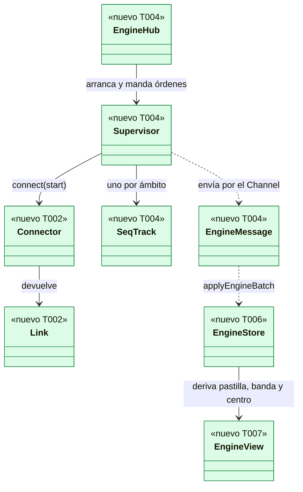
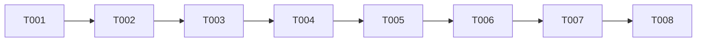

# DS-US-DSK-003 · La app dice si el motor funciona y qué hacer cuando no

## Contexto rápido

Al terminar, quien abre la app ve en la barra de título si el motor está en vivo, conectando, parado, incompatible o esperando Git, y en el centro qué hacer: arrancar el motor, actualizar una instalación o añadir su primer repo. Si la conexión cae, los datos se atenúan con la hora desde la que pueden estar viejos, y la app se pone al día sola al volver. Hoy la ventana B1 de TS-DSK-001 está vacía y el backend no habla con el daemon.

Esta historia pone la tubería que usarán todas las demás: el supervisor de la conexión en el backend (instantánea N, suscripción N+1, `resync`, reconexión, como ADR-CKP-003), un `Channel` de Tauri por el que fluyen los mensajes, y el almacén del frontend. Solo lee: no hay ninguna escritura.

| Término | Qué es aquí |
|---|---|
| Supervisor | Hilo del backend que conecta, toma instantáneas, sigue la secuencia de cada ámbito y reconecta. Es el único que habla con el daemon |
| `Channel` | `tauri::ipc::Channel` creado por el webview y pasado a `engine_watch`; lleva los `EngineMessage` del backend al webview, en orden |
| Costura | Los traits `Connector` y `Link`: el supervisor no sabe cómo se arranca el motor (TS-DSK-002) ni si habla con un daemon real o con el falso de los tests |
| Vista restringida | La ventana la abrió un agente (ADR-GRP-017 § 3): banda fija y sin datos de repos |

**Decisiones de esta Dev Spec**: todas son **Decisión del orquestador (2026-11-08), validada por Arquitecto**.

| # | Decisión | Por qué | Alternativa descartada |
|---|---|---|---|
| D1 | El protocolo del canal vive en el backend: secuencia por ámbito, hueco → instantánea nueva, `scope.resync`, `events.resync` y reconexión. El webview solo aplica mensajes ya ordenados | El backend es quien lee el socket; un webview que recargue no pierde la réplica del motor, solo su caché | Mandar los eventos crudos al webview: duplicaría `sequence.rs` en TypeScript y llevaría texto sin sanear al webview |
| D2 | Se usan `scope.snapshot` y `scope.subscribe` (global y de repo), **no** `engine.snapshot` ni `events.subscribe` | Es lo que usa la TUI desde el protocolo 6: un ámbito con su secuencia contigua. `events.resync` llega a la conexión sin suscribirse (`crates/core/src/channel/bus.rs`). La historia los nombraba como reutilizables; quedan sin uso salvo `engine.snapshot` en la vista restringida (D6) | — |
| D3 | El backend traduce los tipos del contrato a DTO propios (`wire.rs`) y sanea **todo** texto no confiable con `gitraptor_api::display::visible`, el saneador de la TUI movido a `crates/api` | SEC-12 y ADR-GRP-017 § 2 piden las mismas categorías que `present::ingest`; el backend no puede enlazar `apps/cli`. Mover la función (no copiarla) deja una sola fuente | Copiar el saneador en el backend: dos copias que divergen. Sanear en el webview: el texto crudo cruzaría el IPC |
| D4 | La app se presenta como `ClientKind::Cli` hasta que exista la clase `desktop` | Es la única clase a la que el daemon publica `hello.requester` (`crates/core/src/channel/conn.rs:573-577`), que da la señal de "abierta por un agente". No amplía nada: el daemon resuelve al solicitante por ascendencia en cada petición | `Other`: sin `requester`, la app no sabría que la abrió un agente |
| D5 | El motor se arranca (`start = true`) solo al abrir la app y con el botón "Arrancar motor". Una reconexión tras una caída solo conecta | Si el usuario paró el motor con `raptor daemon stop`, la app no debe relanzarlo a sus espaldas. El autoarranque de launchd, si está registrado, lo vuelve a levantar y la app se pone al día sola (escenario 2) | Arrancar en cada intento, como la TUI: pelearía con el usuario |
| D6 | Vista restringida si `hello.profile == mcp` **o** `hello.requester` es `resolved` con `actor` agente. El backend no se suscribe a ningún ámbito: lee una vez `engine.snapshot` para el estado del motor y manda `session.restricted = true` | ADR-GRP-017 § 3 pide perfil `mcp` para una app con un agente en la ascendencia; el daemon aún no lo aplica (G1). La app falla cerrada en lo que muestra | Mostrar la flota mientras el daemon no restrinja: la banda diría "ves lo mismo que él" y sería falso |
| D7 | Capacidades obligatorias: `scope.activity`, `observation.tiers` y `prediction.pairs`. Si al daemon le falta una, estado "Motor incompatible" (`missing-capabilities`). `discovery.events` es opcional: sin ella no se piden candidatos | ADR-GRP-014, Enmienda DEP-DSK-5, D5: "mismo protocolo y las capacidades que la app necesita". US-DSK-004 las usa | Degradar en silencio: la flota diría "no disponible" en columnas que el motor sí puede dar |
| D8 | "Arrancar motor" es `engine_retry { start: true }`, de esta historia; TS-DSK-002 no añade otro comando para lo mismo. "Reintentar ahora" es `engine_retry { start: false }` | Un solo camino para reconectar; TS-DSK-002 aporta el `Connector` que sabe arrancar | Un `engine_start` de TS-DSK-002 y un `engine_retry` de aquí: dos comandos que se pisan |
| D9 | Sin repos: la pantalla a1 de DSF-DSK-001 (tres pasos, privacidad, comprobaciones) con la guía de la TUI (`raptor repo add <ruta>`) y la lista de repos descubiertos. El botón "Añadir mi primer repo" y el comando copiable con ruta son de US-DSK-001 | US-DSK-001 es dueña de añadir repos (comando reservado, factor o comando copiable). Esta historia cumple "le propone añadir" con la misma guía que la TUI | Un botón desactivado "llega pronto": promete una acción que no hay |
| D10 | Con datos ya recibidos, una caída o un motor parado **atenúan** los datos y muestran la banda con la hora; sin datos, el centro muestra el panel del estado. Incompatible, rechazado y sin canal sustituyen siempre el centro | Escenario 2 ("pueden estar desactualizados y desde cuándo") y DSF-DSK-001 § 2.3. Los tres últimos no vuelven solos (US-CKP-003 D2) | Sustituir siempre por el panel, como la TUI con motor no disponible: el escenario 2 pide ver los datos viejos marcados |
| D11 | Reintentos sin fin con espera 250 ms → 5 s (la de la TUI) en todos los estados salvo `unsupported` | Un daemon que vuelve, una instalación actualizada o una carpeta corregida se detectan sin tocar nada. Un intento cada 5 s no pesa (NFR-13.8) | Parar tras N intentos: el escenario 2 pide ponerse al día sola |

---

## 📋 Índice

> **Para aprobar:** [Contexto rápido](#contexto-rápido) · [⚠️ Gaps](#gaps-y-violaciones-de-la-constitución) · [🔭 La forma](#la-forma) · [El trabajo de un vistazo](#el-trabajo-de-un-vistazo).
> **Para implementar:** [🚀 Plan](#plan-de-implementación), en orden. Las `_(ref)_` se abren desde la tarea que las cita.

| Sección | Propósito |
|---------|-----------|
| [Contexto rápido](#contexto-rápido) | Qué se construye, glosario y decisiones |
| [⚠️ Gaps y violaciones de la constitución](#gaps-y-violaciones-de-la-constitución) | Qué impide empezar |
| [🔭 La forma](#la-forma) | Piezas, relaciones y precedencia |
| [🚀 Plan de implementación](#plan-de-implementación) | T001…T008, en orden |
| ↳ [El trabajo de un vistazo](#el-trabajo-de-un-vistazo) | Tareas en tabla y su orden |
| [Estructura de ficheros](#estructura-de-ficheros) _(ref)_ | Árbol anotado |
| [Contratos compartidos](#contratos-compartidos) _(ref)_ | Tipos, mensajes, firmas y textos |
| [Contrato de API](#contrato-de-api) _(ref)_ | Comandos IPC y lo que se consume del canal |
| [Estrategia de pruebas y cobertura](#estrategia-de-pruebas-y-cobertura) _(ref)_ | Escenarios → tests |
| [Gate de seguridad](#gate-de-seguridad) | Checklist pre-merge |
| [Fuera de alcance](#fuera-de-alcance) | Lo que esta entrega no toca |
| [Notas del autor](#notas-del-autor) _(ref)_ | Huecos del motor y lo que no bloquea |

---

## ⚠️ Gaps y violaciones de la constitución

_No gaps. Ready to implement._

Todo lo que la app necesita ya lo publica el canal (verificado en el código el 2026-11-08): `HelloResult.protocol`, `binary_version`, `profile`, `requester` y `capabilities` (`crates/api/src/messages.rs:47-70`); `IncompatibleData.daemon_protocol` y `binary_version` (`:72-78`); `GlobalSnapshot.engine`, `daemon`, `autostart` y `repos` (`crates/api/src/scope.rs:59-68`); `scope.resync` con motivo y `events.resync` (`crates/api/src/methods/scope.rs`, `methods/events.rs`); `discovery.candidates` (`methods/discovery.rs`). La ruta del ejecutable que sirve el daemon la da `raptor daemon ensure --json` de TS-DSK-002. Lo que el motor aún no hace (perfil `mcp` para una app abierta por un agente) no bloquea esta historia: va en [Notas del autor](#notas-del-autor) (G1) con su dueño.

No hay `architecture-constitution.md` en la cascada: rigen `AGENTS.md` y los ADRs citados.

**Depende de**: TS-DSK-001 (andamiaje, patrón de comandos) y TS-DSK-002 (el `Connector` que arranca el motor con el `raptor` del bundle y verifica al daemon, B-3). Los tests de esta historia no necesitan TS-DSK-002: usan `SocketConnector` y el daemon falso.

---

## 🔭 La forma



El webview llama `engine_watch` con un `Channel`; `EngineHub` (estado de Tauri) arranca el `Supervisor` la primera vez y, en las siguientes (recarga del webview), cambia el `Channel` y fuerza instantáneas nuevas. El `Supervisor` usa un `Connector` (TS-DSK-002 en la app; `SocketConnector` en los tests) y lee el `Link`. `EngineView` es una función pura: el único sitio que decide qué se pinta.

**Qué ocupa el centro**, evaluado en orden (`engineView().center`):

| # | Condición | Centro |
|---|---|---|
| 1 | `conn.kind` ∈ {`incompatible`, `rejected`, `unsupported`} | Panel del estado (error) |
| 2 | Sin instantánea global recibida y `conn.kind` = `stopped` | Panel "Motor parado" con [Arrancar motor] |
| 3 | Sin instantánea global y cualquier otro estado | Esqueleto de carga (nunca "vacío") |
| 4 | `session.restricted` | Panel "Vista restringida" |
| 5 | `global.engine.state` = `waiting-for-git` | Panel a0 "Esperando Git" |
| 6 | `global.engine.state` = `no-repos` | Pantalla a1 con candidatos |
| 7 | Cualquier otro caso | Contenido (la flota de US-DSK-004; hasta entonces, `shell.center.empty`) |

En las filas 5 a 7, si `conn.kind` ≠ `live`, el centro lleva `data-stale="true"` (atenuado con `text.muted`) y la banda explica desde cuándo.

---

## 🚀 Plan de implementación

> Orden topológico (`Depende:`). Las rutas son relativas a la raíz del repo.

### El trabajo de un vistazo

| # | Tarea | Depende | Aterriza en |
|---|---|---|---|
| T001 | Mover el saneador visible a `gitraptor-api` | — | `crates/api`, `apps/cli/src/present` |
| T002 | Crear la costura del canal y el daemon falso | T001 | `src-tauri/src/engine`, `src-tauri/tests/support` |
| T003 | Escribir en rojo los tests del supervisor | T002 | `src-tauri/tests/engine_supervisor.rs` |
| T004 | Implementar el supervisor, la secuencia y los mensajes | T003 | `src-tauri/src/engine` |
| T005 | Añadir `engine_watch` y `engine_retry` | T004 | `src-tauri`, `src/client` |
| T006 | Crear el flujo, el almacén y la caché del frontend | T005 | `src/client`, `src/state` |
| T007 | Pintar la pastilla, la banda y los estados del centro | T006 | `src/engine`, `src/shell`, `src/ui`, `src/i18n` |
| T008 | Verificar de punta a punta en macOS | T007 | — |

### En qué orden



### T001 — Mover el saneador visible a `gitraptor-api`

**Objetivo.** Una sola función de saneado para la TUI y la app (SEC-12), sin cambiar lo que pinta la TUI.

**Ubicación.**
- `crates/api/src/display.rs` (**CREATE**)
- `crates/api/src/lib.rs` (**MODIFY**)
- `apps/cli/src/present/sanitize.rs` (**MODIFY**)

**Reglas**
- `display.rs` recibe, sin cambios de lógica, `sanitize(raw, max_chars)` (renombrada `visible`), `must_escape`, `push_escape`, `is_combining`, `MAX_COMBINING` y `ELLIPSIS` de `apps/cli/src/present/sanitize.rs`, y las constantes `NAME_MAX_CHARS = 100` y `TEXT_MAX_CHARS = 1024`. Públicas: `visible`, `must_escape`, `NAME_MAX_CHARS`, `TEXT_MAX_CHARS`. Fuera de la feature `client`: no depende de nada nuevo.
- `lib.rs`: `pub mod display;`.
- `sanitize.rs`: `SafeText::text`/`name` llaman `gitraptor_api::display::visible`; `must_escape` pasa a ser `pub(crate) use gitraptor_api::display::must_escape;`. Los tests del archivo no cambian y pasan.
- Los vectores de prueba de `sanitize.rs` (OSC 52, bidi, anchura cero, Tags, "zalgo", corte con `…`) se copian a `display::tests`.

- **Depende:** —
- **Refs:** D3; SEC-12; ADR-GRP-017 § 2
- **Aceptación:** `cargo test -p gitraptor-api display` y `cargo test -p gitraptor-cli present` en verde; los snapshots de la TUI no cambian (`cargo insta test -p gitraptor-cli` sin pendientes).

### T002 — Crear la costura del canal y el daemon falso

**Objetivo.** El supervisor habla con un `Link` que obtiene de un `Connector`; los tests, con un daemon falso por socket Unix real.

**Ubicación.**
- `apps/desktop/src-tauri/src/engine/mod.rs` (**CREATE**)
- `apps/desktop/src-tauri/src/engine/link.rs` (**CREATE**)
- `apps/desktop/src-tauri/src/lib.rs` (**MODIFY**: `pub mod engine;`)
- `apps/desktop/src-tauri/tests/support/mod.rs` (**CREATE**)
- `apps/desktop/src-tauri/tests/support/fake_daemon.rs` (**CREATE**)
- `apps/desktop/src-tauri/Cargo.toml` (**MODIFY**: dev-dependency `tempfile.workspace = true`)

**Reglas**
- `link.rs` define `Link`, `Connector`, `ConnectFailure`, `LinkError` y `Incompatibility` (§ Firmas del stack), y dos implementaciones:
  - `ClientLink(gitraptor_api::client::Client)`: `call` = `Client::call::<Value, Value>`; `next` = `Client::next_incoming` decodificado a `ServerMessage` con `serde_json::from_slice`; un error de I/O es `LinkError::Lost`, un error RPC es `LinkError::Refused { code }`.
  - `SocketConnector { runtime: PathBuf }`: `Client::connect(&runtime, ClientKind::Cli, PROTOCOL_VERSION)`. Con `start = true` se comporta igual (no sabe arrancar). Traduce `ClientError`: `NotRunning` → `NotRunning`; `Incompatible(d)` → `Incompatible { which: DaemonOlder, daemon_version: Some(d.binary_version), daemon_path: None }`; `ClientTooOld(d)` → `AppOlder`; `ChannelRejected` y `NotAuthentic` → `Rejected`; `TransportUnsupported` → `Unsupported`; `Launch(_)` y `StartTimeout` → `LaunchFailed`; el resto → `Lost`.
- **Contrato con TS-DSK-002**: su lanzador implementa `Connector` (`BundleConnector`): con `start = true` ejecuta `raptor daemon ensure --json`, y en los dos casos conecta con `Client::connect_runtime` y la verificación B-3, rellenando `daemon_path` (ruta cruda que da `ensure`) en `Incompatibility`. Si TS-DSK-002 se mezcla antes sin esta forma, esta tarea envuelve su lanzador en un `BundleConnector` que la cumpla.
- `fake_daemon.rs`: `FakeDaemon::start() -> FakeDaemon` crea una carpeta temporal `0700`, escucha `raptor.sock` y atiende una conexión cada vez en un hilo. Responde por línea JSON-RPC con los tipos de `gitraptor_api` (`Response`, `Notification`). Guion configurable: el `HelloResult` (protocolo, perfil, `requester`, capacidades) o un `INCOMPATIBLE_PROTOCOL` con `IncompatibleData`; respuestas de `connection.accept`, `scope.snapshot` (global y por repo), `scope.subscribe` (subscripción creciente), `engine.snapshot`, `discovery.candidates` y `sessions.list`; `push(notification)`; `drop_connection()`; `stop()` (borra el socket) y `restart()`. Registra cada `(método, params)` recibido para que el test lo consulte (`calls()`).

- **Depende:** T001
- **Refs:** D4, D8; ADR-GRP-014, Enmienda DEP-DSK-5, D1 y D5
- **Aceptación:** `cargo test -p gitraptor-desktop --test engine_supervisor connects_to_the_fake_daemon` en verde (un `SocketConnector` hacia el falso llega al `hello` y a `connection.accept`); V1 (`tests/boundaries.rs`) sigue en verde.

### T003 — Escribir en rojo los tests del supervisor

**Objetivo.** Un test por escenario de la historia y por regla del protocolo, contra el daemon falso, antes del supervisor. Compilan contra stubs de `engine::supervisor` que devuelven `todo` solo dentro de `run` (ninguna ruta de producción con `todo!()` fuera de ella).

**Ubicación.**
- `apps/desktop/src-tauri/tests/engine_supervisor.rs` (**CREATE**)
- `apps/desktop/src-tauri/src/engine/supervisor.rs` (**CREATE**, stub)

**Reglas**
- Cada test arranca `Supervisor::spawn(connector, sink)` con un `sink` que recoge los `EngineMessage` (un `Channel::new` de Tauri en Rust o, para no depender de Tauri en el test, la variante `Sink::Collect(mpsc::Sender)` de § Firmas del stack) y espera mensajes con un plazo de 5 s, sin `sleep` fijos.
- Los nombres y lo que comprueba cada uno están en [§ 9.4](#94-comportamientos-críticos-verificados).

- **Depende:** T002
- **Refs:** escenarios de US-DSK-003; ADR-CKP-003 § 4
- **Aceptación:** `cargo test -p gitraptor-desktop --test engine_supervisor` compila y los tests de escenario fallan (rojo) por el stub; se commitea así antes de T004.

### T004 — Implementar el supervisor, la secuencia y los mensajes

**Objetivo.** El bucle de conexión de ADR-CKP-003 § 4 en el backend, con los mensajes tipados hacia el webview.

**Ubicación.**
- `apps/desktop/src-tauri/src/engine/supervisor.rs` (**MODIFY**)
- `apps/desktop/src-tauri/src/engine/seq.rs` (**CREATE**)
- `apps/desktop/src-tauri/src/engine/wire.rs` (**CREATE**)
- `apps/desktop/src-tauri/src/engine/ingest.rs` (**CREATE**)
- `apps/desktop/src-tauri/src/engine/mod.rs` (**MODIFY**)

**Pasos**
1. `seq.rs`: `SeqTrack` y `Verdict` con la semántica de `apps/cli/src/client/sequence.rs` (copiada, con sus dos tests).
2. `wire.rs`: los tipos de § Mensajes del `Channel`, `serde(rename_all = "camelCase")`, enums con `tag`. `stop_command(path: &str) -> Option<String>`: `'<path>' 'daemon' 'stop'` con cada argumento entre comillas simples POSIX y `'` escrita `'\''`; `None` si algún carácter cumple `display::must_escape` (M-1 de ADR-GRP-017 § 5).
3. `ingest.rs` (parte global): `global(&GlobalSnapshot) -> GlobalDto`, `repo_summary`, `candidate`, `engine`; cada `Untrusted` y cada `String` del sistema de archivos pasa por `visible(_, TEXT_MAX_CHARS)` y cada nombre por `visible(_, NAME_MAX_CHARS)`. `name` del repo = último componente de `path` sin el `.git` final (o el padre si el último es `.git`).
4. `supervisor.rs`, bucle (`run`):
   - Conecta con `start` = `true` en el primer intento tras `spawn` y tras `EngineRetry { start: true }`; si no, `false` (D5). Antes de cada intento manda `conn` `connecting` (intento 0) o `reconnecting { attempt, retryInMs }`; con `start` manda `starting`.
   - Tras conectar: `missing = link.hello().capabilities` frente a `REQUIRED_CAPABILITIES` (D7); si falta alguna, `incompatible { which: missing-capabilities }` y cierra el enlace. Si no, manda `session` (versión, protocolo, `restricted`, `activity`, `discovery`).
   - Restringida (D6): una llamada `engine.snapshot`, manda `engineOnly { engine }` y `conn live`, y solo lee el enlace hasta que caiga (sin suscribirse).
   - Normal: `sync(Global)` = `scope.snapshot` → `global` → `scope.subscribe { from_seq: N + 1, run_id }`. Con `discovery.events`, `discovery.candidates` → `discovered`. Luego los ámbitos de repo abiertos (`HubCmd::Open`, lo usa US-DSK-004). Después `conn live`, con `staleSinceMs` a `null`.
   - Lectura en rebanadas de 20 ms, atendiendo órdenes entre lecturas. `scope.event`: `SeqTrack::accept` del ámbito; `Apply` → `ingest::global_event` (`engine.state`, `repo.observation`, `repo.tier`, `repo.attention`, `repo.discovered`) y el mensaje que toque (otros tipos se aplican a la secuencia y se ignoran); `Duplicate` → nada; `Gap` → `conn syncing` y `sync` del ámbito. `scope.resync` → mismo `sync` y `conn` con `resync: <motivo>` hasta volver a `live`. `events.resync` (`slow-consumer`) → `resync` en el siguiente `conn` y fin de sesión como `Lagged` (la racha de espera sigue, como `End::Lagged` de la TUI).
   - Al caer el enlace: `staleSinceMs` = hora de pared del último `live`, `reconnecting` y espera `backoff(attempt)` = 250 ms × 2^(n−1), con tope 5 s (D11). Un `NotRunning` o `LaunchFailed` manda `stopped { reason }`; `Incompatible`, `incompatible {…}` con `stopCommand = daemon_path.and_then(stop_command)`; `Rejected`, `rejected`; `Unsupported`, `unsupported` y el hilo espera solo a `Shutdown`.
   - Nunca llama `daemon.replace`, `daemon.stop` ni ningún método reservado o de escritura.
5. `engine/mod.rs`: `EngineHub { tx: Mutex<Option<Sender<HubCmd>>>, connector: Mutex<Option<Box<dyn Connector>>> }`. `watch(sink)`: la primera vez lanza el hilo `gitraptor-engine`; las siguientes mandan `HubCmd::Watch(sink)`, y el supervisor reenvía `conn` y `session` actuales y rehace la instantánea de cada ámbito abierto para el oyente nuevo. `retry(start)` → `HubCmd::Retry { start }`. `shutdown()` en `RunEvent::Exit`.

> **Nota técnica.** El reloj de pared (`SystemTime::now`) solo se usa para `staleSinceMs`; las marcas de rendimiento usan `gitraptor_api::clock::monotonic_ns`. V7 sigue en verde: nada lee el entorno.

- **Depende:** T003
- **Refs:** D1, D2, D5–D7, D10, D11; ADR-CKP-003 § 4; ADR-GRP-014, Enmienda DEP-DSK-5, D5
- **Aceptación:** `cargo test -p gitraptor-desktop --test engine_supervisor` y `cargo test -p gitraptor-desktop --lib engine` en verde; `cargo clippy -p gitraptor-desktop --all-targets -- -D warnings` limpio.

### T005 — Añadir `engine_watch` y `engine_retry`

**Objetivo.** Los dos comandos de la lista cerrada, con el patrón de TS-DSK-001 T002.

**Ubicación.**
- `apps/desktop/src-tauri/commands.json` (**MODIFY**)
- `apps/desktop/src-tauri/src/commands/mod.rs` (**MODIFY**)
- `apps/desktop/src-tauri/src/commands/engine_watch.rs` (**CREATE**)
- `apps/desktop/src-tauri/src/commands/engine_retry.rs` (**CREATE**)
- `apps/desktop/src-tauri/capabilities/main.json` (**MODIFY**)
- `apps/desktop/src-tauri/src/lib.rs` (**MODIFY**)
- `apps/desktop/src-tauri/tests/commands.rs` (**MODIFY**)
- `apps/desktop/src/client/commands.ts` (**MODIFY**)
- `apps/desktop/src/client/commands.test.ts` (**MODIFY**)

**Reglas**
- `commands.json` = `["app_info", "engine_watch", "engine_retry"]`; la capability suma `allow-engine-watch` y `allow-engine-retry`.
- Firmas en [§ Contrato de API](#contrato-de-api). `engine_watch` recibe además `webview: tauri::Webview` y `hub: tauri::State<'_, EngineHub>`, y obtiene el `Channel` con `params.channel.channel_on(webview)`.
- `lib.rs`: `.manage(EngineHub::new(Box::new(launcher::BundleConnector::new())))` (el `Connector` de TS-DSK-002) y `.run` con el manejador de `RunEvent::Exit` que llama `hub.shutdown()`.
- `commands.ts`: `COMMANDS` con los dos nombres nuevos y sus tipos (§ Contrato de API); `EngineMessage` importado de `./engine-types`.

- **Depende:** T004
- **Refs:** TS-DSK-001 T002 ("Añadir un comando"); D8; ADR-GRP-017 § 1 y § 2
- **Aceptación:** `tests/commands.rs`: `{"params":{"channel":"__CHANNEL__:1"}}` → `Ok` para `engine_watch`; `{"params":{"start":true}}` → `Ok` para `engine_retry`; campo desconocido dentro y fuera de `params` → `invalid-params` en los dos; `start` ausente → `invalid-params`. V2 (`tests/tauri_surface.rs`) en verde con la capability nueva. `commands.test.ts` en verde.

### T006 — Crear el flujo, el almacén y la caché del frontend

**Objetivo.** Los mensajes del `Channel` llegan al almacén y a la caché de TanStack Query con como mucho un commit de React por frame (NFR-13.1).

**Ubicación.**
- `apps/desktop/src/client/engine-types.ts` (**CREATE**)
- `apps/desktop/src/client/engine-stream.ts` (**CREATE**)
- `apps/desktop/src/client/engine-stream.test.ts` (**CREATE**)
- `apps/desktop/src/client/queries.ts` (**MODIFY**)
- `apps/desktop/src/state/engine-store.ts` (**CREATE**)
- `apps/desktop/src/state/engine-cache.ts` (**CREATE**)
- `apps/desktop/src/state/engine-cache.test.ts` (**CREATE**)
- `apps/desktop/src-tauri/tests/engine_wire.rs` (**CREATE**)
- `apps/desktop/tests/fixtures/engine-messages.json` (**CREATE**, generado)

**Reglas**
- `engine-types.ts`: espejo a mano de `wire.rs` (§ Mensajes del `Channel`).
- `engine-stream.ts`: `watchEngine(onBatch: (batch: EngineMessage[]) => void): Promise<void>` crea un `Channel<EngineMessage>`, acumula en un arreglo y programa un único `requestAnimationFrame` que entrega el lote entero; llama `call("engine_watch", { channel })`. Solo se llama una vez por carga del webview (desde `App`).
- `engine-store.ts` (Zustand, **sin** `persist`): `conn`, `staleSinceMs`, `resync`, `session` (§ Tipos y datos compartidos); acción `apply(batch)`.
- `engine-cache.ts`: `applyEngineBatch(client: QueryClient, batch)`: `global` → `setQueryData(engineKeys.global, dto)`; los parches globales actualizan esa entrada con una copia (nunca mutación); `discovered` → `engineKeys.discovered`; `engineOnly` → `engineKeys.global` con `repos: []` y `restricted`. Un `session` nuevo (otra conexión) no borra la caché; la instantánea siguiente la reemplaza.
- `queries.ts`: `engineKeys = { global: ["engine", "global"], discovered: ["engine", "discovered"], repo: (id) => ["engine", "repo", id] }` (`repo` lo usa US-DSK-004). Ninguna `queryFn` de red: las entradas solo se escriben con `setQueryData` (ADR-GRP-004, Enmienda D7).
- `engine_wire.rs`: construye un ejemplo de cada variante de `EngineMessage` y lo compara con `apps/desktop/tests/fixtures/engine-messages.json`; con la variable `GITRAPTOR_UPDATE_FIXTURES=1` lo reescribe (solo en el test, fuera de `src/`). `engine-cache.test.ts` carga el mismo fixture: un cambio de forma en Rust rompe los dos lados.

- **Depende:** T005
- **Refs:** D1; ADR-GRP-004, Enmienda D7; NFR-13.1
- **Aceptación:** `engine-stream.test.ts`: 1.000 mensajes con `requestAnimationFrame` simulado se entregan en un solo lote, en orden; `engine-cache.test.ts`: cada variante del fixture deja la caché y el almacén esperados, y un parche no muta el objeto anterior; `cargo test -p gitraptor-desktop --test engine_wire` en verde.

### T007 — Pintar la pastilla, la banda y los estados del centro

**Objetivo.** DSF-DSK-001 § 2.3 y las pantallas a0 y a1 sobre la ventana B1, en en/es, accesibles.

**Ubicación.**
- `apps/desktop/src/engine/engine-view.ts` (**CREATE**)
- `apps/desktop/src/engine/engine-view.test.ts` (**CREATE**)
- `apps/desktop/src/engine/useEngine.ts` (**CREATE**)
- `apps/desktop/src/engine/EngineBand.tsx` (**CREATE**)
- `apps/desktop/src/engine/EngineCenter.tsx` (**CREATE**)
- `apps/desktop/src/engine/EngineStates.test.tsx` (**CREATE**)
- `apps/desktop/src/ui/StatusPill.tsx` (**CREATE**)
- `apps/desktop/src/ui/StatePanel.tsx` (**CREATE**)
- `apps/desktop/src/ui/CopyCommand.tsx` (**CREATE**)
- `apps/desktop/src/shell/TitleBar.tsx` (**MODIFY**)
- `apps/desktop/src/shell/AppShell.tsx` (**MODIFY**)
- `apps/desktop/src/app/App.tsx` (**MODIFY**)
- `apps/desktop/src/i18n/locales/en.json` (**MODIFY**)
- `apps/desktop/src/i18n/locales/es.json` (**MODIFY**)

**Reglas**
- `engine-view.ts`: `engineView(input) -> { pill, band, center }`, pura, con la tabla de [§ La forma](#la-forma) para `center` y estas para la pastilla y la banda:

  | Condición (en orden) | Pastilla (símbolo + clave) | Banda |
  |---|---|---|
  | `conn` `connecting` / `syncing` sin datos | `◌` `engine.pill.connecting` | — |
  | `conn` `starting` | `◌` `engine.pill.starting` | — |
  | `conn` `reconnecting` | `✖` `engine.pill.disconnected` (`seconds` = `ceil(retryInMs/1000)`) | `engine.band.disconnected` (`time` = `staleSinceMs` en hora local) + [`engine.action.retryNow`] |
  | `conn` `stopped` | `✖` `engine.pill.stopped` | `engine.band.stopped` (+ `engine.band.launchFailed` si `launch-failed`) + [`engine.action.start`] |
  | `conn` `incompatible` | `✖` `engine.pill.incompatible` | — (va en el panel) |
  | `conn` `rejected` / `unsupported` | `✖` `engine.pill.rejected` / `engine.pill.unsupported` | — |
  | `session.restricted` | `◇` `engine.pill.restricted` | `engine.band.restricted` |
  | `engine` `waiting-for-git` | `⚠` `engine.pill.waitingForGit` (`min` = `2.38`) | — |
  | `conn` `syncing` con datos, o `resync` presente | `◐` `engine.pill.catchingUp` | `engine.band.catchingUp` (+ `engine.resync.<motivo>`) |
  | Repo abierto con `tier` `waking` | `◐` `engine.pill.catchingUp` | `engine.band.catchingUp` |
  | Repo abierto con `tier` `dormant` | `◐` `engine.pill.idle` | — |
  | Resto | `●` `engine.pill.live` | — |

- `StatusPill` (en `src/ui`, sin `client`): `role="status"`, `aria-live="polite"`, símbolo con `aria-hidden` y texto siempre visible; tono por `data-tone` (`success`, `warning`, `danger`, `muted`) con tokens `glass.*`. Va en `TitleBar` entre el botón del panel izquierdo y el de tema.
- `EngineBand`: franja sobre el centro con el texto y su botón; los botones llaman `call("engine_retry", { start })` y quedan `aria-disabled` hasta el siguiente `conn` (respuesta visible ≤ 100 ms, NFR-13.7).
- `EngineCenter`: los paneles con `StatePanel` (título, mensaje, acción), textos de § Textos del catálogo. Incompatible: `daemon-older` y `missing-capabilities` con versión y ruta si llegan, y `CopyCommand` con `stopCommand` cuando existe (copia con `navigator.clipboard.writeText`, sin plugin); sin `stopCommand`, `engine.incompatible.noCommand`. `app-older`: `engine.incompatible.appOlder`. a1: titular, tres pasos, línea de privacidad, comprobaciones "Motor en marcha" y "Git {version} encontrado" (de `engine.gitVersion`), la guía `empty.noRepos.howTo` con el comando como `<code>`, y la lista de candidatos (`name` y `path` saneados) bajo `empty.noRepos.discovered.title` si hay alguno.
- Atenuado: el contenedor del centro lleva `data-stale` y la clase `text-muted`; el lector de pantalla oye la banda (que tiene `role="status"`).
- `App.tsx`: llama `watchEngine` al montar y pasa cada lote a `useEngineStore.getState().apply` y `applyEngineBatch`. Tras el primer frame en que `engineView` da un estado final (`live` con instantánea global pintada, o `stopped`, `incompatible`, `rejected`, `unsupported`, `waiting-for-git`, `no-repos`), `performance.mark("gr:first-meaningful-paint")` una sola vez (NFR-13.6). US-DSK-004 amplía la condición de `live` a "flota pintada" cuando hay repo abierto.
- Textos de la UI: nunca un texto del motor tal cual; solo DTO ya saneados, como texto de React.

- **Depende:** T006
- **Refs:** DSF-DSK-001 § 2.3, a1, § 7; US-CKP-003 D2; NFR-09 (no solo color), NFR-13.6, NFR-13.7; D9, D10
- **Aceptación:** `engine-view.test.ts` cubre cada fila de las dos tablas; `EngineStates.test.tsx` en verde (§ 9.4), `axe-core` sin violaciones en cada estado; `catalog.test.ts` (TS-DSK-001) en verde con las claves nuevas.

### T008 — Verificar de punta a punta en macOS

**Objetivo.** Comprobar con el motor real lo que el daemon falso no ve.

**Ubicación.** Ninguna: solo corre verificaciones.

**Pasos**
1. Con la app de `tauri dev` y el `raptor` del bundle de TS-DSK-002: con el motor parado, la app lo arranca y llega a "En vivo" (≤ 3 s).
2. `raptor daemon stop` con la app abierta: banda "Se perdió la conexión…" con la hora y luego "Motor parado"; [Arrancar motor] lo vuelve a poner en vivo sin recargar.
3. Con un perfil de prueba sin repos (`GITRAPTOR_PROFILE_DIR`, solo debug): pantalla a1; tras `raptor repo add <ruta>` en una terminal, la app sale de a1 sola.
4. Lanzar el binario de la app desde una sesión de Claude Code (agente en la ascendencia): banda "Abierta por un agente" y ningún repo a la vista.

- **Depende:** T007
- **Refs:** escenarios de US-DSK-003; DSF-DSK-001 § 2.3
- **Aceptación:** los cuatro pasos, con su resultado en la descripción del PR.

---

## Estructura de ficheros

```text
crates/api/src/display.rs                 # saneador visible compartido (T001)
apps/desktop/src-tauri/
├── commands.json                         # + engine_watch, engine_retry (T005)
├── src/engine/{mod,link,supervisor,seq,wire,ingest}.rs   # (T002, T004)
├── src/commands/{engine_watch,engine_retry}.rs           # (T005)
└── tests/{engine_supervisor,engine_wire}.rs, tests/support/fake_daemon.rs
apps/desktop/src/
├── client/{engine-types,engine-stream}.ts               # (T006)
├── state/{engine-store,engine-cache}.ts                  # (T006)
├── engine/{engine-view.ts,useEngine.ts,EngineBand.tsx,EngineCenter.tsx}   # (T007)
└── ui/{StatusPill,StatePanel,CopyCommand}.tsx            # puros (T007)
apps/desktop/tests/fixtures/engine-messages.json          # contrato Rust ↔ TS (T006)
```

---

## Contratos compartidos

### Tipos y datos compartidos

| Tipo | Dónde | Forma |
|---|---|---|
| `EngineHub` | `src-tauri/src/engine/mod.rs` | Estado de Tauri: emisor de `HubCmd` y el `Connector` hasta el primer `watch` |
| `HubCmd` | `engine/supervisor.rs` | `Watch(Sink)`, `Retry { start: bool }`, `Open { repo_id }` (US-DSK-004), `Shutdown` |
| `Supervisor` | `engine/supervisor.rs` | `spawn(connector, sink) -> SupervisorHandle`; el bucle de T004 |
| `SeqTrack` | `engine/seq.rs` | `Waiting` \| `At { run_id, seq }`, como `apps/cli/src/client/sequence.rs` |
| `ConnectFailure` | `engine/link.rs` | `NotRunning`, `LaunchFailed`, `Incompatible(Incompatibility)`, `Rejected`, `Unsupported`, `Lost` |
| `Incompatibility` | `engine/link.rs` | `{ which: DaemonOlder \| AppOlder \| MissingCapabilities, daemon_version: Option<String>, daemon_path: Option<String>, missing: Vec<String> }` (crudo; `wire` lo sanea) |
| `REQUIRED_CAPABILITIES` | `engine/supervisor.rs` | `["scope.activity", "observation.tiers", "prediction.pairs"]` (D7), escritas con las constantes `CAP_*` de `gitraptor_api::methods` |
| `EngineStore` (`useEngineStore`, estado `EngineState`) | `src/state/engine-store.ts` | `{ conn: ConnState; staleSinceMs: number \| null; resync: ResyncReason \| null; session: SessionInfo \| null }` |
| `EngineView` | `src/engine/engine-view.ts` | `{ pill: { symbol, tone, key, values }, band: { key, values, action?: "retryNow" \| "start" } \| null, center: CenterKind }` |

### Mensajes del `Channel`

`EngineMessage` (`wire.rs` ↔ `engine-types.ts`), JSON con `type`:

| `type` | Campos | Cuándo |
|---|---|---|
| `conn` | `state: ConnState`, `staleSinceMs: number \| null`, `resync: ResyncReason \| null` | Cada cambio de estado de la conexión |
| `session` | `daemonVersion: string`, `protocol: number`, `restricted: boolean`, `activity: boolean`, `discovery: boolean` | Tras cada `hello` correcto |
| `global` | `GlobalDto` | Cada instantánea global (reemplaza) |
| `engineState` | `engine: EngineDto` | Evento `engine.state` |
| `repoObserved` | `repo: RepoSummaryDto` | `repo.observation` con `observed: true` (upsert) |
| `repoRetired` | `repoId` | `repo.observation` con `observed: false` |
| `repoTier` | `repoId`, `tier` | `repo.tier` |
| `repoAttention` | `repoId`, `attention: AttentionDto` | `repo.attention` |
| `discovered` | `candidates: CandidateDto[]`, `replace: boolean` | `discovery.candidates` (`replace: true`) y `repo.discovered` (añade) |
| `engineOnly` | `engine: EngineDto` | Vista restringida (D6) |

- `ConnState` = `{kind:"connecting"}` \| `{kind:"starting"}` \| `{kind:"syncing"}` \| `{kind:"live"}` \| `{kind:"reconnecting", attempt, retryInMs}` \| `{kind:"stopped", reason:"not-running"\|"launch-failed"}` \| `{kind:"incompatible", which:"daemon-older"\|"app-older"\|"missing-capabilities", daemonVersion: string\|null, daemonPath: string\|null, stopCommand: string\|null}` \| `{kind:"rejected"}` \| `{kind:"unsupported"}`.
- `ResyncReason` = `"slow-consumer" | "replay-unavailable" | "daemon-restarted" | "scope-closed" | null` (el de la TUI; `null` si el hueco lo vio el backend).
- `GlobalDto` = `{ engine: EngineDto, daemon: { version, protocol }, autostart: "registered"|"not-registered"|"unknown", repos: RepoSummaryDto[] }`.
- `EngineDto` = `{ state: "waiting-for-git"|"no-repos"|"observing", gitVersion: string|null }`.
- `RepoSummaryDto` = `{ repoId, name, path, state: "observed"|"unavailable", tier: "active"|"waking"|"dormant"|null, attention: AttentionDto }`; `AttentionDto` = `{ conflicts: CountDto, denials: CountDto }`, `CountDto` = `{state:"counted", count}` \| `{state:"unavailable"}` (nunca un cero no contado, BR-CKP-CALC-001).
- `CandidateDto` = `{ name, path }`.
- Todo `string` que viene del sistema de archivos o de un agente (`name`, `path`, `daemonPath`, `gitVersion`, `daemon.version`) ya está saneado por `visible`.

### Ciclos de vida (DI)

| Pieza | Ciclo |
|---|---|
| `EngineHub` | Uno por proceso, registrado con `Builder::manage`; el hilo del supervisor nace en el primer `engine_watch` y muere en `RunEvent::Exit` |
| `Channel` | Uno por carga del webview; un `engine_watch` posterior lo reemplaza |
| Almacén del motor | Singleton de módulo, sin persistencia (no autoriza nada, ADR-GRP-017 § 1) |
| Entradas de la caché | Escritas solo por `applyEngineBatch` |

### Firmas del stack

```rust
// apps/desktop/src-tauri/src/engine/link.rs
pub trait Link: Send {
    fn hello(&self) -> &gitraptor_api::messages::HelloResult;
    fn call(&mut self, method: &str, params: serde_json::Value) -> Result<serde_json::Value, LinkError>;
    /// The next notification with the `monotonic_ns` reading taken when its frame was read.
    fn next(&mut self, timeout: std::time::Duration) -> Result<Option<(u64, gitraptor_api::rpc::Notification)>, LinkError>;
}
pub trait Connector: Send + 'static {
    /// Connects; with `start`, starts the engine first when none runs (TS-DSK-002).
    fn connect(&mut self, start: bool) -> Result<Box<dyn Link>, ConnectFailure>;
}
pub enum LinkError { Refused { code: i64 }, Lost }
// apps/desktop/src-tauri/src/engine/supervisor.rs
pub enum Sink { Channel(tauri::ipc::Channel<EngineMessage>), Collect(std::sync::mpsc::Sender<EngineMessage>) }
pub fn spawn(connector: Box<dyn Connector>, sink: Sink) -> SupervisorHandle;
pub fn backoff(attempt: u32) -> std::time::Duration;
// apps/desktop/src-tauri/src/engine/wire.rs
pub fn stop_command(path: &str) -> Option<String>;
// crates/api/src/display.rs
pub fn visible(raw: &str, max_chars: usize) -> String;
pub fn must_escape(c: char) -> bool;
```

```ts
// apps/desktop/src/client/engine-stream.ts
export function watchEngine(onBatch: (batch: EngineMessage[]) => void): Promise<void>;
// apps/desktop/src/state/engine-cache.ts
export function applyEngineBatch(client: QueryClient, batch: readonly EngineMessage[]): void;
// apps/desktop/src/engine/engine-view.ts
export function engineView(input: { engine: EngineState; global: GlobalDto | undefined; openRepoTier: Tier | null }): EngineView;
```

### Textos del catálogo

Claves nuevas (`en` / `es`). Los comandos van como `<code>` en la UI.

| Clave | en | es |
|---|---|---|
| `engine.pill.live` | Live | En vivo |
| `engine.pill.connecting` | Connecting to the engine… | Conectando con el motor… |
| `engine.pill.starting` | Starting the engine… | Arrancando el motor… |
| `engine.pill.catchingUp` | Catching up… | Poniéndose al día… |
| `engine.pill.idle` | Idle | En reposo |
| `engine.pill.disconnected` | No connection · retrying in {{seconds}} s | Sin conexión · reintentando en {{seconds}} s |
| `engine.pill.stopped` | Engine stopped | Motor parado |
| `engine.pill.incompatible` | Engine version not compatible | Versión del motor no compatible |
| `engine.pill.rejected` | Engine channel refused | El motor rechazó el canal |
| `engine.pill.unsupported` | No engine channel | Sin canal con el motor |
| `engine.pill.waitingForGit` | Git {{min}} or later missing | Falta Git {{min}} o superior |
| `engine.pill.restricted` | Opened by an agent: restricted view | Abierta por un agente: vista restringida |
| `engine.band.catchingUp` | Checking recent changes; the view may take a few seconds. | Revisando cambios recientes; la vista puede tardar unos segundos. |
| `engine.band.disconnected` | Lost the connection to the engine. What you see may be out of date since {{time}}. | Se perdió la conexión con el motor. Lo que ves puede estar desactualizado desde las {{time}}. |
| `engine.band.stopped` | The GitRaptor engine is not running: no history is being recorded for your repos. | El motor de GitRaptor no está en marcha: no se está guardando historial de tus repos. |
| `engine.band.launchFailed` | It could not be started. | No se pudo arrancar. |
| `engine.band.restricted` | An agent opened this window. You see what it sees and can't make changes from here. | Esta ventana la abrió un agente. Ves lo mismo que él y no puedes hacer cambios desde aquí. |
| `engine.resync.slowConsumer` | The app fell behind the engine. | La app se quedó atrás del motor. |
| `engine.resync.replayUnavailable` | Too many changes to replay. | Demasiados cambios para repetirlos. |
| `engine.resync.daemonRestarted` | The engine restarted. | El motor se reinició. |
| `engine.resync.scopeClosed` | The repo stopped being observed. | El repo dejó de observarse. |
| `engine.action.retryNow` | Retry now | Reintentar ahora |
| `engine.action.start` | Start engine | Arrancar motor |
| `engine.action.copy` | Copy | Copiar |
| `engine.incompatible.title` | Incompatible engine | Motor incompatible |
| `engine.incompatible.daemonOlder` | The running engine ({{version}}, from {{path}}) is older than this app. Update that GitRaptor installation, or stop its engine from a terminal so the app can start its own: | El motor en marcha ({{version}}, de {{path}}) es más antiguo que esta app. Actualiza esa instalación de GitRaptor, o para su motor desde una terminal para que la app arranque el suyo: |
| `engine.incompatible.daemonOlderUnknown` | The running engine is older than this app. Update the GitRaptor installation that started it, or stop it with `raptor daemon stop` from that installation. | El motor en marcha es más antiguo que esta app. Actualiza la instalación de GitRaptor que lo arrancó, o páralo con `raptor daemon stop` de esa instalación. |
| `engine.incompatible.appOlder` | This app is older than the running engine ({{version}}). Update the app. | Esta app es más antigua que el motor en marcha ({{version}}). Actualiza la app. |
| `engine.incompatible.noCommand` | The engine's path has characters that can't be copied safely; stop it from the installation that started it. | La ruta del motor tiene caracteres que no se pueden copiar con seguridad; páralo desde la instalación que lo arrancó. |
| `engine.stopped.title` | Engine stopped | Motor parado |
| `engine.rejected.title` / `.message` | Engine channel refused / The GitRaptor runtime folder is not private → check that only your user can open it. | El motor rechazó el canal / La carpeta de ejecución de GitRaptor no es privada → comprueba que solo tu usuario puede abrirla. |
| `engine.unsupported.title` / `.message` | No engine channel / This platform has no engine channel yet. | Sin canal con el motor / Esta plataforma aún no tiene canal con el motor. |
| `engine.restricted.title` / `.message` | Restricted view / This window shows no repos because an agent opened it. Open GitRaptor yourself to see your fleet. | Vista restringida / Esta ventana no muestra repos porque la abrió un agente. Abre GitRaptor tú mismo para ver tu flota. |
| `empty.waitingForGit.title` / `.message` | Waiting for Git / Git {{min}} or later not found → install or update it; the engine starts on its own once it finds it. | Esperando Git / Falta Git {{min}} o superior → instálalo o actualízalo; el motor empieza solo al detectarlo. |
| `empty.noRepos.headline` | Work with AI agents without fear of losing your code | Trabaja con agentes de IA sin miedo a perder tu código |
| `empty.noRepos.step1.title` / `.body` | See your agents / What each agent does, on which branch, and which changes will clash before they do. | Ve a tus agentes / Qué hace cada agente, en qué rama, y qué cambios van a chocar antes de que choquen. |
| `empty.noRepos.step2.title` / `.body` | Recover what went wrong / GitRaptor keeps restore points. One button takes you back. | Recupera lo que salió mal / GitRaptor guarda puntos de restauración. Con un botón vuelves atrás. |
| `empty.noRepos.step3.title` / `.body` | Stop what's dangerous / If an agent tries to delete or rewrite your main branch, it's stopped and explained. | Frena lo peligroso / Si un agente intenta borrar o reescribir tu rama principal, se frena y te lo explica. |
| `empty.noRepos.privacy` | Everything stays on your computer. No account, and your code is never sent anywhere. | Todo pasa en tu equipo. Sin cuenta y sin enviar tu código a ningún sitio. |
| `empty.noRepos.howTo` | Add your first repo from a terminal: | Añade tu primer repo desde una terminal: |
| `empty.noRepos.discovered.title` | Repos GitRaptor found on your disk | Repos que GitRaptor encontró en tu disco |
| `empty.noRepos.check.engine` | Engine running | Motor en marcha |
| `empty.noRepos.check.git` | Git {{version}} found | Git {{version}} encontrado |

El comando de `empty.noRepos.howTo` es el literal `raptor repo add <path>` / `raptor repo add <ruta>` (como `NoReposMessage` de la TUI), sin ruta real.

---

## Contrato de API

### Comandos IPC que añade

| Comando | `params` | Resultado | Errores (`code`) | Del canal |
|---|---|---|---|---|
| `engine_watch` | `{ channel: JavaScriptChannelId }` | `{}` | `invalid-params` | Ninguno directo: arranca o redirige el supervisor (`hello`, `connection.accept`, `scope.snapshot`, `scope.subscribe`, `discovery.candidates`, `engine.snapshot` en vista restringida) |
| `engine_retry` | `{ start: boolean }` | `{}` | `invalid-params`, `not-watching` (sin supervisor) | Reconecta ya; con `start`, el `Connector` arranca el motor (TS-DSK-002) |

Rust: `EngineWatchParams { channel: tauri::ipc::JavaScriptChannelId }` y `EngineRetryParams { start: bool }`, ambos `#[serde(deny_unknown_fields, rename_all = "camelCase")]`, leídos con `ipc::params`. `CommandError` suma la variante `NotWatching` (`not-watching`). TypeScript: `engine_watch: { params: { channel: Channel<EngineMessage> }; result: Record<string, never> }`, `engine_retry: { params: { start: boolean }; result: Record<string, never> }`.

### Lo que se consume del canal

| Del canal | Dónde está | Uso |
|---|---|---|
| `hello` → `HelloResult.protocol`, `binary_version`, `profile`, `requester`, `capabilities` | `crates/api/src/messages.rs:47-70`; `crates/core/src/channel/conn.rs:542-590` | `session`, vista restringida (D6), capacidades (D7) |
| `INCOMPATIBLE_PROTOCOL` con `IncompatibleData { daemon_protocol, binary_version }` | `messages.rs:72-78`; `client/mod.rs` (`Incompatible`, `ClientTooOld`) | `incompatible` `daemon-older` / `app-older` |
| `scope.snapshot { scope: global }` → `GlobalSnapshot { engine, daemon, autostart, repos }` | `crates/api/src/scope.rs:59-68` | `global` |
| `scope.subscribe` y `scope.event`, `scope.resync { reason }` | `methods/scope.rs`, `scope.rs:178-215` | Secuencia, `resync` |
| Eventos globales `engine.state`, `repo.observation`, `repo.tier` (`observation.tiers`), `repo.attention`, `repo.discovered` (`discovery.events`) | `crates/api/src/event.rs:101-140` | Parches globales |
| `events.resync` (`slow-consumer`) | `methods/events.rs` | Reconexión con racha |
| `discovery.candidates` → `CandidatesResult` | `crates/api/src/discovery.rs` | `discovered` |
| `engine.snapshot` (perfil completo: `Snapshot.engine`; `mcp`: `McpSnapshot.engine_state`) | `messages.rs:1035-1065` | `engineOnly` |
| `raptor daemon ensure --json` (ruta del ejecutable del daemon) | TS-DSK-002 | `daemonPath`, `stopCommand` |

Ningún método reservado ni de escritura. Sin métodos, eventos ni capacidades nuevos en el canal.

### Forma del error y del cuerpo de respuesta

Un comando rechazado responde `{"code": "<kebab>"}` (`CommandError` de TS-DSK-001), nunca texto del motor ni rutas; el frontend lo traduce con `error.<code>`. Los estados del motor no son errores de comando: llegan como `conn` por el `Channel`.

| Estado | Dónde se ve | Tono | Acción |
|---|---|---|---|
| Conectando / arrancando | Pastilla; centro con esqueleto si no hay datos | Atenuado | — |
| Sin conexión (reintentando) | Pastilla, banda con la hora, datos atenuados | Error | Reintentar ahora |
| Motor parado | Pastilla, banda (o panel sin datos) | Error | Arrancar motor |
| Incompatible | Pastilla y panel | Error | Comando copiable o "actualiza la app" |
| Rechazado / sin canal | Pastilla y panel | Error | — |
| Esperando Git | Pastilla y panel a0 | Aviso | Instalar o actualizar Git |
| Sin repos | Pantalla a1 | Info | Guía `raptor repo add <ruta>` |
| Poniéndose al día / en reposo | Pastilla (y banda al ponerse al día) | Aviso | — |
| Vista restringida | Pastilla, banda y panel | Aviso | — |

### Valores numéricos

| Valor | Cifra | Fuente |
|---|---|---|
| Espera entre reintentos | 250 ms × 2^(n−1), tope 5 s | `backoff` de la TUI (ADR-CKP-003 § 4) |
| Rebanada de lectura del enlace | 20 ms | `READ_SLICE` de la TUI |
| Plazo de una llamada al daemon | 10 s | `CALL_TIMEOUT` de `gitraptor_api::client` |
| Git mínimo | 2.38 | `MIN_GIT` de la TUI |
| Primera pintura útil | ≤ 1,5 s p95 con motor en marcha; ≤ 3 s p95 parado | NFR-13.6 |
| Respuesta a un clic | ≤ 100 ms p95 | NFR-13.7 |
| Corte de nombres / textos | 100 / 1024 caracteres | `NAME_MAX_CHARS`, `TEXT_MAX_CHARS` |

---

## Estrategia de pruebas y cobertura

### 9.1 Pirámide de pruebas

| Nivel | Qué | Dónde |
|---|---|---|
| Unitarias Rust | `visible`, `SeqTrack`, `backoff`, `stop_command`, `ingest` | `crates/api/src/display.rs`, `src-tauri/src/engine/*` |
| Integración Rust con daemon falso | El supervisor de punta a punta por socket real | `src-tauri/tests/engine_supervisor.rs` |
| Contrato Rust ↔ TS | Fixture dorada de `EngineMessage` | `tests/engine_wire.rs`, `src/state/engine-cache.test.ts` |
| Comandos | Parámetros y campos desconocidos | `src-tauri/tests/commands.rs` |
| Unitarias TS | `engineView`, lotes por frame | `src/engine/engine-view.test.ts`, `src/client/engine-stream.test.ts` |
| Componente | Estados con Testing Library, `mockIPC` y axe, en/es | `src/engine/EngineStates.test.tsx` |
| Manual | macOS con el motor real | T008 |

### 9.2 Umbrales de cobertura

`engine-view.ts` y `supervisor.rs`: todas las filas de las tablas de precedencia y todas las variantes de `ConnState` con un test (un `match` exhaustivo en el test de Rust y un `satisfies Record<ConnState["kind"], …>` en el de TS hacen fallar la compilación si se añade una variante sin cubrir).

### 9.3 Datos de prueba

Daemon falso en carpeta temporal `0700` por test. Sin repos ni daemon reales salvo T008 (perfil temporal, NFR-01).

### 9.4 Comportamientos críticos verificados

| Escenario / regla | Test Rust (`tests/engine_supervisor.rs`) | Test TS |
|---|---|---|
| El motor no está en marcha | `a_stopped_engine_is_reported_and_retry_with_start_launches_it`: sin socket → `stopped { not-running }`; `Retry { start: true }` con un `Connector` de prueba que arranca el falso → `live` | `EngineStates.test.tsx` › `stopped engine says no history is recorded and offers to start it`: texto de `engine.band.stopped`, botón → `engine_retry { start: true }` |
| Se pierde la conexión | `a_lost_connection_marks_data_stale_and_catches_up_alone`: `live`, `drop_connection` → `reconnecting` con `staleSinceMs`; `restart` → `scope.snapshot` nuevo, `scope.subscribe` con `from_seq = N + 1` del nuevo `run_id`, `live` y `staleSinceMs: null`, sin órdenes del test | `lost connection dims the fleet and says since when` (hora local en en y es; `data-stale`) y `catches up without user action` |
| Versión incompatible | `an_older_daemon_is_incompatible_with_its_version`, `a_newer_daemon_asks_to_update_the_app`, `a_missing_capability_is_incompatible` | `incompatible engine says how to update` (con y sin `stopCommand`; botón Copiar) |
| Sin repos observados | `no_repos_delivers_the_engine_state_and_the_candidates` | `no repos shows the welcome with discovered repos` |
| Hueco y duplicado | `a_gap_takes_a_new_snapshot`, `a_duplicate_is_dropped` | — |
| `scope.resync` y `events.resync` | `a_scope_resync_carries_its_reason_until_live`, `a_slow_consumer_reconnects_with_growing_wait` | `catching up band names the reason` |
| Abierta por un agente | `an_agent_requester_is_restricted_and_never_subscribes`, `an_mcp_profile_is_restricted` (ningún `scope.subscribe` en `calls()`) | `restricted view shows the agent banner and no repos` |
| Texto no confiable | `untrusted_text_reaches_the_webview_escaped`: candidato con `\u{1b}]52;…` y U+202E llega como `\x1b]52;…` y `\u{202e}` | `engine text is rendered as text`: `textContent` igual al DTO; ningún elemento creado por el texto |
| La app nunca reemplaza ni para el motor | `never_sends_replace_stop_or_writes`: ningún `daemon.replace`, `daemon.stop`, `repo.add` ni método con `writes` en `calls()` en todos los tests (aserción común en `support`) | — |
| No solo color (NFR-09) | — | cada estado tiene símbolo y texto visibles; axe sin violaciones |
| Primera pintura útil | — | `marks first meaningful paint once on a final state` |
| Git mínimo igual que la TUI | `tests/min_git.rs`: `"2.38"` de `src/engine` igual al `MIN_GIT` de `apps/cli/src/tui/engine_state.rs` (lectura del archivo) | — |
| `stop_command` (M-1) | `wire::tests::stop_command_quotes_every_argument_and_refuses_sec12` | — |

### 9.5 Plataformas

macOS (T008) y ubuntu (job `desktop`: el daemon falso usa socket Unix). Windows: **Pendiente: etapa de validación multiplataforma**.

---

## Gate de seguridad

- V1, V2, V5 y V7 de ADR-GRP-017 en verde en el job `desktop`.
- `never_sends_replace_stop_or_writes` en verde: la app no reemplaza ni para un daemon (SEC-13, ADR-GRP-014 Enmienda DEP-DSK-5, D5).
- Todo texto que cruza al webview pasa por `display::visible` en `ingest.rs` o `wire.rs`; revisar que ningún DTO lleve un `String` copiado de `Untrusted::raw()` sin él.
- `stop_command` no se ofrece con caracteres de SEC-12 (M-1).
- Corre `/security-review --scope devspec docs/requirements/features/desktop/dev-specs/US-DSK-003-estado-del-motor.md` antes de mezclar (primer uso del canal desde la app y primera vista que depende de la ascendencia).

---

## Fuera de alcance

| Ítem / no-objetivo | Historia que lo cubre | Gate (cómo se verifica) |
|---|---|---|
| Arrancar el motor con el `raptor` del bundle, `ensure`, B-3 y el `.dmg` | TS-DSK-002 | `src/engine` no lanza procesos (`std::process` no aparece en `src/engine`) |
| Añadir un repo desde la app y el comando copiable con ruta | US-DSK-001 | a1 no tiene botón "Añadir mi primer repo" |
| Autoarranque desde Ajustes | TS-DSK-002 (comando) y la historia de Ajustes | `commands.json` sin `autostart_*` en este PR |
| La flota y la apertura de un repo (`HubCmd::Open`) | US-DSK-004 | `engineKeys.repo` sin escritores en este PR |
| Perfil `mcp` aplicado por el daemon a una app abierta por un agente | TS-GRP-009 (G1) | — |
| Activar cambios, presencia de sesión y "Solo lectura" de § 2.3 | US-DSK-006 y el factor del SO (SPIKE-GRD-002) | la pastilla no tiene estado "solo lectura" |
| Protección inactiva (§ 2.3) | US-DSK-002 | sin `guard.*` en el supervisor |

---

## Notas del autor

| ID | Nota | Acción | Owner |
|----|------|--------|-------|
| G1 | El daemon da perfil `mcp` solo a `raptor-mcp` o a quien lo declara (`crates/core/src/channel/conn.rs:535-546`), y no hay clase de cliente `desktop`. ADR-GRP-017 § 3 pide `mcp` para una app con un agente en la ascendencia. La app ya se restringe sola (D6), pero la defensa real es del daemon. No bloquea: esta historia solo lee y falla cerrada | Clase `desktop` y perfil `mcp` con agente en la ascendencia, en el daemon. Hasta entonces la restricción de D6 es cosmética, no un control, y la lectura no es más amplia que la de un agente que ejecuta `raptor`. La detección de `open -a` es de SPIKE-DSK-002 | TS-GRP-009 |
| G2 | TS-DSK-002 aún no tiene Dev Spec. Debe implementar `Connector` (§ Firmas del stack) y no añadir un comando propio de "Arrancar motor" (D8) | Citar esta Dev Spec en `must_read` de la de TS-DSK-002 | TS-DSK-002 |
| G3 | DSF-DSK-001 § 2.3 pone la pastilla en la barra de título como supuesto (H-11). Si Rene la mueve, cambia solo `TitleBar.tsx` | Ninguna | Rene |
| G4 | `commands.json`, `commands/mod.rs`, `capabilities/main.json`, `en.json`, `es.json` y `AppShell.tsx` los tocan también US-DSK-004 y las demás US-DSK (G5 de TS-DSK-001) | Integrar US-DSK-003 antes que US-DSK-004 y rebasar | Orquestador |
| G5 | La marca `gr:first-meaningful-paint` existe; el escenario de banco que la mide (`desktop-*`) es la enmienda de INF-GRP-002 prevista en NFR-13 § Huecos | Reservarla cuando US-DSK-004 pase a `in-progress` | Orquestador |
