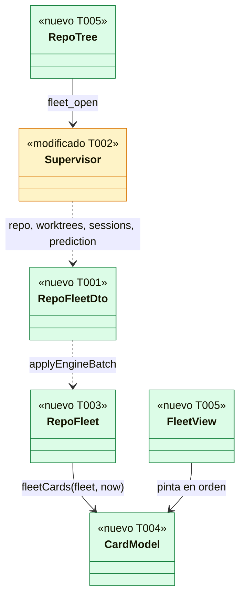
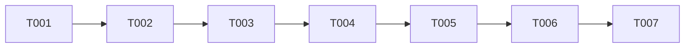

# DS-US-DSK-004 · La flota en vivo en la app

## Contexto rápido

Al terminar, quien abre un repo en la app ve una tarjeta por copia de trabajo con su agente, su estado, los archivos cambiados, el ↑↓ contra la rama base y la antigüedad del último cambio, ordenadas con lo que pide atención primero, y cada tarjeta cambia sola en menos de medio segundo cuando un agente hace un commit. Un repo sin agentes se ve igual, con su copia principal y el aviso de que nadie trabaja en él. Hoy la app (tras US-DSK-003) solo sabe el estado del motor y la lista de repos.

Las reglas de presentación son las de la TUI y no se reabren: la fila de DS-US-CKP-001, el orden y las terminadas de DS-US-CKP-002 y el ⚡ de DS-US-CKP-006. Esta historia las lleva a la app sobre la tubería de US-DSK-003: abre el ámbito del repo en el supervisor del backend y pinta en el webview.

| Término | Qué es aquí |
|---|---|
| Tarjeta | Una copia de trabajo (worktree) publicada por el motor, con su agente y sus datos |
| Clave del worktree | Hash FNV-1a de 64 bits, en hex, de la ruta **cruda** de la raíz; empareja sesiones y pares con su tarjeta sin usar el texto saneado (ajuste del Arquitecto en DS-US-CKP-001 § 2) |
| ⚡ conocido | Algún par de la predicción que incluye ese worktree tiene `level: conflict` en estado `current` o `recalculating` (DS-US-CKP-006, `known_conflict`) |

**Decisiones de esta Dev Spec**: todas son **Decisión del orquestador (2026-11-08), validada por Arquitecto**.

**Decisión del orquestador (2026-11-09)**: el mensaje del `Channel` que lleva una sesión del repo abierto se llama `repoSession` (`{ type: "repoSession", repoId, session, perf }`), no `session`, porque `session` ya es el mensaje de US-DSK-003 (la sesión del ámbito global, sin `repoId`). Afecta a T002, T003, T006, § Contratos compartidos y § Lo que se consume del canal.

| # | Decisión | Por qué | Alternativa descartada |
|---|---|---|---|
| D1 | Las tarjetas van en el **centro** mientras no exista el grafo; la barra lateral gana el árbol de repos con el grupo "Copias de trabajo". US-DSK-005 mueve las tarjetas a la pestaña "Estado de Agentes" del detalle, como dice DSF-DSK-001 § 4.b | A 1000–1359 px el detalle es un cajón cerrado: la flota no se vería al abrir la app | Ponerlas ya en el detalle: la historia no se podría usar sin abrir el cajón |
| D2 | El repo abierto lo elige el webview: el primero del árbol (por nombre y luego `repoId`) si no hay ninguno elegido; se cambia con un clic en el árbol y llama `fleet_open`. No se recuerda entre ejecuciones | La TUI abre el único repo o pregunta; la app tiene el árbol a la vista. La vista recordada es de otra historia (BR-CKP-CONS-006) y el almacén de la ventana solo guarda cuatro claves (TS-DSK-001) | Persistir el repo elegido: pasaría a `localStorage` un id del motor |
| D3 | Sesiones con `sessions.list { repo_id, include_ended: false }` justo después de suscribirse al repo, fusionadas por `session_id` con cada `session.state`: gana el `state_since` posterior y, si empatan, la terminada. Una instantánea nueva vacía las sesiones y se piden otra vez | Es D1 de DS-US-CKP-001, que converge en cualquier orden. La instantánea del repo no trae sesiones | Añadir las sesiones a `RepoSnapshot`: cambia el contrato; es deuda de TS-GRP-004 |
| D4 | Orden: principal, atención, Activo, Inactivo, Terminado visible, sin agente ("agente no disponible" va con sin agente). Dentro del grupo, carpeta, ruta y clave. La atención de una tarjeta es solo el ⚡ conocido: ⛔ y el hueco por worktree no se publican y no suben nada | D1–D3 de DS-US-CKP-002 y la regla de DS-US-CKP-006. La tarjeta solo se mueve al cambiar de grupo | Ordenar por actividad reciente: las tarjetas saltarían con cada archivo guardado |
| D5 | Terminadas: solo la última de cada worktree y solo durante 24 h ("terminó hace 2 h"); después, la tarjeta dice "Sin agente" con "último agente: X". Sin filtro "ver terminadas" | D5, D6 y D10 de DS-US-CKP-002; cumple "las terminadas no llenan la vista" (Q-CKP-3) | La tecla `f` de la TUI: en la app pide su control y su sitio, fuera de UI-1 |
| D6 | Nombre del agente con la carpeta: "Claude Code · feat-pagos", "claude-1 · feat-pagos +1" y la marca "compartido" con dos o más sesiones presentes | E4 de DS-US-CKP-001 y D8 de DS-US-CKP-002 (regla provisional hasta US-GRP-011) | — |
| D7 | Color de agente por hueco estable (`glass.lane.1` … `.7`): cada sesión presente toma el hueco libre más bajo en orden `(started, session_id)` y lo conserva mientras siga presente; con más de 7, se repite el 7. Siempre con nombre y símbolo (NFR-09) | D4 de DS-US-CKP-002 con los siete carriles del tema web | Color por hash: dos agentes comparten color demasiado a menudo |
| D8 | Al cambiar de repo, el backend llama `events.unsubscribe` con la suscripción del repo anterior (errores ignorados) y, además, descarta los `scope.event` de ámbitos que no estén abiertos | `events.unsubscribe` quita cualquier suscripción del bus de la conexión (`crates/core/src/channel/conn.rs:2860`); filtrar por ámbito cubre una respuesta perdida | Dejar vivas las suscripciones: tráfico y CPU por repos que nadie mira (NFR-13.8) |
| D9 | La línea del último commit con su autoría (US-CKP-026) no va en la tarjeta: la autoría de los commits la pinta el grafo (US-DSK-005). De US-CKP-026 se aplica la regla: lo no atribuido nunca se llama "humano" | El escenario 1 no la pide y `events.history` por worktree es el pozo de datos del grafo | Pedir `events.history` aquí: duplicaría lo que US-DSK-005 necesita |
| D10 | La antigüedad ("hace 2 min") se recalcula con un reloj de 1 s que solo corre con la ventana visible (`document.visibilityState`) | Presentación de un dato publicado (E1 de DS-US-CKP-001) y NFR-13.8 (sin bucles con la ventana oculta) | Un reloj siempre activo |

---

## 📋 Índice

> **Para aprobar:** [Contexto rápido](#contexto-rápido) · [⚠️ Gaps](#gaps-y-violaciones-de-la-constitución) · [🔭 La forma](#la-forma) · [El trabajo de un vistazo](#el-trabajo-de-un-vistazo).
> **Para implementar:** [🚀 Plan](#plan-de-implementación), en orden. Las `_(ref)_` se abren desde la tarea que las cita.

| Sección | Propósito |
|---------|-----------|
| [Contexto rápido](#contexto-rápido) | Qué se construye, glosario y decisiones |
| [⚠️ Gaps y violaciones de la constitución](#gaps-y-violaciones-de-la-constitución) | Qué impide empezar |
| [🔭 La forma](#la-forma) | Piezas y relaciones |
| [🚀 Plan de implementación](#plan-de-implementación) | T001…T007, en orden |
| ↳ [El trabajo de un vistazo](#el-trabajo-de-un-vistazo) | Tareas en tabla y su orden |
| [Estructura de ficheros](#estructura-de-ficheros) _(ref)_ | Árbol anotado |
| [Contratos compartidos](#contratos-compartidos) _(ref)_ | DTO, mensajes, firmas y textos |
| [Contrato de API](#contrato-de-api) _(ref)_ | Comando IPC y lo que se consume del canal |
| [Estrategia de pruebas y cobertura](#estrategia-de-pruebas-y-cobertura) _(ref)_ | Escenarios → tests |
| [Gate de seguridad](#gate-de-seguridad) | Checklist pre-merge |
| [Fuera de alcance](#fuera-de-alcance) | Lo que esta entrega no toca |
| [Notas del autor](#notas-del-autor) _(ref)_ | Huecos del motor y lo que no bloquea |

---

## ⚠️ Gaps y violaciones de la constitución

_No gaps. Ready to implement._

Verificado en el código el 2026-11-08: `scope.snapshot` de repo da `RepoView` con `base`, `worktrees` (cabeza, recuentos, `divergence`, estado ilegible), `fetched_utc_ms`, `tier` y `prediction` (`crates/api/src/messages.rs:144-180`, `:368-430`); `WorktreeView.last_activity_utc_ms`, `last_activity_in_gap` y `detached_at` con `scope.activity`; `worktree.state`, `session.state` y `prediction.changed` son eventos del ámbito del repo (`crates/api/src/event.rs:180-205`); `sessions.list` da `detection_available` y `SessionView` con `actor`, `state`, `started_utc_ms`, `state_since_utc_ms`, `ended_utc_ms` y `end_cause` (`messages.rs:797-850`); `PairSummary` trae `a`, `b`, `state` y `level` (`crates/api/src/prediction.rs:31-60`). Lo que el motor no publica (⛔ y hueco por worktree, recuento global de agentes) no bloquea: la tarjeta lo trata como la TUI y va en [Notas del autor](#notas-del-autor) con su dueño.

**Depende de**: US-DSK-003 (supervisor, `Channel`, almacén y estados del centro).

---

## 🔭 La forma



`RepoTree` (barra lateral) elige el repo y llama `fleet_open`; el `Supervisor` de US-DSK-003 abre su ámbito y manda los mensajes del repo. `applyEngineBatch` los guarda en `RepoFleet` (caché `["engine", "repo", id]`). `fleetCards` es pura: decide agente, estado, textos y orden; `FleetView` solo pinta.

---

## 🚀 Plan de implementación

> Orden topológico (`Depende:`). Las rutas son relativas a la raíz del repo.

### El trabajo de un vistazo

| # | Tarea | Depende | Aterriza en |
|---|---|---|---|
| T001 | Escribir en rojo los tests del ámbito del repo y fijar los DTO | — | `src-tauri/tests`, `src-tauri/src/engine/wire.rs` |
| T002 | Abrir el ámbito del repo en el supervisor y añadir `fleet_open` | T001 | `src-tauri/src/engine`, `src-tauri/src/commands` |
| T003 | Guardar la flota en la caché del frontend | T002 | `src/client`, `src/state` |
| T004 | Calcular las tarjetas y su orden | T003 | `src/fleet/fleet-model.ts` |
| T005 | Pintar el árbol de repos y las tarjetas | T004 | `src/fleet`, `src/ui`, `src/shell`, `src/i18n` |
| T006 | Dejar las marcas de frescura | T005 | `src/client`, `src/fleet`, `src-tauri/src/engine` |
| T007 | Verificar de punta a punta en macOS | T006 | — |

### En qué orden



### T001 — Escribir en rojo los tests del ámbito del repo y fijar los DTO

**Objetivo.** Los tests de Rust de los escenarios contra el daemon falso de US-DSK-003, y los tipos de mensaje que comprueban.

**Ubicación.**
- `apps/desktop/src-tauri/src/engine/wire.rs` (**MODIFY**: DTO y mensajes de § Contratos compartidos)
- `apps/desktop/src-tauri/tests/fleet_supervisor.rs` (**CREATE**)
- `apps/desktop/src-tauri/tests/support/fake_daemon.rs` (**MODIFY**: guion de un repo "tienda" y de "notas")

**Reglas**
- El falso sirve "tienda" (`/w/tienda/.git`) con tres worktrees: principal, `feat-pagos` (↑3 ↓1, 2 archivos) y `feat-login` (↑1 ↓0), y `sessions.list` con `claude-1` (Activa, en `feat-pagos`) y `claude-2` (Activa, en `feat-login`) con `detection_available: true`; y "notas" con solo la principal y `sessions: []`.
- Los tests (nombres en [§ 9.4](#94-comportamientos-críticos-verificados)) compilan contra un `HubCmd::Open` que el supervisor aún ignora.

- **Depende:** —
- **Refs:** escenarios de US-DSK-004; DS-US-DSK-003 T002
- **Aceptación:** `cargo test -p gitraptor-desktop --test fleet_supervisor` compila y falla (rojo); se commitea antes de T002.

### T002 — Abrir el ámbito del repo en el supervisor y añadir `fleet_open`

**Objetivo.** El backend sigue un repo: instantánea, suscripción, sesiones y eventos, con la misma disciplina de secuencia que el ámbito global.

**Ubicación.**
- `apps/desktop/src-tauri/src/engine/supervisor.rs` (**MODIFY**)
- `apps/desktop/src-tauri/src/engine/ingest.rs` (**MODIFY**)
- `apps/desktop/src-tauri/src/engine/mod.rs` (**MODIFY**: `EngineHub::open`)
- `apps/desktop/src-tauri/commands.json` (**MODIFY**)
- `apps/desktop/src-tauri/src/commands/mod.rs` (**MODIFY**)
- `apps/desktop/src-tauri/src/commands/fleet_open.rs` (**CREATE**)
- `apps/desktop/src-tauri/capabilities/main.json` (**MODIFY**)
- `apps/desktop/src-tauri/tests/commands.rs` (**MODIFY**)

**Reglas**
- `HubCmd::Open { repo_id }`: el supervisor guarda el repo abierto (uno a la vez). Si hay conexión y no es restringida: `events.unsubscribe` del anterior (D8), `scope.snapshot { scope: repo }` → `repo`; `scope.subscribe { from_seq: N + 1, run_id }`; `sessions.list { repo_id, include_ended: false }` → `sessions`. Tras cada reconexión, hueco o `scope.resync` del repo, repite los tres pasos. En vista restringida no abre nada.
- Un `scope.snapshot` rechazado o un `scope.resync` con `scope-closed` mandan `repoClosed { repoId }` y olvidan el repo abierto.
- Eventos del ámbito del repo abierto con `Apply`: `worktree.state` → `worktrees`; `session.state` → `repoSession`; `prediction.changed` → `prediction`. Los demás tipos avanzan la secuencia y se ignoran. Un `scope.event` de otro ámbito se descarta sin tocar ninguna secuencia.
- `ingest.rs`: `key(raw: &str) -> String` (FNV-1a 64, 16 dígitos hex en minúscula, sobre los bytes crudos); `repo`, `worktree`, `session`, `pair` (§ Contratos compartidos). Toda ruta y nombre pasa por `display::visible`; la carpeta es el último componente de la ruta cruda, saneado después de cortarlo. `detached_at` solo pasa si son 40 o 64 dígitos hex, y se manda entero (la UI corta a 7). `Actor::Agent { kind: claude-code }` → `{ kind: "claude-code" }`; `other` → `{ kind: "other", name }` saneado; `Actor::Unattributed` no aparece en `SessionView` (siempre es un agente) y, si llegara, la sesión se descarta.
- `fleet_open` según [§ Contrato de API](#contrato-de-api); llama `EngineHub::open`. `commands.json` suma `"fleet_open"` y la capability `allow-fleet-open`.
- **Decisión del orquestador (2026-11-09), tras el crítico**: el id de `fleet_open` se valida al deserializar `FleetOpenParams` o al principio de `EngineHub::open`, **antes** de comprobar que hay supervisor (un id inválido da `invalid-params` aunque no haya `watch`); `CommandError` no gana variantes.

- **Depende:** T001
- **Refs:** D3, D8; DS-US-CKP-001 § 2 y D1; ADR-CKP-003 § 4
- **Aceptación:** `cargo test -p gitraptor-desktop --test fleet_supervisor --test engine_supervisor --test commands` en verde; `tests/engine_wire.rs` compara la fixture congelada con las variantes nuevas (la fixture la produce el tester desde `wire.rs`, no se regenera con variable de entorno) y pasa.

### T003 — Guardar la flota en la caché del frontend

**Objetivo.** `RepoFleet` en la caché de TanStack Query, actualizada solo por mensajes.

**Ubicación.**
- `apps/desktop/src/client/engine-types.ts` (**MODIFY**)
- `apps/desktop/src/client/commands.ts` (**MODIFY**)
- `apps/desktop/src/client/commands.test.ts` (**MODIFY**)
- `apps/desktop/src/state/engine-cache.ts` (**MODIFY**)
- `apps/desktop/src/state/engine-cache.test.ts` (**MODIFY**)
- `apps/desktop/src/state/ui-store.ts` (**MODIFY**)
- `apps/desktop/src/state/ui-store.test.ts` (**MODIFY**)
- `apps/desktop/src/fleet/useFleet.ts` (**CREATE**)
- `apps/desktop/src/fleet/useFleet.test.tsx` (**CREATE**)

**Reglas**
- `applyEngineBatch`: `repo` → `setQueryData(engineKeys.repo(id), { repo, sessions: new Map(), detection: null })` (reemplaza y vacía sesiones, D3); `worktrees` → reemplaza `repo.worktrees` y `repo.fetchedUtcMs`; `sessions` → fusiona la lista con la regla de D3 y fija `detection`; `repoSession` → fusiona una; `prediction` → upsert por `pairId` y quita `removed`; `repoClosed` → `removeQueries(engineKeys.repo(id))` y `selectRepo(null)` si era el elegido. Nunca muta el objeto anterior.
- `ui-store.ts`: `selectedRepoId: string | null` y `selectRepo(id)`, **sin** persistir (`partialize` no cambia; el test de las cuatro claves sigue en verde).
- `useFleet.ts`: elige el repo por defecto (D2) cuando llega `global` sin elegido o el elegido desaparece; en cada cambio de `selectedRepoId` llama `call("fleet_open", { repoId })`; expone `useQuery({ queryKey: engineKeys.repo(id), queryFn: skipToken })`.
- **Decisión del orquestador (2026-11-09), tras el crítico**: `useFleet()` no recibe argumentos, lo monta `EngineCenter` (una sola vez) y devuelve el `UseQueryResult<RepoFleet>` de `engineKeys.repo(selectedRepoId)` (con `skipToken` sin repo elegido).

- **Depende:** T002
- **Refs:** ADR-GRP-004, Enmienda D7; D2, D3
- **Aceptación:** `engine-cache.test.ts` (fixture de Rust): cada mensaje del repo deja la caché esperada; una `session` terminada con el mismo `stateSince` gana a una activa; una `repo` nueva vacía las sesiones; `ui-store.test.ts` en verde.

### T004 — Calcular las tarjetas y su orden

**Objetivo.** `fleetCards`, pura, con las reglas de la TUI.

**Ubicación.**
- `apps/desktop/src/fleet/fleet-model.ts` (ya hecho, commits 584439f0 y 71fb2478 de esta rama; no se reescribe)
- `apps/desktop/src/fleet/fleet-model.test.ts` (ya hecho, commits 584439f0 y 71fb2478 de esta rama; no se reescribe)
- `apps/desktop/src/fleet/agent-colors.ts` (ya hecho, commits 584439f0 y 71fb2478 de esta rama; no se reescribe)
- `apps/desktop/src/fleet/agent-colors.test.ts` (ya hecho, commits 584439f0 y 71fb2478 de esta rama; no se reescribe)

**Reglas**
- Una tarjeta por `WorktreeDto`, en el orden de D4. El grupo sale de la sesión de mayor rango que la tarjeta enseña (Activa > Inactiva > Terminada visible).
- Agente: sesiones presentes de la clave del worktree (desempate: Activa, Inactiva, `stateSinceUtcMs` más reciente, `sessionId`); con más de una, "+N" y `shared: true`. Sin presentes: la última terminada dentro de 24 h (D5) o "Sin agente" con `lastAgent`. Con `detection` `null` o `false`: "agente no disponible", sin símbolo, nunca "Sin agente".
- Terminada sin `endedUtcMs`: la ventana cuenta desde `stateSinceUtcMs`; con `endCause` `ended-during-gap`, `fleet.state.endedUnobserved`; sin hora por otro motivo, `fleet.state.endTimeUnknown` (D6 de DS-US-CKP-002).
- Rama: `branch` → nombre; `unborn` → `fleet.branch.unborn`; `detached` → `fleet.branch.noBranch` con 7 dígitos de `detachedAt`, o `fleet.branch.noBranchUnknown`.
- ↑↓: `counted` → `↑{ahead}{exact ? "" : "+"} ↓{behind}{…}`; `base-missing`, `no-base`, `no-commits`, `unreadable` → su texto, nunca `0` ni `–`.
- Actividad: `lastActivityUtcMs` → `fleet.activity.ago` con la unidad entera mayor (`age.*`); sin dato o sin `activity` en la sesión → `fleet.activity.unknown` (`–`).
- Atención: `conflictWith` = las claves del otro lado de cada par con ⚡ conocido (o `base`); texto `fleet.attention.conflict` con la carpeta del otro worktree, `fleet.attention.conflictBase` o `fleet.attention.conflictMany` si son más de uno.
- Worktree ilegible: `unavailable` con `fleet.unavailable.<motivo>`, sin rama ni recuentos.
- `agent-colors.ts`: `assignSlots(previous, presentSessions) -> Map<sessionId, 1..7>` con la regla de D7; el registro vive en un `useRef` de `FleetView` y se vacía al cambiar de repo.

- **Depende:** T003
- **Refs:** D4–D7; DS-US-CKP-001 § 2 y § 7; DS-US-CKP-002 D1–D10; DS-US-CKP-006 (`known_conflict`); BR-CKP-CALC-001, BR-CKP-CONS-003
- **Aceptación:** `fleet-model.test.ts` y `agent-colors.test.ts` en verde (§ 9.4).

### T005 — Pintar el árbol de repos y las tarjetas

**Objetivo.** La flota en el centro y el árbol en la barra lateral de B1, en en/es, accesibles.

**Ubicación.**
- `apps/desktop/src/fleet/FleetView.tsx` (ya hecho, commits 584439f0 y 71fb2478 de esta rama; el cableado lo hace esta corrida)
- `apps/desktop/src/fleet/RepoTree.tsx` (ya hecho, commits 584439f0 y 71fb2478 de esta rama; el cableado lo hace esta corrida)
- `apps/desktop/src/fleet/useNow.ts` (ya hecho, commits 584439f0 y 71fb2478 de esta rama; el cableado lo hace esta corrida)
- `apps/desktop/src/fleet/FleetView.test.tsx` (ya hecho, commits 584439f0 y 71fb2478 de esta rama; el cableado lo hace esta corrida)
- `apps/desktop/src/fleet/RepoTree.test.tsx` (ya hecho, commits 584439f0 y 71fb2478 de esta rama; el cableado lo hace esta corrida)
- `apps/desktop/src/ui/WorktreeCard.tsx` (ya hecho, commits 584439f0 y 71fb2478 de esta rama; el cableado lo hace esta corrida)
- `apps/desktop/src/ui/CardSkeleton.tsx` (ya hecho, commits 584439f0 y 71fb2478 de esta rama; el cableado lo hace esta corrida)
- `apps/desktop/src/engine/EngineCenter.tsx` (**MODIFY**: fila 7 → `FleetView`)
- `apps/desktop/src/shell/AppShell.tsx` (**MODIFY**: barra lateral → `RepoTree`)
- `apps/desktop/src/app/App.tsx` (**MODIFY**: primera pintura útil con repo abierto)
- `apps/desktop/src/i18n/locales/en.json` (**MODIFY**)
- `apps/desktop/src/i18n/locales/es.json` (**MODIFY**)

**Reglas**
- `FleetView`: título del panel `fleet.title` (base y `fetch hace…`), `fleet.titleNeverFetched` sin fetch, `fleet.titleBaseNotFound` si alguna tarjeta tiene `base-missing`. Lista `<ul aria-label={fleet.list.label}>` de `WorktreeCard`. Sin instantánea del repo: tres `CardSkeleton` y `aria-busy="true"`, nunca "sin agentes". Sin ninguna sesión presente ni terminada visible y con `detection` verdadero: aviso `fleet.empty.agents` sobre la lista (escenario 4). Una región `role="status"` oculta anuncia `fleet.attention.announce` cuando una tarjeta entra en el grupo de atención.
- `WorktreeCard` (en `src/ui`, sin `client`): cabecera con símbolo (`●` activo, `◐` inactivo, `○` terminada o sin agente, `⚠` no disponible, ninguno con agente no disponible), nombre del agente en el color `glass.lane.<hueco>` (terminada y sin agente en `glass.text.muted`) y texto del estado; fila de rama (`<code>` para el hash); fila de métricas: archivos, ↑↓ y actividad; fila de atención en `glass.danger` con `⚡` y su texto. Etiqueta "copia principal" en la principal. El nombre accesible es una frase con las partes visibles unidas por ", " (DSF-DSK-001 § 7). Ningún color, radio ni tamaño literal.
- `RepoTree`: cabecera "Repos"; una fila por repo de `global.repos` (nombre saneado, inicial como insignia, `⚡N` en `glass.danger` si `attention.conflicts` es `counted` y > 0, con `aria-label` `repos.conflicts`, "no disponible" si `state` es `unavailable`); la fila del repo abierto se despliega con el grupo "Copias de trabajo": una fila por tarjeta, en el orden de la flota, con el punto del estado (relleno verde activo, hueco inactivo) y el nombre de la carpeta. Navegable con flechas (`role="tree"`, `aria-expanded`, `aria-selected`); `Enter` o clic abre el repo.
- `useNow`: `Date.now()` cada 1 s solo mientras `document.visibilityState === "visible"`; se para con `visibilitychange` (D10).
- `App.tsx`: con un repo elegido, la primera pintura útil exige además la instantánea del repo pintada.

- **Depende:** T004
- **Refs:** DSF-DSK-001 § 2.2, § 4.b y § 7; NFR-09; ADR-GRP-003; D1, D2, D10
- **Aceptación:** `FleetView.test.tsx` y `RepoTree.test.tsx` en verde (§ 9.4), `axe-core` sin violaciones a 1440 y 1200 px en en y es; `catalog.test.ts` en verde.

### T006 — Dejar las marcas de frescura

**Objetivo.** Las marcas que medirá el escenario `desktop-modify` (NFR-13.1), sin el banco.

**Ubicación.**
- `apps/desktop/src-tauri/src/engine/supervisor.rs` (**MODIFY**)
- `apps/desktop/src/client/engine-stream.ts` (**MODIFY**)
- `apps/desktop/src/fleet/FleetView.tsx` (**MODIFY**)
- `apps/desktop/src/fleet/FleetView.test.tsx` (**MODIFY**)
- `apps/desktop/src/app/App.tsx` (**MODIFY**: pasa `receivedAt` al almacén)
- `apps/desktop/src/state/engine-store.ts` (**MODIFY**: `lastRepoBatch`)

**Reglas**
- Backend: `worktrees`, `repoSession` y `prediction` llevan `perf: { backendNs }` = `monotonic_ns()` al enviar menos el `recv_ns` del `Link::next` (costura de DS-TS-DSK-002) que trajo el evento. Ajuste tras la revisión (2026-11-08), validado por Arquitecto / security-expert.
- `engine-stream.ts`: cada lote lleva `receivedAt` = `performance.now()` del primer mensaje del lote.
- **Decisión del orquestador (2026-11-09), tras el crítico**: `watchEngine` entrega cada lote como `onBatch(messages, { receivedAt })` (segundo argumento, no propiedad del array); `App.tsx` aplica el lote y, si trae mensajes del repo, anota `{ receivedAt, n }` en `engine-store.ts` (`lastRepoBatch`) y `FleetView` lo lee tras su commit para medir. `perf.backendNs` es siempre mayor que 0 y menor que 20 ms en el daemon falso.
- `FleetView`: tras el commit de React que aplicó un lote con mensajes del repo, en el primer `requestAnimationFrame`, `performance.measure("gr:fleet-delta", { start: receivedAt })`, y `performance.mark("gr:fleet-delta-painted")`.

- **Depende:** T005
- **Refs:** NFR-13.1; ADR-GRP-017 V3
- **Aceptación:** `pnpm --filter @gitraptor/desktop test -- FleetView` en verde, con el caso «measures each fleet delta once»: un lote produce exactamente una medida `gr:fleet-delta`.

### T007 — Verificar de punta a punta en macOS

**Objetivo.** Comprobar con el motor real lo que el daemon falso no ve.

**Ubicación.** Ninguna: solo corre verificaciones.

**Pasos**
1. Un repo temporal con dos worktrees y dos sesiones de Claude Code: las dos tarjetas con su agente, ↑↓ y archivos.
2. Un commit en uno de ellos: su tarjeta cambia sin recargar, a ojo en menos de medio segundo.
3. Un repo sin agentes: su copia principal con "Sin agente" y el aviso de que nadie trabaja en él.
4. Cambiar de repo en el árbol: la flota cambia y los eventos del anterior ya no llegan (log de depuración del supervisor).

- **Depende:** T006
- **Refs:** escenarios de US-DSK-004
- **Aceptación:** los cuatro pasos, con su resultado en la descripción del PR.

---

## Estructura de ficheros

```text
apps/desktop/src-tauri/
├── commands.json                                  # + fleet_open (T002)
├── src/engine/{supervisor,ingest,wire,mod}.rs     # ámbito del repo (T001, T002)
├── src/commands/fleet_open.rs                     # (T002)
└── tests/fleet_supervisor.rs                      # (T001)
apps/desktop/src/
├── fleet/{fleet-model,agent-colors}.ts            # puros (T004)
├── fleet/{useFleet,useNow}.ts, FleetView.tsx, RepoTree.tsx   # (T003, T005)
├── ui/{WorktreeCard,CardSkeleton}.tsx             # puros (T005)
└── state/{engine-cache,ui-store}.ts               # (T003)
```

---

## Contratos compartidos

### Tipos y datos compartidos

| Tipo | Dónde | Forma |
|---|---|---|
| `RepoFleetDto` | `wire.rs` ↔ `engine-types.ts` | `{ repoId, name, base: { name: string \| null, status: "confirmed" \| "unconfirmed" \| "invalid" }, fetchedUtcMs: number \| null, tier: Tier \| null, worktrees: WorktreeDto[], pairs: PairDto[], pairsTruncated: boolean }` |
| `WorktreeDto` | ídem | `{ key, folder, path, main, status: ReadyDto \| { state: "unavailable", reason: "missing" \| "untrusted" \| "unreadable" }, lastActivityUtcMs: number \| null, lastActivityInGap: boolean, detachedAt: string \| null, operation: string \| null }` |
| `ReadyDto` | ídem | `{ state: "ready", head: { kind: "branch" \| "unborn", name } \| { kind: "detached" }, counts: { staged, unstaged, untracked }, divergence: { state: "counted", ahead: { count, exact }, behind: { count, exact } } \| { state: "base-missing" \| "no-base" \| "no-commits" \| "unreadable" } }` |
| `SessionDto` | ídem | `{ sessionId, worktreeKey, agent: { kind: "claude-code" } \| { kind: "other", name }, origin: "detected" \| "registered", state: "active" \| "inactive" \| "ended", startedUtcMs, stateSinceUtcMs, endedUtcMs: number \| null, endCause: "process-gone" \| "ended-during-gap" \| "registration-withdrawn" \| "worktree-removed" \| null }` |
| `PairDto` | ídem | `{ pairId, a: string /* clave */, b: string \| "base", state: "calculating" \| "current" \| "recalculating" \| "pending" \| "not-computable", level: "none" \| "overlap" \| "conflict" \| null }` |
| `Supervisor` (de DS-US-DSK-003) | `src-tauri/src/engine/supervisor.rs` | Gana `HubCmd::Open` y el ámbito del repo abierto (T002) |
| `RepoTree` | `src/fleet/RepoTree.tsx` | Componente del árbol: lee `engineKeys.global` y `selectedRepoId`; llama `selectRepo` |
| `FleetView` | `src/fleet/FleetView.tsx` | Componente del centro: lee `RepoFleet` y pinta `CardModel[]` |
| `RepoFleet` | `src/state/engine-cache.ts` | `{ repo: RepoFleetDto; sessions: Map<string, SessionDto>; detection: boolean \| null }` en `engineKeys.repo(id)` |
| `CardModel` | `src/fleet/fleet-model.ts` | `{ key, group: Group, main, symbol, agent: { label, colorSlot: number \| null, muted, shared }, stateText, branchText, filesCount, syncText, activityText, attention: { kind: "conflict", text } \| null, unavailableText: string \| null, a11yLabel }` |
| `Group` | ídem | `"main" \| "attention" \| "active" \| "inactive" \| "ended" \| "no-agent"` |

Mensajes nuevos del `Channel` (`EngineMessage`, `type`):

| `type` | Campos | Cuándo |
|---|---|---|
| `repo` | `fleet: RepoFleetDto` | Cada instantánea del repo abierto (reemplaza) |
| `worktrees` | `repoId`, `worktrees: WorktreeDto[]`, `fetchedUtcMs`, `perf` | `worktree.state` |
| `sessions` | `repoId`, `detectionAvailable`, `sessions: SessionDto[]` | Respuesta de `sessions.list` |
| `repoSession` | `repoId`, `session: SessionDto`, `perf` | `session.state` |
| `prediction` | `repoId`, `pairs: PairDto[]`, `removed: string[]`, `perf` | `prediction.changed` |
| `repoClosed` | `repoId` | Repo no observado o `scope-closed` |

`perf` = `{ backendNs: number }` (T006).

### Ciclos de vida (DI)

| Pieza | Ciclo |
|---|---|
| Repo abierto en el backend | Uno a la vez en el supervisor; sobrevive a reconexiones; se olvida con `repoClosed` |
| `RepoFleet` | Una entrada de caché por repo abierto; `repoClosed` la quita |
| Registro de colores | `useRef` de `FleetView`; se vacía al cambiar de repo |
| Reloj `useNow` | Montado con `FleetView`; parado con la ventana oculta |

### Firmas del stack

```rust
// apps/desktop/src-tauri/src/engine/ingest.rs
pub fn key(raw_path: &str) -> String;
pub fn repo(snapshot: &gitraptor_api::scope::RepoSnapshot) -> RepoFleetDto;
pub fn worktree(view: &gitraptor_api::messages::WorktreeView) -> WorktreeDto;
pub fn session(view: &gitraptor_api::messages::SessionView) -> Option<SessionDto>;
pub fn pair(summary: &gitraptor_api::prediction::PairSummary) -> PairDto;
// apps/desktop/src-tauri/src/engine/mod.rs
impl EngineHub { pub fn open(&self, repo_id: String) -> Result<(), CommandError>; }
```

```ts
// apps/desktop/src/fleet/fleet-model.ts
export function fleetCards(fleet: RepoFleet, nowMs: number, activity: boolean, t: TFunction): CardModel[];
export function knownConflicts(pairs: readonly PairDto[], key: string): Array<string | "base">;
// apps/desktop/src/fleet/agent-colors.ts
export function assignSlots(previous: ReadonlyMap<string, number>, present: readonly SessionDto[]): Map<string, number>;
```

### Textos del catálogo

| Clave | en | es |
|---|---|---|
| `fleet.title` | Fleet · ↑↓ vs {{base}} (local copy, fetched {{age}} ago) | Flota · ↑↓ respecto a {{base}} (copia local, fetch hace {{age}}) |
| `fleet.titleNeverFetched` | Fleet · ↑↓ vs {{base}} (local copy, never fetched) | Flota · ↑↓ respecto a {{base}} (copia local, sin fetch) |
| `fleet.titleBaseNotFound` | Fleet · ↑↓ not computable: {{base}} not found | Flota · ↑↓ no calculable: {{base}} no encontrada |
| `fleet.list.label` | Worktrees of {{repo}} | Copias de trabajo de {{repo}} |
| `fleet.main` | main worktree | copia principal |
| `fleet.agent.inWorktree` | {{agent}} · {{worktree}} | {{agent}} · {{worktree}} |
| `fleet.agent.claudeCode` | Claude Code | Claude Code |
| `fleet.agent.more` | +{{count}} | +{{count}} |
| `fleet.agent.shared` | shared | compartido |
| `fleet.noAgent` | No agent · {{worktree}} | Sin agente · {{worktree}} |
| `fleet.agentNotAvailable` | agent not available | agente no disponible |
| `fleet.lastAgent` | last agent: {{agent}} (ended {{age}} ago) | último agente: {{agent}} (terminó hace {{age}}) |
| `fleet.state.active` / `.inactive` | active / inactive | activo / inactivo |
| `fleet.state.ended` | ended {{age}} ago | terminó hace {{age}} |
| `fleet.state.endedUnobserved` | ended unobserved; detected {{age}} ago | terminó sin observar; detectado hace {{age}} |
| `fleet.state.endTimeUnknown` | end time not available | hora de fin no disponible |
| `fleet.branch.unborn` | {{name}} (no commits) | {{name}} (sin commits) |
| `fleet.branch.noBranch` | {{commit}} (no branch) | {{commit}} (sin rama) |
| `fleet.branch.noBranchUnknown` | (no branch) | (sin rama) |
| `fleet.files_one` / `_other` | {{count}} changed file / {{count}} changed files | {{count}} archivo cambiado / {{count}} archivos cambiados |
| `fleet.clean` | no changes | sin cambios |
| `fleet.sync.label` | {{ahead}} ahead and {{behind}} behind {{base}} | {{ahead}} por delante y {{behind}} por detrás de {{base}} |
| `fleet.sync.baseMissing` / `.noBase` / `.noCommits` / `.unreadable` | not computable / no base branch / no commits / unreadable now | no calculable / sin rama base / sin commits / ilegible ahora |
| `fleet.activity.ago` | {{age}} ago | hace {{age}} |
| `fleet.activity.unknown` | – | – |
| `fleet.unavailable.missing` / `.untrusted` / `.unreadable` | unavailable: folder missing / unavailable: Git does not trust it / unavailable: unreadable now | no disponible: falta la carpeta / no disponible: Git no confía en él / no disponible: ilegible ahora |
| `fleet.attention.conflict` | ⚡ predicted conflict with {{other}} | ⚡ conflicto previsto con {{other}} |
| `fleet.attention.conflictBase` | ⚡ predicted conflict with {{base}} | ⚡ conflicto previsto con {{base}} |
| `fleet.attention.conflictMany` | ⚡ predicted conflicts with {{count}} worktrees | ⚡ conflictos previstos con {{count}} copias |
| `fleet.attention.announce` | {{worktree}} needs attention: predicted conflict | {{worktree}} pide atención: conflicto previsto |
| `fleet.empty.agents` | No agents are working in {{repo}} yet. Open Claude Code in a worktree and it shows up here. | Aún no hay agentes trabajando en {{repo}}. Cuando abras Claude Code en una copia de trabajo, aparecerá aquí. |
| `fleet.loading` | Loading the fleet… | Cargando la flota… |
| `repos.title` | Repos | Repos |
| `repos.worktrees` | Worktrees | Copias de trabajo |
| `repos.conflicts` | {{count}} predicted conflicts | {{count}} conflictos previstos |
| `repos.unavailable` | unavailable | no disponible |
| `age.seconds` / `.minutes` / `.hours` / `.days` | {{count}} s / {{count}} min / {{count}} h / {{count}} d | {{count}} s / {{count}} min / {{count}} h / {{count}} d |

---

## Contrato de API

### Comando IPC que añade

| Comando | `params` | Resultado | Errores (`code`) | Del canal |
|---|---|---|---|---|
| `fleet_open` | `{ repoId: string }` | `{}` | `invalid-params` (vacío, más de 128 bytes o con caracteres de control), `not-watching` | `events.unsubscribe` (anterior), `scope.snapshot { scope: repo }`, `scope.subscribe`, `sessions.list` |

Rust: `FleetOpenParams { repo_id: String }` con `#[serde(deny_unknown_fields, rename_all = "camelCase")]`. TypeScript: `fleet_open: { params: { repoId: string }; result: Record<string, never> }`. La validez del id la decide el daemon: uno desconocido acaba en `repoClosed`.

### Lo que se consume del canal

| Del canal | Dónde está | Uso |
|---|---|---|
| `scope.snapshot { scope: repo }` → `RepoSnapshot { run_id, scope_seq, repo: RepoView }` | `crates/api/src/scope.rs:70-76`; `messages.rs:144-180` | `repo` |
| `WorktreeView` (`path`, `main`, `status`, `last_activity_utc_ms`, `last_activity_in_gap`, `detached_at`, `operation`) | `messages.rs:368-430` | `WorktreeDto` |
| `RepoView.prediction` y `prediction.changed` (`prediction.pairs`) | `crates/api/src/prediction.rs`; `methods/prediction.rs` | `PairDto`, ⚡ conocido |
| `worktree.state` (`WorktreeStateData`), `session.state` (`SessionView`) | `event.rs`; `messages.rs:497-510`, `:797-815` | `worktrees`, `repoSession` |
| `sessions.list { repo_id, include_ended: false }` → `{ detection_available, sessions }` | `messages.rs:819-850`; `methods/sessions.rs` | `sessions` |
| `events.unsubscribe { subscription }` | `methods/events.rs`; `crates/core/src/channel/conn.rs:2860` | D8 |

Sin métodos, eventos ni capacidades nuevos en el canal; ninguna escritura.

### Forma del error y del cuerpo de respuesta

`fleet_open` rechazado responde `{"code": "<kebab>"}` (`CommandError`), sin texto del motor; el frontend no muestra nada nuevo: la tarjeta sigue en carga hasta `repo` o el árbol vuelve al repo anterior con `repoClosed`.

| Estado de una tarjeta | Cómo se ve | Tono |
|---|---|---|
| Agente activo / inactivo | `●` / `◐`, nombre en su color, estado en texto | Normal |
| Terminada en 24 h | `○`, nombre atenuado, "terminó hace…" | Atenuado |
| Sin agente | `○`, "Sin agente · carpeta" atenuado | Atenuado |
| Agente no disponible | Sin símbolo, "agente no disponible" | Atenuado |
| Pide atención | Fila `⚡` con el motivo, en el grupo de atención | Peligro |
| No disponible | `⚠`, "no disponible: …", sin métricas | Aviso |
| Base ausente | "no calculable" en ↑↓ y título de la flota | Atenuado |

### Valores numéricos

| Valor | Cifra | Fuente |
|---|---|---|
| Frescura de punta a punta | < 500 ms p95; tramo de la app ≤ 100 ms p95 (backend ≤ 20, webview ≤ 80) | NFR-04, NFR-13.1 |
| Ventana de terminadas | 24 h | DS-US-CKP-002 D5 |
| Huecos de color | 7 (`glass.lane.1`…`.7`) | DSYS-GRP-002 |
| Reloj de antigüedades | 1 s, solo con la ventana visible | D10, NFR-13.8 |
| Dígitos del hash sin rama | 7 | DS-US-CKP-001 § 7, F2 |
| Recuento de commits acotado | 10.000 (`exact: false` → `+`) | `MAX_DIVERGENCE_WALK` |
| Memoria del backend | ≤ 60 MiB | NFR-13.5 |

---

## Estrategia de pruebas y cobertura

### 9.1 Pirámide de pruebas

| Nivel | Qué | Dónde |
|---|---|---|
| Unitarias Rust | `key`, `ingest::*` | `src-tauri/tests/fleet_ingest.rs` |
| Integración Rust con daemon falso | Ámbito del repo de punta a punta | `src-tauri/tests/fleet_supervisor.rs` |
| Contrato Rust ↔ TS | Fixture dorada ampliada | `tests/engine_wire.rs`, `src/state/engine-cache.test.ts` |
| Unitarias TS | `fleetCards`, `assignSlots` | `src/fleet/*.test.ts` |
| Componente | Flota y árbol con Testing Library y axe, en/es | `src/fleet/*.test.tsx` |
| Manual | macOS con el motor real | T007 |

### 9.2 Umbrales de cobertura

`fleet-model.ts`: cada grupo de D4, cada variante de `divergence`, de `head` y de motivo de no disponible, y cada caso de agente (presente, varios, terminada en 24 h, fuera de 24 h, sin agente, detección desconocida) con un test.

### 9.3 Datos de prueba

El guion "tienda" y "notas" del daemon falso (T001) y fixtures de `RepoFleet` construidos en los tests de TS. Sin repos reales salvo T007 (repos temporales, NFR-01).

### 9.4 Comportamientos críticos verificados

| Escenario / regla | Test Rust (`tests/fleet_supervisor.rs`) | Test TS |
|---|---|---|
| Una tarjeta por copia de trabajo | `opening_a_repo_delivers_its_worktrees_and_sessions_with_matching_keys` | `FleetView.test.tsx` › `one card per worktree with agent, state, files and ahead/behind` |
| Cambio en vivo | `a_worktree_state_event_reaches_the_webview_in_order` (evento N + 1 → `worktrees` con ↑4) | `a commit in feat-pagos updates its card without reload` |
| Primero lo que pide atención | `a_prediction_change_reaches_the_webview_with_worktree_keys` | `fleet-model.test.ts` › `a predicted conflict puts feat-login before feat-pagos with its reason`; `a card only moves when its group changes` |
| Repo sin agentes | `a_repo_without_sessions_reports_detection_and_no_sessions` | `a repo without agents shows its main worktree and says no agent works there`; `unknown detection never says no agent` |
| Sesiones convergentes (D3) | `a_new_repo_snapshot_asks_for_the_sessions_again` | `engine-cache.test.ts` › `an ended session with the same time wins` |
| Terminadas (D5) | — | `an ended session shows for 24 hours, then the last agent` |
| Hueco y `scope.resync` del repo | `a_gap_in_the_repo_scope_takes_a_new_snapshot_and_sessions` | — |
| Cambio de repo (D8) | `switching_repos_unsubscribes_and_drops_the_old_scope` | `RepoTree.test.tsx` › `choosing a repo opens it and lists its worktrees` |
| Repo cerrado | `a_closed_repo_is_reported_and_forgotten` | `a closed repo returns to the tree` |
| Sesión del repo con su nombre propio (decisión 2026-11-09) | `a_repo_session_event_reaches_the_webview_as_repo_session` | `engine-cache.test.ts` › `fleet cache` |
| Solo lectura | `a_fleet_run_never_sends_replace_stop_or_writes` | — |
| Marcas del backend (T006) | `fleet_deltas_carry_backend_perf` | `engine-stream.test.ts` › `receivedAt` |
| Hash de la clave y `detached_at` | `tests/fleet_ingest.rs` › `key_is_fnv1a_64_in_16_lowercase_hex_of_the_raw_bytes`, `detached_at_passes_only_as_40_or_64_hex` | — |
| Repo por defecto y apertura (D2) | — | `src/fleet/useFleet.test.tsx` › `picks the first repo by name and opens it`, `selectedRepoId` en `ui-store.test.ts` |
| `fleet_open` en la lista cerrada | `tests/commands.rs` › `fleet_open_is_in_the_closed_list_and_the_capability`, `fleet_open_accepts_params_and_rejects_bad_ids`, `fleet_open_without_a_supervisor_is_not_watching` | `commands.test.ts` › `fleet_open` |
| Vista restringida | `a_restricted_session_never_opens_a_repo` | — |
| Texto no confiable (SEC-12) | `untrusted_branch_and_folder_reach_the_webview_escaped` (rama con `\u{1b}]0;x\u{7}`, carpeta con U+202E) | `branch text is rendered as text` |
| Lo no atribuido nunca es "humano" | — | `no card ever says human` (ningún texto del catálogo en/es contiene "human" ni "humano") |
| Sin rama, base ausente, no disponible | — | `a detached worktree shows 7 digits or no hash`, `a missing base says not computable, never zero`, `an unavailable worktree shows why and no metrics` |
| Colores (D7) | — | `agent-colors.test.ts` › `a present session keeps its slot`, `slots are reused after an end`, `the eighth agent repeats slot 7` |
| No solo color (NFR-09) | — | cada tarjeta tiene símbolo o texto de estado y nombre; axe sin violaciones |
| Reloj parado con la ventana oculta (D10) | — | `useNow stops while hidden` |
| Marcas de frescura | — | `measures each fleet delta once` |

### 9.5 Plataformas

macOS (T007) y ubuntu (job `desktop`). Windows: **Pendiente: etapa de validación multiplataforma** (sin detección de sesiones, `detection_available: false` → "agente no disponible").

---

## Gate de seguridad

- V1, V2, V5 y V7 de ADR-GRP-017 en verde en el job `desktop`.
- Toda ruta, rama, carpeta y nombre de agente pasa por `display::visible` en `ingest.rs`; la clave del worktree se calcula del texto crudo y nunca se muestra.
- `fleet_open` solo lee: ningún método reservado ni de escritura en `calls()` del daemon falso (aserción común de `support`, US-DSK-003).
- `WorktreeCard` está en `src/ui` y V5 le impide importar `client`.
- Revisión de `security-expert`: no hace falta más allá de la de US-DSK-003; no hay comandos que escriban ni texto nuevo fuera del saneador.

---

## Fuera de alcance

| Ítem / no-objetivo | Historia que lo cubre | Gate (cómo se verifica) |
|---|---|---|
| Grafo de carriles y autoría de los commits; mover las tarjetas al detalle | US-DSK-005 | `src/graph/` no existe |
| Panel de conflictos, detalle del par, límites, frescura de la predicción y `prediction.list` | US-DSK-008 | `prediction.list` no aparece en `src-tauri/src` |
| ⛔ por tarjeta | US-DSK-007 (con US-CKP-019) | `CardModel.attention.kind` solo admite `conflict` |
| Filtro "ver terminadas" | Historia de UI-2 que lo pida | sin control de filtro en `FleetView` |
| Ramas locales y remotas en el árbol | TS-CKP-007 y su historia de la app | `RepoTree` no lista ramas |
| Acciones por tarjeta (abrir en editor, diff, integrar) | US-DSK-009 y siguientes | `WorktreeCard` no tiene botones |
| Banco `desktop-modify` / `desktop-soak` | Enmienda de INF-GRP-002 (G4) | — |

---

## Notas del autor

| ID | Nota | Acción | Owner |
|----|------|--------|-------|
| G1 | "Agentes · N en vivo" (barra lateral) y el recuento de agentes por repo del árbol piden un dato global: `RepoSummaryView` no trae sesiones y `sessions.list` es por repo. Esta historia no los pinta (solo el ⚡ del árbol, que sí se publica en `attention.conflicts`) | Publicar el recuento de sesiones presentes por repo en el ámbito global | TS-CKP-010 |
| G2 | ⛔ y el hueco de observación por worktree no se publican: la tarjeta no sube por ellos (como la TUI, D2–D3 de DS-US-CKP-002) | Ninguna aquí | US-CKP-019 / US-GRD, US-GRP-005 |
| G3 | Con `pairsTruncated`, un ⚡ fuera del resumen no sube su tarjeta. Con 10 worktrees caben todos los pares (ADR-CKP-001 § 2) | Leer el resto con `prediction.list` | US-DSK-008 |
| G4 | Las marcas existen; el escenario que las mide (`desktop-modify`, `desktop-soak`, NFR-13.1, 13.5 y 13.8) es la enmienda de INF-GRP-002 prevista en NFR-13 § Huecos | Reservarla al pasar esta historia a `in-progress` | Orquestador |
| G5 | "Compartido" usa la regla provisional de DS-US-CKP-002 D8 (dos o más presentes) hasta que US-GRP-011 publique la marca | Cambiar a la marca publicada y borrar la regla | US-GRP-011 |
| G6 | Archivos compartidos con US-DSK-003 y las demás US-DSK: `commands.json`, `commands/mod.rs`, `capabilities/main.json`, `en.json`, `es.json`, `AppShell.tsx`, `EngineCenter.tsx`, `engine-cache.ts`, `wire.rs`, el fixture | Integrar después de US-DSK-003 y rebasar | Orquestador |
