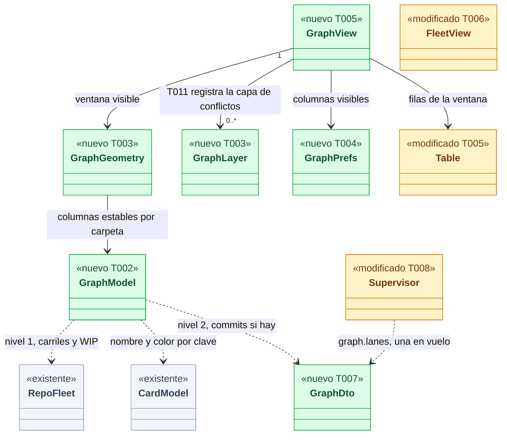
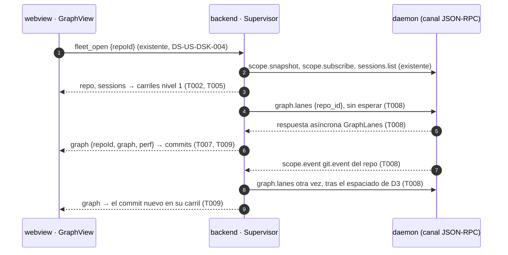
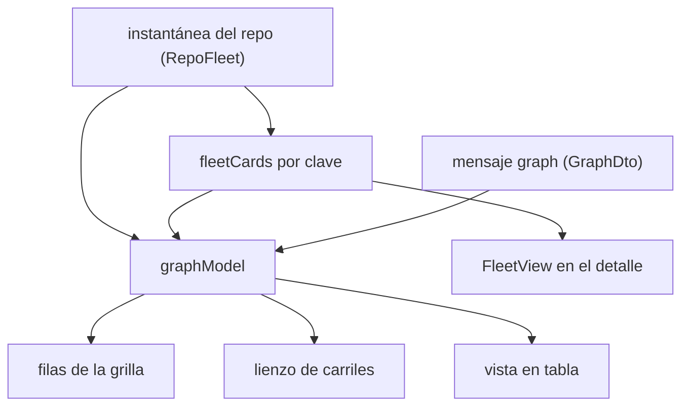
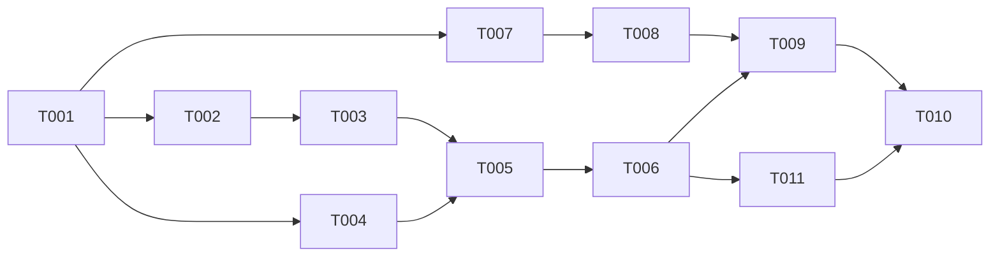

# DS-US-DSK-005 · El grafo de carriles en la app

## Contexto rápido

Al terminar, quien abre un repo en la app ve en el centro un grafo con un carril por rama de agente que sale de la rama base, con el nombre y el color de su agente, una fila WIP con lo que cada copia de trabajo aún no ha commiteado y una cabecera cuyas columnas elige con "Column settings" y que la app recuerda. El carril crece solo: cuando un agente hace un commit, el commit aparece sin recargar. Si la rama base no existe, no hay carriles y la vista dice qué rama falta. Hoy no puede: el centro de la app pinta las tarjetas de la flota (DS-US-DSK-004 D1) y el motor no publica los commits de una rama.

Entra la tercera del orden del orquestador (008 → 007 → 005): el panel de conflictos, la unión `center` de `ui-store`, el `Esc` consumido y `CopyCommand` con su anuncio ya están en `main` con DS-US-DSK-008, y la vista Guardrails con DS-US-DSK-007. La entrega tiene dos niveles. El primero se construye ya con lo que el motor publica hoy en la instantánea del repo: carriles, ↑↓, fila WIP, base ausente o sin confirmar, cabecera configurable y vista en tabla. El segundo pinta los commits de cada carril con la consulta `graph.lanes` de DS-US-CKP-022, que todavía no existe en el motor: sus tareas quedan en `blocked_tasks` hasta que US-CKP-022 y US-CKP-012 estén en `main`. Las reglas del grafo (qué es un carril, qué base cuenta, ventana de 50 commits, "sin atribuir", topes) son las de DS-US-CKP-022 y no se reabren aquí.

| Término | Qué es aquí |
|---|---|
| Carril | La rama de una copia de trabajo dibujada desde su merge-base con la base confirmada (DS-US-CKP-022 D3) |
| Tronco | La copia de trabajo que tiene sacada la rama base: no es carril, es la línea de la base |
| Fila WIP | Una fila por copia de trabajo con cambios sin commitear, encima de la cabeza de su carril (o de la base, si es el tronco) |
| Fila resumen | La fila de un carril cuando sus commits aún no llegaron o no se pueden calcular: rama, agente, ↑↓ y motivo |
| Clave del worktree | La de DS-US-DSK-004: FNV-1a de 64 bits en hex de la ruta cruda; casa carriles, tarjetas y filas WIP |
| Column settings | El popover del engranaje de la cabecera que elige qué columnas se ven (primitives-spec § 2.11) |
| Capa del grafo | Una función de pintado registrada sobre el lienzo, entre las líneas de los carriles y sus nodos (D13); la de conflictos la registra esta historia (T011) |

**Decisiones de esta Dev Spec**: todas son **Decisión del orquestador (2026-11-09), validada por Arquitecto**.

| # | Decisión | Por qué | Alternativa descartada |
|---|---|---|---|
| D1 | **Dos niveles.** Nivel 1, ya: carriles, filas resumen con ↑↓, filas WIP y estados de la base, todo desde `RepoFleet` (instantánea y `worktrees` de DS-US-DSK-004), en vivo por construcción. Nivel 2, bloqueado: los commits de cada carril con `graph.lanes`. La fila resumen se sustituye por los commits del carril cuando llegan | Es D1 de DS-US-CKP-022 llevado a la app: la mitad de los escenarios (1 a nivel de carril, 4, la fila WIP y las columnas) no necesitan la consulta | Esperar a `graph.lanes` para todo: la historia entera quedaría bloqueada por US-CKP-022 y US-CKP-012 |
| D2 | **Sin comando IPC nuevo.** El supervisor del backend pide `graph.lanes` del repo abierto y empuja el resultado por el `Channel` como mensaje `graph`. Esta historia no añade comandos a la lista cerrada de ADR-GRP-017 (la de `main` al entrar, con `guard_blocks` de US-DSK-007) | El repo abierto ya lo fija `fleet_open`; el supervisor es quien sabe cuándo el grafo envejece (D3). Menos superficie y la misma disciplina que la flota | Un comando `graph_lanes { repoId }` de petición y respuesta: suma un comando, deja al webview decidir el ritmo de consultas al pool del daemon y duplica el estado del repo abierto |
| D3 | **Refresco del grafo en el supervisor** (D9 de DS-US-CKP-022): se marca desactualizado al abrir o reabrir el repo, con un `git.event` del repo abierto y con un `worktree.state` que cambie el conjunto de claves, la cabeza o la divergencia de algún worktree. Una sola consulta en vuelo; la siguiente sale cuando han pasado `max(1 s, 2 × duración de la última)`. Al cambiar o cerrar el repo, la consulta en vuelo se cancela con `query.cancel` y su respuesta se descarta. Sin temporizadores si no hay nada pendiente | Coste acotado en el pool de un hilo de DS-US-CKP-012 D4 y NFR-13.8 (sin bucles en reposo). `git.event` es el único aviso de un `--amend` (el stream no lleva el oid de `HEAD`) | Pedir el grafo con cada `worktree.state`: cada archivo guardado por un agente sería una consulta |
| D4 | **Filas intercaladas por fecha**, como el mock B1 y GitKraken: arriba las filas WIP; después la fila de la base; después las filas resumen (en orden de columna) y los commits de todos los carriles por `committedUtcMs` descendente (empate: columna y posición en el carril). Tras el commit más antiguo mostrado de cada carril van su fila "N commits más" (si hay más) y su fila de salida ("sale de main en a1b2c3d") | Es la forma del grafo de B1 (DSF-DSK-001 § 2.2 y § 4.b) y deja ver qué agente avanzó último | Filas agrupadas por carril: más simple, pero esconde el orden temporal y no se parece al grafo que Rene eligió |
| D5 | **Columnas de carril estables**: orden por carpeta, ruta y clave del worktree; nunca por el orden de atención de la flota | En la app la flota no está al lado de cada carril (va en el detalle, D15): reordenar columnas cuando sale un ⚡ haría saltar los carriles y la banda de US-DSK-008 | El orden de la flota (D3 de DS-US-CKP-022): sirve en la TUI porque carril y fila comparten altura |
| D6 | **Nombre y color del carril = los de la tarjeta.** El carril toma `agent.label`, `colorSlot`, símbolo y estado de `CardModel` (`fleetCards`) por clave de worktree. El registro de huecos de color (`assignSlots`) sale de `FleetView` a un almacén no persistido (`useAgentSlots`) que leen la flota y el grafo | Una sola regla de color y nombre (DS-US-DSK-004 D6 y D7, D8 de DS-US-CKP-022). Con el registro en `FleetView`, la flota en un cajón cerrado y el grafo podrían discrepar | Que el grafo calcule su propio color: dos agentes con colores distintos según dónde se miren |
| D7 | **Fila WIP desde la instantánea**: una por worktree `ready` con `counts` > 0, también el tronco; texto "WIP · N archivos sin commit" con el total de `staged + unstaged + untracked`; en el lienzo, nodo hueco en la columna del carril (o de la base) unido a su cabeza. Sin lista de archivos | `WorktreeStatus::Ready.counts` ya llega (`crates/api/src/messages.rs:330-358`; `CountsDto` en `wire.rs`). La lista y el staging son UI-2 (US-DSK-011) | Una sola fila WIP del worktree seleccionado: con varios agentes, el usuario no sabría quién tiene trabajo sin guardar |
| D8 | **Base** (D5 de DS-US-CKP-022 y BR-CKP-EDGE-001), con lo que trae `RepoFleet.repo.base` y la divergencia: `confirmed` → carriles; `unconfirmed` → sin carriles y "Base main sin confirmar: confirma la rama base para ver los carriles"; `invalid` → "Sin rama base: no calculable"; algún worktree con `divergence` `base-missing` (o `graph.base` `base-missing`) → sin carriles y "Rama base develop no encontrada: no calculable". Nunca se usa otra rama. Sin botón "Elegir rama principal" | Panel y vista no pueden discrepar (D5 de DS-US-CKP-022). El botón del mock escribe la configuración del repo: no es de esta historia | Dibujar contra la base resuelta sin confirmar |
| D9 | **Autor = "Tú u otro (sin atribuir)"** en cada commit mientras el motor no publique `graph.commit-actor`; tooltip "GitRaptor aún no sabe qué agente hizo este commit". Nunca autor ni correo de Git. La celda va en `text-text-muted`; el significado completo ("GitRaptor aún no sabe qué agente hizo este commit") entra también en el nombre accesible de la fila (`graph.a11y.commit`), porque el `Tooltip` solo se ve con puntero. La columna sigue visible por defecto (primitives-spec § 2.15) y es la primera en plegarse después de Sha (D11). **Decisión del orquestador (2026-11-09), validada por Diseñador UX** | BR-CKP-CONS-003 (texto literal) y D6/D7 de DS-US-CKP-022: la respuesta no lleva autor ni actor. Cumple el escenario 3 | La columna "Author" con el autor de Git que pinta DSF-DSK-001 § 4.b: el motor no lo publica, por decisión (pantalla compartida) |
| D10 | **Column settings** como fija primitives-spec § 2.11 (Toggle por columna, "Commit message" siempre visible, "Restablecer"). La preferencia vive en un almacén propio del webview, `gitraptor.graph.v1` (Zustand `persist`, versión 1): `columns` (cinco booleanos) y `view` (`graph` o `table`). Al rehidratar solo se aceptan claves conocidas con su tipo; lo demás vuelve al valor por defecto. Igual para todos los repos | Es preferencia cosmética (ADR-GRP-004; ADR-GRP-017 M-3: nada que autorice). Un almacén aparte no toca las cuatro claves de `gitraptor.ui.v1` que fija TS-DSK-001 ni pide migración | Una quinta clave en `gitraptor.ui.v1`: rompe el test de las cuatro claves de TS-DSK-001 y exige versión 2. No guardarla: primitives-spec dice "se guardan por usuario" |
| D11 | **Plegado por anchura del centro** (no de la ventana). El ancho disponible de la grilla (medido con `ResizeObserver` sobre el contenedor de `GraphView`) debe alojar las columnas visibles fijas más 220 px de mensaje; si no, se ocultan, en este orden y sin tocar la preferencia guardada, Sha, Author, Date / Time y Branch / Tag; Graph y Commit message nunca se pliegan. Es el orden y el criterio de primitives-spec § 2.15, enmendada el 2026-11-09 por el Arquitecto para alinearla con D-18 de DSF-DSK-001 (G3): mientras todo commit diga "sin atribuir" (D9), Author repite el mismo texto en cada fila y Date es el dato útil; esta historia es la primera que usa la grilla y su T004 implementa el plegado. Cuentas con las anchuras de § 2.15 (Branch 195, Graph 175, Author 190, Date 120, Sha 84; lateral 252, detalle 352, gutters 12): 1440 px con detalle → centro 788 → Branch, Graph, Message (298) y Date; 1360 px con detalle → 708 → Branch, Graph y Message; 1200 px con cajón cerrado → 912 → todo salvo Sha; 1440 px sin detalle → 1152 → las seis. La grilla solo se desplaza en horizontal si el centro no aloja Graph más 220 px de mensaje. Column settings enseña bajo cada columna plegada `graph.settings.folded` y su interruptor sigue como la persona lo dejó. **Decisión del orquestador (2026-11-09), validada por Diseñador UX** | Es la regla de primitives-spec § 2.15 aplicada al ancho que de verdad hay: a 1440 px con el detalle abierto las seis columnas suman 764 px fijos más el mensaje y no caben (DSF § 2.4) | Plegar solo por anchura de ventana (< 1000 px): a 1440 px la grilla se desplazaría en horizontal, y un novato no encuentra el desplazamiento. Plegar Date antes que Author: esconde el dato que sí sabemos |
| D12 | **Lienzo y virtualización.** La columna Graph se pinta en un `<canvas>` fuera de React (`src/graph/canvas`, ADR-GRP-003 § Enmienda D7 y NFR-13.3); las filas son DOM con la primitiva `Table`, virtualizadas: solo las visibles y un margen, nunca más del doble de las visibles. `Table` gana props aditivas (`firstRowIndex`, `wipIds`, `focusId`, `onFocusOutside`) | NFR-13.3 lo exige. El lienzo solo pinta formas: el texto (rama, asunto, sha) queda en el DOM, accesible y saneado | SVG por fila: miles de nodos con 32 carriles × 50 commits |
| D13 | **Punto de extensión y banda ⚡ en el grafo.** `GraphView` acepta `layers` (capas de lienzo pintadas entre las líneas de los carriles y los nodos, con la geometría de cada columna y fila), `laneBadge` (nodo React en la celda Branch de la cabeza del carril y en la vista en tabla) y `laneA11y` (texto extra para el nombre accesible del carril). **Esta historia registra la capa de conflictos** (T011): US-DSK-008, que entra antes, fija el modelo puro y la insignia (`ConflictBandModel`, `SideRef`, `usePredictionView` en su módulo público `src/conflicts/index.ts`, y `ConflictBand variant="badge"` en `src/ui`, D6 de DS-US-DSK-008); `src/graph/conflict-layer.ts` dibuja la línea entre los carriles `a` y `b` (o hasta la línea de la base) en `danger`, discontinua si `stale` o si las columnas no son contiguas, en la fila de la cabeza más reciente de los dos; un ⚠ es solo insignia. `GraphContent` pasa `layers`, `laneBadge` y `laneA11y` desde `usePredictionView`. `src/graph` solo importa de `src/conflicts` su `index.ts` (tipos y el hook, este solo en `GraphContent`) y nunca `PairDto`, `prediction-model.ts` ni `alerts.ts`. **Decisión del orquestador (2026-11-09), validada por Arquitecto** | El grafo existe solo en esta historia, que llega después: la capa va donde está el lienzo y consume un contrato ya fijado. Así 008 no espera a 005 ni 005 reescribe el modelo | Que 008 escribiese la capa: el lienzo y `GraphGeometry` no existen cuando 008 se implementa. Que 005 derive la banda de los `PairDto`: duplicaría frescura, nombres y orden |
| D14 | **Alternativa textual**: control "Grafo · Tabla" (`SegmentedControl`) en la cabecera y `⌥⌘T`. La tabla tiene una fila por carril: rama, agente, estado, ↑↓ frente a la base y commits (visibles de total). Cada fila del grafo lleva una frase completa como nombre accesible; el lienzo es `aria-hidden` | DSF-DSK-001 § 4.b (estado "sin color / lector de pantalla") y § 7 (2.1.1, 1.4.1) | Solo nombres accesibles en el grafo: no da una vista de resumen equivalente para quien no ve el dibujo |
| D15 | **La flota pasa al detalle**: `FleetView` va al panel derecho con el título "Estado de Agentes"; el centro es el grafo. Sin lista de pestañas hasta que exista la segunda ("Cambios sin commit", US-DSK-010/011) | Es lo que dejó escrito DS-US-DSK-004 D1. En 1000–1359 px el detalle es un cajón cerrado, pero cada carril ya dice su agente y su estado. El tooltip del toggle del detalle nombra su contenido (`detail.agents.show` / `.hide`: "Mostrar estado de agentes") para que se encuentre la flota sin abrirlo a ciegas. **Decisión del orquestador (2026-11-09), validada por Diseñador UX** | Una lista de pestañas con una sola pestaña |
| D16 | **Sin animación de crecimiento** ni anuncio por commit: un commit nuevo aparece en su fila. Solo un cambio del estado de la base se anuncia (`role="status"`) | DSF § 7 (movimiento reducido) y ruido para el lector de pantalla con varios agentes commiteando | Anunciar cada commit |
| D17 | **Motor sin `graph.lanes`** en `hello.methods` → mensaje `graphUnavailable { reason: "unsupported" }`: el grafo se queda en el nivel 1 con la nota "Este motor no ofrece los commits del grafo; actualiza o reinicia GitRaptor". `query-busy` → se reintenta tras el espaciado de D3, sin aviso. Otro rechazo → `graphUnavailable { reason: "failed" }`: se conserva lo último con "No se pudieron leer los commits ahora" | D11 de DS-US-CKP-022 y descubrimiento por `hello.methods` (ADR-GRP-016 § 1; `crates/api/src/messages.rs:57`) | Fallar todo el centro |
| D18 | **Nombre del agente en texto normal, color en un punto.** En la celda Branch el nombre del agente va en `text-text-main` (o `text-text-muted` si no hay agente), precedido de un punto de 8 px `bg-lane-<hueco>` en `aria-hidden`. No se usa `text-lane-<hueco>`: los colores de carril solo tienen contraste no textual sobre `panel` (3.33:1 a 9.73:1 en oscuro, 4.47:1 a 7.57:1 en claro, DSYS-GRP-002) y fallan 4.5:1 como texto (WCAG 1.4.3). El punto y los carriles viven siempre sobre `panel`, nunca sobre `control`. **Decisión del orquestador (2026-11-09), validada por Diseñador UX** | El color identifica, el nombre lo dice (1.4.1) | Texto en color de carril: ilegible con `lane.6` en oscuro y `lane.1` en claro |
| D19 | **Base sin confirmar: el aviso con el comando es uno solo.** El `StatePanel` del grafo dice `graph.base.unconfirmed` y no repite el comando; el aviso con `CopyCommand` del comando de confirmar (construido en el backend con la ruta absoluta de `raptor` y la del repo, D11 de DS-US-DSK-008) lo pinta el panel de conflictos encima del grafo, en el mismo centro; 008 ya está en `main` cuando entra esta historia. `base-missing` y `no-base` añaden una línea de causa (`graph.base.missingHint`) y siguen sin botón. **Decisión del orquestador (2026-11-09), validada por Diseñador UX** | Dos comandos iguales en la misma pantalla confunden; el comando es el de US-GRD-014: confirmar la línea base del equipo fija la rama base confirmada que publica `RepoView.base` (verificado, G4) | Pintar el comando también en el grafo |
| D20 | **Carriles y lienzo.** `LANE_GAP` = 16 px y `NODE_R` = 4 px se confirman; `LANE_GAP_MIN` sube de 6 a 8 px (con 6 px y radio 3 px los nodos se tocan); `NODE_R_MIN` = 3 px. Con 175 px caben la base más 20 carriles al paso mínimo; los que no caben no se dibujan en el lienzo, la celda Branch de su fila sigue diciendo su agente y la nota `graph.clipped` remite a la vista en tabla, que los lista todos. **Decisión del orquestador (2026-11-09), validada por Diseñador UX** | Con 6 px entre ejes y radio 3 px los círculos son tangentes: un carril se confunde con el vecino; 8 px dejan 2 px de aire | Ensanchar la columna Graph: rompe el presupuesto de § 2.15 a 1440 px |
| D21 | **Cambio de vista anunciado.** `⌥⌘T` y el `SegmentedControl` alternan Grafo y Tabla sin mover el foco; una región `role="status"` dice `graph.view.announce.graph` / `.table`. El `Tooltip` del control muestra el atajo y la ayuda `?` (§ 5 de DSF-DSK-001) lo lista. `⌥⌘T` coincide con "Mostrar u ocultar barra de herramientas" de los menús estándar de macOS: la app de Tauri no define hoy ese menú; si se añade un menú nativo con ese atajo, hay que cambiar uno de los dos. **Decisión del orquestador (2026-11-09), validada por Diseñador UX** | Quien usa lector de pantalla no ve que la vista cambió | Cambiar de vista sin anuncio |
| D22 | **"Volver" nombra la vista principal.** Con el grafo en el centro, los botones de DS-US-DSK-007 (`grd.view.back`) y DS-US-DSK-008 (`conflicts.detail.back`) dicen "Volver al grafo" / "Back to the graph" (T006 reescribe esos dos textos). Cada destino del centro (par, Guardrails, Time Machine) es excluyente y vuelve a la vista principal. **Decisión del orquestador (2026-11-09), validada por Diseñador UX** | "Volver a la flota" sería falso: la flota está en el detalle | Dejar el texto y que lleve al grafo |

---

## 📋 Índice

> **Para aprobar:** [Contexto rápido](#contexto-rápido) · [⚠️ Gaps](#gaps-y-violaciones-de-la-constitución) · [🔭 La forma](#la-forma) · [El trabajo de un vistazo](#el-trabajo-de-un-vistazo).
> **Para implementar:** [🚀 Plan](#plan-de-implementación), en orden. Las `_(ref)_` se abren desde la tarea que las cita.

| Sección | Propósito |
|---------|-----------|
| [Contexto rápido](#contexto-rápido) | Qué se construye, glosario y decisiones |
| [⚠️ Gaps y violaciones de la constitución](#gaps-y-violaciones-de-la-constitución) | Qué impide liberar y de qué depende |
| [🔭 La forma](#la-forma) | Piezas, flujo y capas |
| [🚀 Plan de implementación](#plan-de-implementación) | T001…T010, en orden |
| ↳ [El trabajo de un vistazo](#el-trabajo-de-un-vistazo) | Tareas en tabla y su orden |
| [Estructura de ficheros](#estructura-de-ficheros) _(ref)_ | Árbol anotado |
| [Contratos compartidos](#contratos-compartidos) _(ref)_ | Tipos, mensajes, firmas y textos |
| [Contrato de API](#contrato-de-api) _(ref)_ | Comandos IPC y lo que se consume del canal |
| [Estrategia de pruebas y cobertura](#estrategia-de-pruebas-y-cobertura) _(ref)_ | Escenarios → tests |
| [Gate de seguridad](#gate-de-seguridad) | Checklist pre-merge |
| [Fuera de alcance](#fuera-de-alcance) | Lo que esta entrega no toca |
| [Notas del autor](#notas-del-autor) _(ref)_ | Lo que no bloquea |

---

## ⚠️ Gaps y violaciones de la constitución

| ID | Qué falta | Severidad | Alcance | Acción | Owner |
|----|-----------|-----------|---------|--------|-------|
| G1 | NFR-13.4 pide que un commit nuevo aparezca "sin volver a pedir el grafo entero (solo el carril afectado)" (`docs/architecture/non-functional.md:200`), y `graph.lanes` solo acepta `repo_id` (DS-US-CKP-022 § Contrato de API): la app vuelve a pedir todos los carriles. La caché por carril del daemon (D9 de DS-US-CKP-022) solo recorre el carril que cambió, pero la respuesta lleva todos | Bloquea liberación | — | Decidir si NFR-13.4 se lee como "solo se recorre el carril afectado" (enmienda de su texto) o si `graph.lanes` gana un filtro opcional de carriles (enmienda de DS-US-CKP-022, aditiva) antes del gate de rendimiento de la release | Arquitecto |

**Dependencias de orden (`blocked_by`)**: no son decisiones abiertas; el contrato que se consume ya está fijado en DS-US-CKP-022 (`approved`) y cada pieza tiene dueño y ruta. Mientras no estén en `main`, T007 a T010 (`blocked_tasks`) no empiezan; T001 a T006 sí. T011 (capa de conflictos) espera a US-DSK-008, que el orden del orquestador (008 → 007 → 005) ya pone en `main` antes de esta historia.

- **`graph.lanes` no existe en el motor** (DEP-CKP-2). `crates/api/src/methods/` no tiene `graph.rs` ni `query.rs` (comprobado el 2026-11-09: ningún `"graph.` ni `QueryPool` en `crates/` ni en `apps/`). Lo entregan T002 y T003 de DS-US-CKP-022 (US-CKP-022), que a su vez esperan a T003 de DS-US-CKP-012 (`QueryPool`, `query.cancel`, US-CKP-012). Alcanza a T007 y lo que depende de ella.
- **La biblioteca cliente no envía sin esperar.** `Client` solo tiene `call` y `next_incoming` (`crates/api/src/client/mod.rs:414`, `:501`) e `Incoming` solo `Buffered` y `Frame` (`:222-231`); el `Link` de la app tira cualquier respuesta leída fuera de un `call` (`apps/desktop/src-tauri/src/engine/link.rs:139`). `Client::submit`/`settle` e `Incoming::Reply` los entrega T004 de DS-US-CKP-012 (US-CKP-012). Alcanza a T008.
- **US-CKP-022 está en `draft`** aunque su Dev Spec esté `approved`: el PO la pasa a `ready` antes de que su worker arranque (orquestador).

Verificado en el código el 2026-11-09 para el nivel 1: `RepoView.base` con `BaseBranchView { name, status }` (`crates/api/src/messages.rs:152`, `:241-258`); `DivergenceView` con `counted`, `base-missing`, `no-base`, `no-commits` y `unreadable` (`:267-283`); `HeadView` (`:305-313`); `WorktreeStatus::Ready { head, counts, changes, divergence }` y `ChangeCounts` (`:330-358`); `WorktreeView` (`:368-420`). La app ya los lleva al webview como `RepoFleetDto`, `WorktreeDto`, `ReadyDto`, `CountsDto` y `DivergenceDto` (`apps/desktop/src-tauri/src/engine/wire.rs:90-190`). `git.event` es un evento del ámbito del repo (`crates/api/src/event.rs:117`, `:167-174`, `:198`) que hoy `ingest::repo_event` ignora (`ingest.rs:286`).

---

## 🔭 La forma

Al terminar, el centro es `GraphView`: una grilla virtualizada con el lienzo de carriles en la columna Graph, alimentada por la flota (nivel 1) y por el mensaje `graph` del supervisor (nivel 2). La flota se pinta en el detalle.



🟩 nuevo · 🟨 modificado · ⬜ existente (contexto: no cambia). Cada pieza dice qué tarea la toca.

`GraphModel` es pura y no sabe si los commits llegaron: con `GraphDto` ausente da filas resumen; con él, filas de commit. `GraphView` admite cero o más capas: esta historia registra una, la de conflictos (T011), sobre el modelo público de US-DSK-008.

**Cómo fluye:**



El paso que no se adivina es el 4: la respuesta llega en otro momento por la misma conexión, y el `Link` de la app hoy la descarta (`link.rs:139`). La frontera publicada que cambia es el `Channel` (mensajes `graph` y `graphUnavailable`); el canal JSON-RPC no cambia por esta historia.

**Dónde acaba el dato:**



Nombre, color y estado de un agente salen una vez, de `fleetCards` con el registro compartido de D6, y llegan iguales a la tarjeta, al carril y a la tabla; lo comprueba `GraphView.test.tsx` › `a lane and its card share name, colour slot and state`.

---

## 🚀 Plan de implementación

> Orden topológico (`Depende:`). Las rutas son relativas a la raíz del repo. T007 a T010 están en `blocked_tasks`: esperan a US-CKP-022 y US-CKP-012 (§ Gaps).

### El trabajo de un vistazo

Tres frentes y un cierre: el grafo con lo que ya se publica (T001–T006), la banda ⚡ sobre el modelo de US-DSK-008 (T011), los commits por `graph.lanes` (T007–T009, bloqueados) y la verificación en macOS (T010).

| # | Tarea | Depende | Aterriza en |
|---|---|---|---|
| T001 | Escribir en rojo los tests del grafo y fijar sus tipos | — | `apps/desktop/src/graph`, `apps/desktop/src/client` |
| T002 | Calcular las filas del grafo | T001 | `apps/desktop/src/graph/graph-model.ts` |
| T003 | Calcular la geometría y pintar el lienzo | T002 | `apps/desktop/src/graph/graph-layout.ts`, `apps/desktop/src/graph/canvas` |
| T004 | Guardar la configuración de columnas | T001 | `apps/desktop/src/graph/graph-prefs.ts` |
| T005 | Pintar el grafo con Column settings y la vista en tabla | T003, T004 | `apps/desktop/src/graph`, `apps/desktop/src/ui`, `apps/desktop/src/i18n` |
| T006 | Llevar el grafo al centro y la flota al detalle | T005 | `apps/desktop/src/engine`, `apps/desktop/src/shell`, `apps/desktop/src/fleet` |
| T007 | Escribir en rojo los tests del grafo en el backend y fijar su DTO | T001 | `apps/desktop/src-tauri` |
| T008 | Pedir `graph.lanes` desde el supervisor | T007 | `apps/desktop/src-tauri/src/engine` |
| T009 | Guardar el grafo en la caché y pintar los commits | T008, T006 | `apps/desktop/src/state`, `apps/desktop/src/graph` |
| T010 | Verificar de punta a punta en macOS | T009, T011 | — |
| T011 | Dibujar la banda ⚡ en el grafo con el modelo de US-DSK-008 | T006 | `apps/desktop/src/graph/conflict-layer.ts`, `apps/desktop/src/engine` |

### En qué orden

Dos ramas desde T001: la del webview (T002 → T003 → T005 → T006, con T004 en paralelo) se construye ya; la del backend (T007 → T008) espera a sus dependencias y se une en T009; la banda ⚡ (T011) sale de T006 y entra en la verificación de T010.



### T001 — Escribir en rojo los tests del grafo y fijar sus tipos

**Objetivo.** Los tests de TypeScript de los escenarios y de las reglas del grafo, y los tipos que comprueban. Fuera: los tests de Rust (T007).

**Ubicación.**
- `apps/desktop/src/graph/graph-types.ts` (**CREATE**: tipos de § Contratos compartidos)
- `apps/desktop/src/client/engine-types.ts` (**MODIFY**: `GraphDto` y los mensajes `graph` y `graphUnavailable`)
- `apps/desktop/src/graph/fixtures.ts` (**CREATE**)
- `apps/desktop/src/graph/graph-model.test.ts` (**CREATE**)
- `apps/desktop/src/graph/graph-layout.test.ts` (**CREATE**)
- `apps/desktop/src/graph/graph-prefs.test.ts` (**CREATE**)
- `apps/desktop/src/graph/GraphView.test.tsx` (**CREATE**)

**Reglas**
- `fixtures.ts` reutiliza el guion "tienda" de DS-US-DSK-004 (`src/fleet/fixtures.ts`): base `main` confirmada; tronco en `main` con 3 archivos sin commitear; `feat-pagos` de `claude-1` (↑3 ↓1, 2 archivos); `feat-login` de `claude-2` (↑1 ↓0, limpio). Más: "tienda-develop" (base `develop` confirmada, todos los worktrees con `base-missing`), "tienda-sin-confirmar" (`unconfirmed`) y un `GraphDto` de "tienda" con los commits de los dos carriles y un carril `too-slow`.
- Los nombres de los tests son los de [§ 9.4](#94-comportamientos-críticos-verificados).
- Los stubs exportan las firmas de § Firmas del stack y lanzan `Error("not implemented")`: compilan y los tests fallan.

- **Depende:** —
- **Refs:** escenarios de US-DSK-005; DS-US-CKP-022 § Contratos compartidos
- **Aceptación:** `pnpm --filter @gitraptor/desktop test -- src/graph` compila y falla (rojo); se commitea antes de T002.

### T002 — Calcular las filas del grafo

**Objetivo.** `graphModel`, pura: de la flota, las tarjetas y el grafo (si hay) a filas ordenadas y carriles. Fuera: geometría y pintado.

**Ubicación.**
- `apps/desktop/src/graph/graph-model.ts` (**CREATE**)

**Reglas**
- Base (D8): `unconfirmed` → `state: "base-unconfirmed"`; `invalid` → `"no-base"`; algún worktree `ready` con `divergence` `base-missing`, o `graph.base` `not-computable` con `base-missing` → `"base-missing"` con el nombre; `graph.base` `repo-unavailable` → `"repo-unavailable"`. En los cuatro, `lanes: []` y solo filas WIP del tronco (si las hay) y la fila de la base.
- Tronco: el worktree `ready` cuya cabeza es `branch` con el nombre de la base. No es carril; su WIP va en la columna `base`.
- Carriles: todos los demás worktrees, incluido el principal si no tiene la base sacada (D3 de DS-US-CKP-022). Rama → su nombre; `unborn` → nombre y `graph.lane.unborn`; `detached` → la carpeta; `unavailable` → fila resumen con `fleet.unavailable.<motivo>`.
- Orden de columnas (D5): `folder`, después `path`, después `key`, comparados con `localeCompare` sin opciones de idioma.
- Agente del carril (D6): la `CardModel` con la misma `key`: `agent.label`, `agent.colorSlot`, `symbol`, `stateText`; sin tarjeta, "Sin agente" atenuado.
- Filas WIP (D7): una por worktree `ready` con `counts` > 0, arriba, en orden de columna (el tronco primero).
- Sin `graph` para el repo, o con `graphUnavailable`: una fila resumen por carril con ↑↓ (texto de `fleet.sync.*`) y `graph.lane.loading` (o la nota de D17). Con `graph`: los carriles `ready` dan filas de commit (D4) y, si `total.count` > commits mostrados, una fila `more`; después la fila `fork` con los 7 primeros dígitos de `mergeBase`. Los carriles `not-computable` dan su fila resumen con `graph.lane.gap.<motivo>`. Un carril de `graph` cuya `worktreeKey` no está en la flota se ignora; un worktree de la flota sin carril en `graph` (cortado por `cut`) da fila resumen con `graph.lane.cut`.
- Commit: autor `graph.author.unattributed` (D9), sha de 7 dígitos, fecha `committedUtcMs`, `merge` como marca. La cabeza del carril es su commit más reciente (`head: true`).
- Ningún carril tiene commits propios (todos `counted` con `ahead.count` 0, o no hay carriles) → `empty: true` (estado "vacío · sin carriles" de DSF § 4.b); los carriles se siguen listando.
- Nombre accesible de cada fila: las claves `graph.a11y.*`, con las partes visibles unidas por ", " (DSF § 7), más `laneA11y(key)` si se pasa.

> **Nota técnica.** El texto de rama, carpeta y asunto llega saneado del backend (`display::visible`); aquí no se vuelve a sanear ni se interpreta como HTML: React lo pinta como texto.

- **Depende:** T001
- **Refs:** D1, D4–D9; DS-US-CKP-022 D3, D5, D7, D13; BR-CKP-CALC-004, BR-CKP-EDGE-001, BR-CKP-CONS-003
- **Aceptación:** `graph-model.test.ts` en verde (§ 9.4).

### T003 — Calcular la geometría y pintar el lienzo

**Objetivo.** La posición de cada columna y fila y el pintor del lienzo con su punto de extensión de capas. Fuera: la grilla DOM (T005).

**Ubicación.**
- `apps/desktop/src/graph/graph-layout.ts` (**CREATE**)
- `apps/desktop/src/graph/canvas/paint.ts` (**CREATE**)
- `apps/desktop/src/graph/canvas/colors.ts` (**CREATE**)
- `apps/desktop/src/graph/canvas/paint.test.ts` (**CREATE**)

**Reglas**
- `graphLayout(model, graphWidthPx)`: columna `base` en `x = LANE_GAP / 2`; carril `i` en `x = base + (i + 1) × gap`, con `gap = max(LANE_GAP_MIN, min(LANE_GAP, (graphWidthPx − LANE_GAP) / (carriles + 1)))`; radio del nodo `NODE_R`, o `NODE_R_MIN` si `gap < 10`. Cada carril ocupa de su primera fila (WIP o cabeza) a su fila `fork`; la base, de su fila a la última `fork`. Los carriles cuyo `x` pasa de `graphWidthPx` no se dibujan y `GraphGeometry.clipped` cuenta cuántos son (D20).
- `paint(ctx, geometry, window, layers, colors)`: limpia; pinta la línea de la base; pinta las líneas de los carriles con 1,5 px (DSF § 4.b) y la curva de salida a la base en su fila `fork`; llama `layer.draw` de cada capa en orden; pinta los nodos (lleno para commit, hueco para WIP, doble para `merge`). Solo pinta las filas de `window`.
- Color: `colors.ts` lee `--gr-lane-base` y `--gr-lane-1` … `--gr-lane-7` con `getComputedStyle(document.documentElement)` al montar y al cambiar `data-theme`; carril sin agente o terminado en `--gr-text-muted`. Ningún color literal (ADR-GRP-003).
- El lienzo no pinta texto. Escala por `devicePixelRatio`.

- **Depende:** T002
- **Refs:** D5, D12, D13; NFR-13.3; DSYS-GRP-002 (`glass.lane.*`)
- **Aceptación:** `graph-layout.test.ts` y `paint.test.ts` en verde (§ 9.4); `paint.test.ts` usa un contexto 2D falso que registra las llamadas y comprueba que una capa registrada se llama entre las líneas y los nodos.

### T004 — Guardar la configuración de columnas

**Objetivo.** La preferencia de columnas y de vista, persistida en el webview y validada al leerla.

**Ubicación.**
- `apps/desktop/src/graph/graph-prefs.ts` (**CREATE**)

**Reglas**
- Zustand con `persist`, `name: "gitraptor.graph.v1"`, `version: 1`. Estado: `columns: { branch, graph, author, date, sha }` (booleanos, por defecto todos `true`) y `view: "graph" | "table"` (por defecto `"graph"`). Acciones: `setColumn(id, on)`, `resetColumns()`, `setView(view)`.
- `merge` propio: de lo guardado solo toma `columns.<id>` booleanos de ids conocidos y `view` si es uno de los dos valores. Cualquier otra cosa (tipo distinto, clave desconocida, JSON roto) deja el valor por defecto. Nunca lanza.
- `visibleColumns(prefs, availableWidthPx): GraphColumnId[]`: `message` siempre; las demás según `prefs`; mientras la suma de los anchos fijos visibles más 220 no quepa en `availableWidthPx`, quita en orden `sha`, `author`, `date`, `branch` (D11; `graph` nunca). Orden de salida: `branch`, `graph`, `message`, `author`, `date`, `sha`. `folded(prefs, availableWidthPx)` devuelve las que la preferencia pide y no caben (las usa Column settings).
- `gitraptor.ui.v1` no cambia: el test de las cuatro claves de TS-DSK-001 sigue en verde.

> **Nota técnica.** `persist` de Zustand mezcla por defecto lo guardado sobre el estado inicial sin validarlo: un `localStorage` editado a mano metería tipos arbitrarios. Por eso el `merge` es propio.

- **Depende:** T001
- **Refs:** D10, D11; ADR-GRP-004; ADR-GRP-017 M-3; primitives-spec § 2.11 y § 2.15
- **Aceptación:** `graph-prefs.test.ts` en verde (§ 9.4); `src/state/ui-store.test.ts` sigue en verde.

### T005 — Pintar el grafo con Column settings y la vista en tabla

**Objetivo.** `GraphView` con la grilla virtualizada, el lienzo, Column settings y la vista en tabla, en en/es y accesible. Fuera: montarlo en el centro (T006) y los commits reales (T009).

**Ubicación.**
- `apps/desktop/src/graph/GraphView.tsx` (**CREATE**)
- `apps/desktop/src/graph/GraphCanvas.tsx` (**CREATE**)
- `apps/desktop/src/graph/ColumnSettings.tsx` (**CREATE**)
- `apps/desktop/src/graph/LaneTable.tsx` (**CREATE**)
- `apps/desktop/src/graph/LaneTable.test.tsx` (**CREATE**)
- `apps/desktop/src/ui/Table.tsx` (**MODIFY**: props aditivas)
- `apps/desktop/src/ui/Table.test.tsx` (**MODIFY**)
- `apps/desktop/src/shell/useShortcuts.ts` (**MODIFY**: `⌥⌘T`)
- `apps/desktop/src/i18n/locales/en.json` (**MODIFY**)
- `apps/desktop/src/i18n/locales/es.json` (**MODIFY**)

**Reglas**
- `Table` gana, sin cambiar lo existente: `firstRowIndex?: number` (por defecto 0; `aria-rowindex = firstRowIndex + i + 2`), `wipIds?: ReadonlySet<string>` (una fila es WIP si su id es `wipId` o está en `wipIds`), `focusId?: string | null` (si cambia y la fila está pintada, recibe el foco) y `onFocusOutside?: (absoluteIndex: number) => void` (flechas, `PageUp`/`PageDown`, `Home`/`End` con destino fuera de las filas pintadas; `Home` es 0 y `End` es `totalRows − 1`). Sin `onFocusOutside`, el comportamiento actual.
- `GraphView`: contenedor con desplazamiento vertical; altura de fila `--gr-size-graph-row`; ventana = filas visibles más un margen de `OVERSCAN` por arriba y por abajo, sin pasar del doble de las visibles (NFR-13.3); espaciadores arriba y abajo. `onFocusOutside` desplaza hasta la fila y fija `focusId`. `Table` con `label` `graph.title`, columnas de `visibleColumns` con los anchos de primitives-spec § 2.15, `settings` = `ColumnSettings`, `disabled` = centro `stale`, `loading` sin instantánea del repo. `GraphView` mide su contenedor con `ResizeObserver` (un cambio de tamaño por fotograma como mucho, sin bucle en reposo) y pasa el ancho a `visibleColumns` y a `graphLayout` (D11).
- Celdas: Branch → en la cabeza del carril (o su fila resumen), símbolo de estado, nombre de rama en `<code>`, punto `bg-lane-<hueco>` en `aria-hidden` y nombre del agente en `text-text-main` (o `text-text-muted` sin agente) (D18) y `laneBadge(key)`; en la fila de la base, nombre y `graph.base.label`. Graph → vacía en el DOM (`aria-hidden`), la pinta `GraphCanvas`. Commit message → asunto, texto de la fila WIP, resumen, "N más" o salida; si Branch está oculta, la cabeza del carril antepone la rama al mensaje. Author → `graph.author.unattributed` en `text-text-muted` con `Tooltip` `graph.author.tooltip` en filas de commit (el significado también va en el nombre accesible, D9); vacía en las demás. Date / Time → `Intl.DateTimeFormat(idioma, { dateStyle: "short", timeStyle: "short" })`. Sha → 7 dígitos en `<code>`.
- `GraphCanvas`: un `<canvas aria-hidden="true">` sobre la columna Graph del área visible; repinta en un `requestAnimationFrame` cuando cambian el modelo, la ventana, el ancho o el tema; ningún bucle sin cambios (NFR-13.8). Oculta la columna Graph, no pinta.
- Estados del centro: sin instantánea → `loading`; base con problema (D8) → la fila de la base y un `StatePanel` corto con el texto (`role="status"` anuncia el cambio, D16); `empty` → la línea de la base y `graph.empty.noLanes`; `graphUnavailable` → nota bajo la cabecera (D17); `cut` → nota `graph.cut`; carriles que no caben en el lienzo → nota `graph.clipped` (D20). Con el motor desconectado el grafo se atenúa con `text-text-muted` y `data-stale`, no con `opacity`, y la cabecera lleva la hora del último dato. Estados cubiertos (DSF § 4.b): cargando, base sin confirmar, sin base, base no encontrada, vacío sin carriles, nivel 1 sin commits, `graphUnavailable`, corte de carriles, desconectado, sin color (vista en tabla).
- `ColumnSettings`: `Popover` con título `graph.settings.title`, un `Toggle` por columna (Commit message encendido, `disabled` y con la pista `graph.settings.alwaysVisible`) y `Button variant="link" size="sm"` `graph.settings.reset`. Disparador `IconButton` del engranaje con `ui.table.settings`. Los cambios se aplican al momento. Una columna plegada por falta de ancho conserva su interruptor y lleva `graph.settings.folded` en `text-text-muted`, enlazado con `aria-describedby`.
- Vista: `SegmentedControl` `graph.view.*` en la cabecera y `⌥⌘T` en `useShortcuts` alternan `view` y la región `role="status"` de D21 lo anuncia; el foco no se mueve. El `Tooltip` del control incluye `⌥⌘T`. `GraphView` ignora `⌥⌘T` si el foco está en un campo de texto. `LaneTable` (con la primitiva `Table`): una fila por carril con rama, agente, estado, ↑↓ y commits ("12 de 72", o "—" sin `graph`), más `laneBadge(key)`.
- Ningún color, radio ni tamaño literal; clases de tokens (ADR-GRP-003).

- **Depende:** T003, T004
- **Refs:** D9–D14, D16–D21; DSF-DSK-001 § 2.2, § 2.4, § 4.b, § 7, § 8, § 12; primitives-spec § 2.11, § 2.15; NFR-09, NFR-13.3
- **Aceptación:** `GraphView.test.tsx`, `LaneTable.test.tsx` y `Table.test.tsx` en verde (§ 9.4); `axe-core` sin violaciones a 1440 y 1200 px en en y es con las vistas de grafo y de tabla; `catalog.test.ts` en verde.

### T006 — Llevar el grafo al centro y la flota al detalle

**Objetivo.** El centro pinta `GraphView` con la flota del repo abierto; el detalle pinta `FleetView` como "Estado de Agentes". Nivel 1 de punta a punta.

**Ubicación.**
- `apps/desktop/src/engine/EngineCenter.tsx` (**MODIFY**: `FleetContent` → `GraphContent`; conserva el panel de conflictos y los destinos del centro)
- `apps/desktop/src/shell/AppShell.tsx` (**MODIFY**: detalle con `FleetView`)
- `apps/desktop/src/shell/AppShell.test.tsx` (**MODIFY**)
- `apps/desktop/src/fleet/useAgentSlots.ts` (**CREATE**)
- `apps/desktop/src/fleet/useAgentSlots.test.tsx` (**CREATE**)
- `apps/desktop/src/fleet/FleetView.tsx` (**MODIFY**: lee los huecos de `useAgentSlots`)
- `apps/desktop/src/fleet/FleetView.test.tsx` (**MODIFY**)
- `apps/desktop/src/graph/useGraph.ts` (**CREATE**)
- `apps/desktop/src/i18n/locales/en.json` (**MODIFY**)
- `apps/desktop/src/i18n/locales/es.json` (**MODIFY**)

**Pasos**
1. Crear `useAgentSlots`: almacén Zustand **sin** `persist` con `{ repoId, slots: Map<sessionId, number> }`; `useAgentSlotsSync(fleet)` lo actualiza con `assignSlots` cuando cambian las sesiones presentes y lo vacía al cambiar de repo; `useAgentSlot(sessionId)` lo lee.
   1.1 ⛔6.1 Montar `useAgentSlotsSync` en un solo sitio (`GraphContent`). Si lo montan también `FleetView` y el grafo, dos escritores reasignan huecos y un agente cambia de color al abrir el cajón.
2. Cambiar `FleetView` para que tome el hueco de `useAgentSlot` y deje su `useRef` (DS-US-DSK-004 T004).
3. Crear `useGraph()`: lee `useFleet()` (DS-US-DSK-004), calcula `fleetCards` y `graphModel` con `useMemo` y, hasta T009, `graph: null`.
4. En `EngineCenter`, el estado `content` monta `GraphContent` (`useAgentSlotsSync`, `useGraph`, `GraphView`) en lugar de `FleetContent`. El `ConflictPanel` de US-DSK-008 sigue encima de la vista principal y los destinos `pair` y `guardrails` de `center` siguen sustituyéndola; con `center.view === "main"` el centro pinta el panel y el grafo. `Esc` y `backToMain()` no cambian (los dejó 008; esta tarea no toca `useShortcuts` salvo `⌥⌘T` de T005).
5. En `AppShell`, el panel de detalle pasa a llevar `heading={t("detail.agents.title")}` (sin lista de pestañas, D15) y `FleetView` del repo abierto; sin repo abierto, nada. Los estados del motor (`EngineBand`) no cambian. El toggle del detalle (`⌥⌘B`) usa `detail.agents.show` / `.hide` como etiqueta y tooltip.
5.1 Reescribir en `en.json` y `es.json` los textos de `grd.view.back` y `conflicts.detail.back` a "Volver al grafo" / "Back to the graph" (D22).
6. Mover la marca `gr:fleet-delta-painted` de DS-US-DSK-004 T006 tal cual (sigue en `FleetView`) y añadir `gr:graph-painted` tras pintar la primera ventana del grafo con la instantánea del repo.
   6.1 La primera pintura útil (`gr:first-meaningful-paint`, `App.tsx`) no cambia de regla: la instantánea del repo pintada; ahora la pinta el grafo.

- **Depende:** T005
- **Refs:** D6, D15; DS-US-DSK-004 D1, D7; NFR-13.6
- **Aceptación:** `pnpm --filter @gitraptor/desktop test -- AppShell FleetView useAgentSlots GraphView` en verde, con «a lane and its card share name, colour slot and state».
- **Guard ⛔6.1:** `pnpm --filter @gitraptor/desktop test -- useAgentSlots -t "opening the detail does not reassign colour slots"`

### T007 — Escribir en rojo los tests del grafo en el backend y fijar su DTO

**Objetivo.** Los tests de Rust del nivel 2 contra el daemon falso, el DTO del mensaje `graph` y su saneado. Espera a que `gitraptor_api::graph` exista (US-CKP-022).

**Ubicación.**
- `apps/desktop/src-tauri/src/engine/wire.rs` (**MODIFY**: `Graph`, `GraphUnavailable` y los DTO de § Contratos compartidos)
- `apps/desktop/src-tauri/src/engine/ingest.rs` (**MODIFY**: `graph`, `graph_trigger`)
- `apps/desktop/src-tauri/tests/graph_ingest.rs` (**CREATE**)
- `apps/desktop/src-tauri/tests/graph_supervisor.rs` (**CREATE**)
- `apps/desktop/src-tauri/tests/support/fake_daemon.rs` (**MODIFY**: `graph.lanes` asíncrono en "tienda", `hello.methods` con y sin él)
- `apps/desktop/src-tauri/tests/engine_wire.rs` (**MODIFY**: fixture con las variantes nuevas)

**Reglas**
- `ingest::graph(&GraphLanes) -> GraphDto`: `worktreeKey = key(lane.worktree.raw())` (la ruta cruda nunca se manda); rama y base por `visible(…, NAME_MAX_CHARS)`; `summary` por `visible(…, TEXT_MAX_CHARS)`; `oid` y `merge_base` solo si son 40 o 64 dígitos hex: un commit con `oid` inválido se omite, un carril con `merge_base` inválido pasa a `not-computable` `unreadable`. `committed_utc_ms` negativo → el commit se omite.
- `ingest::graph_trigger(&Event) -> bool`: `true` para `git.event`.
- El falso de "tienda" responde `graph.lanes` con el `GraphDto` de T001 tras 30 ms, y "tienda-develop" con `base: not-computable base-missing`.

- **Depende:** T001
- **Refs:** D2, D17; DS-US-CKP-022 § Contratos compartidos y § Contrato de API; SEC-12
- **Aceptación:** `cargo test -p gitraptor-desktop --test graph_ingest` en verde; `--test graph_supervisor` compila y falla (rojo); se commitea antes de T008.

### T008 — Pedir `graph.lanes` desde el supervisor

**Objetivo.** El supervisor pide los carriles del repo abierto sin bloquear el stream y los manda al webview con el ritmo de D3. Espera a `Client::submit`/`settle` e `Incoming::Reply` (US-CKP-012).

**Ubicación.**
- `apps/desktop/src-tauri/src/engine/link.rs` (**MODIFY**: `submit`, `reply`, `cancel`)
- `apps/desktop/src-tauri/src/engine/supervisor.rs` (**MODIFY**)
- `apps/desktop/src-tauri/tests/commands.rs` (**MODIFY**: test «esta historia no añade comandos»)

**Pasos**
1. Añadir a `Link` `submit`, `reply` y `cancel` (§ Firmas del stack) con implementación por defecto: `submit` devuelve `Err(LinkError::Refused { code: rpc::code::METHOD_NOT_FOUND })`, `reply` `None`, `cancel` nada. `ClientLink` las implementa con la API de DS-US-CKP-012 T004; `cancel` llama `query.cancel` e ignora el error.
   1.1 ⛔8.1 En `next`, una respuesta leída que no sea de un `call` se guarda para `reply` **solo si su id es el de la petición en vuelo** (`GraphTrack`); cualquier otra respuesta se tira (L-01 de security-expert, **Decisión del orquestador (2026-11-09), validada por Arquitecto y security-expert**). Hoy se tiran todas (`link.rs:139`): si se siguiera tirando la buena, la vista se quedaría en "cargando commits…" para siempre; si se guardaran todas, un daemon podría llenar la memoria con ids que nadie pidió.
2. Añadir al ámbito del repo un `GraphTrack` (§ Ciclos de vida): `stale`, la petición en vuelo con su instante, el último envío, la última duración y la última cabeza y divergencia por clave.
3. Marcar `stale` con las causas de D3: tras `open_repo` correcto, con `graph_trigger`, y con un `worktree.state` cuyo conjunto de claves o alguna `(head, divergence)` cambie. En vista restringida no se marca nunca.
4. En cada vuelta del bucle (`READ_SLICE`, 20 ms): si `stale`, sin petición en vuelo y pasado el espaciado, `submit(GRAPH_LANES, { repo_id })` y `stale = false`. Si `hello.methods` no trae `graph.lanes`, manda `graphUnavailable { reason: "unsupported" }` una vez por repo abierto y no pide nada.
5. Tras cada `next`, `reply(id)` de la petición en vuelo: `Ok` → deserializar `GraphLanes`, `ingest::graph`, mandar `graph` con `perf`; `Refused` con `query-busy` → `stale = true`; con `query-cancelled` → nada; otro `Refused` → `graphUnavailable { reason: "failed" }`; `Lost` → reconexión como hoy.
   5.1 ⛔8.2 Una respuesta de un repo que ya no está abierto se descarta: comparar el id de petición con el de `GraphTrack` antes de mandar nada.
6. Al cambiar de repo, `repoClosed` o reconexión: `cancel` de la petición en vuelo y `GraphTrack` nuevo.

- **Depende:** T007
- **Refs:** D2, D3, D17; DS-US-CKP-022 D9, D11; DS-US-CKP-012 D1, D2, D4
- **Aceptación:** `cargo test -p gitraptor-desktop --test graph_supervisor --test fleet_supervisor --test engine_supervisor --test commands` en verde; `tests/commands.rs` › `the_graph_adds_no_ipc_command` afirma que esta historia no añade comandos (ningún nombre con `graph` o `lane` en `commands.json` ni en un `#[tauri::command]`), sin fijar la lista absoluta, que sigue fijando el test existente.
- **Guard ⛔8.1:** `cargo test -p gitraptor-desktop --test graph_supervisor an_async_reply_read_while_waiting_for_events_reaches_the_webview` y `an_unknown_reply_id_is_dropped`
- **Guard ⛔8.2:** `cargo test -p gitraptor-desktop --test graph_supervisor a_reply_for_a_repo_no_longer_open_is_dropped_and_the_query_is_cancelled`

> **Enmienda aditiva (2026-11-10), por DS-US-DSK-009 P27 y T005; aceptada por el coordinador el 2026-11-10.** El daemon admite **una sola consulta bajo demanda en vuelo por conexión** (`QUERIES_PER_CONNECTION = 1`, DS-US-CKP-012 D4) y `query.cancel` no libera la plaza hasta que el trabajo cancelado responde (M-01 de la revisión de seguridad 2026-11-10 de DS-US-DSK-009). Por eso el supervisor comparte esa plaza entre `graph.lanes` y el diff de US-DSK-009, con estas reglas, que se suman a los pasos 1 a 6 sin cambiarlos:
>
> - **El diff gana.** Si el usuario pide un diff con un `graph.lanes` en vuelo, el supervisor hace `link.cancel(id)` del grafo y marca `stale = true`; la petición del diff queda pendiente, **sin enviarse**, hasta que llega cualquier respuesta del id cancelado (normalmente `query-cancelled`) o vence `PENDING_DEADLINE` (`DIFF_DEADLINE_MS` + 500 ms); entonces el diff sale, o el diff da `busy` (DS-US-DSK-009 T005 paso 2).
> - **El grafo espera al diff.** Mientras haya un diff pendiente o en vuelo, el paso 4 no envía `graph.lanes` aunque esté `stale`; se vuelve a pedir cuando el diff responde, con el espaciado de D3.
> - **Respuestas guardadas (paso 1.1).** `reply` guarda la respuesta del id en vuelo, sea del grafo o del diff, y la del id cancelado que se está esperando; cualquier otra se sigue tirando.
> - **`query-busy`.** El del grafo sigue como en el paso 5 (`stale = true`); el del diff se reintenta una vez a los 500 ms (DS-US-DSK-009 P27).
> - **Sin firmas nuevas**: `Link::submit`, `reply` y `cancel` no cambian; la regla vive en el supervisor. Prueba: `a_diff_cancels_the_graph_query_and_the_graph_refreshes_after` y `a_diff_after_cancel_waits_for_query_cancelled_and_never_reports_busy` de DS-US-DSK-009 T005, en `tests/diff_supervisor.rs`. Si esta historia se entrega antes que US-DSK-009, la regla la añade T005 de DS-US-DSK-009.

### T009 — Guardar el grafo en la caché y pintar los commits

**Objetivo.** El webview guarda `graph` y `graphUnavailable` por repo y el grafo pinta los commits; marcas de NFR-13.2 y 13.4.

**Ubicación.**
- `apps/desktop/src/client/queries.ts` (**MODIFY**: `engineKeys.graph`)
- `apps/desktop/src/state/engine-cache.ts` (**MODIFY**)
- `apps/desktop/src/state/engine-cache.test.ts` (**MODIFY**)
- `apps/desktop/src/graph/useGraph.ts` (**MODIFY**: lee `engineKeys.graph`)
- `apps/desktop/src/graph/GraphView.tsx` (**MODIFY**: marcas)
- `apps/desktop/src/graph/GraphView.test.tsx` (**MODIFY**)

**Reglas**
- `applyEngineBatch`: `graph` → `setQueryData(engineKeys.graph(repoId), { graph, unavailable: null })`; `graphUnavailable` → conserva `graph` y fija `unavailable`; `repoClosed` → además `removeQueries(engineKeys.graph(repoId))`. Una `repo` nueva no borra el grafo (el supervisor pide otro, D3). Nunca muta el objeto anterior.
- `GraphView`: tras el commit de React que aplicó un lote con `graph`, en el primer `requestAnimationFrame`, `performance.measure("gr:graph-delta", { start: receivedAt })`; la primera vez por repo abierto, además `performance.mark("gr:graph-first-paint")`. `useFleet` marca `gr:repo-selected` al llamar `fleet_open` (inicio de NFR-13.2).
- Al llegar los commits, el foco y la selección se conservan por id de fila; si la fila desapareció, pasan a la cabeza de su carril.

- **Depende:** T008, T006
- **Refs:** D1, D3, D17; NFR-13.2, NFR-13.4; ADR-GRP-004 Enmienda D7
- **Aceptación:** `pnpm --filter @gitraptor/desktop test -- engine-cache GraphView` en verde (fixture de Rust de T007), con «a new commit appears in its lane without reload» y «measures each graph delta once».

### T010 — Verificar de punta a punta en macOS

**Objetivo.** Comprobar con el motor real lo que el daemon falso no ve.

**Ubicación.** Ninguna: solo corre verificaciones.

**Pasos**
1. Repo temporal con `main` confirmada y dos worktrees con sesiones de Claude Code y commits propios: un carril por rama desde su merge-base, con el nombre y el color de su agente, y la fila WIP de quien tenga cambios.
2. Un commit en uno de ellos: aparece en su carril sin recargar, a ojo en menos de medio segundo.
3. Cada commit dice "Tú u otro (sin atribuir)".
4. Base `develop` sin esa rama: sin carriles y "Rama base develop no encontrada: no calculable".
5. Column settings: ocultar Sha y Author, cerrar y abrir la app: siguen ocultas. VoiceOver recorre las filas con flechas y lee la frase de cada una; `⌥⌘T` muestra la tabla.
6. Dos agentes que van a chocar: la línea ⚡ une sus carriles y la insignia sale en la celda Branch de los dos; VoiceOver lee el conflicto en el nombre de cada carril; con 1440 px y el detalle abierto, el panel de conflictos sigue encima del grafo.

- **Depende:** T009, T011
- **Refs:** escenarios de US-DSK-005
- **Aceptación:** los seis pasos, con su resultado en la descripción del PR.

### T011 — Dibujar la banda ⚡ en el grafo con el modelo de US-DSK-008

**Objetivo.** La línea entre carriles y la insignia de cada par ⚡/⚠ en el grafo, consumiendo solo el contrato público de US-DSK-008 (D13). Fuera: el modelo, el panel y los avisos, que son de 008.

**Ubicación.**
- `apps/desktop/src/graph/conflict-layer.ts` (**CREATE**)
- `apps/desktop/src/graph/conflict-layer.test.ts` (**CREATE**)
- `apps/desktop/src/graph/boundaries.test.ts` (**CREATE**)
- `apps/desktop/src/engine/EngineCenter.tsx` (**MODIFY**: `GraphContent` pasa `layers`, `laneBadge` y `laneA11y`)
- `apps/desktop/src/graph/GraphView.test.tsx` (**MODIFY**)

**Reglas**
- `conflictLayer(bands: readonly ConflictBandModel[]): GraphLayer` (pura, `id: "conflicts"`), con el tipo importado de `src/conflicts/index.ts`. Por cada banda `level: "conflict"`: carriles `x` de `a` y `b` en `geometry.laneX` (`SideRef` `base` → la columna de la base); fila = la de la cabeza (o fila resumen) más reciente de los dos en `geometry.rowIndex`; segmento horizontal de `x(a)` a `x(b)` en `colors.danger`, 1,5 px, discontinuo si `stale` o si entre las dos columnas hay otro carril. Un carril sin columna (cortado, D20, o fuera de la flota) no dibuja la línea: la insignia y el panel siguen diciéndolo. `level: "overlap"` no dibuja nada en el lienzo. Solo dentro de `window`.
- `GraphContent`: `const view = usePredictionView(fleet, cards, nowMs)`; `layers = useMemo(() => [conflictLayer(view.bands)], [view.bands])`; `laneBadge(key)` = un `ConflictBand variant="badge"` por banda cuyo `a` o `b` sea ese carril (⚡ antes que ⚠, como mucho dos y "+N" en texto); `laneA11y(key)` = los `a11yLabel` de esas bandas unidos por ", ". La línea de la base usa `SideRef` `base`.
- Frontera (D13): ningún archivo de `src/graph/**` importa de `src/conflicts/` otra cosa que `src/conflicts/index.ts`, ni importa `PairDto` de `src/client`. `GraphContent` vive en `src/engine` y es quien llama el hook.
- Sin animación al aparecer la línea (D16); el lienzo sigue `aria-hidden` y el texto equivalente es el panel de 008 y `laneA11y`.

- **Depende:** T006
- **Refs:** D13, D16, D20; DS-US-DSK-008 D6; DSF-DSK-001 § 4.b (D-8)
- **Aceptación:** `pnpm --filter @gitraptor/desktop test -- conflict-layer boundaries GraphView` en verde (§ 9.4).

---

> Las secciones siguientes son de referencia: se abren desde la tarea que las cita.

## Estructura de ficheros

```text
apps/desktop/src-tauri/                        # ADR-GRP-017
├── src/engine/{wire,ingest}.rs                ← MODIFY (T007)
├── src/engine/{link,supervisor}.rs            ← MODIFY (T008)
└── tests/
    ├── graph_ingest.rs, graph_supervisor.rs   ← CREATE (T007)
    ├── engine_wire.rs                         ← MODIFY (T007)
    └── support/fake_daemon.rs                 ← MODIFY (T007)
apps/desktop/src/
├── graph/                                     # ADR-GRP-003 § Enmienda D7: el grafo vive aquí
│   ├── graph-types.ts, fixtures.ts            ← CREATE (T001)
│   ├── graph-model.ts                         ← CREATE (T002)
│   ├── graph-layout.ts, canvas/{paint,colors}.ts  ← CREATE (T003)
│   ├── graph-prefs.ts                         ← CREATE (T004)
│   ├── GraphView.tsx, GraphCanvas.tsx, ColumnSettings.tsx, LaneTable.tsx  ← CREATE (T005)
│   ├── conflict-layer.ts, boundaries.test.ts   ← CREATE (T011)
│   ├── useGraph.ts                            ← CREATE (T006), MODIFY (T009)
│   └── *.test.ts(x)                           ← CREATE (T001, T003, T005)
├── fleet/useAgentSlots.ts                     ← CREATE (T006)
├── fleet/FleetView.tsx                        ← MODIFY (T006)
├── ui/Table.tsx                               ← MODIFY (T005)
├── engine/EngineCenter.tsx                    ← MODIFY (T006, T011)
├── shell/{AppShell,useShortcuts}.ts(x)        ← MODIFY (T005, T006)
├── client/{engine-types,queries}.ts           ← MODIFY (T001, T009)
├── state/engine-cache.ts                      ← MODIFY (T009)
└── i18n/locales/{en,es}.json                  ← MODIFY (T005, T006)
```

`← CREATE`: fichero nuevo. `← MODIFY`: fichero existente.

---

## Contratos compartidos

### Tipos y datos compartidos

| Tipo | Dónde | Forma |
|---|---|---|
| `GraphDto` | `wire.rs` ↔ `engine-types.ts` | `{ computedUtcMs: number, base: { state: "ready", name: string } \| { state: "not-computable", reason: GraphBaseGap, name: string \| null }, lanes: LaneDto[], lanesTotal: number, cut: "lanes" \| "bytes" \| null }` |
| `GraphBaseGap` | ídem | `"base-unconfirmed" \| "no-base" \| "base-missing" \| "repo-unavailable"` |
| `LaneDto` | ídem | `{ worktreeKey: string, head: { kind: "branch", name } \| { kind: "detached" }, state: { state: "ready", mergeBase: string, total: BoundedCountDto, commits: CommitDto[] } \| { state: "not-computable", reason: "worktree-unavailable" \| "no-commits" \| "no-merge-base" \| "too-slow" \| "unreadable" } }` |
| `CommitDto` | ídem | `{ oid: string /* 40 o 64 hex */, summary: string, committedUtcMs: number, merge: boolean }` |
| `GraphUnavailableReason` | ídem | `"unsupported" \| "failed"` |
| `GraphEntry` | `src/state/engine-cache.ts` | `{ graph: GraphDto \| null; unavailable: GraphUnavailableReason \| null }` en `engineKeys.graph(id)` |
| `GraphColumnId` | `src/graph/graph-types.ts` | `"branch" \| "graph" \| "message" \| "author" \| "date" \| "sha"` |
| `GraphPrefs` | `src/graph/graph-prefs.ts` | `{ columns: Record<Exclude<GraphColumnId, "message">, boolean>; view: "graph" \| "table" }` |
| `GraphRow` | `src/graph/graph-types.ts` | `{ kind: "wip", id, laneKey, files } \| { kind: "base", id: "base", name } \| { kind: "lane", id, laneKey, syncText, note } \| { kind: "commit", id, laneKey, oid, summary, committedUtcMs, merge, head } \| { kind: "more", id, laneKey, count, exact } \| { kind: "fork", id, laneKey, mergeBase }`, todas con `a11yLabel`; `laneKey` es la clave del worktree o `"base"` |
| `LaneModel` | ídem | `{ key, column: number, branchText, agentLabel, colorSlot: number \| null, muted, symbol, stateText, syncText, shown: number, total: BoundedCountDto \| null }` |
| `GraphModel` | ídem | `{ state: "loading" \| "ready" \| "base-unconfirmed" \| "no-base" \| "base-missing" \| "repo-unavailable", baseName: string \| null, lanes: LaneModel[], rows: GraphRow[], empty: boolean, note: "unsupported" \| "failed" \| "cut" \| null }` |
| `GraphGeometry` | `src/graph/graph-layout.ts` | `{ rowHeight: number; graphWidth: number; laneX: ReadonlyMap<string, number>; laneSpan: ReadonlyMap<string, { first: number; last: number }>; rowIndex: ReadonlyMap<string, number>; nodeRadius: number; clipped: number }` |
| `GraphLayer` | ídem | `{ id: string; draw(ctx: CanvasRenderingContext2D, geometry: GraphGeometry, window: { first: number; last: number }, colors: GraphColors): void }` |
| `GraphColors` | `src/graph/canvas/colors.ts` | `{ base: string; lane: readonly string[] /* 7 */; muted: string; danger: string }` (valores leídos de las variables CSS) |
| `GraphTrack` | `supervisor.rs` | Estado del grafo del repo abierto (§ Ciclos de vida) |
| `Supervisor` (de DS-US-DSK-003) | `src-tauri/src/engine/supervisor.rs` | Gana `GraphTrack` y pide `graph.lanes` del repo abierto (T008) |
| `FleetView` (de DS-US-DSK-004) | `src/fleet/FleetView.tsx` | Pasa al detalle y lee los huecos de `useAgentSlot` (T006) |
| `Table` (de DS-TS-DSK-003) | `src/ui/Table.tsx` | Gana `firstRowIndex`, `wipIds`, `focusId` y `onFocusOutside` (T005) |
| `ConflictBandModel`, `SideRef`, `usePredictionView` (de DS-US-DSK-008) | `src/conflicts/index.ts` | Contrato público que consume T011; esta historia no lo cambia |

Mensajes nuevos del `Channel` (`EngineMessage`, `type`):

| `type` | Campos | Cuándo |
|---|---|---|
| `graph` | `repoId`, `graph: GraphDto`, `perf` | Respuesta de `graph.lanes` del repo abierto |
| `graphUnavailable` | `repoId`, `reason: GraphUnavailableReason` | Motor sin `graph.lanes` o consulta rechazada (D17) |

`perf` = `{ backendNs: number }` (el de DS-US-DSK-004 T006).

### Ciclos de vida (DI)

| Pieza | Ámbito / ciclo de vida | Razón |
|---|---|---|
| `GraphTrack` | Uno por repo abierto en el supervisor; nuevo al abrir, cambiar de repo o reconectar | D3: el estado de la consulta no sobrevive a otro repo |
| `GraphEntry` | Una entrada de caché por repo abierto; `repoClosed` la quita | Igual que `RepoFleet` (DS-US-DSK-004) |
| Almacén `gitraptor.graph.v1` | Singleton de módulo con `persist`; se rehidrata al cargar | Preferencia cosmética del usuario (D10) |
| Almacén de huecos de color | Singleton de módulo sin `persist`; se vacía al cambiar de repo | D6: un solo escritor (`useAgentSlotsSync`) |
| Pintor del lienzo | Uno por `GraphCanvas` montado; sin bucle, un frame por cambio | NFR-13.8 |

### Firmas del stack

```rust
// apps/desktop/src-tauri/src/engine/link.rs
pub trait Link: Send {
    // … hello, call, next sin cambios
    fn submit(&mut self, method: &str, params: Value) -> Result<u64, LinkError>;
    fn reply(&mut self, id: u64) -> Option<Result<Value, LinkError>>;
    fn cancel(&mut self, id: u64);
}
// apps/desktop/src-tauri/src/engine/ingest.rs
pub fn graph(lanes: &gitraptor_api::graph::GraphLanes) -> GraphDto;
pub fn graph_trigger(event: &gitraptor_api::event::Event) -> bool;
```

```ts
// apps/desktop/src/graph/graph-model.ts
export function graphModel(input: { fleet: RepoFleet | undefined; cards: readonly CardModel[]; entry: GraphEntry | null; t: TFunction; locale: string; laneA11y?: (key: string) => string | null }): GraphModel;
// apps/desktop/src/graph/graph-layout.ts
export function graphLayout(model: GraphModel, graphWidthPx: number): GraphGeometry;
// apps/desktop/src/graph/canvas/paint.ts
export function paint(ctx: CanvasRenderingContext2D, geometry: GraphGeometry, model: GraphModel, window: { first: number; last: number }, layers: readonly GraphLayer[], colors: GraphColors): void;
// apps/desktop/src/graph/graph-prefs.ts
export const useGraphPrefs: UseBoundStore<StoreApi<GraphPrefs & GraphPrefsActions>>;
export function visibleColumns(prefs: GraphPrefs, availableWidthPx: number): GraphColumnId[];
export function folded(prefs: GraphPrefs, availableWidthPx: number): GraphColumnId[];
// apps/desktop/src/graph/GraphView.tsx
export interface GraphViewProps { model: GraphModel; repoName: string; stale: boolean; layers?: readonly GraphLayer[]; laneBadge?: (key: string) => ReactNode }
export function GraphView(props: GraphViewProps): ReactElement;
// apps/desktop/src/graph/conflict-layer.ts
export function conflictLayer(bands: readonly ConflictBandModel[]): GraphLayer; // ConflictBandModel de src/conflicts/index.ts (DS-US-DSK-008)
// apps/desktop/src/graph/useGraph.ts
export function useGraph(laneA11y?: (key: string) => string | null): { model: GraphModel; fleet: RepoFleet | undefined };
// apps/desktop/src/fleet/useAgentSlots.ts
export function useAgentSlotsSync(fleet: RepoFleet | undefined): void;
export function useAgentSlot(sessionId: string): number | null;
```

### Textos del catálogo

| Clave | en | es |
|---|---|---|
| `graph.title` | Lane graph of {{repo}} | Grafo de carriles de {{repo}} |
| `graph.column.branch` / `.graph` / `.message` | Branch / Tag · Graph · Commit message | Rama / Etiqueta · Grafo · Mensaje del commit |
| `graph.column.author` / `.date` / `.sha` | Author · Date / Time · Sha | Autor · Fecha / Hora · Sha |
| `graph.settings.title` | Column settings | Ajustes de columnas |
| `graph.settings.alwaysVisible` | Always visible | Siempre visible |
| `graph.settings.reset` | Reset | Restablecer |
| `graph.settings.folded` | Doesn't fit at this width | No cabe con este ancho |
| `graph.view.label` / `.graph` / `.table` | Graph view · Graph · Table | Vista del grafo · Grafo · Tabla |
| `graph.view.announce.graph` / `.table` | Graph view / Table view | Vista del grafo / Vista en tabla |
| `graph.view.shortcut` | {{label}} (⌥⌘T) | {{label}} (⌥⌘T) |
| `graph.wip_one` / `_other` | WIP · {{count}} uncommitted file / files | WIP · {{count}} archivo sin commit / archivos sin commit |
| `graph.base.label` | {{base}} · base | {{base}} · base |
| `graph.base.unconfirmed` | Base {{base}} not confirmed: confirm the base branch to see the lanes | Base {{base}} sin confirmar: confirma la rama base para ver los carriles |
| `graph.base.none` | No base branch: not computable | Sin rama base: no calculable |
| `graph.base.missing` | Base branch {{base}} not found: not computable | Rama base {{base}} no encontrada: no calculable |
| `graph.base.missingHint` | Check that the branch exists in this repo: GitRaptor doesn't draw lanes against another branch. | Comprueba que esa rama existe en el repo: GitRaptor no dibuja carriles contra otra rama. |
| `graph.clipped` | The drawing shows {{shown}} of {{total}} lanes; the table view lists them all. | El dibujo muestra {{shown}} de {{total}} carriles; la vista en tabla los lista todos. |
| `graph.base.repoUnavailable` | The repo can't be read now | El repo no se puede leer ahora |
| `graph.empty.noLanes` | Your agents' branches will show up when they make their first commit. | Las ramas de tus agentes aparecerán cuando hagan su primer commit. |
| `graph.lane.loading` | loading commits… | cargando commits… |
| `graph.lane.unborn` | {{name}} (no commits) | {{name}} (sin commits) |
| `graph.lane.cut` | not shown: too many lanes | no se muestra: demasiados carriles |
| `graph.lane.gap.worktreeUnavailable` / `.noCommits` / `.noMergeBase` / `.tooSlow` / `.unreadable` | worktree unavailable / no commits / no common commit with the base / took too long / unreadable now | copia no disponible / sin commits / sin commit común con la base / tardó demasiado / ilegible ahora |
| `graph.more` / `graph.moreAtLeast` | {{count}} more commits / at least {{count}} more | {{count}} commits más / al menos {{count}} más |
| `graph.fork` | branches off {{base}} at {{commit}} | sale de {{base}} en {{commit}} |
| `graph.author.unattributed` | You or another (unattributed) | Tú u otro (sin atribuir) |
| `graph.author.tooltip` | GitRaptor doesn't know yet which agent made this commit. | GitRaptor aún no sabe qué agente hizo este commit. |
| `graph.unsupported` | This engine doesn't offer the graph commits; update or restart GitRaptor. | Este motor no ofrece los commits del grafo; actualiza o reinicia GitRaptor. |
| `graph.failed` | Couldn't read the commits now; showing the last ones. | No se pudieron leer los commits ahora; se ven los últimos. |
| `graph.cut` | Showing {{shown}} of {{total}} lanes | Se ven {{shown}} de {{total}} carriles |
| `graph.a11y.lane` | Lane {{branch}}, {{agent}}, {{state}}, {{sync}} | Carril {{branch}}, {{agent}}, {{state}}, {{sync}} |
| `graph.a11y.commit` | {{branch}}, commit {{sha}}, {{message}}, {{author}}, {{date}} | {{branch}}, commit {{sha}}, {{message}}, {{author}}, {{date}} |
| `graph.a11y.wip` | {{branch}}, {{count}} uncommitted files | {{branch}}, {{count}} archivos sin commit |
| `graph.a11y.more` | {{count}} more commits in {{branch}} | {{count}} commits más en {{branch}} |
| `graph.a11y.fork` | {{branch}} branches off {{base}} at commit {{commit}} | {{branch}} sale de {{base}} en el commit {{commit}} |
| `graph.a11y.base` | Base branch {{base}} | Rama base {{base}} |
| `graph.table.label` | Lanes of {{repo}} | Carriles de {{repo}} |
| `graph.table.branch` / `.agent` / `.state` / `.sync` / `.commits` | Branch · Agent · State · Ahead/behind · Commits | Rama · Agente · Estado · Por delante/detrás · Commits |
| `graph.table.commitsOf` | {{shown}} of {{total}} | {{shown}} de {{total}} |
| `detail.agents.title` | Agent status | Estado de Agentes |
| `detail.agents.show` / `.hide` | Show agent status / Hide agent status | Mostrar estado de agentes / Ocultar estado de agentes |

Las claves `fleet.sync.*`, `fleet.unavailable.*`, `fleet.noAgent` y `fleet.agentNotAvailable` son las de DS-US-DSK-004 y se reutilizan. Ningún texto dice "humano" ni "human".

---

## Contrato de API

### Comandos IPC

Ninguno nuevo (D2). Esta historia no añade comandos a la lista cerrada de ADR-GRP-017 (`apps/desktop/src-tauri/commands.json`, que al entrar ya lleva `guard_blocks` de US-DSK-007); el test existente de `tests/commands.rs` la sigue comparando exacta y el de T008 afirma que esta historia no añade ninguno. Sin parámetros nuevos que validar en la frontera del webview; la entrada nueva que se valida es lo que llega del daemon (T007) y lo que se lee del `localStorage` (T004).

### Lo que se consume del canal

| Del canal | Dónde está | Uso |
|---|---|---|
| `RepoView.base` (`BaseBranchView`, `BaseStatusView`) | `crates/api/src/messages.rs:152`, `:241-258` | D8 (ya llega como `BaseDto`) |
| `WorktreeStatus::Ready { head, counts, divergence }` | `messages.rs:330-358` | Carriles nivel 1 y fila WIP (ya llega como `ReadyDto`) |
| `git.event` en el ámbito del repo | `crates/api/src/event.rs:117`, `:167-174`, `:198` | Disparador de D3 |
| `hello.methods` | `messages.rs:57` | Saber si el motor ofrece `graph.lanes` (D17) |
| `graph.lanes { repo_id }` → `GraphLanes` | Contrato fijado por DS-US-CKP-022 § Contrato de API; **aún no en el código** | `graph` (T007, T008) |
| `query.cancel`, `query-busy`, `query-cancelled` | Contrato de DS-US-CKP-012 D1; **aún no en el código** | D3, D17 |

Ningún método, evento ni capacidad nuevos del canal por esta historia; ninguna escritura. La conexión de la app no es MCP: `mcp: false` de `graph.lanes` no la afecta.

### Forma del error y del cuerpo de respuesta

Sin errores nuevos hacia el webview: los rechazos de `graph.lanes` se traducen a `graphUnavailable` (D17), que el grafo presenta por su clave de catálogo, nunca con el texto del daemon. `query-busy` y `query-cancelled` no llegan al webview.

| Estado del centro | Cómo se ve | Tono |
|---|---|---|
| Cargando la instantánea | Filas de carga, `aria-busy` | Normal |
| Carriles sin commits aún | Fila resumen con ↑↓ y "cargando commits…" | Atenuado |
| Base sin confirmar / sin base / no encontrada | Solo la línea de la base y el texto de D8 | Aviso |
| Sin carriles propios | Línea de la base y "Las ramas de tus agentes aparecerán…" | Atenuado |
| Motor sin `graph.lanes` / consulta fallida | Nivel 1 y la nota de D17 | Atenuado |
| Motor parado o desconectado | Grilla `disabled` (todo atenuado, sin hover) | Atenuado |

### Valores numéricos

| Concepto | Valor | Fuente |
|---|---|---|
| Commits por carril | 50; el resto como "N más", sin desplegar | DS-US-CKP-022 D12, D13 |
| Carriles por respuesta | 32 (`cut: lanes`) | DS-US-CKP-022 D12 |
| Espaciado de consultas | `max(1 s, 2 × duración de la última)`; una en vuelo | D3; DS-US-CKP-022 D9 |
| Vuelta del supervisor | 20 ms (`READ_SLICE`) | `supervisor.rs:117` |
| Alto de fila / cabecera | `--gr-size-graph-row` (44 px) / `--gr-size-graph-header` (38 px) | primitives-spec § 2.15 |
| Anchos de columna | Branch 195 px, Graph 175 px, Message `minmax(220px, 1fr)`, Author 190 px, Date 120 px, Sha 84 px | primitives-spec § 2.15 |
| Plegado de columnas | ancho del centro: Graph + Message (220 px) siempre; luego Sha, Author, Date, Branch en ese orden hasta que quepa | D11; primitives-spec § 2.15 (enmendada el 2026-11-09) |
| `LANE_GAP` / `LANE_GAP_MIN` | 16 px / 8 px | D20: 175 px dan base más 9 carriles a 16 px y 20 al mínimo |
| `NODE_R` / `NODE_R_MIN` | 4 px / 3 px; línea de carril 1,5 px | DSF § 4.b (línea); radio fijado en D20 |
| `OVERSCAN` | 8 filas por lado, sin pasar del doble de las visibles | NFR-13.3 |
| Dígitos del sha | 7 | DS-US-CKP-022 D6 |
| Asunto del commit | ≤ 256 bytes del daemon; `TEXT_MAX_CHARS` (1024) en el backend | DS-US-CKP-022 D12; `crates/api/src/display.rs:14` |
| Primera pintura del grafo | ≤ 1 s p95 | NFR-13.2 |
| Commit nuevo en su carril | < 500 ms p95 | NFR-13.4 (G1) |
| DOM de filas | ≤ 2 × filas visibles | NFR-13.3 |

---

## Estrategia de pruebas y cobertura

### 9.1 Pirámide de pruebas

| Tipo | Cantidad | Tareas dueñas | Herramientas | Cuándo |
|------|---------:|-------------|---------|------|
| Unit | 31 | T002, T003, T004, T006, T007, T011 | Vitest, `cargo test` | PR gate |
| Integration | 8 | T008 | `cargo test` con el daemon falso | PR gate |
| Contract | 2 | T007, T009 | Fixture dorada Rust ↔ TS | PR gate |
| E2E | 1 | T010 | macOS con el motor real, manual | merge gate |
| Security | 3 | T004, T007 | Vitest, `cargo test` | PR gate |
| Componente | 21 | T005, T006, T009, T011 | Testing Library + axe-core, en/es | PR gate |

### 9.2 Umbrales de cobertura

| Capa | Línea | Rama | Mutación | Camino crítico 100% |
|-------|-----:|-------:|---------:|:------------------:|
| `src/graph/graph-model.ts` | ≥ 90 % | ≥ 85 % | — | ✅ cada estado de la base, cada `LaneGap`, WIP, tronco, `more`, `fork`, `cut` |
| `src/graph/graph-prefs.ts` | ≥ 90 % | ≥ 90 % | — | ✅ `merge` con datos hostiles, plegado |
| `src-tauri/src/engine/ingest.rs` (`graph`) | ≥ 90 % | ≥ 85 % | — | ✅ oid inválido, asunto con escapes |

### 9.3 Datos de prueba

- Builders / fixtures: `src/graph/fixtures.ts` (T001) sobre el guion "tienda" de DS-US-DSK-004; el daemon falso de US-DSK-003 con `graph.lanes` asíncrono (T007).
- Multi-tenant data: no aplica.
- PII / PHI: ninguna; los asuntos de commit de los fixtures son inventados; nunca autor ni correo.
- Time / clock: `committedUtcMs` fijos; la fecha se formatea con `Intl` en `en` y `es`; el espaciado de D3 con un reloj inyectado en los tests del supervisor.

Sin repos reales salvo T010 (repos temporales, NFR-01).

### 9.4 Comportamientos críticos verificados

| Escenario / regla | Test Rust | Test TS |
|---|---|---|
| Un carril por agente desde su merge-base | `graph_supervisor` › `opening_a_repo_requests_graph_lanes_and_delivers_lanes_with_worktree_keys` | `graph-model.test.ts` › `one lane per worktree except the trunk, each with its agent name`; `GraphView.test.tsx` › `lanes show branch and agent name in en and es`; `commits end in a fork row at their merge-base` |
| El carril crece en vivo | `graph_supervisor` › `a_git_event_marks_the_graph_stale_and_asks_again_once`; `a_worktree_state_with_a_new_head_asks_again`; `queries_are_spaced_by_twice_the_last_duration` | `GraphView.test.tsx` › `a worktrees message updates the lane ahead count without reload`; `a new commit appears in its lane without reload` |
| Commit sin agente conocido | — | `graph-model.test.ts` › `every commit author is unattributed and never human`; `GraphView.test.tsx` › `a commit row says you or another (unattributed) with its tooltip` |
| La rama base no existe | `graph_supervisor` › `a_base_missing_graph_reaches_the_webview_as_not_computable` | `graph-model.test.ts` › `a missing base gives no lanes and names the base`; `GraphView.test.tsx` › `base develop not found is announced and no lane is drawn` |
| Base sin confirmar / sin base | — | `graph-model.test.ts` › `an unconfirmed base gives no lanes and says how to see them`; `an invalid base says no base branch` |
| Fila WIP (D7) | — | `graph-model.test.ts` › `one wip row per worktree with changes, the trunk on the base column`; `GraphView.test.tsx` › `wip rows sit above their lane head` |
| Orden de filas (D4) y columnas (D5) | — | `graph-model.test.ts` › `commits interleave by committed time`; `graph-layout.test.ts` › `lane columns stay put when a lane changes fleet group` |
| Nombre y color iguales a la tarjeta (D6) | — | `GraphView.test.tsx` › `a lane and its card share name, colour slot and state`; `useAgentSlots.test.tsx` › `opening the detail does not reassign colour slots` |
| "N más" y salida | — | `graph-model.test.ts` › `a lane with 72 commits shows 50 and 22 more`; `an inexact total says at least` |
| Carril no calculable y corte | — | `graph-model.test.ts` › `a too-slow lane keeps its summary row with the reason`; `a cut lane says too many lanes` |
| Column settings (D10) | — | `GraphView.test.tsx` › `hiding sha and author removes their columns and keeps message`; `reset brings every column back` |
| Preferencia guardada y validada (D10) | — | `graph-prefs.test.ts` › `persists columns and view under gitraptor.graph.v1 version 1`; `rehydrates from localStorage`; `ignores unknown keys, wrong types and broken json`; `ui-store.test.ts` (cuatro claves) sigue en verde |
| Plegado (D11) | — | `graph-prefs.test.ts` › `it folds sha, author, date and branch in that order until message has 220 px`; `at 788 px it keeps branch, graph, message and date`; `at 708 px it keeps branch, graph and message`; `a folded column keeps its saved toggle`; `graph and message never fold` |
| Nombre y color accesibles (D18) | — | `GraphView.test.tsx` › `the agent name is main text and the lane colour is a hidden dot` |
| Carriles que no caben (D20) | — | `graph-layout.test.ts` › `lanes past the column are clipped and counted`; `the gap never goes below 8 px` |
| Cambio de vista anunciado (D21) | — | `GraphView.test.tsx` › `option-command-t announces the view and keeps focus` |
| Lienzo y capas (D12, D13) | — | `paint.test.ts` › `a registered layer draws between lane lines and nodes`; `no colour literal reaches the context`; `nothing is painted without a change` |
| Banda ⚡ en el grafo (D13, T011) | — | `conflict-layer.test.ts` › `a conflict draws one danger line between its two lanes at the newer head row`; `a stale or non-contiguous pair draws a dashed line`; `a pair against the base reaches the base column`; `an overlap draws nothing on the canvas`; `a clipped lane draws no line`; `GraphView.test.tsx` › `both lanes of a conflict show the badge and say it in their name`; `the conflict panel stays above the graph` |
| Frontera con US-DSK-008 (D13) | — | `boundaries.test.ts` › `src/graph imports only the public module of src/conflicts`; `src/graph never imports PairDto` |
| Virtualización (NFR-13.3) | — | `GraphView.test.tsx` › `the dom never holds more than twice the visible rows`; `Table.test.tsx` › `firstRowIndex offsets aria-rowindex`, `focus outside the window asks the caller` |
| Teclado y alternativa textual (D14) | — | `GraphView.test.tsx` › `arrows, page and home/end move through every row`; `each row has a full sentence as its name`; `the canvas is hidden from assistive tech`; `LaneTable.test.tsx` › `one row per lane with branch, agent, state, ahead/behind and commits`; `option-command-t switches to the table` |
| No solo color (NFR-09, WCAG 1.4.1) | — | `GraphView.test.tsx` › `every lane has its agent name and state symbol next to its colour`; axe sin violaciones |
| Flota en el detalle (D15) | — | `AppShell.test.tsx` › `the detail shows agent status with the fleet`; `the center shows the graph` |
| Motor sin `graph.lanes` (D17) | `graph_supervisor` › `an_engine_without_graph_lanes_reports_unsupported_once` | `GraphView.test.tsx` › `an unsupported engine keeps level 1 with its note` |
| Consulta ocupada o fallida (D17) | `graph_supervisor` › `query_busy_retries_after_the_spacing`; `a_refused_query_reports_failed_and_keeps_the_last_graph` | `engine-cache.test.ts` › `graph unavailable keeps the last graph` |
| Respuesta asíncrona y repo cambiado | `graph_supervisor` › `an_async_reply_read_while_waiting_for_events_reaches_the_webview`; `a_reply_for_a_repo_no_longer_open_is_dropped_and_the_query_is_cancelled`; `an_unknown_reply_id_is_dropped` (L-01) | — |
| Vista restringida | `graph_supervisor` › `a_restricted_session_never_asks_graph_lanes` | — |
| Solo lectura | `graph_supervisor` › `a_graph_run_never_sends_writes_or_reserved_methods` | — |
| Esta historia no añade comandos | `tests/commands.rs` › `the_graph_adds_no_ipc_command` (sin fijar la lista absoluta) | `commands.test.ts` › `no command of the command map is about the graph` |
| Texto no confiable (SEC-12) | `graph_ingest` › `summary_and_branch_reach_the_webview_escaped` (asunto con `\u{1b}]0;x\u{7}` y U+202E); `an_invalid_oid_drops_the_commit`; `the_raw_worktree_path_never_reaches_the_webview` | `GraphView.test.tsx` › `a summary is rendered as text` |
| Caché del grafo | — | `engine-cache.test.ts` › `graph replaces, repo closed removes it, a new repo snapshot keeps it` |
| Marcas (NFR-13.2, 13.4) | `graph_supervisor` › `graph_messages_carry_backend_perf` | `GraphView.test.tsx` › `measures each graph delta once`; `marks the first graph paint once per repo` |

### 9.5 Plataformas

| Plataforma | Cómo se verifica | Pendiente |
|---|---|---|
| macOS | T010 con el motor real | — |
| Linux | CI `ubuntu-latest`, job `desktop` (WebKitGTK) | Sin medición de rendimiento (NFR-13 solo en la máquina de referencia) |
| Windows | — | **Pendiente: etapa de validación multiplataforma** (US-DSK-005 es macOS en UI-1, Q-DSK-12) |

---

## Gate de seguridad

- V1, V2, V5 y V7 de ADR-GRP-017 en verde en el job `desktop`.
- Esta historia no añade comandos: `commands.json` y `capabilities/main.json` sin cambios en su diff; `tests/commands.rs` › `the_graph_adds_no_ipc_command`.
- Asunto, rama y base pasan por `display::visible` en `ingest::graph`; la ruta cruda del worktree solo se usa para la clave y nunca llega al webview; `oid` y `merge_base` solo como hex de 40 o 64.
- El lienzo no pinta texto; todo texto del repo llega al DOM como texto de React (V5: sin `dangerouslySetInnerHTML`).
- El supervisor solo manda `graph.lanes` y `query.cancel`: ningún método reservado ni de escritura en `calls()` del daemon falso (aserción común de `support`, US-DSK-003). En vista restringida (app abierta por un agente) no pide el grafo: cubre el residuo S-01 de DS-US-CKP-022 G3 para la app.
- `gitraptor.graph.v1` guarda solo columnas y vista, se valida al leer y no autoriza nada (ADR-GRP-017 M-3).
- `Link::next` solo guarda la respuesta cuyo id es el de la petición en vuelo (L-01, T008).
- `src/graph` solo importa de `src/conflicts` su módulo público (T011).
- Revisión de `security-expert`: **hecha el 2026-11-09**: aprobada con comentarios; L-01 aplicado (**Decisión del orquestador (2026-11-09), validada por Arquitecto y security-expert**), I-01 anotado (G13) y el requisito sobre `query.cancel` llevado a DS-US-CKP-012 (G12).

Corre `/security-review --scope devspec docs/requirements/features/desktop/dev-specs/US-DSK-005-grafo-de-carriles.md` antes de mezclar.

---

## Fuera de alcance

| Ítem / no-objetivo | Historia que lo cubre | Gate (cómo se verifica) |
|----------------|--------------------|-------------------------|
| Modelo de la banda, panel de conflictos, línea de límites y avisos | US-DSK-008 (esta historia solo dibuja su modelo en el lienzo, T011) | `src/graph` solo importa `src/conflicts/index.ts` y nunca `PairDto` (`boundaries.test.ts`) |
| Actor por commit (`graph.commit-actor`) | Motor-local (ADR-GRP-013, DEP-CKP-2 opcional); sin historia | `CommitDto` no tiene campo de actor |
| Desplegar "N commits más" o paginar | Sin historia (D13 de DS-US-CKP-022) | La fila `more` no es un botón |
| Detalle y diff de un commit seleccionado | US-DSK-009 | `onActivate` de la grilla no abre nada |
| Pestaña "Cambios sin commit", lista de archivos y staging | US-DSK-010, US-DSK-011 | El detalle no tiene `role="tablist"` |
| Grafo completo de un cliente Git (todas las ramas y etiquetas) y ramas en el árbol | US-DSK-012 (UI-2) | Solo hay filas de carril, base y WIP |
| "Elegir rama principal" | Historia de la base en la app | Sin botón en el estado de base |
| Banco `desktop-graph` (NFR-13.2 a 13.4) | Enmienda de INF-GRP-002 (G4 de DS-US-DSK-004) | — |

---

## Notas del autor

| ID | Nota | Acción | Owner |
|----|------|--------|-------|
| G2 | DSF-DSK-001 § 4.b decía que la columna Author lleva a la persona. DS-US-CKP-022 D6 excluye autor y correo y la historia pide "sin atribuir" (D9). **Resuelto por UX (2026-11-09)**: se sigue la historia y el design flow se corrige (§ 4.b y D-18 de § 10) | Ninguna | — |
| G3 | A 1440 px con el detalle abierto las seis columnas no caben (984 px fijos más el mensaje). **Resuelto (2026-11-09)**: UX lo fijó en D11 (plegado por ancho del centro, orden Sha, Author, Date, Branch) y el Arquitecto enmendó primitives-spec § 2.15 en el mismo cambio, como enmienda aditiva; esta historia, la primera que usa la grilla, lo implementa en T004. **Decisión del orquestador (2026-11-09), validada por Arquitecto** | Ninguna | — |
| G4 | **Resuelto (2026-11-09), verificado en el código**: `raptor guard confirm` confirma la línea base del equipo de la rama principal y esa confirmación fija la rama base confirmada. `guard.confirm` la escribe con `set_confirmed_team_baseline` (`crates/core/src/guardrails/confirm.rs:138-158`, `crates/core/src/profile/team_baseline.rs:47-60`), el daemon la lee para la base del repo (`crates/core/src/daemon/mod.rs:1360-1365`) y `observe::base_branch` la publica como `confirmed` (`crates/core/src/observe.rs:326-341`); `raptor guard install` fija el mismo dato al proteger (`crates/core/src/guardrails/install.rs:1170-1176`). Es lo que la app llama "sin confirmar". Misma afirmación en DS-US-DSK-008 (D11 y G13). El aviso con el comando es el de 008 (D19). Sin evento de cambio de base (G2 de DS-US-DSK-008), el nivel 1 del grafo sigue diciendo "sin confirmar" hasta la siguiente instantánea del repo; el nivel 2 lo corrige en cuanto `graph.lanes` responde | Publicar el cambio de base en el ámbito del repo | US-GRP-016 |
| G5 | El actor por commit no tiene historia: DS-US-CKP-022 lo deja a motor-local con la capacidad reservada `graph.commit-actor`. Hasta entonces todo commit dice "Tú u otro (sin atribuir)", que es el comportamiento aceptado | Si se quiere, TS por reservar (`actor-por-commit-grafo`) en motor-local | Orquestador |
| G6 | Archivos compartidos con US-DSK-008 y US-DSK-007: orden y responsabilidad en [Archivos compartidos](#archivos-compartidos-entre-008-007-y-005), tabla idéntica en las tres DS. Esta historia entra tercera: sustituye `FleetContent` por `GraphContent` conservando el panel y los destinos del centro; `src/graph/` es nuevo y propio. `useShortcuts.ts` lo toca también US-DSK-018 | Integrar en el orden 008 → 007 → 005 y rebasar | Orquestador |
| G7 | Los carriles con ↑0 se listan (D3 de DS-US-CKP-022: todo worktree salvo el tronco es carril) y, si ninguno tiene commits propios, se añade el texto del estado "vacío · sin carriles" de DSF § 4.b. Se deduce de la DS aprobada; no es hueco | Ninguna | — |
| G8 | US-CKP-022 sigue en `draft` con su Dev Spec `approved` | Pasarla a `ready` antes de su worker | PO |
| G9 | El `Link` asíncrono de T008 replica en la app lo que DS-US-CKP-012 T005 hace en la TUI (`Link::submit`, `offers`). Si DS-US-CKP-012 deja `Client::submit` con otra forma, T008 la adapta sin cambiar las firmas de `Link` de esta spec | Ninguna | Worker de T008 |
| G10 | El detalle ("Estado de Agentes") es un cajón cerrado entre 1000 y 1359 px (D15): la flota con sus ⛔, ⚡ y terminadas queda a un toggle de distancia. Si Rene quiere la flota siempre a la vista, el detalle abierto por defecto exige centro de 788 px o menos (D11 ya lo soporta) | Decidir tras el primer prototipo | Rene |
| G11 | **Resuelto (2026-11-09)**: la banda ⚡ del grafo la monta esta historia en T011 (capa `conflictLayer` en `layers`, `ConflictBand variant="badge"` en `laneBadge`, `laneA11y`), sobre el modelo público que fija DS-US-DSK-008 (D6), que entra antes. **Decisión del orquestador (2026-11-09), validada por Arquitecto** | Ninguna | — |
| G12 | **Requisito para DS-US-CKP-012** (verify de security-expert): `query.cancel` solo puede cancelar consultas enviadas por la misma conexión; un id de otra conexión responde como desconocido, sin cancelar nada ni revelar que existe. T008 llama `query.cancel` al cambiar de repo y da por hecho ese aislamiento | Añadir la regla y su test a DS-US-CKP-012 (D1 y su contrato de `query.cancel`) antes de que su worker arranque | Arquitecto |
| G13 | I-01 de security-expert: la clave del carril (FNV-1a de 64 bits de la ruta cruda, DS-US-DSK-004) no resiste colisiones fabricadas. Solo casa carriles, tarjetas, filas WIP y bandas en la pantalla: una colisión puede pintar un carril con el agente o la banda de otro, nunca autoriza ni escribe nada | Ninguna; cambiar a un hash resistente si la clave llegara a usarse para algo más que pintar | — |

### Archivos compartidos entre 008, 007 y 005

Tabla idéntica en DS-US-DSK-008, DS-US-DSK-007 y DS-US-DSK-005. Orden de integración fijado por el orquestador: 008, después 007, después 005; cada una rebasa sobre la anterior ya en `main`. En los archivos compartidos cada historia solo añade variantes, campos o líneas de registro al final (ADR-GRP-016); lo nuevo va en archivos propios (`src/conflicts/`, `src/guardrails/`, `src/graph/`). **Decisión del orquestador (2026-11-09), validada por Arquitecto**.

| Archivo compartido | US-DSK-008 (1.º) | US-DSK-007 (2.º) | US-DSK-005 (3.º) |
|---|---|---|---|
| `src-tauri/commands.json`, `src-tauri/src/commands/mod.rs`, `src-tauri/capabilities/main.json` | sin cambios | añade `guard_blocks` y `allow-guard-blocks` | sin cambios |
| `src-tauri/tests/commands.rs` (lista exacta de DS-US-DSK-004 T002) | test «esta historia no añade comandos», sin fijar la lista | pasa la lista exacta a cinco y añade los tests de `guard_blocks` | test «esta historia no añade comandos», sin fijar la lista |
| `src/client/commands.ts` y `commands.test.ts` | test «ningún comando de predicción» | añade `guard_blocks` | test «ningún comando del grafo» |
| `supervisor.rs`: `HubCmd` | sin variantes | `HubCmd::GuardBlocks` | sin variantes |
| `supervisor.rs`: `RepoScope` y bucle | `PredictionTracker`, recorrido de cursor, `prediction.list` | `raw_path`, `last_guard_read`, lectura en vuelo y relectura por `reserved.audit` | `GraphTrack`, `graph.lanes` asíncrono |
| `src-tauri/src/engine/mod.rs` | `mod prediction;`, `pub mod shell_command;` | `pub mod exception_command;`, `EngineHub::guard_blocks` | sin cambios |
| `engine/link.rs`, `engine/launcher.rs` | `Link::daemon_exe`, `daemon_path` del informe `ready` | sin cambios (los reutiliza) | `Link::submit`, `reply`, `cancel` |
| `engine/shell_command.rs` (nuevo en 008) | crea `posix`, `raptor_path`, `confirm`; `wire::stop_command` lo usa | lo usa desde `exception_command` sin cambiarlo | sin cambios |
| `engine/wire.rs` (`EngineMessage` y DTO) | `PairDto` ampliado, `PairDetails`, `limits`, `confirmCommand` | `GuardBlocks`, `GuardBlocksUnavailable` y sus DTO | `Graph`, `GraphUnavailable` y sus DTO |
| `engine/ingest.rs` | `pair`, `pair_detail`, `limits`, `confirm_command` | `guard_blocks`, `guard_entry`, `protection`, `pending` | `graph`, `graph_trigger` |
| `tests/engine_wire.rs` (fixture) y `tests/support/fake_daemon.rs` | casos de predicción; `Script.prediction` | casos de guard; `guard.status` y `guard.log` | casos del grafo; `graph.lanes` asíncrono |
| `src/client/engine-types.ts`, `src/client/queries.ts` | `pairDetails` y campos nuevos | `guardBlocks*`, `engineKeys.guard` | `graph*`, `engineKeys.graph` |
| `src/state/engine-cache.ts` | `details`, `lastComputed`, regla de `rev` | entrada `engineKeys.guard` | entrada `engineKeys.graph` |
| `src/state/ui-store.ts` | crea `center` (`main`, `pair`) | añade `{ view: "guardrails" }` | sin cambios |
| `src/state/engine-store.ts` | `AlertState` y recuentos sembrados | sin cambios | sin cambios |
| `src/engine/EngineCenter.tsx` | `ConflictPanel` encima de la vista principal; destino `pair` | destino `guardrails`; monta `useGuardBlocks` | `FleetContent` → `GraphContent`; conserva panel y destinos; pasa `layers`, `laneBadge`, `laneA11y` |
| `src/fleet/FleetView.tsx` | sin cambios | sin cambios | pasa al detalle; huecos de `useAgentSlot` |
| `src/shell/AppShell.tsx` | sin cambios (su test de `Esc`) | `GuardrailsNavRow` al pie de la barra lateral | detalle con `FleetView` |
| `src/shell/useShortcuts.ts` | `Esc` consumido (`defaultPrevented`) | sin cambios | `⌥⌘T` |
| `src/shell/TitleBar.tsx` | píldora ⚡ | sin cambios | sin cambios |
| Primitivas de `src/ui` | `CopyCommand` (anuncio, `onCopied`), `Esc` consumido en `Dialog`, `Popover` y `Toast`; `ConflictBand` nuevo y su línea en `index.ts` | `Toast` (`srLabel`) | `Table` (props aditivas) |
| `src/i18n/locales/{en,es}.json` | `conflicts.*`, `ui.common.copied`, `ui.common.copyFailed` | `grd.*` | `graph.*`, `detail.agents.*`; reescribe `grd.view.back` y `conflicts.detail.back` |
