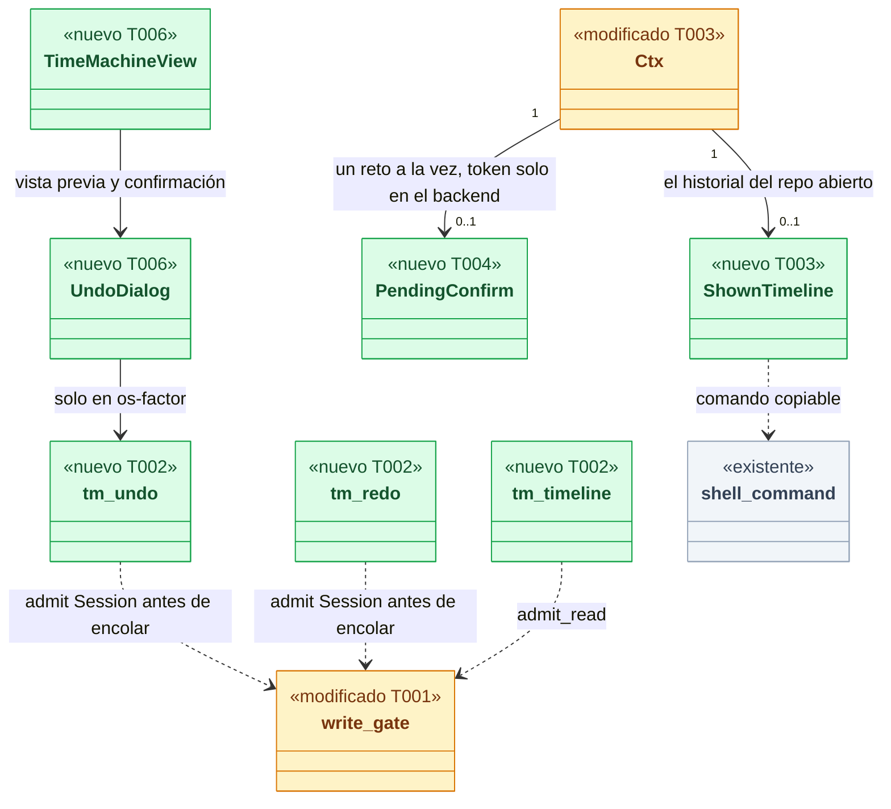
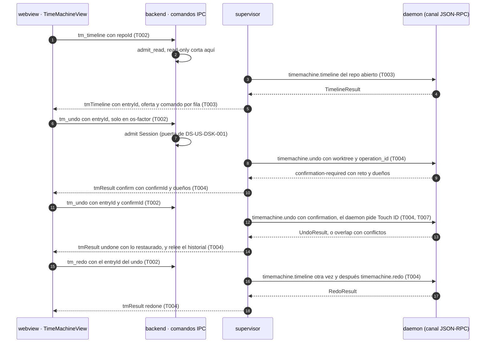
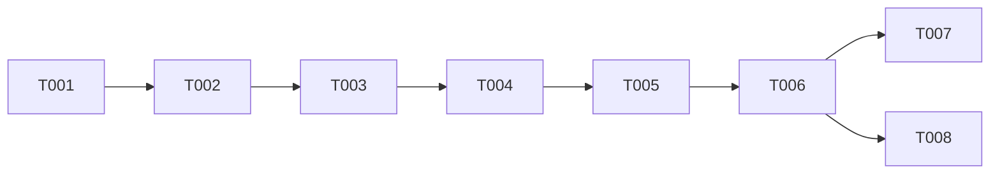

# DS-US-DSK-006 · Ver el historial, deshacer con un botón y rehacer desde la app, por la puerta de escritura

## Contexto rápido

Al terminar, quien tiene un repo observado abre la vista de Time Machine (c1 de DSF-DSK-001) desde la barra lateral o con `⌘Z`, ve qué cambió, cuándo y quién lo hizo, elige una operación, lee qué se recupera y la deshace; después puede rehacerla desde el toast o desde la entrada del undo. Hoy la app no muestra el historial: ningún método `timemachine.*` aparece en `apps/desktop/src-tauri/src` (búsqueda del 2026-11-10).

Esta Dev Spec **no crea otra puerta**. Cita sin redefinir lo que fijaron DS-US-DSK-001 y DS-US-DSK-002 (validadas por el orquestador y por las revisiones de seguridad del 2026-11-10): `engine/write_gate.rs` con sus tres modos (`read-only`, `copy-only`, `os-factor`), `WriteToken` de constructor privado, `HubCmd::is_write` exhaustivo, el recálculo del modo en el supervisor antes de todo handler de escritura (DS-US-DSK-001 P1, M-02), `commands/write/` con `WRITE_COMMANDS` en la capability única (P2), `presence.os-factor` aceptada con `connection.accept` y `connection.desktop` en `hello.methods` (P4, M-01), `presence.session` reservada para esta historia (P4), `DAEMON_METHODS`, `RESERVED_HANDLERS` (DS-US-DSK-002 T001), uno en vuelo y 5 s entre escrituras (L-03), el log `desktop_write_refused` (L-04), el contador de ids del proceso (L-02), el patrón "relectura antes de escribir" (DS-US-DSK-002 M-01) y G1 de DEP-DSK-1 con H-01 a H-04. Lo que esta entrega **añade** a esa misma puerta:

- **Un comando de lectura en `commands/`**: `tm_timeline` (el historial del repo abierto).
- **Dos comandos de escritura en `commands/write/`**: `tm_undo` y `tm_redo`, con la variante nueva `WriteKind::Session` (presencia de sesión) para lo propio y `WriteKind::PerAction` para confirmar trabajo ajeno.
- **El historial mostrado en el supervisor**: guarda cada entrada que vio el webview con un `entryId` (`e<n>`) que no se reutiliza entre sesiones, su `operation_id` y la raíz cruda de su worktree; decide qué se ofrece deshacer; arma el comando copiable; guarda en el backend el reto de confirmación del daemon (nunca llega al webview); y vuelve a pedir el historial cuando el repo cambia.
- **La vista de Time Machine** (c1 a c4) con todos sus estados, en en/es, con axe en tema claro y oscuro.

Hasta que exista el factor del SO (DEP-DSK-1), la app está en `copy-only`: el historial, la vista previa y los avisos funcionan (son lectura y no piden presencia); "Deshacer" y "Rehacer" enseñan el comando de terminal (`raptor undo` / `raptor redo` en la carpeta del worktree), que en la terminal pide la confirmación cuando el trabajo es de un agente. El camino con presencia queda construido y probado contra el daemon falso; lo que depende del contrato del factor y de la presencia de sesión en el cable es T007 y espera a G1, G2 y G3.

| Término | Qué es aquí |
|---|---|
| Entrada mostrada | Una fila de `timemachine.timeline` que el webview está enseñando, guardada **en el backend** con su `entryId` (`e<n>`, del contador del proceso de DS-US-DSK-001 T003 6.1), el `operation_id`, el tipo, el estado y la raíz cruda del worktree que se nombraría al deshacer. El webview solo ve textos saneados |
| Trabajo propio | Lo que el daemon atribuye a "sin atribuir" (D-TMC-12: "Tú u otro"). Deshacerlo no exige confirmación (ADR-TMC-005 § 2) |
| Trabajo ajeno | Lo que el daemon atribuye a un agente. Un solicitante "sin atribuir" solo lo deshace con la confirmación de ADR-TMC-005 § 3; desde la app, con el factor por acción (ADR-GRP-017 § 4) |
| Presencia de sesión | Un Touch ID que habilita las escrituras recuperables en local de la app hasta que caduca (15 min sin escrituras o 4 h) o se invalida (ADR-GRP-017 § 4). Solo con identidad firmada; texto del diálogo: "Permitir que GitRaptor escriba en tus repos hasta las HH:MM. Si no abriste tú la app, cancela." |
| Reto | `TmChallenge` de un solo uso que el daemon devuelve con `confirmation-required`, ligado a la conexión, al proceso y al hash del plan, que caduca a los 60 s (ADR-TMC-005 § 3, Nota 2026-10-09). El backend lo guarda con un `confirmId` (`k<n>`) |
| Punto base | La captura que el solape necesita como base cuando lo que se deshace es de un agente; si aún no está sellada, el undo la espera hasta `BASE_WAIT` (2 s) antes del plazo del solape (TS-TMC-005) |
| Modo de escritura | `read-only` · `copy-only` · `os-factor`, de `write_gate::mode_for` (DS-US-DSK-001 P1, P4) |

⚠️ **ASSUMPTION**: no hay `architecture-constitution.md` en la cascada; rigen `AGENTS.md` y los ADR de `must_read` (NFR-01, NFR-02, ADR-GRP-016, ADR-GRP-017), como en DS-US-DSK-001.

⚠️ **ASSUMPTION**: DS-US-DSK-001 y DS-US-DSK-002 están `spec-ready` y **no están en `main`** (`apps/desktop/src-tauri/commands.json` tiene hoy cinco comandos, 2026-11-10). Todo número de esta Dev Spec (comandos, métodos del daemon) es relativo a las dos entregadas.

### Qué hay en el motor (verificado el 2026-11-10)

- **Ningún método `timemachine.*` es reservado** (`crates/api/src/methods/timemachine.rs:34-51`: "an agent may undo its own work, ADR-TMC-005 § 2"). Solo `timemachine.undo` se ofrece a `raptor-mcp`; `redo`, `restore`, `timeline` y `notices` no (`:54-63`). `undo`, `redo` y `restore` escriben (`RepoWrite::TimeMachine`) y van por su ruta de escritura (`crates/core/src/channel/conn.rs:885-901`, `write_route` en `:3236-3243`).
- **Hoy el daemon no pide presencia para deshacer**: una conexión completa sin terminal con un solicitante "sin atribuir" deshace trabajo "sin atribuir" sin confirmación (ADR-TMC-005 § 2, fila 3). La presencia de sesión de ADR-GRP-017 § 4 todavía no existe en el daemon (`fn layer` sin cambios, DS-TS-GRP-009 § Fuera de alcance). La exigencia en el daemon es un requisito de la ficha de DEP-DSK-1 (G1, H-05), y la app no escribe hasta tenerla (P16).
- `timemachine.timeline` (`TimelineParams`, `crates/api/src/timemachine.rs:700-720`) devuelve `TimelineResult` del repo entero: `entries` con `id`, `origin` (`operation` con `operation_id`, `kind` `protected | undo | redo | restore`, `subtype`, `state`, `acted_on`; `git-event`; `manual-snapshot`), `occurred_utc_ms`, `worktrees`, `actor`, `attribution`, `protection { level, snapshot_id }` y `files` (hasta 20 rutas y el total), más `truncated` y `unavailable` (`:735-773`, `:799-915`). `ProtectionLevel` es `guaranteed-prior | hook-prior | observation | manual | none`; **no hay `purged`** (`:885-893`).
- `timemachine.undo` (`UndoParams`, `:676-694`): `worktree`, como mucho uno de `operation_id`, `since` y `agent`, `surface` y `confirmation`. **Con `operation_id` responde hoy `NOT_IMPLEMENTED` `unassigned`** (`conn.rs:4318-4320`); el selector lo crea DS-US-CKP-017 T004 (X9), con el rechazo `not-last-operation` (DS-US-CKP-021 § Qué hay). Sin selector, deshace lo último del worktree.
- `timemachine.redo` (`RedoParams`, `:697-708`): `worktree`, `operation_id` (hoy `NOT_IMPLEMENTED`, DS-US-TMC-003 D8), `surface`, `confirmation`. Rehace el último undo del worktree mientras no haya una operación nueva (D-TMC-26). Los dueños para los permisos son el solicitante del undo **y** los dueños de lo deshecho (DS-US-TMC-003 D4): rehacer un undo del trabajo de un agente vuelve a tocar trabajo ajeno.
- **Resultados** (conexión completa, con rutas como `Untrusted`): `UndoResult` (`:457-488`) con `operation_id`, `prior_snapshot_id`, `undone_operation_id`, `target_snapshot_id`, `requester`, `written`, `removed`, `not_restored`, `kept`, `warnings`; `RedoResult` (`:490-520`) con `redone_undo_id` y lo mismo.
- **Rechazos** (`OPERATION_REJECTED` con `TmRejectedData` o `TmConfirmData`, `:202-352`): `nothing-to-undo`, `raw-git-not-covered`, `target-unavailable`, `other-actor`, `confirmation-required` (con `challenge` o `cannot_confirm`, y `owners`), `git-operation-in-progress`, `git-busy`, `repo-busy`, `ref-moved`, `ref-in-use`, `challenge-invalid`, `confirmation-unavailable`, `overlap` (con `TmOverlap`: conflictos con sujeto, actor y momento, hasta 50, y `total`), `overlap-unverified`, `nothing-to-redo`, `redo-invalidated` y el resto de la lista cerrada.
- La biblioteca cliente acepta todas las capacidades que el daemon sirve (`crates/api/src/client/mod.rs:398-416`): la app tiene `timemachine.confirmation`, `timemachine.overlap`, `timemachine.timeline-inferred` y `timemachine.timeline-manual` sin código propio.
- **Confirmación**: `requester::confirmation_refusal` exige los controles 1 a 3 (`conn.rs:3940`, `:4055`). Una app abierta desde el Finder no tiene terminal: el daemon responde `confirmation-required` con `cannot_confirm: no-controlling-terminal` y sin reto (DS-TS-GRP-009 D8: `confirmable = false`).
- **Espera del punto base** (TS-TMC-005, `implemented`): cuando lo deshecho es de un agente y falta su base, el undo espera hasta `BASE_WAIT` = 2 s (⚠️ ASSUMPTION del motor) y después corre el plazo de las dos fases del solape (`OVERLAP_BUDGET` = 1,5 s). Al vencer, `overlap-unverified` sin cambios. El daemon **no avisa** al cliente de que está esperando.
- **Avisos**: `TmNoticeKind` solo tiene `interruption` (`:1134-1138`); el aviso de purga lo crea DS-US-TMC-016 (sin entregar). `timemachine.notices` entrega cada aviso una vez por superficie y lo marca entregado (`methods/timemachine.rs:11-13`); `Surface` es `cli | tui | hook` (`timemachine.rs:50-54`), sin `desktop`.
- **La CLI no tiene `-C` ni selector**: `raptor undo [--since D] [--agent ID]` y `raptor redo` actúan sobre el worktree de la carpeta actual (`apps/cli/src/commands/undo.rs:8-23`, `redo.rs:8-14`); `raptor restore <id>` devuelve el worktree actual a un punto (`restore.rs:29-33`).

### NFR-01: qué guarda cada deshacer y rehacer antes de escribir y cómo se recupera

- **Deshacer** (`timemachine.undo`, ADR-TMC-002, US-TMC-001): antes de tocar nada, el daemon toma un **snapshot previo** del worktree (árbol de trabajo, índice y refs, también lo no commiteado) y lo devuelve en `UndoResult.prior_snapshot_id`; si no puede tomarlo, no deshace (`PRIOR_SNAPSHOT_FAILED`, "No se deshizo nada: no pudimos guardar el punto de seguridad antes"). El undo es una entrada nueva del historial con su solicitante y se recupera **rehaciéndolo** (`timemachine.redo`, que vuelve a ese previo) o con `raptor restore <prior_snapshot_id>`.
- **Rehacer** (`timemachine.redo`, DS-US-TMC-003 D3): toma su propio snapshot previo (`RedoResult.prior_snapshot_id`) y vuelve al previo del undo; se recupera deshaciéndolo otra vez (es una operación nueva de la pila).
- **Trabajo sin guardar del usuario en disco**: entra en el snapshot previo, así que deshacer nunca lo pierde: si el undo lo sobrescribe (lo propio posterior es del mismo actor "sin atribuir"), vuelve con "Rehacer" **mientras el redo no esté invalidado** (una operación nueva en el worktree lo invalida, D-TMC-26). Después vuelve con `raptor restore <prior_snapshot_id>`, que la app ofrece como comando copiable en la entrada del undo (revisión de seguridad 2026-11-10, L-03; T003 paso 5). Lo que el editor tiene **sin guardar en disco** no lo ve GitRaptor: c2 lo dice (`tm.undo.saveFirst`) y la app no promete recuperarlo.
- **Trabajo ajeno posterior** (US-TMC-012): si después del cambio elegido otro actor tocó lo mismo, el daemon **no deshace nada** (`overlap`, c3) y la app enseña qué archivos o ramas lo impiden, con su actor y su hora; si no pudo comprobarlo, tampoco deshace (`overlap-unverified`). Lo que otro actor cambió en archivos que el undo no necesita se conserva y se informa (`kept`).
- **Deshacer trabajo de un agente es tocar trabajo ajeno**: exige la confirmación de ADR-TMC-005 § 3, que desde la app es el **factor por acción** (ADR-GRP-017 § 4, Q-DSK-3) y la presencia de sesión nunca la cubre (P17). Hasta DEP-DSK-1, la app no lo deshace: enseña el comando y la terminal pregunta.
- **Lo que no se capturó o se purgó se dice**: una entrada con nivel `none` no ofrece deshacer y dice por qué; `target-unavailable` dice que el punto ya no existe (escenario 4). Nunca se promete recuperar lo que no tiene punto.
- **La app no añade escritura propia**: pide `timemachine.undo` y `timemachine.redo` al daemon, que los autoriza, los audita en el oplog y los hace recuperables como arriba. El backend guarda en memoria las entradas mostradas y el reto; mueren con la sesión.

### Decisión del orquestador pendiente

Decisiones nuevas de frontera de esta historia, numeradas a continuación de las P1 a P14 de DS-US-DSK-001 y DS-US-DSK-002. La **revisión de seguridad 2026-11-10** (opus, APROBADA CON COMENTARIOS: 0 crítico o alto, 3 medio, 3 bajo, 1 informativo) ya está incorporada en los textos de abajo; el veredicto del orquestador está en la [tabla de veredicto](#veredicto-del-orquestador-pendiente-de-ok-de-renecoordinador) y **espera el OK de Rene o del coordinador**: ninguna decisión está aceptada todavía.

| # | Decisión | Recomendación | Por qué |
|---|---|---|---|
| P15 | **Qué se puede hacer sin presencia humana** | Sin presencia (modo `copy-only`): ver el historial, filtrarlo, ver la vista previa (qué se recupera, nivel de protección, quién), ver los rechazos explicados y **copiar el comando** `cd -- '<worktree>' && '<raptor>' 'undo'` (o `'redo'`). `tm_timeline` usa `admit_read`: solo `read-only` lo rechaza. `tm_undo` y `tm_redo` responden `presence-unavailable` en `copy-only` **sin llamar al daemon** (como P5 y P8). El comando solo se ofrece para la **última** operación deshacible del worktree (la CLI no tiene selector): para una entrada anterior, `not-offered { reason: not-last }` con el texto `tm.cmd.notLast`. Con una raíz de worktree que no sea absoluta, `posix_in_dir` da `None` y el comando no se ofrece (`unsafe-text`; revisión de seguridad 2026-11-10, L-01). La raíz cruda y el `snapshot_id` solo salen del backend **dentro del comando copiable armado y validado en el backend** (I-01.1) | La historia pide historial y avisos siempre; son lectura y el daemon no los reserva. Mandar un undo sin presencia no pasaría por la presencia de sesión que exige ADR-GRP-017 § 4 (hoy el daemon lo aceptaría: § Qué hay), así que la app no lo manda. El comando con `cd --` es la única forma de nombrar el worktree en la CLI; la terminal pide la confirmación cuando el trabajo es de un agente (H9 de DS-US-CKP-021) |
| P16 | **Deshacer y rehacer lo propio: `WriteKind::Session`** | Añadir `WriteKind::Session` a `write_gate` (la variante que reservó DS-US-DSK-001 P1). `admit(mode, Session, cmd)` responde igual que `PerAction` por modo (`ReadOnly` → `read-only`, `CopyOnly` → `presence-unavailable`, `OsFactor` → `WriteToken`); la diferencia está en el daemon: con identidad firmada y `presence.session`, el primer undo abre la presencia de sesión y los siguientes pasan sin diálogo; con identidad por ruta (alphas sin firmar), cada undo pide el factor por acción (ADR-GRP-017 § 3, fila 3). La UI rotula el botón según lo que pasará: "Deshacer" (sesión activa), "Deshacer · pide Touch ID una vez" (sesión disponible y no activa) o "Deshacer con Touch ID" (sin sesión). **Requisito de G1 (H-05)**: `presence.os-factor` no se publica a la clase `desktop` sin que el daemon exija presencia (sesión o factor por acción) para `timemachine.undo`, `redo` y `restore` de esa clase. **Orden en el daemon** (revisión de seguridad 2026-11-10, M-02): calcula dueños y elegibilidad **antes** de la presencia; una petición que va a acabar en `confirmation-required` no abre ni consume una sesión ni pide factor: el reto se entrega sin diálogo y solo la segunda llamada pide el factor por acción | Es la tabla de ADR-GRP-017 § 4 ("Deshacer de trabajo propio o sin atribuir" = presencia de sesión) y § 3 (por ruta = solo factor por acción). La app no abre sesiones con un método propio: la abre el daemon en la primera escritura (DSF c2), así no hay un segundo camino que auditar. Atar H-05 a la publicación de `presence.os-factor` evita que `os-factor` llegue con un daemon que acepta undos sin presencia |
| P17 | **Deshacer el trabajo de un agente desde la app** | Solo con el **factor por acción**, nunca con la sesión. Flujo: el primer `tm_undo` (sin `confirmId`) llega al daemon; si responde `confirmation-required` con `challenge`, el backend guarda el token con un `confirmId` (`k<n>`) y manda a c2 los dueños saneados; el usuario lee qué se recupera y de quién es el trabajo y pulsa "Deshacer con Touch ID"; el segundo `tm_undo { entryId, confirmId }` lleva `confirmation` y el daemon abre el diálogo del SO ligado al plan. Con `cannot_confirm` (hoy: `no-controlling-terminal`) o `confirmation-unavailable` → `confirm-unavailable` y c2 enseña el comando de la terminal (DEP-DSK-1 sin resolver; Windows, BR-TMC-AUTH-001). **Requisito de G1 (H-06)**: para la clase `desktop` con factor e identidad, el daemon sustituye el control 3 de la confirmación por el factor por acción ligado al hash del plan (dueños, ids, ámbito), con `localizedReason` que nombra el verbo, a los dueños, el worktree y el código de correlación. **La segunda llamada es `PerAction`** (revisión de seguridad 2026-11-10, M-01): `EngineHub::tm_undo` y `tm_redo` admiten con `kind = PerAction` cuando llega `confirmId` y con `Session` cuando no, así el ritmo (5 s) y el log siguen a lo que la llamada provoca. El reto guarda su operación (`TmOp { Undo, Redo }`): el handler exige operación, `entryId` y caducidad coincidentes, si no `confirm-expired`, y el token se consume en cualquier desenlace (M-03) | ADR-TMC-005 § 3 y ADR-GRP-017 § 4 ("confirmación de trabajo ajeno" en la fila de factor por acción); Q-DSK-3: la app nunca rebaja un control. El token es una credencial de un solo uso (`ConfirmationToken`, `Debug` oculto): no cruza al webview, como la ruta cruda (SEC-12). Dos llamadas son el contrato que ya existe (Nota 2026-10-09: la primera queda `rejected` con `confirmation-required`, la segunda `confirmed = 1`) |
| P18 | **Rehacer exige el mismo factor que el undo que rehace** | `tm_redo` va por `commands/write/` con `WriteKind::Session`; si el daemon responde `confirmation-required` (el undo deshizo trabajo de un agente, DS-US-TMC-003 D4), sigue el flujo de P17 con factor por acción: la segunda llamada es `tm_redo { entryId, confirmId }` (revisión de seguridad 2026-11-10, M-03), con un reto de operación `Redo` que un `tm_undo` no puede usar, ni al revés. En `copy-only`, comando `raptor redo` | Rehacer escribe el repo y devuelve trabajo con dueño; si fuera más débil que deshacer, un agente con Accesibilidad podría pulsar "Rehacer" sobre un undo del humano. La sesión basta para lo propio porque es recuperable en local (NFR-01) |
| P19 | **Los comandos IPC nuevos, su entrada y su forma de error** | Tres: `tm_timeline { repoId }` (lectura, `commands/`), `tm_undo { entryId, confirmId? }` y `tm_redo { entryId, confirmId? }` (escritura, `commands/write/`; `confirmId?` en `tm_redo` por M-03 de la revisión de seguridad 2026-11-10, sin cambiar el número de comandos). Todos responden `{}` y el resultado llega por el `Channel` (`tmTimeline`, `tmTimelineNone`, `tmResult`). Entrada con `deny_unknown_fields`; `repoId`, `entryId` y `confirmId` con la regla de `valid_repo_id`. **Sin `CommandError` nuevo**: `invalid-params`, `read-only`, `presence-unavailable`, `not-watching`. `commands.json` pasa de **11 a 14** con igualdad exacta. Los filtros de c1 (copia, quién, tipo, estado) y el rango de la línea por actor se aplican **en el webview** sobre la página cargada; sin parámetros de filtro en el cable | El webview nunca manda una ruta, un `operation_id` ni un token: elige por el `entryId` que el backend asignó a una fila que enseñó (como `planId`, DS-US-DSK-002 P11). Filtrar en el webview evita validar en el backend nombres de agente y duraciones que el usuario no escribe |
| P20 | **Qué entrada se puede deshacer y cuál se nombra** | Se ofrece deshacer una entrada `operation` de tipo `protected` o `restore`, en estado `finished` o `interrupted`, con nivel distinto de `none` y no deshecha, como H6 de DS-US-CKP-021; un evento crudo, un snapshot manual, un `undo` o un `redo` salen sin botón y con su motivo. El backend manda siempre `operation_id` (nunca un undo "de lo último" desde la app) y nombra la **última** raíz de `entry.worktrees` que sea un worktree disponible (H7 de DS-US-CKP-021). Rehacer se ofrece en una entrada `undo` cuando es el siguiente redo de su worktree según el historial cargado; como `redo` no acepta `operation_id`, el backend **vuelve a leer el historial** justo antes y no rehace si ya no lo es (`expired` con historial nuevo), y comprueba que `redone_undo_id` es el esperado (G3). El selector de G2 tiene que rechazar un `operation_id` que no pertenezca al worktree nombrado (revisión de seguridad 2026-11-10, I-01.4) | Un undo sin selector deshace lo último de la pila, que con un historial desactualizado es otra cosa (NFR-01, H6). El selector `operation_id` lo trae DS-US-CKP-017 X9 (G2): hasta entonces la app no puede deshacer desde el historial, y no hace falta antes de DEP-DSK-1 porque en `copy-only` no se manda nada. La relectura del redo es la misma defensa que DS-US-DSK-002 M-01 y no cierra la carrera; la cierra el daemon con un `operation_id` de guarda en `redo` (G3) |
| P21 | **Ritmo de las escrituras de sesión** | Uno en vuelo por sesión para **todas** las escrituras (L-03 sin cambios). El intervalo mínimo de 5 s de L-03 se queda para `PerAction`; para `WriteKind::Session` baja a **1 s**, para que "Rehacer" del toast (5 s) funcione justo después de deshacer. Con un **tope de ráfaga**: como mucho 6 escrituras `Session` por minuto y sesión; la séptima responde `expired` (revisión de seguridad 2026-11-10, L-02). Una escritura con `confirmId` es `PerAction` y lleva los 5 s (M-01). Se propone el mismo tope por clase `desktop` en el daemon (H-05) | Con 5 s, pulsar "Rehacer" a los 2 s del undo respondería `expired`. El daemon sigue limitando por fatiga y por cuota de escritura; la sesión ya exige un Touch ID y caduca. Cambia un valor de L-03 que fijó la revisión de seguridad de DS-US-DSK-001: por eso es decisión, no ajuste |
| P22 | **Avisos y aviso de purga** | En UI-1 la app **no llama a `timemachine.notices`**: entregar un aviso lo marca entregado para esa superficie, y la app no tiene superficie propia (`Surface` no tiene `desktop`), así que le robaría el aviso a la CLI o a la TUI. El escenario 4 se cubre con el nivel `none` de la entrada y el rechazo `target-unavailable`, con un texto que dice que no hay punto guardado "porque se purgó o porque nunca se guardó". **Requisito para DS-US-TMC-016** (no para DEP-DSK-1): una superficie `desktop` aditiva (o una lectura sin entregar) y un nivel `purged` distinguible de `none`; cuando exista, la banda ⚠ de c1 pinta el aviso de purga | Pedir los avisos sin superficie propia rompe la regla "una vez por superficie" de la Time Machine (H12 de DS-US-CKP-021). Distinguir "se purgó" de "no se capturó" necesita un dato que el motor aún no da |
| P23 | **Deshacer por agente o por tiempo y restaurar desde la app** | Fuera de esta historia. `--agent` y `--since` son deshacer en bloque trabajo ajeno: factor por acción sobre un plan grande, que necesita su propia vista previa. Restaurar a un punto (c3, "Restaurar a las 10:30…") se ofrece **solo como comando copiable** `cd -- '<worktree>' && '<raptor>' 'restore' '<snapshot-id>'`, porque casi siempre sobrescribe trabajo ajeno y la terminal confirma de quién es el trabajo que se toca (ADR-TMC-005 § 3). **Matiz** (revisión de seguridad 2026-11-10, I-01.2): US-TMC-024 está en `draft`, y hoy `raptor restore` **no comprueba el solape** (`crates/core/src/timemachine/restore.rs:827-829`: "The restore's own overlap check is US-TMC-024"); el texto `tm.restore.terminal` lo dice. El mismo comando, con el `prior_snapshot_id` del undo, se ofrece en una entrada `undo` cuyo redo está `invalidated` (L-03). Sin `tm_restore` en la lista cerrada | Mantiene la historia en lo que piden sus cuatro escenarios y no abre un tercer flujo de confirmación de trabajo ajeno antes de que exista DEP-DSK-1. La restauración desde la app con factor es una historia aparte cuando G1 exista |

#### Veredicto del orquestador (pendiente de OK de Rene/coordinador)

Tras la revisión de seguridad 2026-11-10 (opus, APROBADA CON COMENTARIOS). Los cambios ya están en el texto de cada decisión y en las tareas que se citan. Cada hallazgo se verificó leyendo el código antes de aplicarlo (sin compilar): `posix` no comprueba rutas absolutas (`apps/desktop/src-tauri/src/engine/shell_command.rs:12-21`); `RedoParams` ya trae `confirmation` (`crates/api/src/timemachine.rs:697-708`); la restauración no comprueba el solape (`crates/core/src/timemachine/restore.rs:827-829`); US-TMC-024 está en `draft`. **Este veredicto no es una aceptación**: espera el OK de Rene o del coordinador.

| # | Veredicto propuesto | Cambios incorporados | Tareas |
|---|---|---|---|
| P15 | Aceptar con cambios | L-01 (raíz no absoluta = sin comando), I-01.1 (la raíz cruda y el `snapshot_id` solo salen dentro del comando copiable) | T003 |
| P16 | Aceptar con cambios | M-02 (dueños y elegibilidad antes de la presencia; `confirmation-required` sin diálogo ni sesión; caso nuevo para V4 de ADR-GRP-017) | G1 (H-05, H-06) |
| P17 | Aceptar con cambios | M-01 (la segunda llamada es `PerAction`), M-03 (`TmOp` en el reto; consumo en cualquier desenlace) | T002, T004 |
| P18 | Aceptar con cambios | M-03 (`tm_redo { entryId, confirmId? }`) | T002, T004 |
| P19 | Aceptar | `confirmId?` en `tm_redo`; `commands.json` sigue en 14 | T002, T005 |
| P20 | Aceptar | I-01.4 (el selector de G2 rechaza un `operation_id` de otro worktree) | G2 |
| P21 | Aceptar con cambios | M-01 (con `confirmId`, 5 s), L-02 (tope de 6 escrituras `Session` por minuto y sesión; el mismo tope por clase en H-05) | T001, T004, G1 |
| P22 | Aceptar | — | — |
| P23 | Aceptar | I-01.2 (US-TMC-024 en `draft`: `raptor restore` no comprueba el solape), L-03 (`raptor restore <prior>` cuando el redo está invalidado) | T003, T006 |

Además: I-01.3 ("no se reutiliza entre sesiones" en lugar de "de un solo uso" para `entryId`) en § Contexto rápido y § Ciclos de vida.

---

## 📋 Índice

> **Para aprobar:** [Contexto rápido](#contexto-rápido) · [⚠️ Gaps](#gaps-y-violaciones-de-la-constitución) · [🔭 La forma](#la-forma) · [El trabajo de un vistazo](#el-trabajo-de-un-vistazo).
> **Para implementar:** [🚀 Plan](#plan-de-implementación), en orden. Las `_(ref)_` se abren desde la tarea que las cita.

| Sección | Propósito |
|---------|-----------|
| [Contexto rápido](#contexto-rápido) | Qué se construye, qué hay en el motor, NFR-01 y decisiones pendientes |
| [⚠️ Gaps y violaciones de la constitución](#gaps-y-violaciones-de-la-constitución) | Qué impide empezar |
| [🔭 La forma](#la-forma) | Piezas y flujo |
| [🚀 Plan de implementación](#plan-de-implementación) | T001…T008, en orden |
| ↳ [El trabajo de un vistazo](#el-trabajo-de-un-vistazo) | Tareas en tabla y su orden |
| [Estructura de ficheros](#estructura-de-ficheros) _(ref)_ | Árbol anotado |
| [Contratos compartidos](#contratos-compartidos) _(ref)_ | DTO, mensajes, firmas y textos |
| [Contrato de API](#contrato-de-api) _(ref)_ | Comandos IPC y lo que se consume del canal |
| [Estrategia de pruebas y cobertura](#estrategia-de-pruebas-y-cobertura) _(ref)_ | Escenarios → tests |
| [Gate de seguridad](#gate-de-seguridad) | Checklist pre-merge |
| [Fuera de alcance](#fuera-de-alcance) | Lo que esta entrega no toca |
| [Notas del autor](#notas-del-autor) _(ref)_ | Lo que no bloquea |

---

## ⚠️ Gaps y violaciones de la constitución

| ID | Qué falta | Severidad | Alcance | Acción | Owner |
|----|-----------|-----------|---------|--------|-------|
| G1 | El contrato del factor en el cable (G1 de DS-US-DSK-001, con H-01 a H-04 de DS-US-DSK-001 y DS-US-DSK-002, sin cambiar) y, además, estos **requisitos de la Time Machine desde la app**. **(H-05)** Para la clase `desktop`, `timemachine.undo`, `redo` y `restore` exigen presencia: presencia de sesión con identidad firmada (capacidad `presence.session`, ciclo de ADR-GRP-017 § 4: caduca a los 15 min sin escrituras o a las 4 h; se invalida al bloquear la pantalla, suspender, cambiar de usuario, cerrar la conexión o reiniciar el daemon) o factor por acción con identidad por ruta; sin ella, rechazo sin efecto con un motivo de la lista cerrada. `presence.os-factor` no se publica a la clase sin H-05 (P16). **Orden** (revisión de seguridad 2026-11-10, M-02): el daemon calcula dueños y elegibilidad de la confirmación **antes** de la presencia; una petición que va a acabar en `confirmation-required` no abre ni consume la sesión ni pide factor: el reto se entrega sin diálogo. **Tope por clase** (L-02, propuesto): como mucho 6 escrituras de la Time Machine por minuto y conexión `desktop` amparadas por la sesión. **Caso nuevo para V4 de ADR-GRP-017** (requisito de esta spec; el ADR no se edita aquí): "un undo de trabajo ajeno con la sesión activa devuelve el reto sin diálogo y sin tocar la sesión, y su segunda llamada pide el factor por acción". **(H-06)** La confirmación de trabajo ajeno de ADR-TMC-005 § 3 sustituye, para la clase con factor e identidad, el control 3 por el factor por acción ligado al hash del plan del reto (tipo, worktree, dueños, ids, ámbito): solo la segunda llamada con `confirmation` abre el diálogo del SO, y la presencia de sesión nunca la cubre (M-02); con perfil `mcp` o agente en la ascendencia, `cannot_confirm` sin diálogo (P17). **(H-07)** El cliente sabe, sin escribir, si la presencia de sesión está disponible y hasta cuándo está activa (estado en la conexión o una notificación), para rotular el botón; la auditoría y el oplog registran la clase `desktop` (hoy el canal sale `cli`, `conn.rs:3801-3810`) | Bloqueante | T007 | Añadir H-05 a H-07 a la ficha de motor de DEP-DSK-1 (aún sin reservar) | Arquitecto (ficha) · Rene (spike) |
| G2 | **Deshacer por `operation_id`** responde `NOT_IMPLEMENTED` `unassigned` (`conn.rs:4318-4320`). Lo crea DS-US-CKP-017 T004 (X9), con `not-last-operation` (`approved`, sin entregar). Sin él, la app no puede deshacer la entrada que el usuario eligió sin arriesgarse a deshacer otra (P20). Requisito del selector (revisión de seguridad 2026-11-10, I-01.4): el daemon rechaza un `operation_id` que no pertenezca al ámbito del worktree nombrado | Bloqueante | T007 | Mezclar DS-US-CKP-017 T004 antes de T007; T004 se prueba contra el daemon falso con el selector | Orquestador |
| G3 | **Rehacer por `operation_id`** responde `NOT_IMPLEMENTED` (DS-US-TMC-003 D8). Sin un `operation_id` de guarda, la relectura de P20 reduce la ventana de carrera pero no la cierra: un undo de otro cliente entre la relectura y el `redo` haría que se rehiciera otro undo (recuperable deshaciéndolo, NFR-01) | Bloqueante | T007 | Ficha de la Time Machine (o enmienda de DS-US-TMC-003): `redo` con `operation_id` como guarda ("rehaz el siguiente si es este"), con `not-next-redo` si no lo es | Arquitecto (ficha) |

Sin violaciones de la constitución: la app no lee repos ni lanza procesos (ADR-GRP-017 § 1, § 2), no añade plugins ni permisos `dialog:*` o `core:event:*`, y toda escritura pasa por el daemon con su autorización, su snapshot previo y su oplog (NFR-01).

**Depende de**:

- **TS-GRP-009** (ya en `main`, PR #351; era el `blocked_by`): el daemon fija `hello.profile` `mcp` para una ventana que abrió un agente (DS-TS-GRP-009 D3); el perfil se fija en el `hello` y no cambia (D5); el `hello` no cambia de forma (D1).
- **DS-US-DSK-001 y DS-US-DSK-002 entregadas** (T001 a T004 de cada una): `write_gate`, `commands/write/`, `WriteToken`, `RESERVED_HANDLERS`, el contador de ids del proceso, `LinkError::Refused { code, data }`, `Link::accepted` y la relectura antes de escribir. Es una dependencia de código, no de historia: si no están en `main` cuando empiece T001, esta entrega espera; no reimplementa la puerta.
- **`Link::submit`** de DS-US-DSK-005 (envío asíncrono con ticket): si no está en `main` cuando empiece T003, T003 lo añade con la forma de DS-US-DSK-005 y la segunda historia que llegue se lo salta (G6 de DS-US-DSK-001).
- **DEP-DSK-1** (ficha de motor del factor del SO, dueño **Arquitecto**, aún sin reservar): bloquea solo T007 (G1). No va en `blocked_by`: T001 a T006 y T008 se construyen y se verifican en `copy-only`.

---

## 🔭 La forma

Al terminar, la puerta de DS-US-DSK-001 tiene dos comandos de escritura más y una variante `WriteKind::Session`, el supervisor guarda el historial mostrado y el reto de confirmación, y el webview tiene la vista de Time Machine con su vista previa, su confirmación y su toast.



🟩 nuevo · 🟨 modificado · ⬜ existente (contexto: no cambia). Cada pieza dice qué tarea la toca.

**Cómo fluye** (deshacer trabajo de un agente con factor, y después rehacer):



Los pasos que deciden son el 2 y el 7: la puerta corta en Rust antes de llamar al daemon. Solo escriben el 12 y el 17, y únicamente en `os-factor`. En `copy-only`, el usuario copia el comando del paso 5 y la vista se actualiza al releer el historial (T003, paso 6). El token del reto del paso 9 se queda en el backend: el webview solo recibe `confirmId`. Cambian dos contratos publicados: la lista cerrada de comandos (de 11 a 14) y `EngineMessage` (tres variantes nuevas).

---

## 🚀 Plan de implementación

> Orden topológico (`Depende:`). Una casilla se marca cuando su `Aceptación` está verificada. Las rutas son relativas a la raíz del repo.

### El trabajo de un vistazo

Cuatro frentes y un cierre: la puerta y los comandos en Rust (T001 a T004), el webview (T005 y T006), la presencia y el factor cuando exista su contrato (T007) y la verificación en macOS (T008).

| # | Tarea | Depende | Aterriza en |
|---|---|---|---|
| T001 | Añadir la Time Machine a las listas de la puerta y `WriteKind::Session` | — | `apps/desktop/src-tauri/src/engine/write_gate.rs` |
| T002 | Añadir los tres comandos a la lista cerrada | T001 | `apps/desktop/src-tauri/src/commands`, `commands.json`, `capabilities/` |
| T003 | Leer el historial y decidir qué se ofrece en el supervisor | T002 | `apps/desktop/src-tauri/src/engine` |
| T004 | Deshacer, confirmar y rehacer en el supervisor | T003 | `apps/desktop/src-tauri/src/engine` |
| T005 | Guardar historial y resultado en la caché del webview | T004 | `apps/desktop/src/client`, `apps/desktop/src/state` |
| T006 | Pintar la vista de Time Machine con todos sus estados | T005 | `apps/desktop/src/timemachine`, `apps/desktop/src/shell`, `apps/desktop/src/i18n` |
| T007 | Mostrar la presencia de sesión, el factor y sus desenlaces | T006 | `apps/desktop/src/timemachine`, `apps/desktop/src-tauri/src/engine` |
| T008 | Verificar de punta a punta en macOS | T006 | — |

### En qué orden

Cadena recta hasta T006 y un abanico al final: T007 espera a G1, G2 y G3; T008 no espera a T007.



### T001 — Añadir la Time Machine a las listas de la puerta y `WriteKind::Session`

**Objetivo.** `write_gate` conoce los dos comandos de escritura nuevos, los métodos del daemon que llaman y la variante `Session`; ninguna otra regla de la puerta cambia. Fuera: los comandos (T002).

**Ubicación.**
- `apps/desktop/src-tauri/src/engine/write_gate.rs` (**MODIFY**)
- `apps/desktop/src-tauri/tests/write_gate.rs` (**MODIFY**)

**Reglas**
- `WRITE_COMMANDS = ["repo_add", "guard_install", "guard_uninstall", "tm_undo", "tm_redo"]`.
- `DAEMON_METHODS` añade al final `TM_TIMELINE`, `TM_UNDO` y `TM_REDO`. Quedan 19 si DS-US-DSK-005 no añadió `GRAPH_LANES` antes; si lo añadió, 20. Sin `TM_RESTORE` ni `TM_NOTICES` (P22, P23).
- `RESERVED_DAEMON_METHODS` **no cambia**: los métodos `timemachine.*` no son reservados en el daemon. Se añade `WRITE_DAEMON_METHODS = RESERVED_DAEMON_METHODS + [TM_UNDO, TM_REDO]`: los métodos del daemon que escriben, reservados o no.
- `RESERVED_HANDLERS` gana `(TM_UNDO, &["write_tm_undo"])` y `(TM_REDO, &["write_tm_redo"])`, y su comentario pasa a "which supervisor fn may pass each **writing** daemon method to the link". Su nombre no cambia (lo usan los tests de DS-US-DSK-001 y DS-US-DSK-002).
- `WriteKind` gana `Session` al final, con su comentario. `admit(mode, WriteKind::Session, command)` responde por modo exactamente como `PerAction` (P16): `ReadOnly` → `read-only`, `CopyOnly` → `presence-unavailable`, `OsFactor` → `WriteToken`. Sin cambios en `mode_for`, `admit_read`, `SharedMode` ni `WriteToken`.
- `CAP_SESSION = "presence.session"` (P4 de DS-US-DSK-001) se declara aquí; la lee T007, no `mode_for`.
- `min_interval(kind) -> Duration`: `PerAction` → 5 s; `Session` → 1 s (P21). La usa el supervisor para L-03.
- `SESSION_BURST = 6` y `SESSION_BURST_WINDOW = 60 s`: tope de escrituras `Session` por sesión del supervisor en una ventana móvil (revisión de seguridad 2026-11-10, L-02). Lo aplica el supervisor (T004).
- `kind_for(confirm: bool) -> WriteKind`: `PerAction` si la orden lleva `confirmId`, `Session` si no (M-01). La llaman `EngineHub::tm_undo` y `tm_redo` antes de `admit`.
- El log `desktop_write_refused` (L-04) gana `tm_timeline`, `tm_undo` y `tm_redo` en su vocabulario cerrado de `command`.

- **Depende:** —
- **Refs:** DS-US-DSK-001 P1, P2, P4, L-03, L-04; DS-US-DSK-002 T001; P16, P21
- **Aceptación:** `cargo test -p gitraptor-desktop --test write_gate` en verde
- **Guard:** `write_commands_are_exactly_the_five` (igualdad, nunca `contains`)
- **Guard P16:** `session_admits_like_per_action_in_every_mode`
- **Guard M-01:** `a_confirmed_order_is_per_action`

### T002 — Añadir los tres comandos a la lista cerrada

**Objetivo.** `tm_timeline`, `tm_undo` y `tm_redo` existen, validan su entrada, pasan por la puerta en Rust y llegan al supervisor; la lista exacta pasa a catorce. Fuera: lo que el supervisor hace con ellos (T003, T004).

**Ubicación.**
- `apps/desktop/src-tauri/src/commands/tm_timeline.rs` (**CREATE**)
- `apps/desktop/src-tauri/src/commands/write/tm_undo.rs` (**CREATE**)
- `apps/desktop/src-tauri/src/commands/write/tm_redo.rs` (**CREATE**)
- `apps/desktop/src-tauri/src/commands/write/mod.rs` (**MODIFY**: dos `pub mod`)
- `apps/desktop/src-tauri/src/commands/mod.rs` (**MODIFY**)
- `apps/desktop/src-tauri/commands.json` (**MODIFY**)
- `apps/desktop/src-tauri/capabilities/main.json` (**MODIFY**)
- `apps/desktop/src-tauri/src/engine/mod.rs` (**MODIFY**: `EngineHub::{tm_timeline, tm_undo, tm_redo}`)
- `apps/desktop/src-tauri/src/engine/supervisor.rs` (**MODIFY**: variantes de `HubCmd` y sus brazos en `is_write`)
- `apps/desktop/src-tauri/tests/commands.rs` (**MODIFY**)

**Reglas**
- `commands.json` = `["app_info", "engine_watch", "engine_retry", "fleet_open", "guard_blocks", "repo_pick", "repo_add", "guard_plan", "guard_cancel", "guard_install", "guard_uninstall", "tm_timeline", "tm_undo", "tm_redo"]`; `capabilities/main.json` añade `allow-tm-timeline`, `allow-tm-undo` y `allow-tm-redo` (capability única, ADR-GRP-017 § 2, DS-US-DSK-001 P2).
- Las aserciones de lista exacta de `tests/commands.rs` (las que actualizaron DS-US-DSK-001 T002 y DS-US-DSK-002 T002, y la nueva de esta tarea) pasan a los **catorce** nombres, **iguales, nunca `contains`**.
- Como en DS-US-DSK-001, los comandos solo parsean el sobre y delegan en `EngineHub`; `admit` y `admit_read` se llaman en `EngineHub`. Orden: sobre, ids, puerta, supervisor.
  - `tm_timeline` → `hub.tm_timeline(repo_id)`: valida `repoId`, `admit_read(mode, "tm_timeline")`, `HubCmd::TmTimeline { repo_id }`.
  - `tm_undo` → `hub.tm_undo(entry_id, confirm_id)`: valida `entryId` y, si viene, `confirmId`; `kind = write_gate::kind_for(confirm_id.is_some())` (M-01 de la revisión de seguridad 2026-11-10); `admit(mode, kind, "tm_undo")?`; `HubCmd::TmUndo { entry_id, confirm_id, kind, token }`.
  - `tm_redo` → `hub.tm_redo(entry_id, confirm_id)`: lo mismo con `"tm_redo"` y `HubCmd::TmRedo { entry_id, confirm_id, kind, token }` (M-03).
  - Sin supervisor → `not-watching`; sin sesión, el modo es `ReadOnly` y responden `read-only` (como `repo_add`).
- `HubCmd::is_write`: `TmUndo` y `TmRedo` → `true`; `TmTimeline` → `false`. El `match` sigue sin comodín (M-02).
- `tests/commands.rs` › `reserved_methods_are_called_only_from_their_write_handler` recorre ahora `WRITE_DAEMON_METHODS` (no solo los reservados) con `RESERVED_HANDLERS`; `the_backend_calls_only_the_listed_daemon_methods` sigue igual, con la lista de T001.

- **Depende:** T001
- **Refs:** P15, P16, P18, P19; DS-US-DSK-001 P2, P3, M-02; DS-US-DSK-002 T002; ADR-GRP-017 § 1, § 2
- **Aceptación:** `cargo test -p gitraptor-desktop --test commands --test tauri_surface` en verde
- **Guard ⛔ lista exacta:** `tm_commands_are_in_the_closed_list_and_the_capability` (igualdad con los catorce)
- **Guard P15:** `copy_only_refuses_undo_and_redo_but_not_the_timeline`
- **Guard ⛔ métodos que escriben:** `writing_daemon_methods_are_called_only_from_their_handler` (incluye `timemachine.undo` y `timemachine.redo`, que no son reservados)

### T003 — Leer el historial y decidir qué se ofrece en el supervisor

**Objetivo.** El supervisor pide `timemachine.timeline` del repo abierto, guarda las entradas mostradas, decide por cada una si se ofrece deshacer o rehacer y por qué no, arma el comando copiable y vuelve a pedir cuando el repo cambia. Fuera: escribir (T004).

**Ubicación.**
- `apps/desktop/src-tauri/src/engine/supervisor.rs` (**MODIFY**)
- `apps/desktop/src-tauri/src/engine/timeline.rs` (**CREATE**: `ShownTimeline`, `ShownEntry`, `entry_dto`, `offer_of`, `command`)
- `apps/desktop/src-tauri/src/engine/mod.rs` (**MODIFY**: `pub mod timeline;`)
- `apps/desktop/src-tauri/src/engine/shell_command.rs` (**MODIFY**: `posix_in_dir`, aditivo)
- `apps/desktop/src-tauri/src/engine/link.rs` (**MODIFY**, solo si DS-US-DSK-005 no está en `main`: `Link::submit`)
- `apps/desktop/src-tauri/src/engine/wire.rs` (**MODIFY**: variantes y DTO de § Tipos)
- `apps/desktop/src-tauri/tests/support/fake_daemon.rs` (**MODIFY**: guion "pagos" de § 9.3)
- `apps/desktop/src-tauri/tests/tm_timeline.rs` (**CREATE**)
- `apps/desktop/src-tauri/tests/engine_wire.rs` (**MODIFY**)
- `apps/desktop/tests/fixtures/engine-messages.json` (**MODIFY**)

**Pasos**
1. `HubCmd::TmTimeline { repo_id }`: con vista restringida, descartar. Si `ctx.open != repo_id` o el repo no tiene ruta cruda → `TmTimelineNone { repoId, cause: not-open }` (la regla de `guard_blocks`). Si el motor no lista `timemachine.timeline` en `hello.methods` → `TmTimelineNone { cause: unsupported }` (H15 de DS-US-CKP-021). Si no, pedir `timemachine.timeline { worktree: <raíz cruda del worktree principal, o de la primera fila disponible>, limit: 50 }` con `Link::submit` y un ticket; una respuesta de un ticket viejo se descarta (H2 de DS-US-CKP-021).
   1.1 ⛔1.1 Como mucho una petición de historial en vuelo y 1 s entre dos (H3 de DS-US-CKP-021). Una vista desactualizada con una petición en vuelo se marca y se pide al llegar la respuesta.
2. Con la respuesta, sustituir `Ctx.timeline` por `ShownTimeline { repo_id, entries: Vec<ShownEntry> }`. Cada `ShownEntry` lleva `id: "e<n>"` (contador del proceso `NEXT_ID`, prefijo `e`, nunca uno por sesión), el `TimelineEntry.id` del daemon, `operation_id`, `kind`, `state`, `worktree_raw` (la última raíz de `entry.worktrees` que sea un worktree disponible, P20) y `offer`. Un `entryId` se conserva entre relecturas para la misma entrada del daemon, así el cursor del webview sobrevive al refresco (H3).
   2.1 ⛔2.1 El `operation_id` nunca sale del backend, y la raíz cruda y el `snapshot_id` tampoco, **salvo dentro del comando copiable** que arma y valida el backend con `posix_in_dir` (pasos 5 y 5.2; revisión de seguridad 2026-11-10, I-01.1). Fuera de ese comando, el DTO solo lleva textos saneados y el `entryId` (SEC-12).
3. Sanear en `timeline::entry_dto`: worktrees (nombre y ruta), rutas de `files` (hasta 20 y el total), `subtype`, `branch`, `label` y el nombre del actor pasan por `display::visible` con `TEXT_MAX_CHARS` (rutas) o `NAME_MAX_CHARS` (nombres). Los enums (`kind`, `state`, `level`, `attribution`, el tipo de evento) van con su nombre del cable, como `wire_name` de `ingest.rs`. `truncated` y `unavailable` del resultado pasan tal cual.
4. `timeline::offer_of(entry, entries)` decide `undo` y `redo` de cada entrada (P20):
   - `undo: offered` si `origin` es `operation` de `kind` `protected` o `restore`, `state` `finished` o `interrupted`, `protection.level` distinto de `none`, no deshecha (ninguna entrada `undo` posterior la nombra en `acted_on`) y con `worktree_raw`. Si no, `not-offered` con el motivo: `raw-git` (evento crudo), `manual` (snapshot manual), `is-undo` (`undo` o `redo`), `no-point` (nivel `none`: "se purgó o nunca se guardó", P22), `already-undone`, `applying` (estado `applying`), `no-worktree` (ninguna raíz disponible) o `create-worktree` (subtipo `create-worktree`, Q-CKP-58).
   - `redo: offered` en una entrada `undo` en estado `finished` que es la última entrada `undo` de su worktree y sin ninguna operación posterior en ese worktree que no sea un `redo` (D-TMC-26). Si no, en las entradas `undo`, `not-offered { reason: invalidated }`.
   - `ownerHint`: `agent` si el actor de la entrada es un agente, `self` si es "sin atribuir". Es una pista para el chip "Pide confirmación" (c1); quien decide es el daemon.
   - `lastInWorktree`: si la entrada es la operación deshacible más reciente de su worktree.
5. `timeline::command(raptor, entry)` arma el comando copiable con `shell_command::posix_in_dir(worktree_raw, &[raptor, "undo"])` (o `"redo"` para el redo), que produce `cd -- '<worktree>' && '<raptor>' 'undo'` con las comillas de `posix`. Solo se ofrece con `lastInWorktree` (o el redo ofrecido): si no, `NotOffered { reason: not-last }`. Usa `raptor_path` como DS-US-DSK-001 T003 paso 8, y da `NotOffered { reason: raptor-unknown | unsafe-text }` como allí. Nunca `--since` ni `--agent` (P23).
   5.1 ⛔5.1 `posix_in_dir` es aditiva y reutiliza `posix` para cada parte: un `must_escape` en la ruta o en un argumento da `None`, igual que `posix`. El único texto sin comillas es `cd -- ` y ` && `, constantes del backend. Además devuelve `None` (→ `unsafe-text`) si `dir` no es una ruta absoluta (`!Path::new(dir).is_absolute()`; revisión de seguridad 2026-11-10, L-01): `posix` no lo comprueba (`shell_command.rs:12-21`).
   5.2 **Restaurar tras un redo invalidado** (L-03): en una entrada `undo` con `redo: not-offered { reason: invalidated }` y `protection.snapshot_id` presente (el previo del undo), `command` arma `posix_in_dir(worktree_raw, &[raptor, "restore", snapshot_id])` como `TmCommandDto::Restore`. Es la vuelta que dice § NFR-01 cuando "Rehacer" ya no vale. La CLI acepta el id completo o un prefijo único (`apps/cli/src/commands/restore.rs:29-33`); se manda el id completo.
6. **En vivo por re-consulta** (H3 de DS-US-CKP-021): con un historial mostrado, se marca desactualizado con un `git.event`, un `operation.finished` o un `attribution.changed` del repo abierto, con un `resync`, con la respuesta de una escritura propia (T004) y, sin ninguno, cada 60 s. Cambiar de repo abierto vacía `Ctx.timeline`.
7. Fuera de una sesión no se aplaza nada (L-01): en `wait` y `wait_for_shutdown`, `TmTimeline` responde `TmTimelineNone { cause: no-session }`. Al salir de `session`, `Ctx.timeline` se vacía.

> **Nota técnica.** `timemachine.timeline` responde en el brazo del canal, acotado a 50 entradas (H2 de DS-US-CKP-021), pero con `Link::submit` el supervisor no deja de leer notificaciones mientras tanto, como `graph.lanes` en DS-US-DSK-005.

- **Depende:** T002
- **Refs:** P19, P20, P22; DS-US-CKP-021 H2, H3, H6, H7, H15; DS-US-DSK-001 L-01, L-02, T003 paso 8; DS-US-DSK-005 (`Link::submit`); DS-US-DSK-008 D21 (`shell_command`)
- **Aceptación:** `cargo test -p gitraptor-desktop --test tm_timeline --test engine_wire --test commands` en verde
- **Guard ⛔1.1:** `one_timeline_request_in_flight_and_one_second_between_two`
- **Guard ⛔2.1:** `the_raw_root_operation_id_and_snapshot_never_reach_the_webview`
- **Guard ⛔5.1:** `hostile_worktree_roots_get_no_command` (corpus de V6 más las raíces no absolutas `+1`, `-` y `rel/dir`, L-01), `the_copy_command_changes_directory_before_undo`
- **Guard L-03:** `an_invalidated_redo_offers_restore_to_the_undo_prior`
- **Guard P20:** `each_entry_kind_gets_its_offer_and_reason`, `only_the_last_undoable_entry_of_a_worktree_offers_a_command`

### T004 — Deshacer, confirmar y rehacer en el supervisor

**Objetivo.** Con una entrada ofrecida, el supervisor deshace con su `operation_id`, guarda el reto si el daemon pide confirmar, confirma con él, rehace tras releer y mapea cada respuesta. Fuera: la presencia en el cable (T007).

**Ubicación.**
- `apps/desktop/src-tauri/src/engine/supervisor.rs` (**MODIFY**)
- `apps/desktop/src-tauri/src/engine/timeline.rs` (**MODIFY**: `PendingConfirm`, `result_dto`)
- `apps/desktop/src-tauri/src/engine/wire.rs` (**MODIFY**)
- `apps/desktop/src-tauri/tests/tm_undo.rs` (**CREATE**)

**Pasos**
1. `write_tm_undo` (handler de `HubCmd::TmUndo { entry_id, confirm_id, kind, token }`, tras el recálculo del modo de DS-US-DSK-001 T003 paso 4): consumir el `token`.
   - Con `confirm_id` se comprueba **primero** el reto (revisión de seguridad 2026-11-10, M-03): tiene que ser el de `Ctx.confirm`, con `op == TmOp::Undo`, la misma entrada y sin caducar (`expires_in_ms` del reto, contado en el backend desde que llegó); si no → `confirm-expired`. En cualquier desenlace de una orden con `confirm_id` (aceptada, caducada, rechazada por ritmo o fallida), `Ctx.confirm` se vacía y su token se suelta o se mueve a la petición: nunca sirve dos veces.
   - Si `entry_id` no está en `Ctx.timeline`, o su `undo` no es `offered` → `TmResult { status: expired }`.
   - Uno en vuelo por sesión, sumando todas las escrituras (L-03), y `write_gate::min_interval(kind)` desde la anterior: 1 s sin `confirm_id` (`Session`, P21) y 5 s con él (`PerAction`, M-01); si no → `expired`.
   - Con `kind == Session`, como mucho `SESSION_BURST` (6) escrituras `Session` en los últimos `SESSION_BURST_WINDOW` (60 s) de esta sesión; la séptima → `expired` (L-02). El contador vive en `Ctx` y se vacía al salir de `session`.
   - Llamar con `Link::submit` a `timemachine.undo { worktree: worktree_raw, operation_id, confirmation? }`, sin `surface` (la app no declara superficie, DS-TS-GRP-009 D1). El token del reto se mueve de `Ctx.confirm` a la petición y no se guarda en ningún otro sitio.
   1.1 ⛔1.1 El backend **nunca** manda `timemachine.undo` sin `operation_id`: un undo sin selector deshace lo último de la pila, que con un historial desactualizado es otra entrada (P20, H6 de DS-US-CKP-021).
   1.2 ⛔1.2 El token del reto nunca sale del backend ni se registra: `ConfirmationToken` oculta su `Debug`, el DTO solo lleva `confirmId`, y el log no lo nombra.
2. Mapear la respuesta del undo con `timeline::result_dto`:
   - `Ok(UndoResult)` → `undone { written, removed, notRestored, kept, keptTotal, pushedWarning }`, con rutas saneadas (hasta 200 de `kept` y 256 de `not_restored`, con sus totales) y `undoEntryHint` = el `operation_id` del undo **no** se manda: el webview encuentra la entrada del undo en el historial releído (paso 5).
   - `confirmation-required` con `challenge` → guardar `Ctx.confirm = PendingConfirm { id: "k<n>", op: TmOp::Undo, entry_id, token, received_at, expires_in }` (sustituye cualquier reto anterior) y mandar `confirm { confirmId, owners, ownersTotal, undoneCount }` con los dueños saneados (`Actor` a nombre visible). Con `cannot_confirm` o `confirmation-unavailable` → `confirm-unavailable { reason }` (`no-controlling-terminal`, `unsupported`, `agent-ancestry`… del vocabulario de `RefusalReason`; `confirmation-unavailable` → `platform`). `challenge-invalid` → `confirm-expired`.
   - `overlap` → `overlap { conflicts, total }`, cada conflicto con sujeto (ruta o rama) saneado, actor visible y `seenUtcMs`; `overlap-unverified` → `overlap-unverified`.
   - `other-actor` → `refused`; `not-last-operation` (G2) → `not-last`; `nothing-to-undo` → `nothing`; `target-unavailable` → `no-point`; `raw-git-not-covered` → `raw-git`; `git-operation-in-progress` → `git-in-progress`; `git-busy` y `repo-busy` → `busy`; `ref-moved` y `ref-in-use` → `ref-changed`; `PRIOR_SNAPSHOT_FAILED` → `prior-failed`; `NOT_IMPLEMENTED` con `unassigned` → `unsupported` ("este motor no deshace desde el historial; actualízalo", H15).
   - `RESERVED_REFUSED` o el motivo de rechazo por falta de presencia que fije H-05 → `presence-unavailable`; el resto de `OPERATION_REJECTED` → `failed`; otro código → `failed`; `LinkError::Lost` → reconexión.
   2.1 ⛔2.1 Un rechazo nunca se convierte en éxito ni en `presence-unavailable` por defecto (DS-US-DSK-001 10.1): un motivo desconocido es `failed`.
3. `write_tm_redo` (handler de `HubCmd::TmRedo { entry_id, confirm_id, kind, token }`): consumir el `token`; las mismas comprobaciones del paso 1 en el mismo orden, con `op == TmOp::Redo` para el reto (un `confirmId` de un undo → `confirm-expired`, M-03), `min_interval(kind)` y el tope de ráfaga. Con `confirm_id`, la petición lleva `confirmation`. **Relectura antes de escribir** (P20, como DS-US-DSK-002 M-01): pedir `timemachine.timeline` otra vez, recalcular `offer_of` y, si la entrada ya no es el siguiente redo de su worktree, sustituir el historial mostrado, mandarlo con `changed: true` y responder `expired` sin llamar a `timemachine.redo`. Si pasa, `timemachine.redo { worktree: worktree_raw }` (sin `operation_id`, que hoy es `NOT_IMPLEMENTED`; con él en cuanto exista, G3).
   3.1 ⛔3.1 Ninguna llamada entre la relectura y `timemachine.redo`. La relectura reduce la ventana pero no la cierra; la cierra el `operation_id` de guarda de G3.
4. Mapear la respuesta del redo: `Ok(RedoResult)` → `redone { … }` como el undo, y si `redone_undo_id` no es el `operation_id` de la entrada → `redone-other` (rehízo otro undo, recuperable deshaciéndolo; G3); `confirmation-required` → el flujo del paso 2 con `PendingConfirm { op: TmOp::Redo, … }` (P18, M-03); `nothing-to-redo` → `nothing`; `redo-invalidated` → `invalidated`; el resto como el paso 2.
5. Tras cualquier `tmResult` final, marcar el historial desactualizado (T003, paso 6) para que la entrada del undo o del redo aparezca con su solicitante.
6. La reconexión vacía `Ctx.confirm` sin usarlo: el reto está ligado a la conexión y al proceso, y el daemon lo rechazaría (`challenge-invalid`). Cambiar de repo abierto también lo vacía.

> **Nota técnica.** Un undo de trabajo de un agente puede esperar el punto base hasta 2 s y el solape 1,5 s más (TS-TMC-005); con el factor, el diálogo del SO puede tardar hasta 60 s (ADR-GRD-008 § 3). Por eso los dos handlers usan `Link::submit`: el supervisor sigue leyendo notificaciones y el webview pinta "Deshaciendo…" hasta el `tmResult`.

- **Depende:** T003
- **Refs:** P17, P18, P20, P21; revisión de seguridad 2026-11-10 (M-01, M-03, L-02); DS-US-DSK-001 P1, L-01, L-03, M-02, 10.1; DS-US-DSK-002 M-01; DS-US-CKP-021 H6, H7, H9, H15; DS-US-TMC-003 D4, D8; ADR-TMC-005 § 3 y Nota 2026-10-09; TS-TMC-005
- **Aceptación:** `cargo test -p gitraptor-desktop --test tm_undo` en verde contra el daemon falso con el selector `operation_id`
- **Guard ⛔1.1:** `undo_always_names_the_operation_id`
- **Guard ⛔1.2:** `the_challenge_token_never_reaches_the_webview_or_the_log`
- **Guard ⛔2.1:** `an_unknown_undo_refusal_is_failed`
- **Guard ⛔3.1:** `the_timeline_is_reread_right_before_redo`, `a_redo_that_is_no_longer_next_is_never_sent`
- **Guard P17:** `confirmation_required_keeps_the_token_and_sends_owners`, `a_confirm_id_of_another_entry_is_confirm_expired`, `cannot_confirm_is_confirm_unavailable`
- **Guard P21:** `redo_one_second_after_undo_is_accepted`, `a_second_write_in_flight_is_expired`
- **Guard M-01:** `a_confirmed_write_within_five_seconds_is_expired`
- **Guard M-03:** `a_confirm_id_of_an_undo_is_refused_by_redo`, `the_challenge_token_is_consumed_in_every_outcome`
- **Guard L-02:** `the_seventh_session_write_in_a_minute_is_expired`
- **Guard L-01:** `a_reconnection_drops_the_pending_confirm`

### T005 — Guardar historial y resultado en la caché del webview

**Objetivo.** El webview tiene los tipos, los comandos y la entrada de caché de la Time Machine; ningún componente todavía.

**Ubicación.**
- `apps/desktop/src/client/engine-types.ts` (**MODIFY**)
- `apps/desktop/src/client/commands.ts` (**MODIFY**)
- `apps/desktop/src/client/commands.test.ts` (**MODIFY**)
- `apps/desktop/src/client/queries.ts` (**MODIFY**: `engineKeys.timeline(repoId)`)
- `apps/desktop/src/state/engine-cache.ts` (**MODIFY**)
- `apps/desktop/src/state/engine-cache.test.ts` (**MODIFY**)

**Reglas**
- `COMMANDS` pasa a los catorce nombres en el orden de `commands.json` (igualdad en `commands.test.ts`); `Commands` gana las tres entradas de § Contrato de API.
- `engine-types.ts` copia los tipos de § Tipos y datos compartidos.
- `applyEngineBatch`: `tmTimeline` sustituye `engineKeys.timeline(repoId)` (`{ timeline, result: null }`) y conserva un `result` cuyo `entryId` siga en el historial nuevo; `tmResult` solo se guarda si su `entryId` está en el historial guardado; `tmTimelineNone` deja `{ timeline: null, none: cause }`; un `session` nuevo vacía todas las entradas `timeline`.

- **Depende:** T004
- **Refs:** DS-US-DSK-003 (`applyEngineBatch`, fixture dorada); ADR-GRP-004
- **Aceptación:** `pnpm --filter @gitraptor/desktop test -- engine-cache commands` en verde

### T006 — Pintar la vista de Time Machine con todos sus estados

**Objetivo.** El usuario abre la vista, ve el historial, elige una entrada, lee qué se recupera y la deshace o copia el comando; ve el solape, el rehacer y cada estado de § Forma del error, en en/es, accesible y en los dos temas. Fuera: la pantalla del factor y la presencia de sesión (T007).

**Ubicación.**
- `apps/desktop/src/timemachine/TimeMachineView.tsx` (**CREATE**: c1)
- `apps/desktop/src/timemachine/UndoDialog.tsx` (**CREATE**: c2 y c3)
- `apps/desktop/src/timemachine/timeline-model.ts` (**CREATE**)
- `apps/desktop/src/timemachine/useTimeMachine.ts` (**CREATE**)
- `apps/desktop/src/timemachine/TimeMachineView.test.tsx` (**CREATE**)
- `apps/desktop/src/timemachine/UndoDialog.test.tsx` (**CREATE**)
- `apps/desktop/src/timemachine/timeline-model.test.ts` (**CREATE**)
- `apps/desktop/src/timemachine/boundaries.test.ts` (**CREATE**)
- `apps/desktop/src/shell/` (**MODIFY**: la fila "Time Machine" de la barra lateral, los botones "Deshacer" y "Rehacer" de la toolbar y `⌘Z` / `⌘⇧Z` fuera de un campo de texto; los archivos exactos los da la estructura de `src/shell` al empezar)
- `apps/desktop/src/i18n/locales/en.json` y `es.json` (**MODIFY**: `tm.*`)

**Reglas**
- `timelineView(entry, mode, filters, selected, pending)` en `timeline-model.ts` es pura y devuelve un estado de la tabla de § Forma del error con sus claves; el componente solo pinta. Ningún texto se arma con concatenación.
- **c1, vista completa** (decisión de Rene del 2026-11-08, DSF § 4.c): reemplaza al centro y al detalle; "‹ Volver" o `Esc` regresa al grafo. Al montarse llama a `tm_timeline` una vez. Cuatro zonas: filtros (copia, quién, tipo, estado: `SegmentedControl` o `Select` de la primitiva, en el webview, P19), línea de tiempo por actor (una fila por actor, una marca por entrada; arrastrar selecciona un rango que **filtra** la lista, nunca deshace), lista (una línea por entrada con hora, copia, qué pasó, quién y el chip: "Reversible" si `undo.offered` y `ownerHint: self`, "Pide confirmación" si `undo.offered` y `ownerHint: agent`, "No se puede deshacer" con el motivo de `undo.reason`) y vista previa de la selección.
- **Vista previa**: qué pasó, quién, cuándo, el nivel en llano (`tm.level.snapshot` "punto seguro", `tm.level.observed` "visto después"), los archivos de `files` (hasta 20 y "y N más"), la línea de ya empujado si `pushedWarning` y, si no se ofrece, el motivo con su clave `tm.why.<reason>`. Botón "Deshacer" de la vista previa solo con `undo.offered`.
- **Deshacer con `os-factor`**: el `Dialog kind="confirm"` de c2 con `tm.undo.title`, qué cambia, `tm.undo.safe`, `tm.undo.saveFirst` y `confirm = { label: tm.undo.cta.<kind>, variant: "secondary", pending }` (el rótulo exacto según la presencia lo pone T007; hasta entonces `tm.undo.cta` "Deshacer"). Al confirmar, `tm_undo { entryId }`.
- **Deshacer con `copy-only`**: el `Dialog kind="info"` de c2 con lo mismo, el `CopyCommand` de la entrada, `tm.cmd.where` (en qué carpeta y que la terminal preguntará si el trabajo es de un agente), `onb.terminal.where` y `acknowledge = onb.close`. Con `not-offered { reason: not-last }`, sin `CopyCommand`: `tm.cmd.notLast`.
- **Confirmación de trabajo ajeno** (`confirm`): c2 pasa a "Pide confirmación" con `tm.confirm.owners` (los dueños como texto React) y el botón `tm.confirm.cta` ("Deshacer el trabajo de {{owners}} con Touch ID"), que llama a `tm_undo { entryId, confirmId }`. `confirm-unavailable` → `tm.confirm.unavailable` con el `CopyCommand` (`raptor undo` en esa carpeta: la terminal pregunta). `confirm-expired` → `tm.confirm.expired` y el botón para volver a pedir.
- **Deshaciendo** (`pending`): el botón con `aria-busy` y una región `role="status"` con `tm.undo.working`; si pasa 1 s sin `tmResult`, añade `tm.undo.waitingBase` ("Esperamos a que GitRaptor termine de guardar lo último que vio; tarda unos segundos"). El daemon no avisa de la espera del punto base (TS-TMC-005), así que el texto no afirma que esté esperando: dice que puede tardar.
- **Hecho** (`undone`): cierra el diálogo y muestra el toast c4 `tm.undo.done` con la acción "Rehacer" (`Toast` de la primitiva, 5 s, en el centro de avisos) que llama a `tm_redo` con el `entryId` de la entrada del undo cuando el historial releído la trae; mientras no llega, "Rehacer" no se pinta. `kept` y `notRestored` se dicen con `tm.undo.kept` y `tm.undo.notRestored` y una lista plegada (`<details>` nativo, G3 de DS-US-DSK-001).
- **Solape** (`overlap`): c3 con `tm.undo.overlap`, `role="alert"`, la lista de conflictos (sujeto, actor, hora) hasta 50 y "y N más" con `total`, "Entendido" con el foco y, si la entrada tiene punto, la acción secundaria "Restaurar a las HH:MM…" que abre el `CopyCommand` de `raptor restore` (P23) con `tm.restore.terminal`. `overlap-unverified` → `tm.undo.unverified` con "Reintentar".
- **Rehacer**: en la entrada `undo` con `redo.offered`, botón "Rehacer"; `⌘⇧Z` rehace la del worktree seleccionado si está ofrecida, si no tooltip con el motivo. `redone` → toast `tm.redo.done`; `redone-other` → toast `tm.redo.other` (rehízo otro undo: "puedes deshacerlo"); `invalidated` → `tm.redo.invalidated` y, si la entrada trae `command: restore`, el `CopyCommand` de `raptor restore` con `tm.restore.afterInvalidated` (revisión de seguridad 2026-11-10, L-03); `expired` con historial nuevo → `tm.changed`.
- **Toolbar y `⌘Z`**: "Deshacer" de la toolbar y `⌘Z` fuera de un campo de texto abren c1 con la última entrada ofrecida de la copia seleccionada ya seleccionada y su vista previa; **nunca** deshacen sin vista previa (DSF § 5). Sin nada que deshacer, el botón queda desactivado con `tm.nothing` en su tooltip.
- **Errores**: `prior-failed` → `tm.error.prior` con "Reintentar"; `no-point` → `tm.why.no-point`; `git-in-progress` → `tm.error.gitInProgress`; `busy` → `tm.error.busy`; `ref-changed` → `tm.error.refChanged`; `refused` → `tm.error.refused`; `not-last` → `tm.cmd.notLast`; `unsupported` → `tm.error.unsupported`; `failed` y `expired` → `tm.error.failed` con el historial releído.
- `read-only` → la vista no se monta (la vista restringida no muestra repos, DS-US-DSK-003 D6); si un comando la rechaza, `tm.error.readOnly`. `presence-unavailable` → pasa a la variante de `copy-only` con `tm.factor.unavailable`.
- Motor parado (DS-US-DSK-003): la lista atenuada y los botones desactivados con `tm.engineStopped`.
- Accesibilidad: el `Dialog` de la primitiva atrapa y devuelve el foco; la lista es una lista con una frase completa por fila ("10:42, feat-login, commit de claude-2, punto seguro"); la línea de tiempo por actor tiene alternativa textual (la propia lista) y se marca `aria-hidden` en sus marcas; los errores en `role="alert"`, las esperas en `role="status"`; el botón pendiente con `aria-busy`; el chip se dice con texto, nunca solo con color o con glifo.
- Temas: solo tokens de `tokens.ts` y clases de `src/ui`; el lint de tokens cubre los archivos nuevos.

- **Depende:** T005
- **Refs:** DSF-DSK-001 § 2.1 (C → Ses → C2/C3/CT), § 2.2 (toolbar), § 4.c (c1 a c4, tabla de estados, copy `tm.*`), § 5 (`⌘Z`, `⌘⇧Z`), § 7; primitives-spec (`Dialog`, `CopyCommand`, `Button`, `Toast`, `StatePanel`, `Skeleton`, `SegmentedControl`); P15, P17, P18, P20, P22, P23
- **Aceptación:** `pnpm --filter @gitraptor/desktop test -- timemachine shell catalog` en verde, con axe sin violaciones en cada estado de § Forma del error, en en y es, en tema claro y oscuro; `pnpm --filter @gitraptor/desktop typecheck` y `lint` en verde
- **Guard ⌘Z:** `cmd_z_opens_the_preview_and_never_undoes_directly`
- **Guard P15:** `copy_only_shows_the_command_and_no_undo_button`

### T007 — Mostrar la presencia de sesión, el factor y sus desenlaces

**Objetivo.** Espera a G1, G2 y G3. Con el contrato del factor, la presencia de sesión y los selectores fijados, la app rotula el botón según la presencia, muestra el código de correlación mientras el SO pide Touch ID y cada desenlace con su texto. Fuera: restaurar desde la app (P23).

**Ubicación.**
- `apps/desktop/src-tauri/src/engine/supervisor.rs` (**MODIFY**)
- `apps/desktop/src-tauri/src/engine/wire.rs` (**MODIFY**)
- `apps/desktop/src-tauri/tests/tm_undo.rs` (**MODIFY**)
- `apps/desktop/src/timemachine/UndoDialog.tsx` y `timeline-model.ts` (**MODIFY**)
- `apps/desktop/src/i18n/locales/en.json` y `es.json` (**MODIFY**: `tm.factor.*`, `tm.session.*`)

**Pasos**
1. Con H-07: `EngineMessage::Session` gana `presence: PresenceView { session: unavailable | available | active { untilMs } }`, leído de `<el canal que fije H-07>`, solo si `write_gate::CAP_SESSION` está aceptada y `connection.desktop` en `hello.methods` (la regla de M-01 de DS-US-DSK-001). El botón de c2 y de la vista previa pasa a `tm.undo.cta` (activa), `tm.undo.cta.once` ("Deshacer · pide Touch ID una vez", disponible) o `tm.undo.cta.factor` ("Deshacer con Touch ID", sin sesión).
2. Añadir a `TmResultDto` los desenlaces de G1 que añadió DS-US-DSK-001 T006 (`presence-denied`, `presence-cancelled`, `presence-timeout`, `presence-busy`, `presence-throttled { retryAfterS }`, `stale`) y el motivo de rechazo por falta de presencia de H-05, con `<los códigos y el data que fijen G1 y H-05>`. `stale` (el plan cambió entre el diálogo y la escritura) → `tm.factor.stale` y historial releído.
3. Mandar `TmPending { entryId, correlation }` con `<el código de correlación por el canal que fije G1>`, saneado (tope de 16 caracteres). La pantalla de espera dice "Confirma en el diálogo del sistema" con el código, la cuenta atrás de 60 s anunciada al aparecer y a los 30 s (D16 de DS-US-DSK-007) y, en la presencia de sesión, el texto del diálogo de ADR-GRP-017 § 4.
   3.1 ⛔3.1 El paso del factor no tiene botón "Confirmar": la única confirmación es el diálogo del SO (ADR-GRP-017 § 4).
4. Con G2 en `main`: quitar del daemon falso el guion sin selector y verificar `not-last` contra el motor real. Con G3: `write_tm_redo` manda `operation_id` y `not-next-redo` → `expired` con historial nuevo; la relectura del paso 3 de T004 se mantiene como defensa en profundidad.
5. Si G1 decide que la confirmación de trabajo ajeno da un solo diálogo para las dos llamadas, o que la sesión se abre con un método propio, enmienda de esta Dev Spec antes de cambiar la forma.

- **Depende:** T006
- **Refs:** G1 (H-05, H-06, H-07), G2, G3; DS-US-DSK-001 T006; ADR-GRP-017 § 3, § 4; ADR-GRD-008 § 3, § 4
- **Aceptación:** `cargo test -p gitraptor-desktop --test tm_undo` y `pnpm --filter @gitraptor/desktop test -- timemachine` en verde con los desenlaces y los campos de G1; verificación manual con Touch ID en macOS: la primera escritura abre la sesión y la segunda no pide nada; deshacer el trabajo de un agente pide el factor aunque la sesión esté activa; bloquear la pantalla invalida la sesión
- **Guard ⛔3.1:** `the_undo_factor_step_has_no_confirm_button`
- **Guard P17:** `an_active_session_never_covers_foreign_work`

### T008 — Verificar de punta a punta en macOS

**Objetivo.** Los cuatro escenarios de la historia con el motor real y la app del bundle, en la versión `copy-only` (la de la presencia la cierra T007). Fuera: Windows y Linux.

**Ubicación.** Ninguna: solo corre verificaciones.

**Pasos**
1. Con un perfil limpio y un repo temporal `~/tmp/pagos` observado (nunca este repo, NFR-01), con un worktree `feat-pagos` y trabajo sin commitear, hacer `git reset --hard` desde un proceso de Claude Code en ese worktree. Abrir la vista de Time Machine: la entrada sale con el agente, el chip "Pide confirmación" y "punto seguro" o "visto después" según cómo se capturó.
2. Elegir la entrada: la vista previa dice qué se recupera. "Deshacer" enseña `cd -- '…/feat-pagos' && '<raptor>' 'undo'`; pegarlo en Terminal.app, responder la confirmación de la terminal y comprobar que `feat-pagos` vuelve a tener el trabajo sin commitear, y que el historial de la app muestra el undo a nombre "Tú u otro (sin atribuir)" sin reiniciar la app (escenario 1, versión `copy-only`).
3. "Rehacer" en la entrada del undo enseña `raptor redo` en la misma carpeta; ejecutarlo devuelve `feat-pagos` al estado posterior al reset (escenario 2).
4. Repetir el paso 1 y, antes de deshacer, cambiar `pagos.rs` desde otro proceso de agente: el comando de la terminal se detiene por solape y nombra el archivo (escenario 3, versión `copy-only`; con presencia, c3 lo muestra en la app, T007).
5. Con una entrada de nivel `none` (un evento crudo sin punto): la vista previa dice que no se puede deshacer y por qué (escenario 4).
6. Con TS-GRP-009 (ya en `main`), abrir la app con `open -a GitRaptor` desde un proceso de Claude Code: vista restringida, sin historial; `tm_timeline`, `tm_undo` y `tm_redo`, invocados desde las herramientas de desarrollo de una build de depuración, responden `read-only`.
7. `cd -- '<ruta con espacios>' && '<raptor>' 'undo'` funciona pegado en zsh y en bash (T003 paso 5).
8. Repetir el paso 2 en tema claro y oscuro y en en y es.

- **Depende:** T006
- **Refs:** escenarios de US-DSK-006; AGENTS.md (repos temporales)
- **Aceptación:** los ocho pasos anotados en el PR con su resultado; lo no verificado, dicho

---

> Las secciones siguientes son de referencia: se abren desde la tarea que las cita.

## Estructura de ficheros

```text
apps/desktop/
├── src-tauri/
│   ├── commands.json                         ← MODIFY (T002)
│   ├── capabilities/main.json                ← MODIFY (T002)
│   ├── src/
│   │   ├── commands/
│   │   │   ├── mod.rs                        ← MODIFY (T002)
│   │   │   ├── tm_timeline.rs                ← CREATE (T002)
│   │   │   └── write/                        #   la carpeta de DS-US-DSK-001 P2
│   │   │       ├── mod.rs                    ← MODIFY (T002)
│   │   │       ├── tm_undo.rs                ← CREATE (T002)
│   │   │       └── tm_redo.rs                ← CREATE (T002)
│   │   └── engine/
│   │       ├── write_gate.rs                 ← MODIFY (T001: listas, Session, min_interval)
│   │       ├── timeline.rs                   ← CREATE (T003, T004)
│   │       ├── shell_command.rs              ← MODIFY (T003: posix_in_dir, aditivo)
│   │       ├── link.rs                       ← MODIFY (T003, solo sin DS-US-DSK-005 en main)
│   │       ├── mod.rs                        ← MODIFY (T002, T003)
│   │       ├── supervisor.rs                 ← MODIFY (T002, T003, T004, T007)
│   │       └── wire.rs                       ← MODIFY (T003, T004, T007)
│   └── tests/
│       ├── write_gate.rs                     ← MODIFY (T001)
│       ├── commands.rs                       ← MODIFY (T002)
│       ├── tm_timeline.rs                    ← CREATE (T003)
│       ├── tm_undo.rs                        ← CREATE (T004)
│       ├── engine_wire.rs                    ← MODIFY (T003)
│       └── support/fake_daemon.rs            ← MODIFY (T003)
├── tests/fixtures/engine-messages.json       ← MODIFY (T003)
└── src/
    ├── client/{engine-types,commands,queries}.ts, commands.test.ts   ← MODIFY (T005)
    ├── state/engine-cache.ts, engine-cache.test.ts                   ← MODIFY (T005)
    ├── timemachine/                          ← CREATE (T006, T007)
    ├── shell/                                ← MODIFY (T006: barra lateral, toolbar, ⌘Z)
    └── i18n/locales/{en,es}.json             ← MODIFY (T006, T007)
```

`← CREATE`: fichero nuevo. `← MODIFY`: fichero existente. Lo nuevo va en archivos propios (`engine/timeline.rs`, los tres comandos, `src/timemachine/`); en los compartidos solo se añaden variantes, constantes o líneas al final (ADR-GRP-016, `extender-sin-archivos-compartidos.md`). Sin cambios en `crates/`.

---

## Contratos compartidos

### Tipos y datos compartidos

```rust
// apps/desktop/src-tauri/src/commands/tm_timeline.rs (T002)
#[derive(Debug, Deserialize)]
#[serde(deny_unknown_fields, rename_all = "camelCase")]
pub struct TmTimelineParams { pub repo_id: String }

// apps/desktop/src-tauri/src/commands/write/tm_undo.rs (T002)
#[derive(Debug, Deserialize)]
#[serde(deny_unknown_fields, rename_all = "camelCase")]
pub struct TmUndoParams { pub entry_id: String, pub confirm_id: Option<String> }

// apps/desktop/src-tauri/src/commands/write/tm_redo.rs (T002)
#[derive(Debug, Deserialize)]
#[serde(deny_unknown_fields, rename_all = "camelCase")]
pub struct TmRedoParams { pub entry_id: String, pub confirm_id: Option<String> }   // confirm_id: M-03

// apps/desktop/src-tauri/src/engine/supervisor.rs (T002): variants appended to HubCmd
TmTimeline { repo_id: String },
TmUndo { entry_id: String, confirm_id: Option<String>, kind: WriteKind, token: WriteToken },   // is_write = true
TmRedo { entry_id: String, confirm_id: Option<String>, kind: WriteKind, token: WriteToken },   // is_write = true; kind = PerAction iff confirm_id (M-01)

// apps/desktop/src-tauri/src/engine/wire.rs (T003, T004): variants appended to EngineMessage
TmTimeline { timeline: TimelineDto },
TmTimelineNone { repo_id: String, cause: TimelineNoneCause },
TmResult { repo_id: String, entry_id: String, result: TmResultDto },

#[derive(Debug, Clone, PartialEq, Eq, Serialize)]
#[serde(rename_all = "camelCase")]
pub struct TimelineDto {
    pub repo_id: String,
    pub changed: bool,                    // replaces a timeline the window was showing (T004 step 3)
    pub entries: Vec<EntryDto>,           // ≤ 50, newest first, as the daemon sends them
    pub truncated: bool,
    pub unavailable: Vec<String>,         // TimelineSource wire names
    pub mode: WriteMode,
}

#[derive(Debug, Clone, PartialEq, Eq, Serialize)]
#[serde(rename_all = "camelCase")]
pub struct EntryDto {
    pub entry_id: String,                 // "e<n>", stable across rereads for the same daemon entry
    pub origin: String,                   // operation | git-event | manual-snapshot
    pub kind: Option<String>,             // protected | undo | redo | restore
    pub subtype: Option<String>,          // display::visible (e.g. reset-hard)
    pub state: Option<String>,            // applying | finished | interrupted
    pub occurred_utc_ms: i64,
    pub utc_offset_s: i32,
    pub worktrees: Vec<String>,           // display names, display::visible
    pub actor: ActorDto,
    pub inferred: bool,
    pub level: String,                    // guaranteed-prior | hook-prior | observation | manual | none
    pub files: FilesDto,
    pub undo: Offer,
    pub redo: Option<Offer>,              // only on undo entries
    pub owner_hint: OwnerHint,            // self | agent: a hint for the chip, the daemon decides
    pub last_in_worktree: bool,
    pub command: TmCommandDto,
}

#[derive(Debug, Clone, PartialEq, Eq, Serialize)]
#[serde(tag = "kind", rename_all = "kebab-case", rename_all_fields = "camelCase")]
pub enum ActorDto { Agent { name: String }, Unattributed }   // name: display::visible, NAME_MAX_CHARS

#[derive(Debug, Clone, PartialEq, Eq, Serialize)]
#[serde(tag = "state", rename_all = "kebab-case", rename_all_fields = "camelCase")]
pub enum FilesDto { Available { paths: Vec<String>, total: u32 }, Unavailable }

#[derive(Debug, Clone, PartialEq, Eq, Serialize)]
#[serde(tag = "state", rename_all = "kebab-case")]
pub enum Offer { Offered, NotOffered { reason: OfferReason } }

#[derive(Debug, Clone, Copy, PartialEq, Eq, Serialize)]
#[serde(rename_all = "kebab-case")]
pub enum OfferReason { RawGit, Manual, IsUndo, NoPoint, AlreadyUndone, Applying, NoWorktree, CreateWorktree, Invalidated }

#[derive(Debug, Clone, Copy, PartialEq, Eq, Serialize)]
#[serde(rename_all = "kebab-case")]
pub enum OwnerHint { SelfWork, Agent }   // serialises as "self-work" | "agent"

#[derive(Debug, Clone, PartialEq, Eq, Serialize)]
#[serde(tag = "state", rename_all = "kebab-case")]
pub enum TmCommandDto {
    Undo { command: String },
    Redo { command: String },
    Restore { command: String },          // undo entry with an invalidated redo: restore to its prior (L-03)
    NotOffered { reason: TmNotOffered },
}

#[derive(Debug, Clone, Copy, PartialEq, Eq, Serialize)]
#[serde(rename_all = "kebab-case")]
pub enum TmNotOffered { RaptorUnknown, UnsafeText, NotLast, NotUndoable }

#[derive(Debug, Clone, Copy, PartialEq, Eq, Serialize)]
#[serde(rename_all = "kebab-case")]
pub enum TimelineNoneCause { NotOpen, Unsupported, Unavailable, NoSession }

#[derive(Debug, Clone, PartialEq, Eq, Serialize)]
#[serde(tag = "status", rename_all = "kebab-case", rename_all_fields = "camelCase")]
pub enum TmResultDto {
    Undone { written: u64, removed: u64, kept: Vec<String>, kept_total: u64, not_restored: Vec<String>, not_restored_total: u64, pushed_warning: bool },
    Redone { written: u64, removed: u64, kept: Vec<String>, kept_total: u64, not_restored: Vec<String>, not_restored_total: u64 },
    RedoneOther,                                              // redone_undo_id differs (G3)
    Confirm { confirm_id: String, owners: Vec<String>, owners_total: u64, undone_count: u64 },
    ConfirmUnavailable { reason: String },                    // RefusalReason wire name, or "platform"
    ConfirmExpired,
    Overlap { conflicts: Vec<ConflictDto>, total: u32 },
    OverlapUnverified,
    NotLast, Nothing, NoPoint, RawGit, GitInProgress, Busy, RefChanged, PriorFailed,
    Invalidated, Unsupported, Refused,
    ReadOnly, PresenceUnavailable, Expired, Failed,
    // T007 appends the presence and factor outcomes fixed by G1 and H-05
}

#[derive(Debug, Clone, PartialEq, Eq, Serialize)]
#[serde(rename_all = "camelCase")]
pub struct ConflictDto { pub subject: String, pub subject_kind: String, pub actor: ActorDto, pub seen_utc_ms: i64 }   // subject: display::visible
```

```ts
// apps/desktop/src/client/engine-types.ts (T005): the same shapes, camelCase
export type Offer = { state: "offered" } | { state: "not-offered"; reason: "raw-git" | "manual" | "is-undo" | "no-point" | "already-undone" | "applying" | "no-worktree" | "create-worktree" | "invalidated" };
export type ActorDto = { kind: "agent"; name: string } | { kind: "unattributed" };
export type TmCommand = { state: "undo" | "redo" | "restore"; command: string } | { state: "not-offered"; reason: "raptor-unknown" | "unsafe-text" | "not-last" | "not-undoable" };
export interface EntryDto { entryId: string; origin: "operation" | "git-event" | "manual-snapshot"; kind: "protected" | "undo" | "redo" | "restore" | null; subtype: string | null; state: "applying" | "finished" | "interrupted" | null; occurredUtcMs: number; utcOffsetS: number; worktrees: string[]; actor: ActorDto; inferred: boolean; level: "guaranteed-prior" | "hook-prior" | "observation" | "manual" | "none"; files: { state: "available"; paths: string[]; total: number } | { state: "unavailable" }; undo: Offer; redo: Offer | null; ownerHint: "self-work" | "agent"; lastInWorktree: boolean; command: TmCommand }
export interface TimelineDto { repoId: string; changed: boolean; entries: EntryDto[]; truncated: boolean; unavailable: string[]; mode: WriteMode }
export type TmResultDto =
  | { status: "undone"; written: number; removed: number; kept: string[]; keptTotal: number; notRestored: string[]; notRestoredTotal: number; pushedWarning: boolean }
  | { status: "redone"; written: number; removed: number; kept: string[]; keptTotal: number; notRestored: string[]; notRestoredTotal: number }
  | { status: "confirm"; confirmId: string; owners: string[]; ownersTotal: number; undoneCount: number }
  | { status: "confirm-unavailable"; reason: string }
  | { status: "overlap"; conflicts: { subject: string; subjectKind: string; actor: ActorDto; seenUtcMs: number }[]; total: number }
  | { status: "redone-other" | "confirm-expired" | "overlap-unverified" | "not-last" | "nothing" | "no-point" | "raw-git" | "git-in-progress" | "busy" | "ref-changed" | "prior-failed" | "invalidated" | "unsupported" | "refused" | "read-only" | "presence-unavailable" | "expired" | "failed" };
```

### Ciclos de vida (DI)

| Servicio / componente | Ámbito / ciclo de vida | Razón |
|---------------------|------------------|--------|
| `Ctx.timeline` (`Option<ShownTimeline>`) | Sesión; se sustituye con cada `timemachine.timeline`, se vacía al cambiar de repo abierto y al salir de `session` | Lo que se deshace es una fila que el webview enseñó (P19); la raíz cruda no sobrevive a otra conexión (L-01) |
| `ShownEntry.id` (`e<n>`) | Proceso (`NEXT_ID`, prefijo `e`); estable entre relecturas para la misma entrada del daemon y **no se reutiliza entre sesiones** (revisión de seguridad 2026-11-10, I-01.3) | El cursor sobrevive al refresco; un id viejo nunca apunta a otra entrada (L-02) |
| `Ctx.confirm` (`Option<PendingConfirm>`, con su `TmOp` y el token del reto dentro) | Sesión; se crea con `confirmation-required`, se consume en cualquier desenlace de la siguiente orden con `confirmId` (M-03), se vacía al caducar, al cambiar de repo y al salir de `session` | El token es una credencial ligada a la conexión y al proceso (ADR-TMC-005 § 3); nunca cruza al webview (P17) |
| `Ctx.timeline_in_flight` y `last_timeline_at` | Sesión | Una petición de historial en vuelo y 1 s entre dos (T003 ⛔1.1) |
| `Ctx.add_in_flight` / `last_write_at` (de DS-US-DSK-001 L-03) | Sesión; cuentan **todas** las escrituras (`repo_add`, `guard_install`, `guard_uninstall`, `tm_undo`, `tm_redo`) | Uno en vuelo; el intervalo mínimo depende del `WriteKind` (P21, M-01) |
| `Ctx.session_writes` (instantes de las escrituras `Session` del último minuto) | Sesión; se vacía al salir de `session` | Tope de ráfaga de 6 por minuto (L-02) |
| Entradas `engineKeys.timeline(repoId)` | Webview; se vacían con cada `session` | Reflejan el historial del backend, no lo inventan |
| Filtros y rango de c1 | Webview, en memoria, mientras la vista está abierta | P19: no viajan al backend |

### Firmas del stack

```rust
// apps/desktop/src-tauri/src/engine/write_gate.rs (T001)
pub const WRITE_COMMANDS: &[&str] = &["repo_add", "guard_install", "guard_uninstall", "tm_undo", "tm_redo"];
// DAEMON_METHODS: the list of DS-US-DSK-002 + TM_TIMELINE, TM_UNDO, TM_REDO
/// Every daemon method the backend calls that writes a repo, reserved or not.
pub const WRITE_DAEMON_METHODS: &[&str] = &[
    methods::REPO_ADD, methods::GUARD_INSTALL, methods::GUARD_DECLINE, methods::GUARD_UNINSTALL,
    methods::TM_UNDO, methods::TM_REDO,
];
/// Which supervisor fn may pass each writing daemon method to the link (checked by tests/commands.rs).
pub const RESERVED_HANDLERS: &[(&str, &[&str])] = &[
    (methods::REPO_ADD, &["write_repo_add"]),
    (methods::GUARD_INSTALL, &["write_guard_install"]),
    (methods::GUARD_DECLINE, &["write_guard_install"]),
    (methods::GUARD_UNINSTALL, &["write_guard_uninstall", "write_guard_uninstall_apply"]),
    (methods::TM_UNDO, &["write_tm_undo"]),
    (methods::TM_REDO, &["write_tm_redo"]),
];
/// Capability the daemon announces when session presence exists for this class (P4 of DS-US-DSK-001; read by T007).
pub const CAP_SESSION: &str = "presence.session";

/// How a write proves human presence.
#[derive(Debug, Clone, Copy, PartialEq, Eq)]
pub enum WriteKind {
    PerAction,
    /// Writes the Time Machine can revert locally (undo, redo of own work): session presence where the
    /// daemon has it, per-action factor where it does not (P16). Same admission by mode as PerAction.
    Session,
}
/// Minimum time between two writes of a session, by kind (L-03; P21).
pub fn min_interval(kind: WriteKind) -> Duration;   // PerAction: 5 s; Session: 1 s
/// The kind is what the call provokes: a confirmed order opens a per-action OS dialog (M-01).
pub fn kind_for(confirm: bool) -> WriteKind;         // true: PerAction; false: Session
/// Burst cap of Session writes per supervisor session (L-02).
pub const SESSION_BURST: usize = 6;
pub const SESSION_BURST_WINDOW: Duration = Duration::from_secs(60);

// apps/desktop/src-tauri/src/engine/timeline.rs (T003, T004)
pub struct ShownTimeline { pub repo_id: String, pub entries: Vec<ShownEntry> }
pub struct ShownEntry {
    pub id: String, pub daemon_id: String, pub operation_id: Option<String>,
    pub kind: Option<TimelineOperationKind>, pub state: Option<TimelineOperationState>,
    pub worktree_raw: Option<String>,   // last available root of entry.worktrees (P20)
    pub undo: Offer, pub redo: Option<Offer>,
}
#[derive(Debug, Clone, Copy, PartialEq, Eq)]
pub enum TmOp { Undo, Redo }
pub struct PendingConfirm {
    pub id: String, pub op: TmOp, pub entry_id: String,   // the handler requires op, entry_id and expiry to match (M-03)
    pub token: ConfirmationToken,                          // never leaves the backend (P17); consumed in every outcome
    pub received_at: Instant, pub expires_in: Duration,
}
pub fn offer_of(entry: &TimelineEntry, all: &[TimelineEntry], available_roots: &[&str]) -> (Offer, Option<Offer>, bool);
pub fn entry_dto(id: &str, entry: &TimelineEntry, shown: &ShownEntry, command: TmCommandDto) -> EntryDto;
pub fn command(raptor: Option<&Path>, shown: &ShownEntry, last_in_worktree: bool) -> TmCommandDto;
pub fn result_dto(outcome: Result<Value, LinkError>, expected_undo: Option<&str>) -> TmResultDto;

// apps/desktop/src-tauri/src/engine/shell_command.rs (T003, additive)
/// `cd -- '<dir>' && <posix(args)>`, or None when `dir` is not absolute (L-01) or any part has a must_escape character.
pub fn posix_in_dir(dir: &str, args: &[&str]) -> Option<String>;

// apps/desktop/src-tauri/src/engine/mod.rs (T002)
impl EngineHub {
    pub fn tm_timeline(&self, repo_id: String) -> Result<(), CommandError>;                              // validate + admit_read + watching
    pub fn tm_undo(&self, entry_id: String, confirm_id: Option<String>) -> Result<(), CommandError>;    // validate + admit(kind_for(confirm)) + watching
    pub fn tm_redo(&self, entry_id: String, confirm_id: Option<String>) -> Result<(), CommandError>;    // validate + admit(kind_for(confirm)) + watching
}

// apps/desktop/src-tauri/src/engine/supervisor.rs (T004): the only fns that pass timemachine.undo / redo
fn write_tm_undo(link: &mut dyn Link, ctx: &mut Ctx, entry_id: String, confirm_id: Option<String>, kind: WriteKind, token: WriteToken);
fn write_tm_redo(link: &mut dyn Link, ctx: &mut Ctx, entry_id: String, confirm_id: Option<String>, kind: WriteKind, token: WriteToken);

// apps/desktop/src-tauri/src/commands/*.rs (T002)
#[tauri::command] pub fn tm_timeline(request: tauri::ipc::Request<'_>, hub: tauri::State<'_, EngineHub>) -> Result<serde_json::Value, CommandError>;
#[tauri::command] pub fn tm_undo(request: tauri::ipc::Request<'_>, hub: tauri::State<'_, EngineHub>) -> Result<serde_json::Value, CommandError>;
#[tauri::command] pub fn tm_redo(request: tauri::ipc::Request<'_>, hub: tauri::State<'_, EngineHub>) -> Result<serde_json::Value, CommandError>;
```

```ts
// apps/desktop/src/timemachine/timeline-model.ts (T006)
export type TmState =
  | { kind: "loading" } | { kind: "none"; key: string } | { kind: "empty" }
  | { kind: "list"; entries: EntryDto[]; selected: EntryDto | null }
  | { kind: "confirm"; entry: EntryDto; owners: string[]; confirmId: string }
  | { kind: "working"; entry: EntryDto; slow: boolean }
  | { kind: "overlap"; entry: EntryDto; conflicts: TmConflict[]; total: number }
  | { kind: "done"; entry: EntryDto; result: TmResultDto }
  | { kind: "error"; key: string; entry: EntryDto | null };
export interface TmFilters { worktree: string | null; actor: string | null; kind: string | null; reversible: boolean | null; range: [number, number] | null }
export interface TimelineEntry { timeline: TimelineDto | null; result: { entryId: string; result: TmResultDto } | null; none?: "not-open" | "unsupported" | "unavailable" | "no-session" }
export function timelineView(entry: TimelineEntry | undefined, mode: WriteMode, filters: TmFilters, selectedId: string | null, pending: boolean): TmState;

// apps/desktop/src/timemachine/useTimeMachine.ts (T006)
export function useTimeMachine(repoId: string): { state: TmState; refresh: () => void; select: (entryId: string) => void; undo: (entryId: string) => void; confirm: (entryId: string, confirmId: string) => void; redo: (entryId: string) => void };

// apps/desktop/src/timemachine/TimeMachineView.tsx and UndoDialog.tsx (T006)
export interface TimeMachineViewProps { repoId: string; repoName: string; initialWorktree?: string; onBack: () => void }
export function TimeMachineView(props: TimeMachineViewProps): JSX.Element;
export interface UndoDialogProps { entry: EntryDto; state: TmState; mode: WriteMode; onOpenChange: (open: boolean) => void; returnFocusRef: RefObject<HTMLElement | null> }
export function UndoDialog(props: UndoDialogProps): JSX.Element;
```

### Textos del catálogo

Claves nuevas en `tm.*` de `en.json` y `es.json` (el test de catálogo exige las dos). Las de DSF-DSK-001 § 4.c se copian tal cual (`tm.level.*`, `tm.undo.title`, `tm.undo.safe`, `tm.undo.pushed`, `tm.undo.overlap`, `tm.undo.done`, `tm.redo`, `tm.empty`); las nuevas, aquí. `{{worktree}}`, `{{actor}}`, `{{owners}}` y `{{path}}` se interpolan saneados.

| Clave | es | en |
|---|---|---|
| `tm.title` | Time Machine | Time Machine |
| `tm.back` | Volver | Back |
| `tm.chip.reversible` | Reversible | Reversible |
| `tm.chip.confirm` | Pide confirmación | Needs confirmation |
| `tm.chip.no` | No se puede deshacer | Can't be undone |
| `tm.undo.cta` | Deshacer | Undo |
| `tm.undo.saveFirst` | Lo que tengas sin guardar en tu editor no está en disco y no se puede recuperar: guárdalo antes. | Anything unsaved in your editor isn't on disk and can't be recovered: save it first. |
| `tm.undo.working` | Deshaciendo… | Undoing… |
| `tm.undo.waitingBase` | Esperamos a que GitRaptor termine de guardar lo último que vio. Puede tardar unos segundos. | We're waiting for GitRaptor to finish saving the last thing it saw. It can take a few seconds. |
| `tm.undo.kept` | Se quedaron como estaban {{count}} archivos que otro cambió después. | {{count}} files someone else changed afterwards were left as they were. |
| `tm.undo.notRestored` | {{count}} archivos no volvieron a su versión anterior. | {{count}} files didn't go back to their earlier version. |
| `tm.undo.unverified` | No se deshizo nada: no pudimos comprobar si otro cambió esos archivos después. Inténtalo en unos segundos. | Nothing was undone: we couldn't check whether someone else changed those files afterwards. Try again in a few seconds. |
| `tm.cmd.where` | Ejecuta este comando en tu terminal: deshace lo último de {{worktree}}. Si es trabajo de un agente, la terminal te pedirá que confirmes. | Run this command in your terminal: it undoes the latest change in {{worktree}}. If it's an agent's work, the terminal asks you to confirm. |
| `tm.cmd.redoWhere` | Ejecuta este comando en tu terminal: rehace lo último que se deshizo en {{worktree}}. | Run this command in your terminal: it redoes the latest undo in {{worktree}}. |
| `tm.cmd.notLast` | En la terminal solo se deshace lo último de {{worktree}}, y esta operación no lo es. Revisa antes lo que vino después. | In the terminal only the latest change in {{worktree}} can be undone, and this isn't it. Review what came after first. |
| `tm.confirm.owners` | Esto devuelve trabajo de {{owners}}. Solo tú puedes decidirlo. | This takes back work by {{owners}}. Only you can decide that. |
| `tm.confirm.cta` | Deshacer el trabajo de {{owners}} con Touch ID | Undo {{owners}}'s work with Touch ID |
| `tm.confirm.unavailable` | Desde aquí aún no podemos confirmar que eres tú. Para deshacer el trabajo de {{owners}}, ejecuta este comando en tu terminal: te preguntará. | We can't confirm it's you from here yet. To undo {{owners}}'s work, run this command in your terminal: it will ask you. |
| `tm.confirm.expired` | La confirmación caducó. Vuelve a pulsar Deshacer. | The confirmation expired. Press Undo again. |
| `tm.redo.done` | Rehecho: {{what}} en {{worktree}} | Redone: {{what}} in {{worktree}} |
| `tm.redo.other` | Se rehízo otro cambio que se había deshecho en {{worktree}}. Puedes deshacerlo. | Another undone change in {{worktree}} was redone. You can undo it. |
| `tm.redo.invalidated` | Ya no se puede rehacer: hubo cambios después. | It can't be redone anymore: there were changes afterwards. |
| `tm.restore.terminal` | Restaurar {{worktree}} a las {{time}} también quita lo que otros hicieron después, y GitRaptor aún no comprueba qué archivos de otros se pisan. Ejecuta este comando en tu terminal: si toca trabajo de un agente, te pedirá que confirmes. Revisa antes qué cambió después de esa hora. | Restoring {{worktree}} to {{time}} also removes what others did afterwards, and GitRaptor doesn't yet check which of their files get overwritten. Run this command in your terminal: if it touches an agent's work, it asks you to confirm. Check first what changed after that time. |
| `tm.restore.afterInvalidated` | Ya no se puede rehacer, pero puedes volver a como estaba {{worktree}} justo antes de deshacer. Ejecuta este comando en tu terminal: | It can't be redone anymore, but you can return {{worktree}} to how it was right before the undo. Run this command in your terminal: |
| `tm.nothing` | No hay nada que deshacer en {{worktree}} | Nothing to undo in {{worktree}} |
| `tm.changed` | El historial cambió mientras mirabas. Revisa de nuevo. | The history changed while you were looking. Check again. |
| `tm.why.raw-git` | Fue un cambio de Git que GitRaptor solo vio después: se recupera desde el punto anterior, no se deshace por separado. | It was a Git change GitRaptor only saw afterwards: it's recovered from the earlier point, not undone on its own. |
| `tm.why.manual` | Es un punto que se guardó a mano: se usa para restaurar, no se deshace. | It's a point saved by hand: it's used to restore, not undone. |
| `tm.why.is-undo` | Es un deshacer o un rehacer: para volver atrás, usa Rehacer o Deshacer en su entrada. | It's an undo or a redo: to go back, use Redo or Undo on its entry. |
| `tm.why.no-point` | No se puede deshacer: no hay un punto guardado de antes (se purgó o nunca se guardó). | It can't be undone: there's no saved point from before (it was purged or never saved). |
| `tm.why.already-undone` | Ya se deshizo. | It was already undone. |
| `tm.why.applying` | Aún se está aplicando. | It's still being applied. |
| `tm.why.no-worktree` | La copia de trabajo donde pasó ya no está disponible. | The working copy where it happened isn't available anymore. |
| `tm.why.create-worktree` | Se deshace descartando esa copia de trabajo, desde su fila. | It's undone by discarding that working copy, from its row. |
| `tm.factor.unavailable` | Ahora no podemos pedir Touch ID. Para deshacer, ejecuta este comando en tu terminal: | We can't ask for Touch ID right now. To undo, run this command in your terminal: |
| `tm.error.prior` | No se deshizo nada: no pudimos guardar el punto de seguridad antes. | Nothing was undone: we couldn't save the safety point first. |
| `tm.error.gitInProgress` | Hay una operación de Git sin terminar en {{worktree}}. Termínala o cancélala antes de deshacer. | There's an unfinished Git operation in {{worktree}}. Finish or cancel it before undoing. |
| `tm.error.busy` | {{worktree}} está ocupado ahora mismo. Inténtalo en unos segundos. | {{worktree}} is busy right now. Try again in a few seconds. |
| `tm.error.refChanged` | Una rama cambió mientras tanto. No se deshizo nada; revisa el historial. | A branch changed meanwhile. Nothing was undone; check the history. |
| `tm.error.refused` | GitRaptor no aceptó deshacerlo: el trabajo es de otro actor. | GitRaptor refused to undo it: the work belongs to another actor. |
| `tm.error.unsupported` | Este motor no deshace desde el historial. Actualiza GitRaptor. | This engine can't undo from the history. Update GitRaptor. |
| `tm.error.readOnly` | Esta ventana es de solo lectura: la abrió un agente, o GitRaptor no puede confirmar quién la abrió. | This window is read-only: an agent opened it, or GitRaptor can't confirm who did. |
| `tm.error.failed` | No se pudo hacer. No cambió nada; vuelve a intentarlo. | It couldn't be done. Nothing changed; try again. |
| `tm.engineStopped` | El motor está parado | The engine is stopped |
| `error.read-only` y `error.presence-unavailable` | (de DS-US-DSK-001) | (from DS-US-DSK-001) |

T007 añade `tm.undo.cta.once` ("Deshacer · pide Touch ID una vez" / "Undo · asks for Touch ID once"), `tm.undo.cta.factor` ("Deshacer con Touch ID" / "Undo with Touch ID"), `tm.session.*` y `tm.factor.*` con los desenlaces de G1.

---

## Contrato de API

### Comandos IPC que añade

| Comando | Módulo | `params` | Resultado | Errores (`code`) | Del canal |
|---|---|---|---|---|---|
| `tm_timeline` | `commands/` (lectura) | `{ repoId: string }` | `{}`; por el `Channel`: `tmTimeline` o `tmTimelineNone` | `invalid-params`, `read-only`, `not-watching` | `timemachine.timeline { worktree, limit: 50 }` |
| `tm_undo` | `commands/write/` (escritura, `Session`; `PerAction` con `confirmId`, M-01) | `{ entryId: string, confirmId?: string }` | `{}`; por el `Channel`: `tmResult` | `invalid-params`, `read-only`, `presence-unavailable`, `not-watching` | `timemachine.undo { worktree, operation_id, confirmation? }` (no reservado; presencia por H-05) |
| `tm_redo` | `commands/write/` (escritura, `Session`; `PerAction` con `confirmId`) | `{ entryId: string, confirmId?: string }` | `{}`; por el `Channel`: `tmResult` | `invalid-params`, `read-only`, `presence-unavailable`, `not-watching` | `timemachine.timeline` (relectura) y `timemachine.redo { worktree, confirmation? }` |

`invalid-params`: campos desconocidos, `repoId`, `entryId` o `confirmId` vacío, de más de 128 bytes o con caracteres de control. Orden de las comprobaciones: sobre, id, puerta, supervisor. Sin `CommandError` nuevo. Ninguna ruta, `operation_id` ni token viaja desde el webview. `confirmId?` en `tm_redo` (revisión de seguridad 2026-11-10, M-03) cambia solo sus `params`: la lista cerrada sigue en catorce nombres.

`commands.json` tras esta historia (**catorce**, relativo a DS-US-DSK-002, que lo deja en once): `["app_info", "engine_watch", "engine_retry", "fleet_open", "guard_blocks", "repo_pick", "repo_add", "guard_plan", "guard_cancel", "guard_install", "guard_uninstall", "tm_timeline", "tm_undo", "tm_redo"]`. Los nuevos son `tm_timeline`, `tm_undo` y `tm_redo`; `WRITE_COMMANDS` = `repo_add`, `guard_install`, `guard_uninstall`, `tm_undo`, `tm_redo`. `capabilities/main.json`: `core:window:allow-start-dragging` más `allow-<comando>` de los catorce.

### Lo que se consume del canal

| Del canal | Dónde está | Uso |
|---|---|---|
| `timemachine.timeline { worktree, limit }` → `TimelineResult` | `crates/api/src/timemachine.rs:700-773`; no reservado, fuera del MCP | Historial, nivel, archivos, actor; decide la oferta |
| `timemachine.undo { worktree, operation_id, confirmation? }` → `UndoResult` | `timemachine.rs:676-694`, `:457-488`; no reservado; `operation_id` por DS-US-CKP-017 X9 (G2) | Deshacer la entrada elegida |
| `timemachine.redo { worktree, confirmation? }` → `RedoResult` | `timemachine.rs:697-708`, `:490-520`; no reservado, fuera del MCP | Rehacer el siguiente undo del worktree |
| `OPERATION_REJECTED` con `TmConfirmData` (`challenge`, `cannot_confirm`, `owners`, `overlap`) | `timemachine.rs:202-352`; con `timemachine.confirmation` y `timemachine.overlap` aceptadas | Confirmar trabajo ajeno, solape y cada motivo |
| `PRIOR_SNAPSHOT_FAILED` con `PriorFailedData` | `timemachine.rs:120-144` | `prior-failed` |
| `git.event`, `operation.finished`, `attribution.changed`, `resync` (ya suscritos) | DS-US-DSK-003, DS-US-DSK-005 | Releer el historial (T003, paso 6) |
| `presence.os-factor` aceptada y `connection.desktop` | DS-US-DSK-001 P4, M-01 | `mode_for` |
| `presence.session` aceptada y el estado de la sesión | P4 de DS-US-DSK-001; H-07 de G1 | Rótulo del botón (T007) |

Sin métodos, eventos ni capacidades nuevos en el daemon por esta historia. Lo que pide al daemon está en G1 (H-05 a H-07), G2 (selector del undo, DS-US-CKP-017) y G3 (selector de guarda del redo), y a DS-US-TMC-016 en P22.

### Forma del error y del cuerpo de respuesta

Un comando rechazado responde `{"code": "<kebab>"}` (`CommandError`), sin texto del motor ni rutas. Los fallos del motor no son errores del comando: llegan como `tmResult` o `tmTimelineNone`.

```json
// CommandError de tm_undo en copy-only
{ "code": "presence-unavailable" }
// tmResult de un undo detenido por solape
{ "type": "tmResult", "repoId": "pagos", "entryId": "e41", "result": { "status": "overlap", "total": 1, "conflicts": [ { "subject": "src/pagos.rs", "subjectKind": "path", "actor": { "kind": "agent", "name": "claude-2" }, "seenUtcMs": 1762790000000 } ] } }
// tmResult cuando el daemon pide confirmar trabajo ajeno: el token se queda en el backend
{ "type": "tmResult", "repoId": "pagos", "entryId": "e41", "result": { "status": "confirm", "confirmId": "k42", "owners": ["claude-1"], "ownersTotal": 1, "undoneCount": 1 } }
```

| Estado de la UI | Cuándo | Cómo se ve | Clave |
|---|---|---|---|
| Cargando | `tm_timeline` en curso | `Skeleton` de 6 líneas | — |
| Vacío | `tmTimeline` sin entradas | `StatePanel` sin afirmar que el repo no tenga actividad | `tm.empty` |
| Sin repo abierto / motor sin historial | `tmTimelineNone` `not-open`, `unsupported` o `unavailable` | Panel sin acciones con el motivo | `grd.unavailable.notObserved` (existente), `tm.error.unsupported` |
| Lista | Hay entradas | Una línea por entrada con su chip | `tm.chip.*` |
| Vista previa · no deshacible | `undo.not-offered` | Motivo, sin botón | `tm.why.*` |
| Deshacer · sin presencia | `copy-only` | `Dialog kind="info"` con `CopyCommand`, dónde ejecutarlo | `tm.factor.unavailable`, `tm.cmd.where` |
| Comando no ofrecido | `not-last`, `raptor-unknown`, `unsafe-text` | Motivo, sin `CopyCommand` | `tm.cmd.notLast`, `onb.cmd.raptorUnknown`, `onb.cmd.notOffered` |
| Deshacer · con presencia | `os-factor` | `Dialog kind="confirm"` de c2 | `tm.undo.title`, `.safe`, `.saveFirst`, `.cta` |
| Pide confirmación (trabajo ajeno) | `confirm` | c2 con los dueños y el botón con Touch ID | `tm.confirm.owners`, `.cta` |
| Confirmación no disponible | `confirm-unavailable` | Texto y `CopyCommand`: la terminal pregunta | `tm.confirm.unavailable` |
| Confirmación caducada | `confirm-expired` | Texto y botón para volver a pedir | `tm.confirm.expired` |
| Deshaciendo (espera del punto base) | Comando mandado | Botón `aria-busy`; `role="status"`; tras 1 s, la línea de espera | `tm.undo.working`, `.waitingBase` |
| Éxito | `undone` | Toast c4 con "Rehacer"; conservados y no restaurados plegados | `tm.undo.done`, `.kept`, `.notRestored` |
| Éxito · ya empujado | `undone` con `pushedWarning` | La línea del servidor en c2 y en el toast | `tm.undo.pushed` |
| Conflicto de solape con otro actor | `overlap` | c3, `role="alert"`, conflictos, "Entendido" con el foco, restaurar por comando | `tm.undo.overlap`, `tm.restore.terminal` |
| Solape sin comprobar | `overlap-unverified` | `role="alert"` y "Reintentar" | `tm.undo.unverified` |
| Rehacer disponible | `redo.offered` en la entrada del undo | Botón "Rehacer"; acción del toast | `tm.redo` |
| Rehacer caducado | `redo.not-offered` `invalidated`, o `invalidated` | Sin botón; tooltip con el motivo | `tm.redo.invalidated` |
| Rehecho / rehízo otro | `redone`, `redone-other` | Toast | `tm.redo.done`, `.other` |
| Historial cambiado | `changed: true` o `expired` | Aviso y lista nueva | `tm.changed` |
| Nada que deshacer | Toolbar sin entrada ofrecida | Botón desactivado con tooltip | `tm.nothing` |
| Punto ya purgado | Nivel `none` o `no-point` | Motivo en la vista previa | `tm.why.no-point` |
| Errores de Git | `git-in-progress`, `busy`, `ref-changed`, `prior-failed` | `role="alert"` | `tm.error.*` |
| Rechazado por el daemon | `refused` | `role="alert"` | `tm.error.refused` |
| Sin permiso / perfil `mcp` | `read-only` | La vista no se monta; si un comando lo rechaza, texto | `tm.error.readOnly` |
| Factor no disponible | `presence-unavailable` | Pasa a la variante sin presencia | `tm.factor.unavailable` |
| Factor cancelado o fallido | Desenlaces de G1 | T007 | `tm.factor.*` |
| Motor parado | DS-US-DSK-003 | Lista atenuada, botones desactivados | `tm.engineStopped` |
| Fallo | `failed`, `expired` | `role="alert"` e historial releído | `tm.error.failed` |

### Valores numéricos

| Concepto | Valor | Fuente |
|---------|-------|--------|
| Tope de `repoId`, `entryId` y `confirmId` | 128 bytes, sin caracteres de control | `engine/mod.rs` (`valid_repo_id`) |
| Entradas por petición de historial | 50 (`TIMELINE_DEFAULT_LIMIT`) | `timemachine.rs`; H2 de DS-US-CKP-021 |
| Rutas por entrada en el DTO | 20 y el total (`TIMELINE_MAX_FILES`) | `timemachine.rs` |
| Peticiones de historial | 1 en vuelo, 1 s entre dos, refresco lento cada 60 s | H3 de DS-US-CKP-021 |
| Escrituras en vuelo por sesión | 1, sumando las cinco de `WRITE_COMMANDS` | L-03 de DS-US-DSK-001 |
| Intervalo mínimo entre escrituras | 5 s `PerAction` (también toda orden con `confirmId`); 1 s `Session` | L-03; P21; M-01 de la revisión de seguridad 2026-11-10 |
| Tope de ráfaga de escrituras `Session` | 6 por minuto y sesión; la séptima `expired` | L-02 de la revisión de seguridad 2026-11-10 |
| Vida del reto de confirmación | `expires_in_ms` del daemon (60 s) | ADR-TMC-005 § 3 |
| Conflictos de solape mostrados | 50 y el total | `MAX_OVERLAP_CONFLICTS` |
| Rutas conservadas / no restauradas | 200 / 256 y su total | `MAX_KEPT_PATHS`, `MAX_REPORTED_PATHS` |
| Espera del punto base en el daemon | Hasta 2 s, más 1,5 s del solape | TS-TMC-005 (`BASE_WAIT`, ⚠️ ASSUMPTION del motor) |
| Línea "esperamos…" en la UI | Tras 1 s sin respuesta | T006 |
| Toast con "Rehacer" | 5 s, y queda en el centro de avisos | DSF c4 |
| Tope del código de correlación mostrado | 16 caracteres (T007, provisional hasta G1) | ADR-GRP-017 § 4 |

---

## Estrategia de pruebas y cobertura

### 9.1 Pirámide de pruebas

| Tipo | Cantidad | Tareas dueñas | Herramientas | Cuándo |
|------|---------:|-------------|---------|------|
| Unit | 5 | T001, T003 | `cargo test` | PR gate |
| Contract | 7 | T002, T003 | `cargo test` sobre `commands.json`, capability, sobre IPC y fixture dorada | PR gate |
| Integration | 20 | T003, T004 | daemon falso de `tests/support/fake_daemon.rs` | PR gate |
| Unit TS | 6 | T005, T006 | Vitest | PR gate |
| Component | 16 | T006 | Testing Library + axe-core, en/es, claro/oscuro | PR gate |
| Security | 12 | T001 a T004, T006 | fallo cerrado, ruta cruda, token del reto y su operación, selector obligatorio, ids no reutilizados, ritmo y ráfaga | PR gate |
| E2E manual | 8 | T008 | macOS con el motor real | antes de cerrar la historia |

### 9.2 Umbrales de cobertura

| Capa | Línea | Rama | Mutación | Camino crítico 100% |
|-------|-----:|-------:|---------:|:------------------:|
| `engine/timeline.rs` (`offer_of`, `command`, `result_dto`) | — | — | — | ✅ cada motivo de oferta, cada motivo de no ofrecer y cada código y motivo de rechazo con su test |
| `shell_command::posix_in_dir` | — | — | — | ✅ corpus hostil de V6 en la carpeta y en los argumentos |
| `timemachine/timeline-model.ts` | — | — | — | ✅ cada fila de la tabla de estados |

### 9.3 Datos de prueba

- Daemon falso, guion "pagos":
  - `timemachine.timeline` responde para `/w/pagos`: un `reset-hard` de claude-1 en `feat-pagos` (`guaranteed-prior`, con trabajo sin commitear), un commit "sin atribuir" en `main`, un evento crudo sin punto (nivel `none`), un snapshot manual y, tras deshacer, la entrada `undo` con `acted_on` del reset.
  - `timemachine.undo` con `operation_id`: `confirmation-required` con `challenge` y `owners: [claude-1]` sin `confirmation`; `UndoResult` con el token correcto; `challenge-invalid` con un token viejo; `cannot_confirm: no-controlling-terminal` (guion `sin-terminal`); `overlap` con `src/pagos.rs` de claude-2 (guion `solape`); `overlap-unverified` tras retener la respuesta 3,5 s (guion `base`); `not-last-operation`; `target-unavailable`; `PRIOR_SNAPSHOT_FAILED`; `NOT_IMPLEMENTED` `unassigned` (guion `motor-viejo`).
  - `timemachine.redo`: `RedoResult` con `redone_undo_id` igual al esperado; otro distinto (guion `otro-undo`); `redo-invalidated`; `confirmation-required` para un undo de trabajo de claude-1.
  - `git.event` y `operation.finished` publicados tras una escritura (la entrada del undo aparece).
- `hello` en tres variantes, como DS-US-DSK-001 § 9.3.
- Corpus hostil de V6 en raíces de worktree, rutas de `files`, `subtype`, nombres de agente y sujetos de solape: `\u{1b}]52;c;…\u{7}`, U+202E, U+2028, `'` y espacios.
- Sin repos reales salvo T008 (repos temporales, NFR-01). Sin PII. Reloj: la caducidad del reto y el intervalo de P21, con reloj inyectado.

### 9.4 Comportamientos críticos verificados

| Escenario / regla | Test Rust | Test TS |
|---|---|---|
| **Escenario 1 · Deshacer lo que hizo un agente** | `tm_undo.rs` › `confirmation_required_keeps_the_token_and_sends_owners`, `the_confirmed_undo_carries_the_token_and_reports_undone`, `undo_always_names_the_operation_id` | `UndoDialog.test.tsx` › `an agent's work asks to confirm and names the owners`, `copy-only shows the command and says the terminal will ask`; `TimeMachineView.test.tsx` › `the undo entry appears with its requester after the reread` |
| **Escenario 2 · Rehacer lo deshecho** | `tm_undo.rs` › `the_timeline_is_reread_right_before_redo`, `a_redo_that_is_no_longer_next_is_never_sent`, `a_different_redone_undo_is_redone_other` | `TimeMachineView.test.tsx` › `Redo on the toast calls tm_redo with the undo entry`, `an invalidated redo has no button and says why` |
| **Escenario 3 · Trabajo posterior de otro actor** | `tm_undo.rs` › `overlap_maps_conflicts_sanitized_with_actor_and_time`, `overlap_unverified_maps_to_retry` | `UndoDialog.test.tsx` › `an overlap says nothing was undone and lists the files`, `restore after an overlap is a command to copy` |
| **Escenario 4 · Punto ya purgado** | `tm_timeline.rs` › `a_level_none_entry_is_not_offered_with_no_point`; `tm_undo.rs` › `target_unavailable_is_no_point` | `TimeMachineView.test.tsx` › `an entry without a point says it can't be undone and why` |
| Sin presencia (P15) | `commands.rs` › `copy_only_refuses_undo_and_redo_but_not_the_timeline`; `tm_undo.rs` › `without_the_capability_no_undo_reaches_the_daemon` | `TimeMachineView.test.tsx` › `copy_only_shows_the_command_and_no_undo_button`, `updates by itself when the terminal undoes` |
| Comando copiable (P15, ⛔5.1) | `tm_timeline.rs` › `the_copy_command_changes_directory_before_undo`, `only_the_last_undoable_entry_of_a_worktree_offers_a_command`, `hostile_worktree_roots_get_no_command` | `UndoDialog.test.tsx` › `not the last change says to review what came after` |
| Puerta y `WriteKind::Session` (P16) | `write_gate.rs` › `session_admits_like_per_action_in_every_mode`, `write_commands_are_exactly_the_five`, `min_interval_is_five_seconds_per_action_and_one_per_session` | — |
| Fallo cerrado en Rust (perfil `mcp`) | `commands.rs` › `tm_commands_without_a_session_are_read_only`; `tm_timeline.rs` › `a_restricted_session_drops_tm_orders` | `timeline-model.test.ts` › `read-only shows no view and no write button` |
| Lista cerrada y escritura aparte (P19) | `commands.rs` › `tm_commands_are_in_the_closed_list_and_the_capability`, `write_commands_live_in_commands_write_and_match_write_commands` (con los cinco), `the_backend_calls_only_the_listed_daemon_methods`, `writing_daemon_methods_are_called_only_from_their_handler`, `tm_commands_reject_unknown_fields_and_bad_ids` | `commands.test.ts` › `COMMANDS equals commands.json` |
| Confirmación de trabajo ajeno (P17) | `tm_undo.rs` › `the_challenge_token_never_reaches_the_webview_or_the_log`, `a_confirm_id_of_another_entry_is_confirm_expired`, `an_expired_challenge_is_confirm_expired_without_calling`, `cannot_confirm_is_confirm_unavailable`, `a_reconnection_drops_the_pending_confirm` | `UndoDialog.test.tsx` › `confirm unavailable shows the terminal command`, `an expired confirmation offers to ask again` |
| Rehacer con el mismo factor (P18) | `tm_undo.rs` › `a_redo_of_an_agent_undo_asks_to_confirm` | `UndoDialog.test.tsx` › `a redo that needs confirmation names the owners` |
| Ritmo (P21, L-03) | `tm_undo.rs` › `redo_one_second_after_undo_is_accepted`, `a_second_write_in_flight_is_expired`, `a_per_action_write_within_five_seconds_is_expired` | — |
| Revisión de seguridad 2026-11-10 | `write_gate.rs` › `a_confirmed_order_is_per_action` (M-01); `tm_undo.rs` › `a_confirmed_write_within_five_seconds_is_expired` (M-01), `a_confirm_id_of_an_undo_is_refused_by_redo`, `the_challenge_token_is_consumed_in_every_outcome` (M-03), `the_seventh_session_write_in_a_minute_is_expired` (L-02); `tm_timeline.rs` › `hostile_worktree_roots_get_no_command` con `+1`, `-` y `rel/dir` (L-01), `an_invalidated_redo_offers_restore_to_the_undo_prior` (L-03) | `TimeMachineView.test.tsx` › `an invalidated redo offers the restore command` (L-03); `UndoDialog.test.tsx` › `the restore text says overlap is not checked yet` (I-01.2) |
| Ids no reutilizados e historial en vivo (P19, L-02) | `tm_timeline.rs` › `entry_ids_are_stable_across_rereads_and_never_reused_across_sessions`, `opening_another_repo_drops_the_timeline`, `one_timeline_request_in_flight_and_one_second_between_two`, `a_git_event_marks_the_timeline_stale` | `engine-cache.test.ts` › `a result of an entry not in the timeline is ignored`, `a new session clears the timeline` |
| Mapeo de rechazos | `tm_undo.rs` › `each_reject_reason_maps_to_its_status`, `an_unknown_undo_refusal_is_failed`, `unassigned_is_unsupported` | `timeline-model.test.ts` › `each result status maps to its state and key` |
| Deshaciendo (espera del punto base) | `tm_undo.rs` › `a_slow_undo_does_not_block_notifications` (`Link::submit`) | `UndoDialog.test.tsx` › `after one second the wait line appears in a status region` |
| Texto no confiable (SEC-12, V6) | `tm_timeline.rs` › `the_raw_root_operation_id_and_snapshot_never_reach_the_webview`, `hostile_names_and_paths_render_escaped` | `TimeMachineView.test.tsx` › `untrusted names render as text` |
| El webview nunca manda una ruta, un id del daemon ni un token | — | `boundaries.test.ts` › `no invoke of a tm command carries a path, an operation id or a token` |
| `⌘Z` nunca deshace sin vista previa | — | `TimeMachineView.test.tsx` › `cmd_z_opens_the_preview_and_never_undoes_directly` |
| Accesibilidad (WCAG 2.2 AA, NFR-09) y temas | — | `TimeMachineView.test.tsx` y `UndoDialog.test.tsx` › axe sin violaciones en cada fila de § Forma del error, en en y es y en `data-theme` claro y oscuro (como `GuardrailsView.test.tsx`); `each row reads as one sentence`; `focus returns to the opener on close`; `errors are alerts and waits are status` |
| i18n | — | `catalog.test.ts` (existente) › `en and es have the same keys` con `tm.*` |
| Presencia y factor (G1) | T007 › `the_presence_outcomes_map_to_their_status`, `an_active_session_never_covers_foreign_work` | T007 › `the undo factor step has no confirm button`, `the button label follows the session state` |

### 9.5 Plataformas

| Plataforma | Cómo se verifica | Pendiente |
|---|---|---|
| macOS | T008 en la máquina de Rene, motor real | La presencia de sesión y el factor, tras G1 (T007) |
| Linux | CI `ubuntu-latest`, job `desktop` (tests de Rust y Vitest) | Factor con polkit: **Pendiente: etapa de validación multiplataforma** |
| Windows | — | Sin confirmación de trabajo ajeno (BR-TMC-AUTH-001, R-DSK-8; `confirmation-unavailable` → `confirm-unavailable { reason: platform }`). Factor con Windows Hello (TS-GRP-007): **Pendiente: etapa de validación multiplataforma** |

---

## Gate de seguridad

- V1, V2, V5, V6 y V7 de ADR-GRP-017 en verde en el job `desktop`. V2 sin cambios: capability única, sin plugins nuevos, sin `dialog:*` ni `core:event:*`.
- Una sola puerta: `tm_undo` y `tm_redo` viven en `commands/write/`, exigen `WriteToken` y el supervisor recalcula el modo antes de su handler (DS-US-DSK-001 P1, M-02). `WriteKind::Session` admite por modo igual que `PerAction` (P16).
- Con perfil `mcp` o vista restringida, los tres comandos responden `read-only` en Rust y el supervisor descarta las órdenes. El daemon tampoco ofrece `timemachine.redo` ni `timeline` a `raptor-mcp`.
- Sin `presence.os-factor` aceptada, ningún `timemachine.undo` ni `redo` llega al daemon (P15). `presence.os-factor` no se publica a la clase sin H-05 (G1).
- Cada método que escribe (reservado o no) solo sale de su handler (`RESERVED_HANDLERS` sobre `WRITE_DAEMON_METHODS`, test de T002), y la lista de métodos del daemon es exacta.
- La app siempre manda `operation_id` al deshacer (⛔1.1 de T004) y relee el historial antes de rehacer (⛔3.1); lo que se deshace es la entrada que el webview enseñó, con un `entryId` que no se reutiliza entre sesiones (I-01.3).
- El token del reto se queda en el backend, vale para una sola operación (`TmOp`), entrada y plazo, se consume en cualquier desenlace y nunca se registra (⛔1.2, M-03); la presencia de sesión nunca cubre trabajo ajeno (P17, H-06), y el daemon decide dueños antes de tocar la sesión (M-02).
- Toda orden con `confirmId` es `PerAction` (5 s, M-01); las de sesión van con 1 s y un tope de 6 por minuto (P21, L-02).
- El webview nunca manda una ruta, un id del daemon ni un token. Todo texto del historial y de los resultados pasa por `display::visible`. La raíz cruda y el `snapshot_id` solo salen dentro del comando copiable, que sale de `shell_command::posix_in_dir` (solo con raíz absoluta, L-01), `posix` y `raptor_path`, con `cd --` y sin `--since` ni `--agent` (I-01.1).
- La app no ejecuta el comando, no abre la Terminal ni lee el portapapeles (ADR-GRP-017 § 2, § 5).
- NFR-01: cada undo y redo toma su snapshot previo en el daemon y se recupera con el inverso (§ NFR-01); un solape detiene el undo sin cambios.
- Antes de T007: la ficha de DEP-DSK-1 cumple H-01 a H-04 (de DS-US-DSK-001 y DS-US-DSK-002) y H-05 a H-07, con el orden de M-02 y el caso nuevo de V4 de ADR-GRP-017; DS-US-CKP-017 X9 (G2, rechazando un `operation_id` de otro worktree, I-01.4) y el selector de guarda del redo (G3) están en `main`.
- Revisión de `security-expert`: **hecha el 2026-11-10** (revisión de seguridad 2026-11-10, opus, APROBADA CON COMENTARIOS: 0 crítico o alto, 3 medio, 3 bajo, 1 informativo). M-01 a M-03, L-01 a L-03 e I-01 incorporados, cada uno verificado en el código; la parte de daemon de M-02 y L-02 son requisitos de G1, e I-01.4 de G2. Veredicto del orquestador sobre P15 a P23 en § Decisión del orquestador pendiente, **pendiente de OK de Rene/coordinador**.

Corre `/security-review --scope devspec docs/requirements/features/desktop/dev-specs/US-DSK-006-deshacer-de-un-boton.md` antes de mezclar.

---

## Fuera de alcance

| Ítem / no-objetivo | Historia que lo cubre | Gate (cómo se verifica) |
|----------------|--------------------|-------------------------|
| Deshacer por agente o por tiempo (`--agent`, `--since`) desde la app | Historia de la app que lo pida (P23) | Ningún `agent` ni `since` en `TmUndoParams` (test de `deny_unknown_fields`) |
| Restaurar a un punto desde la app (`timemachine.restore`) | Historia aparte cuando G1 exista (P23); hoy solo comando copiable | `TM_RESTORE` no está en `DAEMON_METHODS` (test de T002) |
| Aviso de purga y `timemachine.notices` | DS-US-TMC-016 con superficie `desktop` (P22) | `TM_NOTICES` no está en `DAEMON_METHODS` |
| Snapshot manual desde la app | Historia de la app que lo pida | `TM_SNAPSHOT` no está en `DAEMON_METHODS` |
| Paginar más allá de 50 entradas ("Ver todo el historial") | Historia de UI-2 o enmienda | `limit` fijo en 50 (test de T003) |
| Deshacer desde el toast de otras operaciones de la app (commit, integrar) | Historias de UI-2 que hagan esas operaciones | — |
| Windows y Linux | TS-GRP-007 y la parte Linux de SPIKE-GRD-002 | — |

---

## Notas del autor

| ID | Nota | Acción | Owner |
|----|------|--------|-------|
| G4 | El comando copiable `raptor undo` deshace **lo último** del worktree, no "esa operación": si el historial está desactualizado cuando el usuario lo pega, la terminal deshace otra cosa. El texto lo dice (`tm.cmd.where`), el comando solo se ofrece para la última entrada y el resultado es recuperable con `raptor redo` (NFR-01). Se cierra cuando la CLI tenga un selector `--operation` | Ninguna en esta historia; propuesta para la CLI si el orquestador la quiere | Orquestador |
| G5 | El orden del § 4 de ADR-TMC-005 pone la confirmación antes del solape: el usuario puede confirmar con Touch ID el undo de un agente y recibir después `overlap` (G3 de DS-US-TMC-012). En la app cuesta un Touch ID inútil | Medir en uso; si molesta, enmienda del orden en el motor | Orquestador |
| G6 | `Dialog` de la primitiva solo admite `confirm.variant` `danger` o `secondary` (G3 de DS-US-DSK-001): "Deshacer" sale como `secondary` | Enmienda aditiva de la primitiva en otra historia si el diseño quiere el primario | Diseñador UX |
| G7 | DSF c3 ofrece "Restaurar a las 10:30…" con Touch ID en la app; esta entrega lo deja en comando copiable (P23) | Ajustar DSF-DSK-001 § 4.c (c3) si el orquestador acepta P23 | Diseñador UX |
| G8 | El oplog registra hoy el canal `cli` para la app (`request_channel`, `conn.rs:3801-3810`); "a nombre del usuario" del escenario 1 es "Tú u otro (sin atribuir)", nunca "humano" (D-TMC-23) | H-07 pide la clase `desktop` en la auditoría | Arquitecto (ficha) |
| G9 | La línea "esperamos…" sale tras 1 s sin respuesta, haya o no espera del punto base: el daemon no la avisa. Una notificación de progreso sería trabajo de motor | Ninguna; la reabre la medida de `BASE_WAIT` (TS-TMC-005) si la espera resulta larga | — |
| G10 | `RESERVED_HANDLERS` cubre ahora también métodos no reservados que escriben (`timemachine.undo`, `redo`). Se mantiene el nombre para no romper los tests de DS-US-DSK-001 y DS-US-DSK-002; quien implemente después actualiza esos tests, no los relaja | Avisar al worker que vaya tercero | Orquestador |
