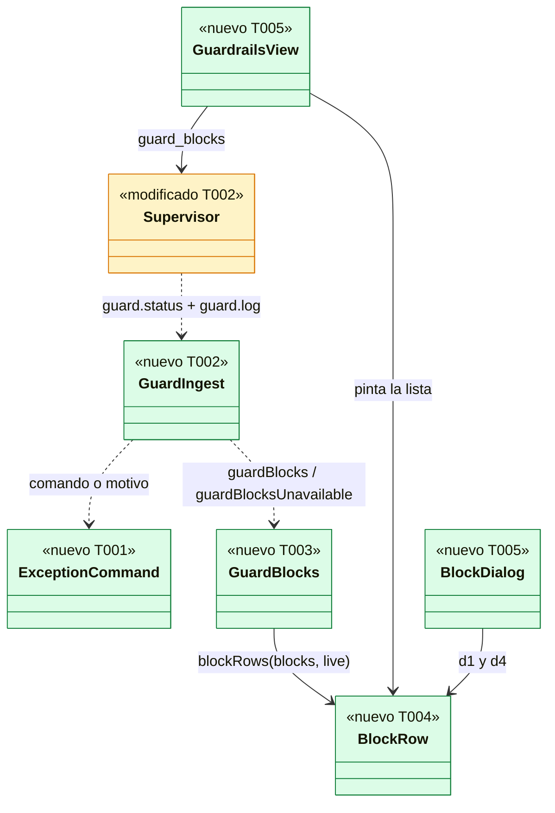
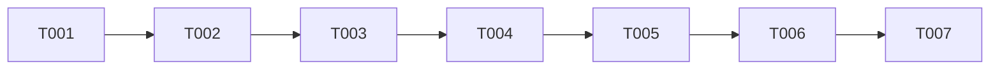

# DS-US-DSK-007 · El bloqueo explicado y el comando de la excepción consciente en la app

## Contexto rápido

Al terminar, quien tiene abierto un repo en la app ve en la vista **Guardrails** (fila del pie de la barra lateral, con su contador ⛔) cada operación que GitRaptor frenó: quién la intentó, qué operación era, qué regla la frenó y cuándo. Al abrir un bloqueo ve la explicación en lenguaje llano (d1 de DSF-DSK-001) y, si la operación admite excepción, el comando exacto `raptor guard exec -- git …` con un botón "Copiar" (d4). La app **nunca** ejecuta ese comando: el humano lo pega en su terminal, donde pasa los controles de la terminal, el anuncio y la ventana cancelable de US-GRD-006. Lo que ocurre allí (excepción anunciada, usada o cancelada) vuelve a la app porque el motor lo anota en su registro y lo anuncia por el canal.

Las reglas de presentación de la denegación son las de US-CKP-019 y `raptor guard log` (US-GRD-005); el mecanismo de la excepción es el de DS-US-GRD-006 y no se reabre. Esta historia es **solo lectura**: un comando IPC nuevo, `guard_blocks`, que lee `guard.status` y `guard.log` del repo abierto; ningún método reservado ni de escritura.

| Término | Qué es aquí |
|---|---|
| Bloqueo | Entrada de `guard.log` con `kind: denial` (`crates/api/src/guard.rs:1165`): el efecto aplicado no fue `allow` |
| Excepción registrada | Entrada `exception`, `exception-cancelled` o `exception-rejected` del mismo registro (DS-US-GRD-006 D16) |
| Excepción anunciada | `GuardStatus.pending` con `action: exception` (`guard.rs:926`, `:635`): la ventana de 10 s está abierta en la terminal de alguien |
| Comando copiable | Cadena POSIX con cada argumento entre comillas simples, construida en el backend (ADR-GRP-017 § 5, M-1, V6) |

### Qué publica el motor de verdad (verificado el 2026-11-09)

- `guard.log` es de lectura, **no reservado** y fuera del MCP (`crates/api/src/methods/guard.rs:19-21`, `:139`). Parámetros `{ path, sinceMs?, limit?, layer? }`, por defecto 50 entradas y como mucho 500 (`guard.rs:1323-1336`, `:1380`); retención 90 días (`:1382`).
- Cada `GuardLogEntry` (`guard.rs:1294-1318`) trae: `atMs`, `utcOffsetS`, `lastMs`, `count`; `worktree` (ruta canónica del cwd del hook, `crates/core/src/guardrails/log.rs:38-39`) y `branch` (el `HEAD` de ese worktree), los dos `Untrusted`; `actor: Option<AgentKind>`, **solo el tipo** (`claude-code` u `other`, `crates/api/src/actor.rs:27-30`), nunca el nombre de la sesión; `operation` normalizada, **nunca el argv** (`guard.rs:1227-1262`); `kind`, `detail`, `effect`, `appliedEffect`, `reasons: [{ rule, level, cause? }]` (`:1268-1274`), `layer`, `origin`, `decisionId`.
- La operación de un push lleva el remoto (nombre, o URL sin credenciales) y las refs **de destino** con su cambio (`create`, `update`, `force`, `delete`); la ref local de origen no se anota (`log.rs:388-411`). La de un rebase **no** lleva ni `upstream` ni `branch` (`log.rs:426-430`, M-06). La de un commit solo lleva la fase.
- El argv de la excepción "nunca se guarda, anota ni audita" (`guard.rs:1432-1435`).
- `guard.log` falla con `INTERNAL` «guardrails unavailable» cuando el motor no puede leer el registro, y con el rechazo `not-observed` si el repo no está observado (`crates/core/src/channel/conn.rs:1943-1946`).
- **No hay evento en vivo de una denegación.** El catálogo de eventos (`crates/api/src/event.rs:179-200`) no tiene ninguno, y `attention.denials` del ámbito global sigue `not-published` (`crates/api/src/scope.rs:100-120`; solo el predictor publica `repo.attention`, `crates/core/src/daemon/modules/predict.rs:572`). Hay que **releer**.
- **Sí hay evento de la excepción**: `reserved.audit` es del ámbito global (`event.rs:107-108`, `:181`) y el daemon lo publica al aceptar `guard.exception` (`conn.rs:3190-3197`) y al cerrarla con `cancelled`, `applied`/`used`, `failed` o `expired` (`crates/core/src/daemon/guard.rs:609`, `:627-656`), con `operation: "guard.exception"` y el `repo_id`. Llega a toda conexión con `audit.outcomes` y `guard.exception` (`crates/core/src/channel/bus.rs:287-300`), que la biblioteca cliente acepta por defecto (`crates/core/src/client.rs:63-77`).
- `audit.list` (`crates/api/src/methods/audit.rs:7`, no reservado) devuelve filas `AuditEntry { id, atMs, operation, repoId, outcome, reason, client }` (`messages.rs:1249-1265`), sin filtro por repo y paginadas desde la más antigua (`after_id`, `messages.rs:1276-1285`; `conn.rs:2947-2962`). No trae la operación de git ni las reglas.
- La forma del comando es `raptor guard exec [--yes] -- git [-C <dir>] push|branch -d|rebase …` (`apps/cli/src/commands/guard.rs:49-58`; DS-US-GRD-006 D1, D2). `--yes` contesta la pregunta, nunca acorta la ventana. Un remoto dado como URL, `rebase -i`, `commit`, `merge` y `pull` se rechazan (D2). Ctrl-C durante la ventana cancela y deja `exception-cancelled` (D8). **`raptor guard cancel <ruta>` también cancela una excepción anunciada** (verificado el 2026-11-09): la CLI llama `guard.cancel` (`apps/cli/src/guard.rs:1247-1267`) y el daemon cancela la acción pendiente del repo sea del tipo que sea y, si era una excepción, anota `exception-cancelled` con quién canceló (`crates/core/src/daemon/guard.rs:429-450`, `crates/core/src/guardrails/pending.rs:264-266`). Su ayuda (`apps/cli/src/commands/guard.rs:37`, «Cancel a removal of the protection») y su mensaje de salida («la protección de {path} sigue») hablan solo de la retirada (G12). `guard.cancel` no es reservado. Un agente nunca la obtiene: `Connection::reserved` la rechaza por ascendencia (D4).
- Los mensajes de denegación al agente nunca nombran la excepción (`apps/cli/src/guard.rs:1845-1862`, `crates/api/src/catalog_denial_tests.rs:107`). Esta app es una superficie del humano, así que sí la nombra; la vista restringida (abierta por un agente) no muestra repos (`supervisor.rs:445-455`) y por tanto tampoco esta vista.

### Decisiones

Todas son **Decisión del orquestador (2026-11-09), validada por Arquitecto**.

| # | Decisión | Por qué | Alternativa descartada |
|---|---|---|---|
| D1 | **Un comando IPC de lectura, `guard_blocks { repoId }`**, con la forma de `fleet_open`: responde `{}` y el supervisor manda el resultado por el `Channel` (`guardBlocks` o `guardBlocksUnavailable`). Solo vale para el repo abierto; otro `repoId` responde `guardBlocksUnavailable { cause: "not-open" }` sin llamar al motor | El supervisor es dueño de la conexión (DS-US-DSK-003); un comando que devolviera el dato tendría que esperar al hilo del supervisor | Un comando por método (`guard_log`, `guard_status`): dos entradas en la lista cerrada para un solo uso |
| D2 | **Fuente de la lista: `guard.status` + `guard.log { path, limit: 50 }`** del repo abierto, en ese orden, con la ruta cruda de `RepoView.path` guardada al abrir el repo. **No se llama `audit.list`**: no filtra por repo, pagina desde la fila más antigua y no trae ni la operación ni las reglas; `guard.log` ya anota la excepción usada, la cancelada (con quién canceló) y la rechazada (DS-US-GRD-006 D16), y `GuardStatus.pending` da la excepción anunciada con su ventana | Lo que pide el escenario ("queda registrada y la app la muestra") está completo en `guard.log`; `audit.list` añadiría el pid y el ejecutable del cliente, que la app no necesita | Leer `audit.list` con cursor: más tráfico y un dato del proceso (ruta del ejecutable) sin uso en UI-1 |
| D3 | **Cuándo se relee**: (a) al abrir la vista Guardrails, al cambiar de repo y al volver la ventana a visible; (b) cada 10 s mientras la ventana está visible y hay repo abierto (el motor no publica las denegaciones); (c) en el backend, sin esperar al webview, cuando llega un `reserved.audit` con `operation` que empieza por `guard.exception` y `repoId` del repo abierto. El backend no lanza otra lectura del mismo repo si la anterior fue hace menos de 2 s y descarta la orden. **Las lecturas por (c) se juntan** (M-02 de security-expert: el daemon publica `reserved.audit` también en los rechazos, `crates/core/src/channel/conn.rs:3129-3140`, `:3195-3196`, así que un agente en bucle con `raptor guard exec` provocaría lecturas sin límite): como mucho una lectura en vuelo; los eventos que llegan durante ella o en los 500 ms siguientes a su fin se juntan en una sola lectura final. **Decisión del orquestador (2026-11-09), validada por Arquitecto y security-expert** | NFR-13.8 (nada corre con la ventana oculta) y una frescura de ≤ 10 s para un bloqueo, ≤ 1 s para la excepción, que sí tiene evento | Leer solo al abrir la vista: el contador ⛔ y el toast no sabrían nada; un evento nuevo del motor: no existe (G2) |
| D4 | **Qué entradas se listan**: `denial`, `exception`, `exception-cancelled` y `exception-rejected`, de todas las capas (`hooks`, `mcp`, `cockpit`). `notice` y `protection-state` no son bloqueos y no se listan aquí. Las de `detail: rate-limited` van en un grupo aparte "anotadas sin detalle" (DSF-DSK-001 § 4.d, "lista de bloqueos") | Lo que la historia llama bloqueo y su desenlace; la regla de `raptor guard log` | Listar los avisos: no son bloqueos y llenarían la vista |
| D5 | **Quién lo intentó** = el tipo de agente con la carpeta del worktree, como la tarjeta de la flota (D6 de DS-US-DSK-004): "Claude Code · feat-pagos", "otro agente · feat-pagos". `actor: null` se dice "sin agente identificado", nunca "humano" (US-CKP-026). El motor no anota el nombre de la sesión (`claude-1`): el escenario se cumple con el agente que el motor sabe | El dato publicado es `AgentKind` (`actor.rs:27`); cruzar con las sesiones por hora atribuiría por adivinación | Inferir la sesión por worktree y hora: puede nombrar a otro agente (G1) |
| D6 | **El comando copiable se construye en el backend** (`engine/exception_command.rs`, sobre `shell_command::posix` y `shell_command::raptor_path` de DS-US-DSK-008 D21, que entra antes), a partir de la entrada cruda, nunca en el webview. Forma: `'<raptor>' 'guard' 'exec' '--' 'git' '-C' '<worktree>' <argumentos>`, cada argumento entre comillas simples POSIX con `'` escrita `'\''` (ADR-GRP-017 § 5). **Nunca lleva `--yes`**: la terminal muestra el plan normalizado y pregunta antes de anunciar (DS-US-GRD-006 D1) | El texto crudo solo existe en el backend; el webview recibe el texto saneado y la cadena final o el motivo por el que no se ofrece. Es la regla de `wire::stop_command` (`apps/desktop/src-tauri/src/engine/wire.rs:412-423`), que 008 ya mueve a `shell_command::posix` | Construirlo en TypeScript: el frontend tendría que recibir texto crudo, que ADR-GRP-004 y SEC-12 prohíben |
| D7 | **Argumentos por operación** (la operación anotada, no el argv del agente, que el motor no guarda): <br>• **push** con remoto por nombre: `push [--force-with-lease] <remoto> <refspec>…`; cada ref `force`, `update` o `create` → `<rama>:<ref>` si `branch` está y difiere de `ref`, o `<ref>` si coincide o falta; cada ref `delete` → `:<ref>`; `--force-with-lease --force-if-includes` si alguna es `force` (L-01: `crates/policy/src/guard/exception.rs:181` admite las dos). <br>• **cambio de refs** con todas las refs `delete` bajo `refs/heads/` → `branch -d <nombre corto>…` (**`-d`, no `-D`**, M-05: git rehúsa borrar una rama no fusionada en vez de perder sus commits; la pista `grd.exc.branchDeleteHint` dice cómo forzarlo a conciencia); una ref fuera de `refs/heads/` → no se ofrece (`operation`). <br>• **rebase**: el motor no anota `upstream` ni `branch` → no se ofrece cadena; se explica la forma (`raptor guard exec -- git rebase …`) sin botón. <br>• **commit**, cambio de refs que crea o mueve, `protection-state`, `mcp-allowlist` → sin excepción (Q-GRD-47). <br>No se ofrece tampoco si: el remoto falta o es una URL (contiene `://` o es `usuario@host:ruta`), falta `worktree` o no es absoluta, la entrada es `rate-limited`, alguna regla no es saltable (D8), algún argumento tiene un carácter de `display::must_escape` (`crates/api/src/display.rs:57`, V6), o no se conoce un `raptor` instalado (D9). **Nombres como los valida el daemon** (M-03, `crates/policy/src/guard/exception.rs:158-171`, `:224-228`): `unsafe-text` si un nombre de rama o ref está vacío, empieza por `-` o `+`, o contiene `:` `*` `?` `[` `\` o `!`; un remoto además si empieza por `/`, `.` o `~`. Una rama que empieza por `+` daría un refspec forzado de otra rama, y `!` lo expande tcsh (I-02). **Decisión del orquestador (2026-11-09), validada por Arquitecto y security-expert** | `--force-with-lease` en vez de `--force` por NFR-01: si el remoto avanzó desde la última copia conocida, el push se niega en vez de pisar commits ajenos; `--force-if-includes` exige además que lo que se pisa esté en la historia local. Las dos **reducen, no eliminan**, el riesgo de pisar commits ajenos (un `fetch` posterior refresca la copia conocida); D2 de DS-US-GRD-006 las admite. La rama de origen `<rama>:<ref>` reproduce el caso de d1 ("push forzado de feat-x sobre main") con el único dato publicado | Ofrecer siempre una cadena con marcadores (`<upstream>`): pegada en una shell, `<` es una redirección |
| D8 | **Reglas saltables** según DS-US-GRD-006 D5: `minimum.force-push`, `minimum.base-branch-delete`, `permission.*`, `policy.protected-branch`, `policy.forbidden-path`, `policy.diff-size`, `policy.commit-format`. Una lista constante en `exception_command.rs` con un test que la fija. El daemon sigue siendo quien decide: si la lista se queda atrás, la terminal rechaza con su motivo (`not-exceptable`) | V1 de ADR-GRP-017 prohíbe enlazar `crates/policy`, donde vive `exceptable` | Ofrecer la cadena siempre: el humano copiaría un comando que la terminal rechaza |
| D9 | **Ruta de `raptor`**: `shell_command::raptor_path` de DS-US-DSK-008 (D21), sin duplicarla: la del ejecutable que sirve al daemon según el último informe `ready` de `raptor daemon ensure` (`daemon_path`, `crates/api/src/client/ensure.rs:22-23`), canonicalizada y aceptada por `installed::is_installed_raptor`; si no la hay **o cuelga de un repo o worktree observado** (L-02), la del `raptor` del bundle (`launcher::bundled_raptor`, `launcher.rs:143-157`); si tampoco, no se ofrece (`raptor-unknown`). Nunca `PATH`. La regla de L-02: **Decisión del orquestador (2026-11-09), validada por Arquitecto y security-expert** | ADR-GRP-017 § 5 pide la ruta absoluta del que sirve al daemon; el del bundle habla con el mismo daemon por el perfil y es la versión de la app | Escribir `raptor` a secas: dependería del `PATH` de la terminal, que puede ser otro binario |
| D10 | **Portapapeles: escribir sí, leer nunca.** La primitiva `CopyCommand` de TS-DSK-003 (`apps/desktop/src/ui/CopyCommand.tsx`) usa `navigator.clipboard.writeText` desde el clic, **sin plugin ni permiso de Tauri** (ADR-GRP-017 § 5; V2 solo admite `tauri-plugin-dialog`, `tests/tauri_surface.rs:262-275`). Ningún archivo de `src/` llama `clipboard.read` ni `readText`: un test lo fija. Lo copiado se recuerda por su origen (`onCopied` de la primitiva enmendada por DS-US-DSK-008 D22: la fila y su operación), nunca leyendo el portapapeles (D12) | WebKit exige activación del usuario para escribir: el clic la da. Leer el portapapeles expondría lo que el humano copió de otro sitio | `tauri-plugin-clipboard-manager`: plugin prohibido por V2 |
| D11 | **Dónde se ve**: una fila "Guardrails" fija al pie de la barra lateral, con `⛔N` = bloqueos no vistos en esta ejecución. Un clic cambia el centro a `GuardrailsView`: añade `{ view: "guardrails" }` a la unión `center` de `ui-store` que crea DS-US-DSK-008 (D7), sin persistir; "Volver a la flota" llama `backToMain()`. Un bloqueo nuevo (no visto, posterior a la primera lectura del repo) abre un toast persistente con el título y "Ver" (el ⛔ lo pinta la primitiva, D15); abrir la vista los marca como vistos. El detalle (d1) y el comando (d4) son un `Dialog` de dos pasos (D14). Al abrir otro destino del centro (un par de US-DSK-008, Time Machine) esta vista se cierra y viceversa; "Volver" lleva a la vista principal (D-15 de DSF-DSK-001) | DSF-DSK-001 § 4.d, estado "default · bloqueo" y "lista de bloqueos"; el centro sigue siendo de la flota mientras no exista el grafo (D1 de DS-US-DSK-004) | Un panel lateral: el cajón del detalle está cerrado entre 1000 y 1359 px |
| D12 | **La excepción anunciada se ve, y se cancela en la terminal.** Con `pending.action = exception` en el repo abierto, la vista y el paso d4 muestran "Excepción anunciada en una terminal: se ejecuta en N s", la operación y las reglas que salta, y cómo cancelarla allí: Ctrl-C en esa terminal, o el comando copiable `'<raptor>' 'guard' 'cancel' '<worktree o repo>'` (verificado: `guard.cancel` cancela la excepción anunciada y anota `exception-cancelled`, § Qué publica el motor). La app **no** llama `guard.cancel` en esta historia. **Excepción distinta de la copiada** (M-01 de security-expert: un agente puede reescribir el portapapeles entre "Copiar" y pegar): si la app copió en esta ejecución un comando de excepción para este repo (`CopyCommand.onCopied`, D10) y llega un `pending` de excepción cuya operación o reglas no coinciden con las de la fila copiada, la vista y el paso d4 muestran un aviso `role="alert"` `grd.exc.mismatch` ("La excepción anunciada no es la que copiaste: cancélala con Ctrl-C en esa terminal") con el `CopyCommand` de cancelar. La comparación la hace el webview (`pendingMismatch`, pura), porque solo él sabe qué se copió y la app nunca lee el portapapeles. **Decisión del orquestador (2026-11-09), validada por Arquitecto y security-expert** Al llegar el desenlace, el aviso cambia a "Hecho con excepción" (`exception`), "Cancelada: no se ejecutó nada" (`exception-cancelled`, con quién canceló) o "Rechazada" (`exception-rejected`) | El escenario 3 ocurre en la terminal; la app lo muestra desde lo registrado. ADR-GRP-017 § 4 permite cancelar desde la app sin presencia de sesión, pero esta entrega solo lee (orden del orquestador) | Botón "Cancelar" que llame `guard.cancel`: escritura, fuera de esta historia (§ Fuera de alcance) |
| D13 | **Registro no disponible** (escenario 4): `guard.log` con `INTERNAL` → `guardBlocksUnavailable { cause: "log-unavailable", protection }`, con el `guard.status` leído antes. Si `protection.state` es `hooks-only` o `full`: "La lista de bloqueos de {repo} no está disponible ahora. La protección sigue activa: los hooks deciden sin esta lista." Si `guard.status` también falló: "… La protección no depende de esta lista: si {repo} está protegido, los hooks siguen frenando." Nunca "nada bloqueado" ni "0" | La protección la imponen los hooks en cada operación (ADR-GRD-001), no el registro; la app solo afirma lo que sabe | Afirmar siempre "sigue activa": sería falso en un repo sin protección |
| D14 | **Estructura del diálogo con la primitiva.** `Dialog kind="info"` (nada se confirma dentro de la app: no es `confirm`). La primitiva solo tiene un botón de pie (`acknowledge`), así que: paso 1, `acknowledge` = "Entendido" (primario, foco inicial: P2), y "Lo haré yo…" (`Button variant="secondary"`) y "Ver en el registro" (`variant="link"`) van al final de `children`, alineados a la derecha; paso 2, el mismo `Dialog` cambia `title`, `description` y `children`, y `acknowledge` pasa a "Cerrar". En un push con rama de origen, el paso 2 dice `grd.exc.sourceInferred` ("Rama de origen deducida: {{branch}} (la que estaba sacada en esa carpeta cuando se bloqueó). Comprueba en el plan de la terminal que es la que quieres subir"): `branch` es el `HEAD` de la carpeta, no la ref de origen del push, que el motor no anota (M-04, `crates/core/src/guardrails/log.rs:388-411`; G3); en un borrado de rama, `grd.exc.branchDeleteHint` (M-05). **Decisión del orquestador (2026-11-09), validada por Arquitecto y security-expert** para estas dos líneas. Al cambiar de paso el foco se mueve al botón "Cerrar" (el botón "Lo haré yo…" desaparece y el foco caería en `body`). `Esc`, clic fuera y la X cierran sin efecto en el motor y devuelven el foco a la fila que lo abrió (`returnFocusRef`). Sin `Cancelar`: nada se cancela desde la app (D12). **Decisión del orquestador (2026-11-09), validada por Diseñador UX** | La primitiva de TS-DSK-003 no tiene un segundo botón de pie y no se amplía para un caso | Un `Dialog kind="confirm"`: pone "Cancelar" y un botón de acción, que sugieren que la app ejecuta algo |
| D15 | **El toast de bloqueo es `kind: "error"`**: la única variante de la primitiva que no se cierra sola y se anuncia como `role="alert"`; pinta ella el glifo `OctagonX` (el ⛔ de DSF), de modo que el mensaje **no** lleva el carácter ⛔ (saldría doble). El prefijo oculto de la primitiva (hoy `ui.toast.kind.error`, "Error") se sustituye por `grd.toast.kindLabel` ("Bloqueo" / "Blocked") con la prop opcional nueva `srLabel` de `ToastInput`: enmienda aditiva de la primitiva (primitives-spec § 2.12), hecha en T005 con su test; sin `srLabel`, el prefijo es el de siempre (**Decisión del orquestador (2026-11-09), validada por Arquitecto**; G10 resuelto). Un solo toast de bloqueo a la vez (`grd.toast.many` si hay varios), de modo que ocupa un solo hueco de los 3 del visor frente a los toasts ⚡ de US-DSK-008. Abrir la vista Guardrails o el diálogo lo retira. **Decisión del orquestador (2026-11-09), validada por Diseñador UX** | Un bloqueo necesita ser visto aunque el usuario esté en otra cosa (DSF § 4.d, "persistente hasta que se lee"); usar `info` lo cerraría a los 5 s | Una variante `blocked` de `Toast`: toca una primitiva por un matiz de texto oculto |
| D16 | **Cuenta atrás.** La cifra se pinta cada segundo, con `aria-hidden="true"`; una región `role="status"` aparte la anuncia al aparecer el aviso (10 s), a los 5 s y al llegar el desenlace, nunca cada segundo. A 0 s el texto pasa a `grd.exc.pendingNow` hasta que llega el desenlace. Con `prefers-reduced-motion` no cambia nada: no hay barra de progreso ni animación, solo el número. El desenlace se anuncia de inmediato. **Decisión del orquestador (2026-11-09), validada por Diseñador UX** | WCAG 2.2.2 y 4.1.3: un anuncio por segundo es ruido; sin barra no hay movimiento que reducir | Anunciar cada segundo; barra animada como d5 de DSF (es de la excepción con factor del SO, fuera de UI-1) |
| D17 | **Quién lo hizo, dicho para novatos.** El título usa el tipo de agente y la carpeta ("Claude Code · feat-pagos") y, sin agente identificado, `grd.block.titleNoActor` ("Bloqueado: se intentó {{operation}} (sin agente identificado)"). Las operaciones de push dicen "en el servidor ({{remote}})" y no solo "origin" (la maqueta d1 dice "en el servidor"). `grd.exc.who` nombra solo el tipo (`grd.agent.*`), sin la carpeta. Los términos de Git del diálogo llevan su glosa de DSF § 12 con un `Popover` desde un `IconButton` "?" (`grd.gloss.*`), sin componente nuevo. **Decisión del orquestador (2026-11-09), validada por Diseñador UX** | El motor no anota `claude-4` (D5): la maqueta d1 se corrige a lo que se sabe. "origin" es jerga (D-4 de DSF-DSK-001) | Poner el nombre de sesión inventado: puede nombrar a otro agente |
| D18 | **Fila y vista.** La fila "Guardrails" del pie es un `<button>` con `aria-current="page"` cuando la vista está abierta; su nombre accesible incluye el texto visible y el contador (`grd.nav.labelUnseen`, no solo el contador). `Esc` en `GuardrailsView` vuelve a la vista principal con la precedencia de D18 de DS-US-DSK-008 (diálogo, popover, toast con foco, cajón, vista) y su mecanismo: la vista llama `event.preventDefault()` al consumirlo y `useShortcuts`, ya ajustado por 008, no cierra además el cajón; al volver, el foco va a la fila "Guardrails" de la barra lateral. El texto de "Volver" es el de la vista principal ("Volver a la flota" hoy, "Volver al grafo" con US-DSK-005). **Decisión del orquestador (2026-11-09), validada por Diseñador UX** | Es el mismo patrón que Time Machine (c1: `Esc` devuelve el foco a la barra lateral) | Solo el botón "Volver": rompe la regla de teclado de DSF § 5 |

---

## 📋 Índice

> **Para aprobar:** [Contexto rápido](#contexto-rápido) · [⚠️ Gaps](#gaps-y-violaciones-de-la-constitución) · [🔭 La forma](#la-forma) · [El trabajo de un vistazo](#el-trabajo-de-un-vistazo).
> **Para implementar:** [🚀 Plan](#plan-de-implementación), en orden. Las `_(ref)_` se abren desde la tarea que las cita.

| Sección | Propósito |
|---------|-----------|
| [Contexto rápido](#contexto-rápido) | Qué se construye, qué publica el motor y decisiones |
| [⚠️ Gaps y violaciones de la constitución](#gaps-y-violaciones-de-la-constitución) | Qué impide empezar |
| [🔭 La forma](#la-forma) | Piezas y relaciones |
| [🚀 Plan de implementación](#plan-de-implementación) | T001…T007, en orden |
| ↳ [El trabajo de un vistazo](#el-trabajo-de-un-vistazo) | Tareas en tabla y su orden |
| [Estructura de ficheros](#estructura-de-ficheros) _(ref)_ | Árbol anotado |
| [Contratos compartidos](#contratos-compartidos) _(ref)_ | DTO, mensajes, firmas y textos |
| [Contrato de API](#contrato-de-api) _(ref)_ | Comando IPC y lo que se consume del canal |
| [Estrategia de pruebas y cobertura](#estrategia-de-pruebas-y-cobertura) _(ref)_ | Escenarios → tests |
| [Gate de seguridad](#gate-de-seguridad) | Checklist pre-merge |
| [Fuera de alcance](#fuera-de-alcance) | Lo que esta entrega no toca |
| [Notas del autor](#notas-del-autor) _(ref)_ | Huecos del motor y lo que no bloquea |

---

## ⚠️ Gaps y violaciones de la constitución

_No gaps. Ready to implement._

Sin `architecture-constitution.md` en la cascada: las restricciones salen de [AGENTS.md](../../../../../AGENTS.md) y de los ADR citados (la app solo lee y sus comandos son una lista cerrada, ADR-GRP-017 § 1 y § 5; texto no confiable saneado en un punto, ADR-GRP-004 y SEC-12; ningún plugin salvo `dialog`, V2). Ninguna tarea las viola. Lo que el motor no publica (nombre de la sesión, argv, argumentos del rebase, evento de denegación) no bloquea: la app lo trata con D5, D7 y D3 y va en [Notas del autor](#notas-del-autor) con su dueño.

**Depende de**: US-DSK-004 (repo abierto en el supervisor, `fleet_open`, `useFleet`, árbol de repos), ya en `main`. Y de **US-DSK-008**, que entra antes por el orden del orquestador (008 → 007 → 005): `shell_command` (`posix`, `raptor_path`), la unión `center` de `ui-store`, el `Esc` consumido y `CopyCommand` con `onCopied`. No es un hueco de decisión: el contrato está fijado en DS-US-DSK-008 y toda la historia (`blocked_tasks`) empieza cuando 008 esté en `main`.

---

## 🔭 La forma



`GuardrailsView` (o el reloj de D3) llama `guard_blocks`; el `Supervisor` lee `guard.status` y `guard.log` del repo abierto, y también lo hace solo al llegar un `reserved.audit` de una excepción. `ingest::guard` sanea cada texto y pide a `exception_command` la cadena copiable o el motivo por el que no se ofrece. `applyEngineBatch` guarda el resultado en la caché (`["engine", "guard", repoId]`); `blockRows` es pura y decide textos y grupos; la vista y el diálogo solo pintan.

---

## 🚀 Plan de implementación

> Orden topológico (`Depende:`). Las rutas son relativas a la raíz del repo.

### El trabajo de un vistazo

| # | Tarea | Depende | Aterriza en |
|---|---|---|---|
| T001 | Escribir en rojo los tests y el constructor del comando copiable | — | `src-tauri/src/engine/exception_command.rs`, `src-tauri/tests` |
| T002 | Leer el registro en el supervisor y añadir `guard_blocks` | T001 | `src-tauri/src/engine`, `src-tauri/src/commands` |
| T003 | Guardar los bloqueos en la caché y releer a su ritmo | T002 | `src/client`, `src/state`, `src/guardrails/useGuardBlocks.ts` |
| T004 | Calcular las filas, los textos y lo no visto | T003 | `src/guardrails/blocks-model.ts` |
| T005 | Pintar la vista, el diálogo y el toast | T004 | `src/guardrails`, `src/shell`, `src/i18n` |
| T006 | Fijar que la app nunca lee el portapapeles ni ejecuta la excepción | T005 | `src/guardrails`, `src-tauri/tests` |
| T007 | Verificar de punta a punta en macOS | T006 | — |

### En qué orden



### T001 — Escribir en rojo los tests y el constructor del comando copiable

**Objetivo.** El contrato del comando copiable (D6–D9) como función pura, y los tests de Rust de los escenarios contra el daemon falso.

**Ubicación.**
- `apps/desktop/src-tauri/src/engine/exception_command.rs` (**CREATE**)
- `apps/desktop/src-tauri/src/engine/wire.rs` (**MODIFY**: DTO y mensajes de § Contratos compartidos)
- `apps/desktop/src-tauri/tests/guard_command.rs` (**CREATE**)
- `apps/desktop/src-tauri/tests/guard_blocks.rs` (**CREATE**)
- `apps/desktop/src-tauri/tests/support/fake_daemon.rs` (**MODIFY**: guion "tienda" con `guard.status` y `guard.log`)

**Reglas**
- Las comillas son las de `shell_command::posix` y la ruta de `raptor` la de `shell_command::raptor_path`, ya en `main` con DS-US-DSK-008 (D21): esta tarea no las reescribe.
- `exception(raptor: Option<&Path>, entry: &GuardLogEntry) -> Result<String, NotOffered>` con las reglas de D7 y D8, y `cancel(raptor: Option<&Path>, path: &str) -> Option<String>` para D12.
- Validación de nombres de D7 (M-03) antes de componer: `unsafe-text` si un nombre de rama o ref está vacío, empieza por `-` o `+`, o contiene `:` `*` `?` `[` `\` o `!`; un remoto, además, si empieza por `/`, `.` o `~`. Borrado de rama: `branch -d` con el nombre sin `refs/heads/` (M-05). Push con `force`: `--force-with-lease --force-if-includes` (L-01).
- `SKIPPABLE: &[Rule]` con la lista de D8; `permission.*` se reconoce por la familia de la regla (todas las variantes `Permission*`).
- El falso sirve "tienda" (`/w/tienda/.git`, protegida `full`) con: una denegación de un force-push de `claude-code` desde `/w/wt/feat-pagos` (rama `feat-pagos`) a `main` en `origin` (`minimum.force-push` y `policy.protected-branch`, nivel `floor`, 10:58); una denegación de un commit en `main` (`policy.forbidden-path`); una de un rebase; una `exception` y una `exception-cancelled` del mismo push; y un guion alternativo con `guard.log` → `INTERNAL` «guardrails unavailable».
- Los tests (nombres en [§ 9.4](#94-comportamientos-críticos-verificados)) compilan contra un `HubCmd::GuardBlocks` que el supervisor aún ignora.

- **Depende:** —
- **Refs:** D6–D9; DS-US-DSK-008 D21; ADR-GRP-017 § 5 (M-1, V6); DS-US-GRD-006 D1, D2, D5
- **Aceptación:** `cargo test -p gitraptor-desktop --test guard_command` en verde (la función es pura y se escribe aquí); `--test guard_blocks` compila y falla (rojo); se commitea antes de T002.

### T002 — Leer el registro en el supervisor y añadir `guard_blocks`

**Objetivo.** El backend lee `guard.status` y `guard.log` del repo abierto, a petición y tras un `reserved.audit` de una excepción, y manda el resultado saneado.

**Ubicación.**
- `apps/desktop/src-tauri/src/engine/supervisor.rs` (**MODIFY**)
- `apps/desktop/src-tauri/src/engine/ingest.rs` (**MODIFY**: `guard_blocks`, `guard_entry`, `protection`, `pending`)
- `apps/desktop/src-tauri/src/engine/mod.rs` (**MODIFY**: `EngineHub::guard_blocks`, `pub mod exception_command`)
- `apps/desktop/src-tauri/commands.json` (**MODIFY**)
- `apps/desktop/src-tauri/src/commands/mod.rs` (**MODIFY**)
- `apps/desktop/src-tauri/src/commands/guard_blocks.rs` (**CREATE**)
- `apps/desktop/src-tauri/capabilities/main.json` (**MODIFY**: `allow-guard-blocks`)
- `apps/desktop/src-tauri/tests/commands.rs` (**MODIFY**)
- `apps/desktop/src-tauri/tests/engine_wire.rs` (**MODIFY**: fixture con las variantes nuevas)

**Reglas**
- `RepoScope` gana `raw_path: Option<String>` = `RepoView.path.raw()` de la última instantánea del repo abierto, `last_guard_read: Option<Instant>`, `guard_read_in_flight: bool` y `guard_reread_after: Option<Instant>`. Se vacía al cerrar o cambiar de repo.
- `HubCmd::GuardBlocks { repo_id }`: en vista restringida, se ignora. Si `repo_id` no es el abierto o aún no hay `raw_path`, manda `guardBlocksUnavailable { repoId, cause: "not-open", protection: null }`. Si la lectura anterior fue hace menos de 2 s, se descarta (D3). Si no: `guard.status { path }` y `guard.log { path, limit: 50 }`.
- Resultado: `guard.log` correcto → `guardBlocks` (§ Contratos). `INTERNAL` → `cause: "log-unavailable"`; rechazo `not-observed` → `cause: "not-observed"`; otro rechazo → `cause: "refused"`; en los tres, `protection` del `guard.status` si respondió, o `null`. `LinkError::Lost` → reconexión, como el resto del supervisor.
- `apply_global_event`: tras `Verdict::Apply`, si `event.kind == reserved.audit`, `data.operation` empieza por `guard.exception` y `data.repo_id` es el abierto, el supervisor pide la misma lectura (sin la espera de 2 s) **con la regla de juntar de D3 (M-02)**: si hay una lectura en vuelo o terminó hace menos de 500 ms, solo anota `guard_reread_after = fin + 500 ms`; al vencer, una sola lectura final por todos los eventos anotados. Ningún otro dato del `reserved.audit` llega al webview.
- `ingest::guard_entry`: `worktree` → `{ folder, path }` con `display::visible` (la carpeta es el último componente de la ruta cruda, saneado después de cortarlo); `branch`, `remote` y los nombres de ref con `display::visible` y el tope de nombres; `decisionId` con `visible` y tope 128; `actor` → `{ kind: "claude-code" } | { kind: "other" } | null`; `reasons` → `rules` con `rule`, `level` y `cause` en su forma del cable. Las entradas de D4 que no se listan se descartan aquí. El comando sale de `exception_command::exception` con `shell_command::raptor_path` (D9, con L-02) y solo para `kind: denial`.
- `ingest::pending`: solo `action: exception` del repo abierto → `{ appliesAtMs, windowMs, operation, rules, cancelCommand }`; `cancelCommand` con la ruta del worktree de la denegación más reciente de la misma operación o, si no, la ruta del repo.
- `guard_blocks` según [§ Contrato de API](#contrato-de-api); valida el id como `fleet_open` (antes de mirar si hay supervisor). `CommandError` no gana variantes. `commands.json` suma `"guard_blocks"` y `tests/commands.rs` sigue comparando la lista **exacta** (Decisión del orquestador (2026-11-09), DS-US-DSK-004 T002).

- **Depende:** T001
- **Refs:** D1–D4, D9, D12, D13; DS-US-DSK-004 T002 y D8; DS-US-DSK-008 D21; ADR-GRP-017 § 1
- **Aceptación:** `cargo test -p gitraptor-desktop --test guard_blocks --test guard_command --test commands --test engine_wire --test fleet_supervisor --test engine_supervisor` en verde; `assert_read_only` sobre las llamadas de todos los tests de `guard_blocks.rs`.

### T003 — Guardar los bloqueos en la caché y releer a su ritmo

**Objetivo.** `GuardBlocks` en la caché de TanStack Query, actualizada solo por mensajes, y el reloj de relectura de D3.

**Ubicación.**
- `apps/desktop/src/client/engine-types.ts` (**MODIFY**)
- `apps/desktop/src/client/commands.ts` (**MODIFY**)
- `apps/desktop/src/client/commands.test.ts` (**MODIFY**)
- `apps/desktop/src/state/engine-cache.ts` (**MODIFY**)
- `apps/desktop/src/state/engine-cache.test.ts` (**MODIFY**)
- `apps/desktop/src/state/ui-store.ts` (**MODIFY**: añade `{ view: "guardrails" }` a `CenterView` de DS-US-DSK-008 y `openGuardrails()`, sin persistir)
- `apps/desktop/src/state/ui-store.test.ts` (**MODIFY**)
- `apps/desktop/src/guardrails/useGuardBlocks.ts` (**CREATE**)
- `apps/desktop/src/guardrails/useGuardBlocks.test.tsx` (**CREATE**)

**Reglas**
- `applyEngineBatch`: `guardBlocks` → `setQueryData(engineKeys.guard(repoId), { state: "ready", …blocks })`; `guardBlocksUnavailable` → `{ state: "unavailable", cause, protection }` pero **sin borrar** las entradas que ya había (se siguen viendo con el aviso, marcadas como "última lectura hace …"); `repoClosed` → `removeQueries(engineKeys.guard(repoId))`. Un `cause: "not-open"` de un repo que ya no es el elegido se ignora.
- `useGuardBlocks()`: sin argumentos, lo monta `EngineCenter` una sola vez; con repo elegido y conexión `live` no restringida, llama `call("guard_blocks", { repoId })` al montar, al cambiar `selectedRepoId`, al volver la ventana a visible y cada 10 s con `document.visibilityState === "visible"` (el mismo patrón de `useNow`, D10 de DS-US-DSK-004). Devuelve el `UseQueryResult<GuardBlocks>` con `skipToken` sin repo.
- `ui-store`: `openGuardrails()` pone `center = { view: "guardrails" }` (sustituye un par abierto; `backToMain()` de 008 vuelve). `partialize` no cambia (el test de las cuatro claves sigue en verde).

- **Depende:** T002
- **Refs:** D3, D11; ADR-GRP-004, Enmienda D7
- **Aceptación:** `pnpm --filter @gitraptor/desktop test -- engine-cache useGuardBlocks ui-store` en verde: cada mensaje deja la caché esperada (fixture de Rust), un `unavailable` conserva las entradas, la relectura corre cada 10 s solo con la ventana visible y se repite al cambiar de repo.

### T004 — Calcular las filas, los textos y lo no visto

**Objetivo.** `blockRows`, pura, con los textos de US-CKP-019 y `raptor guard log`.

**Ubicación.**
- `apps/desktop/src/guardrails/blocks-model.ts` (**CREATE**)
- `apps/desktop/src/guardrails/blocks-model.test.ts` (**CREATE**)

**Reglas**
- Una `BlockRow` por entrada, de la más reciente a la más antigua por `lastMs`; las `rate-limited` en el grupo `unverified`.
- Título (`grd.block.title`): actor (D5) + operación en llano (`grd.op.*`): push con `force` → "reescribir el historial de {ref} en {remote}"; push con `delete` → "borrar {ref} en {remote}"; push con `update`/`create` → "subir a {ref} en {remote}"; cambio de refs con `delete` → "borrar la rama {ref}"; con `update`/`create` → "mover la rama {ref}"; rebase → "rebasar {branch}" (o "un rebase" sin rama); commit → "hacer un commit en {branch}".
- "No pasó nada" (`grd.block.nothing`) solo en `denial` con push o cambio de refs, y dice lo que vale para la operación: push → "{ref} sigue igual en el servidor"; cambio de refs → "{ref} sigue igual en tu equipo".
- "Qué intentó": la operación con la rama de origen si la hay ("Un push forzado de feat-pagos sobre main en origin") y la hora local (`Intl.DateTimeFormat` con el idioma de la app y la zona del equipo) de `atMs`; con `count > 1`, "×{count}, la última a las {hora de lastMs}".
- "Por qué es peligroso": `grd.block.why.forcepush` y `grd.block.why.deletebase` para `minimum.force-push` y `minimum.base-branch-delete`; las demás reglas no llevan esa línea.
- "Qué lo frenó": por razón, `grd.rule.<rule>` con su nivel (`grd.level.<level>`), los mismos textos que `apps/cli/i18n/{en,es}/guard.txt` (`guard.log.rule.*`, `guard.level.*`).
- Excepción: `offered` → el comando; `not-offered` → el texto de `grd.exc.notOffered.<reason>` (§ Textos). Sin conexión `live`: `ctaDisabled = "engine-down"`.
- Entradas `exception*`: título `grd.exc.done`, `grd.exc.cancelled` (con `grd.exc.cancelledBy` si el actor es un agente) o `grd.exc.rejected`, con la operación y las reglas saltadas.
- `unseen(rows, seenAfterMs)`: los `denial` con `lastMs > seenAfterMs`. `seenAfterMs` empieza en el `lastMs` máximo de la primera lectura del repo (lo histórico no cuenta) y avanza al abrir la vista.
- El nombre accesible de cada fila es la frase visible unida por ", " (DSF-DSK-001 § 7).
- `sourceInferred`: en un push con `branch` distinto de la ref de destino, la línea `grd.exc.sourceInferred` del paso 2 (M-04); en un borrado de rama, `grd.exc.branchDeleteHint` (M-05).
- `pendingMismatch(pending, copied): boolean` (D12, M-01): `copied` = la operación y las reglas de la última fila cuyo comando se copió en este repo (o `null`); `true` si hay `copied` y la operación (tipo, remoto y refs con su cambio) o el conjunto de reglas del `pending` difieren. Sin `copied`, `false`. `copied` se olvida al llegar el desenlace o al cambiar de repo.

- **Depende:** T003
- **Refs:** D4, D5, D7, D12; US-CKP-019 (E13); DS-US-GRD-005; DSF-DSK-001 § 4.d
- **Aceptación:** `blocks-model.test.ts` en verde (§ 9.4); cada `Rule`, `Level` y motivo de `NotOffered` del cable tiene texto en en y es (`catalog.test.ts`).

### T005 — Pintar la vista, el diálogo y el toast

**Objetivo.** La vista Guardrails, d1 y d4 con las primitivas de TS-DSK-003, en en/es y accesibles.

**Ubicación.**
- `apps/desktop/src/guardrails/GuardrailsView.tsx` (**CREATE**)
- `apps/desktop/src/guardrails/GuardrailsView.test.tsx` (**CREATE**)
- `apps/desktop/src/guardrails/BlockDialog.tsx` (**CREATE**)
- `apps/desktop/src/guardrails/BlockDialog.test.tsx` (**CREATE**)
- `apps/desktop/src/guardrails/PendingException.tsx` (**CREATE**)
- `apps/desktop/src/guardrails/GuardrailsNavRow.tsx` (**CREATE**)
- `apps/desktop/src/guardrails/PendingException.test.tsx` (**CREATE**)
- `apps/desktop/src/guardrails/GuardrailsNavRow.test.tsx` (**CREATE**)
- `apps/desktop/src/ui/Toast.tsx` (**MODIFY**: prop opcional `srLabel`, D15)
- `apps/desktop/src/ui/Toast.test.tsx` (**MODIFY**)
- `apps/desktop/src/engine/EngineCenter.tsx` (**MODIFY**: `center.view === "guardrails"` pinta `GuardrailsView`; monta `useGuardBlocks`)
- `apps/desktop/src/shell/AppShell.tsx` (**MODIFY**: fila `GuardrailsNavRow` al pie de la barra lateral)
- `apps/desktop/src/i18n/locales/en.json` (**MODIFY**)
- `apps/desktop/src/i18n/locales/es.json` (**MODIFY**)

**Reglas**
- `GuardrailsNavRow`: botón "Guardrails" con el símbolo de bloqueo (U+26D4) y N (no vistos) en `glass.danger` y `aria-label` `grd.nav.unseen`; sin no vistos, sin insignia. Solo con repo abierto y conexión no restringida.
- `GuardrailsView`: cabecera con el repo y "Volver a la flota"; línea de resumen (`grd.summary`: bloqueadas y excepciones del periodo, con los textos de `guard.log.summary.*`); `PendingException` si hay excepción anunciada; lista (`Table` o `<ul>`) de `BlockRow` con hora, actor, operación y regla; grupo "anotadas sin detalle"; periodos sin registro (`unloggedPeriods`, `grd.unlogged`). Vacío con protección activa: `grd.empty`; sin protección: `grd.empty.unprotected` (sin botón: proteger es US-DSK-002). Sin dato aún: `Skeleton` con `aria-busy="true"`, nunca "nada bloqueado". `unavailable`: `StatePanel` con el texto de D13 y, si había entradas, la lista debajo con `grd.stale`.
- `BlockDialog` (D14, D17): usa `Dialog kind="info"`; el símbolo de bloqueo (U+26D4) del título va en `aria-hidden` porque `grd.block.title` ya dice "Bloqueado". Paso 1 (d1): título con el símbolo de bloqueo (U+26D4), "No pasó nada", "Qué intentó", "Por qué es peligroso", "Qué lo frenó", "Detalles técnicos" (disclosure: regla, nivel, capa, actor, `decisionId`), "Qué puedes hacer" y los botones "Lo haré yo…" (`grd.exc.cta`, solo con `offered` o con rebase; en `children`) y "Entendido" (`acknowledge`, primario, foco inicial). "Ver en el registro" solo cuando se abre desde el toast. Con `not-offered`, sin "Lo haré yo…" y con el texto del motivo; con `ctaDisabled`, el botón desactivado y `grd.exc.engineDown`.
- `BlockDialog` paso 2 (d4, variante degradada sin factor del SO): `grd.exc.terminal.title`, `grd.exc.reason` (por qué se pide la terminal), `grd.exc.who`, `grd.exc.remote` si es un push, `grd.exc.terminal` y `CopyCommand` con la cadena; `grd.exc.where` ("¿Dónde está la terminal?…"); `grd.exc.review` ("Revisa el comando: la terminal te enseñará qué va a hacer y te preguntará antes. Si en la terminal aparece `--yes` o una operación distinta, cancélala", M-01); `grd.exc.sourceInferred` o `grd.exc.branchDeleteHint` cuando la fila los trae (M-04, M-05); el `CopyCommand` pasa `onCopied` para recordar la fila copiada (D12); `grd.exc.cancelHow` (Ctrl-C en la ventana de 10 s, sin el comando de cancelar hasta que haya `pending`). El botón de cierre se llama **"Cerrar"** (`grd.exc.close`, el `acknowledge` de D14), no "Cancelar": no cancela nada en el motor (D12). Si llega `pending` de esa operación, el paso muestra `PendingException`; si llega su desenlace, el texto del desenlace. Con rebase: la forma `raptor guard exec -- git rebase …` como `<code>` **sin** botón "Copiar" y `grd.exc.rebaseHint`.
- `PendingException`: "Excepción anunciada en una terminal: se ejecuta en {n} s" (`grd.exc.pending`), operación y reglas, `grd.exc.cancelHow`, `grd.exc.cancelOr` y `CopyCommand` con `cancelCommand`. Con `pendingMismatch` (D12), encima de todo un aviso `role="alert"` con `grd.exc.mismatch`. La cuenta atrás sigue D16: cifra por segundo con `useNow` en `aria-hidden`, región `role="status"` aparte que anuncia a los 10 s, a los 5 s y el desenlace (DSF-DSK-001 § 4.d).
- `Toast` (D15, primitives-spec § 2.12): prop opcional `srLabel?: string` que sustituye al prefijo sr-only `ui.toast.kind.<kind>`; sin ella, nada cambia.
- Toast (D15): un bloqueo no visto abre un `Toast kind="error"` con `srLabel: t("grd.toast.kindLabel")` (persistente, `role="alert"`, glifo de la primitiva) con el título y "Ver" (abre el `BlockDialog` de esa fila); varios a la vez → uno solo con `grd.toast.many`. Abrir la vista o el diálogo lo retira (`toast.dismiss`).
- `GuardrailsNavRow` (D18): `aria-current` y nombre `grd.nav.labelUnseen`; `GuardrailsView`: `Esc` vuelve, el foco va a la fila. Los `(?)` de glosario son `IconButton variant="ghost" size="sm"` con `Popover` (D17), 24 px de objetivo.
- Estados de la vista (DSF § 4.d): cargando (`Skeleton`), vacío con protección, vacío sin protección, con bloqueos, grupo "anotadas sin detalle", periodos sin registro, no disponible (D13), desactualizado (`grd.stale`), excepción anunciada, motor parado (CTA desactivado, `aria-disabled` con motivo) y vista restringida (la fila no existe). Con `prefers-reduced-motion` no hay transiciones propias: el diálogo y el toast usan las de la primitiva, que ya las anulan.
- Todo texto del motor entra como texto de React (nunca HTML); ningún color, radio ni tamaño literal (tokens de `tokens-web-grafito-glass.md`); el símbolo de bloqueo siempre con texto (NFR-09).

- **Depende:** T004
- **Refs:** D11, D12, D13, D14–D18; DSF-DSK-001 § 4.d (d1, d4), § 7, § 8, § 12; NFR-09; ADR-GRP-003
- **Aceptación:** `GuardrailsView.test.tsx`, `BlockDialog.test.tsx`, `PendingException.test.tsx`, `GuardrailsNavRow.test.tsx` y `Toast.test.tsx` en verde (§ 9.4); `axe-core` sin violaciones a 1440 y 1200 px en en y es, con el diálogo abierto en los dos pasos; el foco pasa a "Cerrar" al cambiar de paso; `catalog.test.ts` en verde.

### T006 — Fijar que la app nunca lee el portapapeles ni ejecuta la excepción

**Objetivo.** Las barreras de D6, D10 y "un agente nunca obtiene una excepción a través de la app" como tests, no como intención.

**Ubicación.**
- `apps/desktop/src/guardrails/boundaries.test.ts` (**CREATE**)
- `apps/desktop/src-tauri/tests/guard_blocks.rs` (**MODIFY**)

**Reglas**
- TS: ningún archivo de `apps/desktop/src` (salvo tests) contiene `clipboard.read`, `readText` ni `navigator.clipboard.read`; `navigator.clipboard.writeText` solo aparece en `src/ui/CopyCommand.tsx`.
- Rust: en ningún test de `guard_blocks.rs` el daemon falso recibe `guard.exception`, `guard.exception-child`, `guard.exception-end`, `guard.cancel`, `guard.install` ni `guard.uninstall` (además de `assert_read_only`); ningún comando copiable contiene `--yes`; una vista restringida nunca llama `guard.log` ni `guard.status`.

- **Depende:** T005
- **Refs:** D6, D10; ADR-GRP-017 § 5; DS-US-GRD-006 D4, D15
- **Aceptación:** `pnpm --filter @gitraptor/desktop test -- boundaries` y `cargo test -p gitraptor-desktop --test guard_blocks` en verde.

### T007 — Verificar de punta a punta en macOS

**Objetivo.** Comprobar con el motor real lo que el daemon falso no ve: el registro real, la terminal y el portapapeles de WebKit.

**Ubicación.** Ninguna: solo corre verificaciones.

**Pasos**
1. Repo temporal protegido con `main` protegida y un remoto local (bare). Desde la terminal de una sesión de Claude Code, `git push --force origin HEAD:main` → denegado. En ≤ 10 s la app muestra el bloqueo: Claude Code · carpeta, push forzado a `main` en `origin`, regla y hora.
2. "Lo haré yo…" → "Copiar": pegar en una terminal propia (no la del agente) da exactamente el comando mostrado (comprueba que `writeText` funciona en WKWebView sin plugin). Ejecutarlo: la terminal muestra el plan y pregunta; tras la ventana, el push se hace. La app muestra la excepción anunciada con su cuenta atrás y, después, "Hecho con excepción".
3. Repetir y pulsar Ctrl-C dentro de la ventana: la app muestra "Cancelada: no se ejecutó nada" y el remoto no cambió.
4. Pegar el mismo comando en la terminal del agente: el daemon lo rechaza (ascendencia) y la app muestra la entrada `exception-rejected`.
5. Dejar el perfil sin poder leer el registro (permisos del archivo del registro en el repo temporal, o el guion del daemon de pruebas si el primero no es reproducible): la app dice que la lista no está disponible y que la protección sigue activa; un nuevo force-push del agente sigue denegado.

- **Depende:** T006
- **Refs:** escenarios de US-DSK-007; repos temporales (NFR-01)
- **Aceptación:** los cinco pasos, con su resultado en la descripción del PR.

---

## Estructura de ficheros

```text
apps/desktop/src-tauri/
├── commands.json                                   # + guard_blocks (T002)
├── src/engine/exception_command.rs                 # puro: exception, cancel sobre shell_command de 008 (T001)
├── src/engine/{supervisor,ingest,wire,mod}.rs      # lectura del registro (T002)
├── src/commands/guard_blocks.rs                    # (T002)
└── tests/{guard_command,guard_blocks}.rs           # (T001, T006)
apps/desktop/src/
├── guardrails/blocks-model.ts                      # puro (T004)
├── guardrails/useGuardBlocks.ts                    # relectura (T003)
├── guardrails/{GuardrailsView,BlockDialog,PendingException,GuardrailsNavRow}.tsx   # (T005)
├── guardrails/boundaries.test.ts                   # (T006)
├── state/{engine-cache,ui-store}.ts                # (T003)
└── ui/Toast.tsx                                    # srLabel (T005)
```

---

## Contratos compartidos

### Tipos y datos compartidos

| Tipo | Dónde | Forma |
|---|---|---|
| `GuardBlocksDto` | `wire.rs` ↔ `engine-types.ts` | `{ repoId, protection: ProtectionDto, sinceMs, summary: { blocked, exceptions, exceptionsRejected }, entries: BlockEntryDto[], pending: PendingExceptionDto \| null, unlogged: { fromMs, toMs: number \| null }[] }` |
| `ProtectionDto` | ídem | `{ state: "unprotected" \| "hooks-only" \| "mcp-only" \| "full" }` |
| `BlockEntryDto` | ídem | `{ decisionId, kind: "denial" \| "exception" \| "exception-cancelled" \| "exception-rejected", atMs, lastMs, count, actor: { kind: "claude-code" } \| { kind: "other" } \| null, worktree: { folder, path } \| null, branch: string \| null, operation: OperationDto, rules: { rule: string, level: string, cause: string \| null }[], layer: "hooks" \| "mcp" \| "cockpit", detail: "full" \| "rate-limited", exception: ExceptionCommandDto \| null }` |
| `OperationDto` | ídem | `{ kind: "push", remote: string \| null, refs: RefDto[] } \| { kind: "ref-transaction", refs: RefDto[] } \| { kind: "rebase" } \| { kind: "commit" }` |
| `RefDto` | ídem | `{ name, change: "create" \| "update" \| "force" \| "delete" }` |
| `ExceptionCommandDto` | ídem | `{ state: "offered", command: string } \| { state: "not-offered", reason: NotOffered }` (solo en `denial`) |
| `NotOffered` | ídem | `"commit" \| "rebase" \| "operation" \| "rule" \| "remote" \| "where-unknown" \| "rate-limited" \| "unsafe-text" \| "raptor-unknown"` |
| `PendingExceptionDto` | ídem | `{ appliesAtMs, windowMs, operation: OperationDto, rules: string[], cancelCommand: string \| null }` |
| `GuardBlocks` | `src/state/engine-cache.ts` | `{ state: "ready", …GuardBlocksDto } \| { state: "unavailable", cause, protection: ProtectionDto \| null, entries: BlockEntryDto[], readAtMs: number \| null }` en `engineKeys.guard(repoId)` |
| `Supervisor` (de DS-US-DSK-003 y DS-US-DSK-004) | `src-tauri/src/engine/supervisor.rs` | Gana `HubCmd::GuardBlocks`, `RepoScope.raw_path` y `last_guard_read`, y la relectura tras `reserved.audit` (T002) |
| `ExceptionCommand` | `src-tauri/src/engine/exception_command.rs` | Módulo puro: `exception`, `cancel`, `SKIPPABLE`, `NotOffered`, sobre `shell_command::posix` de DS-US-DSK-008 (T001) |
| `GuardIngest` | `src-tauri/src/engine/ingest.rs` | `guard_blocks`, `guard_entry`, `protection`, `pending`: sanean y construyen `GuardBlocksDto` (T002) |
| `GuardrailsView` | `src/guardrails/GuardrailsView.tsx` | Componente del centro: lee `GuardBlocks` y pinta `BlockRow[]`, `PendingException` y el estado no disponible (T005) |
| `BlockDialog` | `src/guardrails/BlockDialog.tsx` | `Dialog` de dos pasos (d1, d4) sobre una `BlockRow`; solo `CopyCommand` toca el portapapeles (T005) |
| `BlockRow` | `src/guardrails/blocks-model.ts` | `{ id, group: "blocks" \| "unverified", kind, title, nothingHappened: string \| null, attempted, why: string \| null, stoppedBy: string[], technical: string[], exception: { command: string } \| { notOffered: string } \| { rebaseForm: string } \| null, hint: string \| null /* grd.exc.sourceInferred o grd.exc.branchDeleteHint */, ctaDisabled: "engine-down" \| null, a11yLabel }` |
| `CopiedException` | `src/guardrails/blocks-model.ts` | `{ repoId, operation: OperationDto, rules: string[] } \| null`, en memoria de `EngineCenter`; lo fija `onCopied` (D12) |
| `ToastInput` (de DS-TS-DSK-003, ampliada) | `src/ui/Toast.tsx` | gana `srLabel?: string` (D15) |
| `CenterView` (de DS-US-DSK-008) | `src/state/ui-store.ts` | gana `{ view: "guardrails" }` (D11) |

Mensajes nuevos del `Channel` (`EngineMessage`, `type`):

| `type` | Campos | Cuándo |
|---|---|---|
| `guardBlocks` | `blocks: GuardBlocksDto` | Lectura correcta de `guard.status` + `guard.log` (reemplaza) |
| `guardBlocksUnavailable` | `repoId`, `cause: "log-unavailable" \| "not-observed" \| "refused" \| "not-open"`, `protection: ProtectionDto \| null` | `guard.log` falló o el repo no es el abierto |

### Ciclos de vida (DI)

| Pieza | Ciclo |
|---|---|
| `raw_path` y `last_guard_read` del repo abierto | En `RepoScope`; se vacían al cambiar o cerrar el repo |
| `daemon_path` (D9) | Del último informe `ready`; sobrevive a reconexiones sin `ensure` |
| `GuardBlocks` | Una entrada de caché por repo abierto; `repoClosed` la quita |
| `seenAfterMs` | Por repo, en memoria del webview (`useRef` de `EngineCenter`); se pierde al cerrar la app |
| Reloj de relectura | Montado con `EngineCenter`; parado con la ventana oculta |

### Firmas del stack

```rust
// apps/desktop/src-tauri/src/engine/exception_command.rs
pub const SKIPPABLE: &[gitraptor_api::guard::Rule];
pub enum NotOffered { Commit, Rebase, Operation, Rule, Remote, WhereUnknown, RateLimited, UnsafeText, RaptorUnknown }
pub fn exception(raptor: Option<&std::path::Path>, entry: &gitraptor_api::guard::GuardLogEntry) -> Result<String, NotOffered>;
pub fn cancel(raptor: Option<&std::path::Path>, path: &str) -> Option<String>;
// apps/desktop/src-tauri/src/engine/ingest.rs
pub fn guard_blocks(repo_id: &str, status: Option<&gitraptor_api::guard::GuardStatus>, log: &gitraptor_api::guard::GuardLogResult, raptor: Option<&std::path::Path>) -> GuardBlocksDto;
// apps/desktop/src-tauri/src/engine/mod.rs
impl EngineHub { pub fn guard_blocks(&self, repo_id: String) -> Result<(), CommandError>; }
```

```ts
// apps/desktop/src/guardrails/blocks-model.ts
export function blockRows(blocks: GuardBlocks, live: boolean, t: TFunction, lang: string): BlockRow[];
export function unseen(entries: readonly BlockEntryDto[], seenAfterMs: number): BlockEntryDto[];
export function pendingMismatch(pending: PendingExceptionDto | null, copied: CopiedException): boolean;
```

### Textos del catálogo

Las claves `grd.*` de DSF-DSK-001 § 4.d se usan tal cual; las demás son nuevas. Los nombres de regla y nivel copian `apps/cli/i18n/{en,es}/guard.txt`.

| Clave | en | es |
|---|---|---|
| `grd.nav.title` | Guardrails | Guardrails |
| `grd.nav.unseen_one` / `_other` | {{count}} new block / {{count}} new blocks | {{count}} bloqueo nuevo / {{count}} bloqueos nuevos |
| `grd.nav.labelUnseen` | Guardrails, {{unseen}} | Guardrails, {{unseen}} |
| `grd.view.back` | Back to the fleet | Volver a la flota |
| `grd.summary` | {{blocked}} blocked in the last {{days}} days · {{exceptions}} exceptions | {{blocked}} bloqueadas en los últimos {{days}} días · {{exceptions}} excepciones |
| `grd.empty` | Nothing blocked in {{repo}}. Protection is on. | Nada bloqueado en {{repo}}. La protección está activa. |
| `grd.empty.unprotected` | {{repo}} isn't protected. | {{repo}} no está protegido. |
| `grd.unverified` | Logged without detail (too many at once) | Anotadas sin detalle (demasiadas a la vez) |
| `grd.unlogged` | From {{from}} to {{to}} the engine wasn't running: what the hooks blocked then isn't logged | De {{from}} a {{to}} el motor no estaba en marcha: lo que bloquearon los hooks entonces no está anotado |
| `grd.unavailable.active` | The block list of {{repo}} isn't available right now. Protection is still on: the hooks decide without this list. | La lista de bloqueos de {{repo}} no está disponible ahora. La protección sigue activa: los hooks deciden sin esta lista. |
| `grd.unavailable.unknown` | The block list of {{repo}} isn't available right now. Protection doesn't depend on this list: if {{repo}} is protected, the hooks keep stopping operations. | La lista de bloqueos de {{repo}} no está disponible ahora. La protección no depende de esta lista: si {{repo}} está protegido, los hooks siguen frenando. |
| `grd.unavailable.notObserved` | GitRaptor isn't watching {{repo}} right now. | GitRaptor no está observando {{repo}} ahora. |
| `grd.stale` | Last read {{age}} ago | Última lectura hace {{age}} |
| `grd.block.title` | Blocked: {{actor}} tried to {{operation}} | Bloqueado: {{actor}} intentó {{operation}} |
| `grd.block.titleNoActor` | Blocked: someone tried to {{operation}} (no agent identified) | Bloqueado: se intentó {{operation}} (sin agente identificado) |
| `grd.agent.claudeCode` / `.other` / `.none` | Claude Code / another agent / an agent | Claude Code / otro agente / un agente |
| `grd.actor.claudeCode` / `.other` | Claude Code · {{worktree}} / another agent · {{worktree}} | Claude Code · {{worktree}} / otro agente · {{worktree}} |
| `grd.op.forcePush` | rewrite the history of {{ref}} on the server ({{remote}}) | reescribir el historial de {{ref}} en el servidor ({{remote}}) |
| `grd.op.pushDelete` | delete {{ref}} on the server ({{remote}}) | borrar {{ref}} en el servidor ({{remote}}) |
| `grd.op.push` | push to {{ref}} on the server ({{remote}}) | subir a {{ref}} en el servidor ({{remote}}) |
| `grd.op.branchDelete` / `.refMove` | delete the branch {{ref}} / move the branch {{ref}} | borrar la rama {{ref}} / mover la rama {{ref}} |
| `grd.op.rebase` / `.rebaseUnknown` | rebase {{branch}} / a rebase | rebasar {{branch}} / un rebase |
| `grd.op.commit` | make a commit on {{branch}} | hacer un commit en {{branch}} |
| `grd.block.nothing` | Nothing happened. {{ref}} is unchanged on your machine and on the server. | No pasó nada. {{ref}} sigue igual en tu equipo y en el servidor. |
| `grd.block.nothingLocal` | Nothing happened. {{ref}} is unchanged on your machine. | No pasó nada. {{ref}} sigue igual en tu equipo. |
| `grd.block.attempted` | What it tried | Qué intentó |
| `grd.block.attemptedPush` | A {{kind}} of {{source}} onto {{ref}} on the server ({{remote}}), at {{time}}. | Un {{kind}} de {{source}} sobre {{ref}} en el servidor ({{remote}}), a las {{time}}. |
| `grd.block.times` | ×{{count}}, the last at {{time}} | ×{{count}}, la última a las {{time}} |
| `grd.block.whyLabel` / `.stoppedLabel` / `.canDo` / `.technical` | Why it's dangerous / What stopped it / What you can do / Technical details | Por qué es peligroso / Qué lo frenó / Qué puedes hacer / Detalles técnicos |
| `grd.block.why.forcepush` | It replaces the server's history. Commits others pushed that aren't on your machine would be lost for everyone. | Reemplaza el historial del servidor. Los commits que otras personas subieron y no están en tu equipo se perderían para todos. |
| `grd.block.why.deletebase` | It deletes your main branch, the starting point for everyone. | Borra tu rama principal. Todo el equipo la usa como punto de partida. |
| `grd.block.do.nothing` | Nothing: protection did its job. You can tell the agent to use another branch. | Nada: la protección hizo su trabajo. Puedes decirle al agente que use otra rama. |
| `grd.block.do.exception` | If you're the one who needs it, you can make an exception for this once. | Si eres tú quien necesita hacerlo, puedes hacer una excepción para esta vez. |
| `grd.block.ok` / `.seeLog` | Got it / See in the log | Entendido / Ver en el registro |
| `grd.rule.<rule>` | (texto de `guard.log.rule.*` en inglés) | (texto de `guard.log.rule.*` en español) |
| `grd.level.<level>` | (texto de `guard.level.*` en inglés) | (texto de `guard.level.*` en español) |
| `grd.exc.cta` | I'll do it myself… | Lo haré yo… |
| `grd.exc.terminal.title` | Confirm from your terminal | Confirma desde tu terminal |
| `grd.exc.reason` | This version of GitRaptor can't ask for Touch ID yet, so the confirmation happens in your terminal. | Esta versión de GitRaptor todavía no puede pedir Touch ID, así que la confirmación se hace en tu terminal. |
| `grd.exc.who` | You do it, not {{agent}}. It runs once; the rule stays on afterwards. | La harás tú, no {{agent}}. Se ejecuta una sola vez; la regla sigue activa después. |
| `grd.exc.remote` | GitRaptor can't undo this on the server: it may delete other people's commits. | En el servidor no hay vuelta atrás desde GitRaptor: puede borrar commits de otros. |
| `grd.exc.terminal` | To prove it's you and not an agent, run this command in your own terminal (not an agent's): | Para demostrar que eres tú y no un agente, ejecuta este comando en tu propia terminal (no en la de un agente): |
| `grd.exc.where` | Where's the terminal? Press Cmd+Space and type "Terminal". | ¿Dónde está la terminal? Pulsa Cmd+Espacio y escribe "Terminal". |
| `grd.exc.review` | Check the command: the terminal shows what it will do and asks before doing it. If the terminal shows `--yes` or a different operation, cancel it. | Revisa el comando: la terminal te enseñará qué va a hacer y te preguntará antes. Si en la terminal aparece `--yes` o una operación distinta, cancélala. |
| `grd.exc.sourceInferred` | Inferred source branch: {{branch}} (the one checked out in that folder when it was blocked). Check in the terminal's plan that it's the one you want to push. | Rama de origen deducida: {{branch}} (la que estaba sacada en esa carpeta cuando se bloqueó). Comprueba en el plan de la terminal que es la que quieres subir. |
| `grd.exc.branchDeleteHint` | If git says the branch isn't merged and you still want to delete it, change -d to -D. | Si git dice que la rama no está fusionada y la quieres borrar igualmente, cambia -d por -D. |
| `grd.exc.mismatch` | The announced exception isn't the one you copied: cancel it with Ctrl-C in that terminal. | La excepción anunciada no es la que copiaste: cancélala con Ctrl-C en esa terminal. |
| `grd.toast.kindLabel` | Blocked | Bloqueo |
| `grd.exc.cancelHow` | Once you run it you have 10 seconds to cancel: press Ctrl-C in that terminal. | Cuando lo ejecutes tendrás 10 segundos para cancelar: pulsa Ctrl-C en esa terminal. |
| `grd.exc.cancelOr` | Or run this in another terminal: | O ejecuta esto en otra terminal: |
| `grd.exc.pendingNow` | Running now… | Ejecutándose ahora… |
| `grd.exc.close` | Close | Cerrar |
| `grd.exc.pending` | Exception announced in a terminal: runs in {{n}} s | Excepción anunciada en una terminal: se ejecuta en {{n}} s |
| `grd.exc.done` | Done with an exception: {{operation}}; skipped {{rules}} | Hecho con excepción: {{operation}}; se saltó {{rules}} |
| `grd.exc.cancelled` | Cancelled: nothing ran. It's in the log. | Cancelada: no se ejecutó nada. Queda en el registro. |
| `grd.exc.cancelledBy` | Cancelled by {{actor}}: nothing ran. | La canceló {{actor}}: no se ejecutó nada. |
| `grd.exc.rejected` | Exception refused: {{operation}} | Excepción rechazada: {{operation}} |
| `grd.exc.engineDown` | The engine is stopped: the exception needs it. | El motor está parado: la excepción lo necesita. |
| `grd.exc.rebaseHint` | GitRaptor doesn't log which base the agent rebased onto, so it can't write the command for you. If you really need it, write it in your terminal after `--` and read what it shows before accepting. | GitRaptor no anota sobre qué base hizo el agente el rebase, así que no puede escribir el comando por ti. Si de verdad lo necesitas, escríbelo en tu terminal después de `--` y lee lo que te enseñe antes de aceptar. |
| `grd.exc.notOffered.commit` / `.operation` | The exception only works for push, deleting a local branch and rebase. | La excepción solo sirve para push, borrar una rama local y rebase. |
| `grd.exc.notOffered.rule` | This rule can't be skipped with an exception. | Esta regla no se puede saltar con una excepción. |
| `grd.exc.notOffered.remote` | The exception needs a remote by name, not a URL. | La excepción necesita un remoto por su nombre, no una URL. |
| `grd.exc.notOffered.whereUnknown` / `.rateLimited` | GitRaptor didn't log where it happened, so it can't write the command. | GitRaptor no anotó dónde ocurrió, así que no puede escribir el comando. |
| `grd.exc.notOffered.unsafeText` | A name in this operation has characters that could act on your terminal, so we don't offer the command. | Un nombre de esta operación tiene caracteres que podrían actuar sobre tu terminal, así que no ofrecemos el comando. |
| `grd.exc.notOffered.raptorUnknown` | GitRaptor can't find its own `raptor` to write the command. | GitRaptor no encuentra su propio `raptor` para escribir el comando. |
| `grd.toast.many` | {{count}} operations were blocked | Se bloquearon {{count}} operaciones |
| `grd.gloss.ask` | What is {{term}}? | ¿Qué es {{term}}? |
| `grd.gloss.forcePush` | (texto de § 12 de DSF-DSK-001, «Push forzado») | (texto de § 12, «Push forzado») |
| `grd.gloss.hooks` / `.exception` / `.protection` | (texto de § 12: «Hooks», «Excepción consciente», «Protección») | (texto de § 12) |
| `grd.block.openLabel` | View the block: {{title}} | Ver el bloqueo: {{title}} |

---

## Contrato de API

### Comando IPC que añade

| Comando | `params` | Resultado | Errores (`code`) | Del canal |
|---|---|---|---|---|
| `guard_blocks` | `{ repoId: string }` | `{}` | `invalid-params` (vacío, más de 128 bytes o con caracteres de control; campos desconocidos), `not-watching` | `guard.status { path }`, `guard.log { path, limit: 50 }` |

Rust: `GuardBlocksParams { repo_id: String }` con `#[serde(deny_unknown_fields, rename_all = "camelCase")]`; el id se valida antes de mirar si hay supervisor (como `fleet_open`). TypeScript: `guard_blocks: { params: { repoId: string }; result: Record<string, never> }`. La ruta del repo nunca viaja desde el webview: la pone el backend desde la instantánea del repo abierto.

### Lo que se consume del canal

| Del canal | Dónde está | Uso |
|---|---|---|
| `guard.status { path }` → `GuardStatus { state, pending, … }` | `crates/api/src/guard.rs:603`, `:905-926`, `:635-645`; no reservado (`methods/guard.rs:15-16`) | `protection`, `pending` |
| `guard.log { path, limit }` → `GuardLogResult { sinceMs, summary, entries, unloggedPeriods }` | `guard.rs:1323-1378`; no reservado (`methods/guard.rs:19-21`) | `entries`, `summary`, `unlogged` |
| `reserved.audit` (ámbito global) con `operation: "guard.exception"` y `repo_id` | `event.rs:107-108`; `messages.rs:1249`; `daemon/guard.rs:609`, `:627-656` | Solo dispara la relectura (D3 c) |

Sin métodos, eventos ni capacidades nuevos en el canal; ninguna escritura. `audit.list` no se llama (D2).

### Forma del error y del cuerpo de respuesta

`guard_blocks` rechazado responde `{"code": "<kebab>"}` (`CommandError`), sin texto del motor. Los fallos del motor no son errores del comando: llegan como `guardBlocksUnavailable` y se pintan con D13.

| Estado de la vista | Cómo se ve | Tono |
|---|---|---|
| Cargando | `Skeleton`, `aria-busy` | Normal |
| Lista | Filas ⛔ con hora, actor, operación, regla | Peligro en el ⛔, texto normal |
| Vacía, protegido / sin proteger | `grd.empty` / `grd.empty.unprotected` | Normal / Aviso |
| Excepción anunciada | `PendingException` con cuenta atrás | Aviso |
| Desenlace de la excepción | Fila `exception*` | Éxito / Normal / Aviso |
| Registro no disponible | `StatePanel` con D13 y la lista anterior marcada | Aviso |

### Valores numéricos

| Valor | Cifra | Fuente |
|---|---|---|
| Entradas por lectura | 50 (máximo del motor 500) | `guard.rs:1328`, `:1380` |
| Relectura con la ventana visible | 10 s | D3 |
| Intervalo mínimo entre lecturas del backend | 2 s (no aplica a la de `reserved.audit`) | D3 |
| Ventana de la excepción | 10 s | DS-US-GRD-006 D8 |
| Anuncio de la cuenta atrás a lectores de pantalla | cada 5 s | DSF-DSK-001 § 4.d |
| Retención del registro | 90 días | `guard.rs:1382` |
| Tope de un nombre mostrado | 100 caracteres | SEC-12 |

---

## Estrategia de pruebas y cobertura

### 9.1 Pirámide de pruebas

| Nivel | Qué | Dónde |
|---|---|---|
| Unitarias Rust | `posix`, `exception`, `cancel`, `SKIPPABLE` | `src-tauri/tests/guard_command.rs` |
| Integración Rust con daemon falso | Lectura, relectura por `reserved.audit`, registro no disponible, solo lectura | `src-tauri/tests/guard_blocks.rs` |
| Contrato Rust ↔ TS | Fixture dorada ampliada | `tests/engine_wire.rs`, `src/state/engine-cache.test.ts` |
| Unitarias TS | `blockRows`, `unseen` | `src/guardrails/blocks-model.test.ts` |
| Componente | Vista, diálogo, toast con Testing Library y axe, en/es | `src/guardrails/*.test.tsx` |
| Frontera | Portapapeles y métodos prohibidos | `src/guardrails/boundaries.test.ts`, `guard_blocks.rs` |
| Manual | macOS con el motor real y una terminal | T007 |

### 9.2 Umbrales de cobertura

`exception_command.rs`: cada operación de D7, cada motivo de `NotOffered` y cada regla de `SKIPPABLE` con un test. `blocks-model.ts`: cada `kind` listado, cada operación y cada variante de actor con un test.

### 9.3 Datos de prueba

El guion "tienda" del daemon falso (T001) y fixtures de `GuardBlocks` construidos en los tests de TS. Corpus hostil de V6: rama con `\u{1b}]52;c;…\u{7}`, carpeta con U+202E, ref con U+2028 y con U+E0041, remoto con `'` y con espacios. Corpus de nombres de M-03: remoto `--receive-pack=/tmp/x`, rama `+evil`, ref `a:b`, nombre vacío, `-x`, `feat*`, `a?b`, `a[b`, `a\b`, `a!b`; remoto `/tmp/r`, `./r`, `~/r`. Sin repos reales salvo T007 (repos temporales, NFR-01).

### 9.4 Comportamientos críticos verificados

| Escenario / regla | Test Rust | Test TS |
|---|---|---|
| **Escenario 1 · Un bloqueo explicado** | `guard_blocks.rs` › `a_denied_force_push_reaches_the_webview_with_agent_operation_rule_and_time` | `BlockDialog.test.tsx` › `explains who tried what, the rule that stopped it and when`; `GuardrailsView.test.tsx` › `lists the block with time, agent, operation and rule` |
| **Escenario 2 · Hacerla a conciencia: el comando** | `guard_command.rs` › `a_force_push_gives_the_exec_command_with_lease_if_includes_and_source_branch`, `the_command_never_carries_yes` | `BlockDialog.test.tsx` › `I'll do it myself shows the exact command and copies it` (con `writeText` simulado); `a push says which source branch was inferred` |
| **Escenario 2 · …y la app muestra la excepción** | `guard_blocks.rs` › `a_reserved_audit_of_an_exception_reads_the_log_again`, `an_announced_exception_reaches_the_webview_as_pending` | `GuardrailsView.test.tsx` › `shows the pending exception with its countdown`, `shows the exception once it is logged` |
| **Escenario 3 · Una excepción anunciada se puede cancelar** (la cancelación ocurre en la terminal; DS-US-GRD-006 ya prueba que Ctrl-C y `raptor guard cancel` cancelan y anotan, escenario 3 de esa DS; verificado en `crates/core/src/daemon/guard.rs:429-450`) | `guard_blocks.rs` › `a_cancelled_exception_reaches_the_webview_with_who_cancelled`; `an_announced_exception_carries_its_operation_and_rules_to_compare`; `guard_command.rs` › `the_cancel_command_is_quoted` | `GuardrailsView.test.tsx` › `a cancelled exception says nothing ran and stays in the log`; `BlockDialog.test.tsx` › `tells how to cancel in the terminal and never offers a cancel button` |
| Excepción distinta de la copiada (D12, M-01) | — | `blocks-model.test.ts` › `a pending exception that differs from the copied one is a mismatch`; `without a copy there is no mismatch`; `PendingException.test.tsx` › `a mismatch shows an alert with the cancel command` |
| **Escenario 4 · Registro no disponible** | `guard_blocks.rs` › `an_unreadable_log_reports_unavailable_with_the_protection_state`, `an_unreadable_log_and_status_report_unknown_protection` | `GuardrailsView.test.tsx` › `an unavailable list says so and that protection is still on`, `never says nothing blocked when the list is unavailable` |
| Operaciones sin excepción (D7) | `guard_command.rs` › `a_commit_is_not_offered`, `a_rebase_is_not_offered_without_its_arguments`, `a_ref_move_is_not_offered`, `a_url_remote_is_not_offered`, `a_rate_limited_entry_is_not_offered`, `a_rule_outside_the_skippable_list_is_not_offered` | `BlockDialog.test.tsx` › `a commit block shows why there is no exception`, `a rebase shows the form without a copy button` |
| Borrar una rama local (M-05) | `guard_command.rs` › `a_branch_delete_gives_branch_lowercase_d_with_short_names`; `a_ref_outside_refs_heads_is_not_offered` | `BlockDialog.test.tsx` › `a branch delete says how to force it on purpose` |
| Ruta de `raptor` (D9, L-02) | `guard_command.rs` › `without_a_known_raptor_no_command_is_offered`; `guard_blocks.rs` › `the_command_uses_the_daemon_raptor_of_the_ready_report`; `a_daemon_raptor_inside_a_watched_worktree_falls_back_to_the_bundle` (la regla vive en `shell_command`, DS-US-DSK-008; este test la comprueba en el comando de excepción) | — |
| Texto no confiable (SEC-12, V6) y nombres (M-03) | `guard_command.rs` › `hostile_names_are_never_offered` (corpus de § 9.3), `names_the_daemon_would_refuse_are_unsafe_text` (corpus de M-03), `a_quote_is_written_as_posix_escape`; `guard_blocks.rs` › `untrusted_branch_worktree_and_remote_reach_the_webview_escaped` | `untrusted text is rendered as text` |
| Lista cerrada (ADR-GRP-017) | `commands.rs` › `guard_blocks_is_in_the_closed_list_and_the_capability`, `guard_blocks_accepts_params_and_rejects_bad_ids`, `guard_blocks_without_a_supervisor_is_not_watching` | `commands.test.ts` › `guard_blocks` |
| Solo el repo abierto | `guard_blocks.rs` › `another_repo_is_not_open_and_calls_nothing` | `engine-cache.test.ts` › `ignores not-open of a repo no longer chosen` |
| Ritmo de lectura (D3) | `guard_blocks.rs` › `two_reads_within_two_seconds_call_the_log_once`; `a_burst_of_reserved_audit_reads_the_log_at_most_twice` (M-02) | `useGuardBlocks.test.tsx` › `reads every 10 s only while visible`, `asks again when the repo changes` |
| Un agente nunca obtiene una excepción por la app | `guard_blocks.rs` › `a_guard_run_never_calls_exception_cancel_or_writes`, `a_restricted_session_never_reads_the_log` | `boundaries.test.ts` › `the app never reads the clipboard`, `only CopyCommand writes it` |
| Estructura del diálogo (D14) | — | `BlockDialog.test.tsx` › `the footer has one button, Got it, and I'll do it myself sits in the body`; `focus moves to Close when the step changes`; `Esc closes without any call to the engine` |
| Toast de bloqueo (D15) | — | `GuardrailsView.test.tsx` › `a new block shows an error toast that stays and is announced as an alert`; `many blocks show one toast`; `opening the view dismisses it`; `Toast.test.tsx` › `srLabel replaces the hidden kind prefix`; `without srLabel the prefix is the kind` |
| Cuenta atrás (D16) | — | `PendingException.test.tsx` › `the live region announces at 10 s, 5 s and the outcome, never every second`; `the number is the only countdown with reduced motion` |
| Texto para novatos (D17) | — | `blocks-model.test.ts` › `a push says on the server and the remote name`; `no agent identified uses its own title`; `BlockDialog.test.tsx` › `who names the agent type only` |
| Fila y teclado (D18) | — | `GuardrailsNavRow.test.tsx` › `its name includes Guardrails and the count`; `GuardrailsView.test.tsx` › `Esc goes back and returns focus to the sidebar row` |
| Lo no atribuido nunca es "humano" (D5) | — | `blocks-model.test.ts` › `an unattributed block never says human` |
| No vistos y toast (D11) | — | `blocks-model.test.ts` › `history at first read is not new`; `GuardrailsView.test.tsx` › `a new block opens one persistent alert toast` |
| Accesibilidad (WCAG 2.2 AA, NFR-09) | — | axe sin violaciones en la vista y en los dos pasos del diálogo, en en y es; `⛔` con texto; foco inicial en "Entendido"; `Esc` cierra el diálogo y devuelve el foco a la fila; la cuenta atrás se anuncia cada 5 s |

### 9.5 Plataformas

macOS (T007) y ubuntu (job `desktop`). Windows y Linux: **Pendiente: etapa de validación multiplataforma** (sin la excepción en Windows hasta que `raptor guard exec` y sus controles existan allí; la vista de bloqueos es la misma).

---

## Gate de seguridad

- V1, V2, V5, V6 y V7 de ADR-GRP-017 en verde en el job `desktop`. V6 lo cubre `guard_command.rs` con el corpus hostil.
- `guard_blocks` solo lee: `assert_read_only` y la aserción de T006 sobre los métodos `guard.exception*`, `guard.cancel`, `guard.install` y `guard.uninstall`.
- Ningún comando copiable lleva `--yes`; todo comando copiable sale de `shell_command::posix` (DS-US-DSK-008: comillas simples POSIX, sin caracteres de `must_escape`) y de la validación de nombres de D7 (M-03); el `raptor` de un repo o worktree observado nunca se usa (L-02).
- Una excepción anunciada distinta de la copiada se avisa con `role="alert"` (D12, M-01); las lecturas por `reserved.audit` se juntan (D3, M-02).
- Toda rama, ruta, carpeta, remoto y ref pasa por `display::visible` en `ingest.rs`; la ruta cruda del repo nunca sale del backend y el webview nunca manda una ruta.
- El portapapeles solo se escribe desde `CopyCommand` tras un clic; nunca se lee (T006). Sin plugin de portapapeles (V2).
- La vista restringida no lee el registro ni muestra comandos.
- Revisión de `security-expert`: **hecha el 2026-11-09** sobre D3, D6–D9 y D12. M-01 a M-05 y L-01, L-02 aplicados (**Decisión del orquestador (2026-11-09), validada por Arquitecto y security-expert**); I-01 a I-03 anotados (G5, G13). No hay escritura nueva.

---

## Fuera de alcance

| Ítem / no-objetivo | Historia que lo cubre | Gate (cómo se verifica) |
|---|---|---|
| Excepción dentro de la app con el factor del SO (d2, d3, d5) | DEP-DSK-1 / ADR-GRD-008 § 6, tras SPIKE-GRD-002 (posterior a UI-1) | Ningún comando IPC escribe; `commands.json` exacto |
| Cancelar la excepción anunciada desde la app (`guard.cancel`, permitido por ADR-GRP-017 § 4) | Historia de la app que lo pida (la propone el PO) | `guard.cancel` nunca llega al daemon falso (T006) |
| ⛔ por tarjeta y la tarjeta en la zona de atención | US-CKP-019 / US-GRD con `attention.denials` publicado (G2 de DS-US-DSK-004) | `CardModel.attention.kind` solo admite `conflict` |
| Proteger un repo desde la vista vacía | US-DSK-002 | `grd.empty.unprotected` sin botón |
| Avisos (`notice`) y cambios de protección del registro | Historia de la app que lo pida | `ingest::guard_entry` los descarta (test) |
| Filtros por capa o por periodo, más de 50 entradas | Historia de UI-2 | `guard_blocks` no tiene más parámetros |
| `audit.list` y la ventana que caduca sin desenlace en el registro (`expired`) | — (D2, G4) | `audit.list` no aparece en `src-tauri/src` |

---

## Notas del autor

| ID | Nota | Acción | Owner |
|----|------|--------|-------|
| G1 | El registro anota el tipo de agente, no la sesión (`claude-1`): la app dice "Claude Code · feat-pagos" (D5). Si el producto quiere el nombre de la sesión en el bloqueo, el motor tiene que anotarlo en `GuardLogEntry` | Decidir si hace falta; si sí, **TS por reservar (guard-log-sesion-del-agente)** | PO |
| G2 | No hay evento de denegación: la app relee cada 10 s con la ventana visible (D3), así que un bloqueo tarda ≤ 10 s en verse. `attention.denials` sigue sin publicar | Publicar un evento o el contador del ámbito global; entonces D3 (b) se quita | US-CKP-019 / US-GRD (como G2 de DS-US-DSK-004) |
| G3 | El argv no se guarda (por diseño, D3 y D18 de DS-US-GRD-006) y el rebase no anota sus argumentos (M-06): el comando del push es una reconstrucción con la rama de destino y la del worktree (D7), y el rebase no tiene comando copiable. `branch` es el `HEAD` de la carpeta, no la ref de origen del push (M-04): la app la presenta como deducida (`grd.exc.sourceInferred`) y la terminal enseña el plan normalizado antes de anunciar | Que el motor anote la ref de origen de cada refspec del push en `GuardLogEntry` (y `upstream` del rebase cuando sea un nombre de ref); entonces `sourceInferred` deja de ser deducida | PO (historia de motor, sin TS reservada) |
| G4 | Una ventana que caduca porque `exec` murió sin avisar solo queda en la auditoría (`expired`, D8 de DS-US-GRD-006), no en el registro: la app solo ve que el pendiente desaparece | Ninguna en UI-1 | — |
| G5 | `SKIPPABLE` duplica la lista de D5 de DS-US-GRD-006 porque V1 impide enlazar `crates/policy`. Si se desfasa, la terminal rechaza con su motivo `not-exceptable` (falla cerrado). Hoy omite `system.snapshot-failed`, que el daemon sí admite (`crates/policy/src/guard/exception.rs:534`, I-01 de security-expert): esa denegación sale sin comando copiable, que es el lado seguro | Exponer la lista en `crates/api` cuando otra historia la necesite | Orquestador |
| G6 | Archivos compartidos con US-DSK-008 y US-DSK-005: orden y responsabilidad en [Archivos compartidos](#archivos-compartidos-entre-008-007-y-005), tabla idéntica en las tres DS. Esta historia entra segunda: reutiliza `shell_command`, `center` y el `Esc` consumido de 008, y es la única que añade un comando (`guard_blocks`) | Integrar en el orden 008 → 007 → 005 y rebasar | Orquestador |
| G7 | D9 añade a la ruta de ADR-GRP-017 § 5 la de reserva del `raptor` del bundle y el descarte de un `raptor` dentro de un repo observado (L-02). Además, M-01 abre un riesgo que el ADR no nombra: **R-5b, un agente reescribe el portapapeles** (`pbcopy`) entre "Copiar" y pegar; esta DS lo mitiga con D12 (aviso de excepción distinta) y `grd.exc.review`, sin leer el portapapeles. No hace falta tocar el ADR para que esta DS sea correcta | **Enmienda pendiente de ADR-GRP-017** (§ 5 y riesgos): la ruta de reserva con L-02 y R-5b con su mitigación | Arquitecto |
| G8 | `guard.status` lo leerá también US-DSK-002 (proteger con un clic). Si entra antes, esta historia reutiliza su lectura en vez de duplicarla | Coordinar en la integración | Orquestador |
| G9 | **Resuelto (2026-11-09)**: DS-US-DSK-008 (D22, T005) enmienda `CopyCommand` para anunciar "Copiado" y añade `onCopied`; esta historia los usa | Ninguna | — |
| G10 | **Resuelto (2026-11-09)** en D15: el prefijo oculto del toast de bloqueo es `grd.toast.kindLabel` ("Bloqueo") con la prop aditiva `srLabel` de `Toast` (primitives-spec § 2.12), hecha en T005. **Decisión del orquestador (2026-11-09), validada por Arquitecto** | Ninguna | — |
| G11 | La maqueta d1 de DSF-DSK-001 (con `claude-4` y `--force`) queda corregida en el design flow (D-19); el actor por sesión necesita G1 | Ninguna | — |
| G12 | `raptor guard cancel` cancela una excepción anunciada (verificado, § Qué publica el motor), pero su ayuda dice «Cancel a removal of the protection» y su salida «cancelado: la protección de {path} sigue». La app no cambia su texto por eso: dice qué hace el comando, no lo que imprime | Ajustar la ayuda y el mensaje de la CLI para la excepción (Guardrails, sin TS reservada) | PO de Guardrails |
| G13 | I-02: las comillas simples sirven en sh, bash, zsh y fish; en tcsh `!` se expande dentro de ellas, así que `!` en un nombre es `unsafe-text` (D7). I-03: el riesgo R-5 de ADR-GRP-017 (lectura por Accesibilidad) no cambia con esta historia | Ninguna | — |

### Archivos compartidos entre 008, 007 y 005

Tabla idéntica en DS-US-DSK-008, DS-US-DSK-007 y DS-US-DSK-005. Orden de integración fijado por el orquestador: 008, después 007, después 005; cada una rebasa sobre la anterior ya en `main`. En los archivos compartidos cada historia solo añade variantes, campos o líneas de registro al final (ADR-GRP-016); lo nuevo va en archivos propios (`src/conflicts/`, `src/guardrails/`, `src/graph/`). **Decisión del orquestador (2026-11-09), validada por Arquitecto**.

| Archivo compartido | US-DSK-008 (1.º) | US-DSK-007 (2.º) | US-DSK-005 (3.º) |
|---|---|---|---|
| `src-tauri/commands.json`, `src-tauri/src/commands/mod.rs`, `src-tauri/capabilities/main.json` | sin cambios | añade `guard_blocks` y `allow-guard-blocks` | sin cambios |
| `src-tauri/tests/commands.rs` (lista exacta de DS-US-DSK-004 T002) | test «esta historia no añade comandos», sin fijar la lista | pasa la lista exacta a cinco y añade los tests de `guard_blocks` | test «esta historia no añade comandos», sin fijar la lista |
| `src/client/commands.ts` y `commands.test.ts` | test «ningún comando de predicción» | añade `guard_blocks` | test «ningún comando del grafo» |
| `supervisor.rs`: `HubCmd` | sin variantes | `HubCmd::GuardBlocks` | sin variantes |
| `supervisor.rs`: `RepoScope` y bucle | `PredictionTracker`, recorrido de cursor, `prediction.list` | `raw_path`, `last_guard_read`, lectura en vuelo y relectura por `reserved.audit` | `GraphTrack`, `graph.lanes` asíncrono |
| `src-tauri/src/engine/mod.rs` | `mod prediction;`, `pub mod shell_command;` | `pub mod exception_command;`, `EngineHub::guard_blocks` | sin cambios |
| `engine/link.rs`, `engine/launcher.rs` | `Link::daemon_exe`, `daemon_path` del informe `ready` | sin cambios (los reutiliza) | `Link::submit`, `reply`, `cancel` |
| `engine/shell_command.rs` (nuevo en 008) | crea `posix`, `raptor_path`, `confirm`; `wire::stop_command` lo usa | lo usa desde `exception_command` sin cambiarlo | sin cambios |
| `engine/wire.rs` (`EngineMessage` y DTO) | `PairDto` ampliado, `PairDetails`, `limits`, `confirmCommand` | `GuardBlocks`, `GuardBlocksUnavailable` y sus DTO | `Graph`, `GraphUnavailable` y sus DTO |
| `engine/ingest.rs` | `pair`, `pair_detail`, `limits`, `confirm_command` | `guard_blocks`, `guard_entry`, `protection`, `pending` | `graph`, `graph_trigger` |
| `tests/engine_wire.rs` (fixture) y `tests/support/fake_daemon.rs` | casos de predicción; `Script.prediction` | casos de guard; `guard.status` y `guard.log` | casos del grafo; `graph.lanes` asíncrono |
| `src/client/engine-types.ts`, `src/client/queries.ts` | `pairDetails` y campos nuevos | `guardBlocks*`, `engineKeys.guard` | `graph*`, `engineKeys.graph` |
| `src/state/engine-cache.ts` | `details`, `lastComputed`, regla de `rev` | entrada `engineKeys.guard` | entrada `engineKeys.graph` |
| `src/state/ui-store.ts` | crea `center` (`main`, `pair`) | añade `{ view: "guardrails" }` | sin cambios |
| `src/state/engine-store.ts` | `AlertState` y recuentos sembrados | sin cambios | sin cambios |
| `src/engine/EngineCenter.tsx` | `ConflictPanel` encima de la vista principal; destino `pair` | destino `guardrails`; monta `useGuardBlocks` | `FleetContent` → `GraphContent`; conserva panel y destinos; pasa `layers`, `laneBadge`, `laneA11y` |
| `src/fleet/FleetView.tsx` | sin cambios | sin cambios | pasa al detalle; huecos de `useAgentSlot` |
| `src/shell/AppShell.tsx` | sin cambios (su test de `Esc`) | `GuardrailsNavRow` al pie de la barra lateral | detalle con `FleetView` |
| `src/shell/useShortcuts.ts` | `Esc` consumido (`defaultPrevented`) | sin cambios | `⌥⌘T` |
| `src/shell/TitleBar.tsx` | píldora ⚡ | sin cambios | sin cambios |
| Primitivas de `src/ui` | `CopyCommand` (anuncio, `onCopied`), `Esc` consumido en `Dialog`, `Popover` y `Toast`; `ConflictBand` nuevo y su línea en `index.ts` | `Toast` (`srLabel`) | `Table` (props aditivas) |
| `src/i18n/locales/{en,es}.json` | `conflicts.*`, `ui.common.copied`, `ui.common.copyFailed` | `grd.*` | `graph.*`, `detail.agents.*`; reescribe `grd.view.back` y `conflicts.detail.back` |

Implementado en: PR #348 (T001 a T006 de la Dev Spec). Pendiente: la verificación manual en macOS con el motor real (T007: `writeText` en WKWebView, la excepción real anunciada y cancelada, el registro ilegible) y el glosario de D17 (el botón «?» con `Popover`; los textos `grd.gloss.*` ya están en el catálogo).
