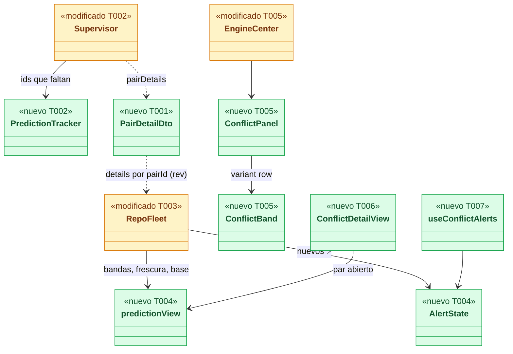
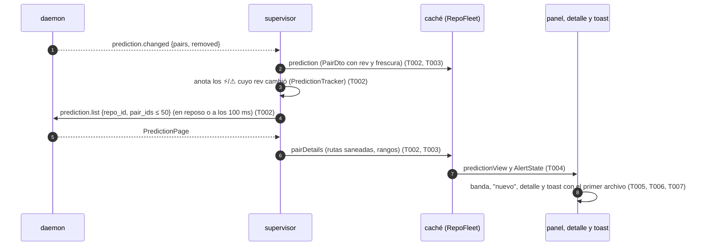
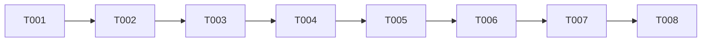

# DS-US-DSK-008 · Los conflictos previstos en la app

## Contexto rápido

Al terminar, quien tiene la app abierta en un repo ve qué pares de agentes (o un agente y la rama base) van a chocar, en qué archivos y en qué líneas de cada lado, y cuánto tiempo tiene esa predicción. Cuando aparece un ⚡ nuevo, recibe un aviso dentro de la app con el par y puede abrir el detalle. Si la predicción se está recalculando o espera a que se confirme la rama base, lo dice. Hoy la app (tras US-DSK-004) solo sabe que una tarjeta tiene un ⚡ conocido: no sabe con qué archivos, no enseña la frescura, no avisa y no lee `prediction.list`.

Las reglas de la predicción son las de la TUI y no se reabren: el panel y el `rev` de DS-US-CKP-006, la frescura de DS-US-CKP-007, la alerta de DS-US-CKP-008 y la base pendiente de US-CKP-009. Esta historia las lleva a la app sobre la tubería de US-DSK-004: el supervisor pide el detalle al motor por su cuenta y el webview pinta la banda, el panel, el detalle y el aviso.

| Término | Qué es aquí |
|---|---|
| Par | Dos lados que el motor compara: dos worktrees o un worktree y la base. Se identifica por `pairId` (16 hex, estable entre reinicios del daemon) |
| ⚡ / ⚠ | `level: conflict` (merge en seco de lo commiteado) / `level: overlap` (archivos en común, incluye lo sin commitear) |
| Banda de conflicto | La pieza que señala un par ⚡ o ⚠: en el grafo de US-DSK-005, una línea entre carriles con su insignia; en el centro, una fila del panel de conflictos (sobre las tarjetas hoy, sobre el grafo cuando exista) |
| `rev` | `scope_seq` del evento que cambió el par por última vez. Un detalle solo se enseña si su `rev` es el del resumen |
| Frescura | La antigüedad del resultado (`computedAtUtcMs`) y el estado del cálculo (`current`, `recalculating`, `calculating`, `pending`, `not-computable`) |
| Sembrado | Un ⚡ que ya existía al abrir el repo en esta ejecución: no avisa (E1 de DS-US-CKP-008) |

**Decisiones de esta Dev Spec**: todas son **Decisión del orquestador (2026-11-09), validada por Arquitecto**.

| # | Decisión | Por qué | Alternativa descartada |
|---|---|---|---|
| D1 | **Sin comandos IPC nuevos.** El supervisor pide `prediction.list` por su cuenta: el detalle de todo par ⚡/⚠ en `current` o `recalculating` cuyo `rev` cambió, en lotes de ≤ 50 ids (AD3 de DS-US-CKP-006), y recorre el cursor cuando la instantánea trae `pairsTruncated` (AD4). Manda el resultado por el mismo `Channel` que abrió `fleet_open`. La lista cerrada sigue siendo `app_info`, `engine_retry`, `engine_watch`, `fleet_open` | La banda y el aviso necesitan el primer archivo sin que nadie lo pida (E3 de DS-US-CKP-008). El webview nunca nombra un par ni un método del canal: no hay entrada nueva que validar. Es lo que hace la TUI | Un comando `prediction_detail { repoId, pairIds }`: superficie nueva, validación de ids en la frontera y una llamada por cada apertura del detalle, cuando el dato ya hace falta antes |
| D2 | Las peticiones de detalle se agrupan: el supervisor anota los ids que quiere y llama cuando el stream queda en reposo (un `link.next` sin notificación) o a los 100 ms del primer id anotado, lo que llegue antes. Una sola llamada en vuelo (el bucle es secuencial) | Una ráfaga de `prediction.changed` no se convierte en una llamada por evento. El cliente de `crates/api` guarda las notificaciones que llegan durante una llamada (`Incoming::Buffered`, `src-tauri/src/engine/link.rs:127-134`) | Llamar tras cada evento: N llamadas en una ráfaga de commits |
| D3 | `PairDto` gana `rev`, `reason`, `computedAtUtcMs`, `overlapFiles`, `overlapPartial`, `conflictFiles` y `conflictTruncated`; `RepoFleetDto` gana `limits`. El detalle viaja aparte (`pairDetails`) con rutas saneadas por `display::visible` y rangos numéricos. `merge_base` y `rewrites_escalated` no viajan | Son los campos que piden la frescura (DS-US-CKP-007 A4) y el aviso; la TUI tampoco pinta los dos que se quedan fuera | Mandar `PairDetail` entero: más texto no confiable sin uso |
| D4 | La caché del frontend guarda el resumen con el `rev` mayor que ha visto: un `prediction` o un `pairDetails` con `rev` menor que el guardado no lo pisa. Un detalle con `rev` mayor que el resumen trae su propio resumen (`PairDetail` lo aplana) y se adoptan los dos. El detalle se pinta solo si `detail.rev === pair.rev`; si no, la vista dice "cargando detalle" y el supervisor lo vuelve a pedir | Es la regla de `rev` de DS-US-CKP-006 (A2) sin el búfer `early`: el `PairDetail` ya lleva el resumen de su `rev` (`crates/api/src/prediction.rs:126-135`) | Guardar el adelantado aparte como la TUI: más estado para el mismo resultado |
| D5 | **Dónde se pinta la banda.** Un panel "Conflictos previstos" **en el centro**, montado por `EngineCenter` encima de la vista principal (las tarjetas de la flota hoy; el grafo de US-DSK-005 cuando exista), con una `ConflictBand` por par ⚡ (primero) y ⚠, las líneas de frescura, el aviso de base pendiente y la línea de límites. Sin pares no se pinta el panel, solo la línea de límites. El panel **no** vive en `FleetView`: con US-DSK-005 la flota pasa al detalle, que es un cajón cerrado entre 1000 y 1359 px, y el ⚡ es la señal de más prioridad. Con el grafo, el panel se queda: el lienzo es `aria-hidden`, así que la lista de filas es la versión textual de la línea y la insignia del dibujo. La tarjeta conserva su fila ⚡ de US-DSK-004. **Decisión del orquestador (2026-11-09), validada por Diseñador UX** | Las dos tarjetas de un par no son contiguas en el orden de atención: una línea entre tarjetas mentiría. El panel es el de la TUI (AD6 de DS-US-CKP-006) y en el centro se ve a cualquier anchura | Pintar la banda entre tarjetas: depende de un orden que no la respeta. Dejar el panel en `FleetView`: desaparece del centro cuando la flota pasa al detalle |
| D6 | **Contrato público para US-DSK-005** (esta historia entra antes: orden 008 → 007 → 005). La banda es un modelo puro (`ConflictBandModel`, de `predictionView`) y un componente de presentación (`ConflictBand` en `src/ui`, variantes `row` y `badge`). Lo único que otra carpeta puede importar de `src/conflicts` es su **módulo público** `src/conflicts/index.ts`: los tipos `ConflictBandModel`, `SideRef` y `PredictionViewModel` y el hook `usePredictionView(fleet, cards, nowMs)` (el mismo modelo que pinta el panel, con `isNew` ya resuelto desde `AlertState`). US-DSK-005 monta la línea entre los carriles cuyas claves son `a` y `b` (o sobre la línea de la base) como capa en su slot `layers`, en `glass.danger`, discontinua si `stale` o si los carriles no son contiguos, y pinta `ConflictBand variant="badge"` como insignia en `laneBadge`; un ⚠ es solo insignia, sin línea (D-8 de DSF-DSK-001). El panel de D5 se queda en el centro encima del grafo; US-DSK-005 no reescribe el modelo ni importa `prediction-model.ts`, `alerts.ts` ni `PairDto`. **Decisión del orquestador (2026-11-09), validada por Arquitecto** | Una sola fuente para la banda en las dos superficies; esta historia no depende de US-DSK-005 y la que llega después consume un contrato fijado | Que US-DSK-005 derive la banda de los `PairDto`: duplicaría frescura, nombres y orden. Que 008 escriba la capa del lienzo: el grafo aún no existe cuando 008 se implementa |
| D7 | El detalle de un par se abre **en el centro** en lugar de la flota (como la vista completa de Time Machine, DSF-DSK-001 § 2.2), con "Volver a la flota" y `Esc`. Lo abren el botón "Ver" de la banda, la acción del aviso y la píldora de la barra de título. **El centro tiene un solo destino a la vez** y esta historia crea su estado: `ui-store.center` es una unión `{ view: "main" } \| { view: "pair"; repoId; pairId }`, sin persistir, con `openPairDetail(p)` y `backToMain()`; US-DSK-007 le añade `{ view: "guardrails" }` y Time Machine el suyo. Abrir un destino sustituye al anterior por construcción; cada "Volver" lleva a la vista principal (flota hoy, grafo con US-DSK-005), no al destino anterior (D-15 de DSF-DSK-001); cambiar de repo vuelve a `main`. **Decisión del orquestador (2026-11-09), validada por Diseñador UX**; la unión como dueña única del centro: **Decisión del orquestador (2026-11-09), validada por Arquitecto** | A 1000–1359 px el detalle derecho es un cajón cerrado; la maqueta § 4.e pone el par en el centro | Un `Dialog`: tapa la flota y el aviso de un ⚡ nuevo |
| D8 | Nombre de cada lado: la etiqueta del agente de su tarjeta (`CardModel.agent.label`, p. ej. "claude-1 · feat-pagos"); un lado sin tarjeta, su carpeta; la base, "{{base}} (rama principal)". `↔` se lee "y" en el nombre accesible | P5 de DS-US-CKP-006 (cada lado se nombra como encabeza su fila) y § 4.e de DSF-DSK-001 | — |
| D9 | Frescura con los textos de DS-US-CKP-007: "hace N s/min/h/d" por par `current`; "desactualizado · hace N · recalculando" por par `recalculating` (banda discontinua y rangos atenuados); una línea "Calculando N de M pares"; una línea por motivo de `pending` y de `not-computable`; "Sin conflictos previstos · hace N" solo con todo `current` y sin ⚡ ni ⚠ (la antigüedad del más antiguo). Un `current` o `recalculating` sin `computedAtUtcMs` cuenta como `calculating` (E4 de DS-US-CKP-007) | BR-CKP-CALC-003: ningún par sin resultado dice "sin conflictos" | — |
| D10 | **Base movida** (escenario 3): el motor pasa los pares contra la base a `calculating` y borra su resultado (`crates/core/src/predict/state.rs:79-84`, `:99-117`). La app recuerda en memoria el último `computedAtUtcMs` de cada par antes de pasar a `calculating` y la línea dice "Calculando N de M pares · último resultado hace 40 s", **sin** su nivel. Si no hay ninguno recordado (la app se abrió después), dice solo "Calculando N de M pares" | El escenario pide "ve la antigüedad del último resultado"; enseñar el nivel viejo contradiría al motor, que ya no lo publica como vigente | Enseñar el ⚡ viejo atenuado: una predicción vieja presentada como resultado |
| D11 | **Base sin confirmar** (escenario 4): un par contra la base en `pending` con `reason: base-unconfirmed` (`crates/core/src/predict/pairs.rs:80`) se agrupa en "Pendiente: confirma la rama base (N pares)" y el panel enseña el aviso "Rama base pendiente de confirmar ({{base}})" con `CopyCommand` del comando de confirmar y su pista. El aviso sale si algún par tiene ese motivo, o si `repo.base.status` es `unconfirmed` y ningún par contra la base ha salido ya de `pending`/`base-unconfirmed` (la confirmación no tiene evento, G2: un par contra la base que pasa a calcularse prueba que ya está confirmada). Los ⚡ entre worktrees siguen a la vista. **El comando** (M-01 de security-expert) lo construye el backend en `ingest::repo` como `RepoFleetDto.confirmCommand` con `shell_command::posix` y la ruta de `raptor` de D21: `'<raptor>' 'guard' 'confirm' '<ruta cruda del repo>'` (la CLI acepta la ruta, `apps/cli/src/commands/guard.rs:45-48`). Si la ruta tiene un carácter de `display::must_escape`, el comando va sin la ruta (`withPath: false`) y la pista dice "ejecútalo en la carpeta de {{repo}}"; sin `raptor` conocido, no se ofrece (`raptor-unknown`) y se dice por qué. Nunca `raptor` a secas (`PATH`). **Verificado el 2026-11-09:** `raptor guard confirm` confirma la línea base del equipo de la rama principal, y esa confirmación incluye la rama base: `guard.confirm` aplica el plan con `set_confirmed_team_baseline` (`crates/core/src/guardrails/confirm.rs:138-158`, `crates/core/src/profile/team_baseline.rs:47-60`), el daemon lee esa confirmación para la base del repo (`crates/core/src/daemon/mod.rs:1360-1365`) y `observe::base_branch` la publica como `confirmed` (`crates/core/src/observe.rs:326-341`); el mismo dato lo fija `raptor guard install` al proteger (`crates/core/src/guardrails/install.rs:1170-1176`). Es un método reservado: la terminal enseña el plan y pregunta, y un agente no lo obtiene por ascendencia. **Decisión del orquestador (2026-11-09), validada por Arquitecto y security-expert** | US-CKP-009 escenario 1; el comando es el de US-GRD-014 (implementada). ADR-GRP-017 § 5 pide la ruta absoluta del `raptor` que sirve al daemon, como D9 de DS-US-DSK-007; la ruta del repo hace que el comando funcione pegado en cualquier carpeta | Copiar `raptor guard confirm` sin ruta ni `raptor` absoluto: depende del `PATH` y de la carpeta de la terminal, que pueden ser otro binario y otro repo |
| D12 | **Alerta** con las reglas de DS-US-CKP-008 (A5, E1–E5, E7): nuevo = `pairId` que pasa a `level: conflict` con `state: current` y no está en el conjunto del repo; la primera instantánea del repo en esta ejecución siembra; `removed`, un `current` sin ⚡ o la ausencia en una instantánea sin `pairsTruncated` lo sacan; `repoClosed` olvida el repo. El conjunto vive en memoria por repo (`engine-store`) y sobrevive al cambio de repo | Alineación con US-CKP-008; volver a un repo con un ⚡ que apareció mientras no se miraba avisa, porque es nuevo para quien mira | Olvidar el conjunto al cambiar de repo: cada vuelta avisaría de todo |
| D13 | El aviso es un toast de la primitiva (`useToast`, `kind: "info"`, `role="status"`, 5 s) con el texto de P5 ("⚡ Conflicto previsto: claude-1 · feat-pagos ↔ claude-2 · feat-login en pagos.rs") y la acción "Ver". Espera al primer archivo hasta 2 s y, si no llega, sale sin él (E3). Si el par deja de ser ⚡ antes de los 5 s, el toast se retira (E4). La marca "nuevo" de la banda dura lo que dura el ⚡ (E5) | `info` no pinta glifo propio: con `warning` saldría el icono de aviso junto al ⚡ (E6 de DS-US-CKP-008). La primitiva ya da `aria-live` cortés, pausa al pasar el ratón y cierre con `Esc` | Una variante `conflict` en `Toast`: toca una primitiva de TS-DSK-003 para un caso que `info` cubre |
| D14 | **Sin notificaciones del SO.** Ni `tauri-plugin-notification` ni la API `Notification` del webview; tampoco sonido. La opción de activarlas (R-3 de DSF-DSK-001: opcionales, apagadas por defecto) es de otra historia | BR-CKP-WF-007 y la petición de esta historia | Activarlas apagadas por defecto ya aquí: pide una pantalla de Ajustes que no existe |
| D15 | Otros repos: cuando el `attention.conflicts` contado de un repo que **no** está abierto sube, la app muestra un toast "⚡ Nuevo conflicto previsto en {{repo}}" con "Ver" (abre ese repo). Sin nombres del par: el ámbito global no los lleva. La primera instantánea global siembra los recuentos | "Dentro de la app" sin abrir el ámbito de cada repo (NFR-13.8) | Suscribirse a todos los repos para tener los pares: tráfico por repos que nadie mira |
| D16 | La píldora de la barra de título "⚡ N conflictos previstos" (DSF-DSK-001 § 2.2) suma los `attention.conflicts` contados de todos los repos y solo sale con N > 0. Es un `Button variant="danger" size="sm"` (sin `shape="pill"`: primitives-spec § 2.1 lo reserva a "Integrar cambios" y con `size="sm"` el radio es `radius-sm`; el borde `danger` y el ⚡ la distinguen). Abre el repo con más conflictos (empate: el abierto, luego por nombre) y, si ese repo tiene un único par ⚡, su detalle; si no, lleva el foco al panel de conflictos. Por debajo de 1000 px de ventana muestra solo "⚡ N" (`conflicts.pill.compact`) y el nombre accesible sigue completo; va a la derecha del buscador y de la píldora del motor y nunca la desplaza. **Decisión del orquestador (2026-11-09), validada por Diseñador UX** | La maqueta la pone; los datos ya están en `global` (US-DSK-004). El número va siempre en texto (NFR-09) | — |
| D17 | **Una pasada de avisos, como mucho un toast por oleada.** Si una misma pasada de `nextAlerts` levanta 3 o más ids (p. ej. al volver a un repo o al mover la base), sale un solo toast `conflicts.toast.many` con "Ver" (lleva el foco al panel) en lugar de uno por par. Con 1 o 2 ids, uno por par. El toast de otros repos (D15) sigue la misma regla. **Decisión del orquestador (2026-11-09), validada por Diseñador UX** | El visor aguanta 3 toasts y comparte sitio con el bloqueo ⛔ de US-DSK-007 (persistente): una ráfaga taparía el resto | Un toast por par: con 5 pares nuevos, la cola esconde el bloqueo |
| D18 | **Teclado de las vistas del centro.** `Esc` actúa sobre una sola capa por pulsación, en este orden: diálogo, popover abierto (p. ej. "Límites (?)"), toast con foco, cajón del detalle, vista del centro (el detalle del par vuelve a la flota). El manejador de `Esc` del par solo actúa con el foco dentro del centro y sin otra capa abierta. **Mecanismo, de esta historia por ser la primera que lo necesita** (T006): quien consume un `Esc` llama `event.preventDefault()` (las primitivas `Dialog`, `Popover` y `Toast`, que hoy lo escuchan en `document`, en el propio elemento o en `window`, y las vistas del centro en su `onKeyDown`), y `useShortcuts` sale sin hacer nada si `event.defaultPrevented` antes de llamar `onEscape`. US-DSK-007 (`GuardrailsView`) y US-DSK-005 lo reutilizan sin cambiar `useShortcuts`. Sin atajos nuevos en esta historia. **Decisión del orquestador (2026-11-09), validada por Diseñador UX**; el mecanismo y su dueño: **Decisión del orquestador (2026-11-09), validada por Arquitecto** | Hoy `useShortcuts` escucha `Esc` en `window` para el cajón: un solo `Esc` cerraría el cajón y el detalle a la vez | Un atajo propio para el par: choca con § 5 de DSF-DSK-001 |
| D19 | **Glifos y nombres accesibles.** ⚡ y ⚠ van en un `<span aria-hidden="true">` cuando el texto de al lado ya dice el nivel (banda, títulos del detalle, píldora); el nombre accesible usa `conflicts.a11y.*` sin glifo. Cada botón "Ver" lleva `aria-label` `conflicts.band.openLabel` ("Ver el conflicto entre {{a}} y {{b}}"), que empieza por el texto visible (WCAG 2.5.3). El texto atenuado de un par `recalculating` usa `text-text-muted` (5.90:1 sobre `raised`, C14), nunca `opacity` ni `text-disabled` (primitives-spec § 1.2). El toast `info` lleva el ⚡ dentro del mensaje porque la primitiva no pinta glifo en `info` (D13). **Decisión del orquestador (2026-11-09), validada por Diseñador UX** | Un lector de pantalla diría "signo de alto voltaje" antes de cada banda; varios "Ver" iguales no se distinguen en una lista de botones | Quitar el ⚡ del texto del toast: pierde la marca visual que pide DSF § 4.b |
| D20 | **Panel con tope.** El panel muestra a lo sumo 3 bandas; si hay más, un `Button variant="link" size="sm"` "y {{count}} más" (`aria-expanded`, `aria-controls`) las despliega y "Mostrar menos" las recoge. Las líneas de frescura y la de límites siempre visibles. **Decisión del orquestador (2026-11-09), validada por Diseñador UX** | Con 8 agentes pueden salir 10 pares; el panel no puede empujar el grafo fuera de la pantalla a 1440 × 900 | Panel con desplazamiento propio: un segundo scroll dentro del centro |
| D21 | **Comandos copiables: un módulo del backend, de esta historia.** `src-tauri/src/engine/shell_command.rs` (T002) tiene `posix(args)` (cada argumento entre comillas simples POSIX con `'` escrita `'\''`; `None` si alguno tiene un carácter de `display::must_escape`) y `raptor_path(...)`: el ejecutable que sirve al daemon según el último informe `ready` de `raptor daemon ensure` (`daemon_path`), canonicalizado y aceptado por `installed::is_installed_raptor`; si no lo hay, o si está **dentro de un repo o worktree observado** (L-02 de security-expert sobre D9 de DS-US-DSK-007: un agente podría dejar ahí su propio `raptor`), el del bundle (`launcher::bundled_raptor`); si tampoco, `None`. Nunca `PATH`. `wire::stop_command` pasa a usar `posix` sin cambiar su salida. US-DSK-007 construye sobre este módulo su comando de excepción y de cancelar (su D6–D9) sin duplicarlo. **Decisión del orquestador (2026-11-09), validada por Arquitecto y security-expert** | El primer comando copiable del orden (D11) ya necesita la regla de D9 de DS-US-DSK-007; escribirla dos veces es la copia que se desfasa | Dejar la regla en 007, que entra después: 008 tendría que copiar `raptor` a secas |
| D22 | **`CopyCommand` anuncia el resultado** (WCAG 4.1.3; G10 resuelto). Enmienda aditiva de la primitiva (primitives-spec § 2.16), hecha en esta historia porque es la primera del orden que la usa (T005): tras `writeText` correcto, el botón dice "Copiado" (`ui.common.copied`) 2 s con el ✔ y una región `role="status"` solo para lectores lo anuncia una vez; si falla, la región anuncia `ui.common.copyFailed` y el botón vuelve a "Copiar". Prop opcional nueva `onCopied?: (command: string) => void`, llamada solo tras un `writeText` correcto (la usa US-DSK-007 para su aviso de excepción distinta). Sin props nuevas, el comportamiento visible no cambia salvo el texto de 2 s. **Decisión del orquestador (2026-11-09), validada por Arquitecto** | Un cambio de icono no se anuncia; tres historias usan la primitiva y una sola tarea la enmienda | Una TS nueva para la enmienda: el cambio es de una primitiva y cabe en una tarea con su test |

---

## 📋 Índice

> **Para aprobar:** [Contexto rápido](#contexto-rápido) · [⚠️ Gaps](#gaps-y-violaciones-de-la-constitución) · [🔭 La forma](#la-forma) · [El trabajo de un vistazo](#el-trabajo-de-un-vistazo).
> **Para implementar:** [🚀 Plan](#plan-de-implementación), en orden. Las `_(ref)_` se abren desde la tarea que las cita.

| Sección | Propósito |
|---------|-----------|
| [Contexto rápido](#contexto-rápido) | Qué se construye, glosario y decisiones |
| [⚠️ Gaps y violaciones de la constitución](#gaps-y-violaciones-de-la-constitución) | Qué impide empezar |
| [🔭 La forma](#la-forma) | Piezas y relaciones |
| [🚀 Plan de implementación](#plan-de-implementación) | T001…T008, en orden |
| ↳ [El trabajo de un vistazo](#el-trabajo-de-un-vistazo) | Tareas en tabla y su orden |
| [Estructura de ficheros](#estructura-de-ficheros) _(ref)_ | Árbol anotado |
| [Contratos compartidos](#contratos-compartidos) _(ref)_ | DTO, mensajes, firmas y textos |
| [Contrato de API](#contrato-de-api) _(ref)_ | Lo que se consume del canal; ningún comando IPC nuevo |
| [Estrategia de pruebas y cobertura](#estrategia-de-pruebas-y-cobertura) _(ref)_ | Escenarios → tests |
| [Gate de seguridad](#gate-de-seguridad) | Checklist pre-merge |
| [Fuera de alcance](#fuera-de-alcance) | Lo que esta entrega no toca |
| [Notas del autor](#notas-del-autor) _(ref)_ | Huecos del motor y lo que no bloquea |

---

## ⚠️ Gaps y violaciones de la constitución

_No gaps. Ready to implement._

Verificado en el código el 2026-11-09:

- La capacidad `prediction.pairs` trae `RepoView.prediction` y `prediction.changed`; `prediction.list` es un método sin capacidad, ni reservado ni de escritura (`crates/api/src/methods/prediction.rs:8-17`). La app ya la pide (`apps/desktop/src-tauri/src/engine/link.rs:18-23`).
- `PairSummary` lleva `pair_id`, `rev`, `a`, `b`, `state`, `reason`, `level`, `computed_at_utc_ms`, `overlap_files`, `overlap_partial`, `conflict_files` y `conflict_truncated` (`crates/api/src/prediction.rs:31-54`); `PairDetail` aplana el resumen y añade `overlap` (rutas) y `conflict` con `files[]`: `path`, `kind`, `ours`/`theirs` (`LineRange { start, len }`, 1-based, nunca contenido), `hunks_truncated`, `has_merge_rule` (`:126-186`).
- `prediction.list { repo_id, worktree?, pair_ids? (≤ 50), cursor? }` → `{ limits, pairs, next_cursor? }`, páginas de ≤ 50 pares y ≤ 512 KiB (`prediction.rs:11-16`, `:188-211`, `:370-402`); el daemon valida los ids y el cursor antes de leer (`:311-326`; `crates/core/src/channel/conn.rs:741-754`, despacho en `:942-947`).
- `prediction.changed { repo_id, pairs, removed }` es un evento del ámbito del repo (`crates/api/src/event.rs:194-196`; `prediction.rs:213-222`), que la app ya traduce (`apps/desktop/src-tauri/src/engine/ingest.rs:274-285`).
- Base sin confirmar: el par contra la base queda `pending` con `base-unconfirmed` (`crates/core/src/predict/pairs.rs:80`); `RepoView.base.status` vale `confirmed`, `unconfirmed` o `invalid` (`crates/api/src/messages.rs:241-258`). Base movida: el par contra la base pasa a `calculating` sin resultado publicado (`crates/core/src/predict/state.rs:79-84`, `:99-117`).
- Los ocho `LimitCode` llegan siempre (`prediction.rs:99-124`).

Lo que el motor no publica (la base anterior en "main → develop", un evento al confirmar la base, los nombres de los pares de otros repos) no bloquea: va en [Notas del autor](#notas-del-autor) con su dueño.

**Depende de**: US-DSK-004 (implementada: `fleet_open`, `useFleet`, `RepoFleet`, `FleetView`, `RepoTree`, el ⚡ conocido de la tarjeta).

---

## 🔭 La forma

Al terminar, el supervisor sigue la predicción del repo abierto con su detalle, la caché la guarda con la regla de `rev`, un modelo puro decide bandas, frescura y avisos, y tres superficies la pintan: el panel de la flota, el detalle en el centro y el toast.



🟩 nuevo · 🟨 modificado. `ConflictBand` es la pieza compartida con el grafo de US-DSK-005, que la consumirá con `variant="badge"` sin redefinirla (D6); el grafo no sale en el dibujo porque aún no existe.

**Cómo fluye:**



---

## 🚀 Plan de implementación

> Orden topológico (`Depende:`). Las rutas son relativas a la raíz del repo.

### El trabajo de un vistazo

| # | Tarea | Depende | Aterriza en |
|---|---|---|---|
| T001 | Escribir en rojo los tests de la predicción en el supervisor y fijar los DTO | — | `src-tauri/tests`, `src-tauri/src/engine/wire.rs` |
| T002 | Pedir el detalle y completar los pares truncados en el supervisor | T001 | `src-tauri/src/engine` |
| T003 | Guardar pares y detalles en la caché con la regla de `rev` | T002 | `src/client`, `src/state` |
| T004 | Calcular bandas, frescura, base pendiente y alertas | T003 | `src/conflicts/*.ts` |
| T005 | Pintar la banda y el panel de conflictos, y la píldora de la barra de título | T004 | `src/ui`, `src/conflicts`, `src/engine`, `src/shell`, `src/i18n` |
| T006 | Pintar el detalle del par en el centro | T005 | `src/conflicts`, `src/engine/EngineCenter.tsx` |
| T007 | Avisar de los conflictos nuevos dentro de la app | T006 | `src/conflicts`, `src/app/App.tsx` |
| T008 | Verificar de punta a punta en macOS | T007 | — |

### En qué orden



### T001 — Escribir en rojo los tests de la predicción en el supervisor y fijar los DTO

**Objetivo.** Los tests de Rust de los escenarios contra el daemon falso, y los tipos que comprueban.

**Ubicación.**
- `apps/desktop/src-tauri/src/engine/wire.rs` (**MODIFY**: `PairDto` ampliado, `PairDetailDto`, `ConflictFileDto`, `LineRangeDto`, `LimitCode`, `PairReason`, `ConflictKind`, mensaje `PairDetails`; § Contratos compartidos)
- `apps/desktop/src-tauri/tests/prediction_supervisor.rs` (**CREATE**)
- `apps/desktop/src-tauri/tests/support/fake_daemon.rs` (**MODIFY**: `Script.prediction` y respuesta de `prediction.list`)

**Reglas**
- El falso responde `prediction.list` con `prediction::validate_list` y `prediction::page` del crate `gitraptor-api` sobre `Script.prediction: HashMap<String, Vec<PairDetail>>` (por repo; sin entrada, página vacía). Un id o cursor inválido responde `INVALID_PARAMS`, como el daemon.
- Guion "tienda" de DS-US-DSK-004 más un par ⚡ `feat-pagos ↔ feat-login` con `pagos.rs` (`ours` 40+19, `theirs` 44+18), un ⚠ `feat-pagos ↔ base` con `README.md`, y un par contra la base en `pending` / `base-unconfirmed` en el guion "tienda-pendiente".
- Los tests (nombres en [§ 9.4](#94-comportamientos-críticos-verificados)) compilan contra un supervisor que todavía no llama `prediction.list`.

- **Depende:** —
- **Refs:** escenarios de US-DSK-008; DS-US-DSK-004 T001
- **Aceptación:** `cargo test -p gitraptor-desktop --test prediction_supervisor` compila y falla (rojo); se commitea antes de T002.

### T002 — Pedir el detalle y completar los pares truncados en el supervisor

**Objetivo.** El backend entrega al webview el detalle de cada par ⚡/⚠ vigente y todos los pares aunque la instantánea venga cortada, sin comando nuevo (D1).

**Ubicación.**
- `apps/desktop/src-tauri/src/engine/prediction.rs` (**CREATE**: `PredictionTracker`)
- `apps/desktop/src-tauri/src/engine/shell_command.rs` (**CREATE**: `posix`, `raptor_path`, `confirm`; D11, D21)
- `apps/desktop/src-tauri/src/engine/mod.rs` (**MODIFY**: dos líneas, `mod prediction;` y `pub mod shell_command;`)
- `apps/desktop/src-tauri/src/engine/supervisor.rs` (**MODIFY**)
- `apps/desktop/src-tauri/src/engine/launcher.rs` (**MODIFY**: guarda el `daemon_path` del último informe `ready`)
- `apps/desktop/src-tauri/src/engine/link.rs` (**MODIFY**: `Link::daemon_exe(&self) -> Option<&Path>`)
- `apps/desktop/src-tauri/src/engine/ingest.rs` (**MODIFY**: `pair` ampliado, `pair_detail`, `limits`, `confirm_command`)
- `apps/desktop/src-tauri/src/engine/wire.rs` (**MODIFY**: `stop_command` usa `shell_command::posix`)
- `apps/desktop/src-tauri/tests/shell_command.rs` (**CREATE**)
- `apps/desktop/src-tauri/tests/engine_wire.rs` (**MODIFY**: fixture congelada con los campos nuevos)
- `apps/desktop/src-tauri/tests/commands.rs` (**MODIFY**: un test que fija que esta historia no añade comandos)

**Reglas**
- `PredictionTracker` (uno por repo abierto, dentro de `RepoScope`): `reset(&[PairSummary])` con la instantánea; `apply(&PredictionChanged)`; `adopt(&[PairDetail])`; `wanted() -> Vec<String>` = ids con `level` ⚡ o ⚠ en `current` o `recalculating` cuyo `detail_rev` no es su `rev`, ⚡ primero, como mucho 50; `needs_fill()` = la instantánea trajo `pairs_truncated` y el recorrido no ha terminado.
- Al abrir el repo (`take_repo`) y tras cada `prediction.changed` aplicado, el supervisor marca la hora del primer id pendiente. En el bucle de `stream`, cuando `link.next` vuelve sin notificación o pasaron 100 ms desde esa marca, llama `prediction.list { repo_id, pair_ids }` con `wanted()` y manda `pairDetails` (D2). Con `needs_fill()`, recorre `prediction.list { repo_id, cursor }` hasta que no haya `next_cursor`, hasta 20 páginas o hasta sumar 2 MiB de respuestas, lo que llegue antes; cada página sale como `pairDetails` y la última lleva `filled: true` solo si el recorrido terminó por `next_cursor` ausente.
- **Un solo recorrido de cursor por `RepoScope`** (L-01 de security-expert): una instantánea truncada nueva (resync) mientras hay un recorrido en curso no inicia otro; el que está en curso se abandona en su página actual y empieza uno nuevo **después**, desde la nueva instantánea. Nunca dos recorridos a la vez. **Decisión del orquestador (2026-11-09), validada por Arquitecto y security-expert**.
- Errores: `LinkError::Refused` (un daemon sin `prediction.list`, o el repo que ya no existe) deja los pares sin detalle y no se reintenta hasta el siguiente cambio de `rev`; `LinkError::Lost` termina la sesión con `End::Reconnect`, como las demás llamadas.
- `ingest::pair` añade los campos de D3 (`computedAtUtcMs` negativo → `null`). `ingest::pair_detail`: cada `path` pasa por `display::visible(_, TEXT_MAX_CHARS)`; `kind`, `ours`, `theirs`, `hunks_truncated`, `has_merge_rule` y `truncated` tal cual; `overlap` saneado igual. `ingest::repo` añade `limits` y `confirmCommand` (`ingest::confirm_command(raw_repo_path, raptor)`, D11): `shell_command::confirm` con la ruta cruda de `RepoView.path`; la ruta cruda nunca viaja aparte.
- `shell_command` (D21): `posix(&[&str]) -> Option<String>`; `raptor_path(daemon_exe: Option<&Path>, bundled: Option<&Path>, watched: &[&Path]) -> Option<PathBuf>`, que descarta `daemon_exe` si cuelga de alguna ruta de `watched` (las rutas crudas de los repos y worktrees de la última instantánea global y del repo abierto) o si no es un `raptor` instalado; `confirm(raptor: Option<&Path>, repo: &str) -> ConfirmCommandDto`. El supervisor llama `raptor_path` con el `daemon_exe()` del `Link` y `launcher::bundled_raptor()`.
- **Esta historia no añade comandos IPC** (I-01 de security-expert): `commands.json` y los `#[tauri::command]` no cambian. El test nuevo no fija la lista absoluta (la fija el test existente de DS-US-DSK-004 T002, que actualiza quien añade un comando, US-DSK-007): afirma que ningún nombre de `commands.json` ni de `#[tauri::command]` en `src/commands/` contiene `prediction`, `pair` ni `conflict`.

- **Depende:** T001
- **Refs:** D1–D3, D11, D21; DS-US-CKP-006 AD3 y AD4; ADR-CKP-001 § 2; ADR-GRP-017 § 5
- **Aceptación:** `cargo test -p gitraptor-desktop --test prediction_supervisor --test shell_command --test engine_stop_command --test fleet_supervisor --test engine_wire --test commands` en verde.

### T003 — Guardar pares y detalles en la caché con la regla de `rev`

**Objetivo.** `RepoFleet` lleva los pares con su frescura, los detalles por par y la última hora conocida de cada par, actualizados solo por mensajes.

**Ubicación.**
- `apps/desktop/src/client/engine-types.ts` (**MODIFY**)
- `apps/desktop/src/state/engine-cache.ts` (**MODIFY**)
- `apps/desktop/src/state/engine-cache.test.ts` (**MODIFY**)
- `apps/desktop/src/state/ui-store.ts` (**MODIFY**: `center`)
- `apps/desktop/src/state/ui-store.test.ts` (**MODIFY**)
- `apps/desktop/src/state/engine-store.ts` (**MODIFY**: conjunto de alertas por repo y recuentos sembrados, T007)

**Reglas**
- `RepoFleet` gana `details: Map<string, PairDetailDto>` y `lastComputed: Map<string, number>`. `repo` (instantánea) los vacía, salvo `lastComputed`, que conserva las horas de los `pairId` que siguen en la instantánea.
- `prediction`: upsert por `pairId` **solo si** `incoming.rev >= stored.rev` (D4); `removed` quita el par, su detalle y su hora. Antes de pisar un par que tenía `computedAtUtcMs` con uno que no lo tiene, guarda la hora vieja en `lastComputed` (D10).
- `pairDetails`: si no hay entrada de caché para su `repoId` (repo cerrado o nunca abierto), el mensaje entero se descarta sin crear la entrada (L-02 de security-expert, **Decisión del orquestador (2026-11-09), validada por Arquitecto y security-expert**). Si la hay, por cada detalle: si su `rev` es mayor que el del resumen guardado (o el par no estaba), adopta también su resumen; si es igual, guarda el detalle; si es menor, lo descarta. Con `filled: true`, `repo.pairsTruncated = false`.
- `ui-store.ts` (D7): `center: CenterView` con `CenterView = { view: "main" } | { view: "pair"; repoId: string; pairId: string }` (US-DSK-007 añade `{ view: "guardrails" }`), por defecto `main`; acciones `openPairDetail(p)` y `backToMain()` (`closePairDetail` es un alias de `backToMain`); `selectRepo` vuelve a `main`. No se persiste: `partialize` no cambia y el test de las cuatro claves sigue en verde.
- Nunca muta el objeto anterior.

- **Depende:** T002
- **Refs:** D4, D7, D10; ADR-GRP-004 Enmienda D7
- **Aceptación:** `pnpm --filter @gitraptor/desktop test -- engine-cache ui-store` en verde, con los casos de § 9.4.

### T004 — Calcular bandas, frescura, base pendiente y alertas

**Objetivo.** Dos módulos puros con las reglas de la TUI: qué se pinta y qué ⚡ es nuevo.

**Ubicación.**
- `apps/desktop/src/conflicts/prediction-model.ts` (**CREATE**)
- `apps/desktop/src/conflicts/prediction-model.test.ts` (**CREATE**)
- `apps/desktop/src/conflicts/alerts.ts` (**CREATE**)
- `apps/desktop/src/conflicts/alerts.test.ts` (**CREATE**)
- `apps/desktop/src/conflicts/index.ts` (**CREATE**: módulo público de D6)
- `apps/desktop/src/conflicts/usePredictionView.ts` (**CREATE**)

**Reglas**
- `index.ts` exporta solo `type ConflictBandModel`, `type SideRef`, `type PredictionViewModel` y `usePredictionView` (D6); `usePredictionView(fleet, cards, nowMs)` llama `predictionView` con `t` y el `isNew` de `AlertState`. Es el contrato que consume US-DSK-005: cambiarlo es cambiar el de las dos historias.
- `predictionView(fleet, cards, nowMs, t)`: `bands` = un `ConflictBandModel` por par ⚡ o ⚠ en `current` o `recalculating` con `computedAtUtcMs`, ⚡ primero y luego por `pairId`; `lines` = las líneas de frescura de D9 y D10 en este orden: calculando, pendientes por motivo, no calculables por motivo, "sin conflictos"; `basePending` según D11; `limits` = los `LimitCode` recibidos.
- Banda: nombres según D8 (`cards` es la salida de `fleetCards`); `firstFile` = el primer `path` de `detail.conflict.files` (⚡) o de `detail.overlap` (⚠) cuando `detail.rev === pair.rev`, si no `null`; `moreFiles` = `conflictFiles − 1` (o `overlapFiles − 1`), más el `+` de `conflictTruncated`/`overlapPartial`; `stale` = `state === "recalculating"`; `isNew` lo pasa quien llama desde `AlertState`.
- Detalle: `pairDetailView(fleet, cards, pairId, nowMs, t)` → cabecera, frescura, estado de la vista (`default`, `overlap-only`, `against-base`, `loading`, `stale`, `calculating`, `pending`, `resolved`, `gone`) y archivos con sus rangos: `len ≤ 1` → `conflicts.range.line`; si no, `conflicts.range.lines` con `start` y `start + len − 1`; `hunksTruncated` añade `conflicts.range.more`.
- `alerts.ts`: `nextAlerts(state, input) -> { state, raised: string[] }` con `input` = `{ kind: "snapshot", pairs, truncated, first }`, `{ kind: "changed", pairs, removed }` o `{ kind: "closed" }`, según D12. `raised` solo contiene ids nuevos; los sembrados nunca.

- **Depende:** T003
- **Refs:** D8–D12; DS-US-CKP-006 P2, P5, AD6; DS-US-CKP-007 A2, A4, P1, P2, P4, E4, E5; DS-US-CKP-008 A5, E1, E2, E5
- **Aceptación:** `prediction-model.test.ts` y `alerts.test.ts` en verde (§ 9.4).

### T005 — Pintar la banda y el panel de conflictos, y la píldora de la barra de título

**Objetivo.** La banda como pieza reutilizable, el panel sobre las tarjetas y la píldora global, en en/es y accesibles.

**Ubicación.**
- `apps/desktop/src/ui/ConflictBand.tsx` (**CREATE**)
- `apps/desktop/src/ui/ConflictBand.test.tsx` (**CREATE**)
- `apps/desktop/src/ui/index.ts` (**MODIFY**: una línea de export)
- `apps/desktop/src/ui/CopyCommand.tsx` (**MODIFY**: enmienda aditiva de D22)
- `apps/desktop/src/ui/CopyCommand.test.tsx` (**MODIFY**)
- `apps/desktop/src/conflicts/ConflictPanel.tsx` (**CREATE**)
- `apps/desktop/src/conflicts/ConflictPanel.test.tsx` (**CREATE**)
- `apps/desktop/src/engine/EngineCenter.tsx` (**MODIFY**: monta `ConflictPanel` encima de la vista principal del centro; T006 añade el detalle)
- `apps/desktop/src/engine/EngineCenter.test.tsx` (**MODIFY**)
- `apps/desktop/src/shell/TitleBar.tsx` (**MODIFY**: píldora ⚡)
- `apps/desktop/src/shell/TitleBar.test.tsx` (**MODIFY**)
- `apps/desktop/src/i18n/locales/en.json` (**MODIFY**)
- `apps/desktop/src/i18n/locales/es.json` (**MODIFY**)

**Reglas**
- `ConflictBand` (en `src/ui`, sin `client`): props de § Contratos compartidos. `variant="row"`: glifo `⚡` (en `text-danger-text`) o `⚠` (en `text-warning-text`), "A ↔ B", primer archivo en `<code>`, "y N más", frescura, la marca "nuevo" como texto (no solo color) y un `Button size="sm"` "Ver" con `onOpen`. Borde izquierdo de 2 px en `danger` (⚡) o `warning` (⚠), **discontinuo** si `stale`. `variant="badge"`: glifo, primer archivo y frescura en una píldora, sin botón (la activa el carril). El nombre accesible es `a11yLabel`. Ningún color, radio ni tamaño literal.
- `CopyCommand` (D22, primitives-spec § 2.16): tras `writeText` correcto, texto del botón `ui.common.copied` durante 2 s con el ✔ y una región `role="status"` (`sr-only`, presente desde el montaje y vacía) que recibe `ui.common.copied` una vez; si falla, la región recibe `ui.common.copyFailed`. `onCopied?.(command)` solo tras un `writeText` correcto. El temporizador se limpia al desmontar. Sin `onCopied`, ningún llamador existente cambia.
- `ConflictPanel`: `<section aria-labelledby>` con encabezado `conflicts.panel.title` (que recibe el foco programático de D16, `tabIndex={-1}`), aviso de base pendiente (D11) con `CopyCommand` de `confirmCommand.command` y `conflicts.base.hint` (con ruta) o `conflicts.base.hintFolder` (`withPath: false`); con `not-offered`, sin `CopyCommand` y con `conflicts.base.raptorUnknown`; `<ul aria-label={conflicts.panel.list}>` de `ConflictBand` con el tope de 3 filas de D20, las líneas de frescura y la línea de límites con un `Popover` "Límites (?)" que lista los ocho textos. Sin pares, solo la línea de límites. Con la predicción aún no recibida (instantánea sin `prediction`), no se pinta: mientras llega, el centro enseña su propio esqueleto y el panel no deja un hueco. Las líneas de frescura van en `<p role="status">` (polite: cambian solas, § 7 de DSF-DSK-001) y no se anuncian si el texto no cambió. Con el motor `stale` (desconectado), el panel se atenúa como el resto del centro (`data-stale`) y sus botones quedan `aria-disabled` con el motivo.
- Estados del panel (§ 4.b de DSF-DSK-001): cargando (sin predicción), calculando ("Calculando N de M pares"), desactualizado (banda discontinua y `conflicts.freshness.stale`), sin conflictos (`conflicts.freshness.clear`, solo con todo al día), base pendiente (D11), degradado (un `prediction.list` rechazado: bandas sin archivo, sin aviso de error), vacío (solo la línea de límites) y desconectado. Ningún estado dice "sin conflictos" sin resultado (BR-CKP-CALC-003).
- Píldora (D16): `Button variant="danger" size="sm"` (sin `shape`) con `⚡` (`aria-hidden`) y `conflicts.pill_one`/`_other` (`conflicts.pill.compact` bajo 1000 px); nombre accesible `conflicts.pill.label`. Objetivo de 24 px (WCAG 2.5.8, primitives-spec § 1.6). Con la ventana a 720 px la barra de título no desborda: el buscador cede ancho antes que la píldora.
- `EngineCenter` pasa a `ConflictPanel` las `cards` que calcula `fleetCards` y el `nowMs` de `useNow`; el panel y la vista principal comparten `fleet`.
- `ConflictBand` (D19): glifo en `aria-hidden`, `Tooltip` del glosario en el glifo (solo con puntero, sin parada de tabulador extra por fila: la misma definición está como texto visible en el detalle, bajo cada sección), botón "Ver" con `aria-label` `conflicts.band.openLabel`. Con `prefers-reduced-motion` no hay transición al aparecer la fila ni la marca "nuevo".

- **Depende:** T004
- **Refs:** DSF-DSK-001 § 2.2, § 4.b, § 7, § 8, § 12; primitives-spec § 2.16; NFR-09; ADR-GRP-003; D5, D6, D11, D16, D19, D20, D22
- **Aceptación:** `ConflictBand.test.tsx`, `CopyCommand.test.tsx`, `ConflictPanel.test.tsx`, `TitleBar.test.tsx` y `EngineCenter.test.tsx` en verde, `axe-core` sin violaciones a 1440 y 1200 px en en y es; `catalog.test.ts` en verde.

### T006 — Pintar el detalle del par en el centro

**Objetivo.** El detalle de § 4.e de DSF-DSK-001 con archivos y rangos, sus estados y el teclado.

**Ubicación.**
- `apps/desktop/src/conflicts/ConflictDetailView.tsx` (**CREATE**)
- `apps/desktop/src/conflicts/ConflictDetailView.test.tsx` (**CREATE**)
- `apps/desktop/src/engine/EngineCenter.tsx` (**MODIFY**: `FleetContent` pinta `ConflictDetailView` cuando `center` es `pair` del repo abierto)
- `apps/desktop/src/shell/useShortcuts.ts` (**MODIFY**: `Esc` consumido, D18)
- `apps/desktop/src/shell/AppShell.test.tsx` (**MODIFY**)
- `apps/desktop/src/ui/Dialog.tsx`, `apps/desktop/src/ui/Popover.tsx`, `apps/desktop/src/ui/Toast.tsx` (**MODIFY**: `preventDefault()` del `Esc` que consumen)
- `apps/desktop/src/ui/Dialog.test.tsx`, `apps/desktop/src/ui/Popover.test.tsx`, `apps/desktop/src/ui/Toast.test.tsx` (**MODIFY**)

**Reglas**
- `Esc` consumido (D18, primitives-spec § 1.7): `useShortcuts` comprueba `event.defaultPrevented` antes de `handlers.onEscape()` y no hace nada si lo está. `Dialog`, `Popover` y `Toast` llaman `event.preventDefault()` en el `keydown` de `Esc` que cierra su capa (los tres ya lo escuchan: `Dialog` en `document`, `Toast` en su elemento, `Popover` en su superficie). `ConflictDetailView` lo llama en el `onKeyDown` del contenedor del centro cuando cierra el detalle. Es el mecanismo que reutilizan US-DSK-007 y US-DSK-005.
- Cabecera: `<h2 tabIndex={-1}>` con `conflicts.detail.title` (⚡) o `conflicts.detail.titleOverlap` (⚠) o `conflicts.detail.titleBase`, y debajo "carpeta A ↔ carpeta B · calculado hace N". Recibe el foco al abrir.
- Sección "Conflicto previsto (trabajo ya en commits)": un bloque por archivo con la ruta en `<code>`, el tipo (`conflicts.kind.*`), una línea por lado ("claude-1 · feat-pagos — líneas 40–58") y la marca `conflicts.detail.mergeRule` si `hasMergeRule`. Sección "Solape (cambios aún sin commit)": las rutas de `overlap`. Si `conflictTruncated`/`overlapPartial`, `conflicts.detail.truncated`.
- Columna "Qué hacer" (a la derecha cuando el centro mide 640 px o más, medido con el contenedor y no con la ventana; debajo si no): `conflicts.detail.todo` y la línea de límites con su `Popover`. El detalle no tiene botones de escritura ni "Copiar aviso para los agentes" (fuera de alcance, H-5).
- Accesibilidad: `<h2>` con el glifo en `aria-hidden`; cada lado se lee "claude-1 · feat-pagos, líneas 40 a 58" (`conflicts.detail.sideA11y`) y `↔` se lee "y"; las rutas van en `<code>` y con `overflow-wrap: anywhere` (una ruta larga no desborda el centro); los rangos atenuados de `stale` usan `text-text-muted`; la lista de archivos es un `<ul>` y cada archivo un `<li>` con su ruta como encabezado de grupo. El foco al abrir va al `<h2>` (`tabIndex={-1}`), no al botón "Volver", para que el lector de pantalla lea el par primero.
- Estados: `loading` → `Skeleton` en la lista de archivos y la cabecera ya pintada; `stale` → banda `conflicts.freshness.stale` y rangos en `text-text-muted`; `calculating` → `conflicts.detail.calculating`, nunca "sin conflictos"; `pending` → el motivo, y con `base-unconfirmed` el aviso de D11; `resolved` → `conflicts.detail.resolved` con su antigüedad; `gone` → `conflicts.detail.gone`. En `resolved` y `gone`, botón "Volver a la flota".
- "Volver a la flota" (`Button variant="link"`) y `Esc` (con la precedencia de D18) llaman `backToMain()` y devuelven el foco al botón "Ver" de la banda que lo abrió, o al encabezado del panel si ya no existe. Con el motor desconectado, la vista se atenúa como el resto del centro (`data-stale`).

- **Depende:** T005
- **Refs:** DSF-DSK-001 § 4.e, § 5, § 7; primitives-spec § 1.7; D7, D8, D18
- **Aceptación:** `ConflictDetailView.test.tsx`, `AppShell.test.tsx`, `Dialog.test.tsx`, `Popover.test.tsx` y `Toast.test.tsx` en verde (§ 9.4) y `axe-core` sin violaciones en en y es.

### T007 — Avisar de los conflictos nuevos dentro de la app

**Objetivo.** El toast de un ⚡ nuevo del repo abierto y de otros repos, sin notificaciones del SO.

**Ubicación.**
- `apps/desktop/src/conflicts/useConflictAlerts.ts` (**CREATE**)
- `apps/desktop/src/conflicts/useConflictAlerts.test.tsx` (**CREATE**)
- `apps/desktop/src/app/App.tsx` (**MODIFY**: monta `useConflictAlerts()` una vez, bajo `ToastProvider`)

**Reglas**
- El hook observa `engineKeys.repo(selectedRepoId)` y `engineKeys.global`. En cada cambio de pares llama `nextAlerts` y guarda el estado en `engine-store` (D12).
- Por cada id de `raised`: marca `isNew`; espera el detalle con el mismo `rev` hasta 2 s y llama `toast.show({ kind: "info", message, action: { label: t("conflicts.toast.open"), onAction: () => openPairDetail(...) } })` con `conflicts.toast.withFile_one`/`_other` o `conflicts.toast.noFile` (D13). Guarda el id del toast; si el par deja de ser ⚡ o desaparece antes de que caduque, `toast.dismiss(id)`.
- Oleada (D17): si `raised` trae 3 o más ids, un solo `toast.show` con `conflicts.toast.many` y la acción "Ver", que lleva el foco al panel; no se guarda un id de toast por par (el toast único se retira cuando ninguno de esos pares sigue en ⚡).
- Otros repos (D15): compara el `attention.conflicts` contado de cada repo no abierto con el anterior; si sube, `toast.show` con `conflicts.toast.otherRepo` y la acción "Ver" que llama `selectRepo`. La primera instantánea global siembra.
- Ni `tauri-plugin-notification` en `Cargo.toml` o `package.json`, ni `new Notification(` ni `Notification.requestPermission` en `src/` (D14).

- **Depende:** T006
- **Refs:** D12–D15; DS-US-CKP-008 A5, E1–E5, E7; BR-CKP-WF-007
- **Aceptación:** `useConflictAlerts.test.tsx` en verde (§ 9.4); `src-tauri/tests/boundaries.rs` › `no_os_notifications` en verde.

### T008 — Verificar de punta a punta en macOS

**Objetivo.** Comprobar con el motor real lo que el daemon falso no ve.

**Ubicación.** Ninguna: solo corre verificaciones.

**Pasos**
1. Un repo temporal con dos worktrees y dos sesiones de Claude Code que cambian las mismas líneas de `pagos.rs` y hacen commit: la banda ⚡ entre los dos, con `pagos.rs` y su antigüedad; "Ver" abre el detalle con los rangos de cada lado.
2. Con la app abierta y sin ⚡, provocar uno nuevo: sale el toast con el par en menos de 2 s después del ⚡ en la flota; no aparece ninguna notificación del SO ni suena nada.
3. Hacer un commit en la base: los pares contra la base dicen "Calculando… · último resultado hace N" y luego su resultado.
4. Con la base sin confirmar (repo recién añadido sin `raptor guard confirm`): "Pendiente: confirma la rama base" y el aviso con el comando, que empieza por la ruta absoluta del `raptor` del daemon y acaba con la ruta del repo. Pegado en una terminal propia abierta en otra carpeta, enseña el plan y pregunta; tras aceptarlo, los pares pasan a calcularse y el aviso desaparece sin reabrir el repo. VoiceOver dice "Copiado" al pulsar "Copiar".

- **Depende:** T007
- **Refs:** escenarios de US-DSK-008
- **Aceptación:** los cuatro pasos, con su resultado en la descripción del PR.

---

## Estructura de ficheros

```text
apps/desktop/src-tauri/
├── src/engine/prediction.rs                       # PredictionTracker (T002)
├── src/engine/shell_command.rs                    # posix, raptor_path, confirm (T002; lo reutiliza US-DSK-007)
├── src/engine/{supervisor,ingest,wire,mod,launcher,link}.rs   # detalle, relleno y comando de confirmar (T001, T002)
└── tests/{prediction_supervisor,shell_command}.rs # (T001, T002)
apps/desktop/src/
├── conflicts/{prediction-model,alerts}.ts         # puros (T004)
├── conflicts/{index,usePredictionView}.ts         # módulo público para US-DSK-005 (T004)
├── conflicts/ConflictPanel.tsx, ConflictDetailView.tsx, useConflictAlerts.ts   # (T005–T007)
├── ui/ConflictBand.tsx                            # pieza compartida con el grafo (T005)
├── ui/CopyCommand.tsx                             # anuncia «Copiado» (T005, D22)
├── ui/{Dialog,Popover,Toast}.tsx, shell/useShortcuts.ts   # Esc consumido (T006, D18)
├── shell/TitleBar.tsx, engine/EngineCenter.tsx                                 # cableado (T005, T006)
└── state/{engine-cache,ui-store,engine-store}.ts  # (T003)
```

---

## Contratos compartidos

### Tipos y datos compartidos

| Tipo | Dónde | Forma |
|---|---|---|
| `PairDto` (ampliado) | `wire.rs` ↔ `engine-types.ts` | `{ pairId, rev: number, a: string /* clave */, b: string \| "base", state: PairState, reason: PairReason \| null, level: "none" \| "overlap" \| "conflict" \| null, computedAtUtcMs: number \| null, overlapFiles: number, overlapPartial: boolean, conflictFiles: number, conflictTruncated: boolean }` |
| `PairReason` | ídem | `"base-unconfirmed" \| "operation-in-progress" \| "power-saving" \| "dormant" \| "base-missing" \| "missing-object" \| "shallow" \| "limit-exceeded" \| "error"` |
| `LimitCode` | ídem | los ocho de `crates/api/src/prediction.rs:102-111`, en kebab-case |
| `RepoFleetDto` (ampliado) | ídem | gana `limits: LimitCode[]` y `confirmCommand: ConfirmCommandDto` |
| `ConfirmCommandDto` | ídem | `{ state: "offered", command: string, withPath: boolean } \| { state: "not-offered", reason: "raptor-unknown" }` (D11; `command` sale de `shell_command::posix`) |
| `PairDetailDto` | ídem | `{ pair: PairDto, overlap: string[], conflict: { files: ConflictFileDto[], truncated: boolean } \| null }` |
| `ConflictFileDto` | ídem | `{ path: string, kind: "content" \| "add-add" \| "modify-delete" \| "rename" \| "directory-file" \| "binary" \| "submodule", ours: LineRangeDto[], theirs: LineRangeDto[], hunksTruncated: boolean, hasMergeRule: boolean }` |
| `LineRangeDto` | ídem | `{ start: number, len: number }` (1-based) |
| `RepoFleet` (ampliado) | `src/state/engine-cache.ts` | gana `details: Map<string, PairDetailDto>` y `lastComputed: Map<string, number>` |
| `ConflictBandModel` | `src/conflicts/prediction-model.ts` | `{ pairId, level: "conflict" \| "overlap", a: SideRef, b: SideRef, aLabel, bLabel, firstFile: string \| null, moreText: string \| null, freshnessText: string, stale: boolean, isNew: boolean, a11yLabel }` |
| `SideRef` | ídem | `{ kind: "worktree"; key: string } \| { kind: "base" }` (lo que el grafo usa para elegir carriles) |
| `PredictionViewModel` | ídem | `{ bands: ConflictBandModel[], lines: string[], basePending: { base: string; repo: string; command: ConfirmCommandDto } \| null, limits: LimitCode[] }` |
| `AlertState` | `src/conflicts/alerts.ts` | `ReadonlyMap<repoId, ReadonlyMap<pairId, "seeded" \| "alerted">>` |
| `ConflictBandProps` | `src/ui/ConflictBand.tsx` | `{ variant: "row" \| "badge", level, aLabel, bLabel, firstFile, moreText, freshnessText, stale, isNew, a11yLabel, onOpen?: () => void, openRef?: Ref<HTMLButtonElement> }` |
| `CenterView` | `src/state/ui-store.ts` | `{ view: "main" } \| { view: "pair"; repoId: string; pairId: string }` en `center`, sin persistir; US-DSK-007 añade `{ view: "guardrails" }` (D7) |
| Módulo público de `src/conflicts` | `src/conflicts/index.ts` | `type ConflictBandModel`, `type SideRef`, `type PredictionViewModel`, `usePredictionView(fleet, cards, nowMs): PredictionViewModel` (D6). Lo único que importa US-DSK-005 |
| `CopyCommandProps` (de DS-US-DSK-003, ampliada) | `src/ui/CopyCommand.tsx` | `{ command: string; className?: string; onCopied?: (command: string) => void }` (D22) |
| `ShellCommand` | `src-tauri/src/engine/shell_command.rs` | `posix`, `raptor_path`, `confirm` (D11, D21); lo reutiliza US-DSK-007 |
| `Supervisor` (de DS-US-DSK-003 y DS-US-DSK-004) | `src-tauri/src/engine/supervisor.rs` | Gana el `PredictionTracker` en `RepoScope`, las llamadas a `prediction.list` y el mensaje `pairDetails` (T002) |
| `ConflictPanel` | `src/conflicts/ConflictPanel.tsx` | `{ fleet: RepoFleet; cards: readonly CardModel[]; nowMs: number }`: lee `AlertState` y `openPairDetail`; pinta `PredictionViewModel` (T005) |
| `ConflictDetailView` | `src/conflicts/ConflictDetailView.tsx` | `{ fleet: RepoFleet; cards: readonly CardModel[]; pairId: string; nowMs: number }`: pinta `PairDetailViewModel` (T006) |
| `PairDetailViewModel` | `src/conflicts/prediction-model.ts` | `{ status: "default" \| "overlap-only" \| "against-base" \| "loading" \| "stale" \| "calculating" \| "pending" \| "resolved" \| "gone", title, subtitle, freshnessText, conflictFiles: Array<{ path, kindText, aText, bText, mergeRule: boolean }>, overlapFiles: string[], truncated: boolean, basePending: { base: string; repo: string; command: ConfirmCommandDto } \| null }` |
| `EngineCenter` (de DS-US-DSK-003) | `src/engine/EngineCenter.tsx` | Monta `ConflictPanel` encima de la vista principal y `ConflictDetailView` cuando `center` es `pair` del repo abierto (T005, T006). `FleetView` no cambia |

Mensajes nuevos del `Channel` (`EngineMessage`, `type`):

| `type` | Campos | Cuándo |
|---|---|---|
| `pairDetails` | `repoId`, `details: PairDetailDto[]`, `filled: boolean`, `perf` | Respuesta de cada `prediction.list` (por ids o por cursor); `filled: true` en la última página de un recorrido |

`repo` y `prediction` no cambian de forma salvo por el `PairDto` ampliado y `limits`.

### Ciclos de vida (DI)

| Pieza | Ciclo |
|---|---|
| `PredictionTracker` | Dentro de `RepoScope`: nace con la instantánea del repo, se reinicia en cada reapertura y muere con `repoClosed` o al cambiar de repo |
| Detalles y `lastComputed` | En la entrada de caché del repo; `repoClosed` los quita con ella |
| `AlertState` y recuentos sembrados | `engine-store` (Zustand, sin persistir): toda la ejecución de la app |
| `center` | `ui-store`, sin persistir; `selectRepo` lo devuelve a `main` |
| Ruta de `raptor` (D21) | `daemon_path` del último informe `ready`; sobrevive a reconexiones sin `ensure`; se vuelve a comprobar contra las rutas observadas en cada `ingest::repo` |
| Toasts de conflicto | Los de la primitiva (5 s, 3 visibles); el hook guarda sus ids para retirarlos |

### Firmas del stack

```rust
// apps/desktop/src-tauri/src/engine/prediction.rs
pub struct PredictionTracker { /* rev, level, state y detail_rev por pair_id; relleno pendiente */ }
impl PredictionTracker {
    pub fn reset(&mut self, summary: Option<&gitraptor_api::prediction::PredictionSummary>);
    pub fn apply(&mut self, changed: &gitraptor_api::prediction::PredictionChanged);
    pub fn adopt(&mut self, details: &[gitraptor_api::prediction::PairDetail]);
    pub fn wanted(&self) -> Vec<String>;          // ≤ MAX_LIST_PAIR_IDS, ⚡ primero
    pub fn needs_fill(&self) -> bool;
}
// apps/desktop/src-tauri/src/engine/ingest.rs
pub fn pair(summary: &gitraptor_api::prediction::PairSummary) -> PairDto;   // ampliado
pub fn pair_detail(detail: &gitraptor_api::prediction::PairDetail) -> PairDetailDto;
pub fn confirm_command(raw_repo_path: &str, raptor: Option<&std::path::Path>) -> ConfirmCommandDto;
// apps/desktop/src-tauri/src/engine/shell_command.rs
pub fn posix(args: &[&str]) -> Option<String>;
pub fn raptor_path(daemon_exe: Option<&std::path::Path>, bundled: Option<&std::path::Path>, watched: &[&std::path::Path]) -> Option<std::path::PathBuf>;
pub fn confirm(raptor: Option<&std::path::Path>, repo: &str) -> ConfirmCommandDto;
```

```ts
// apps/desktop/src/conflicts/prediction-model.ts
export function predictionView(fleet: RepoFleet, cards: readonly CardModel[], nowMs: number, t: TFunction, isNew: (pairId: string) => boolean): PredictionViewModel;
export function pairDetailView(fleet: RepoFleet, cards: readonly CardModel[], pairId: string, nowMs: number, t: TFunction): PairDetailViewModel;
// apps/desktop/src/conflicts/alerts.ts
export type AlertInput =
  | { kind: "snapshot"; pairs: readonly PairDto[]; truncated: boolean; first: boolean }
  | { kind: "changed"; pairs: readonly PairDto[]; removed: readonly string[] }
  | { kind: "closed" };
export function nextAlerts(state: ReadonlyMap<string, "seeded" | "alerted">, input: AlertInput): { state: Map<string, "seeded" | "alerted">; raised: string[] };
// apps/desktop/src/conflicts/useConflictAlerts.ts
export function useConflictAlerts(): void;
// apps/desktop/src/conflicts/index.ts (módulo público, D6)
export type { ConflictBandModel, SideRef, PredictionViewModel } from "./prediction-model";
export function usePredictionView(fleet: RepoFleet, cards: readonly CardModel[], nowMs: number): PredictionViewModel;
```

### Textos del catálogo

Claves nuevas bajo `conflicts.*` (`age.*` es de US-DSK-004). Cadenas enteras por idioma, sin concatenar (P4 de DS-US-CKP-007).

| Clave | en | es |
|---|---|---|
| `conflicts.panel.title` | Predicted conflicts | Conflictos previstos |
| `conflicts.panel.list` | Predicted conflicts in {{repo}} | Conflictos previstos en {{repo}} |
| `conflicts.band.conflict` | ⚡ predicted conflict | ⚡ conflicto previsto |
| `conflicts.band.overlap` | ⚠ same files, not committed yet | ⚠ mismos archivos sin guardar en commit |
| `conflicts.band.pair` | {{a}} ↔ {{b}} | {{a}} ↔ {{b}} |
| `conflicts.band.more_one` / `_other` | and {{count}} more | y {{count}} más |
| `conflicts.band.moreTruncated` | and more | y más |
| `conflicts.band.new` | new | nuevo |
| `conflicts.band.open` | View | Ver |
| `conflicts.band.a11y` | {{level}} between {{a}} and {{b}}, {{file}}, {{freshness}} | {{level}} entre {{a}} y {{b}}, {{file}}, {{freshness}} |
| `conflicts.side.base` | {{base}} (main branch) | {{base}} (rama principal) |
| `conflicts.freshness.ago` | {{age}} ago | hace {{age}} |
| `conflicts.freshness.stale` | outdated · {{age}} ago · recalculating | desactualizado · hace {{age}} · recalculando |
| `conflicts.freshness.clear` | No predicted conflicts · {{age}} ago | Sin conflictos previstos · hace {{age}} |
| `conflicts.freshness.calculating_one` / `_other` | Calculating {{n}} of 1 pair / Calculating {{n}} of {{count}} pairs | Calculando {{n}} de 1 par / Calculando {{n}} de {{count}} pares |
| `conflicts.freshness.calculatingSince_one` / `_other` | Calculating {{n}} of 1 pair · last result {{age}} ago / Calculating {{n}} of {{count}} pairs · last result {{age}} ago | Calculando {{n}} de 1 par · último resultado hace {{age}} / Calculando {{n}} de {{count}} pares · último resultado hace {{age}} |
| `conflicts.freshness.pending_one` / `_other` | Pending: {{reason}} (1 pair) / Pending: {{reason}} ({{count}} pairs) | Pendiente: {{reason}} (1 par) / Pendiente: {{reason}} ({{count}} pares) |
| `conflicts.freshness.notComputable_one` / `_other` | Not computable: {{reason}} (1 pair) / Not computable: {{reason}} ({{count}} pairs) | No calculable: {{reason}} (1 par) / No calculable: {{reason}} ({{count}} pares) |
| `conflicts.reason.baseUnconfirmed` … `.error` | los nueve textos en de `freshness_text.rs:156-166` | los nueve textos es de `freshness_text.rs:170-180` |
| `conflicts.base.pending` | Base branch waiting for confirmation ({{base}}) | Rama base pendiente de confirmar ({{base}}) |
| `conflicts.base.hint` | Run it in your own terminal (not an agent's). It shows what it will do and asks before doing it. | Ejecútalo en tu propia terminal (no en la de un agente). Te enseñará qué va a hacer y te preguntará antes. |
| `conflicts.base.hintFolder` | Run it in your own terminal, in the folder of {{repo}}. It shows what it will do and asks before doing it. | Ejecútalo en tu propia terminal, en la carpeta de {{repo}}. Te enseñará qué va a hacer y te preguntará antes. |
| `conflicts.base.raptorUnknown` | GitRaptor can't find its own `raptor` to write the command. Confirm the base branch from GitRaptor's terminal tools. | GitRaptor no encuentra su propio `raptor` para escribir el comando. Confirma la rama base con las herramientas de terminal de GitRaptor. |
| `conflicts.limits.line` | Uncommitted work counts as overlap; predicted conflicts only use committed work. | La predicción incluye lo sin commitear como solape; el conflicto previsto solo usa lo commiteado. |
| `conflicts.limits.open` | Limits (?) | Límites (?) |
| `conflicts.limits.title` | Prediction limits | Límites de la predicción |
| `conflicts.limit.<código>` (8) | los ocho textos en de `prediction_text.rs:124-131` | los ocho textos es de `prediction_text.rs:137-144` |
| `conflicts.kind.<tipo>` (7) | los siete textos en de `prediction_text.rs:150-156` | los siete textos es de `prediction_text.rs:162-168` |
| `conflicts.range.line` | line {{start}} | línea {{start}} |
| `conflicts.range.lines` | lines {{start}}–{{end}} | líneas {{start}}–{{end}} |
| `conflicts.range.more` | and more ranges | y más rangos |
| `conflicts.range.a11y` | lines {{start}} to {{end}} | líneas {{start}} a {{end}} |
| `conflicts.detail.title` | ⚡ {{a}} ↔ {{b}} are going to collide | ⚡ {{a}} ↔ {{b}} van a chocar |
| `conflicts.detail.titleOverlap` | ⚠ {{a}} and {{b}} are editing the same files | ⚠ {{a}} y {{b}} están editando los mismos archivos |
| `conflicts.detail.titleBase` | ⚡ {{a}} is going to collide with {{base}} | ⚡ {{a}} va a chocar con {{base}} |
| `conflicts.detail.computed` | {{a}} ↔ {{b}} · computed {{age}} ago | {{a}} ↔ {{b}} · calculado hace {{age}} |
| `conflicts.detail.conflict` | Predicted conflict (committed work) | Conflicto previsto (trabajo ya en commits) |
| `conflicts.detail.overlap` | Overlap (uncommitted changes) | Solape (cambios aún sin commit) |
| `conflicts.detail.side` | {{side}} — {{ranges}} | {{side}} — {{ranges}} |
| `conflicts.detail.mergeRule` | has its own merge rule: the real merge may differ | tiene su propia regla de merge: el merge real puede ser distinto |
| `conflicts.detail.truncated` | Not every file is listed. | No se listan todos los archivos. |
| `conflicts.detail.todo` | Simplest fix: merge one branch first, then have the other agent update. | Lo más sencillo: integra una rama primero y que el otro agente se actualice después. |
| `conflicts.detail.prediction` | This is a prediction. It doesn't use your merge rules or .gitattributes. | Esto es una predicción. No usa tus reglas de merge ni .gitattributes. |
| `conflicts.detail.loading` | Loading the files… | Cargando los archivos… |
| `conflicts.detail.calculating` | Calculating… | Calculando… |
| `conflicts.detail.resolved` | No conflict predicted between {{a}} and {{b}} anymore ({{age}} ago). | Ya no se prevé conflicto entre {{a}} y {{b}} (hace {{age}}). |
| `conflicts.detail.gone` | This pair is no longer predicted. | Este par ya no se calcula. |
| `conflicts.detail.back` | Back to the fleet | Volver a la flota |
| `conflicts.detail.todoTitle` | What to do | Qué hacer |
| `conflicts.toast.withFile_one` / `_other` | ⚡ Predicted conflict: {{a}} ↔ {{b}} in {{file}} / ⚡ Predicted conflict: {{a}} ↔ {{b}} in {{file}} and {{count}} more | ⚡ Conflicto previsto: {{a}} ↔ {{b}} en {{file}} / ⚡ Conflicto previsto: {{a}} ↔ {{b}} en {{file}} y {{count}} más |
| `conflicts.toast.noFile` | ⚡ Predicted conflict: {{a}} ↔ {{b}} | ⚡ Conflicto previsto: {{a}} ↔ {{b}} |
| `conflicts.toast.otherRepo` | ⚡ New predicted conflict in {{repo}} | ⚡ Nuevo conflicto previsto en {{repo}} |
| `conflicts.toast.open` | View | Ver |
| `conflicts.pill_one` / `_other` | ⚡ {{count}} predicted conflict / ⚡ {{count}} predicted conflicts | ⚡ {{count}} conflicto previsto / ⚡ {{count}} conflictos previstos |
| `conflicts.pill.label` | {{count}} predicted conflicts across your repos. Open them | {{count}} conflictos previstos en tus repos. Abrirlos |
| `conflicts.tooltip.conflict` | Two branches changed the same part of a file; merging them will need a choice. | Dos ramas cambiaron la misma parte de un archivo; al integrarlas, Git pedirá elegir. |
| `conflicts.tooltip.overlap` | Two agents are editing the same file, not committed yet. | Dos agentes están editando el mismo archivo, aún sin commit. |
| `conflicts.a11y.conflict` / `.overlap` | predicted conflict / same files, not committed yet | conflicto previsto / mismos archivos sin commit |
| `conflicts.band.openLabel` | View the conflict between {{a}} and {{b}} | Ver el conflicto entre {{a}} y {{b}} |
| `conflicts.panel.more_one` / `_other` | and {{count}} more conflict / and {{count}} more conflicts | y {{count}} conflicto más / y {{count}} conflictos más |
| `conflicts.panel.less` | Show fewer | Mostrar menos |
| `conflicts.pill.compact` | ⚡ {{count}} | ⚡ {{count}} |
| `conflicts.toast.many` | ⚡ {{count}} new predicted conflicts | ⚡ {{count}} nuevos conflictos previstos |
| `conflicts.detail.sideA11y` | {{side}}, {{ranges}} | {{side}}, {{ranges}} |
| `conflicts.detail.conflictHint` / `.overlapHint` | (texto de `conflicts.tooltip.conflict` / `.overlap`) | (texto de `conflicts.tooltip.conflict` / `.overlap`) |

Claves nuevas de la primitiva (`ui.*`, primitives-spec § 4, D22):

| Clave | en | es |
|---|---|---|
| `ui.common.copied` | Copied | Copiado |
| `ui.common.copyFailed` | Couldn't copy. Select the command and copy it by hand. | No se pudo copiar. Selecciona el comando y cópialo a mano. |

Los dos tooltips son los del glosario de DSF-DSK-001 § 12 y van en el glifo de la banda (`Tooltip`); los mismos textos se pintan como línea visible bajo cada sección del detalle (`conflicts.detail.conflictHint`, `conflicts.detail.overlapHint`), para quien no usa puntero.

---

## Contrato de API

### Comando IPC que añade

Ninguno (D1). La lista cerrada de ADR-GRP-017 sigue siendo `app_info`, `engine_retry`, `engine_watch` y `fleet_open`, y `tests/commands.rs` la sigue comparando exacta. El detalle sale del supervisor por el `Channel` de `engine_watch` con el repo que ya abrió `fleet_open`.

### Lo que se consume del canal

| Del canal | Dónde está | Uso |
|---|---|---|
| `RepoView.prediction` (`PredictionSummary { limits, pairs, pairs_truncated }`) | `crates/api/src/messages.rs:174-177`; `prediction.rs:20-29` | `repo` con `PairDto` ampliado y `limits` |
| `prediction.changed { repo_id, pairs, removed }` | `event.rs:194-196`; `prediction.rs:213-222` | `prediction` (ya existe) |
| `prediction.list { repo_id, pair_ids ≤ 50 }` y `{ repo_id, cursor }` → `PredictionPage { limits, pairs: PairDetail[], next_cursor? }` | `methods/prediction.rs:10`, `:17`; `prediction.rs:126-211`, `:311-326`, `:370-402`; `crates/core/src/channel/conn.rs:741-754` | `pairDetails` (D1, D2) |
| `RepoView.base { name, status }` | `messages.rs:152`, `:241-258` | Aviso de base pendiente (D11) |
| `RepoSummaryView.attention.conflicts` | ya consumido por US-DSK-004 (`RepoTree`) | Píldora (D16) y toast de otros repos (D15) |

Sin métodos, eventos ni capacidades nuevos en el canal; ninguna escritura. `prediction.list` no es reservado ni escribe (`methods/prediction.rs:17`, `method(PREDICTION_LIST, false, false)`).

### Forma del error y del cuerpo de respuesta

No hay comando nuevo, así que no hay `CommandError` nuevo. Un `prediction.list` rechazado no llega al webview: los pares quedan sin detalle y la banda dice el par sin archivo; el detalle dice "Cargando los archivos…" hasta el siguiente `rev`.

| Estado de la banda | Cómo se ve | Tono |
|---|---|---|
| ⚡ al día | `⚡`, A ↔ B, archivo, "hace N", borde continuo | Peligro |
| ⚡ desactualizado | Igual con "desactualizado · hace N · recalculando" y borde discontinuo | Peligro atenuado |
| ⚡ nuevo | Igual con la palabra "nuevo" | Peligro |
| ⚠ | `⚠`, A ↔ B, archivo, "hace N" | Aviso |
| Sin detalle aún | Sin archivo; el resto igual | — |

| Estado del detalle | Cómo se ve |
|---|---|
| `default` / `against-base` / `overlap-only` | Cabecera, secciones de § 4.e, "Qué hacer" |
| `loading` | Cabecera y esqueleto en la lista de archivos |
| `stale` | Banda de desactualizado y rangos atenuados |
| `calculating` / `pending` | Su texto; con base pendiente, el aviso de D11 |
| `resolved` / `gone` | Su texto y "Volver a la flota" |

### Valores numéricos

| Valor | Cifra | Fuente |
|---|---|---|
| Ids por `prediction.list` | ≤ 50 | `MAX_LIST_PAIR_IDS` (`prediction.rs:12`) |
| Página | ≤ 50 pares, ≤ 512 KiB | `MAX_PAGE_PAIRS`, `MAX_PAGE_BYTES` (`prediction.rs:14-16`) |
| Archivos por par en el detalle | ≤ 200 | `DryMergeLimits::max_files` (`crates/core/src/predict/store.rs:161`) |
| Páginas por recorrido de relleno | ≤ 20 | D1 (≤ 1000 pares; ADR-CKP-001 § 2 prevé ≤ 55) |
| Espera para agrupar peticiones de detalle | ≤ 100 ms | D2 |
| Espera del aviso al archivo | 2 s | E3 de DS-US-CKP-008 |
| Duración del toast / visibles | 5 s / 3 | `Toast.tsx:21-22` |
| Reloj de antigüedades | 1 s, solo con la ventana visible | `useNow` de US-DSK-004 (D10 de DS-US-DSK-004) |
| Largo de una ruta mostrada | ≤ 1024 caracteres | `TEXT_MAX_CHARS` (`crates/api/src/display.rs:14`) |
| Frescura de punta a punta | < 500 ms p95; tramo de la app ≤ 100 ms p95 | NFR-04, NFR-13.1 |

---

## Estrategia de pruebas y cobertura

### 9.1 Pirámide de pruebas

| Nivel | Qué | Dónde |
|---|---|---|
| Unitarias Rust | `PredictionTracker`, `ingest::pair`, `ingest::pair_detail` | `src-tauri/src/engine/prediction.rs` (`#[cfg(test)]`), `tests/fleet_ingest.rs` |
| Integración Rust con daemon falso | Detalle, relleno, errores, solo lectura | `src-tauri/tests/prediction_supervisor.rs` |
| Contrato Rust ↔ TS | Fixture dorada con `PairDto` ampliado y `pairDetails` | `tests/engine_wire.rs`, `src/state/engine-cache.test.ts` |
| Unitarias TS | `predictionView`, `pairDetailView`, `nextAlerts` | `src/conflicts/*.test.ts` |
| Componente | Banda, panel, detalle, píldora y avisos con Testing Library y axe, en/es | `src/ui/ConflictBand.test.tsx`, `src/conflicts/*.test.tsx`, `src/shell/TitleBar.test.tsx` |
| Manual | macOS con el motor real | T008 |

### 9.2 Umbrales de cobertura

`prediction-model.ts`: cada `state` × (`level` presente o no), cada `PairReason`, el lado base, `pairsTruncated`, `conflictTruncated`, `hunksTruncated`, rango de una línea y de varias, y E4 (sin `computedAtUtcMs`) con un test. `alerts.ts`: cada regla de A5, E1 y E2 con un test.

### 9.3 Datos de prueba

El guion "tienda" de DS-US-DSK-004 ampliado en T001 y fixtures de `RepoFleet` construidos en los tests de TS. Sin repos reales salvo T008 (repos temporales, NFR-01).

### 9.4 Comportamientos críticos verificados

| Escenario / regla | Test Rust (`tests/prediction_supervisor.rs`) | Test TS |
|---|---|---|
| Escenario 1: dos agentes van a chocar | `a_conflict_pair_gets_its_files_and_ranges_without_any_command` | `ConflictPanel.test.tsx` › `shows a predicted conflict between feat-pagos and feat-login with pagos.rs`; `ConflictDetailView.test.tsx` › `lists pagos.rs with the lines of each side` |
| Escenario 2: aviso de un conflicto nuevo | `a_new_conflict_event_asks_for_its_detail` | `useConflictAlerts.test.tsx` › `a new conflict shows a toast with the pair of agents`; `alerts.test.ts` › `conflicts already there when the repo opens do not alert` |
| Escenario 3: se está recalculando | `a_base_move_reaches_the_webview_as_calculating_pairs` | `prediction-model.test.ts` › `a moved base says calculating with the age of the last result`; `a recalculating pair says outdated with its age` |
| Escenario 4: base sin confirmar | `a_pending_base_pair_reaches_the_webview_with_its_reason`; `the_repo_message_carries_the_confirm_command_with_the_daemon_raptor_and_the_repo_path` | `ConflictPanel.test.tsx` › `a pending base says so, offers the confirm command and keeps the worktree conflict`; `a base pair that leaves pending hides the warning even if the snapshot still says unconfirmed` |
| Comando de confirmar (D11, M-01) | `tests/shell_command.rs` › `the_confirm_command_quotes_the_daemon_raptor_and_the_raw_repo_path`; `a_repo_path_with_unsafe_text_gives_the_command_without_path`; `without_a_known_raptor_the_confirm_command_is_not_offered`; `a_quote_is_written_as_posix_escape`; `stop_command_output_is_unchanged` (`tests/engine_stop_command.rs`, existente) | `ConflictPanel.test.tsx` › `without a path the hint names the repo folder`; `raptor unknown shows why and no copy button` |
| Ruta de `raptor` (D21, L-02) | `tests/shell_command.rs` › `the_daemon_raptor_of_the_ready_report_is_used`; `a_daemon_raptor_inside_a_watched_worktree_falls_back_to_the_bundle`; `never_path` (sin `raptor` conocido, `None`) | — |
| Regla de `rev` (D4) | `a_detail_is_asked_again_when_the_rev_moves` | `engine-cache.test.ts` › `an older summary never replaces a newer one`; `a detail with a newer rev brings its summary`; `ConflictDetailView.test.tsx` › `a detail of another rev is not shown` |
| Agrupación de peticiones (D2) | `a_burst_of_changes_asks_for_details_once_with_at_most_50_ids` | — |
| Relleno de pares truncados (D1) | `a_truncated_snapshot_walks_the_cursor_and_ends_filled` | `engine-cache.test.ts` › `filled clears pairsTruncated` |
| Un recorrido a la vez y tope (L-01) | `a_resync_during_a_walk_never_runs_two_walks`; `a_walk_stops_at_2_mib_without_filled` | — |
| Detalle de un repo sin caché (L-02 de 008) | — | `engine-cache.test.ts` › `pair details of a repo without a cache entry are dropped` |
| Daemon sin `prediction.list` | `a_refused_list_leaves_pairs_without_detail_and_keeps_streaming` | `ConflictBand.test.tsx` › `a band without detail shows the pair without a file` |
| Esta historia no añade comandos (D1, I-01) | `tests/commands.rs` › `the_prediction_detail_adds_no_ipc_command` (ningún nombre con `prediction`, `pair` o `conflict` en `commands.json` ni en un `#[tauri::command]`; la lista exacta la sigue fijando el test existente) | `commands.test.ts` › `no command of the command map is about prediction` |
| Solo lectura | `a_prediction_run_never_sends_reserved_or_writing_methods` (`assert_read_only`) | — |
| Texto no confiable (SEC-12) | `untrusted_conflict_paths_reach_the_webview_escaped` (ruta con `\u{1b}]52;` y U+202E) | `ConflictDetailView.test.tsx` › `paths are rendered as text` |
| Ninguna predicción vieja como actual (BR-CKP-CALC-003) | — | `prediction-model.test.ts` › `no pair without a result says no conflicts`; `zero pairs show only the limits` |
| Alerta: sin repetición (A5, E1, E2) | — | `alerts.test.ts` › `recalculating back to current does not alert`; `a resync only alerts unknown conflicts`; `absent from a truncated snapshot stays known`; `removed then back alerts again` |
| Alerta: espera al archivo y se retira (E3, E4) | — | `useConflictAlerts.test.tsx` › `waits up to 2 s for the file`; `a toast of a conflict that is gone is dismissed` |
| Otros repos (D15) | — | `useConflictAlerts.test.tsx` › `a rising count in another repo shows a toast without pair names` |
| Sin notificaciones del SO (D14) | `tests/boundaries.rs` › `no_os_notifications` (sin `tauri-plugin-notification` en `Cargo.toml` ni en `package.json`; sin `new Notification(` ni `requestPermission` en `src/`) | — |
| Píldora global (D16) | — | `TitleBar.test.tsx` › `the conflict pill sums counted conflicts and opens the repo` |
| Teclado y foco (D7) | — | `ConflictDetailView.test.tsx` › `Esc goes back and returns focus to the band` |
| No solo color (NFR-09, WCAG 1.4.1) | — | `ConflictBand.test.tsx` › `level, staleness and new are said in text`; axe sin violaciones |
| Lector de pantalla | — | `ConflictBand.test.tsx` › `the accessible name reads the pair with and`; el toast tiene `role="status"` |
| Contrato con el grafo (D6) | — | `ConflictBand.test.tsx` › `the badge variant has no button and the same text`; `prediction-model.test.ts` › `the public module exports only the band model, the side ref, the view model and usePredictionView` |
| `CopyCommand` anuncia (D22, WCAG 4.1.3) | — | `CopyCommand.test.tsx` › `a successful copy says Copied for 2 s and announces it once in a status region`; `a failed copy announces it`; `onCopied runs only after a successful write` |
| Panel en el centro (D5) | — | `EngineCenter.test.tsx` › `the conflict panel sits above the main view and not inside the fleet`; `ConflictPanel.test.tsx` › `shows at most 3 bands and expands the rest` |
| Una oleada, un toast (D17) | — | `useConflictAlerts.test.tsx` › `three or more new conflicts in one pass show a single toast` |
| `Esc` por capas (D18) | — | `ConflictDetailView.test.tsx` › `Esc closes the open popover first, then the detail`; `AppShell.test.tsx` › `Esc inside the center view does not also close the drawer`; `an Esc already consumed never reaches onEscape`; `Dialog.test.tsx`, `Popover.test.tsx`, `Toast.test.tsx` › `the Esc that closes it is marked as consumed` |
| Un solo destino en el centro (D7) | — | `ui-store.test.ts` › `opening a pair replaces the center view and back returns to main`; `selecting another repo returns to main` |
| Glifos y nombres (D19) | — | `ConflictBand.test.tsx` › `the glyph is hidden from assistive tech and View names its pair`; `TitleBar.test.tsx` › `the pill keeps its full name when compact` |

### 9.5 Plataformas

macOS (T008) y ubuntu (job `desktop`). Windows: **Pendiente: etapa de validación multiplataforma** (sin cambios propios de la plataforma en esta historia).

---

## Gate de seguridad

- V1, V2, V5, V6 y V7 de ADR-GRP-017 en verde en el job `desktop`.
- Ningún comando IPC nuevo: `commands.json` y `capabilities/main.json` sin cambios (test exacto de `tests/commands.rs`).
- Toda ruta del detalle pasa por `display::visible` en `ingest.rs`; los rangos son números; ningún contenido de archivo viaja (`LineRange`, `prediction.rs:180-186`).
- El webview no elige qué pares pide el backend: los ids salen de los datos del motor (D1).
- `prediction.list` solo lee: `assert_read_only` sobre las llamadas del daemon falso.
- `CopyCommand` copia solo el `confirmCommand` construido en el backend con `shell_command::posix` (comillas simples POSIX, sin caracteres de `must_escape`), con la ruta absoluta de `raptor` de D21 y nunca `PATH`; el webview no compone comandos (D11, V6; M-01 de security-expert). El `raptor` del daemon que cuelga de un repo o worktree observado se descarta (L-02).
- `CopyCommand` escribe el portapapeles tras un clic y nunca lo lee.
- Sin notificaciones del SO ni sonido (D14).
- `ConflictBand` está en `src/ui` y V5 le impide importar `client`; ningún `dangerouslySetInnerHTML`.

Revisión de `security-expert` hecha el 2026-11-09 sobre esta DS: M-01, L-01, L-02 e I-01 aplicados (D11, D21, T002, T003). Corre `/security-review --scope devspec docs/requirements/features/desktop/dev-specs/US-DSK-008-conflictos-previstos.md` sobre el código antes de mezclar.

---

## Fuera de alcance

| Ítem / no-objetivo | Historia que lo cubre | Gate (cómo se verifica) |
|---|---|---|
| La línea de la banda entre carriles y la insignia en el grafo | US-DSK-005, tarea de la capa de conflictos (consume el módulo público `src/conflicts/index.ts` y `ConflictBand variant="badge"`, D6) | `src/graph/` no existe en esta entrega |
| "Copiar aviso para los agentes" (§ 4.e) | Pendiente de PO (H-5 de DSF-DSK-001) | `ConflictDetailView` no tiene ese botón |
| "Ver en el grafo" | US-DSK-005 | `ConflictDetailView` no tiene ese botón |
| Abrir el archivo en el editor | US-DSK-009 (o la historia de acciones por archivo) | sin `opener` ni `shell` en `src-tauri` (V2) |
| Notificaciones del SO opcionales (R-3) | Historia por escribir (PO): Ajustes de avisos | test `no_os_notifications` |
| Confirmar la base desde la app | US-CKP-009 / US-CKP-019 (comando reservado) | sin comando IPC nuevo |
| Integrar o rebasar desde el detalle | UI-2 (US-DSK-013) | sin botones de escritura en `src/conflicts` |
| ⛔ por tarjeta | US-DSK-007 | `ConflictBandModel.level` solo admite `conflict` y `overlap` |

---

## Notas del autor

| ID | Nota | Acción | Owner |
|----|------|--------|-------|
| G1 | US-CKP-009 pide "Rama base pendiente de confirmar (main → develop)", pero `BaseBranchView` solo trae `name` y `status` (`crates/api/src/messages.rs:241-245`): el motor no publica la base anterior. La app dice "Rama base pendiente de confirmar (develop)" | Publicar la base confirmada anterior junto a la pendiente | US-GRP-016 (draft) / US-CKP-009 (draft) |
| G2 | Ningún evento publica el cambio de `base.status`: la app lo ve en la siguiente instantánea del repo. No bloquea: el aviso de D11 sale por el `reason` de los pares, que sí llega con `prediction.changed`, y se retira en cuanto un par contra la base sale de `pending`/`base-unconfirmed` aunque la instantánea siga diciendo `unconfirmed`. Sin pares contra la base, el aviso sigue hasta la siguiente instantánea | Publicar el cambio de base en el ámbito del repo | US-GRP-016 |
| G3 | Cierra el G3 de DS-US-DSK-004 (`pairsTruncated`): el recorrido de D1 completa los pares | Ninguna | — |
| G4 | Los avisos de otros repos (D15) no nombran el par: el ámbito global solo lleva el recuento. Si el recuento baja y vuelve a subir por el mismo par, avisa otra vez | Publicar los pares nuevos en el ámbito global si se quiere nombrarlos | TS-CKP-010 |
| G5 | `merge_base` y `rewrites_escalated` del detalle no viajan ni se pintan (D3); la TUI tampoco los pinta | Ninguna aquí | — |
| G6 | D10 recuerda la hora del último resultado en el cliente: la TUI no lo hace. Si el motor publicara la hora del resultado anterior de un par contra la base movida, D10 se borraría | Ninguna; revisarlo si cambia DS-TS-CKP-001 | Arquitecto |
| G7 | Archivos compartidos con US-DSK-007 y US-DSK-005: orden y responsabilidad en [Archivos compartidos](#archivos-compartidos-entre-008-007-y-005), tabla idéntica en las tres DS. Esta historia entra primera y crea `shell_command.rs`, `center` en `ui-store` y el `Esc` consumido | Integrar en el orden 008 → 007 → 005 y rebasar | Orquestador |
| G8 | La regla de D12 es por repo y en memoria: al reiniciar la app, los ⚡ existentes se siembran sin avisar (igual que la TUI al abrirse) | Ninguna | — |
| G9 | **Resuelto (2026-11-09)**: la banda en el grafo la monta US-DSK-005, que llega después, en su slot `layers` (capa de conflictos) y en `laneBadge`, consumiendo solo el módulo público `src/conflicts/index.ts` de esta historia (D6). Esta historia fija el contrato; no escribe la capa. **Decisión del orquestador (2026-11-09), validada por Arquitecto** | Ninguna aquí | — |
| G10 | **Resuelto (2026-11-09)** en D22 y T005: enmienda aditiva de `CopyCommand` (primitives-spec § 2.16) con su test; la reutilizan US-DSK-007 y US-DSK-005 | Ninguna | — |
| G11 | `Button` con `size="sm"` ignora `shape="pill"` y primitives-spec § 2.1 reserva la forma a "Integrar cambios": la píldora ⚡ de D16 es un botón de radio `radius-sm`, no una píldora redonda como dibuja el mock | Si Rene la quiere redonda, ampliar `shape="pill"` a otro uso en primitives-spec; si no, queda como botón | PO / Rene |
| G12 | **Resuelto (2026-11-09)** en D18 y T006: `useShortcuts` ignora un `Esc` con `defaultPrevented` y las capas que lo consumen lo marcan (primitives-spec § 1.7); US-DSK-007 y US-DSK-005 lo reutilizan | Ninguna | — |
| G13 | `raptor guard confirm` es el comando correcto (verificado en el código, D11): confirmar la línea base del equipo fija la rama base confirmada que publica `RepoView.base`. Misma afirmación en DS-US-DSK-005 (G4 y D19). Si el plan relaja algo, la CLI espera su ventana; si no hay nada que confirmar (`NothingToConfirm`), la terminal lo dice | Ninguna | — |
| G14 | El `raptor` del daemon (`daemon_path`) se descarta si cuelga de un repo o worktree observado (D21, L-02): con un daemon arrancado desde un `raptor` compilado dentro de un repo observado (desarrollo de GitRaptor), los comandos usan el del bundle o no se ofrecen | Ninguna | — |

### Archivos compartidos entre 008, 007 y 005

Tabla idéntica en DS-US-DSK-008, DS-US-DSK-007 y DS-US-DSK-005. Orden de integración fijado por el orquestador: 008, después 007, después 005; cada una rebasa sobre la anterior ya en `main`. En los archivos compartidos cada historia solo añade variantes, campos o líneas de registro al final (ADR-GRP-016); lo nuevo va en archivos propios (`src/conflicts/`, `src/guardrails/`, `src/graph/`). **Decisión del orquestador (2026-11-09), validada por Arquitecto**.

| Archivo compartido | US-DSK-008 (1.º) | US-DSK-007 (2.º) | US-DSK-005 (3.º) |
|---|---|---|---|
| `src-tauri/commands.json`, `src-tauri/src/commands/mod.rs`, `src-tauri/capabilities/main.json` | sin cambios | añade `guard_blocks` y `allow-guard-blocks` | sin cambios |
| `src-tauri/tests/commands.rs` (lista exacta de DS-US-DSK-004 T002) | test «esta historia no añade comandos», sin fijar la lista | pasa la lista exacta a cinco y añade los tests de `guard_blocks` | test «esta historia no añade comandos», sin fijar la lista |
| `src/client/commands.ts` y `commands.test.ts` | test «ningún comando de predicción» | añade `guard_blocks` | test «ningún comando del grafo» |
| `supervisor.rs`: `HubCmd` | sin variantes | `HubCmd::GuardBlocks` | sin variantes |
| `supervisor.rs`: `RepoScope` y bucle | `PredictionTracker`, recorrido de cursor, `prediction.list` | `raw_path`, `last_guard_read`, lectura en vuelo y relectura por `reserved.audit` | `GraphTrack`, `graph.lanes` asíncrono |
| `src-tauri/src/engine/mod.rs` | `mod prediction;`, `pub mod shell_command;` | `pub mod exception_command;`, `EngineHub::guard_blocks` | sin cambios |
| `engine/link.rs`, `engine/launcher.rs` | `Link::daemon_exe`, `daemon_path` del informe `ready` | sin cambios (los reutiliza) | `Link::submit`, `reply`, `cancel` |
| `engine/shell_command.rs` (nuevo en 008) | crea `posix`, `raptor_path`, `confirm`; `wire::stop_command` lo usa | lo usa desde `exception_command` sin cambiarlo | sin cambios |
| `engine/wire.rs` (`EngineMessage` y DTO) | `PairDto` ampliado, `PairDetails`, `limits`, `confirmCommand` | `GuardBlocks`, `GuardBlocksUnavailable` y sus DTO | `Graph`, `GraphUnavailable` y sus DTO |
| `engine/ingest.rs` | `pair`, `pair_detail`, `limits`, `confirm_command` | `guard_blocks`, `guard_entry`, `protection`, `pending` | `graph`, `graph_trigger` |
| `tests/engine_wire.rs` (fixture) y `tests/support/fake_daemon.rs` | casos de predicción; `Script.prediction` | casos de guard; `guard.status` y `guard.log` | casos del grafo; `graph.lanes` asíncrono |
| `src/client/engine-types.ts`, `src/client/queries.ts` | `pairDetails` y campos nuevos | `guardBlocks*`, `engineKeys.guard` | `graph*`, `engineKeys.graph` |
| `src/state/engine-cache.ts` | `details`, `lastComputed`, regla de `rev` | entrada `engineKeys.guard` | entrada `engineKeys.graph` |
| `src/state/ui-store.ts` | crea `center` (`main`, `pair`) | añade `{ view: "guardrails" }` | sin cambios |
| `src/state/engine-store.ts` | `AlertState` y recuentos sembrados | sin cambios | sin cambios |
| `src/engine/EngineCenter.tsx` | `ConflictPanel` encima de la vista principal; destino `pair` | destino `guardrails`; monta `useGuardBlocks` | `FleetContent` → `GraphContent`; conserva panel y destinos; pasa `layers`, `laneBadge`, `laneA11y` |
| `src/fleet/FleetView.tsx` | sin cambios | sin cambios | pasa al detalle; huecos de `useAgentSlot` |
| `src/shell/AppShell.tsx` | sin cambios (su test de `Esc`) | `GuardrailsNavRow` al pie de la barra lateral | detalle con `FleetView` |
| `src/shell/useShortcuts.ts` | `Esc` consumido (`defaultPrevented`) | sin cambios | `⌥⌘T` |
| `src/shell/TitleBar.tsx` | píldora ⚡ | sin cambios | sin cambios |
| Primitivas de `src/ui` | `CopyCommand` (anuncio, `onCopied`), `Esc` consumido en `Dialog`, `Popover` y `Toast`; `ConflictBand` nuevo y su línea en `index.ts` | `Toast` (`srLabel`) | `Table` (props aditivas) |
| `src/i18n/locales/{en,es}.json` | `conflicts.*`, `ui.common.copied`, `ui.common.copyFailed` | `grd.*` | `graph.*`, `detail.agents.*`; reescribe `grd.view.back` y `conflicts.detail.back` |
