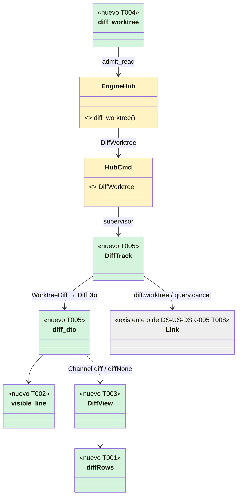
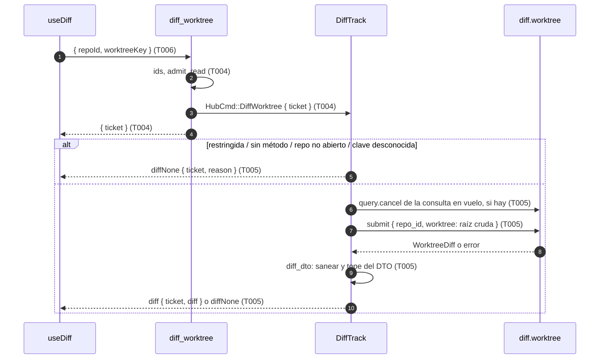
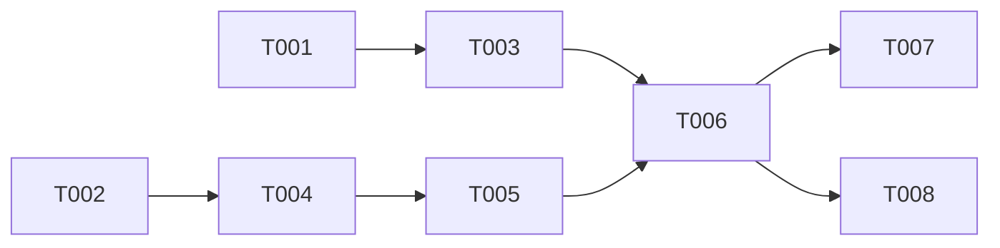

# DS-US-DSK-009 · Revisar en la app qué cambió en una copia de trabajo (y, cuando el motor lo sirva, en un commit)

## Contexto rápido

Al terminar, quien revisa el trabajo de un agente abre desde la tarjeta de su copia de trabajo (US-DSK-004) o desde la cabeza de su carril (US-DSK-005) la vista de cambios: ve por separado lo que entraría al merge y lo que está sin commitear, archivo por archivo, en unificado o dividido, y sabe qué archivos cambiaron sin enseñar su contenido (binarios, demasiado grandes, enlaces, submódulos) y por qué. Hoy la app no enseña ningún diff: ningún `diff.` aparece en `apps/desktop/src-tauri/src` ni en `crates/` de `main` (búsqueda del 2026-11-10).

Es una historia **de lectura**. No pasa por `commands/write/`, no pide `WriteToken`, ni presencia ni factor del SO; su único comando nuevo vive en `commands/` y se admite con `admit_read` de DS-US-DSK-001. Lo que esta entrega añade:

- **Un comando IPC de lectura**: `diff_worktree { repoId, worktreeKey }` (P24). El webview nunca manda una ruta: la clave del worktree es la FNV-1a que ya usa la flota (`engine/ingest.rs:66`), y el backend la traduce a la raíz cruda del último estado del repo abierto.
- **La consulta en el supervisor**: envía `diff.worktree` sin bloquear su bucle (`Link::submit`, la forma de DS-US-DSK-005 T008), cancela la anterior con `query.cancel`, sanea cada ruta y cada línea con `gitraptor_api::display` y manda el resultado por el `Channel`.
- **La vista de cambios** (`apps/desktop/src/diff/`) con lista de archivos y panel de líneas virtualizados, unificado y dividido, navegable con teclado, en en/es, con axe en claro y oscuro, y con todos sus estados.
- **El diff de un commit (escenario 2)** queda especificado y **desbloqueado** (T007): el motor ya sirve `diff.commit` (G2 resuelto, TS-CKP-006).

| Término | Qué es aquí |
|---|---|
| Entraría al merge | La rama del worktree frente a su merge-base con la base confirmada (DS-US-CKP-012 D5). Si la base no está confirmada o no hay merge-base, la sección dice "no calculable" con su motivo y la otra se calcula igual |
| Sin commitear | `HEAD` frente al working tree, preparado y sin preparar juntos, con los archivos sin seguimiento no ignorados como añadidos (DS-US-CKP-012 D5) |
| Clave del worktree | `worktreeKey`: 16 hex de la FNV-1a 64 de la ruta cruda que mandó el motor (`ingest::key`). La conoce el webview por `WorktreeDto.key`; no es una ruta ni se puede convertir en una |
| Ticket | Número del contador de ids del proceso (DS-US-DSK-001 T003 6.1) que `diff_worktree` devuelve; los mensajes del resultado lo llevan y el webview descarta cualquiera que no sea el último que pidió |
| Corte | `cut: files \| bytes \| time` de una sección: el motor llegó a un tope y la sección trae lo calculado hasta ahí (DS-US-CKP-012 D4) |
| Vista restringida | La app conectada con perfil `mcp` (`hello.profile`, DS-TS-GRP-009 D3): la abrió un agente |

⚠️ **ASSUMPTION**: no hay `architecture-constitution.md` en la cascada; rigen `AGENTS.md` y los ADR de `must_read` (NFR-02, SEC-12, ADR-GRP-009, ADR-GRP-016, ADR-GRP-017), como en DS-US-DSK-001 y DS-US-DSK-006.

⚠️ **ASSUMPTION**: DS-US-DSK-001, DS-US-DSK-002 y DS-US-DSK-006 están `spec-ready` y **no están en `main`** (`apps/desktop/src-tauri/commands.json` tiene hoy cinco comandos, 2026-11-10). Todo número de comandos de esta Dev Spec es relativo a las tres entregadas: **14 → 15**.

### Qué hay en el motor (verificado el 2026-11-10 en el worktree de US-CKP-012)

El código del diff **no está en `main`**: vive en la rama `feat/US-CKP-012-agent-diff` (W147, worktree `~/orca/workspaces/gitRaptor/ckp012`, último commit `709b8f94`). Las rutas de abajo son de ese worktree (`evidence[]`) y su contrato es el de DS-US-CKP-012, que está en `main`.

- **Método** `diff.worktree` (`crates/api/src/methods/diff.rs:9`), declarado con `method(DIFF_WORKTREE, false, false).since(CAPABILITIES_PROTOCOL)` (`:17-22`): **no reservado y no ofrecido a `raptor-mcp`** ("the content of a diff does not leave through the MCP (Q-CKP-8)", `:1-2`). Existe desde el protocolo 9 (`capability.rs:24`). Error propio: `diff-unavailable` con `DiffUnavailableData { reason: worktree-unavailable | repo-unavailable }` (`diff.rs:147-158`).
- **Parámetros** `DiffParams { repo_id, worktree }` con `deny_unknown_fields` (`diff.rs:27-33`): `worktree` es la **raíz cruda** del worktree. El daemon valida el `repo_id` (hex y guiones, ≤ 64), valida la ruta con `validate::client_path`, exige que el repo esté `Observed` y que la ruta sea **exactamente** la de un worktree que el motor ya conoce (`core/src/channel/diff.rs:70-109`, la igualdad en `:91`); si no, `not-found` o `diff-unavailable`. Nunca lee una ruta que el motor no observa.
- **Resultado** `WorktreeDiff { computed_at_utc_ms, committed: CommittedDiff, uncommitted: DiffSection }` (`diff.rs:38-44`). `CommittedDiff` es `ready { base, section }` o `not-computable { reason: base-unconfirmed | no-base | base-missing | no-merge-base | too-slow }` (`:46-67`). `DiffSection { files, files_total, cut: files | bytes | time | null }` (`:70-84`). `FileDiff { path: Untrusted, change: added | modified | deleted | type-changed, added, removed, body }` (`:87-103`). `FileBody` es `text { hunks, truncated }`, `binary`, `too-large`, `submodule`, `symlink` u `omitted`; **solo `text` lleva contenido** (`:105-119`). `Hunk { old_start, old_len, new_start, new_len, lines }` y `DiffLineView { kind: context | added | removed, text: Untrusted }` (`:121-144`).
- **Topes** (⚠️ ASSUMPTION del motor, D4 de DS-US-CKP-012; `diff.rs:11-24`): 1.000 archivos por sección, 2.000 líneas por archivo, blobs ≤ 8 MiB, respuesta ≤ 768 KiB serializada, plazo de 2 s, **1 consulta en vuelo por conexión** y cola global de 4. Al pasar un tope la sección sale con lo calculado y su `cut`; nunca un error. `Untrusted` acota cada texto a 4.096 bytes (`untrusted.rs:16`).
- **Sin renombrados** (D16 de DS-US-CKP-012): un `git mv` sale como un borrado y un añadido. **Binario**: NUL en los primeros 8.000 bytes (D7). **Enlaces**: un symlink, en cualquier lado, es `symlink` sin contenido y sin destino; el working tree se abre componente a componente con `O_NOFOLLOW` (D6). Sin filtros `clean`, `textconv` ni procesos hijo (ADR-GRP-009 § 1); el canario existe para `diff.worktree` en `crates/core/tests/diff_git.rs:420` (`no_exec_filters_textconv_and_external_diff_never_run`), no en `crates/git/src/diff_tests.rs`. `neutralize_programs` (`crates/git/src/reader.rs:759-779`) borra solo las secciones **con subsección** de `filter` y `diff`: `[diff] external` (sin subsección) no lo borra (R7).
- **Asíncrono**: el daemon encola el cálculo y responde fuera de orden (`conn.rs:941-947`, `channel/diff.rs:114-152`); `query.cancel { request }` cancela una consulta **de la misma conexión** (`methods/query.rs:7`, `query.rs:16-27`); `query-busy` (con `QueryBusyData { limit }`) y `query-cancelled` son los códigos compartidos. **Cancelar no libera la plaza**: `QueryTable::cancel` solo marca el token y la plaza se libera en `finish`, cuando el trabajo responde; mientras, `register` devuelve `Busy` (`crates/core/src/channel/query.rs:104-127`). Un `cancel` seguido de un `submit` da `query-busy` siempre (P27, M-01 de la revisión de seguridad 2026-11-10). La respuesta va solo a la conexión que preguntó; no se registra, no se audita ni se publica (`channel/diff.rs:1-6`).
- **Cliente**: `Client::submit` envía sin esperar y devuelve el id; como mucho 8 peticiones pendientes (`client/mod.rs:247`, `:487-496`).
- **Saneado de líneas en la TUI**: `apps/cli/src/present/diff.rs:152-170` expande tabuladores a múltiplos de 4 y quita el `\r` final **antes** de `visible`, que escaparía `\x09` y `\x0d`. Es la segunda copia que P26 evita en la app.

### Qué ve cada conexión

- **Perfil completo** (app abierta desde el Finder con identidad, ADR-GRP-017 § 3): `diff.worktree` y `query.cancel` están en `hello.methods`; "el diff bajo demanda va solo a esa conexión" (ADR-GRP-017 § 3, tabla).
- **Perfil `mcp` (ventana abierta por un agente)**: `offered()` filtra por `m.mcp` (`crates/core/src/channel/conn.rs:836-840` **de `main`**) y `diff.worktree` tiene `mcp: false`, así que **no aparece en `hello.methods` y llamarlo responde `-32601`** (`conn.rs:893` de `main`; en la rama de US-CKP-012 las líneas se desplazan). Además, en vista restringida el supervisor no abre el ámbito del repo (`supervisor.rs:557`: `if !restricted && open_repo(...)`), así que no hay ninguna clave de worktree que resolver. TS-CKP-006 fija la misma regla para el diff de un commit. **La ventana abierta por un agente no ve ningún diff** (P25).

### Decisión del orquestador pendiente

Decisiones nuevas de frontera de esta historia, numeradas a continuación de las P15 a P23 de DS-US-DSK-006. Es solo lectura sobre un método que ya existe en la rama de US-CKP-012, así que la tabla es corta: un comando, qué ve la vista restringida, los límites del lado de la app, el reparto de la única consulta por conexión con el grafo y cómo se parte la entrega. **P24 a P28 aceptadas por el coordinador el 2026-11-10; P29 aceptada (2026-11-10)** (ver la tabla de veredicto).

| # | Decisión | Recomendación | Por qué |
|---|---|---|---|
| P24 | **El comando IPC nuevo** | Uno solo de lectura: `diff_worktree { repoId, worktreeKey }` en `commands/diff_worktree.rs` (fuera de `commands/write/`), con `deny_unknown_fields`, ids con la regla de `valid_repo_id` (no vacío, ≤ 128 bytes, sin controles) y `worktreeKey` exactamente 16 hex en minúscula. Orden: sobre, ids, `admit_read(mode, "diff_worktree")`, supervisor. Responde `{ ticket }` y el resultado llega por el `Channel` (`diff`, `diffNone`). **Sin comando de cierre ni de cancelación**: una petición nueva cancela la anterior en el supervisor, y el webview descarta lo que no lleve su último ticket. **Sin `CommandError` nuevo**: `invalid-params`, `read-only`, `not-watching`. `commands.json` pasa de **14 a 15** con igualdad exacta. Si más de un worktree del snapshot tiene la misma clave FNV-1a, la petición falla cerrada con `not-open` (L-01 de la revisión de seguridad 2026-11-10) | El webview manda solo ids que el backend le dio. Un comando de cierre solo ahorraría al daemon un cálculo de ≤ 2 s que ya acota su propio plazo; un comando menos es una superficie menos (ADR-GRP-017 § 2) |
| P25 | **Qué ve la vista restringida y el perfil `mcp`** | Nada del diff, y el motor **no cambia**: `diff.worktree` sigue con `mcp: false` (Q-CKP-8). En la app: la acción "Ver cambios" no se pinta con `session.restricted`; si la vista se abre igual (atajo, estado viejo), el supervisor responde `diffNone { reason: "restricted" }` **sin llamar al daemon**, y la vista enseña el estado "restringida" con su explicación. Una ventana con perfil completo y un daemon que no anuncia `diff.worktree` (protocolo < 9) → `diffNone { reason: "unsupported" }` | El contenido de un diff puede llevar secretos; una ventana que abrió un agente lee en nombre de ese agente (DS-TS-GRP-009 § T004, presupuestos) y el MCP no le da ese contenido. Abrirlo solo para la app crearía una puerta lateral al contenido que el MCP niega. Alcance (I-02 de la revisión de seguridad 2026-11-10): esto cierra el **canal** del MCP y de la app, no los archivos; un agente con shell lee el worktree igual |
| P26 | **Límites y saneado del lado de la app** | Sin topes nuevos de cálculo: los del motor (1.000 archivos, 2.000 líneas, 8 MiB, 768 KiB, 2 s) mandan y la app los **explica**, no los sube. El backend sanea con **una sola función compartida**: `gitraptor_api::display::visible_line(raw: &Untrusted, tab) -> (String, bool)` (expande tabuladores a 4, quita el `\r` final, llama a `visible(…, TEXT_MAX_CHARS)` y devuelve si la línea quedó **cortada**, contando el corte de `visible` sobre la línea ya expandida y el de `Untrusted::is_truncated`), nueva en `crates/api/src/display.rs`, y la TUI pasa a usarla en la misma tarea (`apps/cli/src/present/diff.rs::line_text`). Rutas con `visible(…, TEXT_MAX_CHARS)` y la misma marca de corte; nombre de base con `NAME_MAX_CHARS`. Una línea o ruta cortada lleva `cut: true` en el DTO y la vista lo dice con texto ("línea cortada en 1.024 columnas"), nunca solo con "…" (M-02). `must_escape` gana los invisibles que hoy no escapa (L-04). Tope del DTO: si el `diff` serializado pasa de **2 MiB** (`MAX_DIFF_DTO_BYTES`, el saneado puede crecer al escapar), el backend pasa a `omitted` los cuerpos desde el último archivo hacia atrás, **en una sola pasada** (tamaño de cada cuerpo calculado una vez y restado, L-03), y marca `cut: "bytes"`. Un error de deserialización no se registra ni se propaga: como mucho su `classify()` (L-02). El webview **no guarda el diff** fuera de memoria: caché sin `persist`, se borra al cerrar la vista, al cambiar de repo y al reconectar | `display.rs` dice "there is no second copy": una tercera copia del saneado de líneas en la app sería la que se olvida de un control. El tope del DTO acota el peor caso del escape (un control de 1 byte → hasta 10 caracteres) |
| P27 | **Una consulta en vuelo por conexión, compartida con el grafo** | El supervisor lleva **una sola consulta bajo demanda en vuelo** en el link. La del diff (la pidió el usuario) **gana**: si hay una consulta en vuelo (`graph.lanes` u otro diff, p. ej. "Actualizar" dos veces), se cancela con `query.cancel` y la petición nueva queda **pendiente, sin enviarse**, hasta que llegue cualquier respuesta del id cancelado (normalmente `query-cancelled`); entonces se envía. Si no llega en `DIFF_DEADLINE_MS + 500 ms`, sale `busy`. El grafo queda `stale` y vuelve a pedirse cuando el diff responde (regla de espaciado de DS-US-DSK-005 D3). Un `query-busy` del diff ya enviado se reintenta una vez a los 500 ms; el segundo da `diffNone { reason: "busy" }` con "Reintentar". `graph.lanes` tiene que nacer con `mcp: false` o con presupuesto propio (I-01) | `query-busy` sale por dos causas: la plaza única de la conexión (`QUERIES_PER_CONNECTION = 1`, `diff.rs:22`) **o** la cola global del daemon (4, compartida con la TUI). La plaza solo se libera cuando el trabajo cancelado responde (`query.rs:104-127`), así que enviar justo después de cancelar falla siempre (M-01 de la revisión de seguridad 2026-11-10). Repartir la cola global por solicitante queda como mejora del motor, sin bloqueo (R5). Enmienda aditiva a DS-US-DSK-005 T008: no cambia sus firmas |
| P28 | **Colores del diff sin tokens nuevos** | Añadidas con `--gr-success-bg` / `--gr-success-text`, quitadas con `--gr-danger-bg` / `--gr-danger-text`, contexto en `--gr-text-main`; números de línea en `--gr-text-muted`. El color **nunca va solo**: columna de signo `+` / `−` y texto accesible "añadida" / "quitada". Los tokens propios del diff (`git.added`, `git.removed`, `git.modified` web) siguen pendientes de UX (H-1 de DSF-DSK-001) y, cuando existan, sustituyen a estos en un cambio de una línea por clase | Hay tokens con variante clara y oscura que ya pasan axe en otras vistas; esperar a H-1 bloquearía la pintura por una decisión de UX que no cambia la estructura |
| P29 | **Cómo se parte la entrega (escenario 2)** | Una sola historia con una tarea bloqueada, como DS-US-DSK-006 T007: T001 a T006 y T008 entregan los escenarios 1 y 3; **T007** (diff de un commit) espera a G2. La historia **no pasa a `implemented`** hasta T007; mientras, el plan la lleva `in-progress` con T007 en el backlog de su hito. Alternativa descartada: partir US-DSK-009 en dos historias (decisión del PO, no del Arquitecto) | El escenario 2 depende de un método del motor que no existe; partir la historia por eso duplica criterios y trazas. La partición en tareas da lo mismo sin tocar el backlog. La ficha de motor lleva R1, R3 y R7 endurecidos (M-03 de la revisión de seguridad 2026-11-10) |

#### Veredicto del orquestador y decisión del coordinador

**Decisión del coordinador (2026-11-10)**: P24 a P28 aceptadas; P26 con la condición de que el cambio de la TUI lleve tests propios (T002), P27 con la enmienda a DS-US-DSK-005 T008 y la nota de `graph.lanes` en DS-US-CKP-022. **P29 aceptada después (2026-11-10)**: una sola historia con T007 bloqueada por G2. Veredicto del orquestador, tras la **revisión de seguridad 2026-11-10** (opus, APROBADA CON COMENTARIOS: 0 crítico o alto, 3 medio, 4 bajo, 2 informativos). Cada hallazgo se comprobó en el código antes de aplicarlo (worktree de US-CKP-012 y `main`); los textos de arriba ya los incorporan. Una precisión al comprobar: el canario de filtros **sí existe** para `diff.worktree`, en `crates/core/tests/diff_git.rs:420`, no en `crates/git/src/diff_tests.rs`; el guard de M-03 se exige igualmente para el diff de un commit y se amplía con `diff.external` en `[diff]` sin subsección.

| # | Veredicto del orquestador | Cambios | Estado | Aterriza en |
|---|---|---|---|---|
| P24 | Aceptar | L-01: claves que chocan → `not-open` | Aceptada por el coordinador 2026-11-10 | T005 paso 1.4 |
| P25 | Aceptar | I-02: alcance del cierre en el "Por qué"; verificaciones de T008 (sin captura de ventana en `Saved Application State`, sin `console.*` con el diff) | Aceptada por el coordinador 2026-11-10 | T008 |
| P26 | Aceptar con cambios | M-02 (marca de corte), L-02 (error de serde sin registrar), L-03 (tope en una pasada), L-04 (`must_escape` ampliado) | Aceptada por el coordinador 2026-11-10, con tests propios de la TUI (`tui_diff_marks_cut_lines`, `tui_diff_escapes_invisible_chars`) | T001, T002, T003, T005 |
| P27 | Aceptar con cambios | M-01 (pendiente hasta la respuesta del cancelado, plazo y `busy`), I-01 (`graph.lanes` con `mcp: false` o presupuesto propio) | Aceptada por el coordinador 2026-11-10, con la enmienda a DS-US-DSK-005 T008 y la nota en DS-US-CKP-022 | T005 |
| P28 | Aceptar | — | Aceptada por el coordinador 2026-11-10 | T003 |
| P29 | Aceptar con cambios | M-03: R1, R3 y R7 de la ficha de motor | **Aceptada por el coordinador 2026-11-10** (una sola historia, T007 bloqueada) | T007, G2 |

---

## 📋 Índice

> **Para aprobar:** [Contexto rápido](#contexto-rápido) · [⚠️ Gaps](#gaps-y-violaciones-de-la-constitución) · [🔭 La forma](#la-forma) · [El trabajo de un vistazo](#el-trabajo-de-un-vistazo).
> **Para implementar:** [🚀 Plan](#plan-de-implementación), en orden. Las `_(ref)_` se abren desde la tarea que las cita.

| Sección | Propósito |
|---------|-----------|
| [Contexto rápido](#contexto-rápido) | Qué se construye, qué hay en el motor, qué ve cada conexión y decisiones pendientes |
| [⚠️ Gaps y violaciones de la constitución](#gaps-y-violaciones-de-la-constitución) | Qué impide empezar |
| [🔭 La forma](#la-forma) | Piezas y flujo |
| [🚀 Plan de implementación](#plan-de-implementación) | T001…T008, en orden |
| ↳ [El trabajo de un vistazo](#el-trabajo-de-un-vistazo) | Tareas en tabla y su orden |
| [Estructura de ficheros](#estructura-de-ficheros) _(ref)_ | Árbol anotado |
| [Contratos compartidos](#contratos-compartidos) _(ref)_ | DTO, mensajes, firmas y textos |
| [Contrato de API](#contrato-de-api) _(ref)_ | Comando IPC y lo que se consume del canal |
| [Estrategia de pruebas y cobertura](#estrategia-de-pruebas-y-cobertura) _(ref)_ | Escenarios → tests |
| [Gate de seguridad](#gate-de-seguridad) | Checklist pre-merge |
| [Fuera de alcance](#fuera-de-alcance) | Lo que esta entrega no toca |
| [Notas del autor](#notas-del-autor) _(ref)_ | Lo que no bloquea |

---

## ⚠️ Gaps y violaciones de la constitución

| ID | Qué falta | Severidad | Alcance | Acción | Owner |
|----|-----------|-----------|---------|--------|-------|
| G1 | **El diff del worktree no está en `main`**: `diff.worktree`, `query.cancel`, `query-busy`, `query-cancelled`, los tipos de `gitraptor_api::diff` y `Client::submit` viven en la rama `feat/US-CKP-012-agent-diff` (W147, `evidence[]`). Sin ellos no compila nada del backend de esta entrega | Bloqueante | T004, T005, T006, T008 | Mezclar US-CKP-012 (W147). Si al mezclar cambian nombres o tipos, T004 y T005 los siguen sin cambiar los DTO del webview | Orquestador (W147) |
| G2 | **Resuelto: el diff de un commit está en `main`** (PR #PRN de TS-CKP-006: `diff.commit`, `diff.between`, `diff.index`). Antes no existía en el motor (DEP-DSK-3). Requisitos de esta historia para esa ficha, en § [Requisitos para la ficha de motor](#requisitos-para-la-ficha-de-motor-del-diff-de-un-commit-g2) | Bloqueante | T007 | Escribir la Dev Spec de TS-CKP-006 con R1 a R8, reservarla y mezclarla | Arquitecto |
Dos huecos que **no bloquean** y no entran en la cuenta (los dos los cierra UX y alcanzan solo a la composición y los colores de T003): **H-UX-1**, DSF-DSK-001 solo esboza el diff (§ 6.1, con staging y commit que no son de esta historia), así que esta spec fija la composición desde ese esbozo y UX la revisa antes de mezclar T003; un cambio de composición no cambia DTO ni comando. **H-UX-2**, los tokens web del diff (`git.added`, `git.removed`, `git.modified`, H-1 de DSF-DSK-001) no tienen valor: mientras, P28, y cuando existan se enmienda ADR-GRP-003 / DSYS-GRP-002.

Sin violaciones de la constitución: la app no lee repos ni lanza procesos (ADR-GRP-017 § 1, § 2), no añade plugins ni permisos `dialog:*`, `fs:*` o `core:event:*`, y no escribe nada. Ningún método nuevo en el motor para las tareas no bloqueadas.

**Depende de**:

- **US-CKP-012** (W147): G1. **Va en `blocked_by`** (decisión del coordinador, 2026-11-10): `diff.worktree`, `query.cancel` y `Client::submit` llegan con W147. Pese al bloqueo, T001 a T003 se construyen ya con fixtures; T004 a T008 están en `validation.blocked_tasks`, como en DS-US-DSK-005.
- **DS-US-DSK-001, 002 y 006 entregadas** (dependencia de código, no de historia): `admit_read`, `DAEMON_METHODS`, el contador de ids del proceso y la lista exacta de 14 comandos. Si no están en `main` cuando empiece T004, T004 espera; no reimplementa la puerta.
- **`Link::submit`, `reply` y `cancel`** de DS-US-DSK-005 T008: si no están en `main` cuando empiece T005, T005 los añade con la forma de DS-US-DSK-005 § Firmas del stack y la segunda historia que llegue se lo salta (G6 de DS-US-DSK-001).
- **US-DSK-004** (`implemented`): la tarjeta de la flota es el punto de entrada. **US-DSK-005** (`ready`, sin entregar): la cabeza del carril es el segundo punto de entrada; si el grafo no está en `main` cuando llegue T006, esa entrada se omite y la añade quien entregue la segunda.

---

## 🔭 La forma

Al terminar, el backend tiene un comando de lectura más y un rastreador de la consulta del diff en el supervisor; el webview tiene la vista de cambios, alimentada solo por el `Channel`.





---

## 🚀 Plan de implementación

> Orden topológico (`Depende:`). Una casilla se marca cuando su `Aceptación` está verificada. Las rutas son relativas a la raíz del repo.

### El trabajo de un vistazo

Dos frentes que se juntan: el webview y el saneado compartido, construibles ya con fixtures (T001 a T003); el backend y el cableado, que esperan a G1 (T004 a T006); el diff de un commit, que espera a G2 (T007); y la verificación en macOS (T008).

| # | Tarea | Depende | Aterriza en |
|---|---|---|---|
| T001 | Fijar los DTO del diff y su modelo de filas en el webview | — | `apps/desktop/src/diff`, `apps/desktop/src/client` |
| T002 | Compartir el saneado de líneas en `display` | — | `crates/api/src/display.rs`, `apps/cli/src/present/diff.rs` |
| T003 | Pintar la vista de cambios con todos sus estados | T001 | `apps/desktop/src/diff`, `apps/desktop/src/i18n` |
| T004 | Añadir `diff_worktree` a la lista cerrada | T002 | `apps/desktop/src-tauri/src/commands`, `commands.json`, `capabilities/` |
| T005 | Pedir, cancelar y sanear el diff en el supervisor | T004 | `apps/desktop/src-tauri/src/engine` |
| T006 | Guardar el diff en la caché y abrir la vista desde la flota y el grafo | T003, T005 | `apps/desktop/src/state`, `apps/desktop/src/fleet`, `apps/desktop/src/shell` |
| T007 | Revisar el diff de un commit desde el grafo | T006 | `apps/desktop/src-tauri`, `apps/desktop/src/diff`, `apps/desktop/src/graph` |
| T008 | Verificar de punta a punta en macOS | T006 | — |

### En qué orden

T001 y T002 arrancan a la vez; T003 sale de T001. El backend (T004, T005) espera a G1 y se junta con la vista en T006. T007 espera a G2; T008 no espera a T007.



### T001 — Fijar los DTO del diff y su modelo de filas en el webview

**Objetivo.** Los tipos del diff del lado del webview y una función pura que convierte un `DiffDto` en las filas que se pintan (unificado y dividido) existen y están probados con fixtures. Fuera: pintar (T003) y el backend (T004, T005).

**Ubicación.**
- `apps/desktop/src/client/engine-types.ts` (**MODIFY**: `DiffDto` y compañía, § Tipos y datos compartidos)
- `apps/desktop/src/diff/diff-model.ts` (**CREATE**)
- `apps/desktop/src/diff/diff-model.test.ts` (**CREATE**)
- `apps/desktop/src/diff/fixtures.ts` (**CREATE**)

**Reglas**
- `diffRows(diff, mode)` devuelve una lista plana de filas (`section`, `file`, `hunk`, `line`, `notice`) con un `rowId` estable (`s:<sección>`, `f:<fileId>`, `h:<fileId>:<n>`, `l:<fileId>:<n>:<m>`), para que la virtualización y el foco sobrevivan a un cambio de modo.
- Números de línea calculados desde `oldStart` / `newStart`: `context` avanza los dos, `removed` solo el viejo, `added` solo el nuevo.
- Modo `split`: dentro de cada hunk, cada racha de `removed` seguida de una de `added` se empareja fila a fila; el sobrante queda con la otra mitad vacía. Modo `unified`: una fila por línea.
- `fileList(diff)`: archivos agrupados por sección, en el orden del motor, con `change`, `added`, `removed`, el tipo de cuerpo y un `rowId` de destino.
- Una línea con `cut: true` lleva la marca `cut` en su fila, y un archivo con `pathCut: true` la lleva en su cabecera (M-02 de la revisión de seguridad 2026-11-10).
- Notices por fila (no por color): `binary`, `too-large`, `submodule`, `symlink`, `omitted`, `truncated` (en `text`), `deleted` sin hunks y `type-changed`.
- Sección `not-computable` → una fila `notice` con su motivo; sección con `cut` → una fila `notice` "se muestran X de Y" con el motivo del corte.
- Ninguna función formatea ni interpreta el texto de una línea: se pasa tal cual llegó del backend (ya saneado).

- **Depende:** —
- **Refs:** DS-US-CKP-012 D4, D5, D12, D16; § Tipos y datos compartidos
- **Aceptación:** `pnpm --filter @gitraptor/desktop test -- diff-model` en verde
- **Guard:** `split mode pairs removed and added runs and keeps line numbers`
- **Guard:** `every non-text body becomes a notice row with its reason`

### T002 — Compartir el saneado de líneas en `display`

**Objetivo.** Una sola función sanea una línea de diff para cualquier cliente: la usan la TUI y el backend de la app. Fuera: el uso en la app (T005).

**Ubicación.**
- `crates/api/src/display.rs` (**MODIFY**: `visible_line` y sus tests)
- `apps/cli/src/present/diff.rs` (**MODIFY**: `line_text` llama a `visible_line`; existe tras G1. Si T002 corre antes de mezclar W147, este paso lo hace el worker de W147 o la primera tarea que llegue después)

**Reglas**
- `pub fn visible_line(raw: &Untrusted, tab: usize) -> (String, bool)`: quita un `\r` final, expande cada `\t` hasta el siguiente múltiplo de `tab` columnas y devuelve `visible(&flat, TEXT_MAX_CHARS)` y `cut`. `cut` es `true` si `raw.is_truncated()` (el motor ya cortó a 4.096 bytes, `untrusted.rs:161`) **o** si la línea **ya expandida** pasa de `TEXT_MAX_CHARS` caracteres; así una línea cuyo final queda oculto solo por los tabuladores también sale marcada (M-02 de la revisión de seguridad 2026-11-10). Cualquier otro control sigue escapado.
- `pub fn visible_cut(raw: &str, max_chars: usize) -> (String, bool)` para rutas y nombres, con la misma regla sin tabuladores.
- `must_escape` gana (L-04 de la revisión de seguridad 2026-11-10): U+00AD, U+034F, U+115F, U+1160, U+17B4, U+17B5, U+180E, U+3164, U+FFA0, U+FE00 a U+FE0F y U+E0100 a U+E01EF. Hoy no los escapa (`display.rs`, lista de `must_escape`), y el arreglo sirve a la TUI y a la app a la vez. Se suman al corpus de V6.
- La TUI conserva su comportamiento: los tests existentes de `present/diff.rs` (`tabs_expand_and_crlf_is_trimmed`, `lines_with_controls_are_sanitized`) siguen en verde sin cambiar sus esperados. Sin cambios en `visible` ni en sus constantes.
- **El cambio de la TUI no entra sin cobertura** (condición del coordinador para P26, 2026-11-10): el PR que implemente esta historia añade, en `apps/cli/src/present/diff.rs`, `tui_diff_marks_cut_lines` (una línea cortada por `visible_line` sale marcada en la fila de la TUI) y `tui_diff_escapes_invisible_chars` (los invisibles de L-04 salen escapados en la vista de la TUI), además de los dos existentes.

- **Depende:** —
- **Refs:** P26; `display.rs:1-6`
- **Aceptación:** `cargo test -p gitraptor-api display` en verde y `cargo test -p gitraptor-cli present::diff` en verde con `tui_diff_marks_cut_lines` y `tui_diff_escapes_invisible_chars`
- **Guard:** `visible_line_expands_tabs_trims_cr_and_escapes_the_rest` (corpus hostil de V6: `\u{1b}]52;c;…\u{7}`, U+202E, U+2028, NUL y los invisibles de L-04)
- **Guard M-02:** `a_line_hidden_after_tabs_is_marked_cut` (1.000 caracteres más 10 tabuladores y una cola: `cut = true`)

### T003 — Pintar la vista de cambios con todos sus estados

**Objetivo.** `DiffView` pinta un `DiffEntry` (resultado, carga o ausencia) con lista de archivos y panel de líneas, unificado y dividido, con teclado, lector de pantalla, en/es y claro/oscuro, y con todos los estados de la tabla de abajo. Fuera: de dónde llega el dato (T006).

**Ubicación.**
- `apps/desktop/src/diff/DiffView.tsx` (**CREATE**)
- `apps/desktop/src/diff/DiffFileList.tsx` (**CREATE**)
- `apps/desktop/src/diff/DiffLines.tsx` (**CREATE**)
- `apps/desktop/src/diff/DiffView.test.tsx` (**CREATE**)
- `apps/desktop/src/diff/index.ts` (**CREATE**)
- `apps/desktop/src/i18n/locales/en.json` y `es.json` (**MODIFY**: claves `diff.*` de § Textos del catálogo)
- `apps/desktop/src/ui/Table.tsx` (**MODIFY** solo si DS-US-DSK-005 no está en `main`: props aditivas `firstRowIndex` y `totalRows` con la forma de DS-US-DSK-005 D12)

**Reglas**
- **Composición** (H-UX-1, desde DSF-DSK-001 § 6.1 sin staging ni commit): cabecera con `← Volver`, título `diff.title` ("Cambios de {{folder}}"), hora `diff.computedAt` ("a las HH:MM:SS"), `Actualizar` y `SegmentedControl` Unificado | Dividido; a la izquierda la lista de archivos por sección con su cambio y `+a −r`; a la derecha el panel de líneas. Por debajo de 900 px de ancho, solo unificado y la lista se pliega encima del panel.
- **El diff es una foto** (DS-US-CKP-012 D9): no se recalcula con los eventos. `Actualizar` pide uno nuevo; mientras llega, se ve el anterior con la marca "actualizando…".
- **Virtualización**: lista de archivos y panel de líneas con `Table` (`role="grid"`), `aria-rowcount` = total de filas y `aria-rowindex` por fila; en el DOM solo las visibles y un margen, **nunca más del doble de las visibles** (regla de DS-US-DSK-005 D12, NFR-13.3). Sin dependencias nuevas.
- **Teclado**: `Tab` pasa de la lista al panel; en la lista `↑`/`↓` mueven y `Enter` lleva el panel al archivo; en el panel `↑`/`↓` mueven por filas, `]` / `[` al archivo siguiente o anterior y `n` / `p` al fragmento siguiente o anterior; `Esc` vuelve. Foco visible con el anillo de las primitivas. Atajos solo con el foco dentro de la vista y fuera de un campo de texto.
- **Lector de pantalla**: cada archivo es una fila de cabecera con `aria-level=1` y nombre accesible "{{path}}, {{change}}, {{added}} añadidas, {{removed}} quitadas"; cada línea lleva en una celda solo para lectores "añadida", "quitada" o "sin cambios", y los números de línea. En dividido, la celda vacía se anuncia "sin línea". El estado (cargando, error) va en una región `aria-live="polite"`.
- **No solo color** (P28): columna de signo `+` / `−` / espacio, visible, además del fondo. Contraste comprobado por axe en los dos temas.
- **Texto no confiable** (SEC-12, V5): rutas y líneas son nodos de texto de React, en `<code>` con `white-space: pre`; nunca `dangerouslySetInnerHTML`, markdown, resaltado de sintaxis ni enlaces. Una ruta larga se corta con elipsis en el medio solo con CSS y el título completo va en `Tooltip`.
- **Estados** (cada uno con `StatePanel` o una fila `notice`, con su clave de catálogo):

| Estado | Cuándo | Qué se ve |
|---|---|---|
| Cargando | Entrada `loading` | `Skeleton` de lista y panel; `aria-busy` |
| Vacío | Las dos secciones con 0 archivos y la de merge `ready` | `diff.empty`: "Sin cambios: nada que integrar y nada sin commitear" |
| Merge no calculable | `committed.state = "not-computable"` | Fila `notice` con `diff.committed.<reason>`; la sección sin commitear se ve igual |
| Corte | `cut` no nulo | `diff.cut.<files\|bytes\|time>` con "se muestran {{shown}} de {{total}} archivos" |
| Binario | `body.kind = "binary"` | Cabecera del archivo con `diff.body.binary` ("Binario: cambió, su contenido no se muestra"), sin líneas |
| Demasiado grande | `too-large` | `diff.body.tooLarge` ("Más de 8 MiB: cambió, su contenido no se muestra") |
| Enlace / submódulo | `symlink` / `submodule` | `diff.body.symlink` ("Enlace simbólico: no se sigue ni se muestra su destino") / `diff.body.submodule` |
| Omitido | `omitted` | `diff.body.omitted` ("No se calculó: la sección llegó a su tope") |
| Truncado | `text` con `truncated` | Las líneas que llegaron y la fila `diff.body.truncated` ("se muestran las primeras 2.000 líneas") |
| Línea o ruta cortada | `cut: true` / `pathCut: true` | Marca visible `diff.line.cutMark` ("línea cortada en 1.024 columnas") con el mismo texto para lectores, nunca solo "…" (M-02) |
| Borrado / cambio de tipo | `deleted` / `type-changed` | Cambio en la cabecera; un borrado enseña sus líneas quitadas |
| Renombrado | No se detecta (D16) | Un borrado y un añadido; la ayuda `diff.help.renames` lo dice una vez por vista |
| Rutas raras | Cualquier ruta | La ruta saneada del backend, con los escapes visibles (`\u{202e}`) |
| Restringida | `reason = "restricted"` | `diff.none.restricted`: "Ventana abierta por un agente: el contenido de los cambios no se muestra aquí" |
| Repo no observado | `repo-unavailable` o `not-open` | `diff.none.repoUnavailable` con `← Volver` |
| Copia no disponible | `worktree-unavailable` | `diff.none.worktreeUnavailable` |
| Ocupado | `busy` | `diff.none.busy` con `Reintentar` |
| Motor antiguo | `unsupported` | `diff.none.unsupported` ("Actualiza GitRaptor para ver los cambios") |
| Error | `failed` | `diff.none.failed` con `Reintentar` |

- **Depende:** T001
- **Refs:** P25, P28; DS-US-CKP-012 D9, D12, D16; DS-US-DSK-005 D12; TS-DSK-003 D10; DSF-DSK-001 § 6.1
- **Aceptación:** `pnpm --filter @gitraptor/desktop test -- DiffView` en verde, con axe sin violaciones en en/es × claro/oscuro para cada estado de la tabla
- **Guard ⛔ virtualización:** `the dom never holds more than twice the visible rows` (fixture de 1.000 archivos y 20.000 líneas)
- **Guard ⛔ SEC-12:** `hostile paths and lines render as text` (sin elementos creados por el contenido; ``, `javascript:`, U+202E)
- **Guard a11y:** `every line announces its kind and numbers without colour`

### T004 — Añadir `diff_worktree` a la lista cerrada

**Objetivo.** `diff_worktree` existe, valida su entrada, pasa por `admit_read` y llega al supervisor; la lista exacta pasa a quince. Fuera: lo que el supervisor hace con él (T005).

**Ubicación.**
- `apps/desktop/src-tauri/src/commands/diff_worktree.rs` (**CREATE**)
- `apps/desktop/src-tauri/src/commands/mod.rs` (**MODIFY**)
- `apps/desktop/src-tauri/commands.json` (**MODIFY**)
- `apps/desktop/src-tauri/capabilities/main.json` (**MODIFY**)
- `apps/desktop/src-tauri/src/engine/mod.rs` (**MODIFY**: `EngineHub::diff_worktree`)
- `apps/desktop/src-tauri/src/engine/supervisor.rs` (**MODIFY**: `HubCmd::DiffWorktree` y su brazo en `is_write`)
- `apps/desktop/src-tauri/src/engine/write_gate.rs` (**MODIFY**: `DAEMON_METHODS` y el vocabulario de `desktop_write_refused`)
- `apps/desktop/src-tauri/tests/commands.rs` (**MODIFY**)

**Reglas**
- `commands.json` = `["app_info", "engine_watch", "engine_retry", "fleet_open", "guard_blocks", "repo_pick", "repo_add", "guard_plan", "guard_cancel", "guard_install", "guard_uninstall", "tm_timeline", "tm_undo", "tm_redo", "diff_worktree"]`; `capabilities/main.json` añade `allow-diff-worktree` (capability única, ADR-GRP-017 § 2).
- Las aserciones de lista exacta de `tests/commands.rs` (las que actualizaron DS-US-DSK-001, 002 y 006 T002, y la nueva de esta tarea) pasan a los **quince** nombres, **iguales, nunca `contains`**.
- `WRITE_COMMANDS` **no cambia** (sigue con cinco): `diff_worktree` vive en `commands/`, no en `commands/write/`.
- `diff_worktree` → `hub.diff_worktree(repo_id, worktree_key)`: valida `repoId` (regla de `valid_repo_id`) y `worktreeKey` (exactamente 16 caracteres `[0-9a-f]`); `admit_read(mode, "diff_worktree")?`; toma un `ticket` del contador de ids del proceso; `HubCmd::DiffWorktree { repo_id, worktree_key, ticket }`; responde `{ "ticket": n }`. Sin supervisor → `not-watching`.
- `HubCmd::is_write`: `DiffWorktree` → `false`. El `match` sigue sin comodín (M-02 de DS-US-DSK-001).
- `DAEMON_METHODS` añade `DIFF_WORKTREE` y, si DS-US-DSK-005 no lo añadió ya, `QUERY_CANCEL`. Ninguno es de escritura: `RESERVED_DAEMON_METHODS`, `WRITE_DAEMON_METHODS` y `RESERVED_HANDLERS` **no cambian**. La aserción de lista exacta de `DAEMON_METHODS` se actualiza con igualdad.

- **Depende:** T002 (y G1)
- **Refs:** P24; DS-US-DSK-001 P2, P3, M-02, L-04; DS-US-DSK-006 T002; ADR-GRP-017 § 1, § 2
- **Aceptación:** `cargo test -p gitraptor-desktop --test commands --test tauri_surface --test write_gate` en verde
- **Guard ⛔ lista exacta:** `diff_command_is_in_the_closed_list_and_the_capability` (igualdad con los quince)
- **Guard:** `diff_worktree_lives_outside_commands_write_and_is_not_a_write`
- **Guard:** `diff_worktree_rejects_paths_and_bad_keys` (`/etc/passwd`, `../x`, 15 y 17 hex, mayúsculas, campo de más)

### T005 — Pedir, cancelar y sanear el diff en el supervisor

**Objetivo.** El supervisor resuelve la clave a la raíz cruda, pide `diff.worktree` sin bloquear su bucle, cancela la consulta anterior, sanea el resultado y lo manda por el `Channel`; en vista restringida no llama al daemon. Fuera: el webview (T006).

**Ubicación.**
- `apps/desktop/src-tauri/src/engine/diff.rs` (**CREATE**: `DiffTrack`, `diff_dto`, `none_reason`)
- `apps/desktop/src-tauri/src/engine/mod.rs` (**MODIFY**: `mod diff`)
- `apps/desktop/src-tauri/src/engine/supervisor.rs` (**MODIFY**)
- `apps/desktop/src-tauri/src/engine/wire.rs` (**MODIFY**: `EngineMessage::Diff`, `EngineMessage::DiffNone` y los DTO)
- `apps/desktop/src-tauri/src/engine/link.rs` (**MODIFY** solo si DS-US-DSK-005 T008 no está en `main`: `submit`, `reply`, `cancel`)
- `apps/desktop/src-tauri/tests/diff_supervisor.rs` (**CREATE**)
- `apps/desktop/src-tauri/tests/support/fake_daemon.rs` (**MODIFY**: guion `diff`)

**Pasos**
1. Al recibir `HubCmd::DiffWorktree { repo_id, worktree_key, ticket }`, en este orden; cada salida temprana manda `diffNone { ticket, repoId, worktreeKey, reason }` y no llama al daemon:
   1.1 ⛔5.1 `restricted` → `restricted` (P25).
   1.2 `hello.methods` sin `diff.worktree` → `unsupported`.
   1.3 `repo_id` distinto del repo abierto, o sin `RepoSnapshot` todavía → `not-open`.
   1.4 ⛔5.2 Exactamente un worktree del último snapshot con `ingest::key(raw) == worktree_key`; ninguno → `not-open`, **más de uno → `not-open`** (falla cerrada ante una colisión de FNV-1a, L-01 de la revisión de seguridad 2026-11-10). La raíz cruda sale **solo** de ese snapshot; nunca del webview.
   1.5 Worktree `unavailable` en el snapshot → `worktree-unavailable`.
2. ⛔5.6 Si hay una consulta en vuelo (un `DiffTrack` anterior o un `graph.lanes`): `link.cancel(id)` y la petición nueva se guarda como **pendiente** (`DiffTrack { state: Pending { cancelled: id, since } }`), **sin enviarla**: la plaza de la conexión no se libera hasta que el trabajo cancelado responde (`query.rs:104-127`, M-01 de la revisión de seguridad 2026-11-10). Una petición nueva sobre una pendiente la sustituye (se queda el último ticket). El grafo queda `stale`.
   2.1 Cualquier respuesta del id cancelado (`query-cancelled`, un resultado o un error) se tira y **dispara el envío** de la pendiente (paso 3).
   2.2 Si no llega en `PENDING_DEADLINE` (`DIFF_DEADLINE_MS` + 500 ms = 2,5 s) → `diffNone { reason: "busy" }` y se olvida la pendiente.
3. `link.submit(DIFF_WORKTREE, DiffParams { repo_id, worktree: raíz cruda })` y `DiffTrack { state: InFlight { id }, ticket, repo_id, worktree_key, folder, started, retried: false }`. Mientras haya `DiffTrack` (pendiente o en vuelo), el grafo no pide (P27).
4. Tras cada `next`, `reply(id)` **solo del id en vuelo o del cancelado que se espera** (⛔5.3, regla 8.1 de DS-US-DSK-005: cualquier otra respuesta se tira):
   - `Ok` → deserializar `WorktreeDiff`; `diff_dto` (paso 5); mandar `diff { ticket, diff, perf }`.
   - `Refused` `query-busy` → si `!retried`, reintentar a los 500 ms (`retried = true`); si no, `busy`. Con 5.6, un `query-busy` ya no sale de un cancelar y enviar seguidos: solo de la cola global.
   - `Refused` `query-cancelled` del id en vuelo → nada.
   - `Refused` `diff-unavailable` → `repo-unavailable` o `worktree-unavailable` según `data.reason`; `not-found` → `not-open`; `-32601` → `unsupported`; otro → `failed`.
   - ⛔5.7 Deserialización fallida → `failed`. El error de serde **ni se registra ni se propaga** (puede citar el contenido): como mucho `e.classify()` en el contador de `perf` (L-02 de la revisión de seguridad 2026-11-10). `Lost` → reconexión como hoy y `failed` para el ticket en vuelo.
5. `diff_dto(&WorktreeDiff, folder, ticket) -> DiffDto`: rutas con `visible_cut(raw, TEXT_MAX_CHARS)` (`pathCut`); base con `visible(raw, NAME_MAX_CHARS)`; cada línea con `display::visible_line(raw, 4)` (`text`, `cut`) (P26, M-02); `fileId` = `f<n>` por orden dentro de la respuesta. Después, ⛔5.4 tope del DTO **en una sola pasada O(n)** (L-03 de la revisión de seguridad 2026-11-10): se calcula una vez el tamaño serializado de cada cuerpo y el total; si el total pasa de `MAX_DIFF_DTO_BYTES`, se recorren los archivos desde el último hacia atrás restando el tamaño de cada cuerpo pasado a `omitted` hasta caber, sin volver a serializar el DTO entero, y `cut = "bytes"` en las secciones tocadas.
6. Al cambiar de repo, `repoClosed`, reconexión o `HubCmd::Open` de otro repo: `cancel` del id en vuelo, la pendiente se tira y el `DiffTrack` se olvida.
7. ⛔5.5 Logs: ni rutas, ni líneas, ni nombre de base. Como mucho una línea `desktop_diff` con `files`, `cut` y `ms` (enteros y vocabulario cerrado). `perf` lleva solo tiempos y recuentos.

- **Depende:** T004 (y G1)
- **Refs:** P24, P25, P26, P27; DS-US-CKP-012 D1 a D4, D13; DS-US-DSK-005 T008 (8.1, 8.2), D3
- **Aceptación:** `cargo test -p gitraptor-desktop --test diff_supervisor --test fleet_supervisor --test commands` en verde (y `--test graph_supervisor` si existe)
- **Guard ⛔5.1:** `restricted_session_never_calls_diff_worktree` (`calls()` del daemon falso vacío de `diff.`)
- **Guard ⛔5.2:** `the_root_comes_from_the_snapshot_never_from_the_webview` (dos worktrees con nombres casi iguales y uno con U+202E: la clave elige el correcto) y `colliding_keys_fail_closed` (L-01)
- **Guard ⛔5.3:** `a_reply_to_another_id_is_dropped`
- **Guard ⛔5.4:** `an_oversized_dto_omits_bodies_from_the_tail_and_marks_bytes` y `dto_cap_is_single_pass` (L-03: corpus de peor caso con caracteres Tag U+E0000 a U+E007F, que escapan a 9 caracteres; el DTO se serializa entero como mucho una vez)
- **Guard ⛔5.5:** `diff_content_is_never_logged` (una línea con un secreto de prueba generado en el test y una ruta marcador: ningún `stderr` ni log del backend los contiene)
- **Guard ⛔5.6:** `a_diff_after_cancel_waits_for_query_cancelled_and_never_reports_busy` (con un `graph.lanes` en vuelo y con "Actualizar" dos veces: la petición nueva sale solo tras la respuesta del cancelado; sin ella, `busy` a los 2,5 s)
- **Guard ⛔5.7:** `a_malformed_reply_with_the_test_secret_is_never_logged` (L-02: respuesta malformada que lleva el secreto de prueba; ni `stderr`, ni log, ni `diffNone` lo contienen)
- **Guard P27:** `a_diff_cancels_the_graph_query_and_the_graph_refreshes_after`

### T006 — Guardar el diff en la caché y abrir la vista desde la flota y el grafo

**Objetivo.** El webview pide el diff de un worktree, guarda solo el resultado de su último ticket y abre `DiffView` desde la tarjeta de la flota y desde la cabeza del carril. Fuera: el diff de un commit (T007).

**Ubicación.**
- `apps/desktop/src/client/commands.ts` (**MODIFY**: `COMMANDS` a quince y `Commands.diff_worktree`)
- `apps/desktop/src/client/commands.test.ts` (**MODIFY**)
- `apps/desktop/src/state/engine-cache.ts` (**MODIFY**: mensajes `diff` y `diffNone`)
- `apps/desktop/src/state/ui-store.ts` (**MODIFY**: vista abierta `diff` con `{ repoId, worktreeKey, ticket }` y el modo unificado/dividido)
- `apps/desktop/src/diff/useDiff.ts` (**CREATE**) y `useDiff.test.tsx` (**CREATE**)
- `apps/desktop/src/ui/WorktreeCard.tsx` y `apps/desktop/src/fleet/FleetView.tsx` (**MODIFY**: acción "Ver cambios")
- `apps/desktop/src/shell/` (**MODIFY**: montar `DiffView` en el centro, como `ConflictDetailView`; atajo `d` sobre la tarjeta con foco; los archivos exactos los da `src/shell` al empezar)
- `apps/desktop/src/graph/` (**MODIFY**, solo si DS-US-DSK-005 está en `main`: "Ver cambios" en la fila de cabeza o WIP del carril)

**Reglas**
- `COMMANDS` pasa a los quince nombres en el orden de `commands.json` (igualdad en `commands.test.ts`); `Commands.diff_worktree: { params: { repoId: string; worktreeKey: string }; result: { ticket: number } }`.
- `useDiff(repoId, worktreeKey)` llama al comando, guarda el `ticket` en `ui-store` y lee de la caché la entrada `engineKeys.diff()`: **una sola** entrada (`DiffEntry` = `loading` | `{ diff }` | `{ none }`). Un mensaje cuyo `ticket` no es el actual se descarta.
- ⛔6.1 La entrada del diff no se persiste (sin `persist`, `gcTime: 0`) y se borra al cerrar la vista, al cambiar de repo, con `repoClosed` y al reconectar (P26).
- "Ver cambios" no se pinta con `session.restricted`, ni sobre un worktree `unavailable` (con la pista desactivada y su motivo, como D11 de DS-US-CKP-012). Funciona en cualquier estado de sesión del agente.
- `← Volver` y `Esc` devuelven el foco a la tarjeta o fila de origen.

- **Depende:** T003, T005
- **Refs:** P24, P25, P26; DS-US-DSK-004 T003; DS-US-DSK-005 T006; DS-US-CKP-012 D9, D11
- **Aceptación:** `pnpm --filter @gitraptor/desktop test -- commands useDiff DiffView FleetView AppShell` en verde
- **Guard ⛔ lista exacta:** `COMMANDS equals commands.json` (quince)
- **Guard:** `a stale ticket never replaces the current diff`
- **Guard ⛔6.1:** `pnpm --filter @gitraptor/desktop test -- useDiff`, con el test «closing the view or switching repo drops the diff from the cache»

### T007 — Revisar el diff de un commit desde el grafo

**Objetivo.** Desde una fila de commit del grafo (US-DSK-005), el usuario abre la misma vista con los archivos de ese commit y sus líneas añadidas y quitadas (escenario 2). **Bloqueada por G2**: no se empieza hasta que el método del motor esté en `main` con R1 a R8. Fuera: el diff entre dos commits o de un archivo entre dos puntos (ningún escenario lo pide).

**Ubicación.**
- `apps/desktop/src-tauri/src/commands/diff_commit.rs` (**CREATE**)
- `apps/desktop/src-tauri/commands.json`, `capabilities/main.json`, `tests/commands.rs` (**MODIFY**: **quince → dieciséis**, igualdad exacta)
- `apps/desktop/src-tauri/src/engine/diff.rs` y `supervisor.rs` (**MODIFY**)
- `apps/desktop/src/diff/`, `apps/desktop/src/graph/`, `apps/desktop/src/client/commands.ts` (**MODIFY**)

**Reglas**
- `diff_commit { repoId, commitOid }`: `commitOid` de 40 o 64 hex en minúscula **y** presente en el conjunto de oids que el backend mandó en el último `graph` del repo abierto (el supervisor guarda ese conjunto, acotado por la página del grafo). Un oid que la app no enseñó → `diffNone { reason: "not-open" }` sin llamar al daemon. Mismo `admit_read`, ticket y mensajes que `diff_worktree`.
- La vista reutiliza `DiffView` con una sola sección ("Este commit") y la cabecera del commit con el sha corto y el asunto que el webview **ya tiene** de `CommitDto` (saneados); el backend no manda autor ni mensaje.
- Merge: la cabecera dice "comparado con el primer padre" (R4). Commit raíz: "primer commit".
- Vista restringida: igual que P25 (sin entrada y `restricted`).
- El nombre del método del daemon, sus tipos y sus códigos son los que fije la Dev Spec de TS-CKP-006; esta tarea **no** los inventa: si difieren de lo que enumera TS-CKP-006, se siguen sin cambiar el DTO del webview.

- **Depende:** T006 (y G2; y DS-US-DSK-005 entregada)
- **Refs:** P29; G2; TS-CKP-006; DS-US-DSK-005 `CommitDto`
- **Aceptación:** `cargo test -p gitraptor-desktop --test diff_supervisor --test commands` y `pnpm --filter @gitraptor/desktop test -- DiffView GraphView` en verde, con el escenario 2 en el daemon falso
- **Guard ⛔:** `diff_commit_only_accepts_an_oid_the_graph_showed`

#### Requisitos para la ficha de motor del diff de un commit (G2)

Requisitos de esta historia para la Dev Spec de **TS-CKP-006** (dueño **Arquitecto**; `ready`, con Dev Spec DS-TS-CKP-006). Los nombres que cita TS-CKP-006 (`diff.commit`, `diff.between`, `diff.index`) son una enumeración de una TS `ready`, con Dev Spec DS-TS-CKP-006, **no métodos existentes**: ninguno está en `crates/api/src/methods/` de `main` ni de la rama de US-CKP-012.

- **R1. Una consulta del diff de un commit frente a su primer padre**, en el módulo `diff` que crea US-CKP-012 (archivo propio, ADR-GRP-016), con parámetros `repo_id` y un oid **completo**; sin ruta, sin rango y sin campo de más (`deny_unknown_fields`). El daemon valida el oid como 40 o 64 hex en minúscula y lo convierte con `ObjectId::from_hex`; **prohibido** pasarlo por `rev_parse` o cualquier revspec (`HEAD~`, `@{-1}`, `:/regex`) y rechazado todo valor que empiece por `-` (M-03 de la revisión de seguridad 2026-11-10).
- **R2. La misma forma de sección** que `diff.worktree` (`DiffSection`, `FileDiff`, `FileBody`, `Hunk`), para que la app no tenga un segundo ingest ni una segunda vista; más `parents` (número) y la marca de merge.
- **R3. Alcanzabilidad**: el oid tiene que ser un commit alcanzable desde una ref del repo observado; un blob, un commit huérfano o un oid de otro repo se rechazan sin leer contenido, con un código que no distinga "no existe" de "no alcanzable". La búsqueda de alcanzabilidad se acota con el plazo de 2 s y el token de cancelación; si se corta, responde **el mismo código que "no existe"** (M-03).
- **R4. Merge y raíz**: un merge, contra el primer padre; el commit raíz, contra el árbol vacío.
- **R5. Mismos topes, plazo, cancelación y cola** que `diff.worktree` (D4 de DS-US-CKP-012), y la misma consulta en vuelo por conexión (lo que P27 reparte en la app). Mejora del motor sin bloqueo (I-01 de la revisión de seguridad 2026-11-10): repartir la cola global por solicitante, para que un cliente no agote las 4 plazas de los demás.
- **R6. No ofrecida a `raptor-mcp`** (`mcp: false`) y no reservada: la vista restringida no la ve (P25).
- **R7. Solo lectura sin filtros** (ADR-GRP-009 § 1: sin `clean`, `textconv`, diff externo ni `gpg`, sin procesos hijo) y respuesta solo a la conexión que pregunta, sin registro ni persistencia (Validación 8). Exigido (M-03 de la revisión de seguridad 2026-11-10): leer con `RepoReader::open` (`crates/git/src/reader.rs:160`, que aplica `neutralize_programs`); **prohibida la Git CLI**. Si algún día se usara: argv fijo con `--no-ext-diff --no-textconv --no-color`, `--end-of-options`, `GIT_PAGER=cat`, sin `GIT_EXTERNAL_DIFF` y `-c core.fsmonitor=`. Ojo: `neutralize_programs` (`reader.rs:759-779`) solo borra secciones con subsección, así que **no** borra `[diff] external`; la ficha lo cierra o lo prueba. **Guard obligatorio**: repo con `diff.external`, `diff.x.textconv`, `filter.x.clean` y `.gitattributes` apuntando a un script que crea un marcador; tras el diff de un commit el marcador no existe. El mismo caso, con `diff.external` en `[diff]` sin subsección, se añade al canario de `diff.worktree` (`crates/core/tests/diff_git.rs:420`), que ya cubre filtro, `textconv` y diff externo.
- **R8. Sin renombrados** en el MVP, como D16 de DS-US-CKP-012, para que la vista explique lo mismo en los dos casos.

El diff de un archivo entre dos puntos (también en DEP-DSK-3) **no lo pide ningún escenario** de US-DSK-009; queda para la historia que lo necesite (US-DSK-017 u otra).

### T008 — Verificar de punta a punta en macOS

**Objetivo.** Con el motor real y repos temporales, los escenarios 1 y 3 se ven como dice la historia y la ventana abierta por un agente no ve el diff. Fuera: el escenario 2 (T007).

**Ubicación.**
- Ningún fichero: verificación manual con el binario de la app y repos temporales fuera de este repo (NFR-01).

**Pasos**
1. Repo de demo "feat-pagos" con 2 commits propios sobre `main` confirmada y 1 archivo sin commitear: "Ver cambios" desde la tarjeta enseña "Entraría al merge (N archivos)" y "Sin commitear (1 archivo)", archivo por archivo (escenario 1).
2. Añadir `logo.png` y un `datos.json` de 40 MB: los dos salen en la lista, sin contenido y con su motivo (escenario 3).
3. Un archivo con tabuladores, CRLF, U+202E en el nombre y `\x1b]52` en una línea: se lee bien y los controles salen como escapes.
4. Un symlink a un archivo fuera del repo con un marcador: sale "Enlace simbólico" y el marcador no aparece.
5. Un repo con 3.000 archivos cambiados: corte `files` explicado y el desplazamiento fluido (DOM acotado).
6. Abrir la app desde un agente (Claude Code ejecuta el binario): "vista restringida", sin acción "Ver cambios"; el log del daemon no tiene `diff_worktree` de esa conexión.
7. Unificado y dividido, teclado completo y VoiceOver sobre una línea añadida y una quitada; tema claro y oscuro.
8. Con un diff abierto, cerrar la app: `~/Library/Saved Application State/<bundle-id>.savedState` no guarda imágenes de la ventana (I-02 de la revisión de seguridad 2026-11-10).
9. Con las herramientas del webview abiertas en la build de desarrollo: ningún `console.*` contiene rutas ni líneas del diff (I-02).

- **Depende:** T006
- **Refs:** escenarios 1 y 3 de US-DSK-009; P25; I-02
- **Aceptación:** checklist de 1 a 9 marcada en el PR con capturas en los dos temas

---

## Estructura de ficheros

```text
crates/api/src/display.rs                          ← MODIFY (T002: visible_line)
apps/cli/src/present/diff.rs                       ← MODIFY (T002, tras G1)
apps/desktop/src-tauri/
├── commands.json                                  ← MODIFY (T004: 15; T007: 16)
├── capabilities/main.json                         ← MODIFY (T004, T007)
├── src/commands/
│   ├── mod.rs                                     ← MODIFY (T004)
│   ├── diff_worktree.rs                           ← CREATE (T004)  lectura, fuera de write/
│   └── diff_commit.rs                             ← CREATE (T007, bloqueada)
├── src/engine/
│   ├── diff.rs                                    ← CREATE (T005: DiffTrack, diff_dto)
│   ├── mod.rs                                     ← MODIFY (T004, T005)
│   ├── supervisor.rs                              ← MODIFY (T004, T005)
│   ├── wire.rs                                    ← MODIFY (T005)
│   ├── write_gate.rs                              ← MODIFY (T004: DAEMON_METHODS)
│   └── link.rs                                    ← MODIFY (T005, solo sin DS-US-DSK-005 T008)
└── tests/
    ├── commands.rs                                ← MODIFY (T004)
    ├── diff_supervisor.rs                         ← CREATE (T005)
    └── support/fake_daemon.rs                     ← MODIFY (T005)
apps/desktop/src/
├── client/{engine-types.ts, commands.ts}          ← MODIFY (T001, T006)
├── diff/                                          ← CREATE (T001, T003, T006)
│   ├── diff-model.ts, fixtures.ts
│   ├── DiffView.tsx, DiffFileList.tsx, DiffLines.tsx
│   ├── useDiff.ts, index.ts
│   └── *.test.ts(x)
├── state/{engine-cache.ts, ui-store.ts}           ← MODIFY (T006)
├── fleet/FleetView.tsx, ui/WorktreeCard.tsx       ← MODIFY (T006)
├── shell/                                         ← MODIFY (T006)
└── i18n/locales/{en,es}.json                      ← MODIFY (T003)
```

---

## Contratos compartidos

### Tipos y datos compartidos

| Tipo | Dónde | Forma |
|---|---|---|
| `DiffDto` | `wire.rs` ↔ `engine-types.ts` | `{ ticket: number, repoId: string, worktreeKey: string, folder: string, computedUtcMs: number, committed: { state: "ready", base: string, section: DiffSectionDto } \| { state: "not-computable", reason: "base-unconfirmed" \| "no-base" \| "base-missing" \| "no-merge-base" \| "too-slow" }, uncommitted: DiffSectionDto }` |
| `DiffSectionDto` | ídem | `{ files: DiffFileDto[], filesTotal: number, cut: "files" \| "bytes" \| "time" \| null }` |
| `DiffFileDto` | ídem | `{ fileId: string /* f<n> */, path: string /* saneada */, pathCut: boolean, change: "added" \| "modified" \| "deleted" \| "type-changed", added: number, removed: number, body: { kind: "text", hunks: DiffHunkDto[], truncated: boolean } \| { kind: "binary" \| "too-large" \| "submodule" \| "symlink" \| "omitted" } }` |
| `DiffHunkDto` | ídem | `{ oldStart: number, oldLen: number, newStart: number, newLen: number, lines: { kind: "context" \| "added" \| "removed", text: string /* saneada */, cut: boolean }[] }` |
| `DiffNoneReason` | ídem | `"restricted" \| "unsupported" \| "not-open" \| "repo-unavailable" \| "worktree-unavailable" \| "busy" \| "failed"` |
| `DiffEntry` | `src/state/engine-cache.ts` | `{ state: "loading", ticket } \| { state: "ready", diff: DiffDto } \| { state: "none", ticket, reason: DiffNoneReason }` en `engineKeys.diff()` |
| `DiffRow` | `src/diff/diff-model.ts` | `{ rowId, kind: "section" \| "file" \| "hunk" \| "line" \| "notice", … }` (T001) |

Mensajes nuevos del `Channel`:

| Mensaje | Campos | Origen |
|---|---|---|
| `diff` | `diff: DiffDto`, `perf` | Respuesta de `diff.worktree` |
| `diffNone` | `ticket`, `repoId`, `worktreeKey`, `reason: DiffNoneReason` | Salida temprana o rechazo |

### Ciclos de vida (DI)

| Pieza | Vida | Regla |
|---|---|---|
| `DiffTrack` | Uno como mucho por supervisor, en estado `Pending { cancelled, since }` (esperando la respuesta del id cancelado, como mucho `PENDING_DEADLINE`) o `InFlight { id }`; muere con la respuesta, el plazo, el cambio de repo o la reconexión | P27, M-01: mientras vive, el grafo no pide; nunca se envía mientras la plaza siga ocupada |
| Entrada `engineKeys.diff()` | Una sola en la caché del webview, sin `persist`, `gcTime: 0` | Se borra al cerrar la vista, cambiar de repo, `repoClosed` y reconectar (P26) |
| Modo unificado/dividido | `ui-store`, como las demás preferencias de vista | No guarda nada del contenido |

### Firmas del stack

```rust
// crates/api/src/display.rs
pub fn visible_line(raw: &Untrusted, tab: usize) -> (String, bool); // (texto, cortada)
pub fn visible_cut(raw: &str, max_chars: usize) -> (String, bool);

// apps/desktop/src-tauri/src/commands/diff_worktree.rs
#[derive(Debug, Deserialize)]
#[serde(deny_unknown_fields, rename_all = "camelCase")]
pub struct DiffWorktreeParams { pub repo_id: String, pub worktree_key: String }
#[tauri::command]
pub fn diff_worktree(request: tauri::ipc::Request<'_>, hub: tauri::State<'_, EngineHub>)
    -> Result<serde_json::Value, CommandError>;

// apps/desktop/src-tauri/src/engine/mod.rs
impl EngineHub {
    pub fn diff_worktree(&self, repo_id: String, worktree_key: String) -> Result<u64, CommandError>;
}

// apps/desktop/src-tauri/src/engine/supervisor.rs
pub enum HubCmd { /* … */ DiffWorktree { repo_id: String, worktree_key: String, ticket: u64 } }

// apps/desktop/src-tauri/src/engine/diff.rs
pub const MAX_DIFF_DTO_BYTES: usize = 2 * 1024 * 1024;
pub const BUSY_RETRY: std::time::Duration = std::time::Duration::from_millis(500);
pub const PENDING_DEADLINE: std::time::Duration =
    std::time::Duration::from_millis(gitraptor_api::diff::DIFF_DEADLINE_MS + 500);
pub fn diff_dto(diff: &gitraptor_api::diff::WorktreeDiff, folder: &str, ticket: u64) -> DiffDto;
pub fn none_reason(error: &LinkError) -> Option<DiffNoneReason>; // None = query-cancelled
```

```ts
// apps/desktop/src/diff/diff-model.ts
export type DiffMode = "unified" | "split";
export function diffRows(diff: DiffDto, mode: DiffMode, t: TFunction): DiffRow[];
export function fileList(diff: DiffDto): DiffFileItem[];
// apps/desktop/src/diff/useDiff.ts
export function useDiff(repoId: string, worktreeKey: string): { entry: DiffEntry | undefined; refresh(): void };
```

### Textos del catálogo

Claves nuevas en `en.json` y `es.json` (igualdad de claves en `catalog.test.ts`):

| Clave | es | en |
|---|---|---|
| `diff.action` | Ver cambios | View changes |
| `diff.title` | Cambios de {{folder}} | Changes in {{folder}} |
| `diff.computedAt` | a las {{time}} | at {{time}} |
| `diff.refresh` / `diff.refreshing` | Actualizar / actualizando… | Refresh / refreshing… |
| `diff.mode.unified` / `diff.mode.split` | Unificado / Dividido | Unified / Split |
| `diff.section.committed` | Entraría al merge ({{count}} archivos) | Would be merged ({{count}} files) |
| `diff.section.uncommitted` | Sin commitear ({{count}} archivos) | Uncommitted ({{count}} files) |
| `diff.committed.<reason>` | La base no está confirmada · No hay base · La rama base no existe · Sin historia común con la base · Tardó demasiado en listar los archivos | Base not confirmed · No base · Base branch missing · No common history with the base · Listing the files took too long |
| `diff.cut.<files\|bytes\|time>` | Se muestran {{shown}} de {{total}} archivos: demasiados archivos · respuesta demasiado grande · se acabó el tiempo | Showing {{shown}} of {{total}} files: too many files · response too large · ran out of time |
| `diff.body.<binary\|tooLarge\|symlink\|submodule\|omitted\|truncated>` | Los textos de la tabla de estados de T003 | Lo mismo en inglés |
| `diff.change.<added\|modified\|deleted\|typeChanged>` | añadido · modificado · borrado · cambio de tipo | added · modified · deleted · type changed |
| `diff.line.<added\|removed\|context\|empty>` | añadida · quitada · sin cambios · sin línea | added · removed · unchanged · no line |
| `diff.line.cutMark` / `diff.path.cutMark` | línea cortada en {{columns}} columnas / ruta cortada | line cut at {{columns}} columns / path cut |
| `diff.empty` | Sin cambios: nada que integrar y nada sin commitear | No changes: nothing to merge and nothing uncommitted |
| `diff.help.renames` | Un archivo renombrado aparece como borrado y añadido | A renamed file shows as deleted and added |
| `diff.none.<reason>` | Los textos de la tabla de estados de T003 | Lo mismo en inglés |

---

## Contrato de API

### Comando IPC que añade

| Comando | Params | Resultado | Errores | Módulo |
|---|---|---|---|---|
| `diff_worktree` | `{ repoId: string, worktreeKey: string /* 16 hex */ }` | `{ ticket: number }`; el diff llega por el `Channel` (`diff`, `diffNone`) | `invalid-params`, `read-only`, `not-watching` | `commands/` (lectura) |

`invalid-params`: campos desconocidos, `repoId` vacío, de más de 128 bytes o con controles, `worktreeKey` que no sea exactamente 16 `[0-9a-f]`. Orden: sobre, ids, `admit_read`, supervisor. Ninguna ruta viaja desde el webview.

`commands.json` tras esta historia (**quince**, relativo a DS-US-DSK-006, que lo deja en catorce): `["app_info", "engine_watch", "engine_retry", "fleet_open", "guard_blocks", "repo_pick", "repo_add", "guard_plan", "guard_cancel", "guard_install", "guard_uninstall", "tm_timeline", "tm_undo", "tm_redo", "diff_worktree"]`. `WRITE_COMMANDS` sin cambios (cinco). T007 añade `diff_commit` (dieciséis) cuando G2 se cierre.

### Lo que se consume del canal

| Método o código | Estado | Uso |
|---|---|---|
| `diff.worktree` | Rama de US-CKP-012 (G1); `mcp: false` | T005 |
| `query.cancel`, `query-busy`, `query-cancelled` | Rama de US-CKP-012 (G1); `mcp: false` | T005, P27 |
| `diff-unavailable` (`worktree-unavailable`, `repo-unavailable`) | Rama de US-CKP-012 (G1) | T005 |
| Diff de un commit | **No existe** (G2, TS-CKP-006) | T007 |
| `hello.profile`, `hello.methods` | `main` (DS-TS-GRP-009) | T005 pasos 1.1 y 1.2 |

### Forma del error y del cuerpo de respuesta

Ningún error del daemon llega con su texto al webview: el supervisor lo traduce a `DiffNoneReason` y la vista lo presenta por su clave de catálogo. `query-cancelled` no llega al webview. Los errores del comando son los `CommandError` existentes, en su forma de `ipc.rs` (`{ code }`).

| Del daemon | Al webview |
|---|---|
| `-32601` (método no ofrecido) o ausente de `hello.methods` | `unsupported` (o `restricted` si el perfil es `mcp`, sin llamar) |
| `not-found` | `not-open` |
| `diff-unavailable` `repo-unavailable` / `worktree-unavailable` | `repo-unavailable` / `worktree-unavailable` |
| `query-busy` (tras un reintento) | `busy` |
| `query-cancelled` | (se descarta) |
| `invalid-params`, deserialización fallida, otro | `failed` |

### Valores numéricos

| Valor | Cifra | Origen |
|---|---|---|
| Archivos por sección | 1.000 | Motor, `MAX_DIFF_FILES` (⚠️ ASSUMPTION, D4) |
| Líneas por archivo | 2.000 | Motor, `MAX_DIFF_LINES_PER_FILE` |
| Blob máximo con contenido | 8 MiB | Motor, `MAX_DIFF_BLOB_BYTES` |
| Respuesta del daemon | ≤ 768 KiB | Motor, `MAX_DIFF_RESPONSE_BYTES` |
| Plazo de una consulta | 2 s | Motor, `DIFF_DEADLINE_MS` |
| Consultas en vuelo por conexión | 1 | Motor, `QUERIES_PER_CONNECTION` (P27) |
| Caracteres por línea y por ruta | 1.024 | `TEXT_MAX_CHARS` |
| Tabulador | 4 columnas | `visible_line` (como la TUI) |
| DTO máximo hacia el webview | 2 MiB | App, `MAX_DIFF_DTO_BYTES` (P26) |
| Reintento tras `query-busy` | 1, a los 500 ms | App, `BUSY_RETRY` (P27) |
| Espera de la respuesta del cancelado | 2,5 s | App, `PENDING_DEADLINE` = `DIFF_DEADLINE_MS` + 500 ms (P27, M-01) |
| Filas en el DOM | ≤ 2 × visibles | NFR-13.3, regla de DS-US-DSK-005 D12 |
| Ancho para dividido | ≥ 900 px | App (T003) |
| `worktreeKey` | 16 hex | `ingest::key` |

---

## Estrategia de pruebas y cobertura

### 9.1 Pirámide de pruebas

| Tipo | Cantidad | Tareas dueñas | Herramientas | Cuándo |
|------|---------:|-------------|---------|------|
| Unit | 4 | T002, T005 | `cargo test` | PR gate |
| Contract | 4 | T004 | `cargo test` sobre `commands.json`, capability y `DAEMON_METHODS` | PR gate |
| Integration | 12 | T005 | daemon falso de `tests/support/fake_daemon.rs` | PR gate |
| Unit TS | 6 | T001, T006 | Vitest | PR gate |
| Component | 14 | T003, T006 | Testing Library + axe-core, en/es, claro/oscuro | PR gate |
| Security | 7 | T002 a T006 | vista restringida, raíz del snapshot, claves malas, XSS, logs sin contenido, caché sin persistir, tope del DTO | PR gate |
| E2E manual | 7 | T008 | macOS con el motor real | antes de cerrar los escenarios 1 y 3 |

### 9.2 Umbrales de cobertura

| Capa | Línea | Rama | Mutación | Camino crítico 100% |
|-------|-----:|-------:|---------:|:------------------:|
| `engine/diff.rs` (`diff_dto`, `none_reason`) | — | — | — | ✅ cada variante de `FileBody`, `CommittedGap`, `DiffCut` y cada código de rechazo con su test |
| `display::visible_line` | — | — | — | ✅ corpus hostil de V6, tabuladores y CRLF |
| `diff/diff-model.ts` | — | — | — | ✅ cada fila de la tabla de estados de T003 |

### 9.3 Datos de prueba

- Daemon falso, guion `diff` para el worktree `/w/feat-pagos` del repo `r1`:
  - `diff.worktree` → `WorktreeDiff` con merge `ready` (base `main`, 2 archivos de texto con un hunk cada uno) y sin commitear con 1 archivo nuevo; variantes con `logo.png` `binary`, `datos.json` `too-large`, un `symlink`, un `submodule`, un archivo `truncated`, una sección con `cut: files` (1.000 de 3.000) y la de merge `not-computable` por `base-unconfirmed`.
  - Rechazos: `diff-unavailable` con cada motivo, `not-found`, `query-busy` (una vez y dos veces), `query-cancelled`, `-32601`.
  - `hello` con perfil `full` y `diff.worktree` en `methods`; con perfil `mcp`; con perfil `full` sin `diff.worktree` (protocolo 8).
  - Un `graph.lanes` en vuelo cuando llega el diff (si DS-US-DSK-005 está en `main`).
- Corpus hostil de V6 en rutas, nombre de base y líneas: `\u{1b}]52;c;…\u{7}`, U+202E, U+2028, NUL, ``, `javascript:alert(1)`, `'` y espacios. Para el test de logs, un secreto de prueba con forma de clave de acceso que el test **genera en tiempo de ejecución** (nunca literal en el repo: el hook de secretos lo bloquea).
- Fixture del webview con 1.000 archivos y 20.000 líneas para la virtualización.
- Sin repos reales salvo T008 (repos temporales, NFR-01). Sin PII.

### 9.4 Comportamientos críticos verificados

| Comportamiento | Escenario o regla | Test |
|---|---|---|
| Merge y sin commitear por separado, archivo por archivo | Escenario 1 | `diff_supervisor.rs` › `a_worktree_diff_reaches_the_webview_with_both_sections`; `DiffView.test.tsx` › `shows would-be-merged and uncommitted apart, file by file` |
| Binario y demasiado grande sin contenido y con motivo | Escenario 3 | `diff-model.test.ts` › `every non-text body becomes a notice row with its reason`; `DiffView.test.tsx` › `binary and too-large files say they changed and why` |
| Diff de un commit | Escenario 2 | T007 (bloqueada por G2): `diff_supervisor.rs` › `a_commit_diff_reaches_the_webview`; `diff_commit_only_accepts_an_oid_the_graph_showed` |
| La vista restringida no ve el diff | P25 | `restricted_session_never_calls_diff_worktree`; `DiffView.test.tsx` › `restricted explains why and offers no action` |
| La raíz sale del snapshot, nunca del webview | P24, SEC | `the_root_comes_from_the_snapshot_never_from_the_webview`; `diff_worktree_rejects_paths_and_bad_keys` |
| El contenido es texto, nunca HTML | SEC-12, V5 | `hostile paths and lines render as text`; regla de ESLint de V5 |
| El contenido no se registra ni se persiste | P26, Validación 8 | `diff_content_is_never_logged`; `closing the view or switching repo drops the diff from the cache` |
| Una sola consulta en vuelo, el diff gana al grafo | P27 | `a_diff_cancels_the_graph_query_and_the_graph_refreshes_after`; `a_second_request_cancels_the_first` |
| Cancelar y enviar no da `busy` | P27, M-01 | `a_diff_after_cancel_waits_for_query_cancelled_and_never_reports_busy` |
| Tope del DTO, en una pasada | P26, L-03 | `an_oversized_dto_omits_bodies_from_the_tail_and_marks_bytes`; `dto_cap_is_single_pass` |
| Línea o ruta cortada, marcada | P26, M-02 | `a_line_hidden_after_tabs_is_marked_cut`; `DiffView.test.tsx` › `a cut line says so in text, not only with an ellipsis` |
| Clave que choca | P24, L-01 | `colliding_keys_fail_closed` |
| Error de serde sin registrar | P26, L-02 | `a_malformed_reply_with_the_test_secret_is_never_logged` |
| Invisibles escapados | P26, L-04 | `visible_line_expands_tabs_trims_cr_and_escapes_the_rest` con el corpus ampliado |
| Virtualización | NFR-13.3 | `the dom never holds more than twice the visible rows` |
| Teclado y lector de pantalla, sin depender del color | a11y | `every line announces its kind and numbers without colour`; `keyboard reaches every file and hunk` |
| Lista exacta de comandos | ADR-GRP-017 § 2 | `diff_command_is_in_the_closed_list_and_the_capability`; `COMMANDS equals commands.json` |

### 9.5 Plataformas

| Plataforma | Cómo se verifica | Pendiente |
|---|---|---|
| macOS | T008 en la máquina de Rene, motor real | Escenario 2 tras G2 (T007) |
| Linux | CI `ubuntu-latest`, job `desktop` (tests de Rust y Vitest) | **Pendiente: etapa de validación multiplataforma** |
| Windows | — | **Pendiente: etapa de validación multiplataforma** (Windows entra en M3, Q-DSK-12) |

---

## Gate de seguridad

- V1, V2, V5 y V7 de ADR-GRP-017 en verde en el job `desktop`. V2 sin cambios: capability única, sin plugins nuevos, sin `dialog:*`, `fs:*` ni `core:event:*`.
- Solo lectura: `diff_worktree` vive en `commands/`, no en `commands/write/`; `WRITE_COMMANDS`, `RESERVED_DAEMON_METHODS`, `WRITE_DAEMON_METHODS` y `RESERVED_HANDLERS` no cambian; `HubCmd::DiffWorktree` no es de escritura. La lista de métodos del daemon que llama el backend es exacta (`DAEMON_METHODS` + `DIFF_WORKTREE`, `QUERY_CANCEL`).
- Con perfil `mcp` o vista restringida, el supervisor no llama a `diff.worktree` y el daemon tampoco lo ofrece (`mcp: false`, Q-CKP-8). El webview no pinta la acción.
- El webview nunca manda una ruta: solo `repoId` y `worktreeKey`; la raíz cruda sale del último snapshot del repo abierto, y el daemon además exige que sea la de un worktree observado (`channel/diff.rs:85-89` del worktree de US-CKP-012).
- Todo texto del diff (rutas, base, líneas) pasa por `display::visible` / `visible_line` en el backend y se pinta como texto de React; sin `dangerouslySetInnerHTML`, markdown, resaltado ni enlaces (SEC-12, V5).
- Symlinks y archivos fuera del repo: el motor no los sigue ni lee su destino (`O_NOFOLLOW`, D6 de DS-US-CKP-012); la app no lee el sistema de archivos.
- Secretos: el contenido del diff solo vive en memoria del backend mientras se traduce y en la caché del webview mientras la vista está abierta; ni logs, ni `perf`, ni almacenamiento persistente (P26).
- Topes: los del motor y el del DTO (2 MiB); virtualización con DOM acotado.
- Cancelar y volver a pedir nunca envía con la plaza ocupada (⛔5.6, M-01); una clave que choca falla cerrada (L-01); una línea o ruta cortada se marca con texto (M-02); el error de serde no se registra (L-02); el tope del DTO se aplica en una pasada (L-03); `must_escape` cubre los invisibles de L-04.
- Diff de un commit (T007): solo cuando la ficha de motor cumpla R1 (oid por `ObjectId::from_hex`, sin revspec ni `-`), R3 (alcanzabilidad acotada, el corte responde como "no existe") y R7 (`RepoReader::open`, sin Git CLI, canario con `diff.external` sin subsección).
- Revisión de `security-expert`: **hecha el 2026-11-10** (revisión de seguridad 2026-11-10, opus, APROBADA CON COMENTARIOS: 0 crítico o alto, 3 medio, 4 bajo, 2 informativos). M-01 a M-03, L-01 a L-04, I-01 e I-02 incorporados, cada uno comprobado en el código (worktree de US-CKP-012 y `main`). La decisión sobre P24 a P29 está en la [tabla de veredicto](#veredicto-del-orquestador-y-decisión-del-coordinador): P24 a P28 aceptadas por el coordinador el 2026-11-10 y P29 aceptada (2026-11-10).

Corre `/security-review --scope devspec docs/requirements/features/desktop/dev-specs/US-DSK-009-diff-visual.md` antes de mezclar.

---

## Fuera de alcance

| Ítem / no-objetivo | Historia que lo cubre | Gate (cómo se verifica) |
|----------------|--------------------|-------------------------|
| Preparar (stage) por archivo, fragmento o línea | US-DSK-011 (TS-CKP-008) | Ningún botón "Preparar" en `src/diff`; ningún comando de escritura nuevo (`WRITE_COMMANDS` igual) |
| Hacer commit desde la vista | US-DSK-010 | Sin panel de commit en `DiffView` |
| Diff entre dos commits o de un archivo entre dos puntos | Historia que lo pida (US-DSK-017 u otra) | Ningún parámetro de rango en `diff_worktree` ni `diff_commit` (`deny_unknown_fields`) |
| Detección de renombrados | Fuera del MVP (D16 de DS-US-CKP-012) | `diff.help.renames` |
| Resaltado de sintaxis | Sin historia | Ningún paquete de resaltado en `package.json` |
| Diff en vivo que se recalcula con los eventos | Fuera (D9 de DS-US-CKP-012) | `useDiff` no se suscribe a `worktree.state` |
| Ofrecer el diff al MCP | Rechazado (Q-CKP-8, P25) | `diff.worktree` con `mcp: false` en el motor |

---

## Notas del autor

- **Comando de cierre descartado (P24).** Cerrar la vista no cancela en el daemon la consulta en vuelo; su respuesta llega y el webview la descarta por ticket. El coste es como mucho un cálculo de 2 s ya acotado por el motor; a cambio, un comando menos en la lista cerrada.
- **Ticket en la respuesta del comando.** Los comandos hermanos responden `{}`; este devuelve `{ ticket }` porque el resultado es una foto pedida por el usuario y dos peticiones seguidas (Actualizar dos veces, cambiar de tarjeta) tienen que poder distinguirse sin ids del daemon. El ticket sale del contador del proceso (DS-US-DSK-001 L-02) y no identifica nada fuera de la app.
- **Coordinación con DS-US-DSK-005.** P27 es una enmienda aditiva a su T008 (el grafo no pide mientras hay un diff en vuelo). Si DS-US-DSK-005 llega después, su worker la aplica; si llega antes, la aplica T005.
- **Coordinación con W147.** T002 toca `apps/cli/src/present/diff.rs`, que crea W147. Si W147 sigue abierta cuando arranque T002, se avisa a su worker para que use `visible_line` en lugar de su `line_text` local.
- **Hotspots compartidos** con otras US-DSK: `commands.json`, `commands/mod.rs`, `capabilities/main.json`, `tests/commands.rs`, `write_gate.rs` (`DAEMON_METHODS`), `supervisor.rs`, `wire.rs`, `engine-cache.ts`, `ui-store.ts`, `en.json`, `es.json`, `src/shell`. El rebase sobre la historia que entre antes es trabajo del worker (G6 de DS-US-DSK-001).
