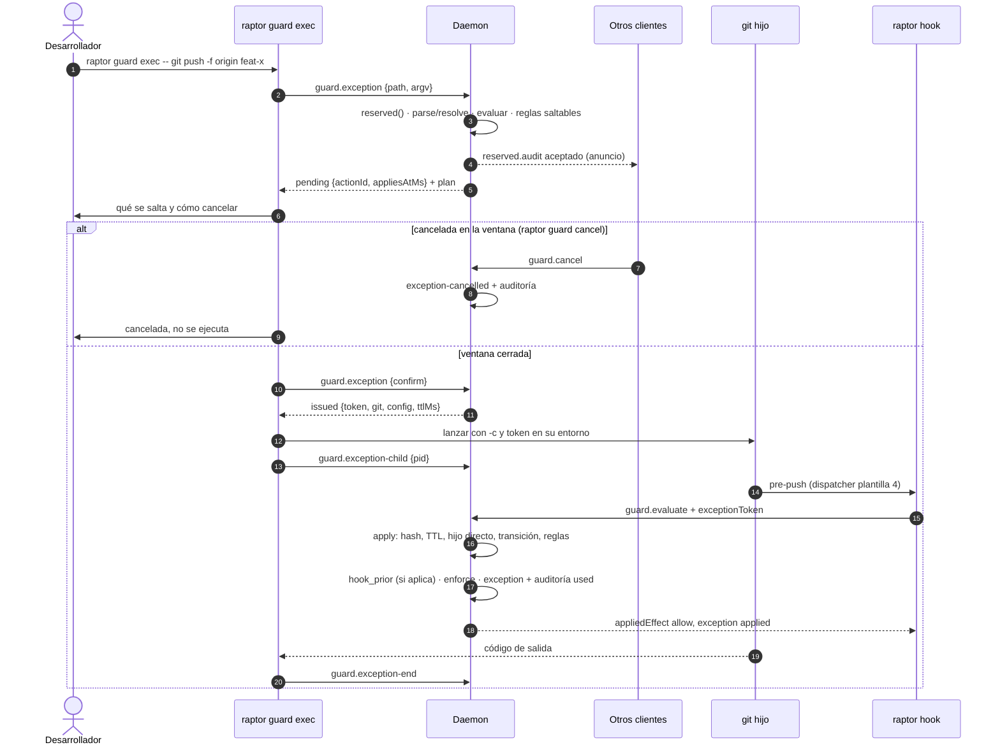

# Dev Spec — US-GRD-006: excepción consciente con constancia

Plano compacto (AADD ligero) de [US-GRD-006](../user-stories/US-GRD-006-excepcion-consciente.md). Las reglas siguen aplicándose igual a cualquier actor (escenario 1, ya cierto desde US-GRD-001). La persona gana una vía para saltarse **en una sola operación** las reglas que hoy la frenan: `raptor guard exec -- git <args…>`. El comando es reservado (ADR-GRP-005 § 6), se anuncia en todos los clientes, espera una ventana cancelable y solo después emite un token de un solo uso, ligado a la transición exacta y al `git` hijo directo del `raptor` que lo pidió ([ADR-GRD-007](../../../../architecture/decisions/ADR-GRD-007-acciones-reservadas-excepcion.md) § 1 a § 3, D5, D10). La pieza reutiliza la ventana de US-GRD-003 (`crates/core/src/guardrails/pending.rs`) y el punto de enganche que dejó US-GRD-017 (`snapshot_required::deny`, que ya lee `Decision.exception`). Cierra también el escenario de la excepción de US-GRD-017 (G2 de DS-US-GRD-017; traspaso N4).

**Invariante**: sin token válido, nada cambia respecto a hoy. Con token válido, la decisión pasa a `appliedEffect = allow` solo si **todas** sus razones de denegación son reglas saltables y estaban en el anuncio. La excepción nunca existe en modo degradado, nunca desde el MCP y nunca para un agente. El token nunca aparece en logs, registros, auditoría ni salidas.

**Restricciones de arquitectura**: no hay `architecture-constitution.md` en la cascada. Rigen `AGENTS.md` (Rust, NFR-01, NFR-02, tests obligatorios) y los ADRs citados, como en las Dev Specs hermanas.

## 1. Decisiones

Lo que ya fija un ADR se cita. Lo que nadie había decidido es **Decisión del orquestador (2026-10-21), validada por Arquitecto** (marcado **(O)**). Las marcadas **(PO)** cambian lo que se promete al usuario y llevan su Q-GRD (§ 9); el PO las revisó el 2026-10-21 y quedan como **Decisión del orquestador (2026-10-21), validada por Arquitecto y PO**.

| # | Decisión |
|---|---|
| D1 | **Forma del comando** (ADR-GRD-007 decisión 3 y § 1): `raptor guard exec [--yes] -- git <args…>`, acción nueva del subcomando `guard`. Tras `--` el primer argumento tiene que ser literalmente `git`; lo demás se rechaza con `unsupported-form`. La única opción global admitida es `-C <dir>`. `-c`, `--git-dir`, `--work-tree`, `--namespace`, `--exec-path`, `--config-env` y los alias de usuario se rechazan: cambiarían el repo o la configuración después de normalizar. `--yes` contesta la pregunta, nunca la ventana (patrón de `guard uninstall`, `apps/cli/src/guard.rs:910`). Un argumento que no es UTF-8 se rechaza en la CLI. El código de salida de `exec` es el de `git` (O) |
| D2 | **(O) Operaciones admitidas en el MVP**: lista cerrada, la que piden la historia y US-GRD-017. (a) `push <remote> <refspec>…` con refspecs explícitos sin comodines, también `-f`, `--force`, `--force-with-lease[=…]`, `--force-if-includes`, `--delete`/`-d` y `:<dst>`. (b) `push [<remote>]` sin refspec con `push.default` en `simple`, `current` o `upstream`, que se resuelve a la rama actual y su destino. (c) `branch -d/-D/--delete [--force] <nombre>…`. (d) `rebase [--onto <base>] [<upstream> [<rama>]]` no interactivo. Se rechazan con `unsupported-form`: `push.default = matching` o `nothing`, `--all`, `--mirror`, `--tags`, refspecs con comodín, un remoto dado como URL, `rebase -i`, `--exec`/`-x`, `--root`, `--interactive` y `pull`. Este último lanza `git` nietos que no heredan la ligadura. El resto de subcomandos (`commit`, `merge`, `reset`, `update-ref`, `worktree`, `switch`…) se rechaza con `unsupported-operation`. **Decisión del orquestador (2026-10-21), validada por Arquitecto y PO** (Q-GRD-47): `commit`, `merge`, `worktree add` y `pull` quedan fuera de la excepción en el MVP. La integración en una rama protegida la cubre el Cockpit (US-CKP-019). El rechazo de `pull` le dice a la persona cómo seguir: traer los cambios con `git fetch` y pedir la excepción para el rebase |
| D3 | **(O) La normalización la hace el daemon** (enmienda de ADR-GRD-007 § 3 paso 1, § 9). La CLI envía el argv tal cual. El daemon primero autoriza (paso 2). Después normaliza con una función pura nueva, `policy::guard::exception::{parse, resolve}`, que reutiliza la tabla de opciones globales de `guard::git_command`, y con los hechos que lee del repo: rama actual, upstream, `push.default`, oids, copias de seguimiento y drivers de `textconv`. Motivos: la ligadura y la comprobación viven en el mismo proceso que decide los hooks, así que no pueden divergir. Un llamante rechazado no hace que el daemon lea el repo (como `repo.add`). Y la auditoría solo guarda la operación normalizada (ADR-GRP-013 § 1). El argv nunca se guarda, se registra ni se audita. El resultado se rechaza **antes** de anunciar nada si no da transiciones concretas (ADR-GRD-007 Validación 8) |
| D4 | **Autorización** (ADR-GRD-007 § 3 paso 2; ADR-GRP-005 § 6): el método es reservado (`method(GUARD_EXCEPTION, true, false)`). Cada una de las tres llamadas reservadas de D6 (1 a 3) pasa `Connection::reserved` (`crates/core/src/channel/conn.rs:2526`), que audita con la cadena completa y rechaza desde el MCP (`not-available-to-mcp`) o desde un proceso que desciende de un agente (`check_reserved`, `crates/core/src/channel/authz.rs:279`). Las tres comprueban además que el solicitante es el mismo proceso, por pid y hora de inicio (`pending::Requester`) |
| D5 | **Qué reglas salta** (O). Son saltables `minimum.force-push`, `minimum.base-branch-delete`, `permission.*`, `policy.protected-branch`, `policy.forbidden-path` **(PO, Q-GRD-50: también con `appliesTo: everyone`; Decisión del orquestador (2026-10-21), validada por Arquitecto y PO)**, `policy.diff-size` y `policy.commit-format` (DS-US-GRD-009) **(también con `appliesTo: everyone`, solo en las operaciones admitidas por Q-GRD-47: en la práctica, el rebase de la persona que reescribe commits fuera de límite o de formato; un commit directo sigue sin excepción en el MVP. Decisión del orquestador (2026-10-21), validada por PO)** y `system.snapshot-failed` (BR-EDGE-005, DS-US-GRD-017 D5). No son saltables los demás `system.*` (`degraded`, `channel-not-authentic`, `repo-mismatch`, `input-rejected`, `internal-error`): son señales de integridad, no reglas de la política. Tampoco `authorship.*` ni `policy.config-protected`, que solo aplican a agentes. El anuncio lista las reglas que la operación incumple **ahora**. En una operación que pide un previo (`timemachine::hook_prior::wants_prior`), el anuncio añade siempre `system.snapshot-failed` y lo dice: «si no se puede guardar el punto de recuperación, se ejecutará igualmente». Cuando se presenta el token, una razón de denegación que no estaba en el anuncio impide la excepción: así nunca se salta una regla que el humano no vio. Si la operación no incumple ninguna regla y no pide previo, `exec` responde `not-denied` y no ejecuta nada. Si incumple una regla no saltable, responde `not-exceptable` |
| D6 | **Cuatro llamadas (tres reservadas), con la ventana impuesta por el daemon** (patrón D6 de DS-US-GRD-003; ADR-GRD-007 § 1 y § 3 pasos 3 a 5). (1) `guard.exception {path, argv}`: autoriza, normaliza, evalúa (D5), audita y anuncia. Guarda la acción en `PendingActions` con `PendingKind::Exception` y el plan (operación normalizada, transiciones y reglas). Responde `pending` y el plan. (2) `guard.exception {path, confirm: action_id}`: solo con la ventana cerrada, sin cancelar ni caducar (ventana + `pending::GRACE`) y desde el mismo proceso. Emite el token y responde `issued {token, git, config, ttlMs}`. (3) `guard.exception-child {path, actionId, pid}`: la CLI la hace justo después de lanzar `git`. El daemon lee la hora de inicio del pid y comprueba que su padre directo es el solicitante (pid y hora de inicio), con el handle en Windows y el audit token en macOS. Solo entonces liga el token a ese `git`. (4) `guard.exception-end {path, actionId}`: sin reserva, solo el mismo proceso. La CLI la llama al terminar `git` y responde `{consumed}`, para que `exec` diga si la excepción llegó a usarse. Un solo pendiente por repo: una desinstalación pendiente y una excepción pendiente se excluyen (`already-pending`) |
| D7 | **Anuncio en todos los clientes** (D5; ADR-GRD-007 § 1, «Anuncio y ventana»). Igual que en US-GRD-003, el anuncio es la entrada `reserved.audit` **aceptada** de la llamada (1), que llega al stream de todos los clientes con el solicitante (`crates/core/src/channel/conn.rs:2564`). Además se ve en `GuardStatus.pending`. Con la capacidad `guard.exception`, `PendingAction` lleva el detalle (`exception: {operation, rules}`). Sin ella, el pendiente de una excepción no se muestra en `pending`: un cliente viejo no sabe leer `PendingKind::Exception`, y le sigue llegando el `reserved.audit`. No se crea el evento `reserved-action-pending` que nombra ADR-GRD-007: US-GRD-003 ya resolvió el anuncio así, y un segundo camino sería una divergencia. Se propone la enmienda del nombre (§ 9) |
| D8 | **Ventana cancelable** (D5, D10; ADR-GRD-007 § 1). Dura 10 s (`pending::WINDOW`, ⚠️ **ASSUMPTION** de ADR-GRD-007; en pruebas, `GITRAPTOR_TEST_GUARD_WINDOW_MS`). Puede cancelarla **cualquier** cliente del usuario con `raptor guard cancel` (`guard.cancel`, no reservado, fuera del MCP), también un agente por la CLI: cancelar solo mantiene la protección. Cancelada, no se emite token y `git` no se lanza. El registro anota `exception-cancelled` y la auditoría anota `cancelled` con la aceptación del riesgo (`RISK_ACCEPTED`, `crates/core/src/daemon/guard.rs:22`). Mientras dura, `exec` consulta `guard.status` cada 200 ms (`WINDOW_POLL`), como `uninstall`. **(PO) Ctrl-C cancela**: un Ctrl-C en `exec` durante la ventana es la forma natural de arrepentirse, así que cuenta como cancelación (escenario 3) y deja `exception-cancelled` y `cancelled`, igual que `raptor guard cancel`. Solo si `exec` muere sin poder avisar, la acción caduca sola y la auditoría anota `expired`, sin entrada en el registro (residuo declarado, § 8). **(PO) Quién cancela**: la entrada `exception-cancelled` lleva el actor que canceló, para que la persona vea si fue un agente quien le frenó la excepción. Que un agente pueda cancelar es aceptable porque solo mantiene la protección. Decisión del orquestador (2026-10-21), validada por PO |
| D9 | **Emisión del token** (ADR-GRD-007 § 3 paso 4; SEC-GRD-04). 16 bytes de `getrandom::fill` (CSPRNG del SO, ya usado en `crates/core/src/guardrails/evaluate.rs:171`), en hex. **No** se usa `pending::new_action_id`, porque no es un CSPRNG. El daemon guarda solo `Sha256(token)`, ligado a: el repo y el worktree (cwd del solicitante, leído por el daemon con `process_cwd`); las transiciones `(ref, viejo, nuevo)`, tomando como viejo esperado la copia de seguimiento conocida, o `(ref, base)` en un rebase; las reglas del anuncio; el solicitante; y el TTL, 60 s desde la emisión (⚠️ **ASSUMPTION** de ADR-GRD-007). La respuesta incluye la ruta validada de `git` del daemon (`SystemGit.path`, ADR-GRP-009 § 4) y la lista exacta de `-c` (D10). La CLI no busca `git` en `PATH` |
| D10 | **Ejecución del hijo** (ADR-GRD-007 § 3 paso 5; H-02). La CLI lanza `<git> <-c del daemon> <args del usuario>` sin shell, con stdio heredado (un push puede pedir credenciales) y el cwd de la llamada (1). El daemon devuelve estos `-c`: `core.fsmonitor=false`, `core.pager=cat`, `core.editor=false`, `sequence.editor=false`, `diff.external=` y uno `diff.<driver>.textconv=` por cada driver de la configuración efectiva. Del entorno del hijo se quitan `GIT_*` salvo una lista cerrada (`GIT_SSH`, `GIT_SSH_COMMAND`, `GIT_ASKPASS`, `GIT_TERMINAL_PROMPT`, `GIT_AUTHOR_*`, `GIT_COMMITTER_*`), y también `EDITOR`, `VISUAL` y `PAGER`. Así un `GIT_DIR` heredado no cambia de repo y `GIT_EDITOR`, `GIT_PAGER`, `GIT_EXTERNAL_DIFF` o `GIT_CONFIG_*` no ganan a los `-c`. Se añade `GITRAPTOR_EXCEPTION_TOKEN=<token>` **solo** al entorno del hijo. Quedan sin neutralizar, como dice ADR-GRD-007 § 2: `credential.helper`, `core.sshCommand`, los filtros, `gpg.program` y los hooks previos encadenados |
| D11 | **Presentación y consumo** (ADR-GRD-007 § 3 pasos 6 a 8; L-04). (a) Plantilla 4 del dispatcher (D12): `raptor-hook` pasa la variable a `raptor hook`. (b) El cliente del hook (`hook.rs`, `ask_daemon`) la envía en `EvaluateParams.exception_token` (en el cable `exception_token`: `EvaluateParams` es snake_case; **Decisión del orquestador (2026-10-27), validada por Arquitecto**) solo si el daemon concede `guard.exception`. (c) En el brazo `GUARD_EVALUATE` (`conn.rs:888`), **después de `guard_served` y antes de `hook_prior`**, una llamada `guardrails::exception::apply` acepta el token solo si se cumplen todas estas condiciones: el hash coincide (comparación en tiempo constante); el TTL no venció antes de la primera presentación; el `git` más cercano del cliente (`second_line::nearest_git`) es el hijo registrado y su padre directo es el solicitante, con la identidad verificada en cada salto; la transición evaluada está entre las ligadas, o es la misma ref y la misma base en el rebase; y toda razón de denegación es saltable y estaba en el anuncio (D5). Si el hijo aún no está registrado, el daemon lo espera como mucho 2 s (`CHILD_WAIT`, ⚠️ **ASSUMPTION** (O)) con un `Condvar` en el hilo de la conexión, nunca en el loop. (d) La primera presentación válida consume el token de forma atómica y escribe la auditoría `used` con la cadena completa. Si la auditoría falla, no hay excepción (se deniega). (e) Resultado: `exception = applied` y `appliedEffect = allow`. `effect` y `reasons` no cambian, así que el registro conserva las reglas saltadas. Las evaluaciones posteriores **de las transiciones ligadas desde ese mismo `git`** reutilizan el resultado sin nueva entrada (un rebase pregunta en `pre-rebase` y en `reference-transaction`). (f) Un token presente pero no válido deja la decisión como estaba, con `exception = rejected`, y deja una entrada `exception-rejected` |
| D12 | **Plantilla 4 del dispatcher** (ADR-GRD-001 § 2 y § 8). `TEMPLATE_VERSION` pasa de 3 a 4 (`crates/core/src/guardrails/constants.rs:13`). `allowlisted_env` (`raptor-hook.rs:279`) añade `GITRAPTOR_EXCEPTION_TOKEN` para `raptor hook`, y `chain` (`raptor-hook.rs:325`) lo quita del entorno del hook previo (`env_remove`; ADR-GRD-007 § 3 paso 9). Una instalación de plantilla ≤ 3 sigue igual y no reenvía el token, así que la operación se deniega como antes (fail-closed). Para no dejar al humano sin saber por qué, `exec` comprueba el estado antes de anunciar: con una instalación de plantilla anterior responde `outdated-install` («reinstala la protección: `raptor guard install`», que actualiza en sitio, `install.rs:590`). **Coordinación**: otra historia que suba la plantilla a la vez rebasa sobre esta y toma el 5 |
| D13 | **Interacción con el snapshot previo** (US-GRD-017; BR-EDGE-005). Como `apply` corre antes de `hook_prior`, una operación con la excepción aplicada tiene `appliedEffect = allow` y **sí** pide su previo (rebase y borrado de una rama local). Si el previo falla, `snapshot_required::enforce` mantiene `allow` porque lee `exception = applied` (`snapshot_required.rs:114-126`, D5 de DS-US-GRD-017). No se toca ese archivo. La entrada `exception` lleva `system.snapshot-failed` con su causa, y `raptor guard log` dice en lenguaje de negocio «se ejecutó sin punto de recuperación: {causa}» (traspaso N4). El force-push y el borrado remoto no piden previo, porque la Time Machine no guarda el remoto (N9 de DS-US-GRD-017). Los cupos son los de la persona (Q-GRD-37) |
| D14 | **Interacción con `ask` de US-GRD-007** (D19, Q-GRD-46). Sin cola, `ask` ya deja pasar a la persona con un aviso, así que no necesita excepción. Bajo `exec`, el actor queda demostrado (cadena verificada hasta un `raptor` que pasó `check_reserved`), y una razón `permission.*` de un `ask` se trata como saltable (D5): no hay caso «no demostrado» con token. Un agente nunca llega a tener token (D4). Mientras exista el modo degradado y el daemon sin la capacidad, siguen siendo «no demostrado» y deniegan a todos, sin excepción |
| D15 | **Interacción con `confirmation-required` de US-MCP-013**. Ninguna en el código. `confirmation-required` es la respuesta de `raptor-mcp` al agente cuando Guardrails pide confirmación en una operación del ejecutor. El agente no tiene vía de excepción, y ni ese texto ni `policy-denied` la mencionan (SEC-GRD-06, D10 de DS-TS-CKP-003). Esta historia no añade herramienta MCP. El método se declara fuera del MCP y el canal lo rechaza desde su conexión (D4). Un test fija que el catálogo MCP no lo ofrece |
| D16 | **Registro** (ADR-GRD-006 § 1 y § 6; BR-CONS-004). `LogKind` gana `Exception`, `ExceptionRejected` y `ExceptionCancelled`, ya admitidos por el esquema (`crates/core/src/profile/schema.rs:236-237`). **`exception`** se escribe en la primera presentación válida, desde `log_decision`. Su condición de salida temprana (`conn.rs:1229`) deja de cubrir `exception = applied`. Lleva la operación, las reglas saltadas con su nivel y el momento, con capa `hooks`. **`exception-cancelled`** se escribe en el `Cancel` del loop. **`exception-rejected`** se escribe en el rechazo de D4 (agente o MCP) y en un token no válido (D11 f). Cada entrada `exception*` lleva el `action_id` en su clave de agregación, así que dos usos nunca se suman, y no la descarta el tope de entradas en vuelo, porque su número está acotado por el «un pendiente por repo». No cuentan en el KPI (`summary.blocked`, `crates/core/src/profile/guard_log.rs:169`). `GuardLogSummary` gana `exceptions` y `exceptionsRejected` para informarlas aparte (ADR-GRD-006 § 6) |
| D17 | **El rechazo de un agente queda en el registro sin sondear el disco** (O). Cuando la llamada (1) se rechaza en D4, el daemon no lee el repo. Normaliza solo de forma léxica (`exception::parse`: subcomando, remoto y refs tal como vienen, saneados y acotados). Resuelve el repo comparando `path` con los repos que ya observa, sin canonicalizar. Si casa, escribe `exception-rejected` con el actor del llamante (`actor::resolve_logged`) y la capa (`mcp` desde el MCP, `hooks` desde la CLI). Si no casa, queda solo la auditoría. ⚠️ **ASSUMPTION**: la comparación léxica con un `path` absoluto basta para los escenarios. Lo comprueba el escenario 5 |
| D18 | **Higiene** (ADR-GRD-007 § 3 paso 9; Validación 10). El token solo vive en: el entorno del hijo, la respuesta de la llamada (2) por el canal local autenticado y la memoria de la CLI. Nunca entra en `Field` de log, en `AuditRow`, en `LogEntry`, en un `Debug` ni en un mensaje: un tipo `ExceptionToken` con `Debug` redactado y sin `Serialize` fuera de `IssuedException`. Los mensajes de denegación al agente no cambian (SEC-GRD-06; `messages_never_mention_the_exception` sigue verde). El argv nunca se guarda (D3) |
| D19 | **Capacidad `guard.exception`** (ADR-GRP-016). Cubre `EvaluateParams.exceptionToken`, `PendingKind::Exception` y `PendingAction.exception` en `guard.status`, los tres `LogKind` y los contadores nuevos de `guard.log`. Los métodos nuevos se descubren en `hello.methods`, sin `.since`. **Daemon nuevo, cliente viejo**: no ve el pendiente de una excepción, y `guard.log` quita las entradas `exception*` y deja los contadores nuevos en cero. **Hook nuevo, daemon viejo**: no envía el token, y la operación se deniega como antes. **`exec` con un daemon sin `guard.exception`**: «esta versión del motor no admite la excepción», sin ejecutar nada. No sube `PROTOCOL_VERSION` (congelado en 9) |
| D20 | **Error tipado** `GUARD_EXCEPTION_REFUSED` (`BLOCK - 2` del bloque `guard`, `crates/api/src/methods/guard.rs:42`) con `GuardExceptionRefusedData {reason, remainingMs}`. `ExceptionRefusal` = `not-installed`, `outdated-install`, `already-pending`, `window-open`, `no-pending`, `not-the-requester`, `unsupported-form`, `unsupported-operation`, `not-denied`, `not-exceptable`, `child-not-ours`. Un método nuevo con su código propio no es un cambio de forma de nada existente |
| D21 | **Qué es del Cockpit** (fuera). La excepción desde la TUI (aprobar en el Cockpit, sin token, ligada al plan) es de **US-CKP-019** (ADR-GRD-007, Enmienda Cockpit; DS-TS-CKP-003 § Pendientes). Pintar en la TUI el anuncio de una acción reservada pendiente y cancelarla desde ella también es del Cockpit, sin historia asignada todavía (como en DS-US-GRD-003). Esta historia solo publica el `reserved.audit` y `GuardStatus.pending`. Aquí todo es CLI y daemon |
| D22 | **Dos PR** (O). **PR-A**: contrato, normalización pura y almacén de tokens puro, con sus pruebas unitarias. No se produce ningún comportamiento observable, porque nadie emite tokens. **PR-B**: daemon, plantilla 4, cliente del hook, `raptor guard exec`, mensajes y las suites e2e (escenarios 1 a 5, el escenario de la excepción de US-GRD-017 y la suite de token de INF-GRD-001, que **bloquea el merge**). La historia pasa a `implemented` solo con PR-B |

## 2. Forma (archivos que se tocan)

Cada pieza nueva va en un archivo propio (ADR-GRP-016, [extender sin archivos compartidos](../../../../architecture/extender-sin-archivos-compartidos.md)). Los archivos centrales ganan una línea o un brazo.

| Pieza | Archivo | PR |
|---|---|---|
| Contrato: métodos, capacidad, error, `ExceptionRefusal`, `PendingKind::Exception`, `PendingAction.exception`, `EvaluateParams.exception_token`, `LogKind`, contadores | `crates/api/src/guard.rs`; `crates/api/src/methods/guard.rs` | A (salvo `PendingKind::Exception`, los tres `LogKind` y el alta de `GUARD_EXCEPTION_REFUSED` en `GROUP.errors` con su texto i18n, que van en B: sus `match` exhaustivos y el test de textos viven en `crates/core/src/daemon/guard.rs` y `apps/cli`. Los tres métodos entran en A declarados por adelantado, `implemented_by: Some("US-GRD-006")`, y B lo quita. **Decisión del orquestador (2026-10-27), validada por Arquitecto**) |
| Normalización pura (léxica y con hechos), saltables, reglas del anuncio | `crates/policy/src/guard/exception.rs` (nuevo); `guard/mod.rs` (+1 línea `pub mod`) | A |
| Almacén de tokens: hash, ligadura, TTL, consumo atómico, espera acotada del hijo, barrido | `crates/core/src/guardrails/exception.rs` (nuevo); `guardrails/mod.rs` (+1); `guardrails/registry.rs` (campo `exceptions` y su acceso) | A |
| Pendiente con plan | `crates/core/src/guardrails/pending.rs` (`Entry.exception`) | A |
| Llamadas (1) y (2) en el loop: normalizar, evaluar, anunciar, emitir; cancelar escribe `exception-cancelled` | `crates/core/src/daemon/guard_exception.rs` (nuevo, `impl Daemon`); `daemon/mod.rs` (+1 `mod`); `daemon/shutdown.rs` (variantes de `GuardRequest`/`GuardReply`); `daemon/guard.rs` (brazo `Cancel`) | B |
| Canal: brazos de los tres métodos, `apply` en `GUARD_EVALUATE`, forma por capacidad en `guard.status` y `guard.log`, salida temprana de `log_decision`, rechazo de D17 | `crates/core/src/channel/conn.rs` | B |
| Entradas `exception*` | `crates/core/src/guardrails/log.rs`; `crates/core/src/profile/guard_log.rs` (contadores) | B |
| Cliente del hook: leer y enviar el token | `crates/core/src/guardrails/hook.rs` (`HookEnv.exception_token`, `ask_daemon`) | B |
| Plantilla 4 | `crates/core/src/guardrails/constants.rs`; `apps/cli/src/bin/raptor-hook.rs` (`allowlisted_env`, `chain`) | B |
| `raptor guard exec` | `apps/cli/src/guard/exec.rs` (nuevo); `apps/cli/src/guard.rs` (+1 `mod`, `HookEnv` desde el entorno, texto del pendiente y del registro); `apps/cli/src/commands/guard.rs` (variante `Exec` y su brazo) | B |
| Mensajes | `apps/cli/i18n/{en,es}/guardexec.txt` (nuevos, grupo `guardexec.`); `apps/cli/i18n/{en,es}/guard.txt` (registro y estado); `apps/cli/i18n/{en,es}/contract.txt` (`error.guard-exception-refused`) | B |
| Tests | § 6 | A y B |
| Documentación | Este archivo; la historia; US-GRD-017 (escenario de la excepción); enmiendas de § 9 (las aplica el orquestador) | B |

## 3. Flujo

Antes de anunciar, `exec` comprueba en este orden: el daemon ofrece `guard.exception` (D19); `guard.status` dice que el repo está protegido (`not-installed`) y con plantilla 4 (`outdated-install`, D12).

## 4. Configuración

No hay claves nuevas: la excepción no se puede activar, desactivar ni ampliar por configuración, ni en ningún nivel. Constantes en código: ventana (`pending::WINDOW`, 10 s), margen para aplicar (`pending::GRACE`, 60 s), TTL del token (60 s), espera del registro del hijo (2 s) y la lista de `-c` de D10.

## 5. Contrato (`crates/api`)

- Métodos (`methods/guard.rs`, en `GROUP.methods`, sin `.since`): `GUARD_EXCEPTION = "guard.exception"` (reservado), `GUARD_EXCEPTION_CHILD = "guard.exception-child"` (reservado), `GUARD_EXCEPTION_END = "guard.exception-end"` (no reservado, solo el mismo proceso). Ninguno se ofrece a `raptor-mcp`.
- `CAP_GUARD_EXCEPTION = "guard.exception"`; error `GUARD_EXCEPTION_REFUSED` (`guard-exception-refused`).
- `GuardExceptionParams { path, argv: Vec<String>, confirm: Option<String> }` (`argv` acotado: 64 elementos de como mucho 4 KiB). `GuardExceptionResult { pending: Option<PendingAction>, plan: ExceptionPlanView, issued: Option<IssuedException> }`. `ExceptionPlanView { operation: LoggedOperation, rules: Vec<Rule> }`. `IssuedException { token, git: Untrusted, config: Vec<String>, ttl_ms }`.
- `GuardExceptionChildParams { path, action_id, pid: u32 }`; `GuardExceptionEndParams { path, action_id }` → `GuardExceptionEndResult { consumed: bool }`.
- `PendingKind::Exception` (PR-B); `PendingAction.exception: Option<ExceptionPlanView>` (`skip_serializing_if`, PR-A).
- `EvaluateParams.exception_token: Option<ExceptionToken>` (en el cable `exception_token`, porque `EvaluateParams` es snake_case; `skip_serializing_if` y `serialize_with`, ya que `ExceptionToken` no implementa `Serialize`; su `Deserialize` valida). **Decisión del orquestador (2026-10-27), validada por Arquitecto**
- `LogKind::{Exception, ExceptionRejected, ExceptionCancelled}` (PR-B); `GuardLogSummary.{exceptions, exceptions_rejected}` (`default`, se omiten en cero).
- `ExceptionState` no cambia (`None`, `Applied`, `Rejected` ya existen, `crates/api/src/guard.rs:217-224`). Se corrige su comentario («Always `none` until US-GRD-006»).

Mensajes (`guardexec.txt`, plantillas fijas; parámetros etiquetados y saneados con SEC-GRD-06):

| Clave | es |
|---|---|
| `guardexec.header` | Excepción consciente en {repo}: {operation}. |
| `guardexec.skips` | Se saltará: {rules}. |
| `guardexec.no-prior` | Si no se puede guardar el punto de recuperación, la operación se ejecutará igualmente. |
| `guardexec.confirm` | ¿Ejecutar esta operación una sola vez saltándote esas reglas? [s/N] |
| `guardexec.window` | Anunciada a todos los clientes. Se ejecuta en {seconds} s; para cancelarla: raptor guard cancel (en cualquier terminal). |
| `guardexec.cancelled` | Cancelada: la operación no se ejecutó. |
| `guardexec.not-used` | La excepción no llegó a usarse: la operación no coincidió con la anunciada y se evaluó como siempre. |
| `guardexec.refused.<motivo>` | Un texto por cada `ExceptionRefusal` (p. ej. `unsupported-operation`: «la excepción consciente solo admite push, borrar una rama local y rebase no interactivo»; para `pull`, «trae los cambios con git fetch y pide la excepción para el rebase») |
| `guardexec.unavailable` | Esta versión del motor no admite la excepción consciente. |
| `guardexec.no-engine` | Sin GitRaptor en marcha no hay excepción consciente: arranca GitRaptor y repite la operación. |

En `guard.txt`: `guard.log.kind.exception` («excepción consciente: {operation}, se saltó {rules}»), `guard.log.kind.exception-cancelled`, `guard.log.kind.exception-rejected`, `guard.log.exception-no-prior` («se ejecutó sin punto de recuperación: {cause}»), la línea aparte del resumen («{n} excepciones usadas · {m} intentos rechazados, fuera del recuento») y `guard.status.pending-exception` («excepción pendiente: {operation}, quedan {seconds} s — cancelar: raptor guard cancel»). El inglés va con las mismas claves.

## 6. Criterios de aceptación verificables

Repos, remotos, perfiles y daemons temporales (NFR-01), con `gitraptor_testkit::{Fixture, check}` para demostrar que fuera de lo esperado no cambia nada. Git, `raptor` y `raptor-hook` reales. El agente es `raptor-fake-agent` (patrón de `apps/cli/tests/guard_us_grd_008.rs`). La ventana se acorta con `GITRAPTOR_TEST_GUARD_WINDOW_MS`. Suites nuevas `apps/cli/tests/guard_us_grd_006.rs` (escenarios) y `apps/cli/tests/guard_exception_token.rs` (suite de token de INF-GRD-001; bloquea el merge). Ninguna espera fija: se sincroniza con `guard.status` y con el stream.

| Escenario / criterio | Test | PR |
|---|---|---|
| 1 · El force-push de `feat-x` se deniega con el mismo motivo (`minimum.force-push`) para Claude Code detectado, codex registrado (US-GRP-009) y un proceso sin atribuir | `same_decision_for_every_actor` | B |
| 2 · `exec` de un force-push denegado: el anuncio llega a otro cliente suscrito (`reserved.audit` aceptado de `guard.exception`) y `guard.status` lo muestra; al cerrarse la ventana se ejecuta, el remoto tiene el commit nuevo y el registro tiene una sola `exception` con la operación, `minimum.force-push` y el momento | `exception_is_announced_waits_and_runs_once` | B |
| 3 · Cancelada con `raptor guard cancel` desde otra terminal: `git` no se lanza, el remoto no cambia y quedan `exception-cancelled` (con el actor que canceló) en el registro y `cancelled` en la auditoría | `a_cancelled_exception_does_not_run` | B |
| 3 · Ctrl-C en `exec` durante la ventana: `git` no se lanza, el remoto no cambia y quedan `exception-cancelled` y `cancelled` (D8) | `ctrl_c_in_the_window_cancels` | B |
| 6 · `exec` de un commit con `permission.commit = deny`, y de un `pull`: se rechaza antes de anunciar, nada se ejecuta, no hay anuncio en otro cliente y el motivo dice qué admite la excepción (Q-GRD-47) | `an_unsupported_operation_is_refused_before_the_announcement` | B |
| Q-GRD-50 · Push a una rama protegida con `appliesTo: everyone`: denegado a la persona sin `exec`; con `exec`, se ejecuta y la entrada `exception` nombra `policy.protected-branch` | `the_exception_skips_an_everyone_policy` | B |
| D5 · Con `diffSize` y `commitFormat` en `appliesTo: everyone`, un rebase no interactivo de la persona que reescribe un commit fuera de límite y otro sin formato: denegado sin `exec`; con `exec`, se ejecuta y la entrada `exception` nombra `policy.diff-size` y `policy.commit-format`. Un `exec` de `git commit` con el mismo contenido se rechaza antes de anunciarse (Q-GRD-47) | `the_exception_skips_everyone_commit_policies_in_a_rebase` | B (tras DS-US-GRD-009) |
| 4 · Tras usarla, un segundo force-push de otro proceso se deniega como antes, sin entrada `exception` nueva | `the_exception_covers_one_operation` | B |
| 5 · `exec` lanzado por `raptor-fake-agent`, y bajo una pty (`script`) del agente: `RESERVED_REFUSED`, `git` no se lanza y quedan `exception-rejected` en el registro y la auditoría | `an_agent_cannot_use_the_exception` | B |
| 5 · `guard.exception` desde una conexión MCP: `not-available-to-mcp`, auditado, `exception-rejected` con capa `mcp`; el catálogo de `raptor-mcp` no lo ofrece | `the_mcp_never_reaches_the_exception` | B |
| US-GRD-017, escenario de la excepción: un rebase y un borrado de una rama local con el previo forzado a fallar (`HOOK_PRIOR_DEADLINE` de pruebas) se ejecutan con `exec`; la entrada `exception` lleva `system.snapshot-failed` con su causa y `guard log` dice «se ejecutó sin punto de recuperación» | `exception_runs_without_a_recovery_point` | B |
| D5 · Una regla nueva que deniega entre el anuncio y la presentación (se commitea otra configuración) impide la excepción: `exception-rejected` | `a_rule_not_announced_is_not_skipped` | B |
| D5 · Sin regla que deniegue y sin previo: `not-denied`, nada se ejecuta | `an_allowed_operation_needs_no_exception` | B |
| D12 · Instalación de plantilla 3: `outdated-install` antes de anunciar; tras `raptor guard install`, `exec` funciona | `an_old_template_refuses_before_the_announcement` | B |
| Degradado: sin daemon, `exec` dice «arranca GitRaptor» y un `git push -f` normal sigue denegado | `no_exception_without_the_engine` | B |
| Validación 7 · El token copiado a un `git` que no es hijo directo del solicitante (un nieto, y otro `git` con la variable puesta a mano) se rechaza | `guard_exception_token::a_copied_token_is_rejected` | B |
| Validación 7 · TTL vencido antes de la primera presentación (TTL de pruebas) | `guard_exception_token::an_expired_token_is_rejected` | B |
| Validación 7 · Otra transición del mismo `git` (otra ref u otro valor nuevo) no queda cubierta | `guard_exception_token::another_transition_is_not_covered` | B |
| Validación 8 · Normalización: refspecs explícitos, `push.default` `simple`/`current`/`upstream`, `-C <dir>`; rechazo antes del anuncio de `matching`, `--all`, `--mirror`, comodines, URL, `-c`, `pull`, `rebase -i` | `guard_exception_token::argv_is_normalized_or_refused_before_the_token` | B |
| Validación 9 · Con `core.pager`, `core.fsmonitor`, `sequence.editor` y un `textconv` apuntando a un canario, y con `GIT_PAGER`/`GIT_EDITOR` en el entorno, el canario no corre | `guard_exception_token::configured_executables_are_neutralized` | B |
| Validación 10 · El hook previo encadenado no ve `GITRAPTOR_EXCEPTION_TOKEN`; el token no aparece en el log del daemon, el perfil (registro y auditoría) ni la salida | `guard_exception_token::the_token_never_leaks` | B |

Además (unitarias e integración sin e2e):

| Comportamiento | Test | PR |
|---|---|---|
| Tabla de formas admitidas y rechazadas (D1, D2), sin E/S | `crates/policy/tests/us_grd_006_exception.rs` · `parse_*` | A |
| `resolve` a transiciones con hechos dados; `push.default`; base del rebase | `crates/policy/tests/us_grd_006_exception.rs` · `resolve_*` | A |
| Saltables y no saltables (D5) | `crates/policy/tests/us_grd_006_exception.rs` · `exceptable_*` | A |
| Almacén: solo hash, tiempo constante, TTL hasta la primera presentación, consumo atómico con dos presentaciones concurrentes, reutilización solo de transiciones ligadas desde el mismo `git`, espera acotada del hijo, barrido | `crates/core/tests/us_grd_006.rs` · `tokens_*` | A |
| Contrato: kebab-case de ida y vuelta, `ExceptionToken` con `Debug` redactado, `architecture.rs` verde | `cargo test -p gitraptor-api` | A |
| Capacidad en las dos direcciones (D19): sin ella no se envía el token, no se ve el pendiente y `guard.log` quita las entradas `exception*` | `crates/core/tests/us_grd_006.rs` · `exception_capability_both_ways` | B |
| `apply` antes de `hook_prior`; `enforce` mantiene `allow` con `applied`; una sola entrada por token | `crates/core/tests/us_grd_006.rs` · `apply_orders_before_the_prior_and_logs_once` | B |

**Windows**: la ligadura por handle y la hora de creación, el registro del hijo y el criterio de humano o agente (ADR-GRD-007 Validación 12, M-07) quedan **pendientes: etapa de validación multiplataforma**, en máquina real. Linux lo cubre el CI de ubuntu.

## 7. Orden de implementación

Ver § Plan de implementación: PR-A = T001 a T004; PR-B = T005 a T011.

## 8. Pendientes, límites y fuera de alcance

**Residuos declarados**: los vectores «No» de ADR-GRD-007 § 2 (`setsid`, `tmux send-keys`, `osascript`, padre elegido en Windows, código plantado) siguen abiertos. Los limitan el anuncio, la ventana y la auditoría, y los cierra el factor de ADR-GRD-008 en modo preferente (OQ-GRD-008-3). Un agente **registrado pero no detectado** que lanza `exec` desde su propia terminal pasa `check_reserved` (R-GRD-2; `actor.rs` aún no busca registros sin proceso). Un rebase con conflictos se detiene, y su `--continue` es otro `git` sin excepción: se sale con `git rebase --abort`. `rebase -i` no está disponible (H-02). Un `exec` que muere sin poder avisar (se mata el proceso o se cierra la terminal) deja la acción caducar con auditoría `expired` y sin entrada en el registro; un Ctrl-C sí cancela (D8). Un commit en una rama protegida con `appliesTo: everyone` sigue sin excepción en el MVP, porque `commit` no es una operación admitida (Q-GRD-47). Un push cuyo remoto se movió desde la copia de seguimiento no coincide con la transición ligada y se deniega. Un push que pide credenciales tiene que terminar dentro del TTL **hasta su primera presentación** (`pre-push` llega después de autenticar).

| Pendiente | Dueño |
|---|---|
| Excepción desde el Cockpit (sin token, ligada al plan) | US-CKP-019 |
| Anuncio y cancelación de una acción reservada en la TUI | Cockpit, sin historia asignada (lo enruta el orquestador) |
| Factor del SO para la excepción (modo preferente) | ADR-GRD-008, OQ-GRD-008-3 |
| `commit`, `merge`, `worktree-add` y `pull` bajo la excepción (fuera del MVP por Q-GRD-47; se reabre con un caso real) | Backlog posterior al MVP |
| Actor de un agente registrado sin proceso detectado | US-GRP-009 (pendiente de `actor.rs`) |
| Linux y Windows reales | **Pendiente: etapa de validación multiplataforma** |

## 9. Validación de las decisiones

Las decisiones (O) son **Decisión del orquestador (2026-10-21), validada por Arquitecto**. Las demás aplican ADR-GRD-007, ADR-GRD-006, ADR-GRD-001, ADR-GRP-005 § 6, ADR-GRP-013 § 1 y DS-US-GRD-017 D5 sin cambiarlos.

Preguntas nuevas, decididas (las registra el orquestador en `context.md` y `business-rules.md`):

| Q | Pregunta | Decisión | Bloquea |
|---|---|---|---|
| Q-GRD-47 | ¿Debe la excepción consciente cubrir en el MVP `commit`, `merge`, `worktree add` y `pull`, además de push, borrar una rama local y rebase? | **No. Decisión del orquestador (2026-10-21), validada por Arquitecto y PO.** La historia y US-GRD-017 solo piden esas tres. `commit` y `merge` tienen dos momentos de evaluación (`pre-commit` y la segunda línea) y `pull` lanza nietos; ampliarlo sin caso real añade superficie al token. Con `permission.commit = deny`, la persona no tiene excepción para hacer commit (lo dice `unsupported-operation`). La integración en una rama protegida la cubre el Cockpit (US-CKP-019), y `pull` tiene una alternativa: `git fetch` y la excepción para el rebase | No |
| Q-GRD-50 | `policy.protected-branch` y `policy.forbidden-path` con `appliesTo: everyone`: la nota de Q-GRD-35 y el comentario de `PatternPolicy` (`crates/policy/src/settings/model.rs:168`) dicen «sin excepción en el MVP». ¿Las salta la excepción ahora que existe? | **Sí. Decisión del orquestador (2026-10-21), validada por Arquitecto y PO.** BR-AUTH-003 (Q-GRD-1) da al humano la excepción para «una regla» en una operación concreta, y la nota de Q-GRD-35 se escribió mientras la excepción no existía. Sin ella, la única salida de una rama congelada con `everyone` sería desinstalar la protección, que relaja mucho más. US-CKP-019 ya da por hecho que una integración en una rama protegida pasa por la excepción (R-CKP-3). El alcance lo limita Q-GRD-47: un commit en una rama `everyone` sigue sin excepción en el MVP. El PO entrega el texto de la enmienda de la nota (BR-VAL-003) y de Q-GRD-35; el comentario de `PatternPolicy` lo corrige PR-B | No (G1 cerrado) |

**Revisión del PO (2026-10-21)** de las decisiones con impacto de producto:

| Decisión | Resultado |
|---|---|
| D1 forma `raptor guard exec [--yes] -- git …` | Validada. Que `--yes` conteste la pregunta y nunca acorte la ventana es la promesa de BR-AUTH-001 |
| D2 operaciones admitidas | Validada con Q-GRD-47. Añadido: el rechazo de `pull` dice cómo seguir |
| D5 reglas que se saltan | Validada con Q-GRD-50. Añadido: también salta `policy.diff-size` y `policy.commit-format` (DS-US-GRD-009), con `everyone` incluido, solo en las operaciones de Q-GRD-47. Sin esto, la única salida de la persona en un rebase sería relajar la configuración, que es lo que Q-GRD-50 quiso evitar. Saltar `system.snapshot-failed` sin saber aún si fallará es aceptable porque el anuncio y la pregunta lo dicen antes de confirmar (US-GRD-017, BR-EDGE-005) |
| D8 ventana de 10 s cancelable desde cualquier cliente | Validada. Cambiado: Ctrl-C en `exec` cancela y queda registrado; el registro de la cancelación dice quién canceló |
| D14 interacción con `ask` | Validada. Coherente con Q-GRD-46: la persona ya pasa con un aviso, así que el caso no cambia lo prometido |
| D15 `confirmation-required` del MCP | Validada. El agente nunca ve la excepción (SEC-GRD-06) |
| D21 Cockpit | Validada. La excepción desde la TUI es de US-CKP-019. **Hueco de producto (no bloquea esta historia)**: mientras la TUI no pinte el anuncio de una acción reservada pendiente, quien vigila desde el Cockpit no ve un `exec` lanzado por otro proceso, que es justo el caso que el anuncio debe destapar (Q-GRD-19). Lo enruta el orquestador al Cockpit, idealmente en el mismo hito |

**Enmiendas propuestas** (las aplica el orquestador; esta Dev Spec no edita ADRs):

| ADR | Enmienda |
|---|---|
| ADR-GRD-007 § 3 pasos 1 y 2 | Normaliza el daemon, después de autorizar, con el traductor puro de `crates/policy`. La CLI solo envía argv, que nunca se guarda (D3). Formas admitidas del MVP (D2) |
| ADR-GRD-007 § 1 «Anuncio y ventana» | El anuncio es la entrada `reserved.audit` aceptada más `GuardStatus.pending`, como en US-GRD-003. No hay evento `reserved-action-pending` (D7) |
| ADR-GRD-007 § 3 pasos 4 a 7 | Respuesta con la ruta validada de `git` y la lista de `-c`; registro del hijo como tercera llamada; espera acotada de 2 s; las reglas del anuncio forman parte de la ligadura (D5, D9, D11) |
| ADR-GRD-001 § 2 y § 8 | Plantilla 4: el dispatcher pasa `GITRAPTOR_EXCEPTION_TOKEN` a `raptor hook` y lo quita del hook previo (D12) |
| ADR-GRD-006 § 1 | Las entradas `exception*` llevan el `action_id` en la clave de agregación y no las descarta el tope en vuelo; `exception-rejected` sin sondear el disco (D16, D17) |

## Anexo de forma (perfil `backend-service`)

### 6.1 Tipos compartidos

Los del § 5 en `crates/api`. En `crates/policy`: `guard::exception::{Request, Form, Binding, Transition, Unsupported, parse, resolve, exceptable}`. En `crates/core`: `guardrails::exception::{Tokens, ExceptionToken, Bound, Presented, apply, facts}`, y `pending::Entry.exception: Option<ExceptionPlan>`.

### 6.2 Ciclos de vida (DI)

_No aplica — no hay contenedor de dependencias. `Tokens` vive en `GuardRegistry` (`Mutex` + `Condvar`), en memoria del daemon: un reinicio lo descarta, y un token sin daemon no vale nada._

### 6.3 Firmas del stack

`exception::parse(argv: &[String]) -> Result<Request, Unsupported>` (puro, sin E/S). `exception::resolve(req: &Request, facts: &RepoFacts) -> Result<Binding, Unsupported>`. `exception::exceptable(rule: Rule) -> bool`. `guardrails::exception::apply(tokens: &Tokens, params: &EvaluateParams, peer: AcceptedPeer, checks: &Checks<'_>, decision: &mut Decision) -> Presented`. `Tokens::issue(&self, bound: Bound, now_ms: i64) -> ExceptionToken`. `Tokens::bind_child(&self, action_id: &str, requester: Requester, child: (u32, u64)) -> Result<(), ExceptionRefusal>`. `Tokens::end(&self, action_id: &str, requester: Requester) -> bool`.

### 7.1 Forma del error

Rechazos del método: `GUARD_EXCEPTION_REFUSED` con `{reason, remainingMs}`, o `RESERVED_REFUSED` (D4). En el hook, un token no válido no cambia el error: la decisión de siempre con `exception = rejected`. El hook sale con 1 y escribe la plantilla fija por stderr, que no menciona la excepción.

### 7.2 Forma de la configuración

_No aplica — no hay claves (§ 4)._

### 7.3 Valores numéricos

Token de 128 bits. Ventana de 10 s, margen de 60 s, TTL de 60 s y espera del hijo de 2 s. `argv` de como mucho 64 elementos de 4 KiB. Un pendiente por repo.

### 8. Modelo de datos

_No aplica — no hay columnas nuevas: la tabla `guardrails_decisions` ya admite los `kind` `exception*` (`schema.rs:236-237`). Los tokens no se persisten._

### 9. Estrategia de pruebas

§ 6. E2e en `apps/cli/tests/guard_us_grd_006.rs` y `guard_exception_token.rs`; integración en `crates/core/tests/us_grd_006.rs`; unitarias puras en `crates/policy/tests/us_grd_006_exception.rs`.

## Gaps y violaciones de la constitución

Ningún hueco bloquea la implementación. No hay constitución en la cascada, así que se aplican `AGENTS.md` y los ADRs citados. G1 (Q-GRD-50) quedó cerrado el 2026-10-21 por decisión del orquestador validada por Arquitecto y PO (§ 9).

| Id | Hueco | Severidad | Alcance |
|---|---|---|---|
| G2 | Las enmiendas de § 9 a ADR-GRD-007, ADR-GRD-001 y ADR-GRD-006 se aplican antes del merge de PR-B | Bloquea liberación | T011 |

## Plan de implementación

> Orden topológico (`Depende:`). Rutas relativas a la raíz del repo. T001 y T005 son los tests en rojo.

| # | Tarea | Depende | Aterriza en |
|---|---|---|---|
| T001 | Unitarias de PR-A en rojo | — | `crates/policy/tests`, `crates/core/tests` |
| T002 | Contrato y capacidad | — | `crates/api` |
| T003 | Normalización pura y saltables | T002 | `crates/policy/src/guard` |
| T004 | Almacén de tokens y pendiente con plan | T002 | `crates/core/src/guardrails` |
| T005 | Suites e2e de PR-B en rojo | T004 | `apps/cli/tests` |
| T006 | Loop: anunciar, emitir, cancelar | T003, T004 | `crates/core/src/daemon` |
| T007 | Canal: métodos, `apply`, forma por capacidad, registro | T006 | `crates/core/src/channel`, `crates/core/src/guardrails/log.rs`, `crates/core/src/profile` |
| T008 | Plantilla 4 y cliente del hook | T007 | `crates/core/src/guardrails`, `apps/cli/src/bin` |
| T009 | Crear `raptor guard exec` y sus mensajes | T007 | `apps/cli` |
| T010 | Estado y registro en la CLI | T007 | `apps/cli/src/guard.rs`, `apps/cli/i18n` |
| T011 | Verificar y documentar | T005, T008, T009, T010 | `docs` |

### T001 — Unitarias de PR-A en rojo

**Objetivo.** Las filas de PR-A del § 6, en rojo antes de implementar y compilando contra stubs.

**Ubicación.**
- `crates/policy/tests/us_grd_006_exception.rs` (**CREATE**)
- `crates/core/tests/us_grd_006.rs` (**CREATE**)

**Reglas**
- Solo la API pública; sin repos (las de `resolve` reciben `RepoFacts` construidos); dos presentaciones concurrentes con hilos y una barrera.

- **Depende:** —
- **Refs:** D2, D5, D9, D11
- **Aceptación:** `cargo test -p gitraptor-policy --test us_grd_006_exception`

### T002 — Contrato y capacidad

**Objetivo.** Los tipos, métodos, capacidad y error del § 5.

**Ubicación.**
- `crates/api/src/guard.rs`, `crates/api/src/methods/guard.rs` (**MODIFY**)

**Reglas**
- Los métodos se declaran solo en `methods/guard.rs` y sin `.since`; los campos nuevos con `skip_serializing_if`; `ExceptionToken` sin `Serialize` salvo dentro de `IssuedException`, y con `Debug` redactado; `crates/api/tests/architecture.rs` sigue verde.

- **Depende:** —
- **Refs:** D19, D20
- **Aceptación:** `cargo test -p gitraptor-api`

### T003 — Normalización pura y saltables

**Objetivo.** `guard/exception.rs`: `parse` léxico con la tabla de D1 y D2, `resolve` a transiciones con hechos dados y `exceptable`.

**Ubicación.**
- `crates/policy/src/guard/exception.rs` (**CREATE**)
- `crates/policy/src/guard/mod.rs` (**MODIFY**, +1 línea)

**Reglas**
- Sin E/S ni reloj; reutiliza la tabla de opciones globales de `guard::git_command` sin duplicarla; toda forma fuera de la lista es `Unsupported` con su motivo; las refs se normalizan como en los hooks (ADR-GRD-002 § 4: `HEAD`, NFC, mayúsculas ambiguas).

- **Depende:** T002
- **Refs:** D1–D3, D5
- **Aceptación:** `cargo test -p gitraptor-policy --test us_grd_006_exception`

### T004 — Almacén de tokens y pendiente con plan

**Objetivo.** `guardrails/exception.rs` (`Tokens`: emitir con `getrandom`, guardar `Sha256`, ligar el hijo, presentar, consumir, terminar, barrer) y `pending::Entry.exception`.

**Ubicación.**
- `crates/core/src/guardrails/exception.rs` (**CREATE**)
- `crates/core/src/guardrails/mod.rs`, `crates/core/src/guardrails/registry.rs`, `crates/core/src/guardrails/pending.rs` (**MODIFY**)

**Reglas**
- Comparación en tiempo constante; consumo atómico bajo el `Mutex`; la espera del hijo con `Condvar` y tope de 2 s; nada del token en `Debug` ni en logs.

- **Depende:** T002
- **Refs:** D9, D11, D18
- **Aceptación:** `cargo test -p gitraptor-core --test us_grd_006 tokens_`

### T005 — Suites e2e de PR-B en rojo

**Objetivo.** `guard_us_grd_006.rs` y `guard_exception_token.rs` con las filas de PR-B del § 6.

**Ubicación.**
- `apps/cli/tests/guard_us_grd_006.rs`, `apps/cli/tests/guard_exception_token.rs` (**CREATE**)

**Reglas**
- Repos temporales y `check` de `gitraptor_testkit` (NFR-01); se niegan a correr sin *debug assertions*; la ventana y el TTL de pruebas por variables de entorno solo en depuración; los tests de Windows quedan `#[cfg]` y marcados como pendientes de máquina real.

- **Depende:** T004
- **Refs:** § 6; INF-GRD-001; ADR-GRD-007 Validación 1 a 10
- **Aceptación:** `cargo test -p gitraptor-cli --test guard_us_grd_006 exception_is_announced_waits_and_runs_once`

### T006 — Loop: anunciar, emitir, cancelar

**Objetivo.** `daemon/guard_exception.rs` con las llamadas (1) y (2) de D6, el `exception-cancelled` en el brazo `Cancel` y la auditoría `applied`/`cancelled`/`expired` con `RISK_ACCEPTED`. Añade `PendingKind::Exception` en `crates/api/src/guard.rs` y su brazo en `audit_pending` (`daemon/guard.rs`). **Decisión del orquestador (2026-10-27), validada por Arquitecto**

**Ubicación.**
- `crates/core/src/daemon/guard_exception.rs` (**CREATE**)
- `crates/core/src/daemon/mod.rs`, `crates/core/src/daemon/shutdown.rs`, `crates/core/src/daemon/guard.rs` (**MODIFY**)

**Reglas**
- Un pendiente por repo; normalizar solo después de autorizar; evaluar con `evaluate::decide` (capa `hooks`, todas las reglas) para las reglas del anuncio; `outdated-install` con el mismo criterio que `outdated` (`crates/core/src/guardrails/install.rs:975`), sin duplicarlo.

- **Depende:** T003, T004
- **Refs:** D3, D5–D9, D12
- **Aceptación:** `cargo test -p gitraptor-cli --test guard_us_grd_006 a_cancelled_exception_does_not_run`

### T007 — Canal: métodos, `apply`, forma por capacidad, registro

**Objetivo.** Brazos de los tres métodos; `exception::apply` entre `guard_served` y `hook_prior`; `log_decision` escribe `exception`; rechazo de D17; `guard.status` y `guard.log` según la capacidad; contadores en `guard_log.rs`. Añade `LogKind::{Exception, ExceptionRejected, ExceptionCancelled}`, da de alta `GUARD_EXCEPTION_REFUSED` en `GROUP.errors` (con `error.guard-exception-refused` en `apps/cli/i18n/{en,es}/contract.txt`) y quita `implemented_by` de los tres métodos. **Decisión del orquestador (2026-10-27), validada por Arquitecto**

**Ubicación.**
- `crates/core/src/channel/conn.rs`, `crates/core/src/guardrails/log.rs`, `crates/core/src/profile/guard_log.rs` (**MODIFY**)

**Reglas**
- Registro y presentación del hijo en el hilo de la conexión, nunca en el loop; sin auditoría `used` no hay excepción; `snapshot_required.rs` no se toca.

- **Depende:** T006
- **Refs:** D4, D7, D11, D13, D16, D17, D19
- **Aceptación:** `cargo test -p gitraptor-core --test us_grd_006 apply_orders_before_the_prior_and_logs_once`

### T008 — Plantilla 4 y cliente del hook

**Objetivo.** `TEMPLATE_VERSION = 4`; `raptor-hook` pasa el token a `raptor hook` y lo quita del hook previo; `HookEnv.exception_token` y `ask_daemon` lo envían con la capacidad.

**Ubicación.**
- `crates/core/src/guardrails/constants.rs`, `crates/core/src/guardrails/hook.rs`, `apps/cli/src/bin/raptor-hook.rs` (**MODIFY**)

**Reglas**
- Una instalación de plantilla 3 sigue funcionando igual; las suites de TD-GRD-001 (`guard_td_grd_001_upgrade.rs`) y de encadenado siguen verdes.

- **Depende:** T007
- **Refs:** D11, D12, D18
- **Aceptación:** `cargo test -p gitraptor-cli --test guard_exception_token the_token_never_leaks`

### T009 — Crear `raptor guard exec` y sus mensajes

**Objetivo.** `apps/cli/src/guard/exec.rs` con el flujo del § 3 y los textos de `guardexec.txt`.

**Ubicación.**
- `apps/cli/src/guard/exec.rs` (**CREATE**)
- `apps/cli/i18n/en/guardexec.txt`, `apps/cli/i18n/es/guardexec.txt` (**CREATE**)
- `apps/cli/src/guard.rs`, `apps/cli/src/commands/guard.rs`, `apps/cli/i18n/{en,es}/contract.txt` (**MODIFY**)

**Reglas**
- `git` se lanza con la ruta y los `-c` que devuelve el daemon, sin shell y con el entorno de D10; registrar el hijo antes de esperarlo; no matar al hijo si el registro falla (se deniega solo); el código de salida es el de `git`; un Ctrl-C durante la ventana cancela la acción antes de salir (D8).

- **Depende:** T007
- **Refs:** D1, D6, D8, D10
- **Aceptación:** `cargo test -p gitraptor-cli --test guard_us_grd_006`

### T010 — Estado y registro en la CLI

**Objetivo.** `raptor guard status` muestra la excepción pendiente; `raptor guard log` muestra las entradas `exception*`, la línea aparte del resumen y «se ejecutó sin punto de recuperación». Incluye los brazos de los tres `LogKind` nuevos en los `match` de `apps/cli/src/guard.rs` (`log_entry_lines`). **Decisión del orquestador (2026-10-27), validada por Arquitecto**

**Ubicación.**
- `apps/cli/src/guard.rs`, `apps/cli/i18n/en/guard.txt`, `apps/cli/i18n/es/guard.txt` (**MODIFY**)

**Reglas**
- Los `match` exhaustivos cubren los `LogKind` nuevos; los textos al agente no cambian (`messages_never_mention_the_exception` verde).

- **Depende:** T007
- **Refs:** D13, D16
- **Aceptación:** `cargo test -p gitraptor-cli --bin raptor guard::`

### T011 — Verificar y documentar

**Objetivo.** Suite completa en verde; estado de US-GRD-006 y del escenario de la excepción de US-GRD-017; § 10 de este archivo; Q-GRD-47 y Q-GRD-50 registradas en `context.md` y `business-rules.md` (con la enmienda de la nota de Q-GRD-35); comentario de `PatternPolicy` corregido; enmiendas de § 9 aplicadas por el orquestador.

**Ubicación.**
- `docs/requirements/features/guardrails/user-stories/US-GRD-006-excepcion-consciente.md`, `docs/requirements/features/guardrails/user-stories/US-GRD-017-sin-snapshot-no-se-ejecuta.md` (**MODIFY**)
- Este archivo (**MODIFY**, § 10)

**Reglas**
- No se declara hecho lo que no se verificó; Windows, pendiente de la etapa multiplataforma; US-GRD-017 pasa a `implemented` solo si sus demás escenarios siguen verdes.

- **Depende:** T005, T008, T009, T010
- **Refs:** D22; G2; Q-GRD-47, Q-GRD-50
- **Aceptación:** `cargo test --workspace`

## 10. Estado de la implementación

Sin empezar (2026-10-21).
