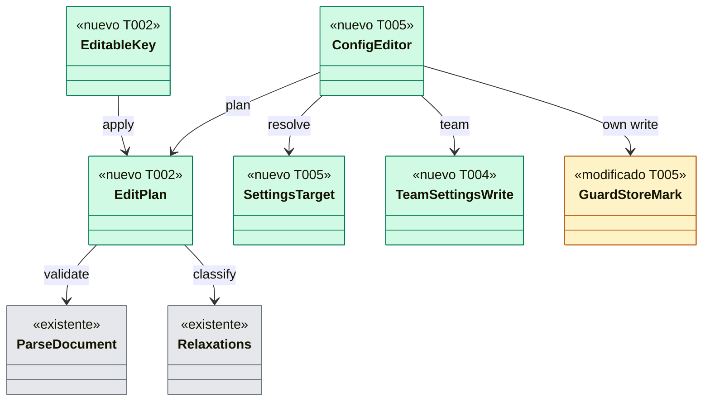

# Dev Spec — US-GRD-013: el comando que edita la configuración sin pisar lo editado a mano

## Contexto rápido

Cuando esto esté hecho, el desarrollador cambia un valor de Guardrails en el nivel de equipo, en su perfil o en la configuración local del repo con `raptor config`. El comando valida el nivel con el schema, no pisa cambios que no hizo él, escribe de forma atómica y deja una copia del archivo anterior. Nunca hace commit. Un agente no puede usarlo. Relajar no se ofrece todavía: responde `factor-unavailable` hasta que exista el factor del SO de ADR-GRD-008, que depende de SPIKE-GRD-002.

**Invariante**: el comando nunca deja la configuración más laxa. Endurece o cambia valores neutros, y todo lo que relaja se rechaza sin escribir (fail-closed, ADR-GRD-008 § 3, OQ-GRD-008-1 y 7).

**Restricciones de arquitectura**: no hay `architecture-constitution.md` en la cascada. Rigen `AGENTS.md` y los ADRs citados, como en las Dev Specs hermanas.

**Corte respecto al gate de SPIKE-GRD-002.** La historia y `non-functional-guardrails.md` (Gate de seguridad) dicen que esta Dev Spec espera a SPIKE-GRD-002. El gate protege una sola cosa: que el comando no relaje sin el factor. Ninguno de los seis escenarios de la historia relaja con éxito: el sexto rechaza la relajación de un agente. Así que todo lo que pide la historia se puede construir ya, y la relajación humana queda en `factor-unavailable` (fail-closed), que es lo que ADR-GRD-008 exige "donde el factor no está disponible". Cuando SPIKE-GRD-002 dé resultados, una enmienda de esta Dev Spec cambia `relax_gate` (D7) por el flujo de ADR-GRD-008 § 3. US-GRD-015 comparte esa dependencia y el módulo de presencia del daemon. El PO aceptó este corte el 2026-10-28 (§ 9).

Lo que ya está en `main` y esta historia **no** rehace:

| Pieza | Dónde | Qué da |
|---|---|---|
| Lectura estricta con límites L-03 | `crates/policy/src/settings/strict.rs`, `strict::parse` | `serde_json::Value` sin claves repetidas, sin BOM, ≤ 64 KiB, profundidad 16 |
| Validación por nivel | `crates/policy/src/settings/document.rs`, `parse_document(bytes, level, source)`; `fn levels` (privada) lee `x-gitraptor-levels` del schema embebido | `SourceStatus` y los diagnósticos `key-not-allowed-at-level`, `unknown-key`, `wrong-type`, `out-of-range` |
| Criterio único de "relaja" | `crates/policy/src/team/confirm.rs`, `relaxations(before: FloorView, after: FloorView)` | Lista cerrada `RelaxedKey` (permisos, mínimo, ramas protegidas, rutas prohibidas, autoría); `Err(Unshowable)` si algo relaja sin explicación |
| Fuente del worktree | `crates/policy/src/team.rs`, `TeamLoader::load`; `TeamSource.blob` | El id del blob `.gitraptor/settings.json` del `HEAD` del worktree |
| Lectura de un blob por id | `crates/git/src/committed.rs`, `RepoReader::blob_by_id(id, max_size)` | Bytes del blob, sin objetos de reemplazo (H-05) |
| Rutas de los niveles personales | `crates/core/src/profile/settings.rs`, `PROFILE_SETTINGS_FILE`, `local_settings_path(dirs, repo_id)`, `read_settings` (sin seguir enlaces) | Dónde viven `settings.json` y `settings.local.json` |
| Capa de escritura de Guardrails | `crates/git/src/guard_write/{mod,unix,portable}.rs`, `GuardWriter::replace_files` | Patrón de escritura: descriptor del directorio, sin seguir enlaces, temporal con nombre aleatorio, `fsync`, `renameat`, `fsync` del directorio |
| Comando reservado y auditoría | `crates/core/src/channel/conn.rs`, `reserved` y `reserved_quiet`; `crates/core/src/channel/authz.rs`, `check_reserved`; `crates/core/src/daemon/guard.rs`, `audit_reserved` | Rechazo `RESERVED_REFUSED` de un agente, auditado con su ascendencia |
| Puntos de corte NFR-12 | `crates/core/src/guardrails/cut.rs`, `trip(step, When)` | Muerte del proceso en un punto con nombre (feature `chaos`) |
| Protección de la configuración ante agentes (US-GRD-012) | `crates/core/src/guardrails/config_guard.rs`; `policy::guard::config::protect_config` | Un agente no commitea `.gitraptor/` (`policy.config-protected`) |

Lo que falta, verificado en el código:

1. No hay comando de edición: `commands!` (`apps/cli/src/commands/mod.rs`) no tiene `Config` y `GuardAction` no edita nada.
2. Nadie escribe `.gitraptor/settings.json` en un worktree: la capa de escritura de Guardrails solo escribe dentro de `<common>/gitraptor/` (ADR-GRD-001 § 7).
3. Nadie escribe `settings.json` del perfil ni `settings.local.json`: `profile/settings.rs` solo lee.
4. Los niveles admitidos de una clave no se pueden consultar desde fuera: `fn levels` de `document.rs` es privada.

## Gaps

_Ninguno bloquea la implementación._ El que bloquea la liberación está en § Gaps y violaciones de la constitución. Lo que queda fuera tiene dueño en § 8.

## La forma



`Relaxations` es `team::confirm::relaxations` y `ParseDocument` es `settings::parse_document`. `GuardStoreMark` son dos funciones nuevas de `RepoStore` en `guard_store.rs`. Los demás nodos se declaran en § 5 y en el Anexo 6.1.

## 1. Decisiones

Cada fila es una **Decisión del orquestador (2026-10-28), validada por el Arquitecto y el PO**. Las que tocan reglas de negocio citan su Q, cerrada en `business-rules.md` (§ 9).

| # | Decisión |
|---|---|
| D1 | **Comando de primer nivel `raptor config`** (Q27 de motor-local lo propone con ese nombre), en `apps/cli/src/commands/config.rs` y una línea en `commands!`. Cuatro acciones: `set <KEY> <VALUE>`, `unset <KEY>`, `add <KEY> <VALUE>` y `remove <KEY> <VALUE>` (las dos últimas solo para listas). Opciones comunes: `--level <team\|profile\|local>`, **obligatoria**, para que nunca se escriba un archivo que el desarrollador no nombró; `--path <PATH>`, el repo o worktree, con la carpeta actual por defecto (no aplica a `profile`); y `--yes`, que solo responde a la pregunta de la rama base inexistente (D9). Textos en `apps/cli/i18n/{en,es}/config.txt`, grupo `config.` |
| D2 | **Lista cerrada de claves editables en el MVP**, con nombres con puntos: `permissions.<operación>` (valor `allow`, `ask` o `deny`: clave virtual que mueve la operación entre las tres listas; `unset` la quita de todas), `permissions.disableSafeMinimum` (`true`/`false`), `engine.baseBranch`, `policies.protectedBranches.patterns` y `policies.forbiddenPaths.patterns` (solo `add` y `remove`), `policies.protectedBranches.appliesTo` y `policies.forbiddenPaths.appliesTo` (`agents`/`everyone`), `policies.commitAuthorship.mode` y `policies.commitAuthorship.onAgentCommit` (los valores de sus enums). Cualquier otra clave da `key-not-editable` con la lista. **Fail-closed**: una clave solo entra en la lista si `relaxations` sabe decir cuándo relaja; US-GRD-009, US-GRD-015 y US-GRP-013 añaden sus claves con su fila de clasificación |
| D3 | **Todo el comando es reservado** (BR-AUTH-004: un agente no modifica ninguna ruta de la configuración "ni por commit ni con el comando"; ADR-GRP-005 § 6). Método `guard.config-edit`, `method(GUARD_CONFIG_EDIT, true, false)`, sin `.since` (ADR-GRP-016) y nunca ofrecido a `raptor-mcp`. Un agente recibe `RESERVED_REFUSED` y el intento queda auditado, tanto si endurece como si relaja. Con eso se cumple el escenario 6 sin depender del factor |
| D4 | **Dos pasos; el humano ve lo que cambia antes de escribir** (patrón de DS-US-GRD-014 D2). (1) `guard.config-edit { level, path, edit }` devuelve `Plan { plan, fingerprint }` o un rechazo, sin escribir. (2) `guard.config-edit { …, accept: fingerprint }` recalcula el plan, compara la huella y escribe. Si cambió, `changed-during-edit`. El CLI solo pregunta cuando el plan trae `base_missing` (D9); en el resto muestra el cambio y acepta sin pregunta, porque la línea de órdenes ya expresa la intención |
| D5 | **"Cambios que no hizo él"** (BR-CONS-006). **Nivel de equipo**: el comando escribe solo si el archivo del working tree es igual, byte a byte, al blob del `HEAD` del worktree (`TeamSource.blob` → `blob_by_id`; los dos ausentes cuentan como iguales) **o** a la última escritura del propio comando en ese worktree. Esa marca es el SHA-256 de los bytes escritos y vive en `store_meta` del repo, con la clave `guardrails.config_edit.<id del worktree>`. En cualquier otro caso responde `unowned-changes` y no escribe. No se compara con el índice: un cambio a mano añadido al índice también es un cambio que no hizo él. **Niveles personales**: no se versionan y editarlos a mano es lo normal, así que el punto de partida es el archivo tal como está. Solo se comprueba que no cambie entre el plan y la escritura (huella, D4). Un documento personal ilegible (`Ignored`) no se reescribe nunca: `document-unreadable` (Q-GRD-57) |
| D6 | **Clasificación endurece / neutro / relaja**, pura, en `crates/policy`. Antes = el documento actual del nivel; después = el documento editado. `relaxations(FloorView { settings: antes, readable: true }, FloorView { settings: después, readable: true })`: si devuelve claves, **relaja**; con `Err(Unshowable)` también relaja (fail-closed). Si no, y el valor efectivo es más restrictivo, **endurece**; si no, **neutro**. Vale para los tres niveles: en un nivel personal, relajar es quitar un endurecimiento propio, lo mismo que el trinquete de Q-GRD-32 llama `personal-relax-pending`. **`engine.baseBranch` es neutro para el comando** (Q-GRD-55): el cambio solo rige cuando llega a la rama principal y el humano lo confirma con `raptor guard confirm` (D8 de ADR-GRD-007, DS-US-GRD-014 D3), que ya es la acción reservada de BR-AUTH-001. **Condición de Q-GRD-55**: con `engine.baseBranch`, el plan y el resultado `Applied` llevan `base_pending_confirmation: true`, y el CLI (en/es) avisa, antes y después de escribir, de que la nueva rama base no rige hasta que llegue a la rama principal y el desarrollador la confirme con `raptor guard confirm` |
| D7 | **Relajar responde `factor-unavailable`, sin escribir, en todos los niveles**, mientras no exista el factor de ADR-GRD-008. Un solo punto de decisión, `config_edit::relax_gate(&EditPlan) -> RelaxGate`, devuelve hoy siempre `Unavailable(FactorCause::NotSupported)`. El intento se audita (ADR-GRD-008 § 3, "Disponibilidad y fail-closed"). No cae a D5: el ADR lo prohíbe para esta acción. El mensaje dice que la acción no está disponible en esta versión. Para el nivel de equipo nombra la vía que ya existe: editar el archivo, commitearlo y confirmar con `raptor guard confirm` cuando llegue a la rama principal (OQ-GRD-008-1). Para los niveles personales no da ninguna vía, porque el trinquete de Q-GRD-32 la cerrará. Ningún texto sugiere cómo saltarse la protección (SEC-GRD-06). La enmienda posterior a SPIKE-GRD-002 sustituye el cuerpo de `relax_gate` por el flujo de ADR-GRD-008 § 3: plan canónico, nonce, diálogo, ventana y recálculo. El contrato ya trae el resultado `factor-unavailable` con causa, así que la enmienda no cambia la forma del contrato |
| D8 | **Escritura atómica y recuperable** (NFR-01, NFR-12). El orden, siempre el mismo: (a) copia del archivo anterior al almacén de copias (D10), con `fsync`; (b) temporal con nombre aleatorio, creado en exclusiva en la carpeta destino, con `fsync`; (c) se comprueba otra vez que el contenido actual es el que leyó el plan; (d) `rename` atómico sobre el destino y `fsync` de la carpeta; (e) la marca de D5 (solo en el nivel de equipo). Si el proceso muere antes de (d), queda el archivo anterior completo y, como mucho, un temporal reconocible. Si muere entre (d) y (e), la siguiente ejecución ve un archivo que no coincide ni con el `HEAD` ni con la marca y responde `unowned-changes`: pide revisar en vez de pisar. **Equipo**: una operación tipada nueva de la capa de escritura de Guardrails, `GuardWriter::replace_team_settings`, relativa a un descriptor del worktree. No sigue enlaces ni en `.gitraptor/` ni en el archivo, crea `.gitraptor/` si falta y conserva el modo del archivo. Exige enmendar ADR-GRD-001 § 7 (G1, T001). **Personales**: un escritor en `crates/core/src/profile/settings_write.rs` con las mismas reglas, en la carpeta privada del perfil. Una carpeta del repo en `config/repos/<id>/` que sea un enlace se rechaza, como en `local_settings` |
| D9 | **Rama base inexistente** (Q-GRD-16). Con `engine.baseBranch`, el plan valida el nombre con `RefName` (`invalid-value` si no es válido) y comprueba si existe como rama local o como rama de seguimiento de algún remoto (`RepoReader::local_branches`, `remote_branches`). Si no existe, el plan lleva `base_missing: true`. El CLI avisa y pregunta `[y/N]`, con "no" por defecto. Sin terminal y sin `--yes`, no escribe. La aceptación lleva `confirm_missing_base: true`; sin esa marca, un plan con `base_missing` se rechaza al aceptar (`base-missing`). El aviso de que la rama base no rige hasta confirmarla (D6, Q-GRD-55) sale también en este caso, junto al de rama inexistente |
| D10 | **Copias del archivo anterior.** Cada escritura guarda antes la versión que reemplaza en `<data>/guardrails/config-backups/<destino>/<at_ms>.json`, con carpeta y archivo privados (`fsperm::ensure_private_dir`, `create_private_file`). `<destino>` es `team-<id del worktree>`, `profile` o `local-<repo_id>`. Se conservan las 10 últimas por destino (Q-GRD-56). ⚠️ **ASSUMPTION**: 10 copias por destino; el número no viene de ningún requisito medido y hay que validarlo con el uso. Si no había archivo, no hay copia y el resultado lo dice. El CLI imprime siempre dónde quedó la copia de cada escritura (`Applied.backup`, ruta completa), en en/es. **Recuperar es copiar ese archivo** o volver a usar el comando: no hay `raptor config restore` porque restaurar puede relajar, y relajar no está disponible (D7). En el nivel de equipo, lo commiteado se recupera además con Git |
| D11 | **Formato canónico.** El comando edita el árbol `serde_json::Value` que devuelve `strict::parse` y lo serializa con 2 espacios, claves en orden y salto de línea final. Las claves que no conoce (de una versión más nueva) se conservan. Si los bytes actuales no están ya en ese formato, el plan lo dice (`reformats: true`) y el CLI lo avisa **antes de escribir**, al mostrar el plan (Q-GRD-57). En el nivel de equipo el aviso dice además que el diff del archivo incluirá el cambio de formato. No se activa `preserve_order` de `serde_json`: es una feature de todo el workspace y cambiaría el orden de otros JSON |
| D12 | **Validación del resultado.** El documento editado pasa por `parse_document(bytes, level, source)`. Si la clave editada sale con `key-not-allowed-at-level`, el resultado es `key-not-allowed-at-level { levels }`, con los niveles que la admiten según `x-gitraptor-levels` (escenario 2: "la rama base solo se define en la configuración del equipo"). Si la edición añade otro diagnóstico que el documento actual no tenía (`wrong-type`, `out-of-range`, `unknown-operation`), el resultado es `invalid-value`. Los diagnósticos que ya estaban no bloquean: el comando no arregla ni empeora lo que no toca. Un documento actual `Ignored` da `document-unreadable` (D5). Para consultar los niveles se expone `settings::document::admitted_levels(pointer) -> Option<Vec<Level>>`, que reutiliza `fn levels`: el schema sigue siendo la única fuente |
| D13 | **Sin commit y sin efecto inmediato en el equipo** (S-GRD-3, Q-GRD-17, Q-GRD-20). El comando nunca invoca Git para escribir. Un cambio del equipo rige cuando se commitea en el worktree (si endurece) o cuando llega a la rama principal y se confirma (D8 de ADR-GRD-007). Eso ya lo hace el cargador de TS-GRD-001; esta historia solo lo prueba (escenario 1). Un cambio personal rige en la siguiente evaluación, porque `guardrails::layers::load` lee los archivos personales cada vez |
| D14 | **Ámbito.** `team` y `local` exigen un repo observado (`not-observed`, Q-GRD-15) y `team`, además, un worktree con working tree (`no-worktree` en un repo bare). `profile` no necesita repo. El daemon resuelve el repo y el worktree desde `path` con el registro, nunca desde un id que mande el cliente |
| D15 | **Auditoría.** Una fila de `AuditRow` por intento que termina, con la operación `guard.config-edit` y una de estas salidas: `applied`, `factor-unavailable`, `unowned-changes` o `changed`. El motivo lleva el nivel, la clave (código cerrado) y los 8 primeros caracteres de los SHA-256 de antes y después, sin valores ni rutas del repo. Sin la marca de riesgo aceptado: aquí no hay ventana D5. El rechazo de un agente lo audita el canal como `rejected` (`reserved_quiet` en los dos pasos). Los errores de validación (`key-not-editable`, `key-not-allowed-at-level`, `invalid-value`) no se auditan: no tienen efecto. Ninguna de estas filas cuenta en el KPI de bloqueos |

## 2. Forma (archivos que se tocan)

Cada pieza nueva va en un archivo propio (ADR-GRP-016). Los archivos centrales ganan una línea, salvo donde se indica.

| Pieza | Archivo |
|---|---|
| Claves editables, edición del árbol, clasificación y serialización canónica (puro) | `crates/policy/src/settings/edit.rs` (nuevo; `pub mod edit;` en `settings/mod.rs`) |
| Niveles admitidos de una clave | `crates/policy/src/settings/document.rs` (`admitted_levels`) |
| Escritura tipada de `.gitraptor/settings.json` en un worktree | `crates/git/src/guard_write/mod.rs` (`replace_team_settings`), `unix.rs` y `portable.rs` |
| Escritor de los niveles personales | `crates/core/src/profile/settings_write.rs` (nuevo; una línea en `profile/mod.rs`) |
| Marca de la última escritura propia | `crates/core/src/profile/guard_store.rs` (`config_edit_mark`, `set_config_edit_mark`) |
| Contrato: `ConfigEditParams`, `ConfigEdit`, `ConfigEditResult`, `ConfigEditPlanView` | `crates/api/src/guard_config.rs` (nuevo; `pub mod guard_config;` en `lib.rs`) |
| Método `guard.config-edit` | `crates/api/src/methods/guard.rs` |
| Plan, aplicar, copias, `relax_gate` y puntos de corte | `crates/core/src/guardrails/config_edit.rs` (nuevo; una línea en `guardrails/mod.rs`) |
| Petición al actor del daemon y auditoría | `crates/core/src/daemon/guard.rs`, `crates/core/src/daemon/shutdown.rs` (`GuardRequest`, `GuardReply`) |
| Dispatch | `crates/core/src/channel/conn.rs` (un brazo junto a los de `guard.`) |
| CLI | `apps/cli/src/commands/config.rs` (nuevo), `apps/cli/src/commands/mod.rs` (una línea en `commands!`), `apps/cli/src/config.rs` (nuevo; plan legible, pregunta, resultados), `apps/cli/i18n/{en,es}/config.txt` (nuevos) |
| Enmienda de la lista cerrada de escritura | `docs/architecture/decisions/ADR-GRD-001-capa-hooks-instalacion.md` § 7, `docs/architecture/decisions/ADR-GRP-009-frontera-solo-lectura-git.md` (nota de Guardrails) |
| Tests | § 6 |

## 3. Flujo de `raptor config set --level team permissions.push deny`

1. **Plan.** El CLI arranca o encuentra el daemon (`engine`) y llama a `guard.config-edit { level: team, path, edit: Set { key: "permissions.push", value: "deny" } }`. `reserved_quiet` rechaza a un agente (auditado). El daemon resuelve el repo y el worktree (D14) y lee el archivo destino sin seguir enlaces. Con el nivel de equipo, comprueba D5. Luego aplica la edición al árbol (D2, D11), valida (D12), clasifica (D6) y, si es `engine.baseBranch`, mira si la rama existe (D9).
2. **Salidas inmediatas, sin escribir:** `not-observed`, `no-worktree`, `key-not-editable`, `key-not-allowed-at-level`, `invalid-value`, `document-unreadable`, `not-a-regular-file`, `unowned-changes`, `unchanged` y `factor-unavailable` (D7; auditada).
3. **Mostrar.** El CLI imprime nivel, archivo (ruta saneada), clave y valor anterior → nuevo, y el aviso de formato canónico si aplica. Con `base_missing`, avisa y pregunta (D9).
4. **Aplicar.** `guard.config-edit { …, accept: fingerprint, confirm_missing_base }`. El daemon recalcula el plan desde cero, compara la huella y escribe con D8. Devuelve `Applied { plan, backup }`, audita `applied` y el CLI imprime la ruta de la copia y, en el nivel de equipo, que el cambio rige al commitearlo.

## 4. Configuración

No hay claves nuevas en el documento. El comando escribe las claves que ya existen en `crates/policy/src/settings/model.rs`, con los niveles de `x-gitraptor-levels`. La lista de acciones que piden el factor sigue fija en el binario (ADR-GRD-008 § 3): no hay clave para apagar `relax_gate`.

## 5. Contrato (`crates/api/src/guard_config.rs`)

```rust
pub struct ConfigEditParams {              // deny_unknown_fields
    pub level: ConfigLevel,                // team | profile | local
    pub path: Option<String>,              // obligatorio salvo con profile
    pub edit: ConfigEdit,
    pub accept: Option<String>,            // huella del plan que el humano vio
    #[serde(default)]
    pub confirm_missing_base: bool,
}

pub enum ConfigEdit {                      // tag = "op", kebab-case
    Set { key: String, value: String },
    Unset { key: String },
    Add { key: String, value: String },
    Remove { key: String, value: String },
}

pub enum ConfigEditResult {                // tag = "result", kebab-case
    Plan { plan: ConfigEditPlanView, fingerprint: String },
    Applied { plan: ConfigEditPlanView, backup: Option<String> },
    Unchanged,
    KeyNotEditable { editable: Vec<String> },
    KeyNotAllowedAtLevel { levels: Vec<ConfigLevel> },
    InvalidValue,
    DocumentUnreadable,
    NotARegularFile,
    UnownedChanges,
    ChangedDuringEdit,
    BaseMissing,
    FactorUnavailable { cause: FactorCause },   // not-supported (hoy); unavailable, … (tras SPIKE-GRD-002)
    NotObserved,
    NoWorktree,
}

pub struct ConfigEditPlanView {
    pub level: ConfigLevel,
    pub file: Untrusted,                   // ruta del destino, saneada al mostrarse
    pub key: String,                       // de la lista cerrada de D2
    pub before: Vec<Untrusted>,            // valor anterior (lista vacía = sin valor)
    pub after: Vec<Untrusted>,
    pub effect: EditEffect,                // hardens | neutral (relaxes nunca llega a Plan hoy)
    pub reformats: bool,
    pub base_missing: bool,
    pub base_pending_confirmation: bool,   // solo con engine.baseBranch (Q-GRD-55)
}
```

El implementador fija los nombres exactos. Lo que no se toca: los dos pasos con huella, el texto del repo como `Untrusted`, los códigos cerrados y `factor-unavailable` con causa.

La huella es el SHA-256 de la serialización canónica de: nivel, ruta canónica del destino, SHA-256 de los bytes actuales (o `absent`), id del blob del `HEAD` y marca de D5 (solo en el nivel de equipo), la edición y el SHA-256 de los bytes nuevos.

## 6. Criterios de aceptación verificables

Suite e2e `apps/cli/tests/config_us_grd_013.rs`, con Git, `raptor` y `raptor-hook` reales sobre la máquina temporal de `guard_machine` (NFR-01). El agente es `raptor-fake-agent` (`Machine::as_agent`). Cada test comprueba el "Entonces" completo y que `git log` no tiene commits nuevos.

| Escenario de la historia | Test |
|---|---|
| 1 · El comando cambia push a `deny` en el equipo en `feat-x`; no hay commit; el push sigue pasando; tras commitearlo, se deniega | `a_team_edit_waits_for_its_commit` |
| 2 · `engine.baseBranch` en el perfil: rechazado, explica que solo se admite en el equipo, no escribe | `a_value_outside_its_level_is_refused` |
| 3 · Ruta prohibida añadida a mano sin commitear; cambiar `permissions.rebase`: no escribe, avisa y el archivo queda byte a byte | `hand_edits_are_never_overwritten` |
| 4 · Escritura interrumpida en cada punto de corte: queda el anterior o el nuevo, completo; el anterior se recupera de la copia | `an_interrupted_write_leaves_old_or_new` · `the_previous_file_is_recoverable` |
| 5 · `engine.baseBranch release` sin la rama: avisa y solo guarda si se confirma (`n` → nada; `y` → guardado); el texto dice que la rama base no rige hasta llegar a la rama principal y confirmarla (Q-GRD-55) | `a_missing_base_branch_asks_first` |
| 6 · Un agente intenta permitir force-push: rechazado, nada escrito, intento en la auditoría (`rejected`) | `an_agent_cannot_relax_and_is_logged` |

Además:

| Comportamiento | Test |
|---|---|
| Un agente tampoco endurece con el comando (BR-AUTH-004) | `an_agent_cannot_harden_either` |
| El desarrollador que relaja recibe `factor-unavailable` en los tres niveles; no se escribe; fila `factor-unavailable` | `relaxing_is_not_offered_without_the_factor` |
| Una escritura propia sin commitear se puede volver a editar; una edición a mano encima de ella se rechaza | `the_command_recognises_its_own_write` |
| El archivo cambia entre el plan y la aceptación: `changed-during-edit`, sin escribir | `a_file_changed_during_the_edit_is_not_written` |
| `.gitraptor/` o el archivo son un enlace: `not-a-regular-file`, nada fuera del worktree cambia | `links_are_never_followed` |
| Documento personal ilegible: `document-unreadable`, bytes intactos | `an_unreadable_personal_file_is_kept` |
| Un archivo del equipo fuera del formato canónico: el aviso (con el diff de formato) sale antes de escribir (Q-GRD-57) | `the_canonical_format_is_announced_before_writing` |
| Cada escritura imprime dónde quedó la copia (Q-GRD-56) | `the_previous_file_is_recoverable` |
| Endurecer el perfil rige en la siguiente operación, sin reiniciar el daemon | `a_personal_hardening_applies_at_once` |
| `raptor-mcp` no ve `guard.config-edit` en `hello.methods` | `crates/core` · `config_edit_is_not_offered_to_mcp` |
| Edición pura: cada clave de D2, clasificación de D6 (incluida `baseBranch` neutra y `Unshowable` como relajación), formato canónico, claves desconocidas conservadas | `crates/policy/tests/us_grd_013_edit.rs` |
| Escritura tipada: atomicidad, sin enlaces, modo conservado, contenido esperado | `crates/git` · `guard_write::replace_team_settings` |

**Puntos de corte** (`cut::trip`, feature `chaos`): `config-edit.backup:after`, `config-edit.temp:after`, `config-edit.rename:before`, `config-edit.rename:after` y `config-edit.mark:before`. El test del escenario 4 recorre los cinco con `GITRAPTOR_TEST_CUT`.

## 7. Orden de implementación

Ver § Plan de implementación: T001 → T002 → T003 → T004 → T005 → T006 → T007 → T008.

## 8. Pendientes, límites y fuera de alcance

- **Relajar con el factor** (SPIKE-GRD-002 → enmienda de esta Dev Spec). Cuando el SPIKE dé el binding de macOS, `relax_gate` pasa a invocar el módulo de presencia del daemon (ADR-GRD-008 § 3 y § 6) con plan canónico, nonce, diálogo, ventana y recálculo. El contrato ya trae `FactorUnavailable { cause }`. Linux y Windows siguen en fail-closed: **Pendiente: etapa de validación multiplataforma**. US-GRD-015 usa el mismo módulo.
- **Trinquete personal** (Q-GRD-32, `personal-relax-pending`). Sin dueño todavía: la historia del PO de la tabla de enmiendas de ADR-GRD-008 está pendiente. Mientras no exista, quitar a mano un endurecimiento personal sigue siendo el riesgo residual R-GRD-4. Cuando llegue, toda escritura del comando que endurece debe adelantar el confirmado; el punto está en `config_edit::apply`, después de (e) de D8.
- **Claves del motor** (`idleThresholdMinutes` y demás, US-GRP-013) y **claves de US-GRD-009 y US-GRD-015**: cada historia añade su fila a la lista de D2 con su clasificación.
- **Ahead/behind contra una rama base inexistente** (Q-GRD-16, Q42 de motor-local): es de US-GRP-016.
- **`raptor config show`** o mostrar la configuración efectiva: fuera de la historia (layered-config, § 9).
- **Carrera residual** entre la comprobación (c) y el `rename` (d) de D8: microsegundos. Un editor que guarde justo en ese instante pierde su escritura, pero la copia de (a) conserva lo que leyó el plan. Se acepta y se dice en el PR.
- **Windows y Linux**: `portable.rs` de la capa de escritura y el escritor personal se validan después en máquinas reales. **Pendiente: etapa de validación multiplataforma** (fila XP nueva en `xplat-pendientes.md`, la abre el orquestador).

## 9. Validación de las decisiones

**Decisión del orquestador (2026-10-28), validada por el Arquitecto y el PO.** El PO aceptó el corte (la historia no espera a SPIKE-GRD-002; relajar responde `factor-unavailable` hasta la enmienda, como dicta Q-GRD-19) y cerró estas tres preguntas en `business-rules.md` y `context.md`:

| Q | Decisión (cerrada) | Dónde |
|---|---|---|
| Q-GRD-55 | Cambiar la rama base con el comando no cuenta como relajación del comando y no pide el factor: el cambio solo rige cuando llega a la rama principal y el humano lo confirma con la acción reservada de Q-GRD-21. Condición del PO: el resultado y el texto de la CLI avisan de que la nueva rama base no rige hasta entonces | D6, D9 |
| Q-GRD-56 | El comando guarda, antes de cada escritura, una copia del archivo que reemplaza, en el perfil, y conserva las 10 últimas por archivo (⚠️ ASSUMPTION). El comando dice dónde quedó cada copia. El desarrollador recupera el valor anterior copiando esa copia o con el propio comando; no hay comando de restaurar mientras relajar no esté disponible | D10 |
| Q-GRD-57 | En los niveles personales, el comando parte del archivo tal como está (las ediciones a mano son el estado de partida) y solo rechaza si el archivo cambia entre que lo lee y lo escribe, o si no se puede leer. En todos los niveles el comando reescribe el archivo con formato canónico (sangría de 2 espacios, claves en orden) y lo avisa antes de escribir; en el nivel de equipo, el aviso dice que el diff incluirá el cambio de formato | D5, D11 |

Revisión de seguridad pendiente: el corte toca una acción reservada y una escritura nueva en el working tree. Se recomienda que el security-expert revise D3, D5, D7 y D8 antes de implementar (SEC-GRD-05, SEC-GRD-06).

## Anexo de forma (perfil `backend-service`)

### 6.1 Tipos compartidos

Los de § 5, en `crates/api/src/guard_config.rs`. En `crates/policy`: `settings::edit::{EditableKey, EditPlan, EditEffect, EditError, canonical_bytes}`. En `crates/core`: `guardrails::config_edit::{ConfigEditor, SettingsTarget, RelaxGate, FactorCause}`. `SettingsTarget` es el destino resuelto (`Team { worktree, repo_id }`, `Profile`, `Local { repo_id }`). `ConfigEditor` agrupa plan y aplicación sobre el `RepoStore` del actor del daemon. `TeamSettingsWrite` es `GuardWriter::replace_team_settings`. `GuardStoreMark` es el par `RepoStore::{config_edit_mark, set_config_edit_mark}`. `Relaxations` (existente) es `team::confirm::relaxations` y `ParseDocument` (existente) es `settings::parse_document`.

### 6.2 Ciclos de vida (DI)

_No aplica: no hay contenedor de dependencias. La edición es una función pura y la aplicación corre en el actor de Guardrails del daemon, que ya tiene el `RepoStore` y el registro._

### 6.3 Firmas del stack

- `settings::edit::plan(current: &Value, level: Level, edit: &Edit) -> Result<EditPlan, EditError>`
- `settings::edit::canonical_bytes(&Value) -> Vec<u8>`
- `settings::document::admitted_levels(pointer: &str) -> Option<Vec<Level>>`
- `GuardWriter::replace_team_settings(&self, worktree: &Path, expected: Option<[u8; 32]>, bytes: &[u8]) -> Result<()>`
- `RepoStore::{config_edit_mark(&self, worktree_key: &str) -> Result<Option<String>>, set_config_edit_mark(&mut self, worktree_key: &str, sha256: &str) -> Result<()>}`
- `team::confirm::relaxations(FloorView, FloorView) -> Result<Vec<Relaxation>, Unshowable>` (existente)

### 7.1 Forma del error

Los resultados de § 5 son respuestas, no errores JSON-RPC. El rechazo a un agente es el `RESERVED_REFUSED` de siempre. No hay códigos nuevos, así que `contract.txt` no cambia.

### 7.2 Forma de la configuración

Sin cambios (§ 4).

### 7.3 Valores numéricos

64 KiB por documento (`strict::MAX_BYTES`); 10 copias por destino (⚠️ ASSUMPTION, Q-GRD-56); valores mostrados truncados a 100 caracteres, como en `guardrails/confirm.rs` (`MAX_NAME_CHARS`).

### 8. Modelo de datos

_No hay tablas nuevas: una clave más de `store_meta` por worktree (`guardrails.config_edit.<id>`). Las copias son archivos en la carpeta privada del perfil._

### 9. Estrategia de pruebas

§ 6.

## Gaps y violaciones de la constitución

Ningún hueco bloquea la implementación. Sin constitución en la cascada: se aplican `AGENTS.md` y los ADRs citados.

| Id | Hueco | Severidad | Alcance |
|---|---|---|---|
| G1 | ADR-GRD-001 § 7 y la nota de Guardrails de ADR-GRP-009 limitan la capa de escritura de Guardrails a `<common>/gitraptor/` y a `core.hooksPath`. `replace_team_settings` añade una operación tipada: escribir `.gitraptor/settings.json` en el working tree de un worktree, solo desde el comando reservado `guard.config-edit`. **No se aplica en esta rama de documentación**: la enmienda la hace T001, primera tarea de la rama de implementación, y la PR de implementación no se libera sin ella | Bloquea liberación | T001, T004 |

## Plan de implementación

> Orden topológico (`Depende:`). Rutas relativas a la raíz del repo. T002 incluye los tests en rojo de la parte pura; T003, los de extremo a extremo.

| # | Tarea | Depende | Aterriza en |
|---|---|---|---|
| T001 | Aplicar la enmienda de la lista cerrada de escritura | — | `docs/architecture/decisions` |
| T002 | Edición pura, niveles admitidos y clasificación | — | `crates/policy/src/settings` |
| T003 | Escribir la suite e2e en rojo | — | `apps/cli/tests` |
| T004 | Escritura tipada del archivo del equipo | T001 | `crates/git/src/guard_write` |
| T005 | Plan, aplicación, copias y `relax_gate` en el daemon | T002, T004 | `crates/core` |
| T006 | Contrato y método `guard.config-edit` | T002 | `crates/api` |
| T007 | CLI `raptor config` y mensajes | T005, T006 | `apps/cli` |
| T008 | Verificar y documentar | T003, T007 | `docs` |

### T001 — Aplicar la enmienda de la lista cerrada de escritura

**Objetivo.** Primera tarea de la rama de implementación, no de la rama de documentación de esta Dev Spec. Añadir a ADR-GRD-001 § 7 y a la nota de Guardrails de ADR-GRP-009 la operación "sustituir `.gitraptor/settings.json` en el working tree de un worktree, solo desde `guard.config-edit`". Sin otros cambios en esos ADRs.

**Ubicación.**
- `docs/architecture/decisions/ADR-GRD-001-capa-hooks-instalacion.md` (**MODIFY**)
- `docs/architecture/decisions/ADR-GRP-009-frontera-solo-lectura-git.md` (**MODIFY**)

**Reglas**
- Se redacta como enmienda fechada: "Decisión del orquestador (2026-10-28), validada por el Arquitecto (DS-US-GRD-013 D8)".
- Se dice que no es una escritura del motor y que la comprobación estática de la Validación 5 la cubre.

- **Depende:** —
- **Refs:** D8; G1
- **Aceptación:** `grep -q replace_team_settings docs/architecture/decisions/ADR-GRD-001-capa-hooks-instalacion.md docs/architecture/decisions/ADR-GRP-009-frontera-solo-lectura-git.md`

### T002 — Edición pura, niveles admitidos y clasificación

**Objetivo.** `settings::edit`: la lista cerrada de D2, la edición del árbol, la validación de D12, la clasificación de D6 y la serialización canónica de D11. `admitted_levels` en `document.rs`.

**Ubicación.**
- `crates/policy/src/settings/edit.rs` (**CREATE**)
- `crates/policy/src/settings/mod.rs` (**MODIFY**)
- `crates/policy/src/settings/document.rs` (**MODIFY**)
- `crates/policy/tests/us_grd_013_edit.rs` (**CREATE**)

**Reglas**
- Sin E/S. El criterio de "relaja" es `team::confirm::relaxations`; no se escribe otra comparación.
- `Err(Unshowable)` cuenta como relajación.
- `engine.baseBranch` es neutro.
- Los diagnósticos que ya tenía el documento no bloquean; solo los nuevos.

- **Depende:** —
- **Refs:** D2, D6, D11, D12
- **Aceptación:** `cargo test -p gitraptor-policy --test us_grd_013_edit`

### T003 — Escribir la suite e2e en rojo

**Objetivo.** `apps/cli/tests/config_us_grd_013.rs` con los tests de § 6 que viven en el CLI. Todos fallan antes de implementar.

**Ubicación.**
- `apps/cli/tests/config_us_grd_013.rs` (**CREATE**)

**Reglas**
- Repos y perfiles temporales, nunca este repo (NFR-01). Sin esperas fijas. `#![cfg(unix)]`, como las suites hermanas.
- Cada test comprueba también que no hay commits nuevos.

- **Depende:** —
- **Refs:** US-GRD-013; § 6
- **Aceptación:** `cargo test -p gitraptor-cli --test config_us_grd_013` compila y falla

### T004 — Escritura tipada del archivo del equipo

**Objetivo.** `GuardWriter::replace_team_settings` con los pasos (b) a (d) de D8, relativa a un descriptor del worktree.

**Ubicación.**
- `crates/git/src/guard_write/mod.rs` (**MODIFY**)
- `crates/git/src/guard_write/unix.rs` (**MODIFY**)
- `crates/git/src/guard_write/portable.rs` (**MODIFY**)

**Reglas**
- No sigue enlaces en `.gitraptor/` ni en el archivo; un enlace da `Changed`.
- El temporal tiene nombre aleatorio, se crea en exclusiva en `.gitraptor/` y se borra si falla.
- Compara el SHA-256 del contenido actual con `expected` justo antes del `rename`.
- Conserva el modo del archivo existente.
- Expone la limpieza de temporales reconocidos, como `remove_file_temporaries`.

> **Nota técnica.** Un temporal que quede en `.gitraptor/` tras un corte aparece como archivo sin seguimiento en `git status`. Por eso el plan de la siguiente edición lo limpia antes de comparar.

- **Depende:** T001
- **Refs:** D8; ADR-GRD-001 § 4 y § 7
- **Aceptación:** `cargo test -p gitraptor-git guard_write`

### T005 — Plan, aplicación, copias y `relax_gate` en el daemon

**Objetivo.** `guardrails::config_edit`: resolver el destino (D14), D5 con la marca, el plan y la huella, `relax_gate` (D7), las copias (D10), la escritura con los puntos de corte de § 6 y la auditoría (D15).

**Ubicación.**
- `crates/core/src/guardrails/config_edit.rs` (**CREATE**)
- `crates/core/src/guardrails/mod.rs` (**MODIFY**)
- `crates/core/src/profile/settings_write.rs` (**CREATE**)
- `crates/core/src/profile/mod.rs` (**MODIFY**)
- `crates/core/src/profile/guard_store.rs` (**MODIFY**)
- `crates/core/src/daemon/guard.rs` (**MODIFY**)
- `crates/core/src/daemon/shutdown.rs` (**MODIFY**)
- `crates/core/src/channel/conn.rs` (**MODIFY**)

**Pasos**
1. Atender `guard.config-edit` en `conn.rs` con `reserved_quiet` en los dos pasos y pasar la petición al actor de Guardrails.
   1.1 ⛔5.1 No uses `reserved` en el paso del plan: escribiría una fila `accepted` por cada plan y la auditoría dejaría de tener una fila por intento.
2. Calcular el plan: leer sin seguir enlaces, D5, `settings::edit::plan`, D9 y la huella de § 5.
3. Al aceptar: recalcular, comparar la huella y pasar por `relax_gate`. Después, copia, escritura y marca, en el orden de D8, con `cut::trip` en cada punto.
4. Escribir la fila de auditoría de D15 con una función propia, sin `RISK_ACCEPTED`.

- **Depende:** T002, T004
- **Refs:** D3, D5, D7, D8, D9, D10, D14, D15
- **Aceptación:** `cargo test -p gitraptor-cli --test config_us_grd_013 hand_edits_are_never_overwritten`
- **Guard ⛔5.1:** `cargo test -p gitraptor-cli --test config_us_grd_013 an_agent_cannot_relax_and_is_logged`

### T006 — Contrato y método `guard.config-edit`

**Objetivo.** Los tipos de § 5 y el método reservado.

**Ubicación.**
- `crates/api/src/guard_config.rs` (**CREATE**)
- `crates/api/src/lib.rs` (**MODIFY**)
- `crates/api/src/methods/guard.rs` (**MODIFY**)

**Reglas**
- `method(GUARD_CONFIG_EDIT, true, false)`, sin `.since`, nunca para `raptor-mcp`.
- `deny_unknown_fields` en los parámetros; texto del repo como `Untrusted`.
- `crates/api/tests/architecture.rs` sigue en verde.

- **Depende:** T002
- **Refs:** D3, D4; ADR-GRP-016
- **Aceptación:** `cargo test -p gitraptor-api`

### T007 — CLI `raptor config` y mensajes

**Objetivo.** El subcomando de D1, el plan legible, la pregunta de D9, la ruta de la copia y el texto de cada resultado, en `en` y `es`.

**Ubicación.**
- `apps/cli/src/commands/config.rs` (**CREATE**)
- `apps/cli/src/commands/mod.rs` (**MODIFY**)
- `apps/cli/src/config.rs` (**CREATE**)
- `apps/cli/src/lib.rs` (**MODIFY**)
- `apps/cli/i18n/en/config.txt` (**CREATE**)
- `apps/cli/i18n/es/config.txt` (**CREATE**)

**Reglas**
- Las mismas claves y marcadores en `en` y `es`, todas del grupo `config.`.
- La pregunta usa `[y/N]` con "no" por defecto, como `guard/confirm.rs`. Sin terminal y sin `--yes`, no escribe.
- El rechazo de un agente usa el texto de siempre ("only the developer can change the protection").
- `factor-unavailable` sigue D7 y nunca sugiere cómo saltarse la protección.
- Avisos antes de escribir: formato canónico (con el diff de formato en el nivel de equipo, D11) y rama base que no rige hasta confirmarla (D6). Después de escribir: dónde quedó la copia (D10).

- **Depende:** T005, T006
- **Refs:** D1, D4, D7, D9, D10, D11
- **Aceptación:** `cargo test -p gitraptor-cli --test config_us_grd_013`

### T008 — Verificar y documentar

**Objetivo.** La suite completa en verde, el estado de US-GRD-013 en su ficha y en el backlog, y la fila XP de Windows y Linux.

**Ubicación.**
- `docs/requirements/features/guardrails/user-stories/US-GRD-013-comando-edicion-configuracion.md` (**MODIFY**)
- `docs/requirements/backlog.md` (**MODIFY**)
- `docs/requirements/release-status.md` (**MODIFY**)
- `docs/architecture/xplat-pendientes.md` (**MODIFY**)

**Reglas**
- No se declara hecho lo que no se verificó. `release-status.md` se regenera con `node tools/status/release-status.mjs`.
- La relajación con factor queda escrita como pendiente de SPIKE-GRD-002, no como hecha.

- **Depende:** T003, T007
- **Refs:** § 8
- **Aceptación:** `cargo test --workspace`
