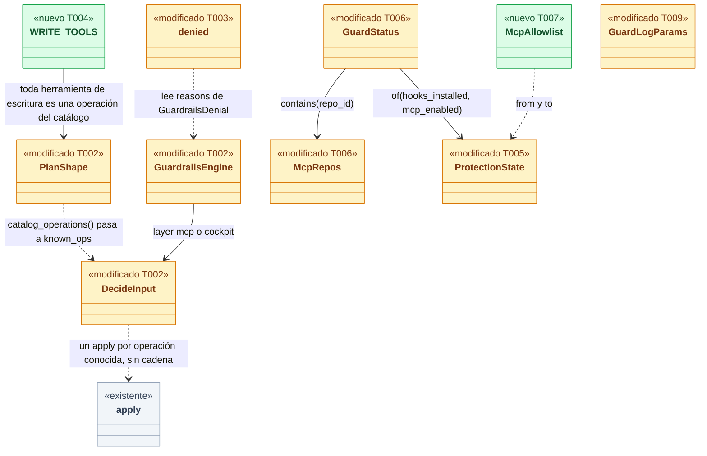
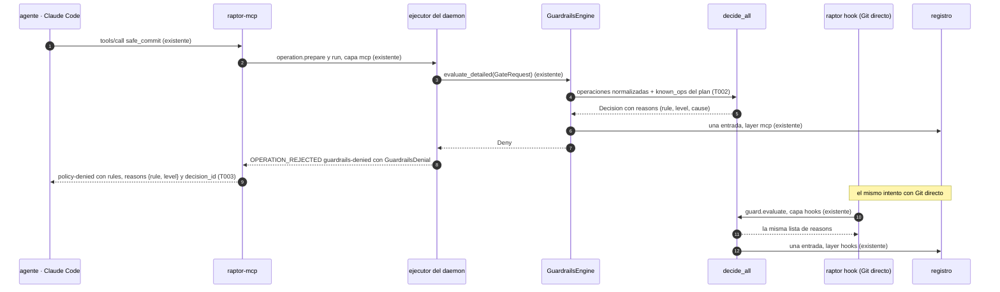
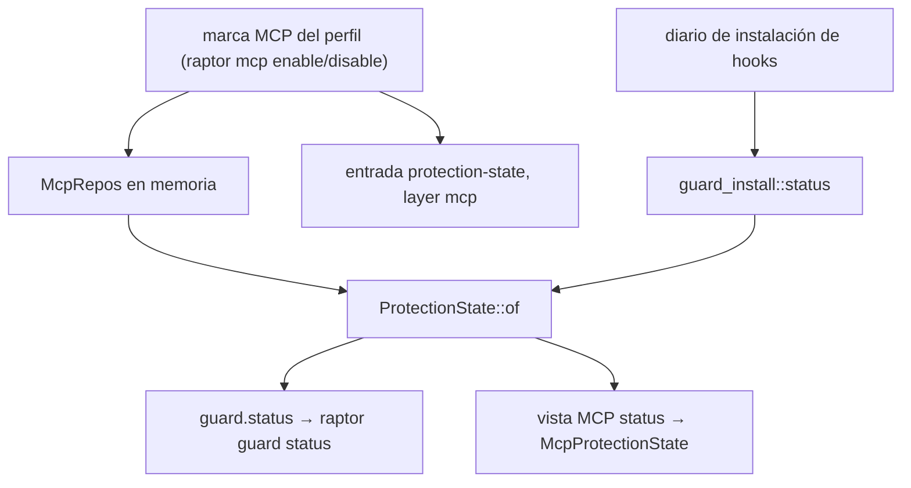
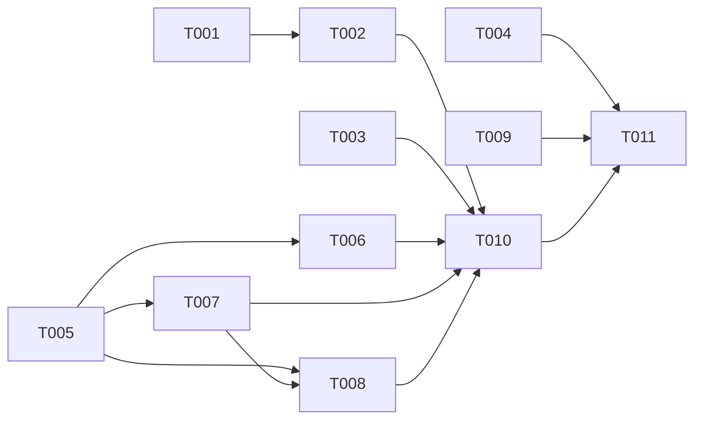

# DS-US-GRD-016 · La misma decisión por las herramientas MCP y por Git directo

## Contexto rápido

Al terminar, un agente que escribe por una herramienta MCP de GitRaptor recibe la misma decisión de Guardrails, con la misma regla y el mismo nivel, que recibiría con Git directo y los hooks instalados; el desarrollador ve en `raptor guard status` uno de los cuatro estados de protección (Sin protección, Solo MCP, Solo hooks, Completa), que sigue a la allowlist del MCP; y ninguna herramienta MCP edita la configuración ni decide en la cola. Hoy no se cumple por tres causas medidas en el código: el ejecutor no aplica los permisos del equipo a sus planes salvo el de `commit` (`crates/core/src/guardrails/evaluate.rs:408`, `RuleSet::all()` con `permissions: false` y el comentario «reach the executor with its own story (US-GRD-016)»); el rechazo `policy-denied` de `raptor-mcp` lleva las reglas pero no el nivel (`apps/mcp/src/engine.rs:430`, `denied()`); y `ProtectionState` solo tiene dos valores (`crates/api/src/guard.rs:443`).

Lo que ya existe y no se rehace: `safe_commit` pasa por el motor de decisión. El ejecutor decide el plan con la misma función que los hooks (`decide_all`, `evaluate.rs:475`), en `GuardrailsEngine` (`plan_gate.rs`), con la capa `mcp` que fija el daemon (`catalog.rs:104`, `Layer`), y deja una entrada con `layer: mcp` en el registro (`plan_gate.rs:88`, `log_layer`). `LogLayer::Mcp` existe (`guard.rs:1117`). La vista MCP de `status` ya habla de `mcp-only` y `full` (`McpProtectionState`, `methods/mcp.rs:294`).

Para eso, cuatro piezas: los permisos de las operaciones que el plan sabe que hace, aplicados sin adivinar por la cadena de procesos; el nivel en el rechazo de `raptor-mcp`; los cuatro estados en el contrato, derivados de la allowlist y con sus transiciones en el registro; y las pruebas que fijan el contrato de toda herramienta MCP de escritura, la paridad de las nueve operaciones y la ausencia de herramientas que relajen o decidan.

| Término | Qué es aquí |
|---|---|
| Capa | Quién aplica la decisión: `hooks` (Git directo), `mcp` (herramienta MCP por el ejecutor) o `cockpit` (el humano por el ejecutor). `LogLayer` en `crates/api/src/guard.rs` |
| Ejecutor | El ejecutor de operaciones del catálogo del daemon (ADR-CKP-002). Toda escritura por MCP pasa por él |
| Plan | Lo que el ejecutor prepara para una operación del catálogo; `PlanShape` (`crates/policy/src/guard/plan.rs`) es su forma para Guardrails |
| Decisión que cuenta | La evaluación del plan en `run`, bajo el cerrojo del repo (ADR-CKP-002 § 2) |
| Operación conocida | Operación del catálogo de BR-VAL-002 que el plan sabe que ejecuta (un `merge-into-base` es `merge`), sin leer procesos |
| Mismo motivo | La misma lista de `(rule, level, cause)` en la decisión. El texto lo pone cada cliente (NFR-10) |
| Allowlist del MCP | La marca de repo observado que ponen `raptor mcp enable` y `disable` (US-MCP-002); en memoria, `McpRepos` (`crates/core/src/timemachine/protected/scope.rs:72`) |
| Esquema de 9 operaciones | El segundo escenario de la historia: commit, push, force-push, reset --hard, borrar rama, rebase, merge, crear worktree, borrar worktree |

⚠️ **ASSUMPTION**: no existe `architecture-constitution.md`; rigen `AGENTS.md` y los ADR de `must_read` (NFR-01, NFR-02, ADR-GRP-016), como en las Dev Specs hermanas.

---

## 📋 Índice

> **Para aprobar:** [Contexto rápido](#contexto-rápido) · [⚠️ Gaps](#gaps-y-violaciones-de-la-constitución) · [🔭 La forma](#la-forma) · [El trabajo de un vistazo](#el-trabajo-de-un-vistazo) · [Decisiones](#decisiones-validadas).
> **Para implementar:** [🚀 Plan](#plan-de-implementación), en orden. Las secciones `_(ref)_` se abren desde la tarea que las cita.

| Sección | Propósito |
|---------|-----------|
| [Contexto rápido](#contexto-rápido) | Qué se construye, qué existe ya, glosario |
| [⚠️ Gaps y violaciones de la constitución](#gaps-y-violaciones-de-la-constitución) | Qué impide liberar |
| [🔭 La forma](#la-forma) | Piezas, cambios y flujo |
| [🚀 Plan de implementación](#plan-de-implementación) | T001…T011, en orden |
| ↳ [El trabajo de un vistazo](#el-trabajo-de-un-vistazo) | Tabla de tareas y orden |
| [Estructura de ficheros](#estructura-de-ficheros) _(ref)_ | Tramos de ficheros |
| [Contratos compartidos](#contratos-compartidos) _(ref)_ | Tipos y firmas |
| [Contrato de API](#contrato-de-api) _(ref)_ | Canal, capacidad, rechazo MCP, numéricos |
| [Modelo de datos](#modelo-de-datos) _(ref)_ | Sin migraciones |
| [Estrategia de pruebas y cobertura](#estrategia-de-pruebas-y-cobertura) _(ref)_ | Escenario → prueba, matriz de 9 operaciones |
| [Gate de seguridad](#gate-de-seguridad) | Checklist pre-merge |
| [Fuera de alcance](#fuera-de-alcance) | Lo que no se toca |
| [Decisiones validadas](#decisiones-validadas) | D1…D11 y las preguntas propuestas |
| [Notas del autor](#notas-del-autor) _(ref)_ | Hechos del código y deducciones |

---

## ⚠️ Gaps y violaciones de la constitución

| ID | Qué falta | Severidad | Alcance | Acción | Owner |
|----|-----------|-----------|---------|--------|-------|
| G2 | La detección del agente por ascendencia y los hooks en Linux y Windows no se verifican desde este Mac; las suites de extremo a extremo son `cfg(any(target_os = "macos", target_os = "linux"))` como `crates/core/tests/us_mcp_009_permission.rs:6` | Bloquea liberación | — | Pendiente: etapa de validación multiplataforma (fila nueva en `xplat-pendientes.md`, T011) | Orquestador |

Todas las tareas se construyen hoy. G1 (lectura de los escenarios 1 a 3 sin herramienta MCP para seis operaciones) se cerró: el PO aceptó Q-GRD-52 y Q-GRD-53, y reescribió el escenario 3. Q-GRD-54 también está aceptada, con la condición que recoge D5.

---

## 🔭 La forma

Queda una sola entrada de decisión para las tres capas, con los permisos del equipo dentro del plan del ejecutor; un rechazo MCP que nombra regla y nivel; y un estado de protección de cuatro valores calculado en el daemon con la allowlist.



🟩 nuevo · 🟨 modificado · ⬜ existente. La arista que decide la paridad es la de `DecideInput` a `apply`: el plan aplica el permiso de la operación que sabe que ejecuta con la misma función pura que usan los hooks (`gitraptor_policy::guard::permissions::apply`), sin la clasificación por procesos, que con la cadena vacía del ejecutor daría `unverifiable`.

**Cómo fluye:**



El paso 4 es el único que cambia la decisión: hasta hoy solo `commit` aplicaba su permiso en el plan (el caso especial de `evaluate.rs:488`). El paso 9 cambia un contrato publicado: el cuerpo de `policy-denied` gana `reasons`, sin quitar `rules`.

**Dónde acaba el dato:**



Los dos consumidores salen de la misma función `ProtectionState::of`; `mcp_status.rs` deja de traducir por su cuenta. T006 lo comprueba con una prueba que compara las dos salidas para los cuatro estados.

---

## 🚀 Plan de implementación

> Orden topológico (`Depende:`). Rutas relativas a la raíz del repo. Cada tramo de § Estructura de ficheros es disjunto salvo las ediciones de una línea que se nombran (ADR-GRP-016).

### El trabajo de un vistazo

Tres frentes independientes: decisión (T001 a T004), estado de protección (T005 a T008) y registro (T009). T010 junta los escenarios de extremo a extremo y T011 cierra documentos.

| # | Tarea | Depende | Aterriza en |
|---|---|---|---|
| T001 | Escribir la suite de paridad de las nueve operaciones en rojo | — | `crates/core/tests/` |
| T002 | Aplicar en el plan del ejecutor los permisos de las operaciones conocidas | T001 | `crates/policy/src/guard/plan.rs`, `crates/core/src/guardrails/` |
| T003 | Llevar el nivel de cada regla en el rechazo `policy-denied` de `raptor-mcp` | — | `apps/mcp/src/` |
| T004 | Fijar el contrato de toda herramienta MCP de escritura y la superficie sin relajación | — | `apps/mcp/src/server.rs`, `crates/api/src/methods/mod.rs` |
| T005 | Ampliar `ProtectionState` a los cuatro estados con su capacidad | — | `crates/api/src/` |
| T006 | Derivar el estado con la allowlist en el daemon y degradarlo sin capacidad | T005 | `crates/core/src/` |
| T007 | Registrar cada entrada y salida de la allowlist como transición de estado | T005 | `crates/api/src/guard.rs`, `crates/core/src/` |
| T008 | Presentar los cuatro estados y la transición nueva en la CLI | T005, T007 | `apps/cli/` |
| T009 | Filtrar `guard.log` por capa | — | `crates/api/src/guard.rs`, `crates/core/src/channel/conn.rs`, `apps/cli/src/guard.rs` |
| T010 | Escribir los escenarios de extremo a extremo de la historia | T002, T003, T006, T007, T008 | `apps/cli/tests/` |
| T011 | Aplicar las enmiendas de ADR, los pendientes multiplataforma y el estado de la historia | T004, T009, T010 | `docs/` |

### En qué orden



### T001 — Escribir la suite de paridad de las nueve operaciones en rojo

**Objetivo.** Una suite que fija, para cada operación del catálogo de BR-VAL-002 en `deny` por el equipo, que la capa `mcp` y la capa `hooks` dan la misma decisión con la misma lista de motivos. No ejecuta Git salvo para el fixture.

**Ubicación.** `crates/core/tests/us_grd_016_parity.rs` (**CREATE**)

**Reglas**
- Sigue el patrón de `crates/core/tests/us_mcp_009_permission.rs`: perfil temporal (`TempProfile`), repo temporal, `GuardRegistry` real y `GuardrailsEngine` real (NFR-01).
- Escribe una tabla con una fila por operación, `const CASES: &[Case]`, con: la clave de `permissions.deny` del equipo, la regla esperada (`Rule::Permission*`) y la forma de comprobarla (D6): `Plan(PlanShape)` para las que el ejecutor tiene forma (merge, rebase, crear worktree, borrar worktree, commit) y `Direct(Operation)` para las que no (push, force-push, reset --hard, borrar rama).
- Para `Plan`, compara la decisión del plan con capa `Layer::Mcp` (`GuardrailsEngine::evaluate_detailed`) contra `decide()` con `LogLayer::Hooks` de cada operación normalizada que los hooks evaluarían. La comparación es sobre `effect`, `applied_effect` y la lista de `(rule, level, cause)`; nunca sobre `decision_id`.
- Para `Direct`, compara `decide()` con `LogLayer::Mcp` contra `decide()` con `LogLayer::Hooks` para la misma `Operation`, y comprueba además que ninguna herramienta la ejecuta (la tabla de T004).
- Añade el mínimo seguro sin configuración: force-push y borrar la rama base dan `minimum.*` por las dos capas.
- Añade la fila de US-GRD-009 como comentario `// US-GRD-009: policy.diff-size y policy.commit-format, cuando existan` (D10); no la inventes.
- `#![cfg(any(target_os = "macos", target_os = "linux"))]`, como la suite modelo.

> **Nota técnica.** `RuleSet::all()` deja hoy `permissions: false` en el ejecutor (`evaluate.rs:408`), así que las filas `Plan` de merge, rebase, crear worktree y borrar worktree fallan en rojo con `effect: allow`. La fila `commit` ya pasa por el caso especial de `evaluate.rs:488`.

- **Depende:** —
- **Refs:** BR-CONS-002, NFR-GRD-06, D6
- **Aceptación:** `cargo test -p gitraptor-core --test us_grd_016_parity` compila y las cuatro filas `Plan` sin `commit` fallan por `effect`; las demás pasan.

### T002 — Aplicar en el plan del ejecutor los permisos de las operaciones conocidas

**Objetivo.** El plan aplica el permiso del equipo de cada operación del catálogo que sabe que ejecuta, con la misma función que los hooks. Fuera: la clasificación por cadena de procesos, que sigue siendo de los hooks.

**Ubicación.**
- `crates/policy/src/guard/plan.rs` (**MODIFY**)
- `crates/core/src/guardrails/evaluate.rs` (**MODIFY**)
- `crates/core/src/guardrails/plan_gate.rs` (**MODIFY**)
- `crates/policy/src/guard/plan_tests.rs` (**MODIFY**)

**Pasos**
1. Añade `PlanShape::catalog_operations(&self) -> &'static [settings::model::Operation]` en `plan.rs`: `Merge` → `[Merge]`, `Rebase` → `[Rebase]`, `CreateWorktree` → `[WorktreeAdd]`, `DeleteWorktree` → `[WorktreeRemove, BranchDelete]`, `Commit` → `[Commit]`.
   1.1 ⛔1.1 `DeleteWorktree` borra también la rama (`catalog.rs:94`, «Remove a worktree and delete its branch»). Si solo lleva `WorktreeRemove`, un equipo con `branch-delete` en `deny` pierde la rama por el Cockpit sin denegación.
2. Añade a `DecideInput` el campo `known_ops: &'a [Operation]` (el `Operation` de `gitraptor_policy::settings::model`); los hooks pasan `&[]` en `serve_audited` y `decide`.
3. En `decide_all`, después del bucle, si `known_ops` no está vacío: carga los permisos efectivos una vez, con el mismo cargador que `evaluate_op` (`super::layers::load(...).permissions()`, o `super::permissions::team_only` si la carga falla), y llama a `gitraptor_policy::guard::permissions::apply(&mut total, op, false, &effective, &[])` por cada operación. El resultado se combina como el máximo (BR-CALC-001), como el resto del bucle.
   3.1 ⛔3.1 No actives `RuleSet.permissions` para el ejecutor: activa la clasificación de `classified()` con `Chain::default()`, que es `uncertain` (`crates/core/src/guardrails/permissions.rs:177`) y deniega como `unverifiable` lo que es un merge legítimo.
4. Borra el caso especial de `commit` de `decide_all` (`evaluate.rs:488` a `506`, `commit_permission` y `staged`): `Commit` entra ya por `known_ops`. Ajusta el comentario de `RuleSet::all()` (`evaluate.rs:406`).
   4.1 ⛔4.1 `Evaluation::add` deja una copia de cada motivo; aun así, si quedan los dos caminos, `permission.commit` sale dos veces en la entrada del registro cuando el nivel difiere. La guarda 8.2 de `us_mcp_009_permission.rs` (`a_human_author_denial_carries_its_rule_once`) tiene que seguir en verde.
5. En `GuardrailsEngine::decide` (`plan_gate.rs:253`) pasa `known_ops: shape.catalog_operations()`. En `link.rs:233` (transición de un hijo no registrada) pasa `&[]`: ahí no hay plan conocido.
6. El efecto `ask` sigue la regla del actor que ya existe (`AskedBy::of`, `evaluate.rs:194`): un agente recibe `GateDecision::Ask` (`confirmation-required` por MCP, US-MCP-013); la persona por el Cockpit pasa con aviso (Q-GRD-46).

> **Nota técnica.** `permissions::apply` añade un motivo por cada nivel que produce el máximo, con `Level::Floor` para el equipo commiteado en la rama principal y `Level::Worktree` para el del worktree (`crates/policy/src/guard/permissions.rs:197`). El nivel «equipo» de la historia es cualquiera de los dos.

- **Depende:** T001
- **Refs:** ADR-GRD-003 § 1, ADR-CKP-002 § 2, BR-VAL-002, D2
- **Aceptación:** T001 en verde; `cargo test -p gitraptor-core --test us_mcp_009_permission` sigue en verde; prueba nueva en `plan_tests.rs` `delete_worktree_knows_it_deletes_the_branch`.
- **Guard ⛔1.1:** `delete_worktree_knows_it_deletes_the_branch`
- **Guard ⛔3.1:** fila `merge` de T001 con `merge` en `allow` y `commit` en `deny`: el plan de merge se permite (los commits integrados no son frescos del agente).
- **Guard ⛔4.1:** `a_human_author_denial_carries_its_rule_once` y una fila nueva en T001: `commit` en `deny` en el suelo y en el worktree da un motivo por nivel, sin duplicados.

### T003 — Llevar el nivel de cada regla en el rechazo `policy-denied` de `raptor-mcp`

**Objetivo.** El cuerpo de `policy-denied` lleva, además de `rules` y `decision_id`, `reasons: [{rule, level}]`, y el texto nombra el nivel. Fuera: el texto de otras herramientas que aún no existen.

**Ubicación.**
- `apps/mcp/src/engine.rs` (**MODIFY**)
- `apps/mcp/src/messages.rs` (**MODIFY**)
- `apps/mcp/src/safe_commit_tests.rs` (**MODIFY**)

**Reglas**
- En `denied()` (`engine.rs:430`) construye `reasons` a partir de `GuardrailsDenial.reasons`: un objeto `{"rule": <código>, "level": <nivel kebab>}` por par distinto, en el orden de la decisión, como mucho `MAX_DENIED_RULES` (4) pares. `rules` sigue igual.
- En `tool_params` (`messages.rs:100`) reconstruye `reasons` validando cada campo como hoy `denied_rules` valida las reglas: solo ASCII `[a-z.-]`, como mucho 64 bytes; `level` solo de `minimum`, `floor`, `worktree`, `profile`, `local`, `system`.
- El texto (`messages.rs:483`) añade el nivel de la primera regla con las palabras de la CLI (`guard.level.*` de `apps/cli/i18n/{en,es}/guard.txt`): `floor` → «team configuration» / «configuración del equipo», `worktree` → «team configuration on this branch» / «configuración del equipo en esta rama», `profile`, `local`, `system` como allí.
- `policy-denied` sigue sin recortar reglas ni `decision_id` (RES-MCP-04); el presupuesto `MCP_POLICY_REFUSAL_TOKENS` se mantiene.

> **Nota técnica.** El daemon ya manda el `Reason` completo, con `level`, `cause` y `params` (`crates/api/src/catalog.rs:878`); `raptor-mcp` lo tira hoy. `params` lleva texto del repo (rama, patrón) y no se reenvía: solo `rule` y `level`.

- **Depende:** —
- **Refs:** ADR-MCP-001 § 5, BR-CONS-002, D3
- **Aceptación:** `policy_denied_names_the_rule_and_its_level` en `safe_commit_tests.rs`; la prueba del peor caso de `messages.rs:717` sigue dentro del presupuesto con cuatro `reasons`.

### T004 — Fijar el contrato de toda herramienta MCP de escritura y la superficie sin relajación

**Objetivo.** Pruebas que fallan si una herramienta MCP escribe sin ser una operación del catálogo decidida por el ejecutor, o si el perfil MCP gana un método de Guardrails. Sin código de producción salvo una constante.

**Ubicación.**
- `apps/mcp/src/server.rs` (**MODIFY**)
- `crates/api/src/methods/mod.rs` (**MODIFY**)

**Reglas**
- En `server.rs` declara `pub(crate) const WRITE_TOOLS: &[(&str, OperationId)] = &[("safe_commit", OperationId::Commit), ("snapshot", OperationId::Snapshot)];` y úsala en `list_tools` para no repetir nombres.
- Prueba `every_tool_is_read_only_or_a_catalog_operation`: cada nombre de `list_tools` es `status` o está en `WRITE_TOOLS`; cada `OperationId` de `WRITE_TOOLS` tiene `entry(id).mcp == true`; y tiene `governed.is_some()` salvo `Snapshot`, la única no gobernada por ADR-MCP-001 § 4.4.
- Prueba `no_tool_edits_the_configuration_or_decides_the_queue`: ningún nombre de `list_tools` contiene `config`, `guard`, `approve`, `reject`, `queue`, `confirm`, `exception`, `install`, `uninstall`, `enable` ni `disable`.
- En `methods/mod.rs`, prueba `mcp_gets_no_guardrails_method`: ningún `MethodSpec` con `module_of(name) == "guard"` tiene `mcp: true`. Sigue rigiendo `mcp_never_gets_a_reserved_command` (`mod.rs:226`), que ya cubre la cola de US-GRD-015 cuando exista: sus métodos de aprobar son reservados (BR-AUTH-001, SEC-GRD-05).
- Cada prueba lleva en su doc el contrato que fija, en una línea, con `ADR-MCP-001 § 4.1` y `BR-AUTH-004`.

> **Nota técnica.** `safe_rebase` (US-MCP-018) y `create_worktree` (US-MCP-019) entran en `WRITE_TOOLS` con su historia; la prueba los obliga a ser `RebaseOntoBase` y `CreateWorktree`, que ya tienen `mcp: true` en `catalog.rs`.

- **Depende:** —
- **Refs:** ADR-MCP-001 § 4.1, BR-AUTH-004, D1, D8
- **Aceptación:** las tres pruebas en verde con `cargo test -p gitraptor-mcp` y `cargo test -p gitraptor-api`.

### T005 — Ampliar `ProtectionState` a los cuatro estados con su capacidad

**Objetivo.** El contrato tiene `unprotected`, `mcp-only`, `hooks-only` y `full`, una función que los calcula y la capacidad que los sirve.

**Ubicación.**
- `crates/api/src/guard.rs` (**MODIFY**)
- `crates/api/src/methods/guard.rs` (**MODIFY**)

**Reglas**
- Añade `McpOnly` y `Full` a `ProtectionState` (`guard.rs:443`) y borra el comentario «Until the MCP layer exists, only these two».
- Añade `ProtectionState::of(hooks_installed: bool, mcp_enabled: bool) -> Self`, `hooks_installed(self) -> bool` y `mcp_enabled(self) -> bool`, con la tabla de § Contratos compartidos.
- Añade `pub fn downgraded(self) -> Self`: `McpOnly` → `Unprotected`, `Full` → `HooksOnly`; lo usa el canal con una conexión sin la capacidad.
- Declara `CAP_GUARD_PROTECTION_LAYERS = Capability::new("guard.protection-layers")` en `methods/guard.rs` y añádela al `GROUP` del módulo (ADR-GRP-016 § 1).

- **Depende:** —
- **Refs:** ADR-GRD-005 § 3, BR-WF-002, ADR-GRP-016, D4
- **Aceptación:** pruebas unitarias `protection_state_of_covers_the_four_states` y `downgraded_keeps_the_hooks_half` en `guard.rs`.

### T006 — Derivar el estado con la allowlist en el daemon y degradarlo sin capacidad

**Objetivo.** `guard.status` devuelve el estado de cuatro valores a quien tiene `guard.protection-layers` y el de dos a quien no; la vista MCP sale de la misma función.

**Ubicación.**
- `crates/core/src/timemachine/protected/scope.rs` (**MODIFY**)
- `crates/core/src/daemon/guard.rs` (**MODIFY**)
- `crates/core/src/daemon/mcp.rs` (**MODIFY**)
- `crates/core/src/channel/conn.rs` (**MODIFY**)
- `crates/core/src/channel/mcp_status.rs` (**MODIFY**)
- `crates/core/src/channel/mcp_status_tests.rs` (**MODIFY**)

**Pasos**
1. Añade `McpRepos::contains(&self, repo_id: &str) -> bool` en `scope.rs`.
2. Deja `guard_install::status` (`install.rs:95`) como está: calcula la mitad de hooks. En las respuestas de `guard.status` del daemon (`daemon/guard.rs:103` y `:389`) y en `mcp_context` (`daemon/mcp.rs:92`) sustituye `state` por `ProtectionState::of(status.state.hooks_installed(), self.mcp_repos.contains(repo_id))`.
   2.1 ⛔2.1 No cambies el `state` dentro de `install.rs` ni en `daemon/guard.rs:150`: la instalación y la desinstalación comparan con `HooksOnly` para saber si los hooks están instalados (`install.rs:341`, `:344`, `:391`, `:602`; `daemon/guard.rs:157`). Con `Full` en esas comparaciones, reinstalar en un repo Completo dejaría de ser idempotente.
3. En `conn.rs`, donde se responde `guard.status`, aplica `state = state.downgraded()` si la conexión no tiene `CAP_GUARD_PROTECTION_LAYERS`, junto al filtro de `CAP_GUARD_LOG_LAYERS` (`conn.rs:1776`).
4. En `mcp_status.rs:331` sustituye el `match` por `if ctx.guard.state.hooks_installed() { Full } else { McpOnly }`.
5. Prueba en `mcp_status_tests.rs` `mcp_view_and_guard_status_agree`: para los cuatro estados, la vista MCP y `guard.status` coinciden (un repo fuera de la allowlist no tiene vista MCP).

> **Nota técnica.** La marca la escribe solo el bucle del daemon y `McpRepos` se actualiza en el mismo `mcp_mark` (`daemon/mcp.rs:53`), así que el estado leído después de `raptor mcp enable` ya es el nuevo.

- **Depende:** T005
- **Refs:** ADR-GRD-005 § 2 y § 3, ADR-MCP-001 § 3, D4, D5
- **Aceptación:** `mcp_view_and_guard_status_agree`; prueba de canal `guard_status_without_the_capability_keeps_two_states`.
- **Guard ⛔2.1:** `apps/cli/tests/guard_us_grd_003.rs` y `guard_legacy_install_recovery.rs` en verde con el repo en la allowlist (T010 añade el caso `reinstall_on_a_full_repo_is_idempotent`).

### T007 — Registrar cada entrada y salida de la allowlist como transición de estado

**Objetivo.** `raptor mcp enable` y `disable` que cambian la marca dejan una entrada `protection-state` con `layer: mcp`, el estado de antes y el de después.

**Ubicación.**
- `crates/api/src/guard.rs` (**MODIFY**)
- `crates/core/src/guardrails/log.rs` (**MODIFY**)
- `crates/core/src/daemon/mcp.rs` (**MODIFY**)
- `crates/core/src/channel/conn.rs` (**MODIFY**)

**Reglas**
- Añade `LoggedOperation::McpAllowlist { from: ProtectionState, to: ProtectionState }` (`guard.rs:1173`, junto a `ProtectionState { .. }`).
- Añade `log::mcp_allowlist_entry(common_dir, at_ms, utc_offset_s, from, to) -> LogEntry` en `log.rs`, al lado de `protection_entry` (`log.rs:157`): `kind: ProtectionState`, `layer: LogLayer::Mcp`, sin actor, `effect` y `applied_effect` `Allow`, sin motivos. Añade la rama a `normalize` (`log.rs:150`).
- En `mcp_mark` (`daemon/mcp.rs:30`), solo si `changed`, calcula `from` y `to` con `ProtectionState::of` (hooks del `guard_install::status` del repo, marca antes y después) y escribe la entrada con `store.record_guard_decision`, como hace `daemon/guard.rs:497`. Un fallo al escribir se registra en el log del daemon (`guard_mcp_log_failed`) y no deshace la marca.
- En `conn.rs`, al listar `guard.log`, omite las entradas `McpAllowlist` a una conexión sin `CAP_GUARD_PROTECTION_LAYERS`.
- No se avisa al desarrollador: el cambio lo hizo él con un comando reservado (BR-WF-002, aviso solo para la pérdida de hooks).

- **Depende:** T005
- **Refs:** BR-WF-002, BR-CONS-004, ADR-GRD-006 § 1, D5
- **Aceptación:** prueba de daemon `enabling_and_disabling_logs_one_transition_each` (dos llamadas idempotentes seguidas dejan una sola entrada).

### T008 — Presentar los cuatro estados y la transición nueva en la CLI

**Objetivo.** `raptor guard status` y `raptor guard log` muestran los estados nuevos en inglés y en español; la CLI pide la capacidad.

**Ubicación.**
- `apps/cli/src/guard.rs` (**MODIFY**)
- `apps/cli/src/guard/status_text_tests.rs` (**MODIFY**)
- `apps/cli/src/tui/view.rs` (**MODIFY**)
- `apps/cli/i18n/en/guard.txt` (**MODIFY**)
- `apps/cli/i18n/es/guard.txt` (**MODIFY**)

**Pasos**
1. Sustituye las comparaciones de igualdad con `ProtectionState` de `apps/cli/src/guard.rs` (`:547`, `:570`, `:608`, `:871`, `:953`) por `hooks_installed()`.
   1.1 ⛔1.1 `status.state == ProtectionState::Unprotected` deja de ser «sin hooks» en un repo `McpOnly`: la CLI ofrecería instalar como si no hubiera ninguna capa, y diría «sin protección» de un repo que el MCP cubre.
2. Añade las claves `guard.state.mcp-only` y `guard.state.full` en los dos idiomas, junto a `guard.state.hooks-only` (línea 71): «estado: solo MCP», «estado: completa»; «state: MCP only», «state: full».
3. Añade la presentación de `LoggedOperation::McpAllowlist` junto a la de `ProtectionState` (`guard.rs:1196`), con las claves `guard.log.mcp-allowlist` en los dos idiomas: «allowlist del MCP: {from} → {to}».
4. Un cliente de `crates/core` pide toda capacidad posterior a la 9 que conoce (guía de extensión, § Añadir una capacidad): comprueba que `CAP_GUARD_PROTECTION_LAYERS` entra en la lista de `connection.accept` del cliente de la CLI.
5. Muestra el diagnóstico «hooks inactivos» junto al estado (condición del PO a Q-GRD-54, D5): en el texto de `raptor guard status`, la línea `guard.hooks.inactive` con su causa va justo después de la del estado cuando `state.hooks_installed()` y `hooks.status == Inactive` (hoy sale en otro bloque, `guard.rs:642`); en la TUI, la barra de estado conserva `Text::ProtectionLost` (`apps/cli/src/tui/view.rs:275`) con el repo en `Full`.
   5.1 ⛔5.1 Si la TUI o la CLI deciden «protección perdida» mirando `state == HooksOnly`, un repo `Full` con los hooks reemplazados deja de avisar.

- **Depende:** T005, T007
- **Refs:** BR-WF-002, NFR-10, D4, D5
- **Aceptación:** `status_text_tests.rs` con los cuatro estados en los dos idiomas y `full_with_inactive_hooks_shows_both`; prueba de la TUI `full_with_inactive_hooks_keeps_the_protection_lost_text`.
- **Guard ⛔5.1:** `full_with_inactive_hooks_keeps_the_protection_lost_text`
- **Guard ⛔1.1:** `status_text_tests::an_mcp_only_repo_is_not_offered_as_unprotected`

### T009 — Filtrar `guard.log` por capa

**Objetivo.** Cerrar el pendiente que ADR-GRD-006 (Enmienda 2026-10-09, TS-CKP-003) fija «a más tardar cuando cierre US-GRD-016»: la consulta filtra por capa.

**Ubicación.**
- `crates/api/src/guard.rs` (**MODIFY**)
- `crates/core/src/channel/conn.rs` (**MODIFY**)
- `apps/cli/src/guard.rs` (**MODIFY**)

**Reglas**
- Añade `layer: Option<LogLayer>` a `GuardLogParams` (`guard.rs:1240`), con `#[serde(default, skip_serializing_if = "Option::is_none")]`.
- El filtro se aplica a `entries` después de los filtros de capacidad (`conn.rs:1770`); el resumen (`GuardLogSummary`) no cambia.
- Un filtro `mcp` o `cockpit` a una conexión sin `CAP_GUARD_LOG_LAYERS` devuelve la lista vacía, nunca entradas `hooks`.
- `raptor guard log --layer <hooks|mcp|cockpit>`.

- **Depende:** —
- **Refs:** ADR-GRD-006 § 6 y Enmienda (2026-10-09, TS-CKP-003), D9
- **Aceptación:** prueba de canal `guard_log_filters_by_layer`.

### T010 — Escribir los escenarios de extremo a extremo de la historia

**Objetivo.** Los cinco escenarios de la historia, con la lectura de D6 y D7, contra el binario real, un perfil temporal y repos temporales (NFR-01).

**Ubicación.** `apps/cli/tests/guard_us_grd_016.rs` (**CREATE**)

**Reglas**
- Usa el arnés de `apps/cli/tests/mcp_safe_commit.rs` para hablar con `raptor-mcp` como Claude Code y el de `apps/cli/tests/guard_us_grd_003.rs` para instalar los hooks.
- Escenario 1 (D6): sin configuración, `safe_commit` no tiene equivalente de force-push; la prueba comprueba que `tools/list` no ofrece ninguna herramienta que empuje y que el force-push con Git directo en el mismo repo se deniega con `minimum.force-push`. La paridad de motivo de esa operación la fija T001.
- Escenario 2, fila `commit`: equipo con `permissions.deny: ["commit"]`; `safe_commit` responde `policy-denied` con `reasons: [{"rule": "permission.commit", "level": "floor"}]`, y la rama no se mueve. Las otras ocho filas las cubre T001 (D6).
- Escenario 3 (D7): con estado Completa y `release/1.0` protegida por el equipo, un commit del agente en `release/1.0` por `safe_commit` y después con `git commit` se deniegan con la misma regla (`policy.protected-branch`) y el mismo nivel; `guard.log` filtrado por capa (T009) tiene una entrada `mcp` y otra `hooks`, una por intento.
- `a_full_repo_with_replaced_hooks_stays_full_and_shows_the_diagnostic` (D5): repo en Completa; se reemplaza un dispatcher y se espera a la comprobación de estado (`GITRAPTOR_TEST_GUARD_HEALTH_MS`). `raptor guard status --json` da `state: full` con `hooks.status: inactive`, el texto muestra el estado y el diagnóstico juntos, y la vista MCP de `status` da `protection: full` con `protection_lost`.
- Escenario 4: las cuatro filas con `raptor mcp enable` / `disable` y `raptor guard install`; cada cambio deja una entrada `protection-state` (T007) y `raptor guard status --json` da el estado esperado.
- Escenario 5: la lista de herramientas de `tools/list` no tiene ninguna que edite la configuración ni decida en la cola (la misma comprobación de T004, ahora contra el binario).
- `reinstall_on_a_full_repo_is_idempotent` (guarda ⛔2.1 de T006).
- `#![cfg(any(target_os = "macos", target_os = "linux"))]`.

- **Depende:** T002, T003, T006, T007, T008
- **Refs:** US-GRD-016, D6, D7
- **Aceptación:** `cargo test -p gitraptor-cli --test guard_us_grd_016` en macOS.

### T011 — Aplicar las enmiendas de ADR, los pendientes multiplataforma y el estado de la historia

**Objetivo.** Los documentos dicen lo que el código hace al terminar.

**Ubicación.**
- `docs/architecture/decisions/ADR-GRD-003-motor-decision-contrato.md` (**MODIFY**)
- `docs/architecture/decisions/ADR-GRD-005-estado-proteccion.md` (**MODIFY**)
- `docs/architecture/decisions/ADR-GRD-006-registro-decisiones.md` (**MODIFY**)
- `docs/architecture/decisions/ADR-MCP-001-servidor-mcp-cliente-daemon.md` (**MODIFY**)
- `docs/architecture/xplat-pendientes.md` (**MODIFY**)
- `docs/requirements/features/guardrails/user-stories/US-GRD-016-misma-decision-por-mcp.md` (**MODIFY**)

**Reglas**
- ADR-GRD-003: Enmienda (fecha del PR, US-GRD-016): el plan del ejecutor aplica los permisos de sus operaciones conocidas (D2).
- ADR-GRD-005: Enmienda: los cuatro estados se sirven con `guard.protection-layers`; la mitad de hooks es «instalada», con la actividad en `hooks` y el diagnóstico junto al estado en la CLI, la TUI y la vista MCP (D5, Q-GRD-54). Retira «Mientras F-001-05 no exista» del § 2.
- ADR-GRD-006: Enmienda: entrada `McpAllowlist` (D5) y filtro por capa hecho (D9).
- ADR-MCP-001: Enmienda: `policy-denied` con `reasons` (D3) y el contrato de herramienta de escritura de D1.
- `xplat-pendientes.md`: fila nueva con G2.
- La historia pasa a `implemented` solo con T010 en verde; si no, `partially-implemented` con lo que falta.

- **Depende:** T004, T009, T010
- **Refs:** AGENTS.md (estado de las historias)
- **Aceptación:** cada ADR enmendado nombra la decisión (D2 a D9) que aplica; `xplat-pendientes.md` tiene la fila de G2; la historia queda en el estado que dice la última regla.

---

> Las secciones siguientes son de referencia. Se abren desde la tarea que las cita, no se leen en orden.

## Estructura de ficheros

```text
crates/policy/src/guard/
├── plan.rs                          ← MODIFY (T002) catalog_operations
└── plan_tests.rs                    ← MODIFY (T002)
crates/api/src/
├── guard.rs                         ← MODIFY (T005 ProtectionState, T007 McpAllowlist, T009 GuardLogParams.layer)
└── methods/
    ├── guard.rs                     ← MODIFY (T005) CAP_GUARD_PROTECTION_LAYERS
    └── mod.rs                       ← MODIFY (T004) prueba mcp_gets_no_guardrails_method
crates/core/src/
├── guardrails/
│   ├── evaluate.rs                  ← MODIFY (T002) known_ops
│   ├── plan_gate.rs                 ← MODIFY (T002)
│   ├── link.rs                      ← MODIFY (T002, una línea: known_ops: &[])
│   └── log.rs                       ← MODIFY (T007)
├── daemon/
│   ├── guard.rs                     ← MODIFY (T006)
│   └── mcp.rs                       ← MODIFY (T006, T007)
├── channel/
│   ├── conn.rs                      ← MODIFY (T006, T007, T009)
│   ├── mcp_status.rs                ← MODIFY (T006)
│   └── mcp_status_tests.rs          ← MODIFY (T006)
└── timemachine/protected/scope.rs   ← MODIFY (T006) McpRepos::contains
crates/core/tests/us_grd_016_parity.rs   ← CREATE (T001)
apps/mcp/src/
├── engine.rs                        ← MODIFY (T003)
├── messages.rs                      ← MODIFY (T003)
├── safe_commit_tests.rs             ← MODIFY (T003)
└── server.rs                        ← MODIFY (T004) WRITE_TOOLS
apps/cli/
├── src/guard.rs                     ← MODIFY (T008, T009)
├── src/guard/status_text_tests.rs   ← MODIFY (T008)
├── src/tui/view.rs                  ← MODIFY (T008) diagnóstico con el estado Full
├── i18n/{en,es}/guard.txt           ← MODIFY (T008)
└── tests/guard_us_grd_016.rs        ← CREATE (T010)
```

`conn.rs` lo tocan T006, T007 y T009 en tres sitios separados del manejador de `guard.status` y `guard.log`: si van en ramas paralelas, cada una añade su bloque sin mover los otros (ADR-GRP-016).

---

## Contratos compartidos

### Tipos y datos compartidos

```rust
// crates/api/src/guard.rs (T005)
/// Protection state of a repo (BR-WF-002, ADR-GRD-005 § 3): the hooks half is "installed"
/// (a confirmed install in the journal); its activity is `GuardStatus.hooks`.
#[derive(Debug, Clone, Copy, PartialEq, Eq, Serialize, Deserialize, JsonSchema)]
#[serde(rename_all = "kebab-case")]
pub enum ProtectionState {
    Unprotected,
    HooksOnly,
    McpOnly,
    Full,
}

impl ProtectionState {
    pub const fn of(hooks_installed: bool, mcp_enabled: bool) -> Self;
    pub const fn hooks_installed(self) -> bool; // HooksOnly | Full
    pub const fn mcp_enabled(self) -> bool;     // McpOnly | Full
    /// For a connection without `guard.protection-layers`.
    pub const fn downgraded(self) -> Self;      // McpOnly -> Unprotected, Full -> HooksOnly
}
```

| `hooks_installed` | `mcp_enabled` | `of(..)` |
|---|---|---|
| false | false | `Unprotected` |
| false | true | `McpOnly` |
| true | false | `HooksOnly` |
| true | true | `Full` |

```rust
// crates/api/src/guard.rs (T007), variante nueva de LoggedOperation
/// The repo entered or left the MCP allowlist (BR-WF-002). Only with `guard.protection-layers`.
McpAllowlist { from: ProtectionState, to: ProtectionState },

// crates/api/src/guard.rs (T009), campo nuevo de GuardLogParams
#[serde(default, skip_serializing_if = "Option::is_none")]
pub layer: Option<LogLayer>,
```

### Ciclos de vida (DI)

_No aplica — no hay contenedor de dependencias. `GuardrailsEngine` sigue siendo uno por daemon (`plan_gate.rs:70`); `McpRepos` es el `Arc` compartido que ya crea `daemon/serve.rs:45`._

### Firmas del stack

```rust
// crates/policy/src/guard/plan.rs (T002)
impl PlanShape {
    /// The operations of the catalog (BR-VAL-002) the plan certainly performs.
    pub fn catalog_operations(&self) -> &'static [crate::settings::model::Operation];
}

// crates/core/src/guardrails/evaluate.rs (T002), campo nuevo de DecideInput<'a>
/// Operations the executor knows the plan performs: their permission is applied directly,
/// with no chain. Empty for a hook.
pub known_ops: &'a [gitraptor_policy::settings::model::Operation],

// crates/policy/src/guard/permissions.rs:214 (existente, sin cambios; la llama T002)
pub fn apply(
    out: &mut Evaluation, op: Operation, unverifiable: bool,
    permissions: &EffectivePermissions, params: &[Param],
);

// crates/core/src/timemachine/protected/scope.rs (T006)
impl McpRepos { pub fn contains(&self, repo_id: &str) -> bool; }

// crates/core/src/guardrails/log.rs (T007)
pub fn mcp_allowlist_entry(
    common_dir: &str, at_ms: i64, utc_offset_s: i32,
    from: ProtectionState, to: ProtectionState,
) -> LogEntry;

// apps/mcp/src/server.rs (T004)
pub(crate) const WRITE_TOOLS: &[(&str, OperationId)];

// crates/api/src/methods/guard.rs (T005)
pub const CAP_GUARD_PROTECTION_LAYERS: Capability = Capability::new("guard.protection-layers");
```

---

## Contrato de API

| Llamada | Cambio | Quién lo ve |
|---|---|---|
| `guard.status` | `state` admite `mcp-only` y `full` | Conexiones con `guard.protection-layers`; las demás reciben `downgraded()` |
| `guard.log` | Parámetro `layer`; entradas `McpAllowlist` | `layer`: todas; `McpAllowlist`: con `guard.protection-layers` y `guard.log-layers` |
| Vista MCP de `status` | Sin cambio de forma; `protection` sale de `ProtectionState::of` | `raptor-mcp` |
| `operation.run` con `guardrails-denied` | Sin cambio en el canal | — |
| Herramienta `safe_commit`, error `policy-denied` | `params.reasons` nuevo | Agente MCP |

### Forma del error y del cuerpo de respuesta

```json
{
  "code": "policy-denied",
  "message": "Guardrails denegó el commit por una regla del repo: permission.commit (configuración del equipo).",
  "action": "Cumple la regla o pide al desarrollador que la cambie.",
  "params": {
    "rules": ["permission.commit"],
    "reasons": [{"rule": "permission.commit", "level": "floor"}],
    "decision_id": "<id>"
  }
}
```

`rules` no cambia (los agentes que ya lo leen siguen igual). `reasons` repite cada regla con su nivel, una vez por par distinto. Un `level` fuera de la lista de T003 descarta el par, no la respuesta.

### Forma de la configuración

_No aplica — no hay claves nuevas. Los permisos son los de US-GRD-007 (`permissions.allow|ask|deny` en la configuración del equipo, ADR-GRP-007) y la allowlist es la marca de US-MCP-002._

### Valores numéricos

| Valor | Cifra | Origen |
|---|---|---|
| Pares en `reasons` | ≤ 4 (`MAX_DENIED_RULES`) | `apps/mcp/src/engine.rs:34` |
| Longitud de un código de regla o de nivel | ≤ 64 bytes | `messages.rs`, `denied_rules` |
| Presupuesto del cuerpo de `policy-denied` | `MCP_POLICY_REFUSAL_TOKENS`, sin cambio | `crates/api/src/mcp_view.rs` |
| Entradas por transición de allowlist | 1 por cambio efectivo (`changed`) | D5 |

---

## Modelo de datos

Sin migraciones. La entrada `McpAllowlist` se guarda como las demás de `protection-state`: la operación va serializada en la columna de operación del registro de ADR-GRD-006, y la columna de capa ya admite `mcp` (Enmienda 2026-10-09, TS-CKP-003: «El `CHECK` de la columna ya admite esos valores, así que no hay migración»). La allowlist sigue en el índice del perfil (`crates/core/src/profile/mod.rs:138`).

---

## Estrategia de pruebas y cobertura

### 9.1 Pirámide de pruebas

| Nivel | Qué | Dónde |
|---|---|---|
| Unidad | `ProtectionState::of` y `downgraded`; `catalog_operations`; reconstrucción de `reasons`; superficie MCP | `crates/api`, `crates/policy`, `apps/mcp` |
| Integración | Paridad de las nueve operaciones con el motor real; vista MCP frente a `guard.status`; registro de la allowlist; filtro por capa | `crates/core/tests/us_grd_016_parity.rs`, pruebas de canal y daemon |
| Extremo a extremo | Los cinco escenarios contra los binarios | `apps/cli/tests/guard_us_grd_016.rs` |

### 9.2 Umbrales de cobertura

Sin umbral numérico en el repo (`AGENTS.md`: tests obligatorios para todo cambio de comportamiento). Cada tarea tiene su prueba de aceptación y cada ⛔ su guarda.

### 9.3 Datos de prueba

| Fixture | Contenido |
|---|---|
| Equipo `deny-<op>` | `{"permissions":{"deny":["<op>"]}}` commiteado en la rama principal y confirmado (como `us_mcp_009_permission.rs`, `rig`) |
| Sin configuración | Solo el mínimo seguro |
| Rama protegida | `{"policies":{"protectedBranches":[{"pattern":"release/1.0"}]}}` en la configuración del equipo (`appliesTo` por defecto `agents`, Q-GRD-35) |
| Actor | `Actor::Agent { kind: ClaudeCode, .. }` en el motor; agente simulado del arnés de `mcp_safe_commit.rs` en extremo a extremo |

### 9.4 Comportamientos críticos verificados

**Matriz del esquema de 9 operaciones (D6):**

| Operación | Herramienta MCP hoy | Cómo se verifica la misma decisión | Prueba |
|---|---|---|---|
| commit | `safe_commit` | Extremo a extremo por la herramienta y paridad del plan | T010, T001 |
| rebase | `safe_rebase` (US-MCP-018, sin construir) | Paridad del plan `PlanShape::Rebase` con capa `mcp`; el extremo a extremo lo añade US-MCP-018 | T001 |
| crear worktree | `create_worktree` (US-MCP-019, sin construir) | Paridad del plan `PlanShape::CreateWorktree`; extremo a extremo con US-MCP-019 | T001 |
| merge | Ninguna (`mcp: false`, `catalog.rs`) | Paridad del plan `PlanShape::Merge` (la capa `cockpit` usa el mismo plan) y ninguna herramienta lo ejecuta | T001, T004 |
| borrar worktree | Ninguna (`mcp: false`) | Paridad del plan `PlanShape::DeleteWorktree` (worktree y rama) y ninguna herramienta | T001, T004 |
| push | Ninguna; fuera del catálogo | Paridad de `decide()` por capa y ninguna herramienta | T001, T004 |
| force-push | Ninguna; fuera del catálogo | Ídem, con el mínimo seguro | T001, T004, T010 |
| reset --hard | Ninguna; fuera del catálogo | Ídem. Con Git directo no es impedible (Q-GRD-42): ninguna capa lo ejecuta por MCP | T001, T004 |
| borrar rama | Ninguna; fuera del catálogo | Ídem, con el mínimo seguro de la rama base | T001, T004 |

| Escenario de la historia | Prueba |
|---|---|
| 1 · Force-push por MCP | `guard_us_grd_016::force_push_has_no_mcp_tool_and_is_denied_by_git` + fila force-push de T001 |
| 2 · Esquema de 9 operaciones | Matriz de arriba |
| 3 · Commit en «release/1.0» por las dos capas | `guard_us_grd_016::the_same_commit_is_denied_alike_by_both_layers` |
| Condición de Q-GRD-54 · Completa con hooks reemplazados | `guard_us_grd_016::a_full_repo_with_replaced_hooks_stays_full_and_shows_the_diagnostic`, `status_text_tests::full_with_inactive_hooks_shows_both`, prueba de `apps/cli/src/tui/view.rs` `full_with_inactive_hooks_keeps_the_protection_lost_text` |
| 4 · Estado sigue a la allowlist | `guard_us_grd_016::protection_state_follows_the_allowlist` (cuatro filas) |
| 5 · Ninguna herramienta relaja ni decide | `no_tool_edits_the_configuration_or_decides_the_queue`, `mcp_gets_no_guardrails_method`, `mcp_never_gets_a_reserved_command` |

### 9.5 Plataformas

| Plataforma | Estado |
|---|---|
| macOS | Se verifica en este entorno |
| Linux | Pendiente: etapa de validación multiplataforma (las suites compilan con `cfg(linux)`) |
| Windows | Pendiente: etapa de validación multiplataforma (detección del agente por ascendencia y hooks) |

---

## Gate de seguridad

- [ ] `raptor-mcp` no gana ningún método `guard.*` ni reservado (T004).
- [ ] `policy-denied` no reenvía `params` de `Reason` (rama, patrón, ruta): solo `rule` y `level` validados (T003).
- [ ] Ninguna operación del plan se permite por haber activado los permisos: `known_ops` solo añade `ask` o `deny` (`permissions::apply` sale con `allow` sin motivo).
- [ ] Una conexión sin `guard.protection-layers` no ve `mcp-only` ni `full` ni entradas `McpAllowlist`.
- [ ] La entrada de la allowlist no lleva actor ni ruta de worktree.
- [ ] `cargo clippy` y `cargo test` del workspace en verde.

### Riesgos residuales

| Riesgo | Por qué queda | Mitigación |
|---|---|---|
| Un agente no detectado cuenta como persona y por el Cockpit pasaría un `ask` con aviso | R-GRD-2, declarado en BR-VAL-002 (Q-GRD-46) | Sin cambio en esta entrega |
| `reset --hard` y borrar worktree no los impide ninguna capa con Git directo | BR-EDGE-003, Q-GRD-42 | El MCP no los ofrece; publicado en `notPreventable` |

---

## Fuera de alcance

| Qué | Dueño |
|---|---|
| `safe_rebase` y `create_worktree`, y su extremo a extremo | US-MCP-018, US-MCP-019 |
| La cola de confirmación y la respuesta `confirmation-pending` | US-GRD-015 (espera a SPIKE-GRD-002), US-MCP-014 |
| Los hechos de `policy.diff-size` y `policy.commit-format` en el plan de un commit | US-GRD-009 (la que entre después lleva la fila de T001; D10) |
| Que la mitad de hooks del estado pase de «instalada» a «activa» | Descartado en el MVP (Q-GRD-54, aceptada; D5) |
| Política de Guardrails sobre `undo` | US-TMC-021 (ADR-MCP-001 § 4.4) |

---

## Decisiones validadas

Decisiones del orquestador (2026-10-28), validadas por el Arquitecto y el PO. D5, D6 y D7 aplican Q-GRD-54, Q-GRD-52 y Q-GRD-53, que el PO aceptó con los ajustes que recogen.

| ID | Decisión | Por qué |
|---|---|---|
| D1 | **Contrato de herramienta MCP de escritura.** Toda herramienta que escribe es una operación del catálogo con `mcp: true` (`WRITE_TOOLS`), preparada y ejecutada por el ejecutor; la decide `GuardrailsEngine` en `run`; `raptor-mcp` no evalúa ni tiene métodos `guard.*`; su denegación sale por `denied()` como `policy-denied` y su `ask` como `confirmation-required`. Gobernada salvo `snapshot` (ADR-MCP-001 § 4.4) | Una sola función decide (ADR-GRD-003, NFR-GRD-06); la prueba de T004 lo hace cumplir a US-MCP-018 y US-MCP-019 |
| D2 | **Permisos de las operaciones conocidas en el plan**, para las capas `mcp` y `cockpit`, con `permissions::apply` y sin cadena de procesos. El caso especial de `commit` se retira | La clasificación por cadena con la cadena vacía del ejecutor deniega como `unverifiable`; el ejecutor sabe qué hace. La persona por el Cockpit queda sujeta a la decisión como en BR-AUTH (fila «Realizar operaciones gobernadas») y un `ask` suyo pasa con aviso (Q-GRD-46). Hoy no cambia nada observable en el Cockpit: sus brazos no están en `ARMS` (`crates/core/src/executor/ops/mod.rs:27`) |
| D3 | **`policy-denied` añade `reasons: [{rule, level}]`** y conserva `rules` | El escenario 2 exige nombrar el nivel; añadir no rompe a quien ya lee `rules` |
| D4 | **Cuatro estados en `ProtectionState`, servidos con `guard.protection-layers`**; sin ella, `downgraded()`. Derivados en el daemon con `ProtectionState::of`, que usan también la vista MCP | Precedente de `guard.log-layers` (ADR-GRD-006, Enmienda TS-CKP-003); ADR-GRD-005 § 3 ya define los cuatro valores |
| D5 | **La mitad de hooks es «instalada»** (diario confirmado), como hoy en `install.rs:135`; la actividad sigue en `hooks.status`. Condición del PO: el diagnóstico «hooks inactivos» se muestra junto al estado en la CLI (`raptor guard status`, texto y JSON), en la TUI (barra de estado) y en la vista MCP (`protection_lost`), a toda conexión con `guard.protection-layers`. Prueba: un repo en Completa con los hooks reemplazados sigue en Completa y muestra el diagnóstico en las tres salidas (T008, T010). La transición de allowlist se registra como `McpAllowlist`, `layer: mcp`, sin aviso | Sigue el código existente sin reabrir US-GRD-004 (Q-GRD-54, aceptada). Las tres salidas ya leen la inactividad (`apps/cli/src/guard.rs:642`, `apps/cli/src/tui/view.rs:275`, `protection_lost` en `mcp_status.rs`); falta que aparezcan junto al estado de cuatro valores y que una prueba lo fije |
| D6 | **Esquema de 9 operaciones**: extremo a extremo por la herramienta donde existe (commit); paridad del plan del ejecutor con capa `mcp` para las cinco formas de plan; paridad de `decide()` por capa y «ninguna herramienta la ejecuta» para las cuatro sin plan. El escenario 1 se verifica así. **Obligación (ajuste del PO a Q-GRD-52)**: toda historia que añada una herramienta MCP para una operación del catálogo trae, antes de liberarse, su prueba de extremo a extremo en `apps/cli/tests/guard_us_grd_016.rs` (la fila del esquema por la herramienta); T004 la obliga además a entrar en `WRITE_TOOLS`. Sin herramienta de merge, un agente solo integra por Git directo, con el límite de Q-GRD-41 | ADR-MCP-001 § 4.1 no ofrece herramientas para seis de las nueve; BR-CONS-002 aplica «siempre que ambas capas cubren la operación» (Q-GRD-52, aceptada) |
| D7 | **Escenario 3, reescrito por el PO**: con el repo en Completa y «release/1.0» protegida por el equipo, un commit del agente en «release/1.0» por `safe_commit` y después con Git directo se deniega con la misma regla (`policy.protected-branch`) y el mismo nivel, y el registro guarda una entrada por intento con su capa. El borrado de la rama base queda en la paridad del motor (T001) | No hay herramienta MCP que borre ramas (Q-GRD-53, aceptada) |
| D8 | **Ninguna herramienta relaja ni decide**: prueba de nombres de `tools/list`, prueba de métodos `guard.*` sin marca MCP y la de reservados que ya existe | BR-AUTH-004 y SEC-GRD-05; la cola no existe y sus métodos serán reservados |
| D9 | **Filtro `layer` en `guard.log`** | Pendiente que ADR-GRD-006 ata a esta historia |
| D10 | **US-GRD-009 no se adelanta**: la suite de T001 es una tabla y la historia que entre después añade sus filas | Las reglas `policy.diff-size` y `policy.commit-format` no existen en el código; DS-US-GRD-009 D17 traspasa aquí la obligación |
| D11 | **Plataformas**: macOS aquí; Linux y Windows, Pendiente: etapa de validación multiplataforma | Memoria del proyecto: validación multiplataforma posterior en máquinas reales |

**Preguntas cerradas** (aceptadas por el PO el 2026-10-28; figuran en `business-rules.md` y `context.md`):

| ID | Pregunta | Decisión | Regla afectada |
|---|---|---|---|
| Q-GRD-52 (cerrada) | El escenario 1 y seis filas del esquema de US-GRD-016 piden operaciones «a través de una herramienta MCP» que ADR-MCP-001 § 4.1 no ofrece (push, force-push, reset --hard, borrar rama, merge, borrar worktree). ¿Cómo se cumplen? | La capa MCP no cubre una operación sin herramienta: el agente no puede ejecutarla por MCP. Se verifica con dos pruebas: ninguna herramienta la ejecuta, y el motor da la misma decisión con capa `mcp` y con capa `hooks`. Las operaciones con plan del ejecutor (merge, borrar worktree, rebase, crear worktree) se verifican además por el plan con capa `mcp`. El extremo a extremo de rebase y crear worktree lo añaden US-MCP-018 y US-MCP-019. Ajuste del PO: una historia que añada una herramienta MCP para una operación del catálogo trae su prueba de extremo a extremo antes de liberarse; sin herramienta de merge, un agente solo integra por Git directo, con el límite de Q-GRD-41 | BR-CONS-002 (aplicabilidad), BR-VAL-002 |
| Q-GRD-53 (cerrada) | El escenario 3 de US-GRD-016 borraba la rama base por la herramienta MCP, y no hay herramienta que borre ramas. ¿Con qué intento se prueba la misma decisión por las dos capas? | Con un commit del agente en «release/1.0», protegida por el equipo, por `safe_commit` y con Git directo: misma regla y nivel, y una entrada por intento con su capa. El PO reescribió el escenario 3 así. El borrado de la rama base se prueba en el motor con las dos capas | BR-CONS-002, BR-CONS-004 |
| Q-GRD-54 (cerrada) | BR-WF-002 deriva el estado de hooks «activos», pero `guard.status` da `hooks-only` con una instalación confirmada aunque los hooks estén inactivos, y muestra la inactividad aparte (`hooks.status`, US-GRD-004). Con cuatro estados, ¿Completa pasa a Solo MCP cuando los hooks dejan de estar activos? | No en el MVP: la mitad de hooks del estado es «instalada» y la pérdida se ve en `hooks` con su aviso, como hoy. Así una pérdida pasajera no cambia el estado y no duplica la transición, que ya registra la entrada `protection-state` de hooks. Condición del PO: el diagnóstico «hooks inactivos» se muestra junto al estado en la CLI, la TUI y la vista MCP (`guard.protection-layers`) | BR-WF-002 (transición Completa → Solo MCP «o dejan de estar activos por otra causa»), ADR-GRD-005 § 2 |

---

## Notas del autor

- **Lo que ya cumple BR-CONS-002 sin cambios**: `safe_commit` decide con `decide_all`, la misma función de los hooks (`evaluate.rs:461`, «the one function the hooks and the executor's plans share»); su entrada lleva `layer: mcp` (`plan_gate.rs:196`); los hooks del `git` que lanza el ejecutor no dejan otra (`log.rs`, `under_executor`).
- **Deducción, no gap (D2)**: el comentario de `evaluate.rs:408` asigna a esta historia los permisos del ejecutor; DS-US-GRD-007 (filas de la tabla de momentos y D9) traspasa aquí merge, reset --hard, borrar worktree y crear worktree sin rama. Se sigue el código y esos traspasos.
- **Deducción, no gap (D5)**: el estado de hooks es «instalada» en `install.rs:135` desde US-GRD-001; se conserva (Q-GRD-54, aceptada por el PO con la condición de D5).
- **`McpProtectionState` se queda**: es la forma de la vista MCP (`methods/mcp.rs:294`) y no tiene `unprotected` ni `hooks-only` porque un repo fuera de la allowlist no se ve por MCP.
- **US-MCP-007 (confused deputy) en `draft`**: no bloquea esta entrega; es condición de liberación de `safe_commit` (DS-US-MCP-009 G3), no de la paridad.
- **Precedente de capacidades**: `CAP_GUARD_LOG_LAYERS` (`methods/guard.rs:92`) y su filtro en `conn.rs:1776`.
- **Archivos compartidos**: `conn.rs` (tres bloques) y `apps/cli/i18n/{en,es}/guard.txt` (archivo de la feature, guía de extensión § Añadir un mensaje).
