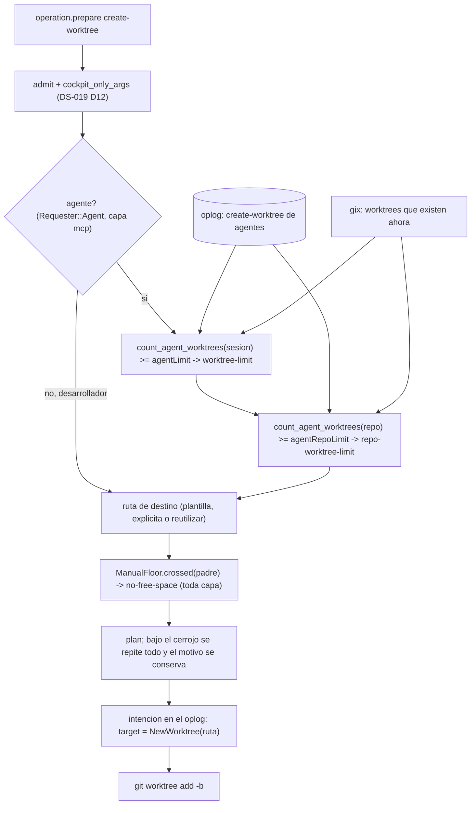

# DS-US-GRP-024 · Un agente no puede llenar el disco ni la flota creando worktrees

## Contexto rápido

Un agente que llama a `create_worktree` en bucle hace unos 1200 checkouts por hora (security-review de DS-US-MCP-019, H-01, Alto). Con el disco lleno fallan la captura de snapshots y el oplog, y se pierde el undo de todos los agentes del repo (NFR-01). Esta historia **mitiga** H-01 con tres límites que se comprueban en el brazo común de `create-worktree` del daemon. Cierra la amplificación **por creación**; no cierra el crecimiento posterior de los worktrees (un `target/` de decenas de GB), que sigue siendo riesgo residual cubierto por SEC-TMC-12 (§ Gate de seguridad):

1. **Tope por sesión** (DS-US-MCP-019 D14): un agente no tiene a la vez más de `worktree.agentLimit` (8) worktrees creados por su sesión en un repo → `worktree-limit`.
2. **Techo por repo** (D18 ii): los agentes no tienen a la vez más de `worktree.agentRepoLimit` (32) worktrees en el repo, cuente la sesión que cuente y aunque ya haya cerrado → `repo-worktree-limit`.
3. **Suelo de espacio libre** (D18 i, SEC-TMC-12): nadie crea un worktree si el espacio libre del volumen del destino, **menos el tamaño estimado del checkout**, queda por debajo del mayor de 5 GiB y el 5 % → `no-free-space` (D7, D15). **Aplica también al desarrollador** (D8, decisión del PO del 2026-11-21).

No hay contador: los dos topes se **recalculan en cada comprobación** a partir del oplog (quién creó qué) y de la lista de worktrees que Git tiene en ese momento (qué sigue existiendo). Así un reinicio no los pone a cero y un worktree borrado libera su hueco sin hacer nada más (D3).

Estado de `main` leído el 2026-11-21 (sin compilar): **US-MCP-019 no está en `main`** (no existe `crates/core/src/executor/ops/create_worktree.rs`; `ARMS = [Commit, Snapshot]`), así que esta DS parte del contrato de DS-US-MCP-019 y no empieza hasta que esa historia entre (`blocked_by`). Sí están: `RequesterKey` y `key_of` (`crates/core/src/channel/limits.rs:24`, `:144`), `FreeSpaceFloor` (5 GiB, 5 %, `timemachine/continuous.rs:113-125`), `FreeSpaceProbe`, `VolumeProbe` y `ManualFloor::crossed`, que falla cerrado (`timemachine/manual.rs:265-318`), el oplog con `requester`, `requester_session` y `target` (`oplog/model.rs:167`, `:243-258`; `schema.rs:34-49`), `admit` (`executor/mod.rs:186`) y la conversión a `state-changed` del replan bajo el cerrojo (`executor/mod.rs:991-996`). `McpToolError::ALL` tiene 34 códigos (`crates/api/src/mcp_view.rs:141`); DS-US-MCP-019 lo lleva a 42.

⚠️ **ASSUMPTION**: no hay `architecture-constitution.md`; rigen `AGENTS.md` y los ADR de `must_read`.

## Gaps

**Dependencia (`blocked_by: [US-MCP-019]`), no un hueco de decisión**: US-MCP-019 no está en `main` (no hay brazo `create-worktree`, ni `WorktreeSite`, ni `no-free-space`/`repo-worktree-limit`). Ninguna tarea empieza sin ella en `main`. Si DS-US-MCP-019 T004 paso 2.3b entró tal cual (conteo solo por rama), T005 lo sustituye por el conteo de D2.
| Id | Hueco | Severidad | Alcance | Qué se hace mientras |
|---|---|---|---|---|
| G1 | Fuera de Unix `VolumeProbe::available_bytes` devuelve `u64::MAX` (`manual.rs:321-324`): no hay sonda de disco en Windows. *Pendiente: etapa de validación multiplataforma* | Bloquea liberación en Windows | Solo Windows | Mientras tanto, **un agente no crea worktrees fuera de Unix**: la sonda del brazo (`WorktreeVolumeProbe`, D16) devuelve error y el suelo falla cerrado → `no-free-space`. El desarrollador crea sin suelo efectivo. La sonda real con `GetDiskFreeSpaceExW` (bytes libres para el llamante y total) va en `crates/winsys` en la etapa multiplataforma; fila nueva en `xplat-pendientes.md` (T008). macOS y Linux (`statvfs`, CI ubuntu) no bloquean |
| G2 | `raptor new` y la TUI de creación (US-WTL-001, US-CKP-018) no están en `main` | Informativo | Escenarios del desarrollador y «por la CLI» | Se prueban en el canal: una conexión de capa `cockpit` (desarrollador) y una CLI con perfil `mcp` (agente) mandan `operation.prepare` de `create-worktree`. Los textos de la CLI y la TUI para `no-free-space` los entregan esas historias (§ Notas) |
| G3 | La guía para agentes (US-MCP-020, D5) exige una entrada por código estable | Informativo | `worktree-limit`, `repo-worktree-limit`, `no-free-space` | Quien entre segundo en `main` añade las entradas de § Contratos compartidos y sube `GUIDE_VERSION` (D11) |

## Decisiones

Decisión del orquestador (2026-11-21), validada por Arquitecto: D1 a D13. D8 recoge además la validación del PO del 2026-11-21. D14 a D20 (security-review del 2026-11-21) son **Decisión del orquestador (2026-11-21), validada por Arquitecto/Seguridad** y prevalecen sobre la redacción anterior de D2, D3, D4, D6 y D7 donde la precisan. Ninguna cambia el alcance de la historia; D8 cambia la regla de DS-US-MCP-019 D18 («la capa `cockpit` no tiene el suelo») y por eso lleva enmienda (§ Notas).

| # | Decisión |
|---|---|
| D1 | **Qué construye esta DS.** El tope por sesión (D14 de DS-US-MCP-019), el conteo común de los dos topes (sustituye a `WorktreeSite::agent_worktrees` de DS-US-MCP-019 T003), el suelo para toda capa (D8) y la certificación de los tres límites de punta a punta, por el MCP y por la CLI. Lo demás de `create-worktree` es de DS-US-MCP-019 |
| D2 | **Qué cuenta como «worktree de un agente».** Una operación del oplog con `kind = protected`, `subtype = "create-worktree"` y `requester = Agent { session_id, .. }`, en cualquier estado, **mientras exista su worktree**. Existe si Git lo lista ahora en el directorio común del repo (lectura con `gix`, excluido el worktree principal), su carpeta es un directorio (`symlink_metadata`) y coincide con la operación por (a) la ruta: `target = NewWorktree(ruta)` (D4) es la ruta canónica del worktree listado; o (b) la rama: la `HEAD` del worktree listado es una ref de `scope.refs` de la operación (`refs/heads/<rama>`). Cada worktree listado cuenta una sola vez. La coincidencia por ruta cubre al agente que cambia de rama dentro de su worktree nuevo (lo normal en un agente); la de rama cubre las filas sin `target` (D4) y un `git worktree move`. Un humano que saca una rama de agente en su worktree hace que ese worktree cuente: es conservador y se acepta. **Quién es humano**: `layer_for` da capa `mcp` a todo agente y `admit` rechaza la capa `mcp` sin agente (`executor/mod.rs:176-193`), así que un agente siempre queda como `Requester::Agent` y el desarrollador (capa `cockpit`) como `Requester::Unattributed`, que **nunca cuenta**. No hace falta columna nueva para distinguirlos. Si aun así llega un llamante con capa `mcp` o perfil `mcp` cuyo solicitante no es `Requester::Agent`, se rechaza antes de contar (D14): no se cuenta por `channel = 'mcp'` |
| D3 | **Durable sin contador.** Los dos topes se calculan en cada comprobación con `count_agent_worktrees` (§ Firmas): una consulta al oplog filtrada por `subtype` (y por `requester_session` para el tope de sesión, índice `operations_by_session`) y la lista de worktrees de `gix`, ambas leídas en ese momento y nunca cacheadas. **Tras reiniciar** no hay nada que reconstruir: el oplog es el de disco y la lista es la de Git. **El hueco se libera** cuando Git deja de listar el worktree (`git worktree remove`, `raptor` del desarrollador, `git worktree prune`) o cuando su carpeta ya no existe (un worktree «prunable» no ocupa disco). Se descarta un contador persistido aparte: duplicaría el oplog y podría desincronizarse de lo que hay en disco. Las operaciones del oplog no se purgan (solo los snapshots, US-TMC-022); si una historia futura purga operaciones, debe conservar las `create-worktree` de agentes cuyo worktree exista |
| D4 | **La ruta queda en el oplog.** `Target` gana la variante `NewWorktree(String)` (serde `"new-worktree"`), con la ruta canónica del plan (`OpPlan.expected["path"]`, DS-US-MCP-019 T004 paso 2.7). La escribe la intención de la operación, antes de correr nada (`protected/mod.rs:548`, hoy `Target::None`). Es aditiva en la columna `target` (TEXT con JSON): sin migración SQL y sin cambio de formato de la cadena. `scope.worktrees` sigue vacío, como fija DS-US-MCP-019 T004 paso 3 (el worktree no existe al registrar la intención). Las filas `create-worktree` anteriores (con `Target::None`) solo coinciden por rama. La línea de tiempo trata `NewWorktree` como `None` (`timeline.rs:364`): no deshace nada distinto. Se descartan: meter la ruta en `scope.worktrees` (el ejecutor y la captura tratan esas rutas como worktrees existentes) y una fila nueva en el diario (cambia el `CHECK` de `journal.entry` y obliga a reconstruir la tabla) |
| D5 | **Clave del tope por sesión = clave del solicitante de los cubos** (ADR-MCP-001 § 6, D9). `RequesterKey::Agent(session_id)` es el `requester_session` del oplog: la misma sesión por `raptor-mcp`, por la CLI que lanza (perfil `mcp`, TS-GRP-010) y por los descendientes del ejecutor (`key_of`, `limits.rs:154-156`), así que suman en un solo tope. `RequesterKey::Unattributed` nunca llega a crear (D2, `admit`). Una sesión nueva del mismo agente empieza con su tope a 0; lo que acota al agente entre sesiones es el techo del repo, que cuenta los worktrees de sesiones ya cerradas mientras existan (validación del PO, punto 3) |
| D6 | **Orden y momento de las comprobaciones** en `plan_op`, después de `admit` y de `cockpit_only_args` (DS-US-MCP-019 D12): (0) capa `mcp` o perfil `mcp` sin `Requester::Agent` → `UnattributedWithoutCockpit` (D14); (1) solo agente, en el lugar del paso 2.3b de DS-US-MCP-019: tope por sesión → `WorktreeLimit`; (2) solo agente: techo por repo → `RepoWorktreeLimit`; (3) **toda capa y toda ruta**, en cuanto se conoce la ruta de destino (tras el paso 2.6 de DS-US-MCP-019 en la ruta de plantilla; tras validar la ruta explícita de DS-US-CKP-018 y la de reutilizar de DS-US-WTL-001): suelo → `NoFreeSpace`. Se repiten bajo el cerrojo del repo con el replan, y ahí **conservan su motivo** (`RejectReason::is_capacity`, § Firmas): hoy todo rechazo del replan pasa a `state-changed` (`executor/mod.rs:991-996`), y la historia pide `no-free-space` cuando el espacio se agota entre preparar y crear. Los recuentos y el espacio **no entran en la huella** del plan: un worktree borrado entre preparar y ejecutar no da `state-changed`. Bajo el cerrojo, dos `create-worktree` del mismo repo se serializan, así que el recuento es exacto (sin carrera entre dos peticiones de la misma sesión); el cerrojo global de D15 serializa además las de repos distintos frente al suelo |
| D7 | **Cómo se mide el suelo.** Con `ManualFloor { floor: FreeSpaceFloor::default(), reserve_bytes, probe }.crossed(dir)` (`manual.rs:278-299`): el mismo umbral que la captura continua y la manual, sin código nuevo de medida; `reserve_bytes` es el tamaño estimado del checkout (D15). `dir` es el padre de la ruta nueva, que DS-US-MCP-019 ya exige que exista y no sea enlace (`new_path.rs`); si no existe, el antepasado existente más cercano, recorrido con `symlink_metadata` sin seguir enlaces. `statvfs` sobre `f_bavail × f_frsize` (lo disponible para el usuario, no para root) y `f_blocks × f_frsize`, por `rustix`, sin shell ni proceso. **Margen confirmado**: el mayor de 5 GiB (5 × 2³⁰ bytes) y el 5 % del total, que es `FreeSpaceFloor::default()` y SEC-TMC-12; con 200 GiB, 10 GiB, como dice la historia. `disponible < suelo + reserva` rechaza; igual pasa. **Falla cerrado**: si la sonda no lee el volumen, rechaza (`crossed` devuelve `true`). El suelo **no es configurable**: no hay clave que lo baje. La sonda llega al brazo por `WorktreeSite` (`Arc<dyn FreeSpaceProbe>`; en producción `WorktreeVolumeProbe`, D16), así que las pruebas la sustituyen y nunca llenan un disco real. Windows: G1, D16 |
| D8 | **La capa del desarrollador (validación del PO, 2026-11-21).** (1) El desarrollador (capa `cockpit` sin perfil `mcp`: TUI, `raptor new`) no tiene tope por sesión. (2) Sus worktrees no cuentan en el techo (D2: `Requester::Unattributed`). (3) Los de un agente cuentan mientras existan, aunque su sesión ya cerró (D3, D5). (4) **El suelo de espacio sí le aplica**, con el mismo rechazo `no-free-space` y sin forma de saltarlo en el MVP: NFR-01 no distingue quién llena el disco, y un `git worktree add` del humano que agota el volumen del perfil rompe el oplog y los snapshots de todos los agentes igual que uno de un agente. Opciones evaluadas: (a) solo aviso al humano: deja abierto el fallo de NFR-01 que el suelo existe para cerrar; (b) rechazo con salto explícito (`--force`): añade una superficie de confirmación que un agente con la CLI podría intentar usar y que el MVP no necesita; (c) rechazo sin salto: gana (c). Coste aceptado: con el disco casi lleno el desarrollador libera espacio antes de crear. La comprobación vive en el brazo común (D6 paso 3), no en la herramienta MCP: cubre la TUI, `raptor new`, la ruta explícita (US-CKP-018), reutilizar rama y la semilla (US-WTL-001). Motivo del canal `no-free-space` (`-32014`). Enmienda propuesta a la regla de cockpit junto a BR-CKP-ELIG-005 (E1) y a DS-US-MCP-019 D18 (E2) |
| D9 | **Configuración.** `worktree.agentLimit`: entero de 1 a 64, **8 por defecto**. `worktree.agentRepoLimit`: entero de 1 a 256, **32 por defecto** (ya lo crea DS-US-MCP-019 T002; aquí no cambia). Las dos en la sección `worktree` (compartida con `worktree.seedBuild` de DS-US-WTL-001 T009), con niveles perfil y local personal (`x-gitraptor-levels = ["profile", "local"]`); gana la local. En `.gitraptor/settings.json` (equipo) se ignoran con diagnóstico. Fuera de rango o de otro tipo: se descarta el valor con diagnóstico y rige el valor por defecto (no se recorta al extremo, como pide el esquema de la historia: 0 → 8, 65 → 8). Se leen frescas en cada comprobación (`WorktreeSite`), sin reiniciar el daemon. Bajar el tope por debajo de lo que ya existe no borra nada: solo rechaza las siguientes creaciones |
| D10 | **Código nuevo `worktree-limit`.** `RejectReason::WorktreeLimit` (`"worktree-limit"`, `-32014`, sin más `data` que `reason`) y `McpToolError::WorktreeLimit` (`"worktree-limit"`) al final del enum y de `ALL` (de 42 a 43 si DS-US-MCP-019 entró con sus 8; si no, +1 sobre lo que haya). Textos de DS-US-MCP-019 D14, sin `params`: ni el número de worktrees, ni el tope, ni la rama (un rechazo no da información que el agente pueda usar para afinar un bucle) |
| D11 | **Guía para agentes (US-MCP-020).** Si su `skill.md` ya está en `main`, este PR añade las entradas de `worktree-limit`, `repo-worktree-limit` y `no-free-space` (§ Contratos compartidos), sube `GUIDE_VERSION` y su fila de `GUIDE_HISTORY` y regenera la copia del repo (DS-US-MCP-020 D4, D5, D11). Si no, lo hace el PR de US-MCP-020 |
| D12 | **Sin ventana de tiempo.** El tope es de existencias, no de ritmo: el ritmo ya lo limita el cubo de escrituras por `RequesterKey` (`limits.rs`). DS-US-MCP-019 D14 ya lo descartó |
| D13 | **Error al leer.** Si falla la consulta al oplog o la lista de worktrees de `gix`, el plan se rechaza con el motivo de lectura que el brazo ya usa para un repo ilegible (el MCP lo traduce a `repo-unavailable`): falla cerrado y con un código que dice la verdad. Sustituye al «un error de lectura del oplog cuenta como lleno» de DS-US-MCP-019 T003, que daría `repo-worktree-limit` con un repo vacío. L-1 la acota (D18) |

### Decisiones de la revisión de seguridad (2026-11-21)

Todas son **Decisión del orquestador (2026-11-21), validada por Arquitecto/Seguridad**. Ninguna cambia el alcance de la historia.

| # | Hallazgo | Decisión | Alternativas descartadas |
|---|---|---|---|
| D14 | A-1 (Alto) | **Agente sin atribuir: fallo cerrado.** En `plan_op`, primer paso de D6: si `layer == Layer::Mcp \|\| caller.mcp` y el solicitante no es `Requester::Agent` (p. ej. un agente que no es Claude, lanzado desde un terminal, con perfil `mcp` por ascendencia no confirmable, TS-GRP-010), `create-worktree` se rechaza con `RejectReason::UnattributedWithoutCockpit` (MCP `unattributed`, `apps/mcp/src/engine.rs:516`) y no se crea nada. Así ningún creador del lado agente queda fuera del recuento. Enmienda la prueba de DS-US-MCP-019 `the_floor_and_ceiling_apply_to_the_mcp_profile_with_cockpit_layer` (E2) | Contar las filas `channel = 'mcp'`: un agente por la CLI queda como `cli`, y todos los sin atribuir compartirían un tope que el desarrollador no puede ver ni gestionar |
| D15 | A-2 (Alto) | **Reserva del checkout, volumen del perfil y serialización.** (1) `reserve_bytes` = tamaño estimado del checkout: suma de los tamaños de los blobs del árbol de la base (`gix`, cabeceras de objeto sin descomprimir contenidos; en la ruta de reutilizar, el árbol de la rama reutilizada). Si no se puede estimar → error de lectura del plan (fallo cerrado, D13). (2) Si el destino está en el mismo dispositivo (`st_dev`) que `profile.data`, la reserva suma además la del previo garantizado (la `reserve_bytes` de la captura manual): previo y checkout salen del mismo disco. Si está en otro dispositivo, el volumen del perfil lo protege su propio suelo (SEC-TMC-12). (3) **Cerrojo global de `create-worktree`** en el daemon (`Executor::create_worktree_gate: Mutex<()>`), tomado después del cerrojo del repo y antes del replan, y soltado cuando termina el paso: dos creaciones, aunque sean de repos distintos sobre el mismo volumen, nunca ven el mismo espacio libre. Orden fijo (repo → global), sin riesgo de interbloqueo | Reserva 0: veinte checkouts paralelos de 2 GiB pasan el suelo a la vez. Cerrojo por volumen (`st_dev`): más concurrencia, pero las creaciones son raras y un mapa de cerrojos añade estado sin ganancia medible |
| D16 | M-1 | **Fuera de Unix, un agente no crea.** `WorktreeVolumeProbe` (nueva, en `limits.rs`) usa `statvfs` en Unix y devuelve `Err(Unsupported)` fuera; `ManualFloor::crossed` lo trata como bajo el suelo → `no-free-space` para la capa `mcp` y el perfil `mcp`. El desarrollador en Windows crea sin suelo efectivo hasta la sonda real (`GetDiskFreeSpaceExW` en `crates/winsys`, etapa multiplataforma, G1). No se toca `VolumeProbe` de la captura | Reutilizar `VolumeProbe` (`u64::MAX`): el suelo no existiría para agentes en Windows |
| D17 | M-2 | **Índice y consulta ligera.** Migración nueva al final de `OPLOG_MIGRATIONS` (`oplog/schema.rs:11`, solo se añade): `CREATE INDEX IF NOT EXISTS operations_create_worktree ON operations(requester_session, seq) WHERE subtype = 'create-worktree';`. `Oplog::agent_created_worktrees(session: Option<&str>) -> Result<Vec<CreatedWorktreeRow>>` lee solo `requester`, `scope` y `target` de esas filas, sin construir `OperationView` ni leer el diario (el estado no importa, D2). El cruce con la lista de Git va con `HashMap` por ruta y por ref: O(filas + worktrees). Presupuesto: ≤ 200 ms en build de depuración con 2000 filas y 1000 worktrees listados (prueba) | `oplog.operations()` con `OperationFilter.subtype`: deriva estado y diario por fila, que este recuento no usa |
| D18 | L-1 | **Lista de Git parcialmente ilegible.** Si una entrada de `<común>/worktrees/<id>` no se lee (sin `gitdir`, `HEAD` corrupta) pero su carpeta existe, cuenta en el **techo del repo** de forma conservadora (no se puede atribuir a una sesión, así que no suma al tope de sesión). Solo un directorio común ilegible da el error de lectura del plan (`repo-unavailable`). Se reconoce que un worktree «prunable» que no cuenta puede seguir ocupando disco (carpeta movida fuera de la ruta registrada); eso lo cubre el suelo, no el techo | Tratar una entrada ilegible como error de todo el repo: un worktree roto bloquearía todas las creaciones |
| D19 | L-2 | **Compatibilidad hacia atrás.** Un binario anterior no sabe leer `Target::NewWorktree`. La migración de D17 sube `user_version`, así que un binario anterior abre el oplog con `SchemaTooNew` (`profile/error.rs:28-32`): no lo toca y no observa el repo, en vez de leer mal una fila. Se declara en la enmienda de ADR-TMC-003 (E3): bajar de versión con filas nuevas deja el repo sin observar hasta volver a subir. Prueba de bajada: `an_older_schema_list_refuses_the_new_oplog` (abre un oplog migrado con `OPLOG_MIGRATIONS` sin la última entrada y espera `SchemaTooNew`, sin leer filas) | Una variante sin subir versión: el binario anterior fallaría al leer la fila en mitad de una línea de tiempo |
| D20 | I-1 | **Configuración desde un agente.** Un futuro `raptor configure-agents` (US-MCP-021/022) debe negarse a escribir cualquier clave `worktree.*` con perfil `mcp`. Se anota en § Notas para esa historia; hoy ningún método del canal escribe configuración | — |

## La forma



## Plan de implementación

### T001 — Escribir en rojo las pruebas de los tres límites

**Objetivo.** Fijar los escenarios de la historia, D2 a D8 y el gate de seguridad antes de tocar código de producción.

**Ubicación.**
- `crates/core/src/executor/ops/create_worktree/limits.rs` (**CREATE**): firmas de § Firmas del stack. Los stubs devuelven `Ok(0)` y `false` (no `todo!()`: el brazo los llama en producción).
- `crates/core/src/executor/ops/create_worktree/limits_tests.rs` (**CREATE**) y su línea `#[path]`.
- `crates/core/tests/us_grp_024_worktree_limits.rs` (**CREATE**): canal, daemon en proceso, repos y perfiles temporales.
- `apps/mcp/tests/us_grp_024_worktree_limit.rs` (**CREATE**): proceso `raptor-mcp`, arnés de `apps/mcp/tests/handshake.rs`.

**Reglas**
- Repos de `gitraptor_testkit::Fixture` y perfiles temporales, nunca este repo (NFR-01).
- El espacio libre sale de una `FreeSpaceProbe` de prueba montada en el `WorktreeSite` de prueba (valores fijos en bytes, y una que cambia en la segunda lectura para el escenario del cerrojo). Ninguna prueba escribe archivos grandes ni llena un volumen.
- Los topes se bajan por configuración del perfil temporal (`worktree.agentLimit = 2`, `worktree.agentRepoLimit = 3`) para no crear 32 worktrees; una prueba aparte usa los valores por defecto con el recuento puro de `count_agent_worktrees` sobre filas y listas sintéticas.
- La clave compartida por MCP y CLI se monta como en `crates/core/tests/requester_budget_any_client.rs`.

- **Depende:** US-MCP-019 en `main` (`blocked_by`)
- **Refs:** D2–D8; DS-US-MCP-019 D14, D18
- **Aceptación:** `cargo test -p gitraptor-core --test us_grp_024_worktree_limits` y `cargo test -p gitraptor-core executor::ops::create_worktree::limits` compilan y fallan.

### T002 — Añadir el código `worktree-limit` al contrato

**Objetivo.** El motivo del canal, el código MCP y sus textos (D10).

**Ubicación.** `crates/api/src/catalog.rs` (**MODIFY**: `RejectReason::WorktreeLimit` junto a `RepoWorktreeLimit`, y `RejectReason::is_capacity`); `crates/api/src/mcp_view.rs` (**MODIFY**: `McpToolError::WorktreeLimit`, `ALL`, `as_str`); `apps/mcp/src/messages.rs` (**MODIFY**: `message` y `action` es/en); `apps/mcp/src/engine.rs` (**MODIFY**: `rejected_refusal`, `WorktreeLimit → worktree-limit`).

**Reglas**
- Al final del enum y de `ALL`; el tamaño de `ALL` sube en uno.
- `mcp_view.rs::mcp_tool_codes_are_kebab_and_closed` sigue en verde con el código nuevo.
- `is_capacity` devuelve `true` solo para `WorktreeLimit`, `RepoWorktreeLimit` y `NoFreeSpace`.

- **Depende:** T001
- **Refs:** D6, D10
- **Aceptación:** `cargo test -p gitraptor-api` en verde (`mcp_tool_codes_are_kebab_and_closed` con el código nuevo). `worktree_limit_over_mcp_has_the_story_texts` (mcp) pasa en T007.

### T003 — Leer `worktree.agentLimit`

**Objetivo.** La clave de D9 en el modelo de configuración, con niveles, rango y diagnóstico.

**Ubicación.** `crates/policy/src/settings/model.rs` (**MODIFY**: campo `agent_limit: Option<u32>` en la sección `worktree`, `#[serde(rename_all = "camelCase")]`, `#[schemars(extend("x-gitraptor-levels" = ["profile", "local"]))]`); `crates/policy/src/settings/worktree_limits_tests.rs` (**CREATE**) y su línea `#[path]` en `settings/mod.rs`.

**Reglas**
- Si la sección `worktree` no existe aún (ni DS-US-MCP-019 T002 ni DS-US-WTL-001 T009 en `main`), se crea aquí; si existe, solo se añade el campo.
- Rango `AGENT_LIMIT_RANGE = 1..=64`, por defecto `AGENT_LIMIT_DEFAULT = 8`. Fuera de rango o tipo distinto → se descarta con diagnóstico y rige 8 (D9).
- Textos del diagnóstico en § Forma de la configuración.

- **Depende:** T001
- **Refs:** D9; ADR-GRP-007, ADR-GRP-008
- **Aceptación:** `cargo test -p gitraptor-policy settings::worktree_limits_tests` en verde, con las cinco filas del esquema de la historia.

### T004 — Guardar la ruta del worktree nuevo en el oplog

**Objetivo.** `Target::NewWorktree(ruta)` en la intención de cada `create-worktree` (D4) y el filtro por subtipo.

**Ubicación.** `crates/core/src/timemachine/oplog/model.rs` (**MODIFY**: variante `NewWorktree(String)` de `Target`); `crates/core/src/timemachine/oplog/schema.rs` (**MODIFY**: migración del índice parcial de D17 al final de `OPLOG_MIGRATIONS`); `crates/core/src/timemachine/oplog/query.rs` (**MODIFY**: `Oplog::agent_created_worktrees` y `CreatedWorktreeRow`, D17); `crates/core/src/timemachine/protected/mod.rs` (**MODIFY**: `NewOperation.target` sale del plan, `:548`); `crates/core/src/timemachine/timeline.rs` (**MODIFY**: `NewWorktree` como `None` en `:364`); `crates/core/src/timemachine/oplog/new_worktree_target_tests.rs` (**CREATE**).

**Reglas**
- Solo `create-worktree` escribe `NewWorktree`; el resto sigue con `Target::None`.
- `target` no necesita migración ni cambia el formato de la cadena: es otra forma del JSON de `target`. `verify_chain` sigue en verde con filas antiguas y nuevas mezcladas.
- La única migración es el índice de D17 (`IF NOT EXISTS`, solo se añade); sube `user_version`, que es lo que hace que un binario anterior se niegue a abrir el oplog (D19).
- La ruta es la canónica de `OpPlan.expected["path"]`; nunca la del argumento del cliente.

- **Depende:** T001
- **Refs:** D4, D17, D19; ADR-TMC-003
- **Aceptación:** `cargo test -p gitraptor-core timemachine::oplog` en verde, con `an_older_schema_list_refuses_the_new_oplog`.

### T005 — Contar los worktrees de agentes

**Objetivo.** `count_agent_worktrees` (D2, D3, D13) y su lugar en `WorktreeSite`.

**Ubicación.** `crates/core/src/executor/ops/create_worktree/limits.rs` (**MODIFY**); `crates/core/src/executor/ops/create_worktree/site.rs` (**MODIFY**: `agent_counts` sustituye a `agent_worktrees`; campos `agent_limit`, `agent_repo_limit` y `probe` en el sitio).

**Pasos**
1. `listed_worktrees(common_dir)`: worktrees de `gix` sin el principal, cada uno con ruta canónica, `HEAD` simbólica (o ninguna), si su carpeta es un directorio y si la entrada se leyó (`readable`, D18).
2. `count_agent_worktrees(rows, listed) -> AgentCounts`: función pura. Filtra `rows` por `Requester::Agent`; cuenta cada worktree listado con carpeta que coincide con alguna fila por ruta (`Target::NewWorktree`) o por rama (`scope.refs`), una vez, con `HashMap` por ruta y por ref (D17). Las entradas ilegibles con carpeta suman solo al techo del repo (D18).
3. `DaemonSite::agent_counts(repo, session)`: lee `oplog.agent_created_worktrees(None)` (repo) y, para la sesión, filtra en memoria por `requester_session`; devuelve `AgentCounts { session, repo }`. Un directorio común ilegible o un fallo del oplog → error de lectura del plan (D13).
4. `estimate_checkout_bytes(repo, tree_oid)`: suma de tamaños de blobs del árbol con `gix` (cabeceras), y `same_device(a, b)` por `st_dev` (D15).

- **Depende:** T004
- **Refs:** D2, D3, D5, D13, D15, D17, D18
- **Aceptación:** `cargo test -p gitraptor-core executor::ops::create_worktree::limits` en verde, con `counting_2000_rows_against_1000_worktrees_fits_the_budget`.

### T006 — Aplicar los tres límites en el brazo y bajo el cerrojo

**Objetivo.** El orden de D6, el suelo para toda capa (D8) y los motivos que sobreviven al replan.

**Ubicación.** `crates/core/src/executor/ops/create_worktree.rs` (**MODIFY**: `plan_op`); `crates/core/src/executor/mod.rs` (**MODIFY**: replan bajo el cerrojo, `:991-996`); `crates/core/src/daemon/serve.rs` (**MODIFY**, solo si el sitio no recibe aún la sonda: `VolumeProbe` al montar `DaemonSite`).

**Pasos**
1. Agente = `layer == Layer::Mcp || caller.mcp`. Si es agente y el solicitante no es `Requester::Agent` → `UnattributedWithoutCockpit` (D14). Para un agente, antes de resolver la ruta: `agent_counts`; `session >= agent_limit` → `WorktreeLimit`; si no, `repo >= agent_repo_limit` → `RepoWorktreeLimit`.
2. En toda capa, en cuanto la ruta de destino está resuelta y validada (plantilla, explícita o reutilizar): `reserve = estimate_checkout_bytes(..)` más la reserva del previo si `same_device(padre, profile.data)` (D15); `floor_crossed(probe, &ruta, reserve)` → `NoFreeSpace`.
3. `Executor::create_worktree_gate`: para `OperationId::CreateWorktree`, se toma después del cerrojo del repo y antes del replan, y se suelta al terminar el paso (D15).
4. En el replan bajo el cerrojo: `Err(ExecError::Rejected(r)) if r.is_capacity() => return refuse(&plan, r)`; cualquier otro motivo sigue siendo `state-changed`.
5. Ni los recuentos, ni el espacio, ni la reserva estimada entran en `expected` ni en la huella.
6. Log del rechazo (D19 de DS-US-MCP-019): `plan_id`, motivo y, para los topes, los dos números (`count`, `limit`); nunca rama ni ruta en claro.

- ⛔6.1 Ningún camino del brazo crea rama, carpeta o worktree después de un rechazo de capacidad.
- ⛔6.2 La capa `cockpit` sin perfil `mcp` nunca recibe `WorktreeLimit` ni `RepoWorktreeLimit`; sí `NoFreeSpace`.

- **Depende:** T002, T003, T005
- **Refs:** D6, D7, D8, D14, D15, D16
- **Aceptación:** `cargo test -p gitraptor-core --test us_grp_024_worktree_limits` y `cargo test -p gitraptor-core executor::` en verde; siguen en verde las pruebas de DS-US-MCP-019 (`create_worktree_tests`, `channel_protected`).
- **Guard ⛔6.1:** `us_grp_024_worktree_limits::a_capacity_refusal_creates_nothing` (ramas, worktrees que lista Git, carpetas y filas `create-worktree` del oplog iguales antes y después, para los tres códigos).
- **Guard ⛔6.2:** `us_grp_024_worktree_limits::the_developer_has_no_agent_caps_but_has_the_floor`.

### T007 — La herramienta MCP y la guía

**Objetivo.** Los tres rechazos por `create_worktree` con su texto, y la guía al día (D11).

**Ubicación.** `apps/mcp/tests/us_grp_024_worktree_limit.rs` (**MODIFY**, ya creado en T001); si US-MCP-020 está en `main`: `crates/api/src/mcp_view/agent_guide/skill.md`, `crates/api/src/mcp_view/agent_guide.rs` (`GUIDE_VERSION`, `GUIDE_HISTORY`), `.claude/skills/gitraptor/SKILL.md` (**MODIFY**).

**Reglas**
- Las respuestas son `isError: true`, `{code, message, action}`, sin `params`, ≤ 80 tokens (RES-MCP-03).
- No se toca `apps/mcp/src/server.rs`: la herramienta ya existe (DS-US-MCP-019 T006).

- **Depende:** T006
- **Refs:** D10, D11; DS-US-MCP-020 D5
- **Aceptación:** `cargo test -p gitraptor-mcp --test us_grp_024_worktree_limit` en verde; si aplica, `cargo test -p gitraptor-api --test us_mcp_020_agent_guide` y `cargo test -p gitraptor-cli --test us_mcp_020_agent_guide` en verde.

### T008 — Documentos y estado

**Objetivo.** Dejar constancia de lo que cambia fuera del código.

**Ubicación.** `docs/requirements/features/mcp/user-stories/US-GRP-024-tope-de-worktrees-por-agente.md` (**MODIFY**: `status: implemented`, lo hace el PR según el flujo del proyecto); `xplat-pendientes.md` (**MODIFY**: fila de G1).

**Reglas**
- Las enmiendas de § Notas las aplica cada dueño; el PR las enumera.

- **Depende:** T007
- **Refs:** G1; § Notas
- **Aceptación:** revisión del PR.

Puerta final: `cargo fmt --all --check && cargo clippy --workspace --exclude gitraptor-desktop --all-targets -- -D warnings && cargo test -p gitraptor-api -p gitraptor-policy -p gitraptor-core -p gitraptor-mcp`.

## Estructura de ficheros

```text
crates/api/src/catalog.rs                                        MODIFY  RejectReason::WorktreeLimit, is_capacity
crates/api/src/mcp_view.rs                                       MODIFY  McpToolError::WorktreeLimit, ALL
crates/policy/src/settings/model.rs                              MODIFY  worktree.agentLimit
crates/policy/src/settings/worktree_limits_tests.rs              CREATE
crates/core/src/timemachine/oplog/model.rs                       MODIFY  Target::NewWorktree
crates/core/src/timemachine/oplog/schema.rs                      MODIFY  índice parcial create-worktree (D17)
crates/core/src/timemachine/oplog/query.rs                       MODIFY  agent_created_worktrees (D17)
crates/core/src/timemachine/oplog/new_worktree_target_tests.rs   CREATE
crates/core/src/timemachine/protected/mod.rs                     MODIFY  target desde el plan
crates/core/src/timemachine/timeline.rs                          MODIFY  NewWorktree como None
crates/core/src/executor/mod.rs                                  MODIFY  motivos de capacidad bajo el cerrojo, create_worktree_gate
crates/core/src/executor/ops/create_worktree.rs                  MODIFY  orden de D6
crates/core/src/executor/ops/create_worktree/site.rs             MODIFY  agent_counts, límites, sonda
crates/core/src/executor/ops/create_worktree/limits.rs           CREATE  recuento y suelo
crates/core/src/executor/ops/create_worktree/limits_tests.rs     CREATE
crates/core/tests/us_grp_024_worktree_limits.rs                  CREATE  canal: escenarios de la historia
apps/mcp/src/messages.rs                                         MODIFY  textos de worktree-limit
apps/mcp/src/engine.rs                                           MODIFY  rejected_refusal
apps/mcp/tests/us_grp_024_worktree_limit.rs                      CREATE  proceso raptor-mcp
```

Puntos calientes compartidos con DS-US-MCP-019, DS-US-WTL-001 y DS-US-CKP-018: `catalog.rs`, `mcp_view.rs`, `settings/model.rs` (sección `worktree`) y `create_worktree.rs`. Esta historia entra después de US-MCP-019; con las otras dos se coordina en el PR (`extender-sin-archivos-compartidos.md`).

## Contratos compartidos

### Tipos y datos compartidos

```rust
// crates/api/src/catalog.rs — en RejectReason, junto a RepoWorktreeLimit (DS-US-MCP-019)
/// The agent session already has `worktree.agentLimit` worktrees in this repo (agents only).
WorktreeLimit, // wire: "worktree-limit"

impl RejectReason {
    /// A capacity refusal keeps its reason when the plan is redone under the lock (D6).
    pub fn is_capacity(&self) -> bool; // WorktreeLimit | RepoWorktreeLimit | NoFreeSpace
}

// crates/api/src/mcp_view.rs — al final de McpToolError y de ALL
WorktreeLimit, // "worktree-limit"

// crates/core/src/timemachine/oplog/model.rs — en Target
/// A `create-worktree`: the canonical path of the new worktree, recorded at intent (D4).
NewWorktree(String), // serde: "new-worktree"

// crates/core/src/timemachine/oplog/query.rs (D17)
pub struct CreatedWorktreeRow { pub requester: Requester, pub scope: Scope, pub target: Target }
impl Oplog {
    /// `create-worktree` rows only, through the partial index; no state, no journal.
    pub fn agent_created_worktrees(&self, session: Option<&str>) -> Result<Vec<CreatedWorktreeRow>>;
}

// crates/core/src/timemachine/oplog/schema.rs — nueva entrada al final de OPLOG_MIGRATIONS (D17)
// CREATE INDEX IF NOT EXISTS operations_create_worktree
//     ON operations(requester_session, seq) WHERE subtype = 'create-worktree';

// crates/core/src/executor/mod.rs — en Executor (D15)
create_worktree_gate: Mutex<()>,

// crates/core/src/executor/ops/create_worktree/limits.rs
pub(crate) struct ListedWorktree { pub path: PathBuf, pub head: Option<String>, pub is_dir: bool, pub readable: bool }
/// `statvfs` on Unix; `Err(Unsupported)` elsewhere, so an agent fails closed (D16).
pub(crate) struct WorktreeVolumeProbe;
pub(crate) struct AgentCounts { pub session: usize, pub repo: usize }
pub(crate) const AGENT_LIMIT_DEFAULT: u32 = 8;
pub(crate) const AGENT_REPO_LIMIT_DEFAULT: u32 = 32;
```

#### Entradas de la guía para agentes (D11, formato de DS-US-MCP-020 D5)

| Código | Means | Do |
|---|---|---|
| `worktree-limit` | your session already has the most worktrees allowed in this repo | ask the developer to remove one; never create a worktree with git instead and do not open another session to get around it |
| `repo-worktree-limit` | agents already have the most worktrees allowed in this repo | ask the developer to remove one; never create a worktree with git instead |
| `no-free-space` | the disk of the new worktree is low on free space and nothing was created | tell the developer; do not delete files to make room |

### Ciclos de vida (DI)

`DaemonSite` (DS-US-MCP-019 T003) gana `probe: Arc<dyn FreeSpaceProbe>` (`WorktreeVolumeProbe` en producción, D16) y lee en cada `site()` los dos topes efectivos. No guarda recuentos: `agent_counts` consulta el oplog y `gix` en cada llamada (D3).

### Firmas del stack

```rust
// crates/core/src/executor/ops/create_worktree/limits.rs (CREATE)
pub(crate) fn listed_worktrees(common_dir: &Path) -> Result<Vec<ListedWorktree>, PlanError>;
/// Pure: agent operations (requester Agent) against what Git lists now (D2).
/// Unreadable entries with a folder count toward the repo only (D18).
pub(crate) fn count_agent_worktrees(rows: &[CreatedWorktreeRow], listed: &[ListedWorktree],
                                    session: Option<&str>) -> AgentCounts;
/// Sum of the blob sizes of `tree` (object headers, no content read) (D15).
pub(crate) fn estimate_checkout_bytes(repo: &gix::Repository, tree: gix::ObjectId) -> Result<u64, PlanError>;
pub(crate) fn same_device(a: &Path, b: &Path) -> bool; // st_dev; false if either is unreadable
/// `ManualFloor { floor: FreeSpaceFloor::default(), reserve_bytes: reserve, probe }.crossed(dir)`,
/// where `dir` is the nearest existing ancestor of `new_path`, walked without following links.
pub(crate) fn floor_crossed(probe: &dyn FreeSpaceProbe, new_path: &Path, reserve: u64) -> bool;

// crates/core/src/executor/ops/create_worktree/site.rs (MODIFY)
pub trait WorktreeSite: Send + Sync {
    fn site(&self, repo: &RepoHandle) -> Result<Site, PlanError>;
    /// Session count only when `session` is `Some` (D5).
    fn agent_counts(&self, repo: &RepoHandle, session: Option<&str>) -> Result<AgentCounts, PlanError>;
    fn free_space_probe(&self) -> &dyn FreeSpaceProbe;
}
// Site gana: agent_limit: u32, agent_repo_limit: u32
```

### Forma del error y del cuerpo de respuesta

Canal (JSON-RPC, sin apunte en el oplog porque el plan no corrió):

```json
{ "code": -32014, "message": "operation rejected", "data": { "reason": "worktree-limit" } }
```

Herramienta MCP: `isError: true`, `{"code", "message", "action"}`, sin `params`, en el idioma de la sesión:

| Código | `message` es / en | `action` es / en |
|---|---|---|
| `worktree-limit` | `Esta sesión ya creó el máximo de worktrees permitido en este repo.` / `This session already created the maximum number of worktrees allowed in this repo.` | `Pide al desarrollador que borre alguno o que suba worktree.agentLimit.` / `Ask the developer to remove one or raise worktree.agentLimit.` |
| `repo-worktree-limit` | De DS-US-MCP-019 (sin cambios) | De DS-US-MCP-019 (sin cambios) |
| `no-free-space` | De DS-US-MCP-019 (sin cambios) | De DS-US-MCP-019 (sin cambios) |

Desarrollador (CLI y TUI, los entregan US-WTL-001 y US-CKP-018 con su i18n): `no-free-space` → «Queda poco espacio libre en el disco del worktree nuevo.» / «Too little free space on the new worktree's disk.», acción «Libera espacio en ese disco y vuelve a intentarlo.» / «Free space on that disk and try again.». Un agente por la CLI recibe el mismo código que por el MCP (TS-GRP-010; formato `--json` de US-MCP-023 cuando entre).

### Forma de la configuración

```json
// settings.json del perfil, o repos/<id-repo>/settings.local.json (gana)
{ "worktree": { "agentLimit": 8, "agentRepoLimit": 32 } }
```

Diagnósticos (mismo mecanismo que `worktree.seedBuild`, DS-US-WTL-001 T009):

| Caso | es | en |
|---|---|---|
| Clave en el archivo del equipo | «`worktree.agentLimit` del archivo del equipo se ignora: solo se lee del perfil personal o de la configuración local personal.» | «`worktree.agentLimit` in the team file is ignored: it is only read from the personal profile or the personal local settings.» |
| Fuera de rango o no entero | «`worktree.agentLimit` debe ser un entero de 1 a 64; se usa 8.» | «`worktree.agentLimit` must be an integer from 1 to 64; using 8.» |

`worktree.agentRepoLimit` usa los mismos textos con su nombre, «1 a 256» y «32».

### Valores numéricos

| Concepto | Valor | Origen |
|---|---|---|
| Tope por sesión y repo | `worktree.agentLimit`, 1 a 64, 8 por defecto | D9; DS-US-MCP-019 D14 |
| Techo de agentes por repo | `worktree.agentRepoLimit`, 1 a 256, 32 por defecto | D9; DS-US-MCP-019 D18 |
| Suelo de espacio libre | máx(5 × 2³⁰ bytes, 5 % del total del volumen), no configurable | D7; SEC-TMC-12; `FreeSpaceFloor::default()` |
| Reserva añadida al suelo | tamaño estimado del checkout; más la reserva del previo garantizado si el destino comparte dispositivo con `profile.data` | D15 |
| Comprobaciones | 2: al preparar y en el replan bajo el cerrojo del repo y el cerrojo global de `create-worktree` | D6, D15 |
| Recuento con 2000 filas y 1000 worktrees | ≤ 200 ms en build de depuración | D17 |
| Peor caso de disco por repo | 32 checkouts de agentes, mientras quede espacio sobre el suelo | D3, D7 |

## Modelo de datos

- **Oplog**: `Target::NewWorktree(ruta)` en la columna `target` de las operaciones `create-worktree` (JSON, aditivo, D4) y un índice parcial nuevo `operations_create_worktree` (migración que solo se añade, sube `user_version`, D17, D19). `agent_created_worktrees` es solo de lectura.
- **Configuración**: `worktree.agentLimit` (T003). Sin migración: sin la clave rige 8.
- **Sin contador persistido** (D3).

## Estrategia de pruebas y cobertura

Pruebas nuevas en archivos nuevos y en rojo antes del código. Repos, perfiles y sondas de espacio temporales (NFR-01). **unit** = `crates/core/src/executor/ops/create_worktree/limits_tests.rs`; **canal** = `crates/core/tests/us_grp_024_worktree_limits.rs`; **mcp** = `apps/mcp/tests/us_grp_024_worktree_limit.rs`; **policy** = `crates/policy/src/settings/worktree_limits_tests.rs`; **oplog** = `crates/core/src/timemachine/oplog/new_worktree_target_tests.rs`.

| Escenario o regla | Prueba | Archivo |
|---|---|---|
| Esc. 1 · crea mientras no llega al tope | `creates_while_below_the_session_limit` (tope 2: el segundo crea) | canal |
| Esc. 2 · el noveno no se crea | `the_session_limit_refuses_with_worktree_limit` (tope 2: el tercero → `worktree-limit`, nada creado) · `worktree_limit_over_mcp_has_the_story_texts` | canal · mcp |
| Esc. 3 · MCP y CLI suman en un tope | `the_agent_limit_counts_by_requester_key_across_cli_and_mcp` (nombre fijado por DS-US-MCP-019 D14; conexión `raptor-mcp` y CLI con perfil `mcp` de la misma sesión) | canal |
| Esc. 4 · borrar libera un hueco | `removing_a_worktree_frees_a_slot` (`git worktree remove` y, aparte, carpeta borrada a mano: los dos liberan) | canal |
| Esc. 5 · techo tras reiniciar | `the_repo_ceiling_survives_a_restart` (techo 3 con tres sesiones; daemon parado y arrancado sobre el mismo perfil → `repo-worktree-limit`) | canal |
| Esc. 6 · sin espacio | `below_the_floor_an_agent_creates_nothing` (sonda: 200 GiB, 4 GiB libres → `no-free-space`) · `the_floor_is_the_larger_of_5_gib_and_5_percent` (tabla: 50 GiB/4.9 GiB, 200 GiB/9.9 GiB, 200 GiB/10 GiB pasa) | canal · unit |
| Esc. 7 · el espacio se agota bajo el cerrojo | `the_floor_is_checked_again_under_the_lock` (sonda que cambia en la segunda lectura → `no-free-space`, no `state-changed`) | canal |
| Esquema · `worktree.agentLimit` | `agent_limit_levels_and_range` (las cinco filas) · `agent_repo_limit_levels_and_range` | policy |
| Esc. 8 · el desarrollador sin topes de agente | `the_developer_has_no_agent_caps_but_has_the_floor` (capa `cockpit`, techo y tope ya alcanzados por agentes → crea) | canal |
| Esc. · los del desarrollador no suman | `developer_worktrees_do_not_count_toward_the_ceiling` (techo 3, dos de agentes y cinco del desarrollador → el agente crea el tercero) | canal |
| Esc. · cuenta aunque la sesión cerró | `a_closed_session_still_counts_toward_the_ceiling` | canal |
| Esc. · el desarrollador tampoco crea con poco espacio | `the_developer_gets_no_free_space_too` (capa `cockpit`, sin salto) | canal |
| D2 · coincidencia por ruta y por rama | `a_branch_switch_inside_the_new_worktree_still_counts` · `an_old_row_without_target_counts_by_branch` · `each_listed_worktree_counts_once` · `the_main_worktree_never_counts` · `unattributed_operations_never_count` | unit |
| D4 · ruta en la intención | `create_worktree_records_its_new_worktree_target` · `old_and_new_targets_keep_the_chain_valid` · `the_timeline_reads_new_worktree_as_none` | oplog |
| D6 · los recuentos no entran en la huella | `a_worktree_removed_between_prepare_and_run_is_not_state_changed` | canal |
| D7 · falla cerrado | `an_unreadable_volume_is_below_the_floor` | unit |
| D10 · código cerrado | `mcp_tool_codes_are_kebab_and_closed` (existente, con el código nuevo) | api |
| D13 · error de lectura | `an_unreadable_oplog_refuses_without_creating` (no da `repo-worktree-limit`) | canal |
| ⛔6.1 | `a_capacity_refusal_creates_nothing` | canal |
| D14 · agente sin atribuir | `an_unattributed_mcp_profile_caller_cannot_create` (perfil `mcp` por ascendencia no confirmable, capa `cockpit` declarada → `unattributed`, nada creado) | canal |
| D15 · reserva del checkout | `the_floor_counts_the_estimated_checkout` (sonda con 10 GiB + 1 libres y base de 2 GiB → `no-free-space`) · `the_prior_reserve_applies_on_the_profile_device` · `estimate_reads_headers_only` | canal · unit |
| D15 · creaciones serializadas | `two_repos_on_one_volume_never_see_the_same_free_space` (dos creaciones concurrentes de repos distintos con espacio para una: una crea, la otra `no-free-space`) | canal |
| D16 · fuera de Unix | `outside_unix_an_agent_cannot_create` (`#[cfg(not(unix))]`; en Unix, la misma regla con una sonda que devuelve `Unsupported`) | unit |
| D17 · presupuesto | `counting_2000_rows_against_1000_worktrees_fits_the_budget` · `the_partial_index_is_used` (`EXPLAIN QUERY PLAN` nombra `operations_create_worktree`) | unit · oplog |
| D18 · lista parcialmente ilegible | `an_unreadable_entry_with_a_folder_counts_toward_the_repo` · `an_unreadable_common_dir_is_repo_unavailable` | unit · canal |
| D19 · bajada de versión | `an_older_schema_list_refuses_the_new_oplog` | oplog |
| Gate · ningún agente sube el tope | `the_team_file_cannot_raise_the_limits` (equipo con 64 y 256 → rigen 8 y 32) · `a_new_session_does_not_escape_the_ceiling` | policy · canal |

Cobertura: las ramas de `limits.rs` al 100 % por las pruebas unit; el resto lo cubren las de canal. **Tests existentes que no cambian:** `create_worktree_tests` de DS-US-MCP-019 salvo `the_repo_ceiling_counts_from_the_oplog_and_survives_a_restart`, que pasa a usar `agent_counts` (mismo comportamiento); `requester_budget_any_client.rs`; `oplog/tests.rs`.

## Gate de seguridad

El tope no es seguridad por oscuridad: se conoce su valor y su regla, y lo que impide saltarlo es dónde vive.

**Qué cierra y qué no.** Esta DS cierra la **amplificación por creación** de H-01: cada creación necesita espacio libre para el suelo más su propio checkout, de una en una, y un agente no tiene a la vez más de 8 por sesión ni los agentes más de 32 por repo. **No declara H-01 cerrado del todo**: lo que un worktree crece después de crearse (un `target/` de decenas de GB por compilar) no lo mide ningún límite de esta historia. Ese crecimiento es riesgo residual de SEC-TMC-12: la captura se detiene bajo su suelo y deja de escribir, pero no impide que la compilación de un agente llene el disco. Queda para quien siga H-01 (§ Notas).

| Control | Cómo se cumple | Prueba |
|---|---|---|
| H-01 · un bucle no amplifica el disco | Tres límites en el daemon, por cualquier puerta: 8 por sesión, 32 de agentes por repo y suelo de SEC-TMC-12 más el checkout estimado, para todos (D15) | Esc. 2, 5, 6; `the_floor_counts_the_estimated_checkout` |
| Creaciones paralelas | Cerrojo global de `create-worktree`: dos creaciones no ven el mismo espacio libre (D15) | `two_repos_on_one_volume_never_see_the_same_free_space` |
| Agente sin atribuir | Capa o perfil `mcp` sin `Requester::Agent` → `unattributed`, fallo cerrado (D14) | `an_unattributed_mcp_profile_caller_cannot_create` |
| Sin sonda de disco | Fuera de Unix un agente no crea (D16, G1) | `outside_unix_an_agent_cannot_create` |
| Un agente no sube el tope | Las claves solo se leen del perfil y de la local personal (en el perfil, fuera del repo); la del equipo se ignora; ningún método del canal escribe configuración; el suelo no es configurable | `the_team_file_cannot_raise_the_limits` |
| Un agente no borra el contador | No hay contador: el recuento sale del oplog (cadena con hash, ADR-TMC-003) y de lo que Git lista. Un error de lectura falla cerrado (D13) | `an_unreadable_oplog_refuses_without_creating` |
| Un agente no lo evade por otra puerta | Misma `RequesterKey` por MCP, CLI con perfil `mcp` y descendientes del ejecutor (D5); un sin atribuir no crea (`admit`); `path`, `reuse_branch` y `seed_copy` están cerrados a un agente (DS-US-MCP-019 D12); la semilla con perfil `mcp` es `reserved-refused` (DS-US-WTL-001 D6) | Esc. 3; `unattributed_operations_never_count` |
| Ni con otra sesión | El techo por repo cuenta las sesiones cerradas mientras sus worktrees existan | `a_new_session_does_not_escape_the_ceiling` |
| Ni cambiando de rama | Coincidencia por ruta (D2, D4) | `a_branch_switch_inside_the_new_worktree_still_counts` |
| TOCTOU | Se comprueba otra vez bajo el cerrojo del repo y el global de `create-worktree`; el motivo se conserva | Esc. 7 |
| Recuento que no se degrada | Índice parcial y consulta ligera (D17); una entrada ilegible con carpeta cuenta (D18) | `counting_2000_rows_against_1000_worktrees_fits_the_budget`, `an_unreadable_entry_with_a_folder_counts_toward_the_repo` |
| Respuestas | Sin `params`: ni recuentos, ni tope, ni rama, ni ruta. Logs con números y hashes (D19 de DS-US-MCP-019) | `worktree_limit_over_mcp_has_the_story_texts` |

**Riesgo residual aceptado** (como DS-US-MCP-019 D16): un agente con shell del mismo usuario puede editar el perfil, borrar el oplog o correr `git worktree add` sin GitRaptor. No gana un privilegio que su shell no tuviera, y la guía (US-MCP-020) le prohíbe rodear un rechazo. Un `git worktree move` seguido de un cambio de rama sale del recuento: exige subvertir a propósito, con el mismo shell. Un worktree «prunable» deja de contar aunque su carpeta movida siga ocupando disco (D18): lo cubre el suelo. El crecimiento posterior de los worktrees es riesgo residual de SEC-TMC-12 (arriba).

Toca escritura en disco, configuración y el oplog: **revisión de `security-expert`** antes de mezclar, con el foco en D2 (que nada que un agente haga por la vía oficial reste del recuento) y en D8. Corre `/security-review --scope devspec docs/requirements/features/mcp/dev-specs/US-GRP-024-dev-spec.md`.

## Fuera de alcance

- La parte común de `create-worktree` (brazo, plantilla, `no-free-space` y `repo-worktree-limit` en el contrato): DS-US-MCP-019.
- Los textos de la CLI y la TUI del desarrollador y su `raptor new`: US-WTL-001 y US-CKP-018.
- Un salto del suelo para el desarrollador (D8, opción b): fuera del MVP.
- Una cuota de disco en bytes por agente: el suelo y los dos topes bastan para H-01.
- La sonda de Windows: etapa de validación multiplataforma (G1).

## Notas

**Destino.** `devspec-target` propone `motor-local/dev-specs/` por el slug `GRP`; esta DS va en `mcp/dev-specs/` porque la historia vive en la feature `mcp` y así lo pidió el encargo. Id reservado: `DS-US-GRP-024`.

**Enmiendas que implica** (propuestas, sin aplicar aquí; cada dueño las aplica):

| # | Origen | Qué cambia | Documento | Dueño |
|---|---|---|---|---|
| E1 | D8 | Regla de cockpit junto a BR-CKP-ELIG-005: `REQUIRE espacio libre del volumen del destino ≥ máx(5 GiB, 5 % del volumen) ELSE rechazo no-free-space`, sin tope de worktrees para el desarrollador y sin salto en el MVP. Comprobar que coincide con la línea ya añadida en el árbol de trabajo | `cockpit/business-rules.md` | PO |
| E2 | D8, D13, D14, D15 | D18 de DS-US-MCP-019: el suelo aplica a toda capa, no solo a los agentes, con la reserva del checkout; T003: un error de lectura del oplog da el motivo de lectura, no «lleno»; `agent_worktrees` pasa a `agent_counts`; la prueba `the_floor_and_ceiling_apply_to_the_mcp_profile_with_cockpit_layer` exige `Requester::Agent` y añade el caso sin atribuir → `unattributed` | `mcp/dev-specs/US-MCP-019-dev-spec.md` | Arquitecto (nota de enlace añadida en G9 y D18) |
| E3 | D4, D17, D19 | Variante `new-worktree` de `target` en las operaciones protegidas; índice parcial `operations_create_worktree`; compatibilidad hacia atrás: un binario anterior no sabe leer la variante nueva y, por la subida de `user_version`, abre el oplog con `SchemaTooNew` y deja el repo sin observar (bajar de versión con filas nuevas no está soportado) | ADR-TMC-003 | Arquitecto |
| E4 | D9 | Clave `worktree.agentLimit` (perfil y local, no equipo) | ADR-GRP-007 | Arquitecto |
| E5 | D8 | Criterio 12 de salida de M3: «el desarrollador no tiene esos límites» pasa a «el desarrollador no tiene el tope ni el techo; el suelo de espacio aplica a todos» | `release-plan.md` | Coordinador |

**Ajustes pedidos a las fichas** (los hace el PO; esta DS no las toca):
1. US-GRP-024, «Diseño y Dev Spec» y Requisitos Técnicos: enlace a `../dev-specs/US-GRP-024-dev-spec.md` y `related.specs: [DS-US-MCP-019, DS-US-GRP-024]`.
2. US-CKP-018 y US-WTL-001: escenario de poco espacio con el texto y la acción del desarrollador de § Forma del error (el PO ya lo anunció).

**Para otras historias** (anotar en sus PR): US-WTL-001 copia artefactos de la semilla, que pueden pesar más que el checkout; su copia debería comprobar otra vez el suelo antes de copiar. US-MCP-023 lleva `worktree-limit`, `repo-worktree-limit` y `no-free-space` a su inventario de códigos de la CLI. US-MCP-021/022: `raptor configure-agents` se niega a escribir cualquier clave `worktree.*` con perfil `mcp` (D20). Quien siga H-01: el crecimiento de un worktree después de crearlo (compilaciones) no lo acota esta historia.

Matriz de plataformas: macOS soportado; Linux en CI ubuntu (`statvfs`); Windows: un agente no crea worktrees y el desarrollador crea sin suelo efectivo, hasta la sonda de G1 (D16).
