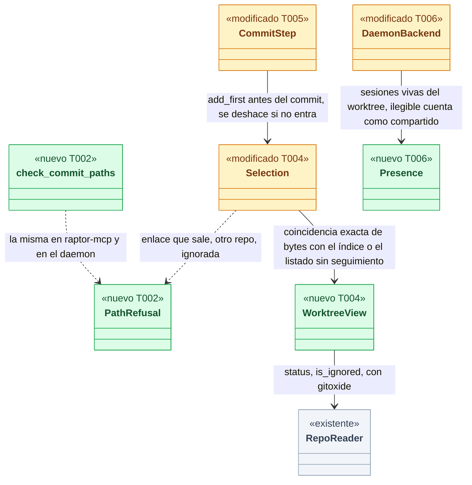
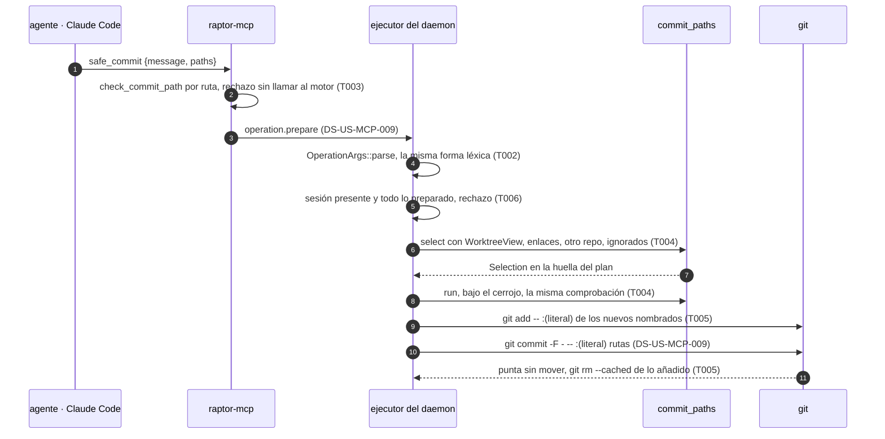
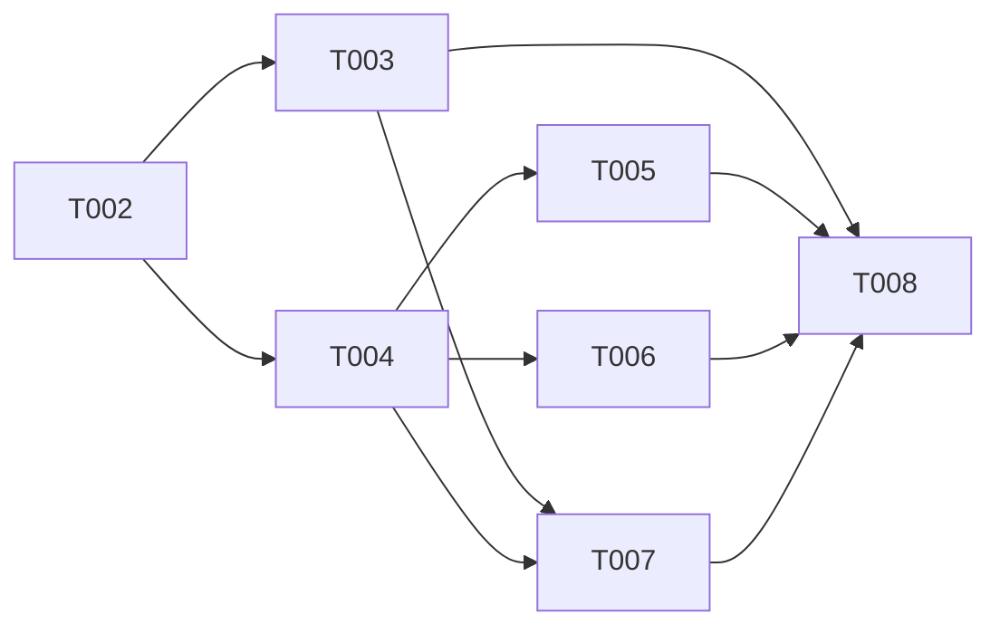

# DS-US-MCP-010 · Rutas de `safe_commit` y su modelo de amenazas

## Contexto rápido

Al terminar, un agente que commitea por MCP solo puede meter en el commit archivos de su worktree que nombra con su ruta exacta, o lo que ya tenía preparado. Una ruta absoluta, UNC, con caracteres de control, con `..`, dentro de `.git`, a través de un enlace que sale del worktree o dentro de otro repo rechaza la llamada entera antes de que Git la vea. Un archivo nuevo entra solo si se nombra, uno ignorado nunca, y en un worktree con otra sesión de agente hay que nombrar las rutas. Hoy no puede: con DS-US-MCP-009, `safe_commit` solo acepta rutas con seguimiento y la defensa de rutas es la forma léxica de `crates/api/src/catalog.rs:check_literal_relative` más lo que Git rechace por su cuenta.

Para eso: la clasificación léxica de rutas en `crates/api`, compartida por `raptor-mcp` y el daemon; la comprobación contra el worktree en el brazo `commit` del daemon; `git add` de los archivos nuevos nombrados dentro del mismo paso protegido; la regla del worktree compartido; y los casos del corpus de seguridad de INF-MCP-001. El esquema de `safe_commit` lo fija DS-US-MCP-009 (D13) y esta spec no lo toca.

| Término | Qué es aquí |
|---|---|
| Ruta | Un elemento de `paths`: texto del agente, relativo a la raíz del worktree, no confiable |
| Forma léxica | Lo que se comprueba sin leer el disco: longitud, caracteres, componentes |
| Pathspec literal | Cada ruta va a Git como `:(literal)<ruta>` después de `--`, sin magia ni opciones (ADR-CKP-002, Enmienda (2026-10-17, TS-CKP-003)) |
| Sin seguimiento | Archivo del working tree que no está en el índice ni está ignorado |
| Puerta del `.git` | Abrir un worktree solo si el repo lo registra y es dueño de su `.git` (`observe::open_registered_worktree`, #223 I-03) |
| Sesión presente | Sesión viva de otro agente en el mismo worktree (BR-MCP-EDGE-003) |

⚠️ **ASSUMPTION**: no existe `architecture-constitution.md`; rigen `AGENTS.md` y los ADR de `must_read`, como en DS-US-MCP-009.

---

## 📋 Índice

> **Para aprobar:** [Contexto rápido](#contexto-rápido) · [⚠️ Gaps](#gaps-y-violaciones-de-la-constitución) · [🔭 La forma](#la-forma) · [El trabajo de un vistazo](#el-trabajo-de-un-vistazo) · [Modelo de amenazas](#modelo-de-amenazas) · [Decisiones](#decisiones-validadas).
> **Para implementar:** [🚀 Plan](#plan-de-implementación), en orden. Las secciones `_(ref)_` se abren desde la tarea que las cita.

| Sección | Propósito |
|---------|-----------|
| [Contexto rápido](#contexto-rápido) | Qué se construye, por qué, y el glosario |
| [⚠️ Gaps y violaciones de la constitución](#gaps-y-violaciones-de-la-constitución) | Qué impide empezar o liberar |
| [🔭 La forma](#la-forma) | Qué piezas quedan y cómo fluye una ruta |
| [🚀 Plan de implementación](#plan-de-implementación) | T001…T008, en orden |
| ↳ [El trabajo de un vistazo](#el-trabajo-de-un-vistazo) | Las tareas en una tabla, y su orden |
| [Estructura de ficheros](#estructura-de-ficheros) _(ref)_ | Tramos disjuntos de ficheros |
| [Contratos compartidos](#contratos-compartidos) _(ref)_ | Tipos y firmas |
| [Contrato de API](#contrato-de-api) _(ref)_ | Motivos, códigos, numéricos |
| [Modelo de datos](#modelo-de-datos) _(ref)_ | Sin migraciones |
| [Estrategia de pruebas y cobertura](#estrategia-de-pruebas-y-cobertura) _(ref)_ | Escenario → prueba |
| [Gate de seguridad](#gate-de-seguridad) | Checklist pre-merge |
| [Modelo de amenazas](#modelo-de-amenazas) | Amenaza → mitigación → prueba guarda |
| [Fuera de alcance](#fuera-de-alcance) | Not Built (diferido) |
| [Decisiones validadas](#decisiones-validadas) | Lo que fija esta spec, pendiente de Arquitecto y PO |
| [Notas del autor](#notas-del-autor) _(ref)_ | Hechos del código y dependencias |

---

## ⚠️ Gaps y violaciones de la constitución

| ID | Qué falta | Severidad | Alcance | Acción | Owner |
|----|-----------|-----------|---------|--------|-------|
| G1 | Los casos que solo existen en Windows (UNC real como cwd, unidad, flujos alternativos `a.txt:x`, nombres reservados `CON`/`NUL`, punto o espacio final, nombres cortos 8.3, *junctions*) se rechazan por forma léxica con `cfg(windows)`, pero no se pueden ejecutar desde macOS. El canal no existe en Windows (XP-01) | Bloquea liberación | — | Verificarlos en la etapa de validación multiplataforma (fila XP-46, T008) antes de liberar en Windows; macOS y Linux no esperan | Arquitecto |

Todas las tareas son construibles hoy, después de DS-US-MCP-009 en `main`. US-GRP-011 está en `draft`: la regla del worktree compartido se apoya en las sesiones vivas que el detector ya registra en el perfil y no en el registro de un segundo agente (N2).

---

## 🔭 La forma

Una ruta pasa por dos filtros: la forma léxica, igual en `raptor-mcp` y en el daemon, y el contraste con el worktree, solo en el daemon, en `prepare` y otra vez bajo el cerrojo en `run`. Solo lo que pasa los dos llega a Git como pathspec literal.



🟩 nuevo · 🟨 modificado · ⬜ existente. La arista de `Selection` a `WorktreeView` resuelve mayúsculas y normalización Unicode sin plegar nada: una ruta vale solo si es byte a byte una entrada que Git ya conoce o que gitoxide lista en el disco.

**Cómo fluye:**



El paso 8 cierra la ventana entre `prepare` y `run`: un enlace o un `.git` puestos entre medias cambian la `Selection` o los hechos, y el plan acaba en `state-changed`. El paso 11 deja el índice como estaba cuando el commit no entra.

---

## 🚀 Plan de implementación

> Orden topológico (`Depende:`). Rutas relativas a la raíz del repo. Requiere DS-US-MCP-009 en `main`: T004 y T005 modifican archivos que crea esa spec.

### El trabajo de un vistazo

Un camino trazador y tres endurecimientos, más el cierre: T001 a T004 llevan de extremo a extremo los escenarios 1 a 3 (suite en rojo, forma léxica, `raptor-mcp`, contraste con el worktree); T005 y T006 añaden los archivos nuevos y el worktree compartido; T007 amplía el corpus; T008 es documentación.

| # | Tarea | Depende | Aterriza en |
|---|---|---|---|
| T001 | Escribir la suite de aceptación de rutas en rojo | — | `apps/cli/tests/` |
| T002 | Clasificar la forma léxica de las rutas en `crates/api` | — | `crates/api/src/` |
| T003 | Validar las rutas en `raptor-mcp` antes de llamar al daemon | T002 | `apps/mcp/src/` |
| T004 | Comprobar las rutas contra el worktree en el daemon | T002 | `crates/core/src/executor/ops/commit_paths.rs` |
| T005 | Añadir los archivos sin seguimiento nombrados y deshacerlo si el commit no entra | T004 | `crates/git/src/user_ops.rs`, `crates/core/src/executor/ops/commit.rs` |
| T006 | Exigir rutas explícitas en un worktree compartido | T004 | `crates/core/src/executor/`, `crates/core/src/timemachine/protected/` |
| T007 | Ampliar el corpus de seguridad con el modelo de amenazas de rutas | T003, T004 | `crates/testkit/src/mcp_corpus/`, `apps/cli/tests/mcp_corpus/` |
| T008 | Aplicar las enmiendas y cerrar los pendientes multiplataforma | T003, T005, T006, T007 | `docs/` |

### En qué orden

Dos frentes tras el contrato (servidor y daemon) que convergen en el corpus; el daemon se abre en dos ramas paralelas (archivos nuevos y worktree compartido).



### T001 — Escribir la suite de aceptación de rutas en rojo

**Objetivo.** Un test por escenario de la historia, por proceso real, contra el JSON del cable.

**Ubicación.** `apps/cli/tests/mcp_safe_commit_paths.rs` (**CREATE**)

**Reglas**
- Copiar el arnés de `apps/cli/tests/mcp_safe_commit.rs` (DS-US-MCP-009 T001) sin editarlo. `#![cfg(target_os = "macos")]` y `#![cfg(debug_assertions)]`.
- Rechazos con `LANG=es_ES.UTF-8` y el texto literal de la historia: "ruta fuera del worktree", "ruta no válida", "demasiadas rutas", "ruta no encontrada", "la ruta .env está ignorada por Git; no se añade", "indica tus rutas: el worktree es compartido".
- La ruta rechazada vuelve en `params.path` como `{"untrusted": …}`.
- Cada rechazo comprueba con `gitraptor_testkit::fingerprint` que el repo, el worktree y su `.git` no cambiaron, y con `git rev-list --count` que no hay commit.
- Worktree compartido: dos `raptor-fake-agent` con su cwd en `shop-feat-a`, esperando con `DEADLINE` a que `raptor status --json` muestre dos sesiones. Si el detector las funde en una, el test siembra la segunda sesión con el almacén del perfil temporal (N2) y lo dice en un comentario.

- **Depende:** —
- **Refs:** US-MCP-010 (Gherkin), DS-US-MCP-009 T001
- **Aceptación:** los ocho tests "e2e" de § Estrategia de pruebas existen y fallan en rojo con el código de DS-US-MCP-009

### T002 — Clasificar la forma léxica de las rutas en `crates/api`

**Objetivo.** Una sola función, usada por `raptor-mcp` y por `OperationArgs::parse`, que dice si una ruta tiene forma válida y, si no, por qué.

**Ubicación.**
- `crates/api/src/commit_paths.rs` (**CREATE**): `PathRefusal`, `check_commit_path`, `check_commit_paths`
- `crates/api/src/catalog.rs` (**MODIFY**): `OperationArgs::check` de `Commit` llama a `check_commit_paths`; se retira `check_literal_relative`; cuatro variantes de `RejectReason`
- `crates/api/src/mcp_view.rs` (**MODIFY**): cinco variantes de `McpToolError`
- `crates/api/tests/us_mcp_010_paths.rs` (**CREATE**)

**Pasos**
1. Escribir primero `us_mcp_010_paths.rs` en rojo con la tabla de § Contrato de API completa.
2. `check_commit_path(p)`, en este orden, el primero que falla decide:
   2.1 Vacía, más de `MAX_PATH_BYTES` bytes (antes de recorrer caracteres) o con NUL → `Invalid`.
   2.2 Algún `is_forbidden_char` → `Invalid`.
   2.3 Empieza por `/`, contiene `\` en cualquier posición, empieza por una letra ASCII seguida de `:`, o empieza por `-` → `Invalid`.
   2.4 Partida por `/`: un componente vacío (`a//b`, `/` final), `.` → `Invalid`; `..` → `Outside`; un componente igual a `.git` sin distinguir mayúsculas ASCII → `Outside`.
   2.5 `cfg(windows)`: además `:` en cualquier posición, un componente que acaba en `.` o en espacio, o cuyo nombre sin extensión es `CON`, `PRN`, `AUX`, `NUL`, `COM1`–`COM9`, `LPT1`–`LPT9` (sin distinguir mayúsculas) → `Invalid`.
   2.6 ⛔2.1 `:(glob)**` y `:!x` pasan la forma léxica: son nombres literales. Si se rechazan aquí, el escenario 3 ("ruta no encontrada") pasa por el motivo equivocado y se pierde la prueba de que Git las recibe como literales.
3. `check_commit_paths(paths)`: más de `MAX_COMMIT_PATHS` → `TooMany` sin mirar ninguna; si no, la primera ruta que falla rechaza todas.
4. `OperationArgs::check`: `PathRefusal` → `Invalid::new("paths", refusal.as_str())`. `RejectReason` gana `PathInvalid`, `PathOutsideWorktree`, `PathIgnored` y `SharedWorktreeNeedsPaths`, solo para conexiones con `CAP_OPERATION_COMMIT`.

> **Nota técnica.** En Unix, `\` y `C:` son nombres de archivo legales. Se rechazan en todas las plataformas para que la misma petición dé el mismo resultado en macOS y en Windows (D2); un archivo así no se puede commitear por MCP.

- **Depende:** —
- **Refs:** BR-MCP-VAL-001, ADR-MCP-001 § 4.2 y § 9 (MCP05), ADR-GRP-016 § 3
- **Aceptación:** `cargo test -p gitraptor-api --test us_mcp_010_paths` en verde, y `cargo test -p gitraptor-api` sigue en verde (incluidas las aserciones de `catalog.rs` que hoy rechazan `../etc/passwd`, `/abs`, `--amend` y `a/.git/config`)
- **Guard ⛔2.1:** `pathspec_magic_is_a_literal_name_for_the_lexical_check`

### T003 — Validar las rutas en `raptor-mcp` antes de llamar al daemon

**Objetivo.** Una ruta con forma no válida se rechaza en `raptor-mcp` con su código y su ruta, sin conectar con el daemon.

**Ubicación.**
- `apps/mcp/src/safe_commit_paths.rs` (**CREATE**): `path_refusal`
- `apps/mcp/src/safe_commit.rs` (**MODIFY**, una llamada a `safe_commit_paths::check` en `call`, antes de `Engine::commit`, y la línea `mod safe_commit_paths;` va en `main.rs`)
- `apps/mcp/src/main.rs` (**MODIFY**, una línea `mod safe_commit_paths;`)
- `apps/mcp/src/messages.rs` (**MODIFY**): plantillas en/es de los cinco códigos
- `apps/mcp/src/engine.rs` (**MODIFY**): filas de `rejected_refusal` para los cuatro motivos nuevos

**Reglas**
- `PathRefusal::Invalid` → `invalid-path`; `Outside` → `path-outside-worktree`; `TooMany` → `too-many-paths` con `params.max: 256`. Los dos primeros con `params.path` como `{"untrusted": …}` recortado a 1.024 bytes.
- El orden de los rechazos de la llamada no cambia: el esquema (`invalid-params`), después el mensaje (`invalid-text`), después las rutas.
- Las filas del daemon: `path-invalid` → `invalid-path`, `path-outside-worktree` → `path-outside-worktree`, `path-ignored` → `path-ignored` con `params.path`, `shared-worktree-needs-paths` → `other-session-present`.

- **Depende:** T002
- **Refs:** ADR-MCP-001 § 4.2 y § 5; DS-US-MCP-005 D4
- **Aceptación:** `cargo test -p gitraptor-mcp` en verde, con `a_bad_path_never_reaches_the_engine`, `the_refused_path_travels_as_untrusted` y `the_spanish_texts_say_what_the_story_says_for_paths`

### T004 — Comprobar las rutas contra el worktree en el daemon

**Objetivo.** `commit_paths::select` acepta solo rutas que el worktree tiene, dentro de él y de este repo, y añade los archivos sin seguimiento nombrados a `Selection.add_first`.

**Ubicación.**
- `crates/core/src/executor/ops/commit_paths.rs` (**MODIFY**): `WorktreeView`, `select` con el contraste, `Selection.add_first`
- `crates/core/src/executor/ops/commit.rs` (**MODIFY**, `plan_op` construye `WorktreeView` y la pasa a `select`)
- `crates/core/tests/us_mcp_010.rs` (**CREATE**)

**Pasos**
1. Escribir primero `us_mcp_010.rs` en rojo, con el rig de `crates/core/tests/us_mcp_009.rs` copiado y la pareja de repos de `crates/core/tests/tm_untrusted_git.rs:Pair` copiada.
2. `WorktreeView::read(root, reader)`: el `Status` de gitoxide, el conjunto de rutas del índice y de `HEAD`, y el listado de archivos sin seguimiento uno a uno.
3. Para cada ruta, en este orden:
   3.1 Cada componente padre que existe, con `symlink_metadata` desde la raíz: enlace → `PathOutsideWorktree`; carpeta que contiene una entrada `.git` (archivo o carpeta) → `PathOutsideWorktree`.
   3.2 El último componente: carpeta → `PathInvalid` (D8). Enlace: su destino con `read_link`, resuelto léxicamente contra su carpeta, absoluto, fuera de la raíz o dentro de `.git` → `PathOutsideWorktree`; si no, la ruta sigue (se commitea el enlace, no su destino).
   3.3 Byte a byte igual a una entrada del índice o de `HEAD` → con seguimiento (también si se borró del disco). Una entrada gitlink → `PathInvalid`.
   3.4 Si no, byte a byte igual a un archivo del listado sin seguimiento → `add_first`.
   3.5 Si no, existe en el disco y `RepoReader::is_ignored(ruta, false)` es `true` → `PathIgnored`.
   3.6 Si no → `PathNotFound`.
   3.7 ⛔4.1 Nunca plegar mayúsculas ni normalizar Unicode para buscar la ruta. En APFS, `SRC/A.rs` abre `src/a.rs`; si se acepta, `git add` crea una segunda entrada del índice para el mismo archivo.
4. "Todo lo preparado" no mira el listado sin seguimiento: `add_first` queda vacío (BR-MCP-EDGE-010).
5. Ninguna ruta con cambio → `NothingToCommit`, como en DS-US-MCP-009.
6. `run` vuelve a planear bajo el cerrojo (ADR-CKP-002 § 5): la `Selection` entra en `expected` y en la huella, así que un enlace o un `.git` cambiados entre `prepare` y `run` dan `state-changed`.
   6.1 ⛔4.2 El `git_dir` del commit sigue saliendo de `DaemonBackend::facts` (guarda 3.3 de DS-US-MCP-009). Esta tarea no lee el `.git` del worktree para nada.

> **Nota técnica.** `RepoReader::is_ignored` (`crates/git/src/reader.rs:395`) aplica las reglas del repo y del usuario con gitoxide. Un archivo con seguimiento nunca cuenta como ignorado en Git, por eso 3.5 va después de 3.3.

> **Nota técnica.** ⚠️ **ASSUMPTION**: `RepoReader::status().untracked` lista archivos uno a uno y no colapsa una carpeta nueva en `dir/`. Si la colapsa, el listado sale de `CaptureReader::untracked` (`crates/git/src/capture.rs:280`), que recorre archivos. Lo prueba `a_new_file_in_a_new_folder_is_committed_when_named`.

- **Depende:** T002
- **Refs:** BR-MCP-VAL-001, BR-MCP-EDGE-010, ADR-CKP-002 § 1 y § 5, #223 I-03
- **Aceptación:** `cargo test -p gitraptor-core --test us_mcp_010` en verde, y `us_mcp_009` sigue en verde
- **Guard ⛔4.1:** `a_path_with_other_case_or_normalization_is_not_found`
- **Guard ⛔4.2:** `a_dot_git_pointed_at_another_repo_after_prepare_commits_nothing`

### T005 — Añadir los archivos sin seguimiento nombrados y deshacerlo si el commit no entra

**Objetivo.** Un archivo nuevo nombrado entra en el commit; si el commit no entra, el índice queda como estaba.

**Ubicación.**
- `crates/git/src/user_ops.rs` (**MODIFY**): `UserOp::AddPaths`, `UserOp::UnstagePaths`
- `crates/core/src/executor/ops/commit.rs` (**MODIFY**, `CommitStep::run`)
- `crates/core/tests/us_mcp_010_untracked.rs` (**CREATE**)

**Pasos**
1. `UserOp::AddPaths { paths }` → `add -- :(literal)p…`; `UserOp::UnstagePaths { paths }` → `rm --cached --quiet --ignore-unmatch -- :(literal)p…`. Sin `-f`, `-A`, `--all` ni `-u`; lista vacía → error al construir.
   1.1 ⛔5.1 Nunca `add -f`: sin `-f`, Git rechaza un ignorado y es la segunda barrera de 3.5 de T004.
2. `CommitStep::run`: con `add_first` no vacío, `AddPaths` por `run_git` antes del commit; si falla, `StepError::unchanged(StepFailure::Unchanged)` sin lanzar el commit.
3. El commit lleva todas las rutas, también las de `add_first`.
4. Si la punta no se movió (DS-US-MCP-009, paso 6.2 de T003): `UnstagePaths` de `add_first`. Si `UnstagePaths` falla → `StepFailure::Changed` (`failed-changed`, deshacer con el previo).
   4.1 ⛔5.2 `rm --cached` solo de `add_first`, nunca de las rutas con seguimiento: quitaría del índice trabajo preparado por el agente o por el desarrollador.

> **Nota técnica.** `rm --cached` de una ruta que no estaba en el índice antes de `add` devuelve el índice a su estado previo con y sin commits en la rama (rama sin nacer incluida); `reset -- <ruta>` necesita `HEAD`.

- **Depende:** T004
- **Refs:** BR-MCP-EDGE-010, ADR-CKP-002 § 6 y § 11, NFR-01
- **Aceptación:** `cargo test -p gitraptor-git` y `cargo test -p gitraptor-core --test us_mcp_010_untracked` en verde, con `a_new_file_enters_only_when_named`, `a_rejected_commit_leaves_the_index_as_it_was` y `a_new_file_in_a_new_folder_is_committed_when_named`
- **Guard ⛔5.1:** `user_ops::tests::add_paths_never_forces`
- **Guard ⛔5.2:** `a_rejected_commit_keeps_what_was_staged_before`

### T006 — Exigir rutas explícitas en un worktree compartido

**Objetivo.** Con otra sesión de agente presente, "todo lo preparado" se rechaza con la acción; con rutas, el commit sigue y no lleva aviso.

**Ubicación.**
- `crates/core/src/timemachine/protected/scope.rs` (**MODIFY**): `ProtectedBackend::live_sessions`, con valor por defecto
- `crates/core/src/timemachine/protected/backend.rs` (**MODIFY**): `DaemonBackend::with_presence` y su `live_sessions`
- `crates/core/src/executor/mod.rs` (**MODIFY**): la regla en `plan`, y `commit` fuera del aviso `ActiveSession`
- `crates/core/src/daemon/serve.rs` (**MODIFY**, una llamada `with_presence`)
- `crates/core/tests/us_mcp_010_shared.rs` (**CREATE**)

**Pasos**
1. `live_sessions(&self, repo) -> Result<Vec<String>, RejectReason>`: por defecto `Ok(vec![])`, documentado como "solo para dobles de prueba". `DaemonBackend` usa su `Presence` (§ Tipos): sesiones del perfil del repo con `end_cause IS NULL` y ruta canónica igual a la del worktree (`profile::Store::sessions_for_worktree`).
2. `executor::plan`, con `op == Commit`, capa `mcp`, `args.paths == None`: si `live_sessions` falla o tiene una sesión distinta de la del solicitante → `RejectReason::SharedWorktreeNeedsPaths`.
   2.1 ⛔6.1 Una presencia ilegible cuenta como compartido. Si cuenta como "nadie", un agente commitea lo que otro tenía preparado.
3. `prepare`: `commit` nunca recibe `WarningCode::ActiveSession` (ADR-MCP-001 § 4.3: `commit` no lleva avisos).
4. `serve.rs`: `DaemonBackend::new(…).with_presence(presence)`, con la presencia leída de los almacenes del perfil por repo que usa `daemon/sessions.rs`. ⚠️ **ASSUMPTION**: si el almacén no se puede compartir entre hilos, la presencia abre el del repo en solo lectura en cada llamada (como `crates/core/tests/profile_read_only.rs`).

- **Depende:** T004
- **Refs:** BR-MCP-EDGE-003, BR-MCP-ELIG-002, ADR-CKP-002 § 1 (`commit`), ADR-MCP-001 § 4.3
- **Aceptación:** `cargo test -p gitraptor-core --test us_mcp_010_shared` en verde, con `all_staged_in_a_shared_worktree_is_refused_with_the_action`, `named_paths_in_a_shared_worktree_commit_only_them` y `a_commit_never_carries_the_active_session_warning`
- **Guard ⛔6.1:** `an_unreadable_presence_counts_as_shared`

### T007 — Ampliar el corpus de seguridad con el modelo de amenazas de rutas

**Objetivo.** Cada fila de § Modelo de amenazas tiene su caso en el corpus de INF-MCP-001, y el KPI sigue en 100 %.

**Ubicación.**
- `crates/testkit/src/mcp_corpus/case.rs` (**MODIFY**): `Setup.files` y `Setup.dot_git_to`
- `crates/testkit/src/mcp_corpus/schema.rs` (**MODIFY**): las claves nuevas
- `apps/cli/tests/mcp_corpus/machine.rs` (**MODIFY**): crear los archivos y reescribir el `.git`
- `apps/cli/tests/mcp_corpus/cases/` (**MODIFY**): los archivos `safe-commit-path-*.json` de § Modelo de amenazas

**Reglas**
- `setup.files`: lista de `{at, state}` con `state` en `modified`, `untracked`, `ignored` (escribe el archivo y su línea en `.gitignore`), `staged`. `setup.dot_git_to`: el worktree de la sesión cuyo `.git` se reescribe para apuntar a `other_repo`.
- Nivel `server` para las formas léxicas (todas las plataformas salvo las de `cfg(windows)`, que declaran `platforms: ["windows"]` y `pending: XP-46`). Nivel `engine` para el resto (macOS y Linux, `pending: XP-42`).
- Cada caso con contenido de otro repo declara `forbidden` con `{other_repo}`: ni su ruta ni su contenido salen por stdout o stderr.
- `every_case_file_is_valid_unique_and_named_after_its_id` sigue en verde con las claves nuevas.

- **Depende:** T003, T004
- **Refs:** DS-INF-MCP-001 D1 y D2; ADR-MCP-001 § 9
- **Aceptación:** `cargo test -p gitraptor-testkit` y `cargo test -p gitraptor-cli --test mcp_security_corpus` en verde

### T008 — Aplicar las enmiendas y cerrar los pendientes multiplataforma

**Objetivo.** Documentos, contrato del canal y pendientes al día; no toca código.

**Ubicación.**
- `docs/architecture/decisions/ADR-MCP-001-servidor-mcp-cliente-daemon.md` (**MODIFY**, Enmienda (2026-10-21, US-MCP-010))
- `docs/requirements/features/mcp/business-rules.md` (**MODIFY**, notas en BR-MCP-VAL-001 y BR-MCP-EDGE-010)
- `docs/architecture/design/api-contract-ipc.md` (**MODIFY**)
- `docs/architecture/xplat-pendientes.md` (**MODIFY**, fila XP-46)
- `docs/requirements/features/mcp/user-stories/US-MCP-010-safe-commit-rutas.md` (**MODIFY**, Requisitos Técnicos y Dev Spec)
- `docs/requirements/features/mcp/dev-specs/US-MCP-010-dev-spec.md` (**MODIFY**, "Estado de la implementación")

**Reglas**
- ADR-MCP-001, Enmienda: § 9, fila MCP05 apunta a § Modelo de amenazas de esta spec; § 5, los cinco códigos nuevos; § 4.2, "rutas relativas a la raíz del worktree, nunca al cwd".
- `business-rules.md` (PO): BR-MCP-VAL-001, "carpetas no; forma canónica; `\` y unidad en todas las plataformas" (D2, D8); BR-MCP-EDGE-010, "un archivo nuevo se nombra uno a uno; una carpeta no lo añade" (D8).
- XP-46: lo de § 9.5 que no se verifica en macOS y G1.
- No editar `docs/ARTIFACTS.md`. El `status` de la historia lo cambia el PR.

- **Depende:** T003, T005, T006, T007
- **Refs:** § Decisiones validadas, `AGENTS.md`
- **Aceptación:** revisión de Arquitecto y PO; los ocho tests de T001 en verde en macOS

---

> Las secciones siguientes son de referencia. Se abren desde la tarea que las cita, no se leen en orden.

## Estructura de ficheros

Seis tramos disjuntos. Los archivos de `crates/core/src/executor/ops/` y `executor/mod.rs` los crea DS-US-MCP-009; aquí se modifican.

### Tramo A — forma léxica (T002)

- `crates/api/src/commit_paths.rs`
- `crates/api/src/catalog.rs`
- `crates/api/src/mcp_view.rs`
- `crates/api/tests/us_mcp_010_paths.rs`

### Tramo B — servidor MCP (T003)

- `apps/mcp/src/safe_commit_paths.rs`
- `apps/mcp/src/safe_commit.rs`
- `apps/mcp/src/main.rs`
- `apps/mcp/src/messages.rs`
- `apps/mcp/src/engine.rs`

### Tramo C — brazo `commit` y Git (T004 y T005)

- `crates/core/src/executor/ops/commit_paths.rs`
- `crates/core/src/executor/ops/commit.rs`
- `crates/git/src/user_ops.rs`
- `crates/core/tests/us_mcp_010.rs`
- `crates/core/tests/us_mcp_010_untracked.rs`

### Tramo D — worktree compartido (T006)

- `crates/core/src/timemachine/protected/scope.rs`
- `crates/core/src/timemachine/protected/backend.rs`
- `crates/core/src/executor/mod.rs`
- `crates/core/src/daemon/serve.rs`
- `crates/core/tests/us_mcp_010_shared.rs`

### Tramo E — aceptación y corpus (T001 y T007)

- `apps/cli/tests/mcp_safe_commit_paths.rs`
- `crates/testkit/src/mcp_corpus/case.rs`
- `crates/testkit/src/mcp_corpus/schema.rs`
- `apps/cli/tests/mcp_corpus/machine.rs`
- `apps/cli/tests/mcp_corpus/cases/safe-commit-path-*.json`

### Tramo F — documentación (T008)

- `docs/architecture/decisions/ADR-MCP-001-servidor-mcp-cliente-daemon.md`
- `docs/requirements/features/mcp/business-rules.md`
- `docs/architecture/design/api-contract-ipc.md`
- `docs/architecture/xplat-pendientes.md`
- `docs/requirements/features/mcp/user-stories/US-MCP-010-safe-commit-rutas.md`
- `docs/requirements/features/mcp/dev-specs/US-MCP-010-dev-spec.md`

---

## Contratos compartidos

### Tipos y datos compartidos

```rust
// crates/api/src/commit_paths.rs (T002)
#[derive(Debug, Clone, Copy, PartialEq, Eq, Serialize, Deserialize, JsonSchema)]
#[serde(rename_all = "kebab-case")]
pub enum PathRefusal {
    Invalid,   // "invalid": absolute, UNC, drive, backslash, control chars, leading '-', not canonical
    Outside,   // "outside": "..", ".git"
    TooMany,   // "too-many"
}

// crates/api/src/catalog.rs (T002): only with `operation.commit`
pub enum RejectReason { /* … */
    PathInvalid,               // "path-invalid": a directory, a gitlink, or a lexical refusal
    PathOutsideWorktree,       // "path-outside-worktree"
    PathIgnored,               // "path-ignored"
    SharedWorktreeNeedsPaths,  // "shared-worktree-needs-paths"
}

// crates/api/src/mcp_view.rs (T002)
pub enum McpToolError { /* … */
    InvalidPath,           // "invalid-path", params.path untrusted
    PathOutsideWorktree,   // "path-outside-worktree", params.path untrusted
    TooManyPaths,          // "too-many-paths", params.max
    PathIgnored,           // "path-ignored", params.path untrusted
    OtherSessionPresent,   // "other-session-present"
}

// crates/core/src/executor/ops/commit_paths.rs (T004; Selection was created by DS-US-MCP-009)
pub(super) struct Selection {
    pub paths: Vec<String>,
    pub all_staged: bool,
    /// Named untracked files, added before the commit and unstaged if it does not land.
    pub add_first: Vec<String>,
}
// crates/core/src/executor/ops/commit.rs (T005; created by DS-US-MCP-009): CommitStep runs AddPaths before the commit.
/// What the worktree knows of its paths, read once per plan with gitoxide.
pub(super) struct WorktreeView { /* status, tracked: BTreeSet<String>, untracked: BTreeSet<String>, root */ }

// crates/git/src/user_ops.rs (T005)
pub enum UserOp { /* … */
    /// `add -- :(literal)<p>…`; never `-f`, `-A` nor `-u`.
    AddPaths { paths: Vec<String> },
    /// `rm --cached --quiet --ignore-unmatch -- :(literal)<p>…`.
    UnstagePaths { paths: Vec<String> },
}

// crates/core/src/timemachine/protected/backend.rs (T006)
/// Live session ids of the worktree at a canonical root; `None` when unreadable.
pub type Presence = Arc<dyn Fn(&Path) -> Option<Vec<String>> + Send + Sync>;
```

### Ciclos de vida (DI)

| Servicio / componente | Ámbito / ciclo de vida | Razón |
|---|---|---|
| `WorktreeView` | Uno por plan (`prepare` y otra vez en `run`) | La segunda lectura, bajo el cerrojo, es la que cuenta |
| `Presence` | Uno por daemon, en `DaemonBackend` | Lee el perfil en cada plan; no guarda estado |

### Firmas del stack

```rust
// crates/api/src/commit_paths.rs
pub fn check_commit_path(path: &str) -> Result<(), PathRefusal>;
/// TooMany before looking at any path; otherwise the first refusal, with its index.
pub fn check_commit_paths(paths: &[String]) -> Result<(), (usize, PathRefusal)>;

// crates/core/src/executor/ops/commit_paths.rs (replaces the DS-US-MCP-009 signature)
impl WorktreeView { pub(super) fn read(root: &Path, reader: &RepoReader) -> Result<Self, RejectReason>; }
pub(super) fn select(args: &CommitArgs, view: &WorktreeView) -> Result<Selection, (RejectReason, Option<String>)>;

// crates/core/src/timemachine/protected/scope.rs
pub trait ProtectedBackend { /* … */
    /// Live agent sessions of the request's worktree. Default for test doubles only.
    fn live_sessions(&self, repo: &RepoHandle) -> Result<Vec<String>, RejectReason> { let _ = repo; Ok(Vec::new()) }
}
// crates/core/src/timemachine/protected/backend.rs
impl DaemonBackend { pub fn with_presence(self, presence: Presence) -> Self; }

// apps/mcp/src/safe_commit_paths.rs
pub fn check(paths: Option<&[String]>) -> Result<(), ToolRefusal>;
```

`select` devuelve la ruta rechazada junto al motivo; el canal la pone en `RejectedData` y `raptor-mcp` en `params.path`.

---

## Contrato de API

Sin llamadas nuevas: cambia el contenido aceptado de `args.paths` de `operation.prepare {operation: "commit"}` (DS-US-MCP-009) y aparecen cuatro motivos bajo `OPERATION_REJECTED`, con `data.path` (untrusted) cuando aplica.

| Ruta (ejemplo) | Dónde se rechaza | Motivo del canal | `code` de la herramienta | Mensaje (es) |
|---|---|---|---|---|
| `/etc/passwd`, `\\servidor\compartido\a.rs`, `C:x`, `a\b`, `-f`, `a//b`, `./a`, `a/`, con controles | `raptor-mcp` y daemon, forma léxica | `path-invalid` | `invalid-path` | "Ruta no válida: {path}." |
| `../otro-repo/secreto`, `a/../../x`, `.git/config`, `sub/.GIT/hooks/x` | ídem | `path-outside-worktree` | `path-outside-worktree` | "Ruta fuera del worktree: {path}." |
| 257 rutas | ídem | `INVALID_PARAMS` (`paths`) | `too-many-paths` | "Demasiadas rutas: como mucho 256." |
| Enlace que sale del worktree, padre enlace, dentro de una carpeta con `.git` propio | daemon | `path-outside-worktree` | `path-outside-worktree` | ídem |
| Una carpeta, un gitlink | daemon | `path-invalid` | `invalid-path` | "Ruta no válida: {path}. Nombra archivos, no carpetas." |
| `:(glob)**` que no existe, `SRC/A.rs` frente a `src/a.rs` | daemon | `path-not-found` | `path-not-found` | "Ruta no encontrada: {path}." |
| `.env` ignorado, sin seguimiento | daemon | `path-ignored` | `path-ignored` | "La ruta {path} está ignorada por Git; no se añade." |
| "Todo lo preparado" con otra sesión presente | daemon | `shared-worktree-needs-paths` | `other-session-present` | "Hay otra sesión de agente en este worktree." · acción "Indica tus rutas: el worktree es compartido." |

Las acciones de los cuatro primeros: "Nombra archivos del worktree, relativos a su raíz, con su nombre exacto."

### Forma del error y del cuerpo de respuesta

Rechazo de dominio de la herramienta, como DS-US-MCP-005 D4:

```json
{"code":"path-outside-worktree","message":"…","action":"…","params":{"path":{"untrusted":"../otro-repo/secreto"}}}
```

Canal:

```json
{"code":-32014,"message":"operation rejected","data":{"reason":"path-outside-worktree","path":"../otro-repo/secreto"}}
```

`data.path` es un campo nuevo y opcional de `RejectedData`, solo con `CAP_OPERATION_COMMIT`. Un rechazo nunca lleva el contenido del archivo, el destino de un enlace ni una ruta de otro repo.

### Forma de la configuración

_No aplica — no se añade configuración._ Las reglas de ignorado son las del repo y del usuario, leídas por gitoxide.

### Valores numéricos

| Concepto | Valor | Fuente |
|---|---|---|
| Rutas por llamada | ≤ 256 (`MAX_COMMIT_PATHS`) | `crates/api/src/catalog.rs:38`; ADR-MCP-001 § 6 (500, endurecido) |
| Bytes por ruta | ≤ 4.096 (`MAX_PATH_BYTES`) | ADR-MCP-001 § 6 |
| Ruta en una respuesta | ≤ 1.024 bytes, con `truncated` | ADR-MCP-001 § 6 |
| Lecturas del disco por ruta | un `symlink_metadata` por componente y, si es enlace, un `read_link` | T004 |

---

## Modelo de datos

_No aplica — sin migraciones ni datos nuevos en el perfil; la presencia lee las sesiones que ya existen._

---

## Estrategia de pruebas y cobertura

### 9.1 Pirámide de pruebas

| Tipo | Cantidad | Tareas dueñas | Herramientas | Cuándo |
|------|---------:|-------------|---------|------|
| Unit | 6 | T002, T003, T005 | `cargo test` | PR gate |
| Integration | 15 | T004, T005, T006 | `cargo test -p gitraptor-core --test us_mcp_010*` | PR gate |
| E2E | 8 | T001 | `cargo test -p gitraptor-cli --test mcp_safe_commit_paths` (macOS) | PR gate en macOS |
| Security | 24 | T007 | `cargo test -p gitraptor-cli --test mcp_security_corpus` | PR gate |

### 9.2 Umbrales de cobertura

| Capa | Línea | Rama | Mutación | Camino crítico 100% |
|-------|-----:|-------:|---------:|:------------------:|
| `commit_paths::check_commit_path` | — | — | — | ✅ cada regla de 2.1 a 2.5 |
| `ops::commit_paths::select` | — | — | — | ✅ cada paso de 3.1 a 3.6 |

### 9.3 Datos de prueba

- Builders / fixtures: el rig de `us_mcp_009.rs` y la pareja de `tm_untrusted_git.rs:Pair`, copiados; repos, HOME y perfil temporales. Nunca este repo ni el perfil real (NFR-01).
- Multi-tenant data: dos agentes simulados en el mismo worktree para BR-MCP-EDGE-003.
- PII / PHI: el `.env` de las pruebas contiene un canario de `gitraptor_testkit::canary`, que no puede aparecer en ninguna salida.
- Time / clock: sin esperas fijas; las sesiones presentes se esperan con `DEADLINE`.

Escenario de la historia → prueba:

| Escenario | Prueba | Comando |
|---|---|---|
| 1. Una ruta fuera del worktree rechaza la llamada entera, ruta como no confiable | e2e `a_path_outside_the_worktree_refuses_the_whole_call` | `cargo test -p gitraptor-cli --test mcp_safe_commit_paths a_path_outside_the_worktree_refuses_the_whole_call -- --exact` |
| 2. `/etc/passwd`, UNC, controles → "ruta no válida" | e2e `invalid_paths_never_reach_git` | ídem con el nombre |
| 2. Enlace que sale → "ruta fuera del worktree" | e2e `a_link_out_of_the_worktree_is_outside` | ídem |
| 2. Más rutas que el tope → "demasiadas rutas" | e2e `too_many_paths_are_refused` | ídem |
| 3. `:(glob)**` → "ruta no encontrada" | e2e `pathspec_magic_is_a_literal_name_not_found` | ídem |
| 4. Un archivo nuevo entra solo si se nombra | e2e `a_new_file_enters_only_when_named` | ídem |
| 5. Un ignorado nunca se commitea | e2e `an_ignored_file_is_never_committed` | ídem |
| 6. En compartido hay que nombrar las rutas; con ellas, solo esas | e2e `a_shared_worktree_needs_named_paths` | ídem |

Integración (`us_mcp_010.rs`): las guardas de T004, `a_parent_symlink_is_outside`, `a_link_inside_is_committed_as_a_link`, `a_path_into_a_nested_repo_is_outside`, `a_folder_is_an_invalid_path`, `a_deleted_tracked_file_is_committed_as_a_deletion`, `a_link_swapped_in_between_prepare_and_run_is_state_changed` y `the_ignore_rules_of_info_exclude_and_the_user_apply`. `us_mcp_010_untracked.rs` y `us_mcp_010_shared.rs`: las de T005 y T006.

### 9.4 Comportamientos críticos verificados

- [ ] Ninguna ruta rechazada llega a un argv de Git: el rechazo léxico ocurre antes de conectar y el del daemon antes de la intención.
- [ ] Toda ruta llega a Git como `:(literal)<ruta>` después de `--`.
- [ ] Un rechazo deja el repo, el worktree, su `.git` y el otro repo de la pareja byte a byte iguales.
- [ ] Un ignorado no entra nunca, ni nombrado; "todo lo preparado" no añade archivos nuevos.
- [ ] Un commit que no entra deja el índice como estaba antes del `add`.
- [ ] Una presencia ilegible cuenta como worktree compartido.
- [ ] Ningún archivo de otro repo, ni el destino de un enlace, aparece en stdout, stderr o una respuesta.

### 9.5 Plataformas

| Plataforma | Cómo se verifica | Pendiente |
|---|---|---|
| macOS | e2e de T001, integración, unitarias y corpus en local; APFS sin distinguir mayúsculas | — |
| Linux | integración, unitarias y corpus `server` en CI `ubuntu-latest`; e2e no (DEP-MCP-9) | Pendiente: etapa de validación multiplataforma (XP-46 a): ext4 distingue mayúsculas, primera ejecución verde del corpus `engine` (XP-42) |
| Windows | `us_mcp_010_paths.rs` con las reglas de `cfg(windows)` y `clippy --target x86_64-pc-windows-msvc`; el commit se rechaza con `git-unavailable` (DS-US-MCP-009 D15) | Pendiente: etapa de validación multiplataforma (XP-46 b): UNC real, unidad, flujos alternativos, nombres reservados, punto o espacio final, nombres 8.3, *junctions* (G1) |

---

## Gate de seguridad

- Validación de entrada en dos sitios con la misma función (`check_commit_path`); el daemon no confía en `raptor-mcp` (S-02: un agente puede hablar con el socket).
- Sin shell, argv fijo, rutas tras `--` con `:(literal)` (NFR-02).
- Ningún enlace se sigue: `symlink_metadata` y `read_link`, nunca `canonicalize` de una ruta del agente.
- El `git_dir` sale de la puerta del registro (#223 I-03); una ruta dentro de un `.git` ajeno se rechaza.
- Comprobación repetida bajo el cerrojo; la `Selection` en la huella.
- Toca validación de rutas y ejecución de procesos: revisión de `security-expert` obligatoria antes de mezclar.

### Riesgos residuales

- **Bajo**: entre la comprobación bajo el cerrojo y la lectura de Git, un proceso del mismo usuario puede cambiar un componente por un enlace. Git no sigue enlaces en un pathspec ("beyond a symbolic link") ni en `add`; el snapshot previo lo recupera.
- **Bajo**: en un worktree compartido, un agente puede commitear una ruta con cambios de otro si la nombra; es la regla de BR-MCP-EDGE-003 y la atribución por archivo está fuera del MVP (Q7).

Corre `/security-review --scope devspec docs/requirements/features/mcp/dev-specs/US-MCP-010-dev-spec.md` antes de mezclar.

---

## Modelo de amenazas

Atacante: el de ADR-MCP-001 § 9 (agente comprometido por *prompt injection*, con shell del mismo usuario y acceso directo al socket). Categorías STRIDE: S suplantación, T manipulación, R repudio, I revelación, D denegación de servicio, E elevación.

| # | STRIDE | Amenaza | Mitigación | Prueba guarda |
|---|---|---|---|---|
| A1 | I, T | `..` sale del worktree (`../otro-repo/secreto`) | Forma léxica 2.4 en `raptor-mcp` y daemon | `us_mcp_010_paths::dot_dot_is_outside`; corpus `safe-commit-path-traversal` |
| A2 | I | Ruta absoluta (`/etc/passwd`) | 2.3 | `absolute_paths_are_invalid`; corpus `safe-commit-path-absolute` |
| A3 | I | UNC (`\\servidor\x`), unidad (`C:x`), `\` | 2.3 | `unc_drive_and_backslash_are_invalid`; corpus `safe-commit-path-unc`, `safe-commit-path-drive` |
| A4 | T, E | Caracteres de control, bidi, anchura cero en la ruta (falsear lo que ve el desarrollador) | 2.2 (`is_forbidden_char`) | `control_and_bidi_are_invalid`; corpus `safe-commit-path-bidi`, `safe-commit-path-nul` |
| A5 | E | Magia de pathspec (`:(glob)**`, `:!src`, `:(top)`) | `:(literal)` por ruta y coincidencia exacta 3.3 a 3.6 | ⛔2.1, `pathspec_magic_is_a_literal_name_not_found`; corpus `safe-commit-path-glob`, `safe-commit-path-exclude` |
| A6 | E | Inyección de opción (`--amend`, `-f`, `--pathspec-from-file=x`) | `-` inicial inválido (2.3); `--` antes de las rutas | `leading_dash_is_invalid`; `user_ops::tests::the_commit_message_never_travels_in_argv`; corpus `safe-commit-path-option` |
| A7 | I, T | Escribir o leer dentro de `.git` (`.git/config`, `sub/.GIT/hooks/x`) | 2.4 sin distinguir mayúsculas ASCII | `dot_git_components_are_outside`; corpus `safe-commit-path-dot-git` |
| A8 | I | Enlace como último componente que apunta fuera | 3.2 | `a_link_out_of_the_worktree_is_outside`; corpus `safe-commit-path-link-out` |
| A9 | I | Carpeta padre que es un enlace a otro repo | 3.1 | `a_parent_symlink_is_outside`; corpus `safe-commit-path-link-parent` |
| A10 | I, T | Ruta dentro de un repo anidado o de un submódulo | 3.1 (carpeta con `.git`), 3.3 (gitlink) | `a_path_into_a_nested_repo_is_outside`; corpus `safe-commit-path-nested-repo` |
| A11 | T, E | `.git` del worktree reescrito para apuntar a otro repo, antes o entre `prepare` y `run` | `git_dir` de `DaemonBackend::facts` y la puerta del registro; hechos y huella otra vez bajo el cerrojo | ⛔4.2; corpus `safe-commit-path-dot-git-swap` |
| A12 | T | Enlace o carpeta cambiados entre `prepare` y `run` (TOCTOU) | `run` planea otra vez bajo el cerrojo; `Selection` en la huella | `a_link_swapped_in_between_prepare_and_run_is_state_changed` |
| A13 | I | Secretos ignorados (`.env`) nombrados | 3.5 (`is_ignored`) y `add` sin `-f` | `an_ignored_file_is_never_committed`, ⛔5.1; corpus `safe-commit-path-ignored` |
| A14 | I, E | "Todo lo preparado" se lleva archivos nuevos o el trabajo preparado de otro agente | `add_first` solo con rutas nombradas (4); compartido exige rutas (T006) | `a_new_file_enters_only_when_named`, ⛔6.1; corpus `safe-commit-path-shared-all-staged` |
| A15 | T | Mayúsculas o normalización Unicode que apuntan a otra entrada (`SRC/A.rs`, NFD frente a NFC) | Coincidencia exacta de bytes (3.7) | ⛔4.1; corpus `safe-commit-path-case` |
| A16 | D | Miles de rutas o rutas enormes para agotar el daemon | Tope de 256 y de 4.096 bytes antes de recorrer; tope de entrada de 1 MiB de `raptor-mcp` (`apps/mcp/src/input.rs`, #225) | `too_many_paths_are_refused`; corpus `safe-commit-path-too-many`, `jsonrpc-oversized-message` |
| A17 | I | La respuesta filtra rutas o contenido de otro repo | Solo `params.path` de la ruta pedida, untrusted; presupuesto de respuesta de US-MCP-005 | `forbidden` `{other_repo}` en los casos `engine` |
| A18 | R | El commit no se atribuye al agente | Operación protegida con solicitante y canal `mcp` (DS-US-MCP-009) | `the_commit_is_recorded_with_the_agent_and_channel_mcp` |
| A19 | S | Formas de Windows: flujos alternativos, nombres reservados, punto o espacio final, 8.3, *junctions* | 2.5 con `cfg(windows)` | `us_mcp_010_paths::windows_forms_are_invalid` (`cfg(windows)`); corpus `safe-commit-path-windows-*` con `pending: XP-46` |

---

## Fuera de alcance

| Ítem / no-objetivo | Historia que lo cubre | Gate (cómo se verifica) |
|----------------|--------------------|-------------------------|
| `expect_worktree`, operación en curso, HEAD separado | US-MCP-011 | esquema de `safe_commit` sin cambios (DS-US-MCP-009 D13) |
| Carpetas como ruta y commit de submódulos | — | `a_folder_is_an_invalid_path` |
| Archivos cuyo nombre empieza por `-`, contiene `\` o empieza por `X:` | — | `leading_dash_is_invalid`, `unc_drive_and_backslash_are_invalid` |
| Atribución por archivo en un worktree compartido | Q7 (fuera del MVP) | sin cambios en el motor |
| Registro de un segundo agente en el mismo worktree | US-GRP-011, US-MCP-006 | la presencia lee las sesiones que ya existen |
| Rutas prohibidas de Guardrails | US-GRD-008 (ya en `main`, por el plan de `commit`) | `PlanShape::Commit.paths` sin cambios |

---

## Decisiones validadas

Todas son **Decisión del orquestador (2026-10-21), validada por Arquitecto y PO**; la columna "Validación" la rellena el orquestador. El pathspec `:(literal)` tras `--` ya lo fija ADR-CKP-002, Enmienda (2026-10-17, TS-CKP-003), y no se redecide.

| # | Decisión | Validación y ajuste aplicado | Alternativas descartadas |
|---|---|---|---|
| D1 | Dos filtros: forma léxica en `crates/api`, compartida por `raptor-mcp` y el daemon; contraste con el worktree solo en el daemon, en `prepare` y otra vez bajo el cerrojo, con la `Selection` en la huella | _(pendiente)_ | Comprobar el disco en `raptor-mcp`: no lee Git (ADR-MCP-001 § 1) y el agente puede saltárselo hablando con el socket |
| D2 | Forma canónica obligatoria y la misma en todas las plataformas: sin `\`, sin `X:` inicial, sin `-` inicial, sin componentes vacíos ni `.`, sin barra final; `..` y `.git` cuentan como "fuera del worktree" | _(pendiente)_ | Normalizar la ruta (oculta lo que pidió el agente); rechazar `\` y unidad solo en Windows (la misma petición daría resultados distintos) |
| D3 | Motivos: `invalid-path`, `path-outside-worktree`, `too-many-paths`, `path-not-found`, `path-ignored`, `other-session-present`; una ruta mala rechaza toda la llamada y vuelve como untrusted | _(pendiente)_ | Commitear las rutas buenas y avisar de las malas: contradice el escenario 1 |
| D4 | Una ruta vale si es byte a byte una entrada del índice o de `HEAD`, o un archivo del listado sin seguimiento de gitoxide; resuelve mayúsculas y normalización Unicode sin crate nuevo | _(pendiente)_ | Plegar mayúsculas o normalizar a NFC: crea entradas dobles en el índice y añade una dependencia |
| D5 | Enlaces: un padre enlace siempre es "fuera del worktree"; el último componente enlace se acepta si su destino, resuelto léxicamente, queda dentro del worktree y fuera de `.git` (se commitea el enlace) | _(pendiente)_ | Rechazar todo enlace (impide commitear enlaces del propio repo); seguir el enlace |
| D6 | Ignorados con `RepoReader::is_ignored` (gitoxide), solo para rutas sin seguimiento; `git add` sin `-f` como segunda barrera | _(pendiente)_ | Lanzar `git check-ignore`: otro proceso fuera de la lista cerrada de operaciones de usuario |
| D7 | Archivos nuevos nombrados: `git add` en el mismo paso protegido antes del commit, y `git rm --cached` de esos mismos si el commit no entra; si eso falla, `failed-changed` | _(pendiente)_ | Índice temporal (`GIT_INDEX_FILE`): los hooks verían otro índice que el del usuario |
| D8 | No se aceptan carpetas ni gitlinks: hay que nombrar archivos | _(pendiente)_ | Aceptar carpetas: con `add` meterían archivos nuevos sin nombrarlos (BR-MCP-EDGE-010) |
| D9 | Puerta del `.git`: ninguna lectura del `.git` del worktree; una ruta bajo una carpeta con su propio `.git` es "fuera del worktree" | _(pendiente)_ | — |
| D10 | Worktree compartido: presencia = sesiones vivas del worktree en el perfil distintas de la del solicitante, por `ProtectedBackend::live_sessions`; ilegible cuenta como compartido; `commit` nunca lleva el aviso `active-session` | _(pendiente)_ | Aviso reconocible con `acknowledge`: ADR-MCP-001 § 4.3 dice que `commit` no lleva avisos |
| D11 | Formas de Windows (`:`, nombres reservados, punto o espacio final) con `cfg(windows)`, verificadas en la etapa multiplataforma (XP-46, G1) | _(pendiente)_ | Esperar a Windows para escribirlas |
| D12 | Corpus: casos nuevos `safe-commit-path-*.json` en `apps/cli/tests/mcp_corpus/cases/`; el esquema del caso gana `setup.files` y `setup.dot_git_to` | _(pendiente)_ | Un corpus aparte para rutas: dos KPI en vez de uno (DS-INF-MCP-001 D2) |
| D13 | Rutas relativas a la raíz del worktree, nunca al cwd del agente | _(pendiente)_ | Relativas al cwd: el cwd de `raptor-mcp` puede ser una subcarpeta y la misma ruta cambiaría de sentido |
| D14 | Orden: esta spec va después de DS-US-MCP-009 y no depende de US-MCP-011 (D13 de DS-US-MCP-009) | _(pendiente)_ | Esperar a la Dev Spec de US-MCP-011 (D-11 original) |

---

## Notas del autor

| ID | Nota | Acción | Owner |
|----|------|--------|-------|
| N1 | `check_literal_relative` (`crates/api/src/catalog.rs:557`) ya rechaza `/`, `\` y `-` iniciales, controles, `..` y `.git`; no rechaza `\` en medio, `X:`, componentes vacíos ni `.`. T002 la sustituye sin aflojar ningún caso | T002 | — |
| N2 | US-GRP-011 está en `draft`; las sesiones de dos agentes detectados en el mismo worktree ya se guardan en el perfil (`profile/store.rs:sessions_for_worktree`) | Ninguna | — |
| N3 | El brazo de prueba de `commit` leía el `.git` del worktree; DS-US-MCP-009 D16 lo retira | Ninguna | — |
| N4 | El pathspec literal va como `:(literal)` por ruta y no con `GIT_LITERAL_PATHSPECS`, porque esa variable llegaría a los hooks del usuario (ADR-CKP-002, Enmienda (2026-10-17)) | Ninguna | — |

### Convenciones observadas

- Forma léxica de rutas en el contrato: `crates/api/src/catalog.rs:check_literal_relative`.
- Ningún componente seguido como enlace: `crates/core/src/executor/new_path.rs:check_new_worktree_path`.
- Puerta del `.git`: `crates/core/src/observe.rs:open_registered_worktree`.
- Ignorados con gitoxide: `crates/git/src/reader.rs:RepoReader::is_ignored`.
- Pathspec literal por ruta: `crates/git/src/user_ops.rs:UserOp::words` (`CommitPaths`).
- Casos de corpus en JSON por archivo: `apps/cli/tests/mcp_corpus/cases/status-param-path-traversal.json`.

### Inventario de reutilización

- Reutiliza: `gitraptor_api::catalog::{is_forbidden_char, MAX_COMMIT_PATHS, MAX_PATH_BYTES}`; `gitraptor_git::RepoReader::{status, is_ignored}`; `gitraptor_git::capture::CaptureReader::untracked` (si hace falta, nota de T004); `crate::observe::open_registered_worktree` vía `DaemonBackend::facts`; `crate::profile::Store::sessions_for_worktree`; el rig de `crates/core/tests/tm_untrusted_git.rs:Pair`; `gitraptor_testkit::{fingerprint, canary, mcp_corpus}`.
- Genera: ninguno.
- Crea nuevo: `crates/api/src/commit_paths.rs`, `apps/mcp/src/safe_commit_paths.rs`, `UserOp::AddPaths` y `UserOp::UnstagePaths`. Búsqueda sin resultado: `grep -n "AddPaths\|\"add\"" crates/git/src/user_ops.rs` (la lista cerrada no tiene `add`).
