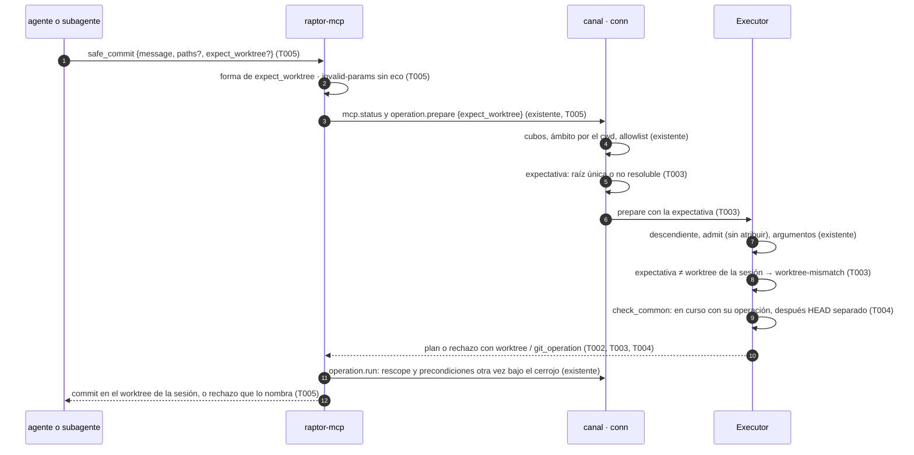
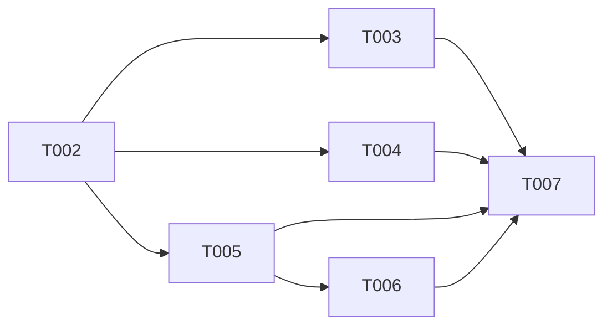

# DS-US-MCP-011 · `expect_worktree` y las precondiciones de las escrituras MCP

## Contexto rápido

Al terminar, un agente puede pasar `expect_worktree` a `safe_commit` y a `snapshot`: si el worktree de la sesión no es ese, la escritura se rechaza con `worktree-mismatch`, que nombra el worktree en el que opera la sesión, y no cambia nada. Un rebase, un merge, un cherry-pick, un revert o un bisect a medias rechaza el commit nombrando la operación ("hay un rebase en curso en este worktree"), antes que el HEAD separado que esa misma operación deja. Hoy `expect_worktree` es `invalid-params` (DS-US-MCP-009 D13; `apps/mcp/src/safe_commit.rs:33-40` en #289) y el rechazo por operación en curso dice "Hay una operación en curso en este worktree." sin nombrarla (`apps/mcp/src/messages.rs:323-326` en #289).

Ya existe y no se rediseña: el ámbito por el cwd de `raptor-mcp`, leído entre dos comprobaciones de identidad (`crates/core/src/channel/conn.rs:3339-3367`, `mcp_repo`), que hace que un `cd` del agente no mueva la escritura; la comprobación otra vez del ámbito al ejecutar (`conn.rs:3652-3663`, `rescope`); el orden de precondiciones de Q-MCP-30 (`crates/core/src/executor/facts.rs:72-103`, `check_common`) y su revalidación bajo el cerrojo (`crates/core/src/executor/mod.rs:982`, el `plan` que repite `run`); y el texto de `detached-head` (`apps/mcp/src/messages.rs:481-482`). De eso, esta spec solo pone las pruebas de extremo a extremo que la historia pide.

Las rutas de código de `safe_commit` son de la rama `feat/US-MCP-009-010-safe-commit` (PR #289), que todavía no está en `main`. `facts.rs` y `mcp_scope.rs` son iguales en `main`.

| Término | Qué es aquí |
|---|---|
| Worktree de la sesión | El worktree observado más profundo que contiene el cwd de `raptor-mcp` (ADR-MCP-001 § 2, punto 2). Las escrituras solo operan aquí |
| `expect_worktree` | Parámetro opcional de las escrituras MCP que solo estrecha: nombre de carpeta o ruta absoluta (D2) |
| Expectativa | Lo que el canal resuelve de `expect_worktree`: la raíz de un worktree del repo, o "no resoluble" |
| Detalle de la operación en curso | `TmGitOperation` (DS-US-TMC-015 T001), compartido con la Time Machine (D7) |
| Capacidad `operation.worktree-checks` | Enciende el parámetro, el motivo `worktree-mismatch` y los dos campos nuevos de `RejectedData` (D4) |

⚠️ **ASSUMPTION**: no existe `architecture-constitution.md`; rigen `AGENTS.md` y los ADR de `must_read` (NFR-01, NFR-02, ADR-GRP-016), como en DS-US-MCP-009.

---

## ⚠️ Gaps y violaciones de la constitución

| ID | Qué falta | Severidad | Alcance | Acción | Owner |
|----|-----------|-----------|---------|--------|-------|
| G1 | `safe_commit`, `CAP_OPERATION_COMMIT`, `rescope` y la tabla de rechazos de escritura de `raptor-mcp` están en el PR #289 (US-MCP-009 y US-MCP-010), abierto | Bloquea inicio | T001 a T006 | Empezar cuando #289 esté en `main`; ramificar desde `main` | Orquestador |
| G2 | US-MCP-007 (confused deputy) sigue en `draft`; DS-US-MCP-009 G3 la pone como condición de liberación de `safe_commit`, y esta historia se libera con US-MCP-009 | Bloquea liberación | — | Liberar US-MCP-009, US-MCP-010 y US-MCP-011 juntas cuando US-MCP-007 esté en `main` | PO |

`TmGitOperation` lo crea la primera que entre de esta historia y US-TMC-015, con la forma de DS-US-TMC-015 § Tipos (D7). No bloquea: es un archivo compartido con edición nombrada. Con esta spec se cierra DS-US-MCP-009 G4.

---

## 🔭 La forma

`expect_worktree` viaja de `raptor-mcp` al daemon en `PrepareParams`. El canal lo resuelve contra la vista de repos del bus con el mismo `locate` que usa para el cwd, y el ejecutor compara la expectativa con el worktree de la sesión después de admitir al solicitante y antes de las precondiciones (ADR-MCP-001 § 2, orden de los rechazos, punto 4).



El paso 8 es el único nuevo que decide. El 11 ya existe: `rescope` exige el mismo worktree que en `prepare`, así que una expectativa que coincidió sigue coincidiendo (D5). Un `cd` en la shell del agente no cambia el cwd de `raptor-mcp`, que nunca cambia de directorio (Q-MCP-2): el paso 4 resuelve el mismo worktree.

---

## 🚀 Plan de implementación

> Orden topológico (`Depende:`). Rutas relativas a la raíz del repo, sobre `main` con #289 dentro (G1). Ediciones de una línea en archivos compartidos se nombran (ADR-GRP-016).

### El trabajo de un vistazo

| # | Tarea | Depende | Aterriza en |
|---|---|---|---|
| T001 | Escribir la suite de aceptación de extremo a extremo en rojo | — | `apps/cli/tests/` |
| T002 | Definir el contrato: parámetro, capacidad, motivo, detalle y código de la herramienta | — | `crates/api/src/` |
| T003 | Resolver y comprobar `expect_worktree` en el daemon | T002 | `crates/core/src/channel/`, `crates/core/src/executor/mod.rs` |
| T004 | Nombrar la operación en curso en el rechazo | T002 | `crates/core/src/executor/` |
| T005 | Aceptar `expect_worktree` en `safe_commit` y `snapshot` y traducir los rechazos | T002 | `apps/mcp/src/` |
| T006 | Ampliar el corpus de seguridad | T005 | `apps/cli/tests/mcp_corpus/cases/` |
| T007 | Aplicar las enmiendas y cerrar el estado | T003, T004, T005, T006 | `docs/` |



T001 se escribe primero y pasa a verde con T005.

### T001 — Escribir la suite de aceptación de extremo a extremo en rojo

**Objetivo.** Un test por escenario de la historia, por proceso real (daemon `raptor`, `raptor-mcp`, agente simulado, Git del sistema), escrito contra el JSON del cable.

**Ubicación.** `apps/cli/tests/mcp_worktree_guard.rs` (**CREATE**)

**Reglas**
- Copiar el arnés de `apps/cli/tests/mcp_safe_commit.rs` de #289 (sesión MCP, repo protegido, `raptor mcp enable` desde el pty), sin editarlo. `#![cfg(target_os = "macos")]` y `#![cfg(debug_assertions)]`.
- Repo `shop` con los worktrees enlazados `shop-feat-a` y `shop-feat-b`, los dos observados y en la allowlist. `raptor-mcp` arranca con cwd `shop-feat-a`.
- "Un subagente en `shop-feat-b` que usa el servidor de su padre" es la misma sesión MCP de `shop-feat-a` con `expect_worktree: "shop-feat-b"`, y otra vez con la ruta absoluta de `shop-feat-b`.
- "El agente cambia de directorio": el agente simulado hace `chdir` a `shop-feat-b` después de lanzar `raptor-mcp` y antes de la llamada.
- Escenarios 1 y 3: la respuesta del commit nombra "shop-feat-a" como el worktree en el que actuó (el escenario 3 lo pide de forma explícita).
- "No cambia nada": `git rev-list --count HEAD` y `git status --porcelain=v2` iguales en los dos worktrees, y ninguna operación nueva en `raptor timeline --json` (el rechazo es en `prepare`, sin intención ni previo).
- Estados confusos con Git del sistema: un `git rebase` que choca a propósito (rebase a medias, que deja HEAD separado) y `git checkout --detach`.
- Base pendiente: el repo sin base confirmada (`raptor guard status --json` con el diagnóstico `base-unconfirmed`).
- Textos con `LANG=es_ES.UTF-8`, comparados con la frase de la historia sin la mayúscula inicial ni el punto final: "el worktree no coincide: esta sesión opera en shop-feat-a", "hay un rebase en curso en este worktree", "resuélvelo o pide al desarrollador que lo resuelva", "HEAD separado", "crea una rama o cámbiate a una".
- Nunca el perfil real (NFR-01): perfil temporal y repos en el directorio temporal del test.

- **Depende:** —
- **Refs:** US-MCP-011 (Gherkin), DS-US-MCP-009 T001
- **Aceptación:** los ocho tests "e2e" de § Estrategia de pruebas existen y fallan en rojo con el código de `main` + #289

### T002 — Definir el contrato: parámetro, capacidad, motivo, detalle y código de la herramienta

**Objetivo.** Las formas del cable y la validación de forma de `expect_worktree`; sin lógica de daemon.

**Ubicación.**
- `crates/api/src/catalog.rs` (**MODIFY**): `PrepareParams.expect_worktree` y su comprobación en `validate`, `ExpectWorktree`, `RejectReason::WorktreeMismatch`, los campos `worktree` y `git_operation` de `RejectedData`
- `crates/api/src/methods/operation.rs` (**MODIFY**): `CAP_OPERATION_WORKTREE_CHECKS` y su entrada en `GROUP.capabilities`
- `crates/api/src/timemachine.rs` (**MODIFY**, solo si US-TMC-015 no entró antes): `TmGitOperation` con la forma de DS-US-TMC-015 § Tipos
- `crates/api/src/mcp_view.rs` (**MODIFY**): `McpToolError::WorktreeMismatch` (`worktree-mismatch`), `ALL` con una entrada más, `MCP_WRITE_TOOL_TOKENS` (D11)
- `crates/api/tests/us_mcp_011_wire.rs` (**CREATE**)

**Reglas**
- Los tipos son los de § Tipos y datos compartidos, literales.
- `ExpectWorktree::parse` (D2): vacío, más de `MAX_EXPECT_WORKTREE_BYTES` bytes o cualquier `is_forbidden_char` → `Invalid::new("expect_worktree", …)`. Absoluta (`Path::is_absolute`) → `Path`. Sin separador, distinta de `.` y `..` y de hasta `MAX_WORKTREE_NAME_BYTES` → `Name`. Cualquier otra forma (relativa con separador, `~`) → `Invalid`. El `Invalid` nunca lleva el valor.
- `PrepareParams::validate` llama a `ExpectWorktree::parse` cuando el campo viene.
- `RejectReason::WorktreeMismatch`, `RejectedData.worktree` y `RejectedData.git_operation` solo los recibe una conexión con `CAP_OPERATION_WORKTREE_CHECKS` (T003, T004). Los dos campos con `#[serde(default, skip_serializing_if = "Option::is_none")]`: sin la capacidad, `RejectedData` serializa como hoy.
- `TmGitOperation`: si US-TMC-015 ya lo creó, se reutiliza sin cambios. Nunca un segundo enum en `catalog.rs` (D7).
- No tocar `lib.rs`, `rpc.rs` ni `methods/mod.rs` (`crates/api/tests/architecture.rs`). Sin códigos de error nuevos: el rechazo viaja bajo `OPERATION_REJECTED`.

- **Depende:** —
- **Refs:** ADR-GRP-016 § 1 y § 3; ADR-MCP-001 § 4.2 y § 5; BR-MCP-VAL-005
- **Aceptación:** `cargo test -p gitraptor-api` en verde, con `expect_worktree_forms_are_parsed_as_the_spec_says`, `an_invalid_expect_worktree_never_carries_its_value`, `rejected_data_without_the_new_fields_is_todays_form` y `mcp_tool_codes_are_kebab_and_closed`

### T003 — Resolver y comprobar `expect_worktree` en el daemon

**Objetivo.** El canal resuelve la expectativa y el ejecutor rechaza con `worktree-mismatch` antes de las precondiciones, sin efectos.

**Ubicación.**
- `crates/core/src/channel/mcp_scope.rs` (**MODIFY**): `expectation`
- `crates/core/src/channel/conn.rs` (**MODIFY**): `operation_prepare`, `commit_rejected` y `exec_error` para el motivo nuevo
- `crates/core/src/executor/mod.rs` (**MODIFY**): `PrepareInput.expect`, comprobación en `prepare`
- `crates/core/tests/us_mcp_011.rs` (**CREATE**)

**Pasos**
1. Escribir primero `crates/core/tests/us_mcp_011.rs` en rojo, sobre el rig de `crates/core/tests/us_mcp_009.rs` de #289 copiado (ejecutor real, oplog real en perfil temporal, `DaemonBackend` real).
2. `operation_prepare` (`conn.rs:3484`), con `p.expect_worktree` presente:
   2.1 Sin `CAP_OPERATION_WORKTREE_CHECKS`, o en una conexión que nombra `worktree` (perfil completo, `conn.rs:3270`, `named_worktree`) → `INVALID_PARAMS` con `"expect_worktree: not available on this connection"`, antes de `write_admission`.
   2.2 Después de `repo_for` y `write_admission` (el cubo de escrituras ya se gastó, D12), `mcp_scope::expectation(&parsed, &shared.repos, repo_index)` da la `Expectation` (§ Firmas).
3. `mcp_scope::expectation`:
   3.1 `Path(p)`: `gitraptor_git::paths::canonicalize(p)`; si falla → `Unresolvable`. Si no, `locate(&canonical, repos)` (`mcp_scope.rs:12`), la misma regla que el cwd: el worktree más profundo que la contiene, por componentes. Fuera de todo worktree observado → `Unresolvable`; si no, `Root` con la raíz de ese worktree.
   3.2 `Name(n)`: las raíces de los worktrees **del repo de la sesión** cuyo nombre de carpeta es byte a byte `n`. Exactamente una → `Root`; ninguna o varias → `Unresolvable`.
   3.3 ⛔3.1 Un nombre repetido en el repo es `Unresolvable`, nunca "el primero". Si no, un subagente en `/b/feat` que espera `feat` coincide con el padre en `/a/feat` y escribe en su worktree.
4. `Executor::prepare` (`executor/mod.rs:577`): después de `admit` y de `OperationArgs::parse`, y antes de `self.plan`, con `input.expect` presente: `Root(r)` con `r == input.repo.worktree` sigue; cualquier otro caso → `Err(RejectReason::WorktreeMismatch.into())`.
   4.1 ⛔3.2 La comprobación va después de `admit` y antes de `plan`: un "sin atribuir" recibe `unattributed`, y una expectativa equivocada en un worktree con un rebase a medias recibe `worktree-mismatch`, no `operation-in-progress` (ADR-MCP-001 § 2: solicitante, `expect_worktree`, precondiciones).
5. Rechazo: `OPERATION_REJECTED` con `RejectedData { reason: WorktreeMismatch, worktree: Some(UntrustedName::new(<nombre de carpeta de repo.worktree>)), git_operation: None, guardrails: None }`. El nombre se toma del `RepoHandle` antes de moverlo a `PrepareInput`.
   5.1 ⛔3.3 Ni el valor de `expect_worktree` ni si existe un worktree con ese nombre o esa ruta salen en la respuesta ni en un log: un solo motivo, sin submotivo (D3).
6. `run` no cambia: `rescope` (`conn.rs:3652`) ya exige el mismo repo y el mismo worktree que en `prepare` (D5).

- **Depende:** T002
- **Refs:** ADR-MCP-001 § 2 (orden de los rechazos, S-02, S-06); BR-MCP-VAL-005, BR-MCP-EDGE-006, BR-MCP-AUTH-003
- **Aceptación:** `cargo test -p gitraptor-core --test us_mcp_011` en verde, con los tests de § 9.4; `--lib channel`, `--lib executor` y `--test us_mcp_009` siguen en verde
- **Guard ⛔3.1:** `a_folder_name_shared_by_two_worktrees_never_matches`
- **Guard ⛔3.2:** `a_wrong_expectation_is_reported_before_an_operation_in_progress`
- **Guard ⛔3.3:** `a_mismatch_never_says_what_was_expected`

### T004 — Nombrar la operación en curso en el rechazo

**Objetivo.** `operation-in-progress` lleva la operación de Git que lo causa a una conexión con la capacidad; el orden de Q-MCP-30 no cambia.

**Ubicación.**
- `crates/core/src/executor/facts.rs` (**MODIFY**): `RepoFacts.in_progress_op`, `git_operation`
- `crates/core/src/executor/mod.rs` (**MODIFY**): `ExecError::InProgress`, su mapeo en `plan` y en los registros de `run`
- `crates/core/src/channel/conn.rs` (**MODIFY**): `exec_error` y `exec_refusal` para `ExecError::InProgress`
- `crates/core/tests/us_mcp_011.rs` (**MODIFY**, de T003)

**Pasos**
1. `RepoFacts::read` (`facts.rs:38`) rellena `in_progress_op: Option<TmGitOperation>` desde `p.in_progress` (`crates/git/src/preflight.rs:37`, `InProgress` de `crates/git/src/reader.rs:98`) con `git_operation` (§ Firmas). `in_progress` (texto) se queda como está.
2. `Executor::plan` (`executor/mod.rs:518`): si `check_common` devuelve `OperationInProgress`, devolver `ExecError::InProgress(facts.in_progress_op)`. El resto de motivos, igual.
   2.1 ⛔4.1 Todo sitio que registra el motivo de un rechazo (evento `operation.finished`, cierre del plan en `run`) trata `ExecError::InProgress(_)` como `RejectReason::OperationInProgress`, con `ExecError::reason()`. El oplog y el registro guardan el código y nunca la operación (como DS-US-TMC-015 D5).
3. `check_common` (`facts.rs:72-103`) no cambia: el orden (en curso, HEAD separado, el resto) ya es el de Q-MCP-30 y lo fija `preconditions_keep_their_order` (`facts.rs:131`).
4. Canal: `ExecError::InProgress(op)` → `OPERATION_REJECTED` con `RejectedData { reason: OperationInProgress, git_operation: op, … }`; `git_operation` solo con `CAP_OPERATION_WORKTREE_CHECKS`, nunca la ruta del worktree (SEC-12).

> **Nota técnica.** `run` vuelve a llamar a `plan` bajo el cerrojo (`executor/mod.rs:982`): un rebase que empieza entre `prepare` y `run` se rechaza ahí con el mismo detalle y sin previo, porque `plan` va antes de la intención.

- **Depende:** T002
- **Refs:** ADR-CKP-002 § 1 (orden, Q-MCP-30) y § 5; BR-MCP-EDGE-008; DS-US-TMC-015 T001 y D5
- **Aceptación:** `cargo test -p gitraptor-core --test us_mcp_011` y `--lib executor` en verde, con `a_rebase_names_itself_before_the_detached_head_it_leaves` y `a_rebase_started_after_prepare_is_refused_at_run_without_effects`
- **Guard ⛔4.1:** `the_oplog_records_operation_in_progress_without_the_operation`

### T005 — Aceptar `expect_worktree` en `safe_commit` y `snapshot` y traducir los rechazos

**Objetivo.** Las dos escrituras MCP en `main` aceptan `expect_worktree`; `worktree-mismatch` y la operación en curso salen con los textos de la historia.

**Ubicación.**
- `apps/mcp/src/safe_commit.rs` (**MODIFY**): esquema, `RESERVED` sin `expect_worktree`, `arguments`, `CommitCall.expect_worktree`, descripción
- `apps/mcp/src/snapshot.rs` (**MODIFY**): esquema, argumentos, descripción
- `apps/mcp/src/engine.rs` (**MODIFY**): `call_prepare` con `expect_worktree`, `Engine::commit` y `Engine::snapshot`, filas de `rejected_refusal` (`engine.rs:451`)
- `apps/mcp/src/messages.rs` (**MODIFY**): plantillas en/es de `worktree-mismatch` y de `operation-in-progress` con `operation`; `params` permitidos (`messages.rs:115`)
- `apps/mcp/src/worktree_guard_tests.rs` (**CREATE**), con una línea `#[path]` en `safe_commit.rs`
- `apps/mcp/tests/token_budget.rs` (**MODIFY** si `snapshot` entra en `MCP_WRITE_TOOLS`, D11)

**Reglas**
- Esquema: `"expect_worktree":{"type":"string","minLength":1,"maxLength":4096}`, opcional, en las dos herramientas. Descripción: una frase constante en inglés (§ Contrato de API).
- `arguments`: `expect_worktree` que no es texto, o que `ExpectWorktree::parse` rechaza → `-32602` `invalid-params` con `field: "expect_worktree"`, sin el valor (DS-US-MCP-005 D7). Se valida antes de llamar al motor.
- `call_prepare` (`engine.rs:255`) pone el valor en `PrepareParams.expect_worktree`. Nunca se descarta: si el daemon responde `INVALID_PARAMS` por el campo (sin la capacidad), la herramienta responde `invalid-params` con `field: "expect_worktree"` (D4).
  - ⛔5.1 `raptor-mcp` no compara la expectativa con el nombre de `mcp.status`: ese nombre llega recortado a 64 caracteres (ADR-MCP-001, Enmienda (2026-10-08, US-MCP-004)) y la comparación local no cubre a la CLI lanzada por el agente (D1).
- `RejectReason::WorktreeMismatch` → `worktree-mismatch` con `params {worktree: {"untrusted": …}}` desde `RejectedData.worktree`.
- `RejectReason::OperationInProgress` con `git_operation` → `operation-in-progress` con `params {kind: "git", operation}`; sin `git_operation`, `{kind: "git"}` y el texto de hoy.
- La respuesta de éxito no cambia: el worktree sale de `mcp.status` (`engine.rs:202`) y `rescope` garantiza que es el del plan.
- `snapshot`: misma regla y mismas filas. Un rechazo de cuota (`quota-exceeded`) o de cubo llega antes que `worktree-mismatch` (D12).
- Presupuesto: `safe_commit` y `snapshot` dentro del tope de su clase tras el cambio (D11); `token_budget` en verde.

- **Depende:** T002
- **Refs:** ADR-MCP-001 § 4.2, § 5 y Enmienda (2026-10-07, presupuesto de tokens); DS-US-MCP-005 D4 y D7; DS-US-MCP-008 T006
- **Aceptación:** `cargo test -p gitraptor-mcp` en verde, con `expect_worktree_reaches_prepare_untouched`, `an_invalid_expect_worktree_is_malformed_and_not_echoed`, `a_daemon_without_the_capability_never_drops_expect_worktree`, `the_spanish_texts_say_what_the_story_says` y `token_budget`; los ocho e2e de T001 en verde en macOS
- **Guard ⛔5.1:** `a_name_longer_than_the_status_cut_is_compared_by_the_daemon`

### T006 — Ampliar el corpus de seguridad

**Objetivo.** El corpus de INF-MCP-001 rechaza las formas malas de `expect_worktree` sin devolverlas.

**Ubicación.** `apps/cli/tests/mcp_corpus/cases/` (**MODIFY**): cinco archivos nuevos

**Reglas**
- Nivel `server` (todas las plataformas): `safe-commit-expect-worktree-control` (bidi y NUL), `safe-commit-expect-worktree-too-long` (4.097 bytes), `safe-commit-expect-worktree-tilde` (`~/feat`), `snapshot-expect-worktree-relative` (`../other-repo`): `-32602`, `field: "expect_worktree"`, sin el valor.
- Nivel `engine` (macOS y Linux, `pending: XP-42`): `safe-commit-expect-worktree-other` (ruta absoluta de otro worktree observado): `worktree-mismatch`, `params.worktree` es el de la sesión y el valor pedido no aparece.
- `safe-commit-param-expect-worktree.json` (`../other-repo`) sigue en verde sin cambios: una ruta relativa con separador es `invalid-params` (D2).
- Ningún caso cambia el esquema del corpus. Si el KPI baja de 100 %, el PR no se mezcla.

- **Depende:** T005
- **Refs:** DS-INF-MCP-001 D1 y D2; ADR-MCP-001 § 9
- **Aceptación:** `cargo test -p gitraptor-cli --test mcp_security_corpus` en verde, con `every_case_file_is_valid_unique_and_named_after_its_id` y `the_corpus_is_fully_rejected`

### T007 — Aplicar las enmiendas y cerrar el estado

**Objetivo.** Dejar escritas en sus documentos las decisiones de § Decisiones; no toca código.

**Ubicación.** Los documentos de § Enmiendas que implica, en el mismo PR.

**Reglas**
- Cada enmienda con su fecha y "Decisión del orquestador (2026-10-27), validada por Arquitecto" (y PO cuando la valide).
- No editar `docs/ARTIFACTS.md` a mano.
- El `status` de la historia lo cambia el PR (`partially-implemented` mientras G2 siga abierto).

- **Depende:** T003, T004, T005, T006
- **Refs:** `AGENTS.md` (PR con IDs)
- **Aceptación:** revisión de Arquitecto y PO; `/aadd-analyze` sin BLOCKER

---

> Las secciones siguientes son de referencia. Se abren desde la tarea que las cita.

## Estructura de ficheros

Tramos disjuntos: ningún archivo aparece en dos, salvo `executor/mod.rs` y `conn.rs`, que T003 y T004 tocan en funciones distintas (`prepare` frente a `plan` y el mapeo de `ExecError`); si se reparten entre dos personas, T004 rebasa sobre T003.

| Tramo | Tarea | Archivos |
|---|---|---|
| A — contrato | T002 | `crates/api/src/catalog.rs`, `crates/api/src/methods/operation.rs`, `crates/api/src/timemachine.rs` (condicional), `crates/api/src/mcp_view.rs`, `crates/api/tests/us_mcp_011_wire.rs` |
| B — expectativa | T003 | `crates/core/src/channel/mcp_scope.rs`, `crates/core/src/channel/conn.rs`, `crates/core/src/executor/mod.rs`, `crates/core/tests/us_mcp_011.rs` |
| C — operación en curso | T004 | `crates/core/src/executor/facts.rs` (+ las funciones de B citadas en T004) |
| D — servidor MCP | T005 | `apps/mcp/src/{safe_commit,snapshot,engine,messages}.rs`, `apps/mcp/src/worktree_guard_tests.rs`, `apps/mcp/tests/token_budget.rs` |
| E — aceptación y corpus | T001, T006 | `apps/cli/tests/mcp_worktree_guard.rs`, `apps/cli/tests/mcp_corpus/cases/*.json` |
| F — documentación | T007 | § Enmiendas que implica |

---

## Contratos compartidos

### Tipos y datos compartidos

```rust
// crates/api/src/catalog.rs — MODIFICADO
pub struct PrepareParams {
    // … campos de hoy …
    /// Only narrows (BR-MCP-VAL-005): the worktree the caller expects to write in, as a folder
    /// name or an absolute path. Only on a connection with `operation.worktree-checks` that
    /// does not name `worktree`.
    #[serde(default, skip_serializing_if = "Option::is_none")]
    pub expect_worktree: Option<String>,
}

/// Longest `expect_worktree`, and longest folder name.
pub const MAX_EXPECT_WORKTREE_BYTES: usize = 4096;
pub const MAX_WORKTREE_NAME_BYTES: usize = 255;

/// A well-formed `expect_worktree` (D2). `Debug` never prints the value.
#[derive(Clone, PartialEq, Eq)]
pub enum ExpectWorktree { Name(String), Path(std::path::PathBuf) }

impl ExpectWorktree {
    pub fn parse(raw: &str) -> Result<Self, Invalid>;
}

pub enum RejectReason {
    // … variantes de hoy …
    /// `expect_worktree` does not name the session's worktree. Only with
    /// `operation.worktree-checks`.
    WorktreeMismatch,
}

pub struct RejectedData {
    pub reason: RejectReason,
    #[serde(default, skip_serializing_if = "Option::is_none")]
    pub guardrails: Option<GuardrailsDenial>,
    /// The session's worktree folder name, only with `worktree-mismatch`.
    #[serde(default, skip_serializing_if = "Option::is_none")]
    pub worktree: Option<UntrustedName>,
    /// The Git operation in progress, only with `operation-in-progress`. Never its path.
    #[serde(default, skip_serializing_if = "Option::is_none")]
    pub git_operation: Option<crate::timemachine::TmGitOperation>,
}

// crates/api/src/methods/operation.rs — NUEVO
pub const CAP_OPERATION_WORKTREE_CHECKS: Capability = Capability::new("operation.worktree-checks");

// crates/api/src/timemachine.rs — de DS-US-TMC-015 T001, si no existe todavía
#[serde(rename_all = "kebab-case")]
pub enum TmGitOperation { Rebase, Merge, CherryPick, Revert, Bisect, Sequence }

// crates/api/src/mcp_view.rs — NUEVA variante
McpToolError::WorktreeMismatch // "worktree-mismatch"
```

Forma en el cable (con la capacidad):

```json
{"reason":"worktree-mismatch","worktree":{"untrusted":"shop-feat-a"}}
{"reason":"operation-in-progress","git_operation":"rebase"}
```

### Ciclos de vida (DI)

| Componente | Ámbito | Razón |
|---|---|---|
| `Expectation` | Una por `operation.prepare`; no se guarda en el plan | `rescope` en `run` prueba el mismo worktree (D5) |
| Capacidad `operation.worktree-checks` | Por conexión, desde el `hello` | El cliente pide todas las que conoce (`crates/core/src/client.rs:77`) |

### Firmas del stack

```rust
// crates/core/src/channel/mcp_scope.rs — NUEVO
pub(crate) enum Expectation { Root(PathBuf), Unresolvable }
/// `repo` is the index of the session's repo in `repos` (from `locate` of the cwd).
pub(crate) fn expectation(e: &ExpectWorktree, repos: &[RepoView], repo: usize) -> Expectation;

// crates/core/src/executor/mod.rs — MODIFICADO
pub struct PrepareInput<'a> { /* … */ pub expect: Option<Expectation> }
pub enum ExecError { /* … */ InProgress(Option<TmGitOperation>) }
impl ExecError { pub fn reason(&self) -> Option<RejectReason>; }

// crates/core/src/executor/facts.rs — NUEVO
pub struct RepoFacts { /* … */ pub in_progress_op: Option<TmGitOperation> }
fn git_operation(p: InProgress) -> TmGitOperation;
// Rebase, RebaseInteractive, ApplyMailbox, ApplyMailboxRebase → Rebase (⚠️ ASSUMPTION de DS-US-TMC-015 T001)
// Merge → Merge · CherryPick → CherryPick · Revert → Revert · Bisect → Bisect
// CherryPickSequence, RevertSequence → Sequence
```

`mcp_repo` (`conn.rs:3339`) ya tiene el índice del repo de la sesión en `locate`; T003 lo devuelve junto al `RepoHandle` o lo recalcula con la misma vista del bus, sin leer el cwd otra vez.

---

## Contrato de API

| Llamada | Quién | Cambio | Errores nuevos |
|---|---|---|---|
| `operation.prepare {…, expect_worktree}` | Conexión sin `worktree` con `operation.worktree-checks` | Acepta el campo; `worktree-mismatch` antes de las precondiciones | `OPERATION_REJECTED` (`worktree-mismatch`, con `worktree`); `INVALID_PARAMS` (`expect_worktree`) |
| ídem, sin la capacidad o con `worktree` | Cualquiera | — | `INVALID_PARAMS` (`expect_worktree`) |
| `operation.prepare` y `operation.run` con una operación de Git en curso | Con la capacidad | `RejectedData.git_operation` | — |
| Herramientas `safe_commit` y `snapshot` | Agente atribuido | `expect_worktree?` en el esquema | § Forma del error |

Descripción añadida a las dos herramientas, constante en inglés: `expect_worktree: refused unless it names this session's worktree (folder name or absolute path).`

### Forma del error y del cuerpo de respuesta

Rechazo de dominio como DS-US-MCP-005 D4 (`isError: true`, solo bloque de texto).

| Origen | `code` | `params` | Mensaje y acción (es) |
|---|---|---|---|
| `worktree-mismatch` | `worktree-mismatch` | `worktree` (untrusted) | "El worktree no coincide: esta sesión opera en {worktree}." · "No escribas desde esta sesión: pide al desarrollador que lo haga en tu worktree." (Q-MCP-45, cerrada) |
| `operation-in-progress` con `git_operation` | `operation-in-progress` | `kind: "git"`, `operation` | "Hay un {rebase · merge · cherry-pick · revert · bisect} en curso en este worktree." · "Resuélvelo o pide al desarrollador que lo resuelva." Con `sequence`: "Hay un cherry-pick o un revert de varios commits en curso en este worktree." |
| `operation-in-progress` sin `git_operation` | `operation-in-progress` | `kind: "git"` | El de hoy (`messages.rs:323-326`) |
| `detached-head` | `detached-head` | — | El de hoy: "HEAD separado." · "Crea una rama o cámbiate a una." |
| `expect_worktree` mal formado, o el daemon no lo acepta | `-32602` `invalid-params` | `field: "expect_worktree"` | Los de DS-US-MCP-005 |

En inglés: "The worktree does not match: this session works in {worktree}." · "Do not write from this session: ask the developer to do it in your worktree."; "A {operation} is in progress in this worktree." · "Resolve it or ask the developer to resolve it." Ningún rechazo lleva el valor de `expect_worktree` ni la ruta de un worktree (SEC-05, SEC-12).

### Forma de la configuración

_No aplica — sin configuración nueva._

### Valores numéricos

| Concepto | Valor | Fuente |
|---|---|---|
| `expect_worktree` | 1 a 4.096 bytes (`MAX_EXPECT_WORKTREE_BYTES`), sin `is_forbidden_char` | Tope de ruta de ADR-MCP-001 § 6 |
| Nombre de carpeta en `expect_worktree` | ≤ 255 bytes (`MAX_WORKTREE_NAME_BYTES`) | Tope de nombre de los sistemas de archivos soportados |
| Presupuesto de una herramienta de escritura (`MCP_WRITE_TOOLS`) | ≤ 300 tokens (`MCP_WRITE_TOOL_TOKENS`, hoy 250) | D11; ⚠️ **ASSUMPTION**: `safe_commit` mide 243 tokens y la frase y el esquema nuevos suman unos 40 |
| Presupuesto de `snapshot` | ≤ 150 tokens; si al medir pasa, entra en `MCP_WRITE_TOOLS` | D11 |
| Total del catálogo | ≤ 1.500 tokens, sin cambio | RES-MCP-01 |
| Rechazo `worktree-mismatch` | ≤ 80 tokens en en y en es | RES-MCP-03 |

---

## Modelo de datos

_No aplica — sin migraciones. Un rechazo en `prepare` no deja apunte en el oplog; uno en `run` registra el código, nunca la operación ni el valor esperado (D7)._

---

## Estrategia de pruebas y cobertura

### 9.1 Pirámide de pruebas

| Nivel | Dónde | Qué |
|---|---|---|
| e2e | `apps/cli/tests/mcp_worktree_guard.rs` (T001) | Los cinco escenarios de la historia, con las tres filas del esquema y la variante de ruta |
| Integración | `crates/core/tests/us_mcp_011.rs` (T003, T004) | Resolución, orden, revalidación bajo el cerrojo, oplog |
| Unidad | `crates/api/tests/us_mcp_011_wire.rs`, `apps/mcp/src/worktree_guard_tests.rs` | Formas, eco, textos, presupuesto |
| Corpus | `apps/cli/tests/mcp_corpus/cases/` (T006) | Formas malas y mismatch sin eco |

### 9.2 Umbrales de cobertura

Toda rama de `ExpectWorktree::parse`, `mcp_scope::expectation` y `git_operation` cubierta por un test con nombre; sin umbral porcentual nuevo.

### 9.3 Datos de prueba

Repo `shop` con `shop-feat-a` y `shop-feat-b`; para la ambigüedad, dos worktrees `feat` bajo dos carpetas distintas del mismo repo; un nombre de 80 caracteres para ⛔5.1. Repos temporales; nunca este repo ni el perfil real.

### 9.4 Comportamientos críticos verificados

| Escenario o regla | Test |
|---|---|
| 1. Declara el worktree y coincide | e2e `the_expected_worktree_matches_and_the_commit_lands_there` |
| 2. Subagente que espera otro worktree | e2e `a_subagent_expecting_another_worktree_changes_nothing` (nombre y ruta) |
| 3. Un `cd` no mueve la escritura | e2e `a_cd_in_the_agents_shell_does_not_move_the_commit` |
| 4. Rebase a medias | e2e `a_half_done_rebase_refuses_the_commit_naming_the_rebase` |
| 4. Rebase que deja HEAD separado | e2e `a_rebase_that_detaches_head_is_reported_as_the_rebase` |
| 4. HEAD separado | e2e `a_detached_head_refuses_the_commit` |
| 5. Base pendiente | e2e `a_pending_base_still_commits_under_the_minimum` (⚠️ **ASSUMPTION** D10) |
| BR-MCP-VAL-005 en `snapshot` | e2e `a_snapshot_with_another_expected_worktree_saves_nothing` |
| Una ruta dentro del worktree de la sesión coincide | `a_path_inside_the_session_worktree_matches` |
| Ruta inexistente o fuera de todo worktree observado | `an_unresolvable_path_is_a_mismatch` |
| ⛔3.1 | `a_folder_name_shared_by_two_worktrees_never_matches` |
| ⛔3.2 | `a_wrong_expectation_is_reported_before_an_operation_in_progress`, `an_unattributed_caller_is_refused_before_the_expectation` |
| ⛔3.3 | `a_mismatch_never_says_what_was_expected` |
| Perfil completo o sin capacidad | `expect_worktree_on_a_full_connection_is_invalid_params`, `expect_worktree_without_the_capability_is_invalid_params` |
| Revalidación bajo el cerrojo | `a_rebase_started_after_prepare_is_refused_at_run_without_effects` |
| ⛔4.1 | `the_oplog_records_operation_in_progress_without_the_operation` |
| ⛔5.1 | `a_name_longer_than_the_status_cut_is_compared_by_the_daemon` |
| Sin capacidad, nunca se descarta | `a_daemon_without_the_capability_never_drops_expect_worktree` |

### 9.5 Plataformas

| Plataforma | Cómo se verifica | Pendiente |
|---|---|---|
| macOS | e2e de T001, `us_mcp_011.rs` y unitarias en local | — |
| Linux | `us_mcp_011.rs`, unitarias y corpus `server` en CI `ubuntu-latest`; e2e no (cwd del par, DEP-MCP-9) | Pendiente: etapa de validación multiplataforma (XP nueva, a): primera ejecución verde del e2e en Linux |
| Windows | Compila (`clippy --target x86_64-pc-windows-msvc`); sin canal MCP hoy (XP-01) | Pendiente: etapa de validación multiplataforma (XP nueva, b): formas absolutas de Windows en `ExpectWorktree::parse` (unidad, `\\?\` y UNC), que hoy se tratan con `Path::is_absolute` y fallan cerradas si no resuelven |

---

## Gate de seguridad

- Sin shell ni Git nuevo: `expect_worktree` solo se canonicaliza y se compara; nunca abre un repo ni llega a argv (NFR-02).
- Solo estrecha: un `Root` distinto del worktree de la sesión, o `Unresolvable`, rechaza; nunca cambia el ámbito (BR-MCP-VAL-005, S-02).
- Validado dos veces (`raptor-mcp` y `PrepareParams::validate`); nunca se devuelve ni se registra; un solo motivo sin submotivo, sin oráculo sobre otros worktrees (D3).
- Ambigüedad y fallos de canonicalización fallan cerrados (⛔3.1).
- El detalle de la operación en curso es un enum cerrado, sin ruta (SEC-12).
- Toca validación de entradas y el canal: revisión de `security-expert` antes de mezclar.

### Riesgos residuales

- **Medio**: `expect_worktree` es opcional. Un subagente que no lo pasa sigue escribiendo en el worktree de su padre (BR-MCP-EDGE-006 lo acepta así; R-MCP-2). Cota: cada respuesta nombra el worktree en el que actuó, el snapshot previo y `raptor undo`.
- **Bajo**: el cwd enruta, no autoriza (S-02): un agente con shell puede lanzar `raptor-mcp` desde otro worktree. `expect_worktree` evita errores honestos, no es una frontera.
- **Bajo**: una llamada con la expectativa equivocada gasta el cubo de escrituras y, en `snapshot`, la cuota se comprueba antes (D12). Un agente en bucle se frena antes, sin efectos.

Corre `/security-review --scope devspec docs/requirements/features/mcp/dev-specs/US-MCP-011-dev-spec.md` antes de mezclar.

---

## Fuera de alcance

| Ítem / no-objetivo | Historia que lo cubre | Gate (cómo se verifica) |
|----------------|--------------------|-------------------------|
| `expect_worktree` en `safe_rebase` | US-MCP-018 (D6) | Si US-MCP-018 entra después, añade la línea y la fila; si entró antes, este PR se las añade |
| `expect_worktree` en `create_worktree` | US-MCP-019 (D6) | Ídem; hoy `create_worktree_tests::expect_worktree_is_malformed_until_us_mcp_011` |
| `expect_worktree` en `undo` si US-MCP-012 entra después | US-MCP-012 (D6, Q-MCP-44) | Lo añade la historia que entre en `main` más tarde: si `undo` ya está en `main` al construir esta, este PR añade el parámetro y la prueba `undo_with_another_worktree_is_worktree_mismatch`; si no, se la lleva US-MCP-012. Mientras ninguna lo tenga, el parámetro en `undo` da `invalid-params` |
| `register_agent` y `unregister_agent` | US-MCP-006 | Sin el parámetro: ya se registran solo en el worktree del cwd (`worktree-mismatch` del registro) |
| Hacer obligatorio `expect_worktree` | — | BR-MCP-VAL-005 lo define opcional |

---

## Decisiones

Cada decisión es **Decisión del orquestador (2026-10-27), validada por Arquitecto y PO** (§ Validación del PO), salvo que la columna diga otra cosa. Lo que ya fijan ADR-MCP-001, ADR-CKP-002 y DS-US-MCP-009 se cita y no se redecide.

| # | Decisión | Validación | Alternativas descartadas |
|---|---|---|---|
| D1 | Compara el daemon. El canal resuelve la expectativa con la vista de repos del bus y el mismo `locate` del cwd; el ejecutor la comprueba en `prepare` después de admitir al solicitante y antes de `plan` (ADR-MCP-001 § 2, orden, punto 4) | Validada por Arquitecto y PO | Comparar en `raptor-mcp` con el nombre de `mcp.status`: llega recortado a 64 caracteres, son dos llamadas con una ventana entre ellas y no cubre a la CLI lanzada por el agente (S-01) |
| D2 | Formas: nombre de carpeta (sin separador, ≤ 255 bytes, distinto de `.` y `..`) o ruta absoluta. Una ruta vale si su worktree observado más profundo es el de la sesión, también desde una subcarpeta (la regla del cwd, Q-MCP-2). Un nombre vale si es el de exactamente un worktree del repo y es el de la sesión. Relativa con separador o `~` → `invalid-params` | Validada por Arquitecto y PO | Solo nombre: ambiguo entre worktrees con el mismo nombre de carpeta. Solo ruta: el Gherkin y `status` hablan por nombre. Aceptar rutas relativas: ¿relativas a qué cwd? (la del agente no la ve el daemon) |
| D3 | Un solo código `worktree-mismatch`, con `params.worktree` = el worktree de la sesión; nunca el valor pedido ni un submotivo (no existe, ambiguo, otro) | Validada por Arquitecto y PO | Submotivos: dicen si existe un worktree con ese nombre o esa ruta (oráculo) |
| D4 | El parámetro va en `PrepareParams.expect_worktree`, no en los `args` de la operación, detrás de la capacidad `operation.worktree-checks`, que enciende también `worktree-mismatch`, `RejectedData.worktree` y `RejectedData.git_operation`. Solo en conexiones sin `worktree`; con `worktree` o sin la capacidad, `INVALID_PARAMS`. `raptor-mcp` nunca lo descarta en silencio | Validada por Arquitecto y PO | En `args`: cada operación lo repetiría y `safe_rebase` y `create_worktree` lo copiarían. Sin capacidad: un cliente con `deny_unknown_fields` rompería con el motivo nuevo (ADR-GRP-016). Ignorarlo si el daemon no lo entiende: falla abierto |
| D5 | La expectativa no se guarda en el plan: `rescope` (`conn.rs:3652`) exige en `run` el mismo repo y worktree que en `prepare`, y las precondiciones se revalidan bajo el cerrojo con el `plan` de `run` (`executor/mod.rs:982`) | Validada por Arquitecto y PO | Comprobarla otra vez en `run`: repite lo que `rescope` ya prueba |
| D6 | Esta historia activa `expect_worktree` en las escrituras MCP que estén en `main` al construirla: `safe_commit` y `snapshot`. `safe_rebase`, `create_worktree` y `undo` lo añaden en su historia si entran después; si entraron antes, este PR lo añade. El registro queda fuera. En `undo` el parámetro va en los argumentos de la herramienta y en los parámetros del método de undo del canal (como en `snapshot`, que tampoco pasa por `prepare`), se resuelve con `mcp_scope::expectation` y se comprueba después del cubo de escrituras y antes de `undo_last` (D12); el rechazo es el mismo `worktree-mismatch` de D3 | Validada por Arquitecto y PO. **Ajuste (Q-MCP-44)**: Decisión del orquestador (2026-10-27), validada por Arquitecto y PO: `undo` sigue la misma regla que `safe_rebase` y `create_worktree` (lo construye la historia que entre después), en lugar de quedar fuera | Solo `safe_commit`: un subagente creería tener un snapshot de su worktree y lo tendría del padre. Todas las escrituras ahora: esperar a US-MCP-018 y US-MCP-019 |
| D7 | `operation-in-progress` nombra la operación con `TmGitOperation` de DS-US-TMC-015 (un solo enum en `crates/api/src/timemachine.rs`; lo crea la primera historia que entre), mapeado desde `InProgress` de `crates/git`. Viaja en `RejectedData.git_operation`; en MCP, `params {kind: "git", operation}`. El oplog guarda solo el código. Acción "resuélvelo o pide al desarrollador que lo resuelva" | Validada por Arquitecto y PO | Un segundo enum en `catalog.rs` (dos copias que divergen); texto genérico (no cumple el escenario 4); mandar la ruta del worktree (SEC-12) |
| D8 | El detalle sale del ejecutor como `ExecError::InProgress(Option<TmGitOperation>)`, con `ExecError::reason()` para los registros | Validada por Arquitecto y PO | Un canal implícito por hilo como `take_refused_path` (`executor/ops/commit.rs:48`): funciona, pero esconde el dato fuera del tipo de error |
| D9 | El orden de Q-MCP-30 y el texto de `detached-head` no cambian (`facts.rs:72-103`, `messages.rs:481-482`); esta historia solo los prueba de extremo a extremo con Git del sistema | Validada por Arquitecto y PO | — |
| D10 | Base pendiente: `commit` no lee la base, así que no cambia nada. El e2e comprueba que el commit entra y que la entrada de `raptor guard log --json` es `allow` con capa `mcp` y sin reglas fuera de `minimum.*`. ⚠️ **ASSUMPTION**: esa es la forma observable de "Guardrails decide con su conjunto mínimo" (ADR-GRD-004 § 3) | Validada por Arquitecto y PO; el PO confirma la forma observable (§ Validación del PO) | Exponer en la respuesta qué conjunto aplicó Guardrails: no está en la vista MCP y no hace falta para el agente |
| D11 | `MCP_WRITE_TOOL_TOKENS` sube de 250 a 300; `snapshot` entra en `MCP_WRITE_TOOLS` solo si al medir pasa de 150. El total del catálogo sigue en 1.500. Enmienda de RES-MCP-01 y de ADR-MCP-001 § 6 | Validada por Arquitecto y PO | Recortar las declaraciones de seguridad de la descripción (RES-MCP-04 lo prohíbe); dejar `expect_worktree` sin descripción |
| D12 | El orden con los límites no cambia: el cubo de escrituras (y en `snapshot`, la cuota) va antes que la expectativa, porque el rate limit va antes que todo (ADR-MCP-001 § 2). Una llamada con la expectativa equivocada gasta un turno del cubo | Validada por Arquitecto y PO | Comprobar la expectativa antes del cubo: el canal la resolvería sin límite |
| D13 | Orden de construcción: después de #289 (G1). Liberación conjunta con US-MCP-009 y US-MCP-010; cierra DS-US-MCP-009 G4 y sustituye su D13 (la reserva) | Validada por Arquitecto y PO | — |

### Preguntas abiertas

| ID | Pregunta | Por defecto mientras tanto | Dueño |
|---|---|---|---|
| Q-MCP-44 | ¿`undo` (US-MCP-012) acepta `expect_worktree`? Deshace operaciones propias, que pueden ser de otro worktree del repo | **Cerrada.** Producto: Decisión del orquestador (2026-10-27), validada por PO: sí. `undo` es una escritura y BR-MCP-VAL-005 da `expect_worktree` a todas las escrituras, con la misma semántica: compara el worktree de la sesión y solo estrecha. Así un subagente que comparte el servidor de su padre no deshace el trabajo del padre. Qué operaciones puede deshacer fuera del worktree de la sesión lo sigue fijando US-MCP-012. Construcción: **Decisión del orquestador (2026-10-27), validada por Arquitecto y PO**: lo construye la historia que entre en `main` más tarde, con la regla de D6. La que entre antes no lo deja a medias: sin el parámetro, `undo` responde `invalid-params`, que falla cerrado. DS-US-MCP-012 G3 dice lo mismo | Arquitecto |
| Q-MCP-45 | ¿Qué acción ofrece `worktree-mismatch` a un subagente que comparte el servidor de su padre y no puede abrir el suyo? | **Cerrada.** Decisión del orquestador (2026-10-27), validada por PO: "No escribas desde esta sesión: pide al desarrollador que lo haga en tu worktree." El subagente no puede arrancar otro servidor, así que la única salida útil es parar y pasar el trabajo al humano; la frase no promete nada que el agente no pueda hacer | PO |

## Validación del PO (2026-10-27)

**Veredicto: aprobada con ajustes.** Los cinco escenarios de US-MCP-011 (siete casos con las filas del esquema) tienen su prueba de extremo a extremo con el mismo resultado observable y los textos de la historia (motivo y acción).

- **Ajuste aplicado**: T001 comprueba que la respuesta nombra "shop-feat-a" (escenario 3, "la respuesta nombra el worktree en el que actuó"), que no estaba en las reglas de la suite.
- **Alcance**: sin desbordamiento. `snapshot` con `expect_worktree` (D6) lo pide ya BR-MCP-VAL-005 ("las escrituras aceptan"); no es alcance nuevo. Nada fuera del MVP.
- **Decisiones con efecto en el producto, aceptadas**: nombre de carpeta o ruta absoluta (D2), con fallo cerrado ante un nombre que comparten dos worktrees; un solo código `worktree-mismatch` que nunca repite lo pedido (D3); acción de la operación en curso "resuélvelo o pide al desarrollador que lo resuelva" (D7); presupuesto de 300 tokens por herramienta de escritura sin tocar el total de 1.500 (D11); una llamada con la expectativa equivocada gasta un turno del cubo (D12).
- **D10, forma observable de "Guardrails decide con su conjunto mínimo"**: confirmada. La entrada `allow` del registro con capa `mcp` y solo reglas `minimum.*` es lo que el desarrollador puede comprobar; no hace falta exponerlo al agente.
- **Sigue abierto**: quién construye `expect_worktree` en `undo` (Q-MCP-44, Arquitecto). *Cerrado después por el Arquitecto: la historia que entre más tarde (D6).*

---

## Enmiendas que implica

No aplicadas en esta spec; las aplica T007 en el PR de implementación (o el orquestador antes).

| Documento | Enmienda |
|---|---|
| ADR-MCP-001 | Enmienda (2026-10-27, US-MCP-011): § 4.2, formas de `expect_worktree` y su sitio en `PrepareParams` con la capacidad (D2, D4); § 2, dónde se comprueba dentro del orden (D1, D12); § 5, `worktree-mismatch` se emite con `params.worktree` y `operation-in-progress` gana `params.operation` (D3, D7); § 6, presupuesto de herramienta de escritura de 300 tokens (D11); cierra la reserva de la Enmienda (2026-10-21, US-MCP-009), § 4.2 (D13) |
| `docs/architecture/non-functional.md` | RES-MCP-01: `MCP_WRITE_TOOL_TOKENS` = 300 y la regla de `snapshot` (D11) |
| `docs/architecture/design/api-contract-ipc.md` | `CAP_OPERATION_WORKTREE_CHECKS`, `PrepareParams.expect_worktree`, `RejectReason::WorktreeMismatch`, `RejectedData.worktree` y `RejectedData.git_operation` |
| `business-rules.md` (PO) | BR-MCP-VAL-005: las dos formas, la ambigüedad falla cerrada y "no coincide" incluye "no existe" (D2, D3). BR-MCP-EDGE-008: la acción "resuélvelo o pide al desarrollador que lo resuelva" y el nombre de la operación (D7) |
| US-MCP-011 | Dependencias: ADR-CKP-002 está `accepted` y ADR-MCP-001 existe (el texto los da como bloqueos); la dependencia real es #289 (G1). Requisitos Técnicos y enlace a esta Dev Spec |
| `user-stories.md` (índice) | Enlace a DS-US-MCP-011 |
| DS-US-MCP-009 | G4 cerrado y D13 sustituida por esta spec (D13) |
| DS-US-MCP-018 | Fila de `operation-in-progress` y `detached-head`: los crea esta historia (D7, D9); regla de D6 para `expect_worktree` |
| DS-US-MCP-019 | § Dependencias y § Fuera de alcance: regla de D6 (lo añade la que entre después) |
| DS-US-TMC-015 | T001: `TmGitOperation` lo usa también el catálogo (`RejectedData.git_operation`); lo crea la primera historia que entre (D7) |
| `docs/architecture/xplat-pendientes.md` | Fila nueva (siguiente id libre tras XP-47): e2e de US-MCP-011 en Linux y formas absolutas de Windows (§ 9.5) |
| `context.md` (PO) | Q-MCP-44 y Q-MCP-45 en la tabla de preguntas |

---

## Notas del autor

| ID | Nota | Acción | Owner |
|----|------|--------|-------|
| N1 | `RepoFacts.in_progress` guarda `format!("{s:?}")` del enum de `crates/git` (`facts.rs:51`); el mapeo de T004 sale del enum, no de ese texto | T004 | — |
| N2 | `Engine::commit` toma el nombre del worktree de `mcp.status` antes de `prepare` (`engine.rs:163-202`); con `rescope` en `run` es el del plan. `Engine::snapshot` no llama a `mcp.status` (`engine.rs:104-134`): su respuesta ya lleva el worktree desde `SnapshotRunResult.worktree` | Ninguna | — |
| N3 | El cliente pide todas las capacidades que conoce (`crates/core/src/client.rs:77`), así que `raptor-mcp` recibe `operation.worktree-checks` de un daemon de su misma versión sin tocar `ClientOptions` | Ninguna | — |
| N4 | La historia dice que ADR-CKP-002 está "propuesto" y que ADR-MCP-001 "no existe"; los dos están en `docs/architecture/decisions/`, ADR-CKP-002 con `status: accepted` | T007 (enmienda de la historia) | PO |
| N5 | El caso de corpus `safe-commit-param-expect-worktree.json` (`../other-repo`) de #289 sigue siendo `invalid-params` con D2, por la forma relativa y ya no por la reserva; su título sigue siendo cierto | Ninguna | — |

### Convenciones observadas

- Ámbito MCP por el cwd del par entre dos resoluciones de identidad: `crates/core/src/channel/conn.rs:mcp_repo`.
- Worktree más profundo por componentes: `crates/core/src/channel/mcp_scope.rs:locate`.
- Precondiciones comunes en el orden de Q-MCP-30: `crates/core/src/executor/facts.rs:check_common`.
- Forma servida solo con capacidad: `conn.rs:operation_prepare` (`CAP_OPERATION_COMMIT`, `CAP_OPERATION_SNAPSHOT`).
- Un argumento mal formado se nombra y no se devuelve: `apps/mcp/src/safe_commit.rs:arguments` (`RESERVED`).
- Tabla de rechazos de escritura compartida: `apps/mcp/src/engine.rs:rejected_refusal`.

### Inventario de reutilización

- Reutiliza: `mcp_scope::locate`; `gitraptor_git::paths::canonicalize`; `RepoHandle.worktree`; `check_common`; `rescope`; `TmGitOperation` (DS-US-TMC-015); `catalog::is_forbidden_char`; `UntrustedName`; `rejected_refusal` y las plantillas de `messages.rs`; el arnés de `apps/cli/tests/mcp_safe_commit.rs` y el rig de `crates/core/tests/us_mcp_009.rs` (#289).
- Genera: ninguno.
- Crea nuevo: `ExpectWorktree`, `Expectation`, `mcp_scope::expectation`, `ExecError::InProgress`, `CAP_OPERATION_WORKTREE_CHECKS`, `RejectReason::WorktreeMismatch`, `McpToolError::WorktreeMismatch`. Búsqueda sin resultado: `grep -rn "expect_worktree\|WorktreeMismatch" crates/core/src/executor crates/api/src/catalog.rs apps/mcp/src` en #289 (solo la reserva de `safe_commit.rs:37` y el `WorktreeMismatch` del registro de agentes, que es otro motivo de otro método).
