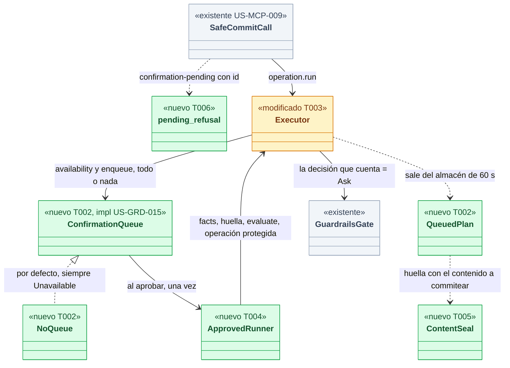
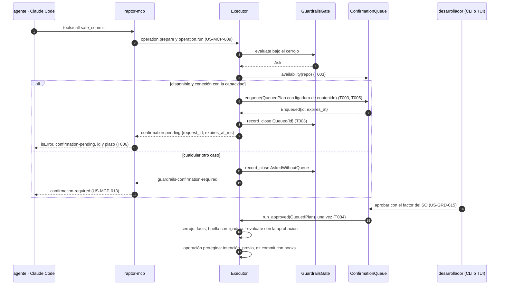
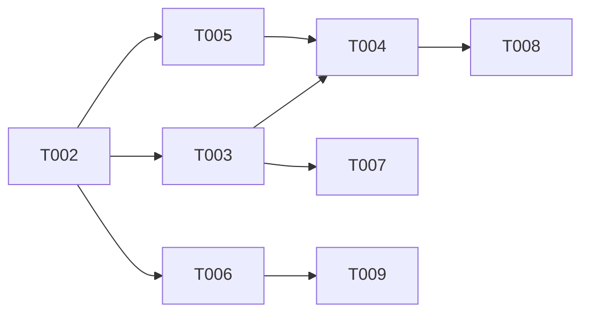

# DS-US-MCP-014 · "Pendiente" con id por MCP, y denegar cuando la cola falla

> **Estado: bloqueada.** No se implementa hasta que existan la cola de confirmación (US-GRD-015, con su Dev Spec, que espera los resultados de SPIKE-GRD-002) y `safe_commit` en `main` (US-MCP-009, PR #289). Esta spec fija lo que el MCP necesita de la cola (§ Contrato que la cola debe ofrecer) y el fallo cerrado, y deja un plan construible el día que la cola exista.

## Contexto rápido

Cuando exista la cola, una escritura que un agente pide por MCP y que Guardrails marca "pedir confirmación" queda en la cola del desarrollador. El agente recibe al momento `confirmation-pending` con un id de petición y un plazo, sin esperar la decisión. Si el desarrollador aprueba, el daemon ejecuta ese mismo plan una vez, como operación protegida. Si la cola no está disponible por cualquier motivo, la respuesta es la de US-MCP-013 (`confirmation-required`) y no queda ninguna petición creada. El servidor nunca pide nada al cliente del agente.

Hoy no puede: en `main` el ejecutor cierra todo `Ask` como `AskedWithoutQueue` y devuelve `guardrails-confirmation-required` (`crates/core/src/executor/mod.rs:931-933`), `raptor-mcp` lo traduce a `confirmation-required` (`apps/mcp/src/engine.rs:263-264`), y no existe código de cola (`grep -rniE 'ConfirmationQueue|PendingRequest|confirmation_queue'` en `crates/` y `apps/`: sin resultados). En el PR #289 (`feat/US-MCP-009-010-safe-commit`, solo lectura) `safe_commit` hereda la misma tabla: `apps/mcp/src/engine.rs:463-464` mapea `GuardrailsConfirmationRequired` a `ConfirmationRequired`, y `call_run` envía `confirmation: None` (`apps/mcp/src/engine.rs:285`).

| Término | Qué es aquí |
|---|---|
| Cola | La cola de confirmación de US-GRD-015: vive en el daemon, la decide el humano desde la CLI o el Cockpit, aprobar exige el factor del SO (ADR-GRD-008) y rechazar no |
| Petición | Una entrada de la cola: estados `pending`, `approved`, `rejected`, `expired` (BR-WF-001 de Guardrails) |
| Encolar | Pasar un plan del ejecutor, con la decisión que cuenta en `ask`, a una petición de la cola. Todo o nada (R3) |
| Plan encolado | El plan del ejecutor que la petición guarda hasta su desenlace. Sale del almacén de planes de 60 s (`PLAN_TTL_MS`, `crates/api/src/catalog.rs:27`) |
| Ligadura de contenido | El resumen del contenido que el plan va a commitear (índice o blobs de las rutas nombradas), parte de la huella del plan encolado (D6) |
| Fallo cerrado | Ante cualquier duda sobre la cola, el `ask` se aplica como denegar con `confirmation-required` (US-MCP-013) y no queda petición |
| Decisión que cuenta | La evaluación de Guardrails en `run`, bajo el cerrojo del repo (ADR-CKP-002 § 2, punto 4) |

⚠️ **ASSUMPTION**: no existe `architecture-constitution.md`; rigen `AGENTS.md` y los ADR de `must_read` (NFR-01, NFR-02, ADR-GRP-016), como en DS-US-MCP-009 y DS-US-MCP-013.

---

## 📋 Índice

> **Para aprobar:** [Contexto rápido](#contexto-rápido) · [⚠️ Gaps](#gaps-y-violaciones-de-la-constitución) · [Contrato que la cola debe ofrecer](#contrato-que-la-cola-debe-ofrecer) · [Fallo cerrado](#fallo-cerrado) · [Decisiones](#decisiones-validadas).
> **Para implementar (cuando se desbloquee):** [🚀 Plan](#plan-de-implementación), en orden.

| Sección | Propósito |
|---------|-----------|
| [⚠️ Gaps y violaciones de la constitución](#gaps-y-violaciones-de-la-constitución) | Qué impide empezar o liberar |
| [Contrato que la cola debe ofrecer](#contrato-que-la-cola-debe-ofrecer) | R1…R10: forma de la API, ids y estados que el MCP necesita de US-GRD-015 |
| [Fallo cerrado](#fallo-cerrado) | Cada fallo de la cola y su respuesta |
| [🔭 La forma](#la-forma) | Piezas y flujo |
| [🚀 Plan de implementación](#plan-de-implementación) | T001…T009 |
| [Contratos compartidos](#contratos-compartidos) _(ref)_ | Tipos y firmas |
| [Contrato de API](#contrato-de-api) _(ref)_ | Canal y herramienta |
| [Estrategia de pruebas y cobertura](#estrategia-de-pruebas-y-cobertura) _(ref)_ | Escenario → prueba |
| [Gate de seguridad](#gate-de-seguridad) | Checklist pre-merge |
| [Fuera de alcance](#fuera-de-alcance) | Not Built |
| [Decisiones validadas](#decisiones-validadas) | D1…D12 |
| [Preguntas abiertas](#preguntas-abiertas) | Q-MCP-52…Q-MCP-54 |
| [Enmiendas que implica](#enmiendas-que-implica) | Lo que esta spec no edita y alguien tiene que aplicar |
| [Notas del autor](#notas-del-autor) _(ref)_ | Hechos del código |

---

## ⚠️ Gaps y violaciones de la constitución

| ID | Qué falta | Severidad | Alcance | Acción | Owner |
|----|-----------|-----------|---------|--------|-------|
| G1 | La cola no existe: US-GRD-015 está en `draft` sin Dev Spec, y su Dev Spec espera los resultados de SPIKE-GRD-002 (parte macOS: plan validado el 2026-10-09, sin ejecutar; `research/` solo tiene `SPIKE-GRD-001-resultados.md`) | Bloquea inicio | T002…T009 | Ejecutar SPIKE-GRD-002 (macOS) y escribir DS-US-GRD-015 | Orquestador (SPIKE), Arquitecto (DS) |
| G2 | DS-US-GRD-015 tiene que adoptar R1…R10 de § Contrato que la cola debe ofrecer, o enmendar esta spec antes de construir | Bloquea inicio | T003, T004 | Al escribir DS-US-GRD-015, comprobar R1…R10 fila a fila | Arquitecto |
| G3 | `safe_commit` no está en `main`: los tres escenarios lo usan y T006 edita su tabla de rechazos (PR #289) | Bloquea inicio | T001, T006 | Mezclar US-MCP-009 y US-MCP-010 | Orquestador |
| G4 | Sin forma de que el agente conozca el desenlace (aprobada y ejecutada, rechazada, caducada, no ejecutada) el "pendiente" es un callejón: `explain_history` (US-MCP-017) está en `draft` | Bloquea liberación | T008 | Resolver Q-MCP-52 | Rene (PO la registra) |
| G5 | El factor del SO solo existirá en macOS tras SPIKE-GRD-002; en Linux y Windows la cola no es aprobable y por R2 el MCP responde `confirmation-required` | Bloquea liberación (Linux, Windows) | — | Etapa de validación multiplataforma (XP) | Orquestador |

US-CKP-023 (presentación en la TUI) no bloquea: la cola se decide también desde la CLI (US-GRD-015, Dependencias).

---

## Contrato que la cola debe ofrecer

Lo que el MCP necesita de US-GRD-015. Es un requisito para DS-US-GRD-015 (G2), no su diseño interno: almacén, presentación, factor y registro de transiciones son de esa spec. Todo vive en el proceso del daemon, así que el ejecutor la usa por un puerto inyectado, como al gate (`Arc<dyn GuardrailsGate>`), y no por el canal.

| # | Requisito | Por qué |
|---|---|---|
| R1 | **Puerto en proceso**, `ConfirmationQueue` (§ Firmas), inyectado en `Executor::new`. Implementación por defecto `NoQueue`, que siempre responde `Unavailable(NotWired)`; el cableado de producción la usa hasta que US-GRD-015 entregue la suya | Fallo cerrado por construcción: sin cola cableada no hay `pending` |
| R2 | **Disponibilidad que incluye "aprobable"**: `availability(repo)` responde `Available` solo si la cola acepta peticiones de ese repo **y** el factor del SO está disponible en ese momento (ADR-GRD-008 § 3, "Si no está disponible"). Sin factor → `Unavailable(FactorUnavailable)` | Una petición que nadie puede aprobar solo puede caducar: crearla es peor que denegar con la acción (US-MCP-013) |
| R3 | **Encolar es atómico**: `enqueue` devuelve `Enqueued{id, expires_at}` con la petición ya visible para el humano, o `Unavailable(motivo)` sin rastro. No hay tercer resultado ni "quizá". Un pánico o un error interno de la cola se traducen a `Unavailable(Internal)` y la cola garantiza que no quedó entrada | "Nunca crear una petición a medias" |
| R4 | **Plazo acotado de `enqueue`**: responde en ≤ 250 ms (⚠️ **ASSUMPTION**, se ejecuta bajo el cerrojo del repo). Sin E/S de red ni diálogo: el factor solo se pide al aprobar | El cerrojo del repo no espera a una persona (DS-US-MCP-013 G2) |
| R5 | **Id de petición**: opaco, ≥ 96 bits del CSPRNG del SO, `[a-z0-9-]`, ≤ 40 caracteres, prefijo `cr-`; ligado al repo: un id de otro repo responde igual que uno inexistente (ADR-MCP-001 § 5, S-08). Nunca lleva datos del plan | El agente lo ve; no debe permitir adivinar ni leer nada |
| R6 | **Estados mínimos**: `pending`, `approved`, `rejected`, `expired` (BR-WF-001), finales salvo `pending`. Una petición aprobada lleva además el desenlace de su ejecución: `ran{operation_id, outcome}` o `not-run{reason}` con `reason ∈ {state-changed, policy-denied, expired-during-approval}`. Sin `cancelled`: el fin de la sesión del agente no cambia el estado (Q-MCP-53, D13) | El agente y el registro distinguen "el humano dijo sí" de "se ejecutó" |
| R7 | **Plazo**: el de BR-TIME-001 (5 min por defecto; los niveles personales solo lo acortan). `enqueue` devuelve el vencimiento absoluto en milisegundos del reloj del daemon | El agente recibe cuánto tiene el humano, sin esperarlo |
| R8 | **El plan encolado viaja con la petición**: la cola guarda el `QueuedPlan` (operación, argumentos, repo, solicitante, capa `mcp`, huella con ligadura de contenido) y lo entrega, una sola vez, al callback de ejecución al aprobarse. El `QueuedPlan` no sale de la memoria del daemon ni se escribe en el perfil. El solicitante de la ejecución aprobada es el que guarda el `QueuedPlan`; nunca se vuelve a resolver desde un proceso vivo (el del agente puede haber terminado y su pid, reutilizarse) (D13) | Una aprobación vale una vez (S-GRD-8); el plan no se puede editar entre la petición y la aprobación |
| R9 | **Reinicio del daemon**: las peticiones `pending` no sobreviven como ejecutables. Si la cola las persiste para el registro, al arrancar pasan a `expired` sin ejecutar | El `QueuedPlan` vive en memoria (R8); ejecutar tras un reinicio sería ejecutar otro plan |
| R10 | **Idempotencia mientras está pendiente**: `enqueue` con la misma clave (`requester`, repo, huella) que una petición `pending` devuelve esa misma petición; con una rechazada, caducada o aprobada crea una nueva (escenario "Reintentar" de US-GRD-015). Más un cupo por solicitante y por repo (Q-MCP-54): lleno → `Unavailable(QuotaFull)` | Un reintento tras `outcome-unknown` no duplica la petición, y un agente en bucle no inunda la cola |

La cola nunca se expone al perfil `mcp`: ningún método de decidir, listar o consultar la cola tiene marca MCP, y decidir sigue siendo reservado (ADR-GRP-005 § 6; `crates/api/src/methods/mod.rs:226`, `mcp_never_gets_a_reserved_command`).

---

## Fallo cerrado

Toda fila termina igual para el agente: `confirmation-required` sin `params`, con los textos de DS-US-MCP-013, el worktree sin cambios, sin intención en el oplog, sin snapshot previo y sin petición. El cierre del plan es `AskedWithoutQueue`, una sola entrada en el registro (ADR-GRD-006), con `cause` = `ask-unavailable`.

| Situación | Dónde se detecta | Respuesta |
|---|---|---|
| Cola sin cablear (`NoQueue`) | `availability` en `run` | Denegar (US-MCP-013) |
| La conexión no tiene la capacidad `operation.confirmation-queue` (cliente antiguo) | `run`, antes de mirar la cola | Denegar (US-MCP-013). El daemon nunca envía `pending` a quien no lo pidió |
| Factor del SO no disponible (SSH, pantalla bloqueada, Linux y Windows hasta XP) | `availability` (R2) | Denegar (US-MCP-013) |
| Cupo de peticiones lleno (Q-MCP-54) | `enqueue` → `QuotaFull` | Denegar (US-MCP-013), sin código propio (Q-MCP-54, cerrada) |
| `enqueue` devuelve error, entra en pánico o supera R4 | Envoltorio del ejecutor (`catch_unwind` y plazo) | Denegar (US-MCP-013). Si el plazo vence, el ejecutor llama a `abandon(token)` y la cola descarta la entrada si llegó a crearla (R3) |
| Respuesta ambigua o desconocida de la cola (variante nueva no reconocida) | `match` no exhaustivo con `_ =>` cerrado | Denegar (US-MCP-013) |
| El daemon se detiene durante `enqueue` | `DaemonStopping` | `engine-unavailable`, como hoy; la cola no deja entrada (R3, R9) |
| La petición se crea pero la respuesta no llega al agente (transporte) | `raptor-mcp` | `outcome-unknown` sin id, como hoy. El reintento recibe la misma petición (R10) |
| La regla cambia a `deny` antes de aprobar | Ejecución tras aprobar (T004) | No se ejecuta: `not-run{policy-denied}` |
| El contenido o el estado cambian antes de aprobar | Ejecución tras aprobar, huella con ligadura (D6) | No se ejecuta: `not-run{state-changed}` |
| La petición caduca durante el diálogo del factor | Cola (ADR-GRD-008 § 3, "Vida de la entrada") | No se ejecuta: `expired` |

Nunca: elicitation, `sampling`, ni una petición del servidor al cliente del agente, con o sin cola (ADR-MCP-001 § 1; `apps/mcp/tests/no_elicitation.rs:23`).

---

## 🔭 La forma



🟩 nuevo · 🟨 modificado · ⬜ existente. La arista que decide el fallo cerrado es `Executor → ConfirmationQueue`: solo un `Enqueued` produce `pending`; cualquier otra cosa es el camino de US-MCP-013.

**Cómo fluye:**



El agente no espera nada a partir del paso 9 o del 12: su llamada ya respondió. El paso 15 corre en el daemon, sin conexión del agente; su resultado lo conoce el agente por la vía que fije Q-MCP-52.

---

## 🚀 Plan de implementación

> Construible solo con G1, G2 y G3 cerrados. Orden topológico (`Depende:`). Rutas relativas a la raíz del repo. Archivos propios por tarea (ADR-GRP-016); las ediciones de una línea en archivos compartidos se nombran.

| # | Tarea | Depende | Aterriza en |
|---|---|---|---|
| T001 | Suite de aceptación en rojo: tres escenarios y la tabla de fallo cerrado | — | `apps/cli/tests/mcp_confirmation_pending.rs` |
| T002 | Contrato: puerto `ConfirmationQueue`, `NoQueue`, `QueuedPlan`, capacidad, error del canal y código MCP | — | `crates/api/src/`, `crates/core/src/executor/queue.rs` |
| T003 | Encolar en `run` con fallo cerrado y cierre `Queued` | T002 | `crates/core/src/executor/` |
| T004 | Ejecutar un plan aprobado una vez | T002, T003, T005 | `crates/core/src/executor/approved.rs` |
| T005 | Ligadura de contenido del plan de `commit` | T002 | `crates/core/src/executor/ops/commit_seal.rs` |
| T006 | `confirmation-pending` en `raptor-mcp` | T002 | `apps/mcp/src/` |
| T007 | Idempotencia y cupo al encolar (R10, Q-MCP-54) | T003 | `crates/core/src/executor/queue.rs` |
| T008 | Desenlace visible para el agente (Q-MCP-52) | T004 | según Q-MCP-52 |
| T009 | Corpus de seguridad, guardas sin elicitation y documentos | T006 | `apps/cli/tests/mcp_corpus/cases/`, `docs/` |



### T001 — Suite de aceptación en rojo

**Ubicación.** `apps/cli/tests/mcp_confirmation_pending.rs` (**CREATE**); casos del ejecutor en `crates/core/tests/us_mcp_014.rs` (**CREATE**).

**Reglas**
- Copiar el arnés de `apps/cli/tests/mcp_safe_commit.rs` (US-MCP-009) sin editarlo. `#![cfg(target_os = "macos")]`, `#![cfg(debug_assertions)]`.
- Cola real de US-GRD-015 con el factor sustituido por su doble de prueba (ADR-GRD-008, Validación 1); la aprobación se hace con el comando de la CLI que entregue US-GRD-015, nunca desde el canal del agente.
- Escenario 1: la respuesta llega antes de que exista decisión (el test comprueba que la petición sigue `pending` después de recibirla), `git rev-list --count` no cambia, y la cola lista la petición con agente, operación y worktree.
- Escenario 2: la sesión MCP grabada no contiene ningún mensaje del servidor con `method` (ni `elicitation/create` ni `sampling/createMessage`), con y sin cola.
- Escenario 3 y § Fallo cerrado: una prueba por fila, en `us_mcp_014.rs` con un `ConfirmationQueue` doble que responde cada caso (`Unavailable` de cada motivo, error, pánico, retraso mayor que R4, variante desconocida). Cada prueba comprueba: `guardrails-confirmation-required`, cola vacía, sin intención en el oplog, una sola entrada `AskedWithoutQueue` en el registro.
- Aprobada: el commit aparece una vez en el timeline, con previo, actor el agente y canal `mcp`; una segunda aprobación no ejecuta nada.
- Aprobada con contenido cambiado: el agente edita `src/a.rs` entre la petición y la aprobación → `not-run{state-changed}`, ningún commit.

- **Depende:** —
- **Refs:** US-MCP-014 (Gherkin), DS-US-MCP-013 T004, US-GRD-015
- **Aceptación:** las pruebas de § Estrategia existen y fallan en rojo

### T002 — Contrato

**Ubicación.** `crates/api/src/confirmation_queue.rs` (**CREATE**), `crates/core/src/executor/queue.rs` (**CREATE**); una línea `pub mod confirmation_queue;` en `crates/api/src/lib.rs`; una variante al final de `McpToolError` y de `ALL` en `crates/api/src/mcp_view.rs`.

**Reglas**
- Tipos de § Contratos compartidos. Capacidad `operation.confirmation-queue` declarada en el registro de capacidades (ADR-GRP-016), en su propio archivo.
- Error nuevo del canal `CONFIRMATION_PENDING` con `ConfirmationPendingData { request_id, expires_at_ms }`, `deny_unknown_fields`. No se añade un campo a `RejectedData` ni a `OperationRunResult`, que son `deny_unknown_fields` (`crates/api/src/timemachine.rs:148`): romperían a todo cliente (D3). El número del código lo fija T002 en `docs/architecture/design/api-contract-ipc.md` dentro del rango del canal.
- `McpToolError::ConfirmationPending` (`confirmation-pending`, reservado en ADR-MCP-001 § 5).

- **Depende:** —
- **Aceptación:** `mcp_tool_codes_are_kebab_and_closed` incluye `confirmation-pending`; prueba de ida y vuelta de `ConfirmationPendingData`

### T003 — Encolar en `run` con fallo cerrado

**Ubicación.** `crates/core/src/executor/mod.rs` (**MODIFY**, solo el brazo `GateDecision::Ask` de `run`, hoy `:931-933`), `crates/core/src/executor/queue.rs` (**MODIFY**), `crates/core/src/executor/gate.rs` (**MODIFY**, una variante `PlanClose::Queued`).

**Reglas**
- En el brazo `Ask`: (1) si la conexión no tiene la capacidad, o `availability` no es `Available`, camino actual (`AskedWithoutQueue` + `GuardrailsConfirmationRequired`); (2) si no, `enqueue` envuelto en `catch_unwind` y en el plazo de R4; (3) solo `Enqueued` cierra con `PlanClose::Queued{id}` y devuelve `ExecError::ConfirmationPending`; (4) cualquier otro resultado, camino actual.
- El plan sale del almacén de planes antes de encolar y nunca vuelve: un `run` posterior del mismo `plan_id` es `plan-unknown`.
- La vista previa de `prepare` sigue mostrando `DecisionView::Deny` para `Ask` (`crates/core/src/executor/mod.rs:651`; DS-US-MCP-013 D3). `raptor-mcp` no decide por ella.
- La capa del agente no cambia lo que se decide (ADR-GRD-003 § 1): solo cambia si hay cola. El `ask` del desarrollador sigue pasando (Q-GRD-46, `crates/core/src/guardrails/evaluate.rs:212-216`).

- **Depende:** T002
- **Aceptación:** las pruebas de fallo cerrado de `us_mcp_014.rs` pasan; `production_wiring_has_no_governed_arm_without_guardrails` sigue en verde

### T004 — Ejecutar un plan aprobado una vez

**Ubicación.** `crates/core/src/executor/approved.rs` (**CREATE**); una línea `mod approved;` en `crates/core/src/executor/mod.rs`.

**Reglas**
- `run_approved(plan: QueuedPlan, approval: ApprovalRef) -> ApprovedOutcome`, que la cola llama una vez por petición aprobada (R8).
- Orden: cerrojo del repo con la espera de cola de `run` → facts → huella con ligadura (T005); distinta → `not-run{state-changed}` → `evaluate` con `ApprovalRef` en la petición del gate: `Ask` aprobado se ve como `Allow`; `Deny` gana (`not-run{policy-denied}`) → operación protegida como en `run` (intención, previo, paso), con capa `mcp` y el solicitante del plan.
- Los hooks de Guardrails reciben la decisión ligada (DS-US-MCP-009 D10): la ligadura nombra el `request_id`.
- Una entrada del registro para la ejecución, enlazada a la petición por `request_id`; las transiciones de la petición las escribe la cola (US-GRD-005).
- No se reutiliza `run`: no hay `plan_id`, ni conexión, ni avisos que reconocer (`commit` no tiene avisos en `catalogVersion` 1).

- **Depende:** T002, T003, T005
- **Aceptación:** `an_approved_request_runs_once_with_a_prior`, `a_changed_content_is_not_run`, `a_rule_turned_deny_is_not_run`

### T005 — Ligadura de contenido del plan de `commit`

**Ubicación.** `crates/core/src/executor/ops/commit_seal.rs` (**CREATE**); una línea en `crates/core/src/executor/ops/commit.rs` (US-MCP-009) para añadir el sello a `expected`.

**Reglas**
- Hoy la huella cubre `RepoFacts` (`crates/core/src/executor/facts.rs:12-29`: HEAD, rama, cerrojos, sin contenido) y, en el PR #289, la selección de rutas (`crates/core/src/executor/ops/commit.rs:85-87` del PR: `old`, `branch`, `selection`), no el contenido. Eso basta dentro de una llamada; no tras minutos de espera, porque el agente sigue trabajando.
- Sello: con rutas nombradas, el oid de blob del contenido del working tree de cada ruta (con gitoxide, sin `git` del sistema); con "todo lo preparado", el oid del árbol del índice. Lo calcula el brazo en el plan y entra en la huella.
- Solo se calcula cuando el plan va a encolarse (T003 lo pide al brazo con `seal()`), para no añadir coste a cada `commit` permitido.

- **Depende:** T002
- **Aceptación:** `the_seal_changes_when_a_named_path_changes`, `the_seal_ignores_unnamed_paths`

### T006 — `confirmation-pending` en `raptor-mcp`

**Ubicación.** `apps/mcp/src/pending.rs` (**CREATE**), `apps/mcp/src/messages_pending_tests.rs` (**CREATE**); una fila en `rejected_refusal` (`apps/mcp/src/engine.rs`, función de PR #289 en `:450`) y los textos en `apps/mcp/src/messages.rs`.

**Reglas**
- `ClientError::Rpc` con `CONFIRMATION_PENDING` → `confirmation-pending` con `params: {request_id, expires_in_s}`; `expires_in_s` se calcula con el reloj del daemon que viene en la respuesta, nunca con el del cliente.
- Un `CONFIRMATION_PENDING` sin `data` decodificable → `confirmation-required` (fallo cerrado hacia US-MCP-013, no `internal`).
- `safe_commit` no espera: la llamada responde en cuanto llega el error del canal.
- El `outputSchema` de `safe_commit` no cambia: `pending` es un rechazo de dominio (D2).

- **Depende:** T002
- **Aceptación:** textos de § Contrato de API ≤ 80 tokens en en y es (`MCP_REFUSAL_TOKENS`)

### T007 — Idempotencia y cupo

**Ubicación.** `crates/core/src/executor/queue.rs` (**MODIFY**), o la cola de US-GRD-015 si DS-US-GRD-015 lo absorbe (G2).

**Reglas**
- R10 tal cual. La clave usa el solicitante resuelto por el daemon, nunca el canal declarado.
- Cupo de Q-MCP-54 (cerrada): ≤ 3 peticiones `pending` por solicitante y repo y ≤ 20 por repo.

- **Depende:** T003
- **Aceptación:** `a_retry_while_pending_returns_the_same_id`, `a_retry_after_rejection_creates_a_new_request`, `a_full_quota_denies_without_a_request`

### T008 — Desenlace visible para el agente

Según Q-MCP-52. Con la recomendación (b), una vista `pending_requests` en `McpStatusView` con las peticiones propias del solicitante en el repo (≤ 3, id, estado, desenlace), dentro del presupuesto de RES-MCP-02. **No se construye sin la respuesta.**

- **Depende:** T004
- **Aceptación:** la que fije Q-MCP-52

### T009 — Corpus, guardas y documentos

**Ubicación.** `apps/cli/tests/mcp_corpus/cases/` (**CREATE** casos `confirmation-pending-*`), `docs/` (las enmiendas de § Enmiendas que implica).

**Reglas**
- Casos: `pending` no lleva regla, ruta, mensaje ni repo; un `request_id` inventado en cualquier parámetro de `safe_commit` es `invalid-params`; ninguna herramienta acepta un `request_id`.
- `apps/mcp/tests/no_elicitation.rs` sin cambios: sigue rigiendo con la cola cableada.
- US-MCP-014 pasa a `implemented` solo con T001 en verde y G4 cerrado.

- **Depende:** T006

---

## Contratos compartidos

```rust
// crates/api/src/confirmation_queue.rs
pub const CAP_OPERATION_CONFIRMATION_QUEUE: Capability =
    Capability::new("operation.confirmation-queue");

/// The data of the channel error CONFIRMATION_PENDING: the plan is waiting for the developer.
#[derive(Debug, Clone, PartialEq, Eq, Serialize, Deserialize, JsonSchema)]
#[serde(deny_unknown_fields)]
pub struct ConfirmationPendingData {
    /// Opaque, bound to the repo (R5).
    pub request_id: String,
    /// Daemon clock, Unix ms (R7).
    pub expires_at_ms: u64,
    pub now_ms: u64,
}

// crates/core/src/executor/queue.rs
pub enum Availability { Available, Unavailable(Unavailable) }

#[non_exhaustive]
pub enum Unavailable { NotWired, FactorUnavailable, QuotaFull, RepoNotQueued, Internal }

pub enum Enqueue {
    Enqueued { id: RequestId, expires_at_ms: u64 },
    Unavailable(Unavailable),
}

/// The confirmation queue as the executor uses it (R1). Implemented by US-GRD-015.
pub trait ConfirmationQueue: Send + Sync {
    fn availability(&self, repo: &RepoHandle) -> Availability;
    /// All or nothing (R3), bounded (R4), idempotent while pending (R10).
    fn enqueue(&self, plan: QueuedPlan, token: EnqueueToken) -> Enqueue;
    /// Drops whatever `enqueue` with this token created; called when its deadline passed.
    fn abandon(&self, token: EnqueueToken);
}

/// Default and production wiring until US-GRD-015: never available.
pub struct NoQueue;

// crates/core/src/executor/gate.rs — en PlanClose
/// The decision that counts asked and the plan went to the queue: no step, no prior.
Queued { request_id: RequestId },
```

`RequestId` es un tipo opaco con `Debug` que no imprime más que el prefijo. `QueuedPlan` guarda los campos de `StoredPlan` que la ejecución necesita (`crates/core/src/executor/mod.rs:261`) más el sello de T005, y no implementa `Serialize` (R8, R9).

---

## Contrato de API

| Superficie | Cambio | Quién lo recibe |
|---|---|---|
| Canal, `operation.run` | Error `CONFIRMATION_PENDING` con `ConfirmationPendingData` | Solo conexiones con `operation.confirmation-queue` |
| Canal, `operation.run` sin la capacidad | Sin cambio: `-32014` `guardrails-confirmation-required` | Clientes antiguos |
| Herramienta `safe_commit` | Rechazo de dominio `confirmation-pending` | El agente |

Herramienta: `isError: true`, sin `structuredContent`, `content[0].text` con `{"code":"confirmation-pending","message":…,"params":{"request_id":"cr-…","expires_in_s":300},"action":…}`.

| Idioma | `message` | `action` |
|---|---|---|
| en | `This action is waiting for the developer's decision.` | `Carry on with other work. Do not retry: it returns the same request.` |
| es | `Esta acción espera la decisión del desarrollador.` | `Sigue con otra cosa. No reintentes: devuelve la misma petición.` |

La acción no dice cómo conocer el desenlace hasta Q-MCP-52. `params` no lleva regla, nivel, rama, ruta ni repo (SEC-05).

| Concepto | Valor | Fuente |
|---|---|---|
| Plazo de la petición | 5 min, solo acortable | BR-TIME-001 |
| Plazo de `enqueue` | ≤ 250 ms | R4, ⚠️ **ASSUMPTION** |
| Espera del agente | ninguna tras encolar | BR-MCP-WF-004 |
| Tamaño del rechazo | ≤ 80 tokens | RES-MCP-03 |
| Cupo de peticiones | ≤ 3 por solicitante y repo, ≤ 20 por repo | Q-MCP-54, cerrada |

## Modelo de datos

_Sin migraciones._ El `QueuedPlan` vive en memoria del daemon (R8). Lo que la cola persista para el registro es de DS-US-GRD-015.

---

## Estrategia de pruebas y cobertura

| Escenario o regla | Prueba | Nivel |
|---|---|---|
| Esc. 1: pendiente sin esperar | `a_pending_answer_arrives_before_the_decision` | e2e |
| Esc. 1: la cola tiene agente, operación y worktree | `the_queue_lists_the_agent_operation_and_worktree` | e2e |
| Esc. 1: el worktree no cambia | `the_worktree_does_not_change_while_pending` | e2e |
| Esc. 2: sin elicitation con cola | `the_server_never_asks_the_client_with_a_queue` | e2e |
| Esc. 3: cola no disponible | `an_unavailable_queue_denies_without_a_request` | e2e |
| Fallo cerrado, una por fila | `us_mcp_014::fail_closed_*` (8) | integración, cola doble |
| Cliente sin capacidad | `a_client_without_the_capability_gets_the_denial` | integración |
| Aprobada, una vez | `an_approved_request_runs_once_with_a_prior` | e2e |
| Contenido cambiado | `a_changed_content_is_not_run` | e2e |
| Regla ahora `deny` | `a_rule_turned_deny_is_not_run` | integración |
| R10 | tres pruebas de T007 | integración |
| D13: sesión terminada | `a_pending_request_runs_after_the_agent_session_ends` (ejecuta una vez, actor = el solicitante del plan) | integración, cola doble |
| `data` indecodificable | `an_undecodable_pending_is_confirmation_required` | unidad |

Cobertura: ≥ 90 % de líneas en `executor/queue.rs`, `executor/approved.rs` y `apps/mcp/src/pending.rs`; 100 % de las ramas del brazo `Ask` de `run`. Plataforma: macOS. Linux y Windows: `confirmation-required` por R2 hasta la etapa multiplataforma (G5).

---

## Gate de seguridad

- Fallo cerrado: solo `Enqueued` produce `pending`; todo lo demás es US-MCP-013, sin petición, sin intención y sin previo.
- Una aprobación vale una vez y para el plan que el humano vio: `QueuedPlan` en memoria, entregado una vez, con ligadura de contenido.
- El agente no decide: ningún método de la cola tiene marca MCP; aprobar exige el factor del SO (ADR-GRD-008).
- Sin elicitation ni peticiones del servidor al cliente (`no_elicitation.rs`).
- El id no revela nada y está ligado al repo (R5).
- Cupo contra un agente que inunda la cola del desarrollador (R10).
- Toca el ejecutor y la superficie de rechazos: revisión de `security-expert` obligatoria antes de mezclar.

**Riesgos residuales**
- **Medio**: el agente puede sembrar peticiones con un resumen engañoso de su intención (el mensaje de commit lo escribe él). Cota: la cola muestra operación, rutas y regla, no el mensaje como verdad; lo presenta US-GRD-015 y US-CKP-023.
- **Bajo**: una ejecución aprobada corre sin la conexión del agente; si falla, el agente solo lo sabe por la vía de Q-MCP-52 (G4).

---

## Fuera de alcance

| Ítem | Historia | Gate |
|---|---|---|
| Almacén, presentación, factor y transiciones de la cola | US-GRD-015, US-CKP-023 | `NoQueue` en el cableado de producción hasta entonces |
| `confirmation-pending` en `safe_rebase` y `create_worktree` | US-MCP-018, US-MCP-019, con la misma tabla (`rejected_refusal`) | Sin código propio por herramienta |
| `DecisionView::Ask` en la vista previa | US-GRD-015 | `DecisionView` sin cambios |
| Notificación al agente cuando se decide | — (MCP sin `listChanged` ni notificaciones propias, ADR-MCP-001 § 1) | `announces_only_the_tools_capability` |
| Consultar el desenlace por id | US-MCP-017 o Q-MCP-52 | Ninguna herramienta acepta `request_id` |

---

## Decisiones validadas

Cada una es **Decisión del orquestador (2026-10-27), validada por Arquitecto y PO** (§ Validación del PO). Lo que ya fijan ADR-MCP-001 § 1 y § 5, BR-MCP-WF-004, DS-US-MCP-013 y ADR-GRD-008 se cita y no se redecide.

| # | Decisión | Alternativas descartadas |
|---|---|---|
| D1 | La spec se escribe ahora con `status: blocked` y `blocked_by: [US-GRD-015, SPIKE-GRD-002, US-MCP-009]`; fija el contrato que el MCP exige de la cola (R1…R10) para que DS-US-GRD-015 lo adopte (G2) | Esperar a DS-US-GRD-015: la cola se diseñaría sin el consumidor que necesita "pendiente sin bloquear" |
| D2 | `confirmation-pending` es un rechazo de dominio (`isError: true`), familia "decisión" de ADR-MCP-001 § 5; `safe_commit` no cambia su `outputSchema` | Resultado estructurado con `status: pending`: un modelo puede leerlo como "commit hecho" y cambia la instantánea de la vista |
| D3 | El canal lo comunica con un error nuevo `CONFIRMATION_PENDING` y sus datos, servido solo con la capacidad `operation.confirmation-queue`; sin ella, el `ask` se deniega como hoy | Campo en `RejectedData` u `OperationRunResult`: ambos son `deny_unknown_fields` y romperían a los clientes; un motivo nuevo bajo `-32014` no puede llevar el id |
| D4 | La cola se usa por un puerto en proceso (`ConfirmationQueue`) inyectado en el ejecutor, con `NoQueue` por defecto; la cola vive en el daemon (US-GRD-015) | Llamarla por el canal: añade un tercer resultado (transporte) y la ambigüedad que R3 prohíbe |
| D5 | Al aprobar, el daemon ejecuta el plan encolado una vez (T004), como operación protegida con capa `mcp` y el agente como solicitante; el agente no vuelve a llamar | El agente reintenta con el id tras aprobar: le obliga a sondear, convierte la aprobación en algo que se canjea desde el canal del agente y contradice US-CKP-023 ("el rebase se ejecuta una vez") |
| D6 | El plan encolado lleva ligadura de contenido (T005); al aprobar se recalcula y, si cambió, no se ejecuta (`not-run{state-changed}`) | Commitear el contenido del momento de la aprobación: el humano aprobaría algo que no vio |
| D7 | Disponibilidad = acepta peticiones **y** el factor del SO está disponible (R2); sin factor, US-MCP-013 | Encolar igualmente y dejar caducar: una petición que nadie puede aprobar solo hace esperar al humano y al agente |
| D8 | Fallo cerrado de § Fallo cerrado: cualquier respuesta de la cola distinta de `Enqueued` (incluido error, pánico, plazo vencido y variante desconocida) es US-MCP-013, con `abandon` si venció el plazo | Reintentar `enqueue`: alarga el cerrojo del repo; responder `internal`: el agente no recibe la acción |
| D9 | Encolar es idempotente mientras la petición está pendiente (R10) y tiene cupo (Q-MCP-54) | Una petición por llamada: un reintento tras `outcome-unknown` duplica la petición en la cola del humano |
| D10 | Las peticiones pendientes no sobreviven a un reinicio del daemon como ejecutables (R9) | Persistir el plan: ejecutaría tras un reinicio un plan cuyo contexto (sesión, facts) ya no existe |
| D11 | Cierre de plan nuevo `PlanClose::Queued{request_id}`: una entrada del registro al encolar; la ejecución aprobada escribe la suya, enlazada por `request_id` | Diferir el cierre hasta el desenlace: el plan de 60 s caducaría como `Dropped` |
| D12 | El `ask` del desarrollador sigue pasando sin cola ni petición (Q-GRD-46); la cola solo recibe planes de agentes por la capa `mcp` en esta historia | Encolar también al desarrollador: contradice Q-GRD-46 |
| D13 | Fin de la sesión del agente con la petición pendiente: sigue pendiente hasta la decisión del desarrollador o el plazo (Q-MCP-53). Es seguro porque la ejecución aprobada no depende de la sesión: el plan está sellado y en memoria (R8, D6), se ejecuta una vez, revalida HEAD, rama y cerrojos bajo el cerrojo del repo y Guardrails decide otra vez en `run` (`not-run{state-changed}` o `not-run{policy-denied}`); el factor del SO lo pone el humano; el solicitante sale del `QueuedPlan` y no se re-resuelve por pid (R8). El reinicio del daemon sí las caduca (D10) porque pierde el plan; el fin de la sesión no lo pierde. Un worktree borrado o con otro contenido cae en `state-changed`. **Decisión del orquestador (2026-10-27), validada por Arquitecto y PO**: el Arquitecto ratifica el cierre del PO y retira su recomendación | Anular al terminar la sesión (recomendación inicial del Arquitecto): exige que la cola observe el fin de cada sesión MCP, un estado `cancelled` más en DS-US-GRD-015 y quita al humano una decisión, para ahorrar como mucho 5 min; re-resolver el solicitante al aprobar: con la sesión terminada fallaría o, con un pid reutilizado, atribuiría a otro proceso |

---

## Preguntas abiertas

| ID | Pregunta | Recomendación | Bloquea |
|---|---|---|---|
| Q-MCP-52 | ¿Cómo conoce el agente el desenlace de su petición (aprobada y ejecutada con su oid, rechazada, caducada, no ejecutada)? `explain_history` (US-MCP-017) está en `draft` | (b) Una vista `pending_requests` en `status` con sus peticiones en el repo (≤ 3), hasta US-MCP-017, que la absorbe. Descartadas: (a) esperar a US-MCP-017, que deja el "pendiente" sin salida; (c) nada en el MVP | Liberación (G4) |
| Q-MCP-53 | Si la sesión del agente termina antes de la decisión, ¿la petición sigue pendiente o se anula? | **Cerrada.** Decisión del orquestador (2026-10-27), validada por PO: **sigue pendiente** hasta que el desarrollador decide o vence el plazo (5 min como mucho, BR-TIME-001). No se añade `cancelled` en el MVP. La petición es una decisión del desarrollador sobre trabajo que sigue en el worktree, no una espera del agente: si la aprueba, el commit se hace con el contenido que vio (D6) y queda atribuido al agente que lo pidió. Con un plazo tan corto, anularla al cerrar la sesión ahorra poco y le quita al humano un elemento de su cola sin que lo haya decidido. Se aparta de la recomendación inicial del Arquitecto (anular al terminar la sesión); R6 queda sin `cancelled`. **Ratificada por el Arquitecto** (Decisión del orquestador (2026-10-27), validada por Arquitecto y PO): falla cerrado y no depende de la sesión; condiciones en D13 y R8 | DS-US-GRD-015 (R6) |
| Q-MCP-54 | ¿Cupo de peticiones pendientes, y con qué código se rechaza la que no cabe? | **Cerrada.** Decisión del orquestador (2026-10-27), validada por PO: ≤ 3 por solicitante y repo, ≤ 20 por repo, y rechazo `confirmation-required` sin código nuevo. El agente que llena su cupo ya tiene peticiones esperando al humano, y la acción de US-MCP-013 ("avisa al desarrollador: la decisión es suya") es la correcta para él. Las cifras son de partida: se revisan con el dogfooding sin cambiar la historia | T007 |

## Validación del PO (2026-10-27)

**Veredicto: aprobada con ajustes.** Sigue bloqueada (US-GRD-015, SPIKE-GRD-002, US-MCP-009). Los tres escenarios de US-MCP-014 tienen prueba con el mismo resultado observable: "pendiente" con id y sin esperar, la cola con agente, operación y worktree, sin peticiones al cliente del agente, y la denegación con "requiere confirmación del desarrollador" y su acción (textos de DS-US-MCP-013) sin petición creada.

- **Decisiones con efecto en el producto, aceptadas**: "pendiente" como rechazo de dominio para que el agente no lo lea como commit hecho (D2); textos "Esta acción espera la decisión del desarrollador." · "Sigue con otra cosa. No reintentes: devuelve la misma petición."; fallo cerrado ante cualquier duda de la cola (D8) y sin factor del SO (D7), porque una petición que nadie puede aprobar solo hace esperar; ejecución única al aprobar, sin que el agente vuelva a llamar (D5), con el contenido que vio el humano (D6); idempotencia mientras está pendiente (D9).
- **Alcance**: T004 y T005 (ejecutar lo aprobado una vez, con su ligadura) están dentro del valor de la historia: "el worktree no cambia hasta que el desarrollador decide" implica que cambia cuando aprueba. T008 no está en ningún escenario: no se construye sin la respuesta de Q-MCP-52 y una enmienda de la historia que lo haga visible.
- **Preguntas**: Q-MCP-53 y Q-MCP-54 cerradas. **Q-MCP-52 sigue abierta para Rene.** Posición del PO: el desenlace es parte del valor (el agente no debe rehacer un trabajo aprobado ni dar por hecho uno rechazado). Como US-MCP-014 depende de una cadena más larga que US-MCP-017, `explain_history` estará en `main` antes y ya muestra el commit aprobado con el agente como actor. Lo que falta son rechazada, caducada y no ejecutada. Recomendación: (b), escrita como escenario nuevo de US-MCP-014, para que no sea alcance escondido.

---

## Enmiendas que implica

Esta spec no edita otros archivos. Quien aplique cada fila:

| Artefacto | Enmienda | Quién |
|---|---|---|
| US-MCP-014 | Dependencias: US-GRD-015 ya no depende del Cockpit F-001-02 y ADR-GRD-008 existe (aceptado 2026-10-04); `blocked_by: [US-GRD-015, SPIKE-GRD-002, US-MCP-009]`; Requisitos Técnicos y Dev Spec apuntan a esta spec | PO |
| `mcp/user-stories.md` | Filas de US-MCP-014 (`:41`, `:144`): mismo ajuste de bloqueos | PO |
| US-GRD-015 (y su futura DS) | Adoptar R1…R10; añadir `not-run{…}` al estado `approved`; sin `cancelled` (Q-MCP-53, D13); el solicitante de la ejecución sale del `QueuedPlan` (R8) | Arquitecto, PO |
| ADR-MCP-001 § 5 | `confirmation-pending` deja de estar reservado: rechazo de dominio con `request_id` y `expires_in_s`, capacidad `operation.confirmation-queue`, fallo cerrado a `confirmation-required` | Arquitecto |
| ADR-GRD-003 § 4 y S-GRD-9 | Con cola, `ask` de un agente por `mcp` se encola; sin cola o sin factor, se aplica como denegar | Arquitecto |
| ADR-GRD-006 § 1 | `Queued` como cierre de plan y la entrada de la ejecución aprobada enlazada por `request_id` | Arquitecto |
| ADR-CKP-002 § 2 y § 4 | Ejecución de un plan aprobado fuera de `run` (T004) y ligadura de contenido de `commit` (T005) | Arquitecto |
| `api-contract-ipc.md` | Error `CONFIRMATION_PENDING`, sus datos y la capacidad | T002 |
| `mcp/context.md` | Q-MCP-52, Q-MCP-53 y Q-MCP-54 en la tabla de preguntas | PO |
| BR-MCP-WF-004 | "pendiente con id" + "sin cola, sin factor o con la cola fallando, denegar con acción y sin petición" | PO |
| `release-plan.md` | US-MCP-014 sigue la cadena SPIKE-GRD-002 → US-GRD-015 → US-MCP-014, más US-MCP-009 | Orquestador |

---

## Notas del autor

| ID | Nota |
|----|------|
| N1 | `view_of` ya distingue `Ask` de `Deny` (`crates/core/src/guardrails/plan_gate.rs:151-159`) y el ejecutor cierra `Ask` con `AskedWithoutQueue` (`crates/core/src/executor/mod.rs:931-933`; `gate.rs:65-83`). T003 solo cambia ese brazo |
| N2 | `link.rs:90-91` aplica `ask` como `deny` al combinar decisiones del hook; no se toca: el hook (capa `hooks`) es de US-GRD-015 |
| N3 | El cliente del canal pide todas las capacidades del registro por defecto (`crates/core/src/client.rs:77`): `raptor-mcp` recibirá la capacidad nueva sin código propio |
| N4 | El PR #289 deja `confirmation: None` en `RunParams` (`apps/mcp/src/engine.rs:285` del PR): ese campo es el reto del Cockpit (`crates/api/src/catalog.rs:926-927`), no la cola; esta spec no lo usa |
| N5 | Q-MCP-52…55 son los ids asignados por el orquestador para esta spec; el máximo en `docs/` hoy es Q-MCP-43 |

**Convenciones observadas**: fallo cerrado de un gate ausente (`NoGuardrails` → `NotEvaluated`, `executor/gate.rs`); forma servida solo con capacidad (`crates/core/src/channel/conn.rs:3339`); tabla de rechazos de escritura compartida (`rejected_refusal`).

**Inventario de reutilización**: reutiliza `GateDecision::Ask`, `PlanClose`, `rejected_refusal`, `refusal` de `messages.rs`, el arnés de `mcp_safe_commit.rs` y `ProtectedOperation`. Crea nuevo: `executor/queue.rs`, `executor/approved.rs`, `ops/commit_seal.rs`, `apps/mcp/src/pending.rs`, `crates/api/src/confirmation_queue.rs`.
