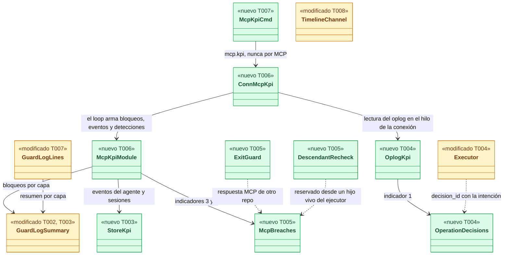
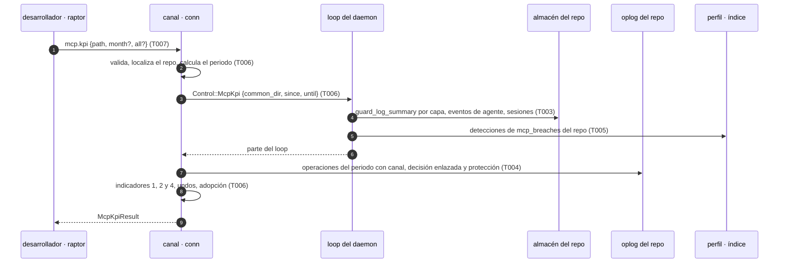
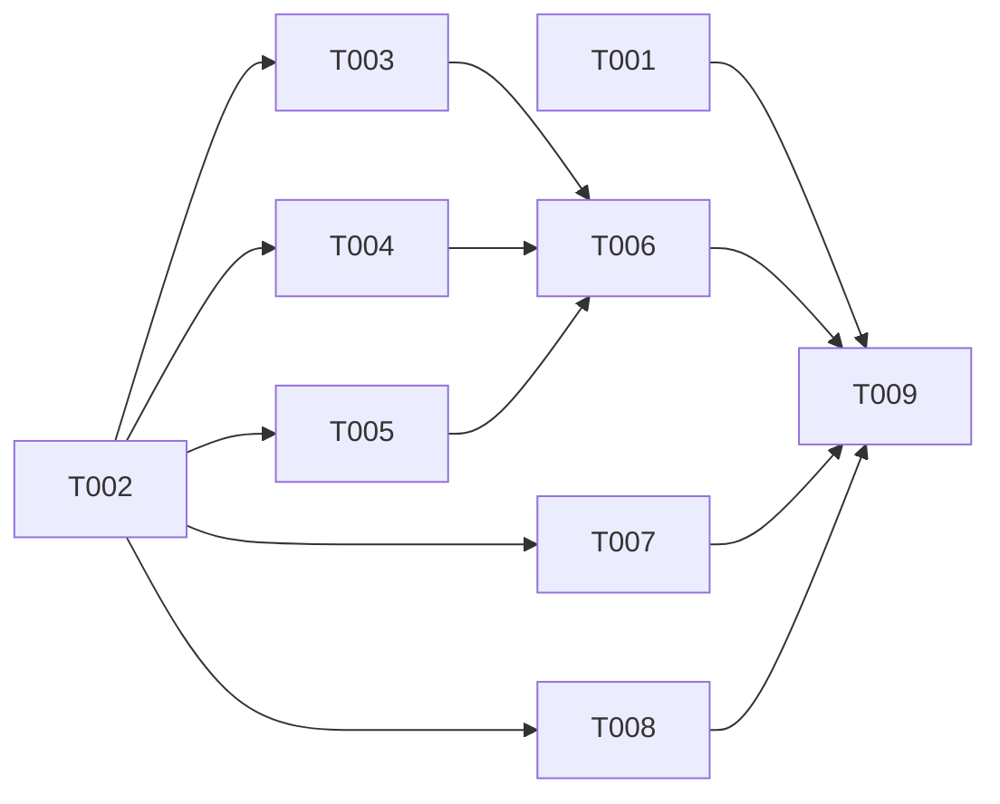

# DS-US-MCP-015 · Medición del MCP

## Contexto rápido

Al terminar, el desarrollador ejecuta `raptor mcp kpi` en "shop" y ve, para el mes: las acciones bloqueadas por capa ("12 por mcp, 7 por hooks"), las operaciones hechas por MCP, los undos del mes por canal y por usuario activo, los cinco indicadores de seguridad del MCP con su meta de cero y la adopción del MCP como porcentaje sin meta. `raptor guard log` muestra también el desglose por capa. Hoy no puede: el registro de decisiones guarda la capa de cada entrada (`crates/core/src/profile/guard_log.rs:94-120`, columna `layer`), pero el resumen solo suma un total (`guard_log.rs:166-183`, `GuardLogSummary` en `crates/api/src/guard.rs:1250-1260`). El oplog guarda el canal de cada operación (`crates/core/src/timemachine/oplog/schema.rs:42`), pero el timeline no lo publica para las operaciones (`crates/api/src/timemachine.rs:655-665`; solo los snapshots manuales lo llevan, `timeline.rs:506-510`). Ningún comando lee los indicadores.

Para eso: el resumen por capa del registro (ADR-GRD-006 § 6); el método `mcp.kpi`, que reúne registro, oplog, eventos del motor y una tabla de detecciones; el enlace entre una operación del oplog y la decisión que la permitió; la segunda línea que detecta y anota las fugas de allowlist y los comandos reservados desde descendientes; el canal en las entradas de operación del timeline; y el subcomando `raptor mcp kpi`. La presentación en el Cockpit (F-001-02) queda fuera.

| Término | Qué es aquí |
|---|---|
| Capa | Quién tomó la decisión de Guardrails: `hooks`, `mcp` o `cockpit` (`LogLayer`, `crates/api/src/guard.rs:1117-1121`). La fija el daemon por solicitante: `mcp` para todo plan de un agente en el ejecutor, venga del cliente que venga (`crates/core/src/executor/mod.rs:177-183`, `layer_for`) |
| Canal | Por dónde llegó la petición al motor: `cli`, `tui`, `mcp` o `hook` (`RequestChannel`, `crates/api/src/timemachine.rs:56-64`). Lo hecho "con las herramientas del MCP" es lo del canal `mcp` |
| Operación del MCP | Una fila del oplog con `channel = 'mcp'` (protegida, `undo`, `redo` o `restore`). Un snapshot manual por MCP se informa aparte: no es una escritura |
| Bloqueo | La regla del KPI de US-GRD-005: suma de `count` de las entradas `denial` con origen `daemon`, filas `rate-limited` incluidas (`guard_log.rs:168-170`) |
| Segunda línea | Una comprobación independiente de la primera, que vuelve a mirar lo que la primera ya dejó pasar y, si encuentra una violación, la bloquea y la anota en `mcp_breaches` |
| Periodo | Mes natural en la hora local del daemon. El actual si no se pide otro |

⚠️ **ASSUMPTION**: no existe `architecture-constitution.md`. Rigen `AGENTS.md` y los ADR de `must_read` (NFR-01, NFR-02, ADR-GRP-016), como en DS-US-MCP-009.

---

## 📋 Índice

> **Para aprobar:** [Contexto rápido](#contexto-rápido) · [⚠️ Gaps](#gaps-y-violaciones-de-la-constitución) · [🔭 La forma](#la-forma) · [El trabajo de un vistazo](#el-trabajo-de-un-vistazo) · [Decisiones](#decisiones-validadas) · [Preguntas abiertas](#preguntas-abiertas) · [Enmiendas](#enmiendas-que-implica).
> **Para implementar:** [🚀 Plan](#plan-de-implementación), en orden. Las secciones `_(ref)_` se abren desde la tarea que las cita.

| Sección | Propósito |
|---------|-----------|
| [Contexto rápido](#contexto-rápido) | Qué se construye, por qué y el glosario |
| [⚠️ Gaps](#gaps-y-violaciones-de-la-constitución) | Qué impide empezar o liberar |
| [🔭 La forma](#la-forma) | Piezas, cambios y flujo |
| [🚀 Plan de implementación](#plan-de-implementación) | T001…T009, en orden |
| [Estructura de ficheros](#estructura-de-ficheros) _(ref)_ | Tramos disjuntos |
| [Contratos compartidos](#contratos-compartidos) _(ref)_ | Tipos y firmas |
| [Contrato de API](#contrato-de-api) _(ref)_ | Método, capacidades, errores, textos |
| [Modelo de datos](#modelo-de-datos) _(ref)_ | Dos migraciones aditivas |
| [Estrategia de pruebas y cobertura](#estrategia-de-pruebas-y-cobertura) _(ref)_ | Escenario → prueba |
| [Gate de seguridad](#gate-de-seguridad) | Checklist y riesgos residuales |
| [Fuera de alcance](#fuera-de-alcance) | Not Built |
| [Decisiones validadas](#decisiones-validadas) | Lo que fija esta spec |
| [Validación del PO](#validación-del-po-2026-10-27) | Veredicto de producto y observaciones |
| [Preguntas abiertas](#preguntas-abiertas) | Q-MCP-49 a Q-MCP-51 (cerradas) |
| [Enmiendas que implica](#enmiendas-que-implica) | Lo que otros documentos deben cambiar |
| [Notas del autor](#notas-del-autor) _(ref)_ | Hechos del código y convenciones |

---

## ⚠️ Gaps y violaciones de la constitución

| ID | Qué falta | Severidad | Alcance | Acción | Owner |
|----|-----------|-----------|---------|--------|-------|
| G1 | US-MCP-009 (`safe_commit`, PR #289) no está en `main`. Sin ella no hay ninguna operación del MCP gobernada por Guardrails: los escenarios 2 y 3 no se pueden ejercitar de extremo a extremo, y T004 no tiene en `main` un plan con `decision_id` que enlazar (en `main`, `ARMS` solo tiene `Snapshot`, DS-US-MCP-009 § Contexto rápido) | Bloquea inicio | T001, T004 | `blocked_by: US-MCP-009` para T001 y T004. T002, T003, T005, T006, T007 y T008 se construyen hoy | Orquestador |
| G2 | US-MCP-012 (undo por MCP) está en `draft`: hoy no existe un undo con canal `mcp`. El escenario 4 se verifica en `crates/core` con filas del oplog con canal `mcp` escritas por el propio oplog (`NewOperation { channel: Channel::Mcp, .. }`); su prueba de extremo a extremo llega con US-MCP-012 | Bloquea liberación | Escenario 4 e2e | US-MCP-012 añade `undo_by_mcp_counts_in_the_kpi` a `apps/cli/tests/mcp_kpi.rs` (Enmiendas) | PO |

Hay un tercer hueco que no bloquea: ADR-GRD-006 § 6 cuenta también las peticiones `rejected` y `expired` de la cola de confirmación, que aún no existen (US-GRD-015). Cuando existan, entran en el desglose por capa con la misma consulta (N4).

---

## 🔭 La forma

Queda una consulta de solo lectura que no añade escritores nuevos al camino de una operación, salvo dos: el enlace operación → decisión, en la misma transacción que la intención, y la anotación de una detección de la segunda línea.



🟩 nuevo · 🟨 modificado. Las aristas que apuntan a `McpBreaches` son las únicas que escriben en el camino caliente; cada una solo escribe cuando la primera línea ya falló.

**Cómo fluye:**



El paso 4 hace primero `flush_guard_overflow`, como `guard.log` (`crates/core/src/daemon/guard.rs:737-746`), para que el conteo sea el real. El paso 6 lee el oplog en solo lectura desde la conexión, como `timemachine.timeline` (DS-US-TMC-006 T004). Con `all`, los pasos 3 a 6 se repiten por repo observado y el resultado suma.

---

## 🚀 Plan de implementación

> Orden topológico (`Depende:`). Rutas relativas a la raíz del repo. Cada tramo de § Estructura de ficheros es disjunto; las ediciones de una línea en archivos compartidos se nombran (ADR-GRP-016).

### El trabajo de un vistazo

Un contrato, tres fuentes (registro y eventos, oplog, detecciones), un ensamblado, la CLI, el canal del timeline y el cierre. T001 se escribe primero y pasa a verde con T009.

| # | Tarea | Depende | Aterriza en |
|---|---|---|---|
| T001 | Escribir la suite de aceptación de extremo a extremo en rojo | US-MCP-009 en `main` (G1) | `apps/cli/tests/` |
| T002 | Definir `mcp.kpi`, el resumen por capa y las capacidades en `crates/api` | — | `crates/api/src/methods/`, `crates/api/src/guard.rs` |
| T003 | Sumar los bloqueos por capa y contar los eventos del agente en el almacén del repo | T002 | `crates/core/src/profile/` |
| T004 | Enlazar cada operación con su decisión y leer las operaciones del periodo en el oplog | T002, US-MCP-009 en `main` (G1) | `crates/core/src/timemachine/oplog/`, `crates/core/src/executor/` |
| T005 | Montar la segunda línea y la tabla `mcp_breaches` | T002 | `crates/core/src/channel/`, `crates/core/src/profile/` |
| T006 | Servir `mcp.kpi` y armar los indicadores | T003, T004, T005 | `crates/core/src/daemon/modules/`, `crates/core/src/channel/conn.rs` |
| T007 | Crear `raptor mcp kpi` y el resumen por capa de `raptor guard log` | T002 | `apps/cli/src/` |
| T008 | Publicar el canal en las entradas de operación del timeline | T002 | `crates/core/src/timemachine/timeline.rs`, `apps/cli/src/commands/` |
| T009 | Aplicar las enmiendas y cerrar el estado de la historia | T001…T008 | `docs/` |

### En qué orden



### T001 — Escribir la suite de aceptación de extremo a extremo en rojo

**Objetivo.** Un test por escenario, por proceso real (`raptor` daemon, `raptor-mcp`, `raptor-hook`, agente simulado, Git del sistema), contra el JSON del cable de `raptor mcp kpi --json` y `raptor guard log --json`.

**Ubicación.** `apps/cli/tests/mcp_kpi.rs` (**CREATE**)

**Reglas**
- Copiar el arnés de `apps/cli/tests/mcp_safe_commit.rs` (de US-MCP-009) sin editarlo. `#![cfg(target_os = "macos")]` y `#![cfg(debug_assertions)]`.
- Repo `shop` con el worktree `shop-feat-a`, observado, protegido (`raptor guard install`) y habilitado (`raptor mcp enable` desde el pty), con la política de autoría que exige el trailer del agente (DS-US-MCP-009 D14).
- Escenario 1 en e2e con cifras pequeñas: un `safe_commit` sin trailer (denegado, capa `mcp`) y un `git commit` crudo del mismo agente sin trailer (denegado por el hook, capa `hooks`) → `blocked_by_layer = {mcp: 1, hooks: 1}` y el texto "1 por mcp, 1 por hooks". Las cifras de la historia (12 y 7) se prueban en `crates/core` (T003), donde el registro se siembra sin procesos.
- Escenario 2: tras el `safe_commit` denegado, `raptor guard log --json` tiene una sola entrada con su `decision_id`, `layer: "mcp"` y `actor: "claude-code"` (el "claude-1" de la historia: hasta US-GRP-009 el registro guarda solo el tipo de agente, ADR-GRD-006 § Enmiendas); el despachador del hook no añadió otra.
- Escenario 3: un `git commit` crudo permitido de "claude-1" en `shop-feat-a` no suma en `mcp_operations` y aparece en `raptor timeline --json` como `entry: "git-event"`.
- Escenario 5: tras un mes simulado de uso (un `safe_commit` permitido, uno denegado, un snapshot manual), los cinco indicadores valen 0, cada uno con su `measured_since_ms`, y `adoption.percent` es un número entre 0 y 100 sin campo de meta.
- Con `LANG=es_ES.UTF-8`, el texto contiene "Acciones bloqueadas: 1 por mcp, 1 por hooks", "Indicadores de seguridad del MCP (meta: 0)" y "Adopción del MCP:".
- Nunca el perfil real ni este repo (NFR-01).

- **Depende:** US-MCP-009 en `main` (G1)
- **Refs:** US-MCP-015 (Gherkin), DS-US-MCP-009 T001
- **Aceptación:** los cinco tests e2e de § Estrategia de pruebas existen y fallan en rojo con el código actual

### T002 — Definir `mcp.kpi`, el resumen por capa y las capacidades en `crates/api`

**Objetivo.** El contrato completo, sin lógica: método, parámetros, resultado, el campo nuevo del resumen y dos capacidades.

**Ubicación.** `crates/api/src/methods/mcp.rs` (**MODIFY**: `MCP_KPI` en `GROUP` con `method(MCP_KPI, false, false)`, junto a `MCP_ALLOWLIST`, `:58-61`; tipos de § Contratos compartidos) · `crates/api/src/methods/guard.rs` (**MODIFY**: `CAP_GUARD_LOG_LAYER_SUMMARY`) · `crates/api/src/methods/timemachine.rs` (**MODIFY**: `CAP_TM_TIMELINE_CHANNEL`) · `crates/api/src/guard.rs` (**MODIFY**: `GuardLogSummary.by_layer`) · `crates/api/src/timemachine.rs` (**MODIFY**: `channel` opcional en `EntryOrigin::Operation`) · `crates/api/tests/us_mcp_015_wire.rs` (**CREATE**)

**Reglas**
- `mcp.kpi` no es reservado y **nunca** se ofrece por MCP (`mcp: false`): lo comprueba `crates/api/tests/architecture.rs`, que ya exige el prefijo del módulo.
- `GuardLogSummary` es `deny_unknown_fields` (`guard.rs:1251-1253`): `by_layer` va con `#[serde(default, skip_serializing_if = "Option::is_none")]` y el daemon solo lo rellena con `guard.log-layer-summary`.
- `EntryOrigin::Operation.channel` igual: opcional y solo con `timemachine.timeline-channel`.
- Ningún tipo nuevo lleva rutas, mensajes ni nombres de rama: solo contadores, códigos e ids de repo.

- **Depende:** —
- **Refs:** ADR-GRP-016 § Añadir una capacidad, D1, D2, D4
- **Aceptación:** `cargo test -p gitraptor-api --test us_mcp_015_wire` (incluye `mcp_kpi_is_never_offered_over_mcp`, `by_layer_is_absent_without_its_capability`, `the_kpi_result_round_trips_in_kebab_case`, `an_operation_entry_without_channel_still_decodes`)

### T003 — Sumar los bloqueos por capa y contar los eventos del agente en el almacén del repo

**Objetivo.** Dos consultas del almacén del repo: el desglose por capa con la misma regla del total, y los eventos de Git atribuidos a un agente fuera de las ventanas del ejecutor (denominador de la adopción).

**Ubicación.** `crates/core/src/profile/guard_log.rs` (**MODIFY**: la consulta del resumen de `guard_log`, `:166-183`) · `crates/core/src/profile/mcp_kpi.rs` (**CREATE**) · `crates/core/src/profile/mod.rs` (**MODIFY**, una línea `mod mcp_kpi;`) · `crates/core/tests/us_mcp_015_store.rs` (**CREATE**)

**Reglas**
- El desglose usa la condición del total (`kind = 'denial' AND origin = 'daemon'`, filas `rate-limited` incluidas, mismo filtro de `config.relax-ignored`) agrupada por `layer`. Invariante: `mcp + hooks + cockpit == blocked`, comprobado en la prueba.
- `agent_git_events(since, until, windows)` cuenta las filas de `events` (`crates/core/src/profile/schema.rs:212-222`) con `session_id` de una sesión de agente y cuyo `observed_utc_ms` no cae en ninguna de las ventanas `[intención, fin]` que recibe, por worktree (D11). Solo los tipos de evento que tienen operación equivalente en el catálogo (commit, movimiento de rama, rebase, alta y baja de worktree); la lista vive en una constante del archivo.
- `session_worktrees(ids)` devuelve el worktree de cada sesión (`sessions.worktree_id`, `schema.rs:171-182`) para el indicador 4.

- **Depende:** T002
- **Refs:** ADR-GRD-006 § 6, D2, D9, D11
- **Aceptación:** `cargo test -p gitraptor-core --test us_mcp_015_store` (incluye `twelve_mcp_and_seven_hooks_denials_split_by_layer`, `the_layers_sum_to_the_blocked_total`, `rate_limited_rows_count_in_their_layer`, `notices_count_in_no_layer`, `agent_events_inside_an_executor_window_are_not_counted`, `events_of_the_developer_are_not_agent_events`)

### T004 — Enlazar cada operación con su decisión y leer las operaciones del periodo en el oplog

**Objetivo.** Que el indicador 1 sea un hecho del registro y no una suposición: cada operación del ejecutor guarda el `decision_id` de la decisión que cuenta, y una lectura del oplog devuelve las operaciones del periodo con lo que los indicadores necesitan.

**Ubicación.** `crates/core/src/timemachine/oplog/schema.rs` (**MODIFY**: una migración al final de `OPLOG_MIGRATIONS`) · `crates/core/src/timemachine/oplog/kpi.rs` (**CREATE**) · `crates/core/src/timemachine/oplog/mod.rs` (**MODIFY**: `mod kpi;` y el parámetro opcional de la intención) · `crates/core/src/executor/mod.rs` (**MODIFY**: pasar el `decision_id` del plan al registrar la intención) · `crates/core/tests/us_mcp_015_oplog.rs` (**CREATE**)

**Reglas**
- Tabla nueva `operation_decisions` (§ Modelo de datos), escrita **en la misma transacción** que la fila de `operations`. Así no se toca `NewOperation` ni sus constructores.
- El `decision_id` es el de la decisión que cuenta en `run` (DS-US-MCP-009 D10). Si después un hijo directo deniega (decisión tardía, `final_decision` en `crates/core/src/guardrails/plan_gate.rs`), la entrada del registro lleva el `decision_id` de esa decisión tardía: el enlace guarda **los dos** si difieren (una fila por `decision_id`).
- `kpi_operations(since, until)` devuelve, por operación: `kind`, `channel`, `state`, `requester` y su sesión, `scope.worktrees` (`crates/core/src/timemachine/oplog/model.rs:205-209`), los `decision_id` enlazados y el nivel de protección, calculado con la misma función que usa el timeline (`crates/core/src/timemachine/timeline.rs:263-271`), extraída a una función pública en `timeline.rs` sin cambiar su comportamiento.
- La ventana de cada operación protegida (intención y fin, del diario) sale también, para T003.

- **Depende:** T002, US-MCP-009 en `main` (G1)
- **Refs:** ADR-TMC-003, D7, D8
- **Aceptación:** `cargo test -p gitraptor-core --test us_mcp_015_oplog` (incluye `the_intent_and_its_decision_are_written_together`, `a_late_denial_is_linked_next_to_the_counting_decision`, `an_undo_has_no_decision_link`, `kpi_operations_reads_channel_and_protection_like_the_timeline`, `the_migration_keeps_every_existing_operation`)

### T005 — Montar la segunda línea y la tabla `mcp_breaches`

**Objetivo.** Los indicadores 3 y 5 no se pueden reconstruir con lo que hoy se guarda (las lecturas por MCP no dejan rastro y la auditoría de reservados solo guarda pid y arranque del llamante, `crates/core/src/daemon/guard.rs:28-30`). Una comprobación independiente de la primera línea los detecta, los bloquea y los anota.

**Ubicación.** `crates/core/src/channel/mcp_exit_guard.rs` (**CREATE**) · `crates/core/src/channel/descendant_recheck.rs` (**CREATE**) · `crates/core/src/channel/mod.rs` (**MODIFY**, dos líneas `mod`) · `crates/core/src/channel/conn.rs` (**MODIFY**: la llamada de la guarda de salida en la respuesta de una conexión `mcp` y la del re-chequeo antes de aceptar un reservado) · `crates/core/src/profile/schema.rs` (**MODIFY**: una migración al final de `INDEX_MIGRATIONS`) · `crates/core/src/profile/index.rs` (**MODIFY**: `append_breach`, `breaches`) · `crates/core/tests/us_mcp_015_breaches.rs` (**CREATE**)

**Reglas**
- **Guarda de salida (indicador 3).** Para toda respuesta a una conexión `mcp` que lleva datos de un repo, el repo de la respuesta debe ser el admitido por la comprobación de ámbito y allowlist de esa petición. Si difiere, la respuesta se sustituye por `mcp-unavailable` y se anota `allowlist-response`. Si el repo es el admitido pero el desarrollador lo quitó de la allowlist durante la llamada, también se sustituye y **no** se anota: la primera línea no falló (D10).
- **Re-chequeo de descendientes (indicador 5).** Antes de aceptar un comando reservado, se cruza la cadena de ancestros del llamante, que ya se lee para los controles (`crates/core/src/channel/authz.rs:122-141`, `ChainLink { pid, start_us }`), con los hijos vivos del ejecutor según el diario del oplog (`child-started` sin `child-ended`, `crates/core/src/timemachine/oplog/schema.rs:54`). Coincidencia de pid y arranque → se rechaza con `executor-descendant`, la auditoría de reservados guarda `rejected` y se anota `reserved-from-descendant` con el canal de la operación del ejecutor dueña de ese hijo (`operations.channel` de la fila del diario). El rechazo no depende del canal: un hijo de un plan llegado por la CLI también se rechaza y se anota; el indicador 5 solo cuenta las filas con canal `mcp` (D10). La fuente es distinta de la que usa la primera línea (las marcas del ejecutor en la resolución del solicitante).
- La anotación la escribe el loop (único escritor del perfil, ADR-GRP-006) por un mensaje `Control` sin espera; si la cola está llena, un contador en memoria se vuelca después, como `LogSink` (`crates/core/src/guardrails/log.rs:350-430`). Una detección nunca se pierde en silencio.
- Una fila guarda: momento, indicador, canal, `repo_id`, método o comando y la sesión del solicitante si la hay. En `allowlist-response` el canal es siempre `mcp` (la guarda solo mira conexiones `mcp`). Nunca rutas, contenido de respuesta ni argv.
- La guarda de salida no lee la respuesta para buscar datos: compara el `repo_id` que el manejador devuelve junto al resultado. Coste: una comparación por respuesta.

- **Depende:** T002
- **Refs:** ADR-MCP-001 § 3 y § 9 (MCP08), ADR-GRD-007, D10, Q-MCP-49
- **Aceptación:** `cargo test -p gitraptor-core --test us_mcp_015_breaches` (incluye `a_response_for_another_repo_is_replaced_and_recorded`, `a_repo_disabled_mid_call_is_refused_without_a_breach`, `a_reserved_command_from_a_live_executor_child_is_rejected_and_recorded`, `a_finished_child_no_longer_matches`, `a_cli_plan_child_is_rejected_and_recorded_with_channel_cli`, `breaches_survive_a_full_queue`, `the_breach_row_has_no_paths`)

### T006 — Servir `mcp.kpi` y armar los indicadores

**Objetivo.** El método completo: periodo, una o todas las fuentes, y el ensamblado de § Contrato de API.

**Ubicación.** `crates/core/src/daemon/modules/mcp_kpi.rs` (**CREATE**: la parte del loop) · `crates/core/src/daemon/modules/mod.rs` (**MODIFY**, una línea) · `crates/core/src/channel/mcp_kpi.rs` (**CREATE**: periodo, lectura del oplog y ensamblado) · `crates/core/src/channel/conn.rs` (**MODIFY**: el brazo `MCP_KPI` junto a `MCP_ALLOWLIST`, `:882-895`, y el relleno de `by_layer` en `guard_log`, `:1669-1700`) · `crates/core/tests/us_mcp_015.rs` (**CREATE**)

**Reglas**
- Periodo (D6): mes natural en la hora local del daemon; `month: "AAAA-MM"` opcional. Un mes que empieza antes de la retención del registro (90 días, `LOG_RETENTION_DAYS`) es `invalid-params` con `reason: "before-retention"`. Un mes futuro, igual con `reason: "future-month"`.
- `all: true` repite por cada repo observado y suma; el resultado lleva también la lista por repo (`repo_id` y sus cifras). Sin `all`, el repo de `path`; uno no observado da el rechazo de `guard.log` (`not-observed`).
- Los indicadores 1, 2 y 4 y la adopción se calculan según D7, D8, D9 y D11 sobre lo leído en T003 y T004; los 3 y 5, contando las filas de `mcp_breaches` del periodo con `channel = 'mcp'` (D10).
- `measured_since_ms` por indicador: el primer momento desde el que la fuente existe en ese repo (la migración de T004 para el 1, la de T005 para el 3 y el 5; el 2 y el 4 desde el inicio del oplog). Si el periodo empieza antes, la respuesta lo dice y el texto también (D12).
- `unlogged_periods` se copia del registro (`GuardLogResult.unlogged_periods`): sin motor no hubo decisiones registradas.
- Con `guard.log-layer-summary`, `guard.log` rellena `summary.by_layer`.

- **Depende:** T003, T004, T005
- **Refs:** D1 a D12
- **Aceptación:** `cargo test -p gitraptor-core --test us_mcp_015` (incluye `a_denied_operation_that_ran_counts_in_indicator_one`, `a_governed_mcp_operation_without_a_link_is_reported_unlinked`, `an_mcp_write_without_a_prior_counts_in_indicator_two`, `an_mcp_write_outside_the_session_worktree_counts_in_indicator_four`, `three_undos_by_mcp_are_included_and_split_by_channel`, `redo_is_not_an_undo`, `a_breach_from_a_cli_plan_does_not_count_in_indicator_five`, `adoption_is_null_without_agent_activity`, `a_manual_snapshot_is_not_an_mcp_operation_for_adoption`, `all_sums_every_observed_repo`, `a_month_before_retention_is_invalid`, `measured_since_is_reported_when_the_period_starts_earlier`)

### T007 — Crear `raptor mcp kpi` y el resumen por capa de `raptor guard log`

**Objetivo.** La consulta por CLI en en/es, texto y `--json`.

**Ubicación.** `apps/cli/src/commands/mcp.rs` (**MODIFY**: `McpAction::Kpi { path, month, all, json }`, `:26-51`) · `apps/cli/src/mcp_kpi.rs` (**CREATE**: llamada y texto) · `apps/cli/src/lib.rs` (**MODIFY**, una línea `mod`) · `apps/cli/src/guard.rs` (**MODIFY**: `log_lines`, `:1325-1345`, una línea por capa tras el total) · `apps/cli/i18n/{en,es}/mcp.txt` y `apps/cli/i18n/{en,es}/guard.txt` (**MODIFY**: claves `mcp.kpi.*` y `guard.log.by-layer`) · `apps/cli/src/mcp_kpi_tests.rs` (**CREATE**)

**Reglas**
- Pide `guard.log-layer-summary` en el `hello`. Contra un daemon sin `mcp.kpi`, el texto de versión del daemon que ya usan los demás subcomandos.
- Orden del texto: bloqueos por capa; operaciones del MCP; undos; indicadores con su meta; adopción; periodos sin registro. Ejemplo de § Contrato de API.
- Capas en orden fijo `mcp`, `hooks`, `cockpit`; una capa con 0 no se nombra; si todas valen 0, "Acciones bloqueadas: 0".
- Un indicador distinto de 0 se marca con el estilo de error del design system (no solo color: el texto dice "meta: 0").
- La salida `--json` es el `McpKpiResult` tal cual.

- **Depende:** T002
- **Refs:** docs/design-system (CLI), D1, D2
- **Aceptación:** `cargo test -p gitraptor-cli --lib mcp_kpi_tests` (incluye `layers_read_twelve_by_mcp_seven_by_hooks`, `a_zero_layer_is_not_named`, `a_nonzero_indicator_says_its_goal`, `adoption_has_no_goal`, `every_key_exists_in_en_and_es`)

### T008 — Publicar el canal en las entradas de operación del timeline

**Objetivo.** BR-MCP-CONS-006 dice que las operaciones del MCP quedan en el timeline "con su actor y canal"; hoy el canal solo sale en los snapshots manuales.

**Ubicación.** `crates/core/src/timemachine/timeline.rs` (**MODIFY**: rellenar `channel` en `EntryOrigin::Operation` desde el `meta.channel` que ya lee) · `crates/core/src/channel/conn.rs` (**MODIFY**: quitar el campo sin la capacidad, junto a `without_manual` y `without_inferred`) · `apps/cli/src/commands/timeline.rs` (**MODIFY**: mostrar "por MCP" en las operaciones con canal `mcp`) · `crates/core/tests/us_mcp_015_timeline.rs` (**CREATE**)

**Reglas**
- Una función `without_channel(result)` en `timeline.rs`, como `without_manual` (`:597`) y `without_inferred` (`:610`).
- La CLI solo nombra el canal `mcp`; `cli`, `tui` y `hook` no se muestran en texto (sí en `--json`).

- **Depende:** T002
- **Refs:** BR-MCP-CONS-006, US-TMC-006, D4
- **Aceptación:** `cargo test -p gitraptor-core --test us_mcp_015_timeline` (incluye `an_mcp_operation_carries_channel_mcp`, `without_the_capability_the_entry_is_unchanged`)

### T009 — Aplicar las enmiendas y cerrar el estado de la historia

**Objetivo.** Las enmiendas de § Enmiendas que implica, el contrato del canal y el estado de US-MCP-015.

**Ubicación.** Los documentos listados en § Enmiendas que implica (**MODIFY**).

- **Depende:** T001…T008
- **Aceptación:** `/aadd-analyze --strict` sin BLOCKER; US-MCP-015 en `implemented` (o `partially-implemented` mientras G2 siga abierto) con enlace a esta spec

---

## Estructura de ficheros

### Tramo A — contrato (T002)

```
crates/api/src/methods/mcp.rs            ← MODIFY  (MCP_KPI y tipos)
crates/api/src/methods/guard.rs          ← MODIFY  (CAP_GUARD_LOG_LAYER_SUMMARY)
crates/api/src/methods/timemachine.rs    ← MODIFY  (CAP_TM_TIMELINE_CHANNEL)
crates/api/src/guard.rs                  ← MODIFY  (GuardLogSummary.by_layer)
crates/api/src/timemachine.rs            ← MODIFY  (EntryOrigin::Operation.channel)
crates/api/tests/us_mcp_015_wire.rs      ← CREATE
```

### Tramo B — almacén del repo (T003)

```
crates/core/src/profile/guard_log.rs     ← MODIFY  (resumen por capa)
crates/core/src/profile/mcp_kpi.rs       ← CREATE
crates/core/src/profile/mod.rs           ← MODIFY  (1 línea)
crates/core/tests/us_mcp_015_store.rs    ← CREATE
```

### Tramo C — oplog y ejecutor (T004)

```
crates/core/src/timemachine/oplog/schema.rs  ← MODIFY  (migración)
crates/core/src/timemachine/oplog/kpi.rs     ← CREATE
crates/core/src/timemachine/oplog/mod.rs     ← MODIFY
crates/core/src/executor/mod.rs              ← MODIFY  (decision_id en la intención)
crates/core/tests/us_mcp_015_oplog.rs        ← CREATE
```

### Tramo D — segunda línea (T005)

```
crates/core/src/channel/mcp_exit_guard.rs     ← CREATE
crates/core/src/channel/descendant_recheck.rs ← CREATE
crates/core/src/channel/mod.rs                ← MODIFY  (2 líneas)
crates/core/src/profile/schema.rs             ← MODIFY  (migración del índice)
crates/core/src/profile/index.rs              ← MODIFY
crates/core/tests/us_mcp_015_breaches.rs      ← CREATE
```

### Tramo E — ensamblado y canal (T006, T008)

```
crates/core/src/daemon/modules/mcp_kpi.rs    ← CREATE
crates/core/src/daemon/modules/mod.rs        ← MODIFY  (1 línea)
crates/core/src/channel/mcp_kpi.rs           ← CREATE
crates/core/src/channel/conn.rs              ← MODIFY  (brazo MCP_KPI, by_layer, without_channel; T005 añade dos llamadas)
crates/core/src/timemachine/timeline.rs      ← MODIFY  (channel, without_channel, nivel de protección público)
crates/core/tests/us_mcp_015.rs              ← CREATE
crates/core/tests/us_mcp_015_timeline.rs     ← CREATE
```

`conn.rs` lo tocan T005, T006 y T008: cada uno su brazo o su llamada junto a los de su módulo (ADR-GRP-016). `timeline.rs` lo tocan T004 (extraer el nivel de protección) y T008; si corren en paralelo, T004 primero.

### Tramo F — CLI (T007, T008)

```
apps/cli/src/commands/mcp.rs        ← MODIFY  (McpAction::Kpi)
apps/cli/src/mcp_kpi.rs             ← CREATE
apps/cli/src/mcp_kpi_tests.rs       ← CREATE
apps/cli/src/lib.rs                 ← MODIFY  (1 línea)
apps/cli/src/guard.rs               ← MODIFY  (log_lines)
apps/cli/src/commands/timeline.rs   ← MODIFY  (por MCP)
apps/cli/i18n/{en,es}/mcp.txt       ← MODIFY
apps/cli/i18n/{en,es}/guard.txt     ← MODIFY
```

### Tramo G — aceptación y documentación (T001, T009)

```
apps/cli/tests/mcp_kpi.rs           ← CREATE
docs/…                              ← MODIFY  (§ Enmiendas que implica)
```

---

## Contratos compartidos

### Tipos y datos compartidos

```rust
// crates/api/src/methods/mcp.rs
/// The MCP's KPIs of a repo or of every observed repo, for a calendar month. Read-only;
/// never over MCP.
pub const MCP_KPI: &str = "mcp.kpi";

#[derive(Debug, Clone, PartialEq, Eq, Serialize, Deserialize, JsonSchema)]
#[serde(deny_unknown_fields, rename_all = "camelCase")]
pub struct McpKpiParams {
    /// Any folder of the repo. Ignored with `all`.
    pub path: String,
    /// `YYYY-MM` in the daemon's local time; the current month when absent.
    #[serde(default, skip_serializing_if = "Option::is_none")]
    pub month: Option<String>,
    #[serde(default)]
    pub all: bool,
}

#[derive(Debug, Clone, Copy, PartialEq, Eq, Default, Serialize, Deserialize, JsonSchema)]
#[serde(deny_unknown_fields, rename_all = "camelCase")]
pub struct BlockedByLayer { pub mcp: u64, pub hooks: u64, pub cockpit: u64 }

#[derive(Debug, Clone, Copy, PartialEq, Eq, Default, Serialize, Deserialize, JsonSchema)]
#[serde(deny_unknown_fields, rename_all = "camelCase")]
pub struct ByChannel { pub cli: u64, pub tui: u64, pub mcp: u64, pub hook: u64 }

#[derive(Debug, Clone, Copy, PartialEq, Eq, Serialize, Deserialize, JsonSchema)]
#[serde(deny_unknown_fields, rename_all = "camelCase")]
pub struct Indicator {
    pub count: u64,
    /// Always 0: the goal of BR-MCP-CONS-006.
    pub goal: u64,
    /// Since when the source exists in this repo; the count says nothing before it.
    pub measured_since_ms: i64,
}

#[derive(Debug, Clone, Copy, PartialEq, Eq, Serialize, Deserialize, JsonSchema)]
#[serde(deny_unknown_fields, rename_all = "camelCase")]
pub struct McpSecurityIndicators {
    pub denied_executed: Indicator,
    /// Governed MCP operations with no decision linked: never folded into a zero (D7).
    pub denied_executed_unlinked: u64,
    pub writes_without_snapshot: Indicator,
    pub allowlist_responses: Indicator,
    pub writes_outside_worktree: Indicator,
    pub reserved_from_descendants: Indicator,
}

#[derive(Debug, Clone, Copy, PartialEq, Eq, Serialize, Deserialize, JsonSchema)]
#[serde(deny_unknown_fields, rename_all = "camelCase")]
pub struct McpUndos {
    /// Finished undos of the period, any requester.
    pub total: u64,
    pub by_channel: ByChannel,
    /// People with activity in the profile in the period (1 in the MVP, D5).
    pub active_users: u32,
    /// `total / active_users`, one decimal; `None` without active users.
    pub per_active_user_tenths: Option<u64>,
}

#[derive(Debug, Clone, Copy, PartialEq, Eq, Serialize, Deserialize, JsonSchema)]
#[serde(deny_unknown_fields, rename_all = "camelCase")]
pub struct McpAdoption {
    pub by_mcp: u64,
    pub raw_git: u64,
    /// `by_mcp / (by_mcp + raw_git)` in tenths of a percent; `None` when both are 0.
    /// No goal (context § 3).
    pub percent_tenths: Option<u32>,
}

#[derive(Debug, Clone, PartialEq, Eq, Serialize, Deserialize, JsonSchema)]
#[serde(deny_unknown_fields, rename_all = "camelCase")]
pub struct McpKpiFigures {
    pub blocked: u64,
    pub blocked_by_layer: BlockedByLayer,
    /// MCP-channel operations by kind (`protected`, `undo`, `redo`, `restore`).
    pub mcp_operations: McpOperationCounts,
    pub mcp_manual_snapshots: u64,
    pub undos: McpUndos,
    pub security: McpSecurityIndicators,
    pub adoption: McpAdoption,
}

#[derive(Debug, Clone, PartialEq, Eq, Serialize, Deserialize, JsonSchema)]
#[serde(deny_unknown_fields, rename_all = "camelCase")]
pub struct McpKpiResult {
    pub since_ms: i64,
    pub until_ms: i64,
    pub figures: McpKpiFigures,
    /// Only with `all`: one row per observed repo.
    #[serde(default, skip_serializing_if = "Vec::is_empty")]
    pub repos: Vec<McpKpiRepo>,
    pub unlogged_periods: Vec<crate::guard::UnloggedPeriod>,
}
```

`McpOperationCounts { protected, undo, redo, restore }` y `McpKpiRepo { repo_id: String, figures: McpKpiFigures }` siguen el mismo patrón. `GuardLogSummary` gana `by_layer: Option<BlockedByLayer>`; `EntryOrigin::Operation` gana `channel: Option<TimelineChannel>`.

### Firmas del stack

```rust
// crates/core/src/profile/mcp_kpi.rs
impl RepoStore {
    pub fn blocked_by_layer(&self, since_ms: i64, until_ms: i64) -> Result<BlockedByLayer>;
    pub fn agent_git_events(&self, since_ms: i64, until_ms: i64, windows: &[ExecWindow]) -> Result<u64>;
    pub fn session_worktrees(&self, sessions: &[String]) -> Result<HashMap<String, String>>;
}

// crates/core/src/timemachine/oplog/kpi.rs
pub struct KpiOperation {
    pub kind: OperationKind, pub channel: Channel, pub state: OperationState,
    pub session: Option<String>, pub worktrees: Vec<String>,
    pub decision_ids: Vec<String>, pub protection: ProtectionLevel, pub window: ExecWindow,
}
impl Oplog {
    pub fn kpi_operations(&self, since_ms: i64, until_ms: i64) -> Result<Vec<KpiOperation>>;
}

// crates/core/src/channel/mcp_exit_guard.rs
pub fn check(admitted: Option<&RepoId>, answered: Option<&RepoId>, allowlist: &McpRepos) -> ExitVerdict;
pub enum ExitVerdict { Pass, RefuseDisabled, RefuseBreach }

// crates/core/src/channel/descendant_recheck.rs
pub fn is_live_executor_child(chain: &[ChainLink], live: &[LiveChild]) -> bool;

// crates/core/src/profile/index.rs
pub(crate) fn append_breach(&mut self, row: &BreachRow) -> Result<i64>;
/// Counts only rows whose `channel` is `mcp`; the other rows stay as audit.
pub(crate) fn breaches(&self, repo_id: &str, since_ms: i64, until_ms: i64) -> Result<BreachCounts>;
```

---

## Contrato de API

| Llamada | Quién | Resultado | Errores |
|---|---|---|---|
| `mcp.kpi {path, month?, all?}` | Cualquier cliente local que no sea MCP | `McpKpiResult` | `invalid-params` (`before-retention`, `future-month`, mes mal formado); rechazo `not-observed`; `internal` si el almacén o el oplog no se leen |
| `guard.log` con `guard.log-layer-summary` | Igual que hoy | `summary.by_layer` relleno | Los de hoy |
| `timemachine.timeline` con `timemachine.timeline-channel` | Igual que hoy | `channel` en las entradas de operación | Los de hoy |

Por una conexión `mcp`, `mcp.kpi` responde como todo método no ofrecido por MCP (comprobado en el corpus de INF-MCP-001, T001 añade el caso `mcp-kpi-not-offered`).

### Textos

| Clave | es | en |
|---|---|---|
| `mcp.kpi.blocked` | Acciones bloqueadas: {layers} | Blocked actions: {layers} |
| `guard.log.by-layer` | {count} por {layer} | {count} by {layer} |
| `mcp.kpi.operations` | Operaciones por MCP: {count} ({undo} undos) | Operations through MCP: {count} ({undo} undos) |
| `mcp.kpi.undos` | Undos del mes: {total} ({mcp} por mcp) · {per_user} por usuario activo | Undos this month: {total} ({mcp} through mcp) · {per_user} per active user |
| `mcp.kpi.security` | Indicadores de seguridad del MCP (meta: 0) | MCP security indicators (goal: 0) |
| `mcp.kpi.adoption` | Adopción del MCP: {percent} % de las operaciones del agente (sin meta) | MCP adoption: {percent}% of the agent's operations (no goal) |
| `mcp.kpi.adoption-none` | Adopción del MCP: sin operaciones del agente | MCP adoption: no agent operations |
| `mcp.kpi.since` | medido desde {date} | measured since {date} |
| `mcp.kpi.unlinked` | {count} operaciones sin decisión enlazada | {count} operations with no linked decision |

Ejemplo (es):

```
shop · octubre de 2026
Acciones bloqueadas: 12 por mcp, 7 por hooks
Operaciones por MCP: 41 (3 undos)
Undos del mes: 9 (3 por mcp) · 9,0 por usuario activo
Indicadores de seguridad del MCP (meta: 0)
  Operaciones denegadas que se ejecutaron     0
  Escrituras sin snapshot                     0
  Respuestas fuera de la allowlist detectadas 0  medido desde 27/10/2026
  Escrituras fuera del worktree del llamante  0
  Reservados desde descendientes detectados   0  medido desde 27/10/2026
Adopción del MCP: 62,1 % de las operaciones del agente (sin meta)
```

### Valores numéricos

| Valor | Cifra | Origen |
|---|---|---|
| Meses consultables | El actual y los que empiezan dentro de 90 días | `LOG_RETENTION_DAYS` (`crates/api/src/guard.rs`) |
| Decimales | Una cifra (décimas) para porcentaje y undos por usuario | D5, D11 |
| Repos con `all` | Todos los observados; sin tope propio (el MVP tiene ≤ 5 por el BRD § 9) | ⚠️ **ASSUMPTION** |

---

## Modelo de datos

Dos migraciones aditivas, append-only, sin tocar filas existentes.

```sql
-- oplog (OPLOG_MIGRATIONS, T004)
CREATE TABLE operation_decisions (
    operation_id TEXT NOT NULL REFERENCES operations(operation_id),
    decision_id  TEXT NOT NULL,
    PRIMARY KEY (operation_id, decision_id)
) STRICT;

-- índice del perfil (INDEX_MIGRATIONS, T005)
CREATE TABLE mcp_breaches (
    id         INTEGER PRIMARY KEY,
    at_ms      INTEGER NOT NULL,
    indicator  TEXT NOT NULL CHECK (indicator IN ('allowlist-response', 'reserved-from-descendant')),
    channel    TEXT NOT NULL CHECK (channel IN ('cli', 'tui', 'mcp', 'hook')),
    repo_id    TEXT,
    method     TEXT NOT NULL,
    session_id TEXT
) STRICT;
CREATE TRIGGER mcp_breaches_no_update BEFORE UPDATE ON mcp_breaches
    BEGIN SELECT RAISE(ABORT, 'breaches are append-only'); END;
CREATE TRIGGER mcp_breaches_no_delete BEFORE DELETE ON mcp_breaches
    BEGIN SELECT RAISE(ABORT, 'breaches are append-only'); END;
```

`operation_decisions` sigue la retención de su operación. `mcp_breaches.channel` es el canal de la operación que originó la detección (D10); los indicadores filtran `channel = 'mcp'` y las demás filas quedan como auditoría. `mcp_breaches` no se purga: son pocas filas y cada una es un fallo de seguridad (como la auditoría de reservados, `crates/core/src/profile/schema.rs:48-51`). La clave de `operations` es `operation_id` (`crates/core/src/timemachine/oplog/schema.rs:34-35`).

---

## Estrategia de pruebas y cobertura

### 9.1 Pirámide de pruebas

| Tipo | Cantidad | Tareas | Herramientas | Cuándo |
|------|---------:|--------|--------------|--------|
| Unit | 9 | T002, T007 | `cargo test` | PR gate |
| Integration | 32 | T003, T004, T005, T006, T008 | `cargo test -p gitraptor-core --test us_mcp_015*` | PR gate |
| E2E | 5 | T001 | `cargo test -p gitraptor-cli --test mcp_kpi` (macOS) | PR gate en macOS |
| Security | 1 | T001 | caso `mcp-kpi-not-offered` en `mcp_security_corpus` | PR gate |

El contrato de `/nassa-core:implement` declara `"suite": { "command": "node tools/test/nextest-junit.mjs" }` y su capa `runtime` con `report: "target/nextest/ci/junit-paths.xml"` (AGENTS.md).

### 9.2 Umbrales de cobertura

| Capa | Camino crítico 100% |
|------|:-------------------:|
| `profile::guard_log` (resumen) | ✅ la suma por capa igual al total, con y sin filas `rate-limited` |
| `channel::mcp_exit_guard` | ✅ los tres veredictos |
| `channel::descendant_recheck` | ✅ hijo vivo, hijo terminado, arranque distinto con el mismo pid, hijo de un plan con canal `cli` |
| `channel::mcp_kpi` | ✅ cada indicador con 0 y con 1, `unlinked`, `measured_since` |

### 9.3 Datos de prueba

- Fixtures: `gitraptor_testkit::Fixture` y repos, HOME y perfil temporales. Nunca este repo ni el perfil real (NFR-01).
- El registro se siembra con `RepoStore::record_guard_decision` (`guard_log.rs:63`) con `LogEntry { layer, .. }` para las cifras de la historia; el oplog, con `NewOperation { channel: Channel::Mcp, kind: OperationKind::Undo, .. }`.
- Reloj: los periodos se calculan con un `now_ms` inyectado; ninguna espera fija.

Escenario de la historia → prueba:

| Escenario | Prueba | Comando |
|---|---|---|
| 1. 12 por mcp, 7 por hooks | core `twelve_mcp_and_seven_hooks_denials_split_by_layer` | `cargo test -p gitraptor-core --test us_mcp_015_store twelve_mcp_and_seven_hooks_denials_split_by_layer -- --exact` |
| 1. Por procesos reales, cada capa con su bloqueo | e2e `blocked_actions_are_counted_by_layer` | `cargo test -p gitraptor-cli --test mcp_kpi blocked_actions_are_counted_by_layer -- --exact` |
| 1. El texto | cli `layers_read_twelve_by_mcp_seven_by_hooks` | `cargo test -p gitraptor-cli --lib mcp_kpi_tests` |
| 2. Una sola entrada, capa `mcp`, actor del agente | e2e `an_mcp_decision_is_logged_once_with_layer_mcp` | ídem con el nombre |
| 3. El commit crudo no es operación del MCP y sale como observado | e2e `a_raw_git_commit_is_not_an_mcp_operation` | ídem |
| 4. 3 undos por MCP incluidos y por canal | core `three_undos_by_mcp_are_included_and_split_by_channel` | `cargo test -p gitraptor-core --test us_mcp_015 three_undos_by_mcp_are_included_and_split_by_channel -- --exact` |
| 4. Por procesos reales | e2e `undo_by_mcp_counts_in_the_kpi` (llega con US-MCP-012, G2) | — |
| 5. Los cinco indicadores y la adopción sin meta | e2e `the_mcp_security_indicators_and_adoption_are_reported` | `cargo test -p gitraptor-cli --test mcp_kpi` con el nombre |
| 5. Cada indicador cuenta solo el canal `mcp` | core `a_cli_write_does_not_count_in_the_mcp_indicators` | `cargo test -p gitraptor-core --test us_mcp_015` con el nombre |
| 5. Un reservado desde un hijo de un plan llegado por la CLI se bloquea pero no suma en el indicador 5 | core `a_breach_from_a_cli_plan_does_not_count_in_indicator_five` | `cargo test -p gitraptor-core --test us_mcp_015` con el nombre |

### 9.4 Comportamientos críticos verificados

- [ ] La suma por capa es igual al total del KPI, también con filas por encima del tope.
- [ ] Una decisión del MCP deja una sola entrada; el desglose no la cuenta dos veces.
- [ ] Un commit crudo nunca suma en `mcp_operations` ni en los indicadores.
- [ ] Una operación gobernada del MCP sin decisión enlazada se informa como `unlinked`, nunca como 0.
- [ ] Una respuesta MCP con un repo distinto del admitido no sale y queda anotada.
- [ ] Un reservado desde un hijo vivo del ejecutor se rechaza y queda anotado con su canal; el indicador 5 solo cuenta los de canal `mcp`.
- [ ] `mcp.kpi` no se ofrece por MCP.
- [ ] Sin las capacidades nuevas, `guard.log` y `timemachine.timeline` responden como hoy.

### 9.5 Plataformas

| Plataforma | Cómo se verifica | Pendiente |
|---|---|---|
| macOS | e2e de T001 y `us_mcp_015*.rs` en local | — |
| Linux | `us_mcp_015*.rs` en CI `ubuntu-latest`; e2e no (DEP-MCP-9) | Pendiente: etapa de validación multiplataforma: el re-chequeo de descendientes con la cadena de ancestros de Linux |
| Windows | Compila (`clippy --target x86_64-pc-windows-msvc`); sin canal hoy (XP-01) | Pendiente: etapa de validación multiplataforma: la cadena de ancestros por named pipe en el re-chequeo |

---

## Gate de seguridad

- `mcp.kpi` es de solo lectura, no reservado y nunca por MCP: un agente no ve por MCP qué indicador falló ni cuántas veces lo bloquearon.
- La respuesta solo lleva contadores, códigos e ids de repo; ningún texto de un repo, rama, ruta ni mensaje (M-06 de ADR-GRD-006).
- `month` se valida con un formato cerrado (`AAAA-MM`) antes de calcular nada; `path` pasa por `validate::client_path` como `guard.log` (`conn.rs:1675-1676`).
- La segunda línea falla cerrada: ante la duda (repo de la respuesta desconocido) la respuesta MCP no sale.
- `mcp_breaches` es append-only por triggers, como la auditoría de reservados.
- Toca `unsafe`: no. Toca el camino de respuesta del canal y la aceptación de reservados: revisión de `security-expert` obligatoria antes de mezclar.

### Riesgos residuales

- **Medio**: los indicadores 3 y 5 cuentan lo que la segunda línea detectó, no lo que salió sin que nadie lo viera. Si las dos líneas fallan a la vez, el indicador dice 0. Lo cubren el corpus de INF-MCP-001 en cada PR y la revisión de NFR-02 por release (Q-MCP-49).
- **Bajo**: la adopción aproxima qué eventos de Git produjo el ejecutor por la ventana de la operación en el mismo worktree; un commit crudo de otra sesión en ese worktree y en esa ventana no cuenta. No tiene meta (Q-MCP-50).
- **Bajo**: la capa `mcp` incluye los planes de un agente que llegan por la CLI (ADR-CKP-002 § 4, `layer_for`): "por mcp" se lee "decidido para un agente por el motor", no "llegado por `raptor-mcp`". Los indicadores sí filtran por canal, también el 5 (`mcp_breaches.channel`, D10).
- **Bajo**: un agente con shell puede leer `raptor mcp kpi` por la CLI. Ve contadores de su propio repo y de los demás observados con `all`, que ya ve con `mcp.allowlist`.

Corre `/security-review --scope devspec docs/requirements/features/mcp/dev-specs/US-MCP-015-dev-spec.md` antes de mezclar.

---

## Fuera de alcance

| Ítem / no-objetivo | Historia que lo cubre | Gate (cómo se verifica) |
|---|---|---|
| Presentación en el Cockpit y en la TUI | F-001-02 (Fase posterior) | sin claves `mcp.kpi.*` en `apps/cli/src/tui/` |
| Filtro por capa del listado de `guard.log` (ADR-GRD-006 § 6) | US-GRD-005 (pendiente hasta US-GRD-016) | `GuardLogParams` sin `layer` |
| Peticiones `rejected`/`expired` de la cola en el KPI | US-GRD-015 | sin `LogKind::Request` (N4) |
| Rechazos por rate limit, cupos de snapshot, validación o allowlist como "bloqueos" | — (D13) | el desglose solo lee `guardrails_decisions` |
| Exportación del informe | BR-24 (Fase 3) | sin `--csv` ni archivo |
| Usuarios activos de un equipo | Edición de equipo | `active_users` es 1 o 0 (D5) |
| Indicadores de US-MCP-011 (subagente con `expect_worktree`) | US-MCP-011 | el indicador 4 compara con la sesión del solicitante |
| Conflictos previstos (BRD § 9) | US-CKP-010 | sin campo en `McpKpiResult` |

---

## Decisiones validadas

Cada decisión es **Decisión del orquestador (2026-10-27), validada por Arquitecto y PO** (validación del PO en § Validación del PO). Lo que ya fijan ADR-GRD-006, ADR-CKP-002, ADR-MCP-001 y DS-US-MCP-009 se cita y no se redecide.

| # | Decisión | Validación y ajuste aplicado | Alternativas descartadas |
|---|---|---|---|
| D1 | Superficie: método `mcp.kpi` (no reservado, nunca por MCP) y subcomando `raptor mcp kpi [ruta] [--month AAAA-MM] [--all] [--json]`. `raptor guard log` muestra además el desglose por capa | Decisión del orquestador (2026-10-27), validada por Arquitecto y PO | Ampliar solo `raptor guard log` (no tiene undos ni indicadores); una herramienta MCP de KPIs (el agente vería sus propios indicadores) |
| D2 | Bloqueos por capa desde la columna `layer` del registro, con la regla del total de US-GRD-005; invariante `mcp + hooks + cockpit == blocked`. La capa es la de la decisión (ADR-CKP-002 § 4): `mcp` = plan de un agente en el ejecutor. En `guard.log` va tras la capacidad `guard.log-layer-summary` | Decisión del orquestador (2026-10-27), validada por Arquitecto y PO, con ajuste: capacidad nueva en vez de reusar `guard.log-layers`, que ya cambió la forma del listado | Contar por canal (la decisión no guarda el canal); reusar `guard.log-layers` (rompería a un cliente que ya la pide con `deny_unknown_fields`) |
| D3 | "Una decisión se cuenta una vez" ya la garantiza el código: una entrada por plan, y los hooks bajo el ejecutor no anotan (`crates/core/src/guardrails/log.rs:5-6`, DS-US-MCP-009 D10). Esta spec solo la verifica de extremo a extremo y en el desglose | Decisión del orquestador (2026-10-27), validada por Arquitecto y PO | Deduplicar en la consulta por `decision_id` (oculta un fallo del escritor en vez de probarlo) |
| D4 | Operación del MCP = fila del oplog con canal `mcp`. Lo crudo vive en `events`, nunca en el oplog, así que no puede contar. El timeline publica el canal de las operaciones con `timemachine.timeline-channel` | Decisión del orquestador (2026-10-27), validada por Arquitecto y PO | Contar por capa (incluiría planes del agente por la CLI); contar los eventos del motor con sesión de agente (mezcla lo crudo) |
| D5 | Undos: operaciones `undo` terminadas del periodo, de cualquier solicitante, por canal. Por usuario activo = total / personas con actividad en el perfil; en el MVP, 1 o 0 (D3 del BRD: una persona). ⚠️ **ASSUMPTION**: los agentes no son usuarios; sus undos suman al de la persona. `redo` no es undo | Decisión del orquestador (2026-10-27), validada por Arquitecto y PO; el PO confirma el supuesto: "usuario activo" del BRD § 9 es una persona | Contar cada agente como usuario (infla el denominador y oculta el uso); excluir los undos de agentes (contradice el escenario 4) |
| D6 | Periodo: mes natural en la hora local del daemon, el actual por defecto; meses que empiezan antes de los 90 días de retención del registro son `invalid-params` | Decisión del orquestador (2026-10-27), validada por Arquitecto y PO | Ventana móvil de 30 días (el BRD dice "por mes"); permitir meses con datos purgados (cifras falsas) |
| D7 | Indicador 1: operaciones del MCP que llegaron a aplicarse (`applying`, `finished`, `interrupted`) con algún `decision_id` enlazado que tiene entrada `denial` en el registro, decisión tardía incluida. Enlace en `operation_decisions`, en la transacción de la intención. Una operación gobernada sin enlace se informa como `unlinked`, nunca como 0 | Decisión del orquestador (2026-10-27), validada por Arquitecto y PO, con ajuste: guardar también el `decision_id` tardío | Darlo por 0 por construcción (sin medición, es una afirmación); un campo en `NewOperation` (toca todos sus constructores) |
| D8 | Indicador 2: operaciones del MCP aplicadas cuyo nivel de protección es `none`, calculado con la función del timeline | Decisión del orquestador (2026-10-27), validada por Arquitecto y PO | Una comprobación propia (dos definiciones de "protegida" que pueden divergir) |
| D9 | Indicador 4: operaciones del MCP con algún worktree de su ámbito distinto del worktree de la sesión del solicitante. Excepción: el worktree que crea `create_worktree` cuenta como del llamante (US-MCP-019). Una operación del MCP sin sesión cuenta como violación | Decisión del orquestador (2026-10-27), validada por Arquitecto y PO | Comparar con el cwd del agente (el cwd enruta, no autoriza, ADR-MCP-001 § 2) |
| D10 | Indicadores 3 y 5: segunda línea independiente que bloquea y anota en `mcp_breaches` (guarda de salida por repo admitido; re-chequeo de reservados contra los hijos vivos del ejecutor del diario). El indicador cuenta los fallos de la primera línea que detectó la segunda. Un repo quitado de la allowlist durante la llamada se rechaza sin anotarse. Cada fila guarda el canal de la operación que la originó; el bloqueo vale para todos los canales y los indicadores 3 y 5 cuentan solo las filas con canal `mcp` | Decisión del orquestador (2026-10-27), validada por Arquitecto y PO; semántica cerrada en Q-MCP-49. **Ajuste (observación 2 del PO)**: Decisión del orquestador (2026-10-27), validada por Arquitecto y PO: columna `channel` en `mcp_breaches` y filtro `mcp` en el recuento, para que el indicador 5 cumpla "cada indicador cuenta solo lo hecho con las herramientas del MCP". El canal ya está en la fila del oplog de la operación dueña del hijo, así que cuesta una columna y un `WHERE` | Registrar cada lectura MCP con su repo (crece sin límite y repite el oplog); declarar 0 por el corpus (el corpus no ve el uso real); contar todos los canales en el 5 (mezcla planes de la CLI en un indicador del MCP y lo infla sin poder separar después); no bloquear los hijos de planes `cli` (quitaría una defensa de ADR-GRD-007 para mejorar una cifra) |
| D11 | Adopción = operaciones del MCP de agentes con equivalente en Git (protegidas, `undo`, `redo`, `restore`) / (esas + eventos de Git atribuidos a un agente fuera de las ventanas del ejecutor en su worktree). Los snapshots manuales se informan aparte. Sin meta; `None` sin actividad | Decisión del orquestador (2026-10-27), validada por Arquitecto y PO; fórmula cerrada en Q-MCP-50 | Contar todos los eventos del agente (cuenta dos veces los commits del ejecutor) |
| D12 | Cada indicador lleva `measured_since_ms`; si el periodo empieza antes, el texto dice "medido desde". `unlogged_periods` sale del registro | Decisión del orquestador (2026-10-27), validada por Arquitecto y PO | Mostrar 0 antes de que exista la fuente (un 0 sin medición) |
| D13 | Los rechazos por rate limit, cupos de snapshot (ADR-MCP-001 § 6 y su Enmienda (2026-10-21, US-MCP-009)), validación o allowlist no son decisiones de Guardrails: no cuentan como bloqueos ni en los indicadores | Decisión del orquestador (2026-10-27), validada por Arquitecto y PO; cerrada en Q-MCP-51 | Sumarlos a "bloqueos por mcp" (mezcla seguridad del canal con política del repo) |

---

## Validación del PO (2026-10-27)

**Veredicto: aprobada desde producto, con dos observaciones.** Los cinco escenarios tienen prueba con el mismo resultado observable: "12 por mcp, 7 por hooks" (core y texto de la CLI; en e2e con cifras pequeñas), una sola entrada con capa `mcp` y el actor del agente, el commit crudo fuera de las operaciones del MCP y visible como observado, los 3 undos por canal `mcp` (e2e pendiente de US-MCP-012, G2) y los cinco indicadores más la adopción en porcentaje sin meta.

- **Alcance proporcionado.** `operation_decisions` es la única forma de que el indicador 1 sea una medición y no una afirmación; la segunda línea y `mcp_breaches` son la única forma de medir los indicadores 3 y 5, que el contexto § 3 fija con meta 0. Además bloquean, así que suman defensa a NFR-02. La presentación en el Cockpit y la exportación quedan fuera, conforme a AGENTS.md.
- **`raptor mcp kpi [ruta] [--month AAAA-MM] [--all] [--json]`** sirve al desarrollador: un comando, el mes actual por defecto y el orden del texto sigue las preguntas que se hace (qué paró, qué recuperó, si hay fallos y si sus agentes usan el MCP).
- **Observación 1 (actor).** El escenario 2 dice actor "claude-1"; hasta US-GRP-009 el registro guarda solo el tipo (`claude-code`). La prueba lo acepta así; se recomienda enmendar la historia.
- **Observación 2 (indicador 5 y canal).** El re-chequeo cuenta un reservado desde cualquier hijo vivo del ejecutor, también de un plan de agente llegado por la CLI (capa `mcp`, canal `cli`). La historia dice "cada indicador cuenta solo lo hecho con las herramientas del MCP". Desde producto es aceptable contar de más en un indicador de seguridad, pero queda para el Arquitecto decidir si la fila de `mcp_breaches` guarda el canal de la operación para filtrar por `mcp`. *Resuelta por el Arquitecto: sí, columna `channel` y recuento solo de `mcp`; el bloqueo sigue para todos los canales (D10).*

---

## Preguntas abiertas

| ID | Pregunta | Por defecto aplicado | Quién |
|----|----------|----------------------|-------|
| Q-MCP-49 | ¿Los indicadores "respuestas con datos fuera de la allowlist" y "reservados aceptados desde descendientes" pueden contar los fallos de la primera línea que detectó la segunda (que además los bloquea), en vez de "lo que salió"? | **Cerrada.** Decisión del orquestador (2026-10-27), validada por PO: sí (D10). Los indicadores 3 y 5 cuentan las veces que la primera línea dejó pasar algo y la segunda lo paró; la meta sigue siendo 0, porque cada uno es un fallo de seguridad que hay que corregir aunque no haya salido nada. El texto los nombra como "detectadas"/"detectados" para no afirmar que salieron. El riesgo de que fallen las dos líneas queda declarado y lo revisa `security-expert` (§ Gate de seguridad) | PO |
| Q-MCP-50 | ¿Vale como fórmula de la adopción la de D11 (operaciones con equivalente en Git; eventos crudos del agente fuera de las ventanas del ejecutor; snapshots manuales aparte)? | **Cerrada.** Decisión del orquestador (2026-10-27), validada por PO: sí, sin meta. Cuenta lo que llegó a pasar en los dos lados (una operación denegada por MCP no deja operación; un commit crudo bloqueado por el hook no deja evento), así que el porcentaje compara trabajo hecho, que es lo que el desarrollador necesita para decidir si sus agentes deberían usar más el MCP | PO |
| Q-MCP-51 | ¿El informe debe mostrar también los rechazos del canal (rate limit, cupos de snapshot, allowlist) como cifra aparte de los bloqueos? | **Cerrada.** Decisión del orquestador (2026-10-27), validada por PO: no en esta historia (D13). No son decisiones de Guardrails ni KPI del contexto § 3. Si el dogfooding muestra agentes frenados por el rate limit o los cupos, se pide como historia aparte | PO |

---

## Enmiendas que implica

Las aplica T009; esta spec no edita ningún otro documento.

- **ADR-GRD-006**, Enmienda (2026-10-27, US-MCP-015): § 6, el resumen trae el desglose por capa con `guard.log-layer-summary` y el invariante de la suma (D2).
- **ADR-MCP-001**, Enmienda (2026-10-27, US-MCP-015): § 9, fila MCP08, la mitigación enlaza las definiciones de D7 a D11; § 4, `mcp.kpi` nunca por MCP; § 3, la guarda de salida como segunda línea de la allowlist (D10).
- **ADR-TMC-003**: tabla `operation_decisions` en el oplog (D7).
- **ADR-GRP-006**: tabla `mcp_breaches` en el índice del perfil, append-only, escrita por el loop (D10).
- **ADR-GRD-007**: el re-chequeo de descendientes contra el diario del ejecutor (D10).
- **`docs/architecture/design/api-contract-ipc.md`**: método `mcp.kpi`; capacidades `guard.log-layer-summary` y `timemachine.timeline-channel`.
- **BR-MCP-CONS-006** (PO): la fuente de cada indicador y la fórmula de la adopción (D7 a D11); los rechazos del canal fuera (D13).
- **`../context.md` § 3** (PO): fila "Adopción" con la fórmula de D11.
- **US-MCP-015** (PO): Requisitos Técnicos y enlace a esta spec; en Dependencias, US-MCP-019 (D9).
- **US-MCP-012 y DS-US-MCP-012** (PO, Arquitecto): añadir `undo_by_mcp_counts_in_the_kpi` a `apps/cli/tests/mcp_kpi.rs` (G2).
- **INF-MCP-001**: caso `mcp-kpi-not-offered` en el corpus.
- **`docs/requirements/release-plan.md`**: fila US-MCP-015 con la Dev Spec; criterio 5 de la sección de KPIs con el comando `raptor mcp kpi`.
- **`docs/architecture/xplat-pendientes.md`**: una fila XP nueva (siguiente id libre) para el re-chequeo de descendientes en Linux y Windows.
- **`../user-stories.md`** (índice) y **`ARTIFACTS.md`** (se regenera solo).

---

## Notas del autor

| ID | Nota | Acción | Owner |
|----|------|--------|-------|
| N1 | El resumen de `guard_log` suma `blocked` sin capa (`crates/core/src/profile/guard_log.rs:166-183`), aunque la capa está en cada fila y en la clave de agregación (`crates/core/src/guardrails/log.rs:74-88`) | T003 | — |
| N2 | Sin `guard.log-layers`, `guard.log` quita del listado las entradas que no son `hooks` y el resumen las cuenta igual (`crates/core/src/channel/conn.rs:1694-1697`). El desglose respeta esa regla: cuenta todas las capas siempre | T006 | — |
| N3 | La CLI ya distingue la capa en la salida detallada (`apps/cli/src/guard.rs:1272-1280`); falta en el resumen (`:1325-1345`) | T007 | — |
| N4 | ADR-GRD-006 § 6 cuenta `request` `rejected`/`expired`; `LogKind` solo tiene `Denial`, `Notice` y `ProtectionState` (`crates/api/src/guard.rs:1095-1102`) | Ninguna hasta US-GRD-015 | — |
| N5 | El oplog guarda el canal (`crates/core/src/timemachine/oplog/schema.rs:42`) y el timeline lo lee para los snapshots manuales (`crates/core/src/timemachine/timeline.rs:506-510`), no para las operaciones (`crates/api/src/timemachine.rs:655-665`, también en PR #289) | T008 | — |
| N6 | La auditoría de reservados guarda solo `{pid, start_us}` del llamante (`crates/core/src/daemon/guard.rs:28-30`, `crates/core/src/profile/index.rs:192-206`): no permite reconstruir la ascendencia después | T005 | — |
| N7 | `layer_for` da `mcp` a todo agente, también por la CLI (`crates/core/src/executor/mod.rs:177-183`); por eso los indicadores filtran por canal y los bloqueos por capa | D2, D4 | — |
| N8 | En PR #289, la entrada única de un plan la escribe `closing_entry` al cerrar el plan, con la decisión tardía si la hubo (`crates/core/src/guardrails/plan_gate.rs`, `closing_entry` y `final_decision`, en `/Users/rbonilla/orca/workspaces/gitRaptor/mcp009`) | T004 | — |

### Convenciones observadas

- Consulta del registro por el loop tras volcar lo pendiente: `crates/core/src/daemon/guard.rs:guard_log`.
- Forma nueva solo con capacidad: `crates/core/src/channel/conn.rs:guard_log` (`CAP_GUARD_LOG_LAYERS`).
- Filtros del timeline por capacidad: `timeline.rs:without_manual`, `without_inferred`.
- Tablas append-only con triggers: `reserved_audit` (`crates/core/src/profile/schema.rs:48-51`), `events` (`:225-228`).
- Migraciones append-only en `OPLOG_MIGRATIONS` e `INDEX_MIGRATIONS`.
- Envío sin espera con contador de desborde: `crates/core/src/guardrails/log.rs:LogSink`.

### Inventario de reutilización

- Reutiliza: `RepoStore::guard_log` y su condición del KPI; `GuardLogResult.unlogged_periods`; `Oplog` y su diario (`child-started`, `child-ended`); el cálculo del nivel de protección de `timeline.rs`; `ChainLink` de `authz.rs`; `validate::client_path`; `crate::observe::locate`; `ctx.mcp_repos`; `LOG_RETENTION_DAYS`.
- Crea nuevo: `profile/mcp_kpi.rs`, `timemachine/oplog/kpi.rs`, `channel/mcp_exit_guard.rs`, `channel/descendant_recheck.rs`, `channel/mcp_kpi.rs`, `daemon/modules/mcp_kpi.rs`, `apps/cli/src/mcp_kpi.rs`. Búsqueda: `grep -rhoi "\w*kpi\w*\|\w*by_layer\w*\|\w*breach\w*" --include='*.rs' crates apps` solo encuentra el KPI del corpus (`kpi_permille`, INF-MCP-001), la prueba `kpi_counts_the_period_only` de US-GRD-005 y coincidencias con "cockpit"; nada de `by_layer` ni de detecciones.
