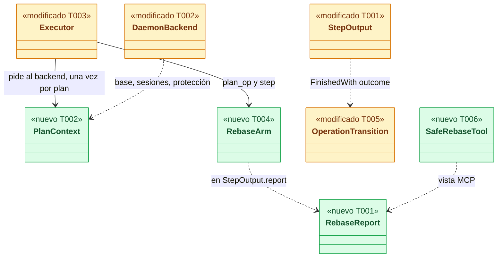
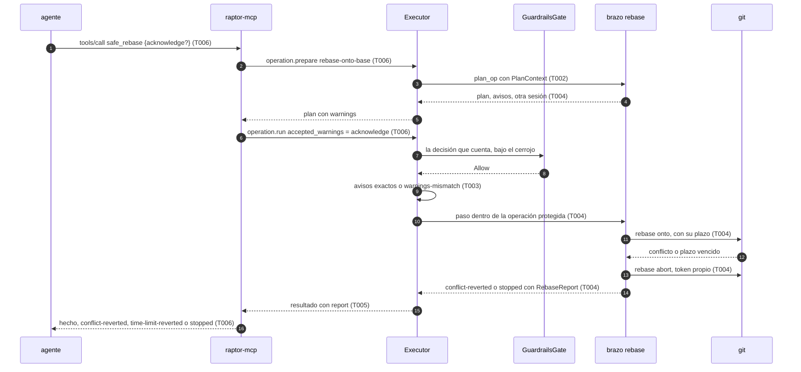
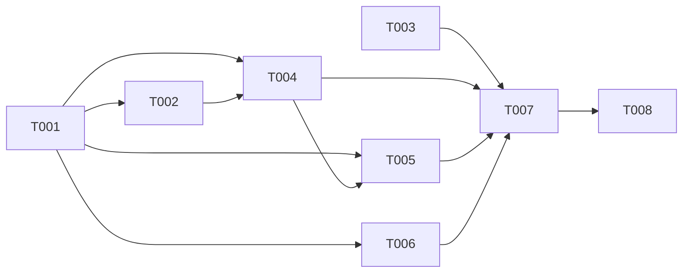

# DS-US-MCP-018 · `safe_rebase`: rebase atómico sobre la rama base confirmada

## Contexto rápido

Al terminar, un agente pide `safe_rebase` y su rama queda rebasada sobre la rama base confirmada, con un snapshot previo y el rebase en el timeline; si choca o se queda sin tiempo, el ejecutor lo aborta dentro de la misma operación y la rama queda como estaba, con las rutas en conflicto en la respuesta. Hoy no puede: `rebase-onto-base` solo existe como brazo de prueba de depuración (`crates/core/src/executor/ops/test_arms.rs:290-316`), sin precondiciones de producto, sin aviso de upstream, sin tiempo propio y con un abort que hereda la interrupción del plan.

Es la operación `rebase-onto-base` del catálogo en **modo `atomic`**, que fija la capa `mcp` (ADR-CKP-002 § 9). El modo `stop` es de US-CKP-015 y reutiliza la parte de plan de esta entrega.

| Término | Qué es aquí |
|---|---|
| Base confirmada | La rama base que el desarrollador confirmó (US-GRD-014). "No confirmada" y "pendiente de confirmar" son estados distintos (`BaseStatus::Unconfirmed` y el diagnóstico `base-change-pending`) |
| Modo `atomic` | Si el rebase choca o vence su tiempo, `git rebase --abort` corre como otro hijo registrado del mismo plan, con sus transiciones registradas y sin reevaluar (ADR-CKP-002 § 4 y § 9, DEP-MCP-5) |
| Revertido | Resultado `conflict-reverted`: el abort funcionó y la rama, HEAD y el worktree son los previos |
| Detenido | Resultado `stopped`: el abort falló; Git dejó el rebase en curso, el oplog registra que lo dejó el ejecutor y toda escritura siguiente se rechaza por "operación en curso" |
| Aviso `upstream-diverges` | La rama tiene upstream y el rebase reescribe commits que ya están en él. Se reconoce con `acknowledge` en una segunda llamada (ADR-MCP-001 § 4.3) |
| Contexto del plan | Lo que el perfil sabe del repo y que Git no dice: base confirmada o pendiente, sesiones abiertas en el worktree, si la política vigente deniega el force-push de la rama (D3, D12) |

⚠️ **ASSUMPTION**: no existe `architecture-constitution.md`; rigen `AGENTS.md` y los ADR de `must_read` (NFR-01, NFR-02, ADR-GRP-016), como en DS-US-MCP-008 y DS-US-MCP-013.

---

## 📋 Índice

> **Para aprobar:** [Contexto rápido](#contexto-rápido) · [⚠️ Gaps](#gaps-y-violaciones-de-la-constitución) · [🔭 La forma](#la-forma) · [El trabajo de un vistazo](#el-trabajo-de-un-vistazo) · [Decisiones](#decisiones-validadas).
> **Para implementar:** [🚀 Plan](#plan-de-implementación), en orden. Las secciones `_(ref)_` se abren desde la tarea que las cita.

| Sección | Propósito |
|---------|-----------|
| [Contexto rápido](#contexto-rápido) | Qué se construye, por qué, y el glosario |
| [⚠️ Gaps y violaciones de la constitución](#gaps-y-violaciones-de-la-constitución) | Qué impide empezar o liberar |
| [🔭 La forma](#la-forma) | Qué piezas quedan, qué cambia y cómo fluye |
| [🚀 Plan de implementación](#plan-de-implementación) | T001…T008, en orden |
| ↳ [El trabajo de un vistazo](#el-trabajo-de-un-vistazo) | Las tareas en una tabla, y su orden |
| [Estructura de ficheros](#estructura-de-ficheros) _(ref)_ | Tramos de ficheros y puntos compartidos |
| [Contratos compartidos](#contratos-compartidos) _(ref)_ | Tipos y firmas |
| [Contrato de API](#contrato-de-api) _(ref)_ | Canal, herramienta, códigos y numéricos |
| [Modelo de datos](#modelo-de-datos) _(ref)_ | Resultado en el oplog, sin migración |
| [Estrategia de pruebas y cobertura](#estrategia-de-pruebas-y-cobertura) _(ref)_ | Escenario → prueba |
| [Gate de seguridad](#gate-de-seguridad) | Checklist pre-merge |
| [Fuera de alcance](#fuera-de-alcance) | Not Built (diferido) |
| [Decisiones validadas](#decisiones-validadas) | Lo que fija esta spec |
| [Notas del autor](#notas-del-autor) _(ref)_ | Hechos del código que sostienen las decisiones |

---

## ⚠️ Gaps y violaciones de la constitución

| ID | Qué falta | Severidad | Alcance | Acción | Owner |
|----|-----------|-----------|---------|--------|-------|
| G3 | **Barrera de arranque con *spawn* suspendido** (ADR-CKP-002, Pendientes): requisito de la primera historia que arme una operación gobernada que lance `git` en producción. Hoy se asigna a US-MCP-009 o US-CKP-018 (DS-TS-CKP-003); si US-MCP-018 llegara antes, lo hereda | Bloquea liberación | — | Comprobar al entrar quién lo cerró; si nadie, no se libera | Orquestador |
| G4 | **Sin escritor de la confirmación de la base** (US-GRD-014, `draft`). Sin él, en producción la base nunca está confirmada y `safe_rebase` siempre responde `base-unconfirmed`. Las pruebas siembran lo confirmado con `RepoStore::set_confirmed_team_baseline` (`crates/core/src/profile/team_baseline.rs:48`) | Bloquea liberación | — | **Veredicto del PO (2026-10-21): `safe_rebase` no se libera antes de US-GRD-014** | PO |
| G5 | **Foto a mitad de operación** (W86, `fix/tm-prior-point-binding`, sin mezclar). Tras un `stopped`, el ancla posterior al paso (`after_step`, `executor/mod.rs:1003-1007`) se toma con el rebase en curso. Sin la marca `mid_operation` de W86 (D3), un undo posterior de Git crudo puede elegir esa foto como destino (NFR-01) | Bloquea liberación | — | Liberar con W86 mezclado; T008 lo comprueba | Orquestador |
| G6 | **Revisión de `security-expert`**: operación destructiva nueva por MCP, texto del repo (rutas, upstream, agente) en la respuesta | Bloquea liberación | — | El orquestador la pide antes del merge (§ Gate de seguridad) | Orquestador |

**Dependencias de implementación (orden, no diseño).** T006 y T007 entran después de US-MCP-009 (método genérico de escritura de `Engine`, `acknowledge`, tabla de rechazos con `policy-denied`, `running` con id a los 30 s, cupo S-03), US-MCP-007 (requisito de toda escritura) y US-MCP-011 (`expect_worktree`), las tres en `draft`. T001 a T005 no dependen de ellas.

**Trabajo afectado de un rebase: resuelto por D13.** En el MVP `safe_rebase` no evalúa `foreign-work` por commit; lo que bloquea es otra sesión presente (D2, D3).

Las decisiones D1 a D13 son **Decisión del orquestador (2026-10-21), validada por Arquitecto**; las que conviene validar con el PO están marcadas en § Decisiones validadas.

---

## 🔭 La forma

El ejecutor gana un brazo de producción `rebase-onto-base` con su plan (precondiciones, base, upstream) y su paso atómico; la decisión de Guardrails pasa por delante de los avisos; el oplog guarda cómo terminó la operación; y `raptor-mcp` publica `safe_rebase` sobre el flujo de escritura de US-MCP-009.



🟩 nuevo · 🟨 modificado · ⬜ existente.

**Cómo fluye:**



El paso 9 es el cambio de orden de G6 de DS-US-MCP-013: hoy los avisos se comprueban antes del cerrojo y de Guardrails (`executor/mod.rs:819-824` frente a `:918-936`). El paso 13 corre con un `CancelToken` nuevo: con el del plan, un plazo vencido interrumpiría también el abort (`executor/git.rs:128-139`).

---

## 🚀 Plan de implementación

> Orden topológico (`Depende:`). Rutas relativas a la raíz del repo. Los archivos compartidos (enums de códigos, listas de brazos y de herramientas) se tocan con una línea por entrada; el segundo en entrar integra.

### El trabajo de un vistazo

| # | Tarea | Depende | Aterriza en |
|---|---|---|---|
| T001 | Definir el contrato del rebase atómico | — | `crates/api/src/` |
| T002 | Dar al plan el contexto del perfil (base, sesiones, protección) | T001 | `crates/core/src/executor/`, `timemachine/protected/backend.rs` |
| T003 | Poner Guardrails antes que los avisos en `run` | — | `crates/core/src/executor/mod.rs` |
| T004 | Crear el brazo `rebase-onto-base` con su plan y su paso atómico | T001, T002 | `crates/core/src/executor/ops/`, `crates/git/src/` |
| T005 | Registrar en el oplog y en el timeline cómo terminó la operación | T001, T004 | `crates/core/src/timemachine/`, `apps/cli/` |
| T006 | Crear la herramienta `safe_rebase` en `raptor-mcp` | T001 (y US-MCP-009, 007, 011) | `apps/mcp/src/` |
| T007 | Escribir la aceptación de extremo a extremo | T004, T005, T006 | `apps/mcp/tests/` |
| T008 | Cerrar documentos, enmiendas propuestas y estado | T007 | `docs/` |

### En qué orden



### T001 — Definir el contrato del rebase atómico

**Objetivo.** Los tipos y códigos nuevos del canal y de la herramienta, con sus textos; nada los produce todavía.

**Ubicación.**
- `crates/api/src/catalog.rs` (**MODIFY**): `WarningCode::UpstreamDiverges`; `RejectReason::{DirtyWorktree, BaseUnconfirmed, BaseChangePending}`; `RejectedData.other_agent`; `CATALOG_VERSION` de 1 a 2
- `crates/api/src/rebase.rs` (**CREATE**): `RebaseReport`, `RevertCause`, `UpstreamView`, `McpRebaseView`, `REBASE_MCP_LIMIT`, `REBASE_ABORT_LIMIT`, `MAX_CONFLICT_PATHS`
- `crates/api/src/lib.rs` (**MODIFY**, una línea `pub mod rebase;`)
- `crates/api/src/methods/operation.rs` (**MODIFY**): `CAP_OPERATION_REBASE` en `GROUP.capabilities` (`:29-53`)
- `crates/api/src/timemachine.rs` (**MODIFY**): `McpOperationRunResult.rebase: Option<RebaseReport>` y `OperationRunResult.rebase`, solo con la capacidad
- `crates/api/src/mcp_view.rs` (**MODIFY**): los códigos de § Códigos de la herramienta que no existan aún, en `McpToolError` y `ALL` (`:65-134`)
- `crates/core/src/timemachine/protected/mod.rs` (**MODIFY**): `StepOutput.report: Option<RunReport>` (`:191-199`)
- `apps/mcp/src/messages.rs` (**MODIFY**): textos en/es de los códigos nuevos
- `crates/api/tests/us_mcp_018_wire.rs` (**CREATE**), `apps/mcp/src/messages_rebase_tests.rs` (**CREATE**)

**Pasos**
1. Escribir primero las dos pruebas en rojo (§ Estrategia de pruebas).
2. `WarningCode::UpstreamDiverges` al final del enum (`catalog.rs:788-797`). Añadir un aviso sube `CATALOG_VERSION` (ADR-MCP-001 § 4.3, comentario de `catalog.rs:21-25`).
   2.1 ⛔1.1 El aviso y el resultado ampliado solo viajan a una conexión con `operation.rebase`. Sin ella, `operation.prepare` de `rebase-onto-base` responde `not-available-for-layer` sin plan: un cliente que no conoce el aviso no podría reconocerlo.
3. `StepOutput.report` tiene `Default` (`None`); todos los constructores existentes usan `..StepOutput::default()` (seis sitios, comprobado), así que no se edita ningún test.
4. Los textos de § Forma del error, literales.

- **Depende:** —
- **Refs:** ADR-MCP-001 § 4.3 y § 5, ADR-GRP-016 § 1 y § 3, RES-MCP-03
- **Aceptación:** `cargo test -p gitraptor-api --test us_mcp_018_wire` y `cargo test -p gitraptor-mcp --bin raptor-mcp messages::rebase_tests` en verde
- **Guard ⛔1.1:** `us_mcp_018_wire::rebase_is_refused_without_the_rebase_capability`

### T002 — Dar al plan el contexto del perfil

**Objetivo.** El plan de `rebase-onto-base` conoce la base confirmada o pendiente, las sesiones abiertas en el worktree y si la protección está activa, sin cambiar la firma de ningún trait implementado por pruebas.

**Ubicación.**
- `crates/core/src/executor/plan_context.rs` (**CREATE**): `PlanContext`, `BaseFacts`, `fn read_plan_context(dirs, repo) -> PlanContext`
- `crates/core/src/executor/mod.rs` (**MODIFY**): `pub mod plan_context;` y su uso en `plan()` (`:495-525`)
- `crates/core/src/timemachine/protected/scope.rs` (**MODIFY**): método provisto `ProtectedBackend::plan_context` y `plan_op_in`
- `crates/core/src/timemachine/protected/backend.rs` (**MODIFY**): `DaemonBackend` los implementa (`:310-357`)
- `crates/core/src/executor/plan_context_tests.rs` (**CREATE**)

**Pasos**
1. Métodos **provistos** con valor por defecto que falla cerrado: `plan_context` devuelve `PlanContext::unknown()` (base desconocida = no confirmada, sesiones desconocidas = presentes, protección desconocida = inactiva); `plan_op_in` delega en `plan_op`. Ningún doble de prueba cambia.
2. `DaemonBackend::plan_context` lee con `read_plan_context`: lo confirmado y las sesiones abiertas del almacén del repo en el perfil (`RepoStore::confirmed_team_baseline`, `open_sessions`, `crates/core/src/profile/store.rs:396-417`), el diagnóstico `base-change-pending` del nivel del equipo (`TeamLoader::load`, `crates/policy/src/team.rs:471`; `diagnostic.rs:94-96`) y si la política vigente deniega el force-push de la rama a su remoto (D12): capa de hooks activa (`guardrails::health::check`) **y** una evaluación pura de `policy::guard::evaluate` de ese force-push con el actor del plan, sin registro, que deniega. Sin upstream, o si algo no se puede leer, `force_push_blocked = false` (la respuesta solo avisa de la divergencia).
   2.1 ⚠️ **ASSUMPTION**: `TmRepos` expone los `ProfileDirs` con que abre el almacén (lo usa al construir el `StoreSnapshotter`, `backend.rs:246-252`) y abrir el `RepoStore` en solo lectura desde el ejecutor es seguro con el daemon escribiendo. El implementador lo comprueba; si no, el contexto viaja por `Daemon::protected_wiring` (`crates/core/src/daemon/serve.rs:22-41`) y se anota.
3. En `plan()`: una sola llamada a `backend.plan_context(repo)` por plan; `op_plan.other_session` de `rebase-onto-base` = alguna sesión abierta del worktree distinta de la del solicitante, o desconocido. La regla de `:514` no cambia.
   3.1 ⛔2.1 Las sesiones se comparan con el `session_id` del solicitante re-resuelto, nunca con lo que declara el cliente.
4. El contexto entra en `OpPlan.expected` y por tanto en la huella: una sesión que aparece o una base que cambia entre `prepare` y `run` da `state-changed`.
5. **Trabajo afectado** (D13): el brazo declara `OpPlan.affected = Affected::Nobody` con `// TRADEOFF: no per-commit foreign-work check until DEP-CKP-2; rewritten commits are recovered from the guaranteed prior (NFR-01, US-GRD-017).` El ejecutor no cambia: la regla de permisos se aplica a lo que declara el brazo (`crates/core/src/executor/mod.rs:517`, `permission` en `:194-208`), y con `Nobody` devuelve `Ok(false)` (`:196`). El brazo de prueba ya declara `Nobody` (`test_arms.rs:81`).
   5.1 ⛔2.2 La otra sesión presente sigue bloqueando con capa `mcp` (`:514`): D13 no relaja la presencia, solo el chequeo por commit.

- **Depende:** T001
- **Refs:** ADR-CKP-002 § 1 y § 3, BR-MCP-ELIG-003, BR-MCP-EDGE-002, BR-MCP-EDGE-003, Q-MCP-21
- **Aceptación:** `cargo test -p gitraptor-core --lib executor::plan_context` en verde
- **Guard ⛔2.1:** `plan_context_tests::the_own_session_is_never_another_session`
- **Guard ⛔2.2:** `us_mcp_018_arm::another_open_session_refuses_the_rebase_over_mcp`

### T003 — Poner Guardrails antes que los avisos en `run`

**Objetivo.** Una denegación (o "pedir confirmación") de Guardrails se devuelve antes que `warnings-mismatch` (ADR-MCP-001 § 4.3; G6 de DS-US-MCP-013, prerrequisito bloqueante de esta historia).

**Ubicación.**
- `crates/core/src/executor/mod.rs` (**MODIFY**): mover el bloque de `:819-824` justo después de la decisión que cuenta (`:918-936`)
- `crates/core/tests/us_mcp_018_order.rs` (**CREATE**)

**Pasos**
1. Prueba en rojo con el rig copiado de `crates/core/tests/us_mcp_013.rs` (sin editarlo): plan con un aviso, gate doble `Deny` o `Ask`, `accepted_warnings` vacío.
2. Mover la comprobación. Con `Allow` y avisos que no coinciden: `close(Rejected)` y `WarningsMismatch`; el gate real no deja entrada en el registro (`closing_entry`, `crates/core/src/guardrails/plan_gate.rs:200-221`).
   2.1 ⛔3.1 La comprobación de avisos sigue antes del paso, del snapshot previo y de la intención en el oplog.
   2.2 ⛔3.2 La comprobación del desafío (`:825-846`) no se mueve: sigue antes del cerrojo.

- **Depende:** —
- **Refs:** ADR-MCP-001 § 4.3 y Enmienda (2026-10-09, US-MCP-013), ADR-CKP-002 § 2 punto 4
- **Aceptación:** `cargo test -p gitraptor-core --test us_mcp_018_order` y `--test us_mcp_013` en verde
- **Guard ⛔3.1:** `a_warnings_mismatch_after_an_allow_has_no_effect_and_no_log_entry`
- **Guard ⛔3.2:** `us_mcp_018_order::a_missing_challenge_is_refused_before_the_lock`

### T004 — Crear el brazo `rebase-onto-base`

**Objetivo.** El ejecutor de producción sirve `rebase-onto-base` con capa `mcp` en modo atómico.

**Ubicación.**
- `crates/core/src/executor/ops/rebase_onto_base.rs` (**CREATE**): `plan_op`, `AtomicRebase` (paso), `AbortRunner`
- `crates/core/src/executor/ops/mod.rs` (**MODIFY**): una línea en `ARMS` (`:22`) y el brazo en `plan_op`/`step`
- `crates/core/src/executor/git.rs` (**MODIFY**): `run_git_until`
- `crates/git/src/reader.rs` (**MODIFY**): `RepoReader::unmerged_paths(max)`
- `crates/git/src/reader_unmerged_tests.rs` (**CREATE**), `crates/core/tests/us_mcp_018_arm.rs` (**CREATE**)

**Reglas**

Del plan (layer-agnóstico, lo reutiliza US-CKP-015):
- Orden de rechazos: los comunes de `check_common` (operación en curso, luego HEAD separado; `facts.rs:72-103`) → `dirty-worktree` (algo preparado o modificado; los no rastreados no cuentan, D6) → `base-unconfirmed` o `base-change-pending` → otra sesión (`:514`, solo capa `mcp`).
- `onto` = punta de `refs/heads/<base confirmada>` leída del directorio común; nunca `resolve_main_branch` (lo que hace hoy el brazo de prueba, `test_arms.rs:95-97`).
- Rama = la de HEAD del worktree; si es la base, el plan sigue y decide Guardrails (BR-MCP-ELIG-003, D8).
- Upstream: `branch_upstream` (`crates/git/src/reader.rs:280`), ignorando el remoto `.`. `UpstreamDiverges` si la punta del upstream existe y su `merge_base` con la rama (`reader.rs:488`) no es antepasado de `onto` (D7).
- `expected` = rama, punta, `onto`, punta del upstream y el contexto del plan. `governed` = `PlanShape::Rebase` como hoy.

Del paso:
- El paso se construye solo con `Layer::Mcp`; con `Layer::Cockpit`, `step()` devuelve error antes de la operación protegida (sin intención ni previo): el modo `stop` es de US-CKP-015.
- `rebase` con `run_git_until(ctx, cmd, &plan.cancel, ahora + REBASE_MCP_LIMIT, &[])`: se interrumpe con Cancelar, con el tope del ejecutor o con su plazo, lo que llegue antes (D4).
- Tras el rebase, clasificar leyendo el estado, nunca por el código de salida solo:
  - éxito y HEAD en la rama, punta nueva descendiente de `onto` → `done`, con `head`, `up_to_date = (head == old_tip)` y el upstream;
  - sin rebase en curso y rama en `old_tip` → `failed-unchanged` (p. ej. `pre-rebase` lo rechazó);
  - rebase en curso → `unmerged_paths(MAX_CONFLICT_PATHS)` y el total, y luego el abort;
  - cualquier otra cosa → `failed-changed`.
- Abort: `UserOp::RebaseAbort` por `AbortRunner` con un `CancelToken` **nuevo** y su propio plazo `REBASE_ABORT_LIMIT`, y la transición `Expected::RestoreTo { refname: rama, value: old_tip }` (como `test_arms.rs:307-312`).
  - ⛔4.1 Nunca con el token del plan: un plazo vencido o un Cancelar ya puesto interrumpiría el abort (`git.rs:128-139`).
  - Verificar después: sin operación en curso, HEAD simbólico a la rama, rama en `old_tip`, worktree limpio. Si todo cuadra → `conflict-reverted` con `cause` `conflict` o `time-limit` (por el motivo de la interrupción); si no → `stopped` con `abort_failed: true`.
  - ⛔4.2 El paso nunca devuelve `Err` después de lanzar `git`: un `Err` se registra como `failed-changed` (`executor/mod.rs:1020-1026`) aunque el repo esté como antes.
- `AbortRunner` es la costura para la Validación 28 de ADR-CKP-002: en producción lanza `git`; las pruebas en proceso inyectan uno que falla. En builds de depuración, además, `GITRAPTOR_TEST_FAIL_REBASE_ABORT=1` con `GITRAPTOR_PROFILE_DIR` (como los brazos de prueba, `ops/mod.rs:120-129`).
- El brazo de prueba de `rebase-onto-base` sale de `TEST_ARMS` (`test_arms.rs:26-32`) cuando el de producción entra; sus pruebas de proceso pasan a usar el de producción.

- **Depende:** T001, T002
- **Refs:** ADR-CKP-002 § 1, § 4, § 6, § 9 y Validación 28 y 29; DEP-MCP-2, DEP-MCP-5; BR-MCP-WF-002, BR-MCP-WF-003
- **Aceptación:** `cargo test -p gitraptor-core --test us_mcp_018_arm` y `cargo test -p gitraptor-git reader_unmerged` en verde; `production_wiring_has_no_governed_arm_without_guardrails` sigue en verde
- **Guard ⛔4.1:** `an_abort_after_the_time_limit_is_not_interrupted`
- **Guard ⛔4.2:** `a_reverted_rebase_is_never_recorded_as_failed_changed`

### T005 — Registrar cómo terminó la operación

**Objetivo.** El oplog guarda el resultado de una operación que no terminó en `done`, y el timeline lo muestra: "rebase abortado por conflicto", "por time-limit" o "detenido", con el actor y el canal.

**Ubicación.**
- `crates/core/src/timemachine/oplog/mod.rs` (**MODIFY**): `OperationTransition::FinishedWith { outcome }` (`:91-113`), mismo estado `finished`, `detail` = el resultado en kebab-case
- `crates/core/src/timemachine/oplog/model.rs` (**MODIFY**): `OperationView.outcome: Option<String>`
- `crates/core/src/timemachine/protected/mod.rs` (**MODIFY**): el paso (5) usa `FinishedWith` cuando `output.outcome` no es `None` ni `Done`
- `crates/api/src/timemachine.rs` (**MODIFY**): `EntryOrigin::Operation.outcome` y `.channel`, solo con `timemachine.timeline-outcome` (`:648-673`)
- `crates/api/src/methods/timemachine.rs` (**MODIFY**): `CAP_TM_TIMELINE_OUTCOME`
- `apps/cli/i18n/{en,es}/timeline.txt` (**MODIFY**) y el render de `raptor timeline`
- `crates/core/tests/us_mcp_018_oplog.rs` (**CREATE**)

**Reglas**
- Sin migración: `detail` ya existe en el diario y hoy va vacío para `finished` (`oplog/mod.rs:1027-1030`). Una fila sin él se lee como `None` (= `done`).
- ⛔5.1 `stopped` deja la marca que el Cockpit lee para ofrecer Abortar (BR-CKP-EDGE-002, US-CKP-016): resultado `stopped` + operación del ejecutor en ese worktree.
- Si US-MCP-009 ya añadió `channel` a las entradas de operación, se reutiliza; si no, lo añade esta tarea bajo la misma capacidad (el segundo integra).

- **Depende:** T001, T004
- **Refs:** ADR-TMC-003 § 3 y § 4, ADR-CKP-002 § 9, ADR-GRP-016 § 3
- **Aceptación:** `cargo test -p gitraptor-core --test us_mcp_018_oplog` en verde
- **Guard ⛔5.1:** `a_stopped_rebase_is_recorded_as_left_by_the_executor`

### T006 — Crear la herramienta `safe_rebase`

**Objetivo.** `raptor-mcp` publica `safe_rebase` y traduce cada desenlace a su respuesta.

**Ubicación.**
- `apps/mcp/src/rebase.rs` (**CREATE**): `tool()`, argumentos, `call`, `view`
- `apps/mcp/src/server.rs` (**MODIFY**): una línea en `list_tools` y un brazo en `call_tool` (`:161-200`)
- `apps/mcp/src/engine.rs` (**MODIFY**): pedir `operation.rebase` en `connection.accept` y la tabla de rechazos (`rejected_refusal`)
- `apps/mcp/src/rebase_tests.rs` (**CREATE**)

**Reglas**
- Entrada: `{acknowledge?: ["upstream-diverges"], expect_worktree?: string}`, `additionalProperties: false`. `acknowledge` es el enum cerrado de US-MCP-009; `expect_worktree`, el de US-MCP-011.
- Prepara y ejecuta en la misma llamada con el método genérico de US-MCP-009; pasa `acknowledge` como `accepted_warnings` y decide `run` sin mirar la vista previa (D5 de DS-US-MCP-013). Con `warnings-mismatch`, responde `warnings-not-acknowledged` con los avisos del plan preparado.
- Éxito: `McpRebaseView` en `structuredContent` y en texto.
- `conflict-reverted`, `time-limit-reverted`, `stopped`, `failed-unchanged`, `failed-changed`: rechazos de dominio con sus `params` (§ Códigos).
- Descripción ≤ 150 tokens con su esquema (RES-MCP-01), en inglés, declarando el texto del repo como dato.

- **Depende:** T001; en orden, después de US-MCP-009, US-MCP-007 y US-MCP-011
- **Refs:** ADR-MCP-001 § 4.1 a § 6, BR-MCP-WF-001, BR-MCP-EDGE-007
- **Aceptación:** `cargo test -p gitraptor-mcp --bin raptor-mcp rebase` en verde, y `the_catalog_fits_its_token_budget` y `every_refusal_fits_its_token_budget` siguen en verde

### T007 — Aceptación de extremo a extremo

**Objetivo.** Los seis escenarios de la historia, con el binario real por stdio, repos temporales y perfil temporal (NFR-01).

**Ubicación.** `apps/mcp/tests/us_mcp_018.rs` (**CREATE**)

**Reglas**
- La base se confirma sembrando el almacén (G4); `main` protegida con `policies.protectedBranches` para el escenario 6.
- Conflicto real: `feat-a` y `main` cambian las mismas líneas de `src/pago.rs`.
- Tiempo vencido: tope corto en el daemon de prueba y un `reference-transaction` del usuario que duerme la primera vez que se mueve HEAD, para que el rebase esté en curso al interrumpirlo. ⚠️ **ASSUMPTION** sin verificar: que con ese hook Git deja `rebase-merge/` presente al recibir SIGINT; si no, se inyecta por `AbortRunner` y se anota.
- Abort fallido: `GITRAPTOR_TEST_FAIL_REBASE_ABORT=1`. La escritura siguiente es otro `safe_rebase` (`safe_commit` es de US-MCP-009): `operation-in-progress`.
- Escenario 6: el motivo coincide con el de `policy::guard::evaluate` para la transacción de un rebase que mueve `main` (regla `policy.protected-branch`).

- **Depende:** T003, T004, T005, T006
- **Refs:** escenarios de US-MCP-018, ADR-CKP-002 Validación 28 y 29, BR-MCP-AUTH-001
- **Aceptación:** `cargo test -p gitraptor-mcp --test us_mcp_018` en verde en macOS y en CI `ubuntu-latest`

### T008 — Cerrar documentos y estado

**Objetivo.** Dejar escritas las propuestas de § Decisiones validadas para que las apliquen sus dueños, y el estado de la historia.

**Ubicación.** `docs/requirements/features/mcp/user-stories/US-MCP-018-safe-rebase-atomico.md` (**MODIFY**, `status`, Requisitos Técnicos, Dev Spec), `docs/requirements/release-plan.md` (**MODIFY**), `docs/architecture/design/api-contract-ipc.md` (**MODIFY**, `data.reason` nuevos y `operation.rebase`)

**Reglas**
- `status: implemented` solo con G3, G4, G5 y G6 cerrados; si no, `partially-implemented` con los pendientes en el PR.
- Las enmiendas de ADR y BR de § Decisiones validadas las aplica su dueño en otra rama; esta tarea no edita ADR ni BR. No editar `docs/ARTIFACTS.md`.

- **Depende:** T007
- **Refs:** § Decisiones validadas, `AGENTS.md`
- **Aceptación:** revisión de Arquitecto y PO; `/aadd-analyze` sin BLOCKER

---

> Las secciones siguientes son de referencia. Se abren desde la tarea que las cita, no se leen en orden.

## Estructura de ficheros

```text
# Tramo A — contrato (T001)
crates/api/src/catalog.rs                       ← MODIFY  WarningCode, RejectReason, RejectedData, CATALOG_VERSION
crates/api/src/rebase.rs                        ← CREATE
crates/api/src/lib.rs                           ← MODIFY  una línea
crates/api/src/methods/operation.rs             ← MODIFY  CAP_OPERATION_REBASE
crates/api/src/timemachine.rs                   ← MODIFY  rebase en el resultado de run (T001); outcome y channel del timeline (T005)
crates/api/src/mcp_view.rs                      ← MODIFY  códigos de la herramienta
crates/api/tests/us_mcp_018_wire.rs             ← CREATE
apps/mcp/src/messages.rs                        ← MODIFY  textos
apps/mcp/src/messages_rebase_tests.rs           ← CREATE
# Tramo B — ejecutor (T002, T003, T004)
crates/core/src/executor/plan_context.rs        ← CREATE
crates/core/src/executor/plan_context_tests.rs  ← CREATE
crates/core/src/executor/mod.rs                 ← MODIFY  plan() y orden de run
crates/core/src/executor/git.rs                 ← MODIFY  run_git_until
crates/core/src/executor/ops/rebase_onto_base.rs← CREATE
crates/core/src/executor/ops/mod.rs             ← MODIFY  ARMS y despacho
crates/core/src/executor/ops/test_arms.rs       ← MODIFY  sale RebaseOntoBase de TEST_ARMS
crates/core/src/timemachine/protected/scope.rs  ← MODIFY  métodos provistos
crates/core/src/timemachine/protected/backend.rs← MODIFY  DaemonBackend
crates/git/src/reader.rs                        ← MODIFY  unmerged_paths
crates/git/src/reader_unmerged_tests.rs         ← CREATE
crates/core/tests/us_mcp_018_order.rs           ← CREATE
crates/core/tests/us_mcp_018_arm.rs             ← CREATE
# Tramo C — oplog y timeline (T005)
crates/core/src/timemachine/oplog/mod.rs        ← MODIFY  FinishedWith
crates/core/src/timemachine/oplog/model.rs      ← MODIFY  OperationView.outcome
crates/core/src/timemachine/protected/mod.rs    ← MODIFY  StepOutput.report (T001) y paso (5) (T005)
crates/api/src/methods/timemachine.rs           ← MODIFY  CAP_TM_TIMELINE_OUTCOME
apps/cli/i18n/en/timeline.txt, es/timeline.txt  ← MODIFY
crates/core/tests/us_mcp_018_oplog.rs           ← CREATE
# Tramo D — raptor-mcp (T006, T007)
apps/mcp/src/rebase.rs                          ← CREATE
apps/mcp/src/rebase_tests.rs                    ← CREATE
apps/mcp/src/server.rs                          ← MODIFY  una línea por punto
apps/mcp/src/engine.rs                          ← MODIFY  capacidad y tabla de rechazos
apps/mcp/tests/us_mcp_018.rs                    ← CREATE
# Tramo E — documentos (T008)
```

Puntos compartidos con otras historias en curso (US-MCP-009, 010, 011, 019, US-CKP-015): `McpToolError::ALL`, `RejectReason`, `CATALOG_VERSION`, `ARMS`, `server.rs`, `engine.rs::rejected_refusal`, `messages.rs`. Una línea por entrada; el segundo en entrar integra. Sin cambios: `crates/policy`, `crates/core/src/guardrails/`, `apps/mcp/Cargo.toml`.

---

## Contratos compartidos

### Piezas

| Pieza | Dónde | Estado |
|---|---|---|
| `Executor` | `crates/core/src/executor/mod.rs` | existente; `plan()` y el orden de `run` cambian (T002, T003) |
| `GuardrailsGate` | `crates/core/src/executor/gate.rs`; real: `GuardrailsEngine`, `crates/core/src/guardrails/plan_gate.rs` | existente, sin cambios |
| `RebaseArm` | `crates/core/src/executor/ops/rebase_onto_base.rs`: `plan_op`, `AtomicRebase`, `AbortRunner` | nuevo (T004) |
| `SafeRebaseTool` | `apps/mcp/src/rebase.rs`: `tool()`, `call`, `view` | nuevo (T006) |
| `DaemonBackend` | `crates/core/src/timemachine/protected/backend.rs` | existente; implementa `plan_context` y `plan_op_in` (T002) |
| `OperationTransition` | `crates/core/src/timemachine/oplog/mod.rs` | existente; gana `FinishedWith { outcome: &'a str }` (T005) |

### Tipos y datos compartidos

```rust
// crates/api/src/rebase.rs
/// Longest run of an atomic rebase step over MCP, so the call returns its outcome
/// within the 30 s of a write (hardens ADR-CKP-002 § 6, ⚠️ ASSUMPTION).
pub const REBASE_MCP_LIMIT: Duration = Duration::from_secs(20);
/// Longest `git rebase --abort`; past it the worktree is left stopped (⚠️ ASSUMPTION).
pub const REBASE_ABORT_LIMIT: Duration = Duration::from_secs(5);
/// Conflicted paths the MCP answer names; the total always travels.
pub const MAX_CONFLICT_PATHS: usize = 3;

pub enum RevertCause { Conflict, TimeLimit, Cancelled }          // kebab-case
pub struct UpstreamView {
    pub name: UntrustedName,
    pub diverges: bool,
    /// Only when true: the policy in force denies a force-push of this branch (D12).
    #[serde(default, skip_serializing_if = "std::ops::Not::not")]
    pub force_push_blocked: bool,
}

/// What an atomic rebase did. Travels only with `operation.rebase`.
pub struct RebaseReport {
    pub branch: UntrustedName,
    pub old_head: String,
    /// The tip after the operation: the new one when done, `old_head` when reverted.
    pub head: String,
    pub up_to_date: bool,
    pub upstream: Option<UpstreamView>,
    pub reverted: Option<RevertCause>,
    pub conflicts: Vec<Untrusted>,          // at most the ones read before the abort, capped
    pub conflicts_total: u32,
    pub abort_failed: bool,
}

// crates/core/src/timemachine/protected/mod.rs
pub enum RunReport { Rebase(gitraptor_api::rebase::RebaseReport) }
pub struct StepOutput { /* …existing… */ pub report: Option<RunReport> }

// crates/api/src/catalog.rs
pub enum WarningCode { /* … */ UpstreamDiverges }
pub enum RejectReason { /* … */ DirtyWorktree, BaseUnconfirmed, BaseChangePending }
pub struct RejectedData {
    pub reason: RejectReason,
    pub guardrails: Option<GuardrailsDenial>,
    /// Another agent present in the worktree (`other-session-present`), only with `operation.rebase`.
    #[serde(default, skip_serializing_if = "Option::is_none")]
    pub other_agent: Option<UntrustedName>,
}

// crates/core/src/executor/plan_context.rs
pub enum BaseFacts { Confirmed(String), Unconfirmed, ChangePending, Unknown }
pub struct PlanContext {
    pub base: BaseFacts,
    /// Open agent sessions in the worktree: (session_id, shown name). `None`: unknown.
    pub sessions: Option<Vec<(String, String)>>,
    /// The policy in force denies a force-push of the branch to its remote (D12); `false` when unknown.
    pub force_push_blocked: bool,
}
```

### Ciclos de vida (DI)

_Sin estado ambiental nuevo._ `PlanContext` se lee una vez por `plan()` (en `prepare` y otra vez bajo el cerrojo en `run`). `AbortRunner` es un `Arc<dyn AbortRunner>` del brazo, fijado al cablear.

### Firmas del stack

```rust
// crates/core/src/timemachine/protected/scope.rs — métodos provistos de ProtectedBackend
fn plan_context(&self, repo: &RepoHandle) -> PlanContext { PlanContext::unknown() }
fn plan_op_in(&self, op: OperationId, args: &OperationArgs, repo: &RepoHandle,
              facts: &RepoFacts, ctx: &PlanContext) -> Result<OpPlan, PlanError> {
    self.plan_op(op, args, repo, facts)
}

// crates/core/src/executor/git.rs
/// `run_git_with`, also interrupted (as `TimeLimit`) once `deadline` passes.
pub fn run_git_until(ctx: &mut StepCtx<'_>, cmd: UserGitCommand, cancel: &CancelToken,
                     deadline: Instant, transitions: &[Expected]) -> std::io::Result<GitRun>;

// crates/git/src/reader.rs
/// Paths with an index stage above 0, sorted, at most `max`, and how many there are.
pub fn unmerged_paths(&self, max: usize) -> Result<(Vec<String>, u32), ReadError>;

// crates/core/src/executor/ops/rebase_onto_base.rs
pub trait AbortRunner: Send + Sync {
    fn abort(&self, ctx: &mut StepCtx<'_>, cmd: UserGitCommand, deadline: Instant,
             back: &[Expected]) -> std::io::Result<GitRun>;
}
```

---

## Contrato de API

| Superficie | Cambio | Quién lo recibe |
|---|---|---|
| Canal, capacidad | `operation.rebase` | `raptor-mcp`; el TUI cuando llegue US-CKP-015 |
| Canal, `operation.prepare` | `rebase-onto-base` servido; aviso `upstream-diverges`; rechazos `dirty-worktree`, `base-unconfirmed`, `base-change-pending`, `other-session-present` (con `other_agent`) | Conexiones con la capacidad |
| Canal, `operation.run` | `rebase` en el resultado; `outcome` `done`, `conflict-reverted`, `stopped`, `failed-unchanged`, `failed-changed`, `cancelled` | Ídem |
| Canal, `timemachine.timeline` | `outcome` y `channel` en entradas de operación con `timemachine.timeline-outcome` | CLI, `raptor-mcp` (US-MCP-017) |
| Herramienta MCP | `safe_rebase` | El agente |

### Forma del error y del cuerpo de respuesta

Éxito (`McpRebaseView`, compacto, ≤ 300 tokens ⚠️ **ASSUMPTION**):

```json
{"worktree":{"untrusted":"shop-feat-a"},"branch":{"untrusted":"feat-a"},"head":"<oid>","operation_id":"…","prior_snapshot_id":"…","upstream":{"name":{"untrusted":"origin/feat-a"},"diverges":true,"force_push_blocked":true}}
```

`up_to_date` solo cuando es true; `upstream` solo si la rama tiene upstream (RES-MCP-04).

### Códigos de la herramienta

| Código | Dueño | `params` | `message` es / en | `action` es / en |
|---|---|---|---|---|
| `dirty-worktree` | US-MCP-018 | — | El worktree tiene cambios sin commitear. / The worktree has uncommitted changes. | Commitea o descártalos antes de rebasar. / Commit or discard them before rebasing. |
| `base-unconfirmed` | US-MCP-018 | — | La rama base no está confirmada. / The base branch is not confirmed. | Pide al desarrollador que la confirme en GitRaptor. / Ask the developer to confirm it in GitRaptor. |
| `base-change-pending` | US-MCP-018 | — | La rama base está pendiente de confirmar. / The base branch change is pending confirmation. | Ídem |
| `other-session-present` | US-MCP-018 | `agent`, `others` | `{agent}` sigue trabajando en este worktree. / `{agent}` is still working in this worktree. | Espera a que termine o pide al desarrollador que rebase. / Wait for it or ask the developer. |
| `operation-in-progress`, `detached-head` | US-MCP-011 (si no existen, este) | `kind` | "operación en curso" · "HEAD separado" | "resuélvelo o pide al desarrollador…" · "crea una rama o cámbiate a una" |
| `warnings-not-acknowledged` | US-MCP-009 (si no existe, este) | `warnings` | Hay avisos sin reconocer. / Unacknowledged warnings. | Repite la llamada reconociéndolos con `acknowledge`. / Repeat the call with `acknowledge`. |
| `policy-denied` | US-MCP-009 / US-GRD-016 | la regla y sus parámetros, como los hooks | el texto de la regla de la capa de hooks | — |
| `conflict-reverted` | US-MCP-018 | `paths` (≤ 3), `total`, `truncated` | Rebase cancelado: conflicto; tu rama está como antes. / Rebase cancelled: conflict; your branch is as before. | Resuelve el conflicto con el desarrollador o actualiza tu trabajo. / Resolve it with the developer. |
| `time-limit-reverted` | US-MCP-018 | — | Rebase cancelado por time-limit; tu rama está como antes. / Rebase cancelled by the time limit; your branch is as before. | Avisa al desarrollador. / Tell the developer. |
| `stopped` | US-MCP-018 | `prior_snapshot_id` | No se pudo cancelar el rebase. Hay un snapshot previo. / The rebase could not be cancelled. A prior snapshot exists. | Pide al desarrollador que lo resuelva en GitRaptor. / Ask the developer to resolve it in GitRaptor. |
| `failed-unchanged`, `failed-changed` | US-MCP-009 (si no existen, este) | `prior_snapshot_id` en `failed-changed` | — | `failed-changed`: deshacer con `undo` |

Ningún rechazo lleva salida de Git ni de los hooks, ni mensajes de commit (ADR-CKP-002 § 12, SEC-05). Rutas, rama, upstream y agente van como `{"untrusted": …}` con el tope de 100 caracteres (SEC-12).

### Forma de la configuración

_No aplica — ninguna tarea lee configuración nueva._ La base confirmada y `policies.protectedBranches` ya existen.

### Valores numéricos

| Concepto | Valor | Fuente |
|---------|-------|--------|
| Plazo del paso de rebase por MCP | 20 s ⚠️ | D4; endurece los 300 s de ADR-CKP-002 § 6 / `MCP_TIME_LIMIT_MS` (`catalog.rs:34`) |
| Plazo del abort | 5 s ⚠️ | D4 |
| Vuelta de la llamada de escritura | 30 s, con `running` e id si no terminó | ADR-MCP-001 § 6, `MCP_WRITE_TIME_LIMIT` (`mcp_view.rs:59`) |
| Rutas en conflicto en la respuesta | ≤ 3, con el total | D9 |
| Presupuesto de `conflict-reverted` y `stopped` | ≤ 200 tokens ⚠️ (excepción a los 80 de RES-MCP-03) | D9 |
| Éxito de `safe_rebase` | ≤ 300 tokens por parte ⚠️ | como RES-MCP-02 |
| `CATALOG_VERSION` | 2 | ADR-MCP-001 § 4.3 |

---

## Modelo de datos

Sin migración. La fila `finished` del diario de una operación lleva en `detail` su resultado cuando no es `done` (`conflict-reverted`, `stopped`, `failed-unchanged`, `cancelled`). `OperationView.outcome` lo lee; una fila sin `detail` es `done`. Los hashes de la cadena no cambian para las filas existentes.

---

## Estrategia de pruebas y cobertura

### 9.1 Pirámide de pruebas

| Tipo | Cantidad | Tareas dueñas | Herramientas | Cuándo |
|------|---------:|-------------|---------|------|
| Unit | ~10 | T001, T002, T004 (`unmerged_paths`), T006 | `cargo test` | PR gate |
| Integration | ~14 | T003, T004, T005 | `cargo test -p gitraptor-core --test us_mcp_018_*` | PR gate |
| E2E | 9 | T007 | `cargo test -p gitraptor-mcp --test us_mcp_018` | PR gate |

El contrato de `/nassa-core:implement` declara `"suite": { "command": "node tools/test/nextest-junit.mjs" }` y `"layers": { "runtime": { "commands": [{ "id": "suite", "cmd": "node tools/test/nextest-junit.mjs" }], "report": "target/nextest/ci/junit-paths.xml" } }` (AGENTS.md). Las pruebas en rojo van en archivos propios.

### 9.2 Umbrales de cobertura

| Capa | Línea | Rama | Mutación | Camino crítico 100% |
|-------|-----:|-------:|---------:|:------------------:|
| Clasificación del paso atómico | — | — | — | ✅ done, failed-unchanged, conflicto revertido, time-limit revertido, abort fallido, failed-changed |
| Orden de `run` | — | — | — | ✅ Deny y Ask antes que avisos |

### 9.3 Datos de prueba

- Repos y perfil temporales (`tempfile`), nunca este repo ni el perfil real (NFR-01). Base confirmada sembrada en el almacén.
- Un solicitante agente atribuido (`claude-1`) y otra sesión abierta (`claude-3`) para el rechazo por sesión.
- Sin esperas fijas salvo el hook que duerme del escenario de tiempo, acotado por el tope corto del daemon de prueba.

Escenario de la historia → prueba:

| Escenario | Prueba |
|---|---|
| 1. El rebase termina y queda protegido | `us_mcp_018::a_rebase_onto_the_confirmed_base_is_done_with_a_prior_and_a_timeline_entry` |
| 2. Choca → revertido | `us_mcp_018::a_conflicting_rebase_is_reverted_and_names_the_path`; `us_mcp_018_arm::a_conflict_is_aborted_and_the_branch_is_as_before` |
| 2. Tiempo → revertido | `us_mcp_018::a_rebase_over_the_time_limit_is_reverted`; `us_mcp_018_arm::an_abort_after_the_time_limit_is_not_interrupted` |
| 3. Abort fallido → detenido y escrituras rechazadas | `us_mcp_018::a_failed_abort_leaves_the_worktree_stopped_and_refuses_the_next_write`; `us_mcp_018_oplog::a_stopped_rebase_is_recorded_as_left_by_the_executor` |
| 4. Precondiciones (6 filas) | `us_mcp_018::each_precondition_refuses_without_changing_the_branch` (tabla) |
| 5. Rama empujada: aviso y segunda llamada | `us_mcp_018::a_pushed_branch_needs_the_warning_acknowledged_and_warns_again` |
| 6. Rama base protegida, mismo motivo que los hooks | `us_mcp_018::rebasing_the_protected_base_is_denied_like_the_hooks` |
| Orden Guardrails → avisos | `us_mcp_018_order::a_deny_comes_before_unacknowledged_warnings`, `an_ask_comes_before_unacknowledged_warnings` |

### 9.4 Comportamientos críticos verificados

- [ ] Ningún rechazo previo deja intención, snapshot previo ni entrada en el registro por avisos (NFR-01, ADR-MCP-001 § 4.3).
- [ ] El abort corre con su propio token y su plazo, y sus transiciones no se reevalúan.
- [ ] Un rebase revertido deja rama, HEAD e índice iguales a los previos, comprobado leyendo el repo.
- [ ] `stopped` queda en el oplog y la escritura siguiente responde `operation-in-progress`.
- [ ] Los rechazos no llevan salida de Git ni de hooks; el texto del repo va escapado.

### 9.5 Plataformas

| Plataforma | Cómo se verifica | Pendiente |
|---|---|---|
| macOS | todo § 9.1 en local | — |
| Linux | todo en CI `ubuntu-latest` | — |
| Windows | compila con `clippy --target x86_64-pc-windows-msvc`; `interrupt_group` no interrumpe en Windows (`git.rs:98-100`), así que el plazo no revierte allí | Pendiente: etapa de validación multiplataforma; fila nueva en `xplat-pendientes.md` para la interrupción por plazo |

---

## Gate de seguridad

- Fallo cerrado: contexto del plan desconocido = base no confirmada, sesión presente, force-push no declarado bloqueado (T002).
- Riesgo conocido aceptado por el PO (D13, excepción temporal a BR-MCP-AUTH-003): reescritura de commits de otro actor en la rama del agente, cubierta por el snapshot previo obligatorio (NFR-01).
- Sin entrada nueva salvo `acknowledge` (enum cerrado) y `expect_worktree` (US-MCP-011); la rama y la base salen del repo y del perfil, nunca del agente (BR-MCP-ELIG-003); oids completos del plan, argv fijo con `--no-update-refs --no-autosquash --no-autostash` (`crates/git/src/user_ops.rs:165-171`), sin `--exec` (NFR-02).
- Sin salida de Git ni de hooks en la respuesta (SEC-05, SEC-12); rutas, rama, upstream y agente escapados y con tope.
- Una sola decisión de Guardrails por plan; el abort la hereda sin entrada propia (DEP-MCP-5).
- Revisión de `security-expert` **obligatoria** antes del merge (G6): este agente no puede lanzarla; el orquestador la pide e incorpora sus condiciones aquí.

Corre `/security-review --scope devspec docs/requirements/features/mcp/dev-specs/US-MCP-018-dev-spec.md` antes de mezclar.

---

## Fuera de alcance

| Ítem / no-objetivo | Historia que lo cubre | Gate (cómo se verifica) |
|----------------|--------------------|-------------------------|
| Modo `stop` del Cockpit | US-CKP-015 | `step()` con `Layer::Cockpit` falla antes de la operación protegida |
| Abortar desde el Cockpit un `stopped` | US-CKP-016 | `abort-in-progress` sigue fuera de `ARMS` |
| Flujo genérico de escritura MCP, `policy-denied`, `running`, S-03 | US-MCP-009 | Dependencia de orden de T006 |
| Chequeo de `foreign-work` por commit reescrito (TRADEOFF de D13) | Cuando exista la relación commit → sesión (DEP-CKP-2, motor-local) | El brazo declara `Affected::Nobody`; `rebase_onto_base.rs` lleva el comentario `TRADEOFF` |
| `explain_history` con el resultado por id | US-MCP-017 | La respuesta `running` remite a `raptor timeline` |
| Escritor de la confirmación de la base | US-GRD-014 | G4 |
| ⚡ conflicto predicho como aviso | — (no aplica por MCP, ADR-MCP-001 § 4.3) | `PredictedConflict` nunca sale con capa `mcp` |
| Excluir del undo un rebase revertido | Fuera de alcance (Q-MCP-38, PO 2026-10-21) | Aparece en el undo como operación sin efecto neto |

---

## Decisiones validadas

Cada fila dice su validación: **Decisión del orquestador (2026-10-21), validada por Arquitecto** (técnica), **validada por Arquitecto y PO** (técnica con efecto de producto) o **validada por PO** (de producto). Los veredictos del PO son del 2026-10-21. Lo que ya fijan ADR-MCP-001, ADR-CKP-002, BR-MCP-WF-002/003 y DS-US-MCP-013 se cita y no se redecide.

| # | Decisión | Validación | Alternativas descartadas |
|---|---|---|---|
| D1 | Una capacidad `operation.rebase` gobierna toda la forma nueva (aviso, `report`, `other_agent`); sin ella el rebase no se sirve | Arquitecto | Servir el aviso a todos: un cliente viejo no lo decodifica (`deny_unknown_fields`) |
| D2 | Contexto del plan por métodos **provistos** de `ProtectedBackend` con valor por defecto que falla cerrado | Arquitecto | Añadir campos a `RepoFacts` (17 literales en 6 archivos de prueba) o cambiar la firma de `OperationCatalog::plan_op` (8 implementaciones) |
| D3 | La sesión presente la calcula el ejecutor contra el solicitante re-resuelto; el contexto entra en la huella | Arquitecto | Calcularla en el brazo: no conoce al solicitante |
| D4 | Plazo propio del rebase por MCP de 20 s y del abort de 5 s, con token nuevo para el abort, para que la llamada devuelva el desenlace dentro de sus 30 s | Validada por Arquitecto y PO, tal cual (las cifras se miden en dogfooding, Q-MCP-37) | Usar los 300 s: el agente recibiría `running` y no vería el revert sin US-MCP-017 |
| D5 | Clasificar el desenlace leyendo el repo, nunca por el código de salida; el paso no devuelve `Err` tras lanzar `git` | Arquitecto | `Err` en cualquier fallo: registra `failed-changed` con el repo intacto |
| D6 | Los archivos no rastreados no hacen "sucio" el worktree (Git los protege y el previo los guarda). **Condición del PO**: si un no rastreado impide el rebase (Git rehúsa sobrescribirlo), la respuesta lo dice con motivo y acción y la rama no cambia: `failed-unchanged` con `params.cause: "untracked-would-be-overwritten"`, detectado porque Git terminó sin rebase en curso y con la rama en `old_tip` | Validada por PO, con la condición; se mantiene la enmienda a BR-MCP-ELIG-003 | Tratarlos como sucios: bloquea con artefactos de build no ignorados |
| D7 | `upstream-diverges` cuando la `merge_base` de rama y upstream no es antepasado de `onto` | Arquitecto | Avisar siempre que haya upstream: aviso falso en una rama empujada y ya al día |
| D8 | Rama = base: el plan sigue y decide Guardrails; si la base no está en `protectedBranches`, el resultado es `done` con `up_to_date` | Validada por Arquitecto y PO, tal cual | Rechazar con un motivo propio: contradice BR-MCP-ELIG-003 y el "mismo motivo que los hooks" |
| D9 | `conflict-reverted` con ≤ 3 rutas y el total, y presupuesto propio de 200 tokens. El timeline registra "rebase abortado por conflicto" | Validada por Arquitecto y PO, tal cual | Todas las rutas: rompe RES-MCP-03; ninguna: el escenario nombra la ruta |
| D10 | Dos códigos: `conflict-reverted` y `time-limit-reverted`; `base-unconfirmed` y `base-change-pending`. En el timeline, "rebase abortado por conflicto" y "rebase abortado por time-limit" son eventos distintos: `detail` de `finished` es `conflict-reverted` o `time-limit-reverted` (T005) | Validada por Arquitecto y PO, tal cual | Un código con `params.cause`: la plantilla es fija por código (ADR-MCP-001 § 5) |
| D11 | El resultado de una operación no `done` se guarda en `detail` de la fila `finished`, sin migración | Arquitecto | Un estado nuevo en el oplog: toca la máquina de estados de ADR-TMC-003 |
| D13 | En el MVP `safe_rebase` no evalúa `foreign-work` por commit reescrito: el brazo declara `Affected::Nobody` y lo que bloquea es otra sesión presente (BR-MCP-EDGE-003, D2/D3). Los commits reescritos se recuperan con el snapshot previo obligatorio (NFR-01, US-GRD-017). El chequeo por commit queda en Not Built hasta DEP-CKP-2. **Ajuste del PO**: es un TRADEOFF del MVP que choca con BR-MCP-AUTH-003 ("nunca actúa sobre el trabajo de otro actor"); se propone una excepción temporal a esa regla (§ Enmiendas propuestas) y se registra el riesgo conocido: un agente puede reescribir en su rama commits de otro actor, recuperables con el snapshot previo (NFR-01). La operación se atribuye a quien la pide y Git conserva el autor de cada commit (Q-MCP-36) | Validada por Arquitecto y PO, con el ajuste | Atribuir commits por eventos del motor: no consta que guarden el oid (N5); tratar todo como de otro actor (ADR-CKP-002 § 3 literal): rechaza todo `safe_rebase` |
| D12 | **Ajustada por el PO.** La respuesta dice `force_push_blocked: true` solo si la política vigente deniega el force-push de esa rama a su remoto: con la capa de hooks activa y una evaluación pura de Guardrails (sin registro) de ese force-push con el actor del plan, que deniega. En cualquier otro caso el campo no sale y la respuesta solo avisa de la divergencia. Que los hooks estén activos no basta: el equipo puede desactivar el mínimo seguro (Q-GRD-5) | Validada por Arquitecto y PO, con el ajuste | Decir siempre "bloqueado por política": falso con la protección retirada o el mínimo desactivado; basarlo solo en la salud de los hooks: mismo fallo con el mínimo desactivado |

### Preguntas nuevas

| ID | Pregunta | Default del autor | Respuesta del PO (2026-10-21) |
|---|---|---|---|
| Q-MCP-36 | No bloqueante. ¿Cuándo y cómo se atribuyen a una sesión los commits que reescribe un rebase, para retirar el TRADEOFF de D13? | Con DEP-CKP-2, por el oid de cada commit en los eventos del motor | **Resuelta**: fuera del MVP (DEP-CKP-2). La operación se atribuye a quien la pide; Git conserva el autor de cada commit |
| Q-MCP-37 | ¿Bastan 20 s para un rebase por MCP con hooks del usuario? | Sí, a medir en dogfooding | **Resuelta**: 20 s bastan; se mide en dogfooding |
| Q-MCP-38 | ¿Un rebase revertido debe aparecer como operación deshacible en el undo? | Hoy sí, sin efecto neto | **Resuelta**: aparece en el undo como operación sin efecto neto; sacarlo del undo queda fuera de alcance |
| Q-MCP-39 | ¿Los archivos no rastreados bloquean `safe_rebase`? | No (D6) | **Resuelta**: no bloquean (D6, con su condición) |

### Enmiendas propuestas (no aplicadas)

| Documento | Cambio |
|---|---|
| ADR-MCP-001 § 5 | Añadir `dirty-worktree` ya listado, `base-change-pending` y `time-limit-reverted`; `other-session-present` con `params.agent` |
| ADR-MCP-001 § 6 | El paso de rebase por MCP con tope de 20 s y abort de 5 s (endurece) |
| ADR-CKP-002 § 6 y § 9 | El abort atómico corre con su propio token y plazo; el resultado no `done` queda en el oplog; capacidad `operation.rebase`; `CATALOG_VERSION` 2 |
| ADR-CKP-002 § 3 | Con capa `mcp`, `rebase-onto-base` no evalúa trabajo afectado por commit hasta DEP-CKP-2; bloquea la otra sesión presente (D13) |
| ADR-TMC-003 § 3 | `detail` de `finished` con el resultado |
| NFR RES-MCP-03 | Excepción de 200 tokens para `conflict-reverted` y `stopped` |
| BR-MCP-ELIG-003 (PO) | "worktree limpio" = sin cambios preparados ni modificados; un no rastreado que impide el rebase da motivo y acción sin cambiar la rama (D6) |
| BR-MCP-EDGE-007 (PO) | La respuesta final dice "el force-push está bloqueado por política" solo si la política vigente deniega el force-push de esa rama; si no, solo avisa de la divergencia (D12) |
| BR-MCP-AUTH-003 (PO) | **Excepción temporal** (MVP, hasta DEP-CKP-2): `safe_rebase` puede reescribir en la rama del propio worktree commits de otro actor; solo bloquea otra sesión presente. **Riesgo conocido**: reescritura de trabajo ajeno en la rama del agente; cubierto por el snapshot previo obligatorio (NFR-01, US-GRD-017), la atribución de la operación a quien la pide y el autor de cada commit que conserva Git (D13) |

---

## Notas del autor

| ID | Nota | Acción | Owner |
|----|------|--------|-------|
| N1 | El mínimo seguro solo protege la base contra el **borrado** (`ref_update`, `crates/policy/src/guard/mod.rs:329-356`); el rebase solo aplica su permiso (`:182-190`). La denegación del escenario 6 sale de `policies.protectedBranches` (`policies_of`, `:212-242`), que deniega cualquier movimiento de la rama protegida | Ninguna; la prueba configura `protectedBranches` | — |
| N2 | `run_git_with` interrumpe en cuanto el token tiene motivo (`executor/git.rs:128-139`); el brazo de prueba aborta con el mismo token (`test_arms.rs:311`), así que tras un plazo vencido su abort también se interrumpiría | ⛔4.1 | — |
| N3 | El ejecutor traduce `Cancelled` a `OperationOutcome::Cancelled` por encima de `output.outcome` (`executor/mod.rs:1011-1013`); un Cancelar del Cockpit sobre un `safe_rebase` sale `cancelled` con el repo revertido | Ninguna | — |
| N4 | `McpOperationRunResult` (`crates/api/src/timemachine.rs:170-176`) no lleva oid nuevo ni rutas: por eso `rebase` va aparte bajo la capacidad | D1 | — |
| N5 | No se verificó si `Event.metadata` (`crates/core/src/profile/store.rs:227-237`) guarda el oid de un commit (Q-MCP-36) ni cómo `TmRepos` expone sus `ProfileDirs` (T002 paso 2.1) | Comprobar antes de T002 | Implementador |
| N6 | Las Dev Specs de US-MCP-009/010 no estaban escritas al redactar esta (`/Users/rbonilla/orca/workspaces/gitRaptor/dsmcp009`, sin archivos nuevos); la propiedad de los códigos compartidos de § Códigos es provisional | Alinear al mezclar la primera de las dos | Orquestador |
