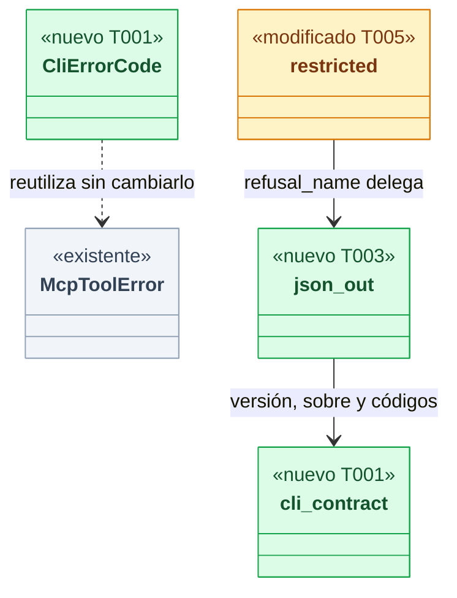
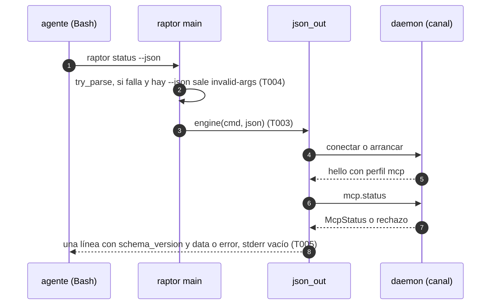
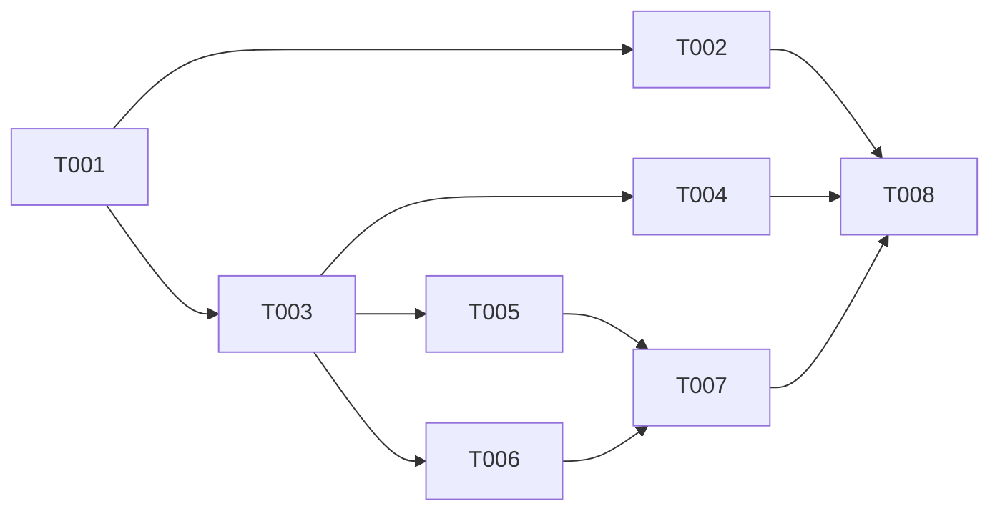

# DS-US-MCP-023 · Contrato JSON estable y versionado de la CLI `raptor`

## Contexto rápido

Al terminar, un agente que trabaja por Bash recibe de `raptor … --json` siempre una línea JSON que declara la versión del contrato. Puede ser un éxito (`data`) o un rechazo con código estable, motivo y acción (`error`). Hoy no puede: ninguna salida declara versión, los errores salen como texto por stderr, y `agent withdraw`, `daemon status` y `guard exec` no tienen `--json` ([inventario](../research/inventario-json-cli-2026-11.md)).

Las piezas son cuatro:

- el contrato en `crates/api`: versión, sobre, códigos y tipos de salida;
- un helper único en `apps/cli` por el que pasa toda salida `--json`;
- la instantánea de esquemas con su prueba de compatibilidad, más la referencia para agentes generada de ella;
- la migración de cada subcomando.

El contrato lo fija ADR-MCP-001, Enmienda (2026-11-10), puntos C1, C3 y D. Esta spec cierra lo que el ADR deja a la Dev Spec.

| Término | Qué es aquí |
|---|---|
| Sobre | El objeto de primer nivel de toda salida `--json`: `{schema_version, data}` o `{schema_version, error}` |
| Perfil `mcp` | Vista restringida que el daemon fija a la CLI cuando la lanza un agente (TS-GRP-010, S-01) |
| Vista del agente | `status`, `undo`, `redo`, `agent register`, `daemon status` (decisión del PO, 2026-11-21) |
| Instantánea | `crates/api/schemas/cli-contract.json`: esquemas de salida y códigos de la versión publicada |
| Mayor / menor | `schema_version = "MAJOR.MINOR"`. Un cambio incompatible sube el mayor; añadir sube el menor |

---

## 📋 Índice

> **Para aprobar:** [Contexto rápido](#contexto-rápido) · [Decisiones](#decisiones) · [⚠️ Gaps](#gaps-y-violaciones-de-la-constitución) · [🔭 La forma](#la-forma) · [El trabajo de un vistazo](#el-trabajo-de-un-vistazo).
> **Para implementar:** [🚀 Plan](#plan-de-implementación), en orden. Las `_(ref)_` se abren desde la tarea que las cita.

| Sección | Propósito |
|---------|-----------|
| [Contexto rápido](#contexto-rápido) | Qué se construye y el glosario |
| [Decisiones](#decisiones) | Lo que la ficha y el ADR dejaban abierto |
| [⚠️ Gaps y violaciones de la constitución](#gaps-y-violaciones-de-la-constitución) | Qué impide empezar |
| [🔭 La forma](#la-forma) | Piezas, cambios y flujo |
| [🚀 Plan de implementación](#plan-de-implementación) | T001…T008, en orden |
| ↳ [El trabajo de un vistazo](#el-trabajo-de-un-vistazo) | Tareas en tabla y su orden |
| [Estructura de ficheros](#estructura-de-ficheros) _(ref)_ | Árbol anotado |
| [Contratos compartidos](#contratos-compartidos) _(ref)_ | Tipos y firmas |
| [Contrato de API](#contrato-de-api) _(ref)_ | Sobre, códigos, salidas, numéricos |
| [Modelo de datos](#modelo-de-datos) _(ref)_ | No aplica |
| [Estrategia de pruebas y cobertura](#estrategia-de-pruebas-y-cobertura) _(ref)_ | Escenario → test |
| [Gate de seguridad](#gate-de-seguridad) | Checklist pre-merge |
| [Fuera de alcance](#fuera-de-alcance) | Lo que no se toca |
| [Notas del autor](#notas-del-autor) _(ref)_ | Lo que no bloquea |

---

## Decisiones

Decisiones del Arquitecto (2026-11-21) sobre lo que la ficha deja abierto. Cada una indica la opción descartada.

| # | Decisión | Por qué / descartado |
|---|---|---|
| D1 | **Contrato en `crates/api/src/cli_contract.rs`** (módulo nuevo, una línea `pub mod` en `lib.rs`). Contiene `CLI_SCHEMA_VERSION = "1.0"` (con `CLI_SCHEMA_MAJOR`/`MINOR`), el sobre (`CliOk<T>`, `CliErr`), `CliErrorCode` y los tipos de salida que hoy no existen (`AgentRegisterView`, `McpDaemonStatusView`, `DaemonStatusView`). | Está junto a `mcp_view.rs` y `McpToolError`, como pide el ADR (D3). Archivo propio para no tocar `mcp_view.rs` (ADR-GRP-016). Se descarta ponerlo en `apps/cli`, porque la guía de US-MCP-020 y la prueba de códigos leen de `crates/api`. |
| D2 | **Códigos: `CliErrorCode` = `Tool(McpToolError)` ∪ `Cli(CliOnlyCode)`**, serializado como la cadena kebab. Los códigos del MCP se reutilizan sin cambiar `McpToolError`. Los solo-CLI son cuatro: `command-unavailable` (`params.reason`: `agent-view` o `engine-version`), `reserved-command`, `invalid-args` y `command-failed` (`params.reason`: nombre estable del error del canal; `params.detail`: el `reason` de su `data` cuando lo hay). `CliErrorCode::ALL` lista los nueve del MCP que la CLI emite (ver § Contrato de API) más los cuatro. `stable_codes()` es la unión `McpToolError::ALL ∪ CliOnlyCode::ALL` para la guía. | Si se añadieran variantes a `McpToolError`, la prueba `every_code_has_its_texts_in_both_languages` de `apps/mcp/src/messages.rs` exigiría textos MCP para códigos que el MCP nunca emite. Un solo `command-unavailable` con `reason` cubre los dos casos (vista del agente y daemon antiguo) sin multiplicar códigos. `command-failed` cubre la cola larga de rechazos del desarrollador (registro, Guardrails…) con un código estable y sin texto libre. |
| D3 | **Textos fijos `message`/`action` por código en la CLI**: `apps/cli/i18n/{en,es}/jsonerr.txt`, claves `jsonerr.<code>.message` y `jsonerr.<code>.action`. Para los códigos del MCP dicen lo mismo que `apps/mcp/src/messages.rs`, pero la acción nombra el comando de la CLI (`raptor agent register`, no `register_agent`). | El contrato es el código. Mover `texts()` (≈400 líneas, ya revisadas por seguridad) a `crates/api` sería un refactor fuera de alcance. Un test exige las dos lenguas para cada código de `CliErrorCode::ALL`. |
| D4 | **Un único helper `apps/cli/src/json_out.rs`**: `ok(data)`, `fail(code, params)`, `from_client_error(err, restricted)`, `engine(cmd, json)` y `require(client, method)`. Escribe una sola línea en stdout y nada en stderr. Toda salida `--json` pasa por él. `restricted::refusal_name` se queda como envoltorio de `from_client_error` para la salida humana. | Un sitio para la versión, el escape y el código de salida. Se descarta un `--json` global de clap: cambiaría la sintaxis de todos los subcomandos. |
| D5 | **JSON compacto, una línea, siempre**, también en un TTY. | Menos tokens y una sola forma que probar. Quien quiera formato usa `jq`. Se descarta formatear cuando stdout es un TTY (sugerencia del ADR): dos formatos para un mismo contrato y tests dependientes del terminal. Hoy `status`, `sessions`, `events` y `status --resources` salen formateados: cambian a compactos. |
| D6 | **Errores de clap en JSON solo si argv lleva `--json`** antes de un `--`. `main.rs` pasa de `Cli::parse()` a `Cli::try_parse()`. Si falla y hay `--json` (y no es `DisplayHelp`/`DisplayVersion`), sale `invalid-args` con `params.kind` (el `ErrorKind` en kebab) y `params.argument` (el nombre del argumento según la definición del binario, nunca el valor tecleado), con código de salida 2. Sin `--json`, `e.exit()` como hoy. | Recomendación del ADR. El valor tecleado no se repite para no reflejar texto del llamante. |
| D7 | **Códigos de salida por familia**: `0` éxito; `1` rechazo o fallo (el `code` del JSON dice cuál); `2` uso (`invalid-args`, clap, id de `restore` mal formado). `guard exec` conserva el código de Git y `130` al interrumpirse. | Las familias que ya existen (`ExitCode::from(2)` en `restore`). Se descarta un código por familia de rechazo (3, 4…): el agente lee `error.code`, y cambiar códigos de salida rompería la salida humana. La salida humana no cambia su código de salida. |
| D8 | **Esquemas generados con `schemars`**, que ya es dependencia de `crates/api` (`crates/api/Cargo.toml:26`, 1.2.2) y lo usan los `outputSchema` de `apps/mcp`. No se añade ninguna dependencia. La instantánea es **un solo archivo** `crates/api/schemas/cli-contract.json` con `{schema_version, outputs: {<salida>: <schema>}, codes: [{code, exit}]}`. | Se descarta la «forma» derivada del JSON de ejemplo: necesita fixtures vivos y no ve campos opcionales. `insta` no sirve: no clasifica el cambio. |
| D9 | **Prueba de compatibilidad**: se aplana cada esquema (resolviendo `$ref`) a `ruta → {tipos, requerido, valores enum}` y se compara con la instantánea. **Incompatible**: quitar o renombrar una ruta, cambiar o estrechar su tipo, pasar de requerida a opcional, o quitar un valor de enum o un código. **Compatible**: añadir una ruta, un valor de enum o un código. Si hay cambio incompatible, el mayor debe subir; si hay compatible, debe subir el menor (o el mayor); sin cambios, la versión debe ser igual a la de la instantánea. Si se cumple y la instantánea difiere, el test falla con «regenera con `GITRAPTOR_BLESS_CLI_CONTRACT=1`». Regenerar no se salta la comprobación de versión. | Es lo más simple que cumple «cambio incompatible sube el mayor». Un valor de enum añadido cuenta como compatible, igual que un código (ADR § 5). |
| D10 | **Alcance de la instantánea**: las salidas de la **vista del agente** más `agent withdraw`. Son `status@agent` (`McpStatus`), `undo@agent` (`McpUndoResult`), `redo@agent` (`McpRedoResult`), `agent-register` (`AgentRegisterView`), `daemon-status@agent` (`McpDaemonStatusView`) y `agent-withdraw` (`RegistrationWithdrawResult`). Se añaden el sobre de error y la lista de códigos. Las salidas del desarrollador llevan el sobre y la versión, pero su `data` no se congela en 1.x y la referencia lo dice («sin esquema congelado»). | Varias de esas salidas se construyen hoy con `json!` en la CLI (`sessions`, `events`, `status --resources`, el `status` completo); tiparlas es otra historia (G1). El agente no las ve. |
| D11 | **Referencia para agentes generada** en `docs/architecture/design/cli-json-contract.md`, desde la instantánea. Por cada salida: subcomando, perfil, versión, campos (ruta, tipo, requerido) y códigos que puede devolver, con su familia de salida. Prueba de deriva: el texto generado es igual al del archivo. | El mismo `bless` la reescribe. `docs/architecture/design/` ya tiene los contratos (`api-contract-ipc.md`). |
| D12 | **Fuera de la vista del agente** (`sessions`, `events`, `timeline`, `restore`, `guard status`, `guard log`): con `--json`, `json_out::require(&client, method)` antes de llamar. Si `restricted::may_call` es falso, devuelve `command-unavailable` con `reason: agent-view` (o `engine-version` si no hay restricción). **Reservados** (`agent withdraw`, `correct`, `uncorrect`, `guard exec`): se llama al motor, que rechaza y audita (TS-GRP-010 D15), y `RESERVED_REFUSED` se traduce a `reserved-command` con `params.reason` (el `RefusalReason`). | El motor decide y audita los reservados; la CLI solo presenta. La comprobación previa evita que `sessions` lea un `McpSnapshot` como `Snapshot` y salga `internal`. Sin `--json` el texto humano no cambia. |
| D13 | **`agent withdraw --json`**: `data` = `RegistrationWithdrawResult`. **`daemon status --json`**: con perfil `mcp`, `McpDaemonStatusView {engine_state, requester?}`; con el desarrollador, `DaemonStatusView` completo. **`guard exec --json`**: sin `--yes` → `confirmation-required` sin iniciar nada (no hay pregunta interactiva en JSON). Con `--yes`, la salida de Git va a stderr (es de Git, no de `raptor`) y stdout lleva una línea `{schema_version, data: {git_exit_code}}`; el código de salida es el de Git. Con perfil `mcp` llega al motor y sale `reserved-command` (C3). | C3 del ADR. Con `--json`, stdout queda solo para el JSON. |
| D14 | **`daemon ensure --json` queda fuera del sobre.** | Es el protocolo interno entre binarios (`EnsureReport`, compartido con `apps/desktop/src-tauri/src/engine/launcher.rs:217`, TS-DSK-002 D4), oculto y con su propia prueba (`crates/api/tests/ensure_report.rs`). Envolverlo rompería el lanzador de escritorio sin dar nada a un agente. Precisa ADR D1 («todas las salidas») y se anota. |
| D15 | **Texto del repo como dato (SEC-12)**: `json_out` pasa `data` y `error.params` por `gitraptor_api::mcp_view::for_mcp` antes de serializar, salvo en las salidas del desarrollador fuera de la vista del agente (`timeline`, `sessions`, `events`, `restore`), que conservan el texto crudo en `untrusted` (`json_out::ok_raw`): el JSON ya escapa los caracteres de control y la salida sigue en una línea compacta. La pantalla humana conserva su saneo. En JSON, raptor no escribe nada en stderr: se omiten los avisos (`undo::notices::show_pending`) y la confirmación interactiva. `params` solo lleva enums del binario o datos del daemon ya escapados, nunca texto del llamante. | Es la misma pasada que el MCP (DS-US-MCP-005 D1) y alcanza todo `{"untrusted": …}` de la vista del agente. Sustituir por U+FFFD en la salida del desarrollador perdería el nombre real del archivo y esa salida no tiene esquema congelado (D10). `serde_json` solo escapa los caracteres de control, no bidi ni anchura cero. |
| D16 | **`params` siempre presente** en el error (`{}` si no hay). `schema_version` es una cadena `"MAJOR.MINOR"`. | Un campo fijo es más fácil de leer para un agente. Precisa la forma del MCP, que lo omite. |
| D17 | **Solape en `undo`/`redo` con `--json`**: hoy imprime el `TmConfirmData` crudo con salida 1. Pasa a `error` con `code: confirmation-required` y `params` = el `TmConfirmData` escapado. | Un solo sobre. Rompe `undo_overlap_process.rs` (ver Notas). |

---

## ⚠️ Gaps y violaciones de la constitución

_No gaps. Ready to implement._ La condición de entrada C1 (TS-GRP-010) está en `main` (#368). Lo que no bloquea va en [Notas del autor](#notas-del-autor).

---

## 🔭 La forma

Al terminar, toda salida `--json` de `raptor` (salvo `daemon ensure`) sale por `json_out`, que pone la versión de `cli_contract`. Una prueba de `crates/api` mantiene alineadas la instantánea, la versión y la referencia.



🟩 nuevo · 🟨 modificado · ⬜ existente.

**Cómo fluye:**



El código de rechazo lo decide `from_client_error`: es el único sitio que traduce errores del canal a códigos estables.

---

## 🚀 Plan de implementación

> Orden topológico (`Depende:`). Rutas relativas a la raíz del repo. Las pruebas de aceptación (T008) se pueden escribir primero, en rojo, como contrato.

### El trabajo de un vistazo

Dos frentes y un cierre: el contrato en `crates/api` (T001-T002), la CLI (T003-T007) y la aceptación (T008).

| # | Tarea | Depende | Aterriza en |
|---|---|---|---|
| T001 | Crear el contrato de la CLI en `crates/api` | — | `crates/api/src` |
| T002 | Crear la instantánea de esquemas, la prueba de compatibilidad y la referencia | T001 | `crates/api/schemas`, `crates/api/tests`, `docs/architecture/design` |
| T003 | Crear el helper `json_out` y los textos de error | T001 | `apps/cli/src`, `apps/cli/i18n` |
| T004 | Modificar `main.rs` para sacar en JSON los errores de clap | T003 | `apps/cli/src` |
| T005 | Modificar las salidas de la vista del agente | T003 | `apps/cli/src` |
| T006 | Modificar el resto de salidas `--json` y añadir las que faltan | T003 | `apps/cli/src` |
| T007 | Modificar las pruebas y herramientas que leen el JSON antiguo | T005, T006 | `apps/cli/tests`, `tools/dogfooding` |
| T008 | Crear las pruebas de aceptación de US-MCP-023 | T002, T004, T007 | `apps/cli/tests` |

### En qué orden

Dos frentes en paralelo tras T001, que se juntan en T008.



### T001 — Crear el contrato de la CLI en `crates/api`

**Objetivo.** Crear la versión, el sobre, `CliErrorCode`, los tipos de salida nuevos y el clasificador de compatibilidad. Ningún consumidor todavía.

**Ubicación.**
- `crates/api/src/cli_contract.rs` (**CREATE**)
- `crates/api/tests/us_mcp_023_cli_contract.rs` (**CREATE**, compartido con T002: las pruebas de contrato viven en tests de integración y no en `src`, por la regla de contratos de `/implement`)
- `crates/api/src/lib.rs` (**MODIFY**)

**Reglas**
- Una línea `pub mod cli_contract;` en `lib.rs`. Nada más en archivos compartidos (ADR-GRP-016).
- `CLI_SCHEMA_VERSION`, `CLI_SCHEMA_MAJOR` y `CLI_SCHEMA_MINOR` concuerdan. Un test unitario lo comprueba.
- `CliErrorCode` se serializa como la cadena de `as_str()`. Su `JsonSchema` es un `enum` de cadenas con `ALL`.
- `CliErrorCode::exit_code()`: `InvalidArgs` → 2; el resto → 1.
- Los tipos de salida nuevos llevan `#[serde(deny_unknown_fields)]` y `JsonSchema`. Los nombres no confiables van como `UntrustedName`/`UntrustedText` (marcador `{"untrusted": …}`).
- `AgentRegisterView` conserva los campos de hoy (`apps/cli/src/agent.rs:83-91`): `repo_id`, `session_id`, `outcome`, `agent`, `agent_name`, `origin`, `support`. Solo cambia que `agent_name` pasa a `Option<UntrustedName>`.
- `compat(old, new) -> Change` implementa las reglas de D9 sobre esquemas JSON (`serde_json::Value`).

- **Depende:** —
- **Refs:** ADR-MCP-001 Enmienda 2026-11-10 § D1-D4; D1, D2, D9, D16
- **Aceptación:** `crates/api/tests/us_mcp_023_cli_contract.rs::compat_removing_or_renaming_a_field_is_breaking`, `::compat_adding_a_field_is_additive`, `::compat_narrowing_a_type_or_making_optional_is_breaking`, `::compat_removing_an_enum_value_is_breaking`, `::the_version_constants_agree`, `::cli_only_codes_are_kebab_and_disjoint_from_the_mcp_codes`

### T002 — Crear la instantánea de esquemas, la prueba de compatibilidad y la referencia

**Objetivo.** Hacer que CI falle si una salida de la vista del agente cambia sin subir la versión, y generar la referencia para agentes.

**Ubicación.**
- `crates/api/tests/us_mcp_023_cli_contract.rs` (**CREATE**)
- `crates/api/schemas/cli-contract.json` (**CREATE**)
- `docs/architecture/design/cli-json-contract.md` (**CREATE**)

**Pasos**
1. Construir el contrato actual: `schemars::schema_for!` de cada salida de D10 y del sobre de error, más `CliErrorCode::ALL` con su `exit_code`.
   1.1 ⛔2.1 Generar con `schema_for!` sobre el tipo `data`, no sobre `CliOk<T>`. El sobre se describe una vez; si cada salida lo repitiera, un cambio en el sobre se contaría seis veces y ocultaría el diff real.
2. Leer la instantánea, aplicar `compat` y comprobar la versión según D9.
3. Con `GITRAPTOR_BLESS_CLI_CONTRACT=1`, y solo si el paso 2 pasa, reescribir la instantánea y la referencia. Sin la variable, fallar si difieren.
4. Generar la referencia (Markdown determinista, en español: una sección por salida con subcomando, perfil, campos, versión y códigos con su familia) y compararla con el archivo.

- **Depende:** T001
- **Refs:** D8-D11; ADR-MCP-001 Enmienda § D3
- **Aceptación:** `crates/api/tests/us_mcp_023_cli_contract.rs::the_schemas_match_the_snapshot_for_this_version`, `::the_agent_reference_is_generated_from_the_schemas`, `::every_agent_output_lists_fields_version_and_codes`
- **Guard ⛔2.1:** `crates/api/tests/us_mcp_023_cli_contract.rs::each_output_schema_describes_its_data_not_the_envelope`

### T003 — Crear el helper `json_out` y los textos de error

**Objetivo.** Crear la única salida JSON de la CLI y la traducción de errores del canal a códigos estables.

**Ubicación.**
- `apps/cli/src/json_out.rs` (**CREATE**)
- `apps/cli/src/json_out_tests.rs` (**CREATE**)
- `apps/cli/i18n/en/jsonerr.txt` (**CREATE**)
- `apps/cli/i18n/es/jsonerr.txt` (**CREATE**)
- `apps/cli/src/main.rs` (**MODIFY**)

**Reglas**
- `mod json_out;` en `main.rs`. Es la única línea compartida.
- Una línea en stdout con `serde_json::to_string`. Nada en stderr. Si serializar falla, se imprime el literal fijo del error `internal`.
- `data` y `error.params` pasan por `gitraptor_api::mcp_view::for_mcp` (D15).
- `from_client_error` traduce así: conexión o arranque fallido, y `profile_dirs` fallido → `engine-unavailable`; `SCOPE_REFUSED` con `NotAllowlisted` → `repo-not-enabled`, con otro motivo → `not-in-observed-worktree`; `RATE_LIMITED` → `rate-limited`; `MCP_UNAVAILABLE` → `repo-unavailable`; `RESERVED_REFUSED` → `reserved-command` (o `identity-unverified` si el `RefusalReason` es `IdentityUnverified`); `METHOD_NOT_FOUND`/`NOT_IMPLEMENTED` → `command-unavailable`; `INVALID_PARAMS` → `invalid-args`; `PRIOR_SNAPSHOT_FAILED` → `aborted`; solape de `OPERATION_REJECTED` → `confirmation-required` (D17); respuesta que no deserializa → `internal`; cualquier otro error RPC → `command-failed` con `params.reason` = nombre estable del `ErrorCode` (`crates/api/src/rpc.rs:197`).
- `restricted::refusal_name` pasa a llamar a `from_client_error` (misma tabla, sin copia).

> **Nota técnica.** Las pruebas de T003 son unitarias, en `src` y fuera del contrato firmado: `json_out` es `pub(crate)` de un crate binario y ninguna prueba de integración lo alcanza; los criterios V4, V5 y V8 miden el comportamiento desde fuera.
>
> El cwd fuera de un worktree (`undo.not-in-worktree`) es `not-in-observed-worktree`: no hay ningún dato del repo que devolver.

- **Depende:** T001
- **Refs:** D2-D4, D12, D15-D17; DS-US-MCP-005 D1, D4
- **Aceptación:** `apps/cli/src/json_out_tests.rs::every_cli_code_has_message_and_action_in_both_languages`, `::client_errors_map_to_stable_codes`, `::one_line_and_nothing_on_stderr`, `::untrusted_params_are_escaped`

### T004 — Modificar `main.rs` para sacar en JSON los errores de clap

**Objetivo.** Hacer que un error de uso con `--json` salga como `invalid-args` en JSON con código de salida 2.

**Ubicación.** `apps/cli/src/main.rs` (**MODIFY**)

**Pasos**
1. Sustituir `Cli::parse()` (`main.rs:80`) por `Cli::try_parse()`.
2. Si falla: con `--json` en argv antes de `--` y un `ErrorKind` distinto de `DisplayHelp`/`DisplayVersion`, `json_out::usage(&err)`. Si no, `err.exit()`.
   2.1 ⛔4.1 No copiar en `params` el valor tecleado ni el texto de clap: solo `kind` y el nombre del argumento según la definición del binario. El texto de clap repite lo que escribió el llamante.
3. Dejar intacto el camino del dispatcher de Guardrails (`main.rs:74-79`), que no usa clap.

> **Nota técnica.** `Lang::choose(cli.lang)` corre después de parsear. El error de clap toma el idioma solo del entorno (`LC_ALL`/`LANG`), no de `--lang`.

- **Depende:** T003
- **Refs:** D6, D7
- **Aceptación:** `apps/cli/tests/us_mcp_023_cli_json.rs::a_usage_error_with_json_is_json`
- **Guard ⛔4.1:** `apps/cli/tests/us_mcp_023_cli_json.rs::a_usage_error_does_not_echo_the_typed_value`

### T005 — Modificar las salidas de la vista del agente

**Objetivo.** Hacer que `status`, `undo`, `redo`, `agent register` y `daemon status` (este con `--json` nuevo) respondan con el sobre, con y sin perfil `mcp`.

**Ubicación.**
- `apps/cli/src/restricted.rs` (**MODIFY**)
- `apps/cli/src/commands/status.rs` (**MODIFY**)
- `apps/cli/src/undo/mod.rs` (**MODIFY**)
- `apps/cli/src/undo/redo.rs` (**MODIFY**)
- `apps/cli/src/agent.rs` (**MODIFY**)
- `apps/cli/src/commands/daemon.rs` (**MODIFY**)

**Pasos**
1. `restricted::print_status`: el éxito pasa de `to_string_pretty` a `json_out::ok(&McpStatus)` y el error, de `{"error": name}` a `json_out::fail`.
2. `status` completo (`commands/status.rs:90`): `json_out::ok(&status::json(..))`. Usar `json_out::engine(CMD, json)` en lugar de `engine(CMD)`.
3. `undo`/`redo`: deserializar el `Value` en `McpUndoResult`/`McpRedoResult` (perfil `mcp`) o en `UndoResult`/`RedoResult`, y `json_out::ok`. En JSON, no llamar a `notices::show_pending`.
   3.1 ⛔5.1 No reimprimir el `Value` del daemon tal cual (`println!("{value}")`, `undo/mod.rs:124`, `redo.rs:48`). Un campo nuevo del daemon cambiaría el contrato sin pasar por la instantánea.
4. `agent register`: sustituir el `json!` (`agent.rs:84`) por `AgentRegisterView`. Los errores salen por `json_out::fail`.
5. `daemon status`: añadir `#[arg(long)] json: bool` a `DaemonAction::Status`. Con perfil `mcp`, `McpDaemonStatusView`; si no, `DaemonStatusView`.

- **Depende:** T003
- **Refs:** D4, D5, D13, D15, D17; TS-GRP-010 D11
- **Aceptación:** `apps/cli/tests/us_mcp_023_cli_json.rs::every_agent_subcommand_declares_the_contract_version` (incluye daemon status del agente)
- **Guard ⛔5.1:** `apps/cli/tests/us_mcp_023_cli_json.rs::agent_outputs_deserialize_into_their_contract_type`

### T006 — Modificar el resto de salidas `--json` y añadir las que faltan

**Objetivo.** Envolver las salidas del desarrollador y añadir `--json` a `agent withdraw` y `guard exec`.

**Ubicación.**
- `apps/cli/src/commands/sessions.rs` (**MODIFY**)
- `apps/cli/src/commands/events.rs` (**MODIFY**)
- `apps/cli/src/commands/timeline.rs` (**MODIFY**)
- `apps/cli/src/commands/restore.rs` (**MODIFY**)
- `apps/cli/src/commands/agent.rs` (**MODIFY**: la bandera `--json` de `withdraw`)
- `apps/cli/src/agent.rs` (**MODIFY**: T005 hace `register`; T006 hace `correct`, `uncorrect` y el éxito de `withdraw`)
- `apps/cli/src/commands/guard.rs` (**MODIFY**)
- `apps/cli/src/guard.rs` (**MODIFY**)
- `apps/cli/src/guard/exec.rs` (**MODIFY**)

**Pasos**
1. Migrar cada sitio a `json_out::ok`/`fail`, sin cambiar los campos de `data`:
   - `sessions` (`commands/sessions.rs:55`), `events` (`commands/events.rs:100`) y `status --resources` (`commands/status.rs:186`): de formateado a compacto;
   - `timeline` (`commands/timeline.rs:83`, `TimelineResult`) y `restore` (`commands/restore.rs:71`, `RestoreResult`, error de uso → `invalid-args`, salida 2);
   - `agent correct`/`uncorrect` (`agent.rs:197`, `agent.rs:233`);
   - `guard status` (`guard.rs:1027`, `GuardStatus`) y `guard log` (`guard.rs:1635`, `GuardLogResult`).
2. Antes de la primera llamada al motor de `sessions`, `events`, `timeline`, `restore`, `guard status` y `guard log`, y solo con `--json`, llamar a `json_out::require(&client, <método que ya llama el subcomando>)` (D12).
3. `agent withdraw`: añadir `--json` a `AgentAction::Withdraw` (`commands/agent.rs:33`). El éxito es `RegistrationWithdrawResult`; el rechazo sale de `fail`.
4. `guard exec`: añadir `#[arg(long)] json: bool` a `GuardAction::Exec` y aplicar D13.
   4.1 ⛔6.1 Con perfil `mcp`, comprobar `restricted::may_call(GUARD_EXCEPTION)` antes que la capacidad `CAP_GUARD_EXCEPTION` (`guard/exec.rs:79`), para que el rechazo sea `reserved-command` del motor y no `command-unavailable` de la CLI.

- **Depende:** T003
- **Refs:** D5, D7, D12, D13; ADR-MCP-001 Enmienda § C3; ADR-GRD-007 § 1
- **Aceptación:** `apps/cli/tests/us_mcp_023_cli_json.rs::outside_the_agent_view_is_a_json_refusal`, `::the_developer_withdraws_with_json`, `::the_developer_reads_daemon_status_and_runs_guard_exec_with_json` (T005 construye el --json de daemon status y T006 el de guard exec)
- **Guard ⛔6.1:** `apps/cli/tests/us_mcp_023_cli_json.rs::an_agent_guard_exec_is_a_reserved_command_refusal`

### T007 — Modificar las pruebas y herramientas que leen el JSON antiguo

**Objetivo.** Adaptar a `.data` y `.error` a los consumidores de `--json` del repo, sin cambiar lo que comprueban.

**Ubicación.**
- `apps/cli/tests/` (**MODIFY**)
- `tools/dogfooding/sample.mjs` (**MODIFY**)
- `tools/dogfooding/dogfooding.test.mjs` (**MODIFY**)

**Reglas**
- Unos 45 archivos de `apps/cli/tests/` pasan `"--json"`. Cada lectura de primer nivel pasa a `["data"]`. Los rechazos que comprobaban `{"error": "<code>"}` pasan a `["error"]["code"]`.
- `ts_grp_010_agent_cli.rs` (`json_of`, líneas 226 y 316-332) lee `view["data"]["worktree"]`. `undo_overlap_process.rs` lee el solape en `error.params` (D17).
- `daemon_ensure.rs` no cambia (D14).
- `tools/dogfooding/sample.mjs` lee `.data` de `status --resources`, `sessions` y `events`.

- **Depende:** T005, T006
- **Refs:** D5, D14, D17
- **Aceptación:** `cargo test -p gitraptor-cli` y `node --test tools/dogfooding/dogfooding.test.mjs` en verde

### T008 — Crear las pruebas de aceptación de US-MCP-023

**Objetivo.** Comprobar cada escenario de la ficha de punta a punta con repos temporales (NFR-01).

**Ubicación.** `apps/cli/tests/us_mcp_023_cli_json.rs` (**CREATE**)

**Reglas**
- Agente simulado con `GITRAPTOR_AGENT_EXECUTABLES`, como `ts_grp_010_agent_cli.rs` (`as_agent`).
- Cada caso de error comprueba: stdout es exactamente una línea JSON, stderr vacío, `schema_version == "1.0"` y código de salida según D7.
- Ningún test toca este repo ni el perfil real (`GITRAPTOR_PROFILE_DIR`, solo en debug).

> **Nota técnica.** Para «motor caído y sin poder arrancar» sirve un perfil cuya carpeta de runtime es un archivo regular, de modo que el daemon no puede crear su socket. `mcp_allowlist.rs::an_engine_that_cannot_start_gives_the_action` usa otro truco (`raptor-mcp` sin `raptor` al lado) que no aplica a la CLI. Si el implementador usa otro mecanismo, lo anota en el PR.

- **Depende:** T002, T004, T007
- **Refs:** US-MCP-023 Criterios de Aceptación; BR-MCP-CONS-008
- **Aceptación:** la tabla de [§ 9.4](#94-comportamientos-críticos-verificados), en verde

---

> Las secciones siguientes son de referencia: se abren desde la tarea que las cita.

## Estructura de ficheros

```text
crates/api/
├── src/
│   ├── lib.rs                          ← MODIFY (una línea pub mod)
│   └── cli_contract.rs                 ← CREATE
├── schemas/
│   └── cli-contract.json               ← CREATE (instantánea, se regenera con bless)
└── tests/
    └── us_mcp_023_cli_contract.rs      ← CREATE
apps/cli/
├── i18n/{en,es}/jsonerr.txt            ← CREATE
├── src/
│   ├── main.rs                         ← MODIFY (mod json_out, try_parse)
│   ├── json_out.rs                     ← CREATE
│   ├── json_out_tests.rs               ← CREATE
│   ├── restricted.rs, agent.rs, guard.rs, guard/exec.rs   ← MODIFY
│   ├── undo/mod.rs, undo/redo.rs       ← MODIFY
│   └── commands/{status,daemon,sessions,events,timeline,restore,agent,guard}.rs  ← MODIFY
└── tests/
    ├── us_mcp_023_cli_json.rs          ← CREATE
    └── (≈45 archivos con "--json")     ← MODIFY
docs/architecture/design/cli-json-contract.md   ← CREATE (generado)
tools/dogfooding/{sample.mjs,dogfooding.test.mjs} ← MODIFY
```

---

## Contratos compartidos

### Tipos y datos compartidos

```rust
// crates/api/src/cli_contract.rs
pub const CLI_SCHEMA_MAJOR: u16 = 1;
pub const CLI_SCHEMA_MINOR: u16 = 0;
pub const CLI_SCHEMA_VERSION: &str = "1.0";

#[derive(Serialize, JsonSchema)]
pub struct CliOk<T> { pub schema_version: &'static str, pub data: T }

#[derive(Serialize, JsonSchema)]
pub struct CliErr { pub schema_version: &'static str, pub error: CliError }

#[derive(Serialize, JsonSchema)]
pub struct CliError {
    pub code: CliErrorCode,
    pub message: String,           // plantilla fija por código (jsonerr.txt)
    pub params: serde_json::Value, // objeto; {} si no hay
    pub action: String,            // plantilla fija por código
}

#[derive(Debug, Clone, Copy, PartialEq, Eq)]
pub enum CliOnlyCode { CommandUnavailable, ReservedCommand, InvalidArgs, CommandFailed }

#[derive(Debug, Clone, Copy, PartialEq, Eq)]
pub enum CliErrorCode { Tool(McpToolError), Cli(CliOnlyCode) }

#[derive(Serialize, Deserialize, JsonSchema)] #[serde(deny_unknown_fields)]
pub struct AgentRegisterView {
    pub repo_id: String, pub session_id: String, pub outcome: String,
    pub agent: String, pub agent_name: Option<UntrustedName>,
    pub origin: String, pub support: String,
}

#[derive(Serialize, Deserialize, JsonSchema)] #[serde(deny_unknown_fields)]
pub struct McpDaemonStatusView {
    pub engine_state: EngineStateView,
    #[serde(default, skip_serializing_if = "Option::is_none")]
    pub requester: Option<ConnectionRequester>,
}

#[derive(Serialize, Deserialize, JsonSchema)] #[serde(deny_unknown_fields)]
pub struct DaemonStatusView {
    pub engine_state: EngineStateView, pub pid: u32, pub protocol: u32,
    pub git_version: Option<UntrustedText>,
    pub autostart: Option</* tipo de ScopeSnapshot::Global(g).autostart */>,
    pub requester: Option<ConnectionRequester>,
    pub repos: Vec<DaemonRepoView>, // { repo_id, state: <tipo de RepoView.state>, path: <tipo de RepoView.path> }
}

pub enum Change { None, Additive(Vec<String>), Breaking(Vec<String>) }
```

### Ciclos de vida (DI)

_No ambient state — DI lifetimes follow stack defaults._ El idioma de `jsonerr.txt` sale del `Lang` global que ya fija `main.rs`.

### Firmas del stack

```rust
// crates/api/src/cli_contract.rs
impl CliErrorCode {
    pub const ALL: &'static [Self];
    pub const fn as_str(self) -> &'static str;
    pub const fn exit_code(self) -> u8;            // 2 para InvalidArgs; 1 para el resto
}
pub fn stable_codes() -> Vec<&'static str>;          // McpToolError::ALL ∪ CliOnlyCode, para US-MCP-020
pub fn agent_output_schemas() -> Vec<(&'static str, serde_json::Value)>; // D10, en orden fijo
pub fn compat(old: &serde_json::Value, new: &serde_json::Value) -> Change;

// apps/cli/src/json_out.rs
pub(crate) fn ok<T: Serialize>(data: &T) -> ExitCode;
pub(crate) fn fail(code: CliErrorCode, params: Option<Value>) -> ExitCode;
pub(crate) fn from_client_error(err: &ClientError, restricted: bool) -> (CliErrorCode, Option<Value>);
pub(crate) fn engine(command: &str, json: bool) -> Result<Client, ExitCode>; // json → engine-unavailable en JSON
pub(crate) fn require(client: &Client, method: &str) -> Result<(), ExitCode>; // D12
pub(crate) fn usage(err: &clap::Error) -> ExitCode;                         // D6
```

---

## Contrato de API

Superficie: stdout de `raptor … --json`. Sin HTTP.

| Subcomando | Perfil `mcp` (agente) | Desarrollador | `data` |
|---|---|---|---|
| `status` | ✅ | ✅ | `McpStatus` (agente) · `StatusJson` (desarrollador) |
| `status --resources` | ✅ si el motor lo ofrece | ✅ | `resources::json` |
| `undo`, `redo` | ✅ | ✅ | `McpUndoResult`/`McpRedoResult` · `UndoResult`/`RedoResult` |
| `agent register` | ✅ | ✅ | `AgentRegisterView` |
| `daemon status` (nuevo `--json`) | ✅ | ✅ | `McpDaemonStatusView` · `DaemonStatusView` |
| `sessions`, `events`, `timeline`, `restore`, `guard status`, `guard log` | `command-unavailable` (`agent-view`) | ✅ | lo de hoy, envuelto |
| `agent withdraw` (nuevo `--json`), `correct`, `uncorrect` | `reserved-command` | ✅ | `RegistrationWithdrawResult` · lo de hoy |
| `guard exec` (nuevo `--json`) | `reserved-command` | ✅ con `--yes` | `{git_exit_code}` |
| `daemon ensure --json` | — | — | fuera del sobre (D14) |

### Forma del error y del cuerpo de respuesta

```json
{"schema_version":"1.0","data":{"repo_id":"…","worktree":{"untrusted":"shop"},"branch":{"untrusted":"main"},"…":"…"}}
```

```json
{"schema_version":"1.0","error":{"code":"repo-not-enabled","message":"This repo is not enabled for agents.","params":{},"action":"Ask the developer to enable it with raptor mcp enable."}}
```

Códigos que emite la CLI (`CliErrorCode::ALL`) y su familia de salida:

| Código | Origen | Salida |
|---|---|---|
| `engine-unavailable`, `repo-not-enabled`, `not-in-observed-worktree`, `repo-unavailable`, `identity-unverified`, `rate-limited`, `confirmation-required`, `aborted`, `internal` | `McpToolError` (reutilizado) | 1 |
| `command-unavailable` (`params.reason`: `agent-view` \| `engine-version`) | solo CLI | 1 |
| `reserved-command` (`params.reason`: el `RefusalReason`) | solo CLI | 1 |
| `command-failed` (`params.reason`, `params.detail?`) | solo CLI | 1 |
| `invalid-args` (`params.kind`, `params.argument?`) | solo CLI | 2 |

Motivos locales (no vienen del canal): `raptor guard exec --json` emite `command-failed` con `params.reason` = `no-folder`, `cancelled`, `declined`, `interrupted` o `git-failed`; y `invalid-args` con `params.kind` = `invalid-utf8` cuando un argumento no es UTF-8 (el mismo nombre que da clap). Un daemon sin la capacidad de la excepción da `command-unavailable` con `params.reason` = `engine-version`.

### Forma de la configuración

_No aplica — esta entrega no lee configuración. La única variable es `GITRAPTOR_BLESS_CLI_CONTRACT=1`, que solo usa la prueba de T002 para regenerar la instantánea y la referencia._

### Valores numéricos

| Concepto | Valor | Fuente |
|---|---|---|
| Versión inicial del contrato | `1.0` | ADR-MCP-001 Enmienda § D2 |
| Código de salida de éxito / rechazo / uso | `0` / `1` / `2` | D7 |
| Interrupción de `guard exec` | `130` (128 + SIGINT) | `apps/cli/src/guard/exec.rs` (`INTERRUPTED`) |
| Tope de ruta o texto no confiable en `data` | 1.024 bytes | `mcp_view::MAX_MCP_PATH_BYTES` (vía `for_mcp`) |
| Líneas por salida `--json` | 1 | D5 |

---

## Modelo de datos

_No aplica — esta entrega no persiste nada. La instantánea `cli-contract.json` es un artefacto de prueba versionado en el repo, no un almacén._

---

## Estrategia de pruebas y cobertura

### 9.1 Pirámide de pruebas

| Tipo | Cantidad | Tareas dueñas | Herramientas | Cuándo |
|------|---------:|-------------|---------|------|
| Unit | 8 | T001, T003 | cargo test | PR gate |
| Contract | 4 | T002 | cargo test | PR gate |
| E2E | 9 | T004, T005, T006, T008 | cargo test (repos temporales) | PR gate |

### 9.2 Umbrales de cobertura

| Capa | Línea | Rama | Mutación | Camino crítico 100% |
|-------|-----:|-------:|---------:|:------------------:|
| `crates/api/src/cli_contract.rs` | — | — | — | ✅ `compat` (cada regla de D9 con su test) |
| `apps/cli/src/json_out.rs` | — | — | — | ✅ `from_client_error` (cada fila de T003) |

### 9.3 Datos de prueba

- Fixtures: `Fixture`/`Machine` de `apps/cli/tests` (como `ts_grp_010_agent_cli.rs`). Repos `shop` (habilitado) y `otro` (observado, no habilitado).
- Texto hostil: worktree `wt-\u{1b}[31mred` y rama con bidi (U+202E) y anchura cero (U+200B).
- Sin PII. Sin reloj.

### 9.4 Comportamientos críticos verificados

| Escenario de la ficha | Test |
|---|---|
| Toda salida JSON declara la versión (`status`, `undo`, `redo`, `agent register "Claude Code"`, `daemon status`) | `apps/cli/tests/us_mcp_023_cli_json.rs::every_agent_subcommand_declares_the_contract_version` |
| Fuera de la vista: `sessions`, `timeline`, `guard log` → `command-unavailable`; `agent withdraw`, `guard exec -- git commit` → `reserved-command`; salida ≠ 0, stderr vacío, una línea | `apps/cli/tests/us_mcp_023_cli_json.rs::outside_the_agent_view_is_a_json_refusal` |
| Un agente que lanza `guard exec --json` recibe `reserved-command` del motor, no `command-unavailable` (⛔6.1) | `apps/cli/tests/us_mcp_023_cli_json.rs::an_agent_guard_exec_is_a_reserved_command_refusal` |
| El desarrollador retira con `--json`; lee `daemon status --json` y corre `guard exec --json` | `apps/cli/tests/us_mcp_023_cli_json.rs::the_developer_withdraws_with_json`, `::the_developer_reads_daemon_status_and_runs_guard_exec_with_json` |
| Motor caído → `engine-unavailable` en JSON | `apps/cli/tests/us_mcp_023_cli_json.rs::an_engine_that_cannot_start_answers_in_json` |
| Repo no habilitado → `repo-not-enabled`, sin datos de «otro» | `apps/cli/tests/us_mcp_023_cli_json.rs::a_repo_not_enabled_gives_no_data_in_json` |
| Cambio incompatible sube el mayor; añadir sigue en 1 | `crates/api/tests/us_mcp_023_cli_contract.rs::compat_removing_or_renaming_a_field_is_breaking`, `::compat_adding_a_field_is_additive`, `::the_schemas_match_the_snapshot_for_this_version` |
| Contrato documentado para agentes | `crates/api/tests/us_mcp_023_cli_contract.rs::the_agent_reference_is_generated_from_the_schemas`, `::every_agent_output_lists_fields_version_and_codes` |
| Errores de clap en JSON (D6) | `apps/cli/tests/us_mcp_023_cli_json.rs::a_usage_error_with_json_is_json`, `::a_usage_error_does_not_echo_the_typed_value` |
| Texto del repo como dato (SEC-12) | `apps/cli/tests/us_mcp_023_cli_json.rs::hostile_names_arrive_escaped_in_json` |
| Salida humana sin cambios | `apps/cli/tests/us_mcp_023_cli_json.rs::without_json_the_output_is_unchanged` (y el resto de la suite sin `--json`, que no se toca en T007) |
| Una línea compacta | `apps/cli/tests/us_mcp_023_cli_json.rs::every_json_output_is_one_line` |

- [ ] Ninguna salida `--json` (salvo `daemon ensure`) se imprime fuera de `json_out`. Se comprueba con `grep -rn 'println!("{value}")\|to_string_pretty' apps/cli/src`, que debe dar vacío fuera de `json_out.rs` y de los tests.

### 9.5 Plataformas

| Plataforma | Cómo se verifica | Pendiente |
|---|---|---|
| macOS | local + CI | — |
| Linux | CI `ubuntu-latest` | — |
| Windows | CI | Validación multiplataforma: el agente simulado por ascendencia (`xplat-pendientes.md`) |

---

## Gate de seguridad

- El texto del repo en `data` y `params` pasa por `for_mcp` (bidi, anchura cero, ANSI, userinfo de URLs).
- `params` nunca lleva texto del llamante (argv de clap) ni rutas fuera de lo que ya da la vista.
- Con perfil `mcp`, ninguna salida da más campos que la vista MCP. `repo-not-enabled` no lleva datos del repo.
- Los reservados siguen yendo al motor, que decide y audita. La CLI no se adelanta con un rechazo propio.

Corre `/security-review --scope devspec docs/requirements/features/mcp/dev-specs/US-MCP-023-dev-spec.md` antes de mezclar.

---

## Fuera de alcance

| Ítem / no-objetivo | Historia que lo cubre | Gate (cómo se verifica) |
|---|---|---|
| Predicción de conflictos en `status --json` | US-MCP-024 | La instantánea no tiene campo de predicción |
| Guía para agentes que enseña este contrato | US-MCP-020 | Sin cambios en `.claude/skills/` |
| Tipar y congelar `data` de las salidas del desarrollador | G1 | La instantánea solo lista las salidas de D10 |
| Sobre en `daemon ensure --json` | — (D14) | `crates/api/tests/ensure_report.rs` y `daemon_ensure.rs` sin cambios |
| Cambiar `McpToolError` o los textos del MCP | — | `git diff` sin cambios en `crates/api/src/mcp_view.rs` ni en `apps/mcp/` |

---

## Notas del autor

| ID | Nota | Acción | Owner |
|----|------|--------|-------|
| G1 | `sessions`, `events`, `status --resources` y el `status` completo construyen su JSON con `json!` o con tipos locales de la CLI. Llevan el sobre, pero su `data` no se congela en 1.x. | Historia técnica para tipar esas salidas en `crates/api` y añadirlas a la instantánea (sube el menor) | Arquitecto |
| G2 | **Rompe pruebas existentes**: unos 45 archivos de `apps/cli/tests` leen `--json` en el primer nivel. Destacan `ts_grp_010_agent_cli.rs` (`json_of`), `undo_overlap_process.rs` (solape en `error.params`), `tm_interruption.rs` (8 usos) y `daemon_ensure.rs` (no cambia, D14). | T007 los adapta. El orquestador debe contar con una suite larga en rojo hasta T007 | Implementador |
| G3 | `tools/dogfooding/sample.mjs` consume `status --resources`, `sessions` y `events` con `--json`. | T007 lo adapta | Implementador |
| G4 | D14 precisa ADR-MCP-001 Enmienda § D1 («todas las salidas `--json`»): `daemon ensure` queda fuera. D5 descarta el formato en TTY que el ADR dejaba abierto. D16 hace `params` obligatorio. | Anotar en la Enmienda del ADR al mezclar | Arquitecto |
| G5 | US-MCP-020 (guía) debe probar sus códigos contra `cli_contract::stable_codes()`, no solo contra `McpToolError::ALL`. | Anotarlo en su Dev Spec | Arquitecto |
| G6 | Hoy, bajo perfil `mcp`, `sessions`/`timeline`/`guard log` dan texto («el motor todavía no hace eso», `NOT_IMPLEMENTED`/`METHOD_NOT_FOUND` de `crates/core/src/channel/conn.rs`). Sin `--json` no cambia. | Ninguna | — |

Implementado en: PR #380.
