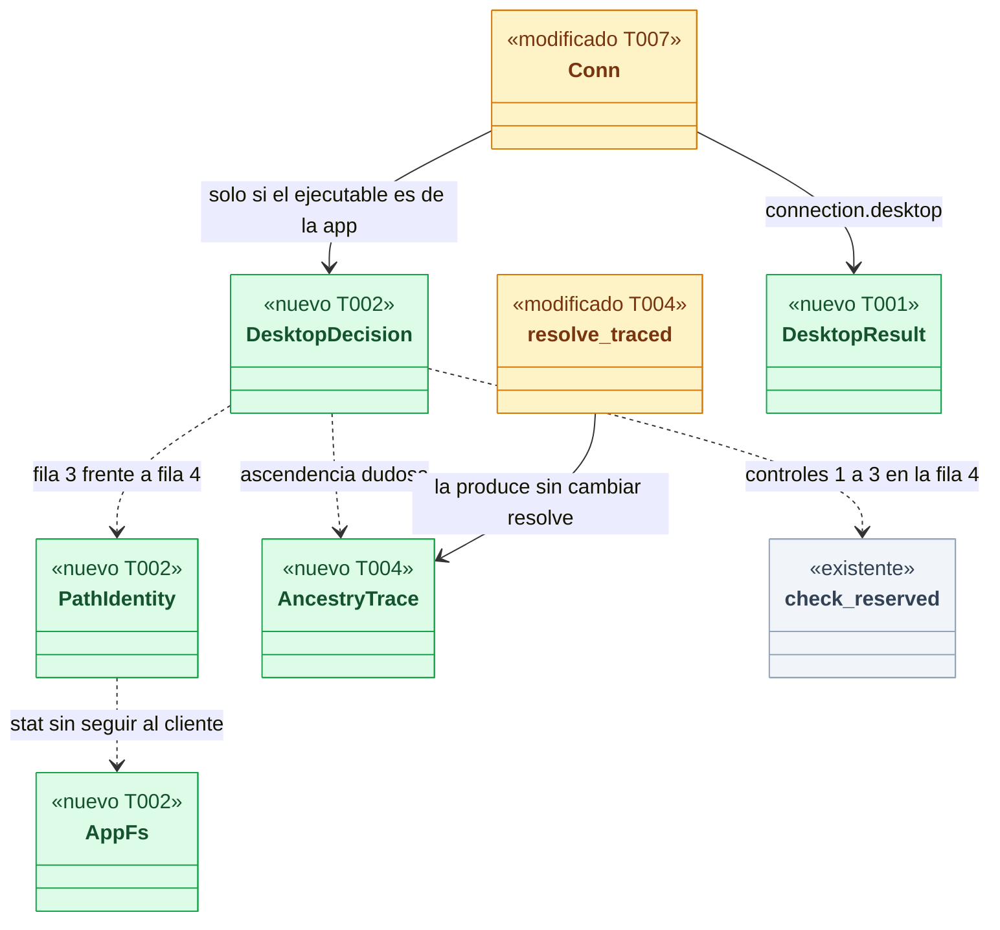
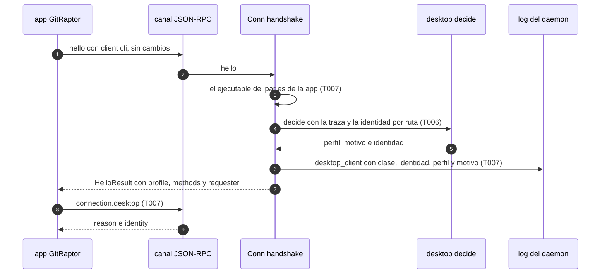
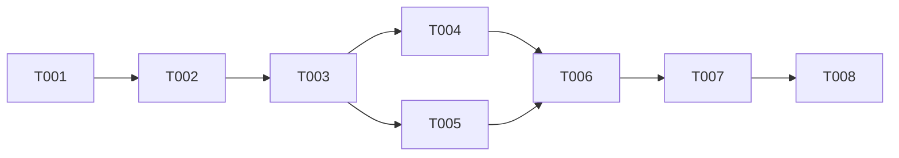

# DS-TS-GRP-009 · Clase de cliente de la app de escritorio y su perfil de lectura en el daemon

## Contexto rápido

Al terminar, una ventana de GitRaptor que abrió un agente ve lo mismo que ese agente ve por el MCP, y quien lo decide es el daemon, no la app. La app abierta desde el Finder en la carpeta de aplicaciones conserva la vista completa. Hoy no se puede: el daemon da el perfil `mcp` solo al ejecutable `raptor-mcp` o a quien se declara `mcp` (`crates/core/src/channel/conn.rs:540-550`), así que una app abierta por un agente recibe el perfil completo y la restricción que la app se aplica a sí misma (DS-US-DSK-003 D6) es cosmética.

Para eso: el daemon reconoce la clase de la app por el nombre del ejecutable del par que le da el kernel; para esa clase decide el perfil con la ascendencia que él mismo resuelve y con la identidad por ruta del ejecutable; publica el solicitante en el `hello` de siempre y el motivo en un método nuevo de solo lectura, `connection.desktop`; y deja una línea en el log por cada conexión de la clase. Las decisiones son de ADR-GRP-017 § 3, de la Enmienda (2026-11-08) de ADR-MCP-001 y de TS-GRP-009; aquí solo se concretan (§ Decisión del orquestador).

| Término | Qué es aquí |
|---|---|
| Clase `desktop` | Conexión cuyo par es un ejecutable llamado como el binario de la app (`GitRaptor` o `gitraptor-desktop`). La deduce el daemon del ejecutable; el cliente no la declara |
| Perfil | `ConnectionProfile`: `full` (todos los métodos) o `mcp` (la allowlist del MCP y sus vistas acotadas, con el ámbito por cwd) |
| Filas 1 a 4 | Las filas de la tabla de ADR-GRP-017 § 3: 1 = agente en la ascendencia; 2 = identidad firmada (fuera de alcance); 3 = identidad por ruta; 4 = sin identidad |
| Identidad por ruta | El ejecutable del par, canonicalizado, es `<apps>/GitRaptor.app/Contents/MacOS/<binario de la app>` con `<apps>` = `/Applications` o `~/Applications`, sin traslocación, sin volumen montado y sin escritura para otros usuarios. Solo alphas sin firmar (R-6) |
| Controles 1 a 3 | Los de ADR-GRP-005 § 6 (par no reutilizable, ascendencia sin agente, terminal de control y líder de sesión): lo que comprueba `authz::check_reserved` |
| Ascendencia dudosa | Una cadena del par con un intérprete (`ExeClass::Interpreter`), un multiplexor de terminal o un final no limpio (padre reutilizado o ilegible) |
| Traza | `AncestryTrace`: lo que vio la caminata de `requester::resolve` y que hoy no sale de ella (intérprete, multiplexor, final limpio, descendiente del daemon) |
| I-01 | Hallazgo de la revisión de seguridad de TS-GRP-009: la clase solo estrecha la lectura; nunca da más que declararse `cli` desde el mismo proceso |
| R-6 | Riesgo residual de ADR-GRP-017: un binario homónimo en `~/Applications` lanzado con `open -a` obtiene la lectura completa. Aceptado solo para las alphas |

⚠️ **ASSUMPTION**: no existe `architecture-constitution.md` en la cascada; rigen `AGENTS.md` y los ADR de `must_read` (NFR-01, NFR-02, ADR-GRP-016), como en DS-TS-GRP-008.

### Decisión del orquestador (2026-11-09), validada por Arquitecto

La propuesta del orquestador se valida con tres correcciones, porque en su forma original chocaba con dos ADR. Ninguna reabre una decisión aceptada.

| # | Decisión | Por qué |
|---|---|---|
| D1 | **La clase la deduce el daemon del ejecutable del par; `hello` no cambia.** No hay variante `ClientKind::Desktop`. El par es de la clase si el nombre de su ejecutable (del kernel, `ProcInfo.exe`) está en `APP_BINARIES = ["GitRaptor", "gitraptor-desktop"]`, sea cual sea el `client` que declare | Corrige la propuesta. La Enmienda (2026-11-08) de ADR-MCP-001 dice "la clase `desktop` no se declara: la deduce el daemon del ejecutable del par", y ADR-GRP-016 dice "`hello` no cambia de forma" y descarta el reintento ante un daemon viejo por frágil. Un `client: "desktop"` lo cerraría un daemon anterior con `INVALID_PARAMS` (`Hello` es `deny_unknown_fields` y "Frozen") |
| D2 | **El contrato nuevo es un método, no una capacidad**: `connection.desktop` (protocolo 9, abierto a ambos perfiles, no reservado), ofrecido en `hello.methods` solo a las conexiones de la clase. Devuelve `{reason, identity}`. `HelloResult` no gana campos: la clase recibe el `requester` que ya existe | Corrige la propuesta. ADR-GRP-016: "un método nuevo no necesita capacidad; el cliente lo descubre en `hello.methods`". Un campo nuevo en `HelloResult` rompería una app de una alpha anterior conectada a un daemon nuevo, porque `HelloResult` es `deny_unknown_fields` y se envía antes de `connection.accept`. Un daemon viejo no lista el método y la app degrada sin reintentos (ADR-GRP-017 § 6) |
| D3 | **Decisión del perfil de la clase**, en este orden, primera que aplica: (a) declarado `mcp` o ejecutable `raptor-mcp` → `mcp`; (b) `resolve` falla → `mcp`; (c) marca del ejecutor o descendiente del daemon → `mcp`; (d) agente en la ascendencia, directo o por multiplexor → `mcp` (fila 1); (e) ascendencia dudosa → `mcp`; (f) identidad que no se puede verificar → `mcp`; (g) identidad por ruta → `full` (fila 3); (h) sin identidad → `full` si pasan los controles 1 a 3, si no `mcp` (fila 4) | Corrige la fila 4 de la propuesta ("igual que `cli` hoy, `full`"). ADR-GRP-017 § 3 la manda a "las reglas actuales de un cliente sin terminal (ADR-MCP-001 § 2)", y la Enmienda de ADR-MCP-001 dice que un sin atribuir sin terminal "solo conservaba el perfil completo si pasaba los controles 1 a 3". Con `full` siempre, la identidad por ruta no decidiría nada y la fila 3 sobraría |
| D4 | **Identidad por ruta** como función pura sobre un puerto de sistema de archivos (`AppFs`), con las carpetas de aplicaciones como parámetro. En producción: `/Applications` y `<home>/Applications`, con `<home>` leído de la base de usuarios para el uid del daemon (`getpwuid`), nunca del entorno ni del cliente. Solo macOS; en Linux y Windows la lista está vacía y la identidad es siempre `none` (Pendiente: etapa de validación multiplataforma) | Valida la propuesta. La lista fija de binarios excluye `raptor` y `raptor-mcp`, que viven en el mismo `Contents/MacOS/` (`externalBin`, ADR-GRP-017 § 6). Se aceptan los dos nombres porque el bundler de Tauri usa el `productName` (`GitRaptor`, `apps/desktop/src-tauri/tauri.conf.json:3`) o el nombre del binario de Cargo (`gitraptor-desktop`) según versión y `mainBinaryName`; los dos están dentro de `GitRaptor.app` y no aflojan nada |
| D5 | **El perfil se fija en el `hello` y no cambia**; un segundo `hello` ya se rechaza (`already greeted`). El solicitante se sigue resolviendo en cada petición (sin cambios) | Valida la propuesta. Precisa ADR-MCP-001 § 2 ("se resuelve al conectar y otra vez en cada llamada; solo se endurece"): para el perfil de lectura de la clase, resolverlo otra vez no puede endurecerlo, porque un par no gana antecesores después de conectar (un padre que muere lo hereda `launchd`) y las marcas del ejecutor existen antes de que el hijo conecte |
| D6 | **Sin escalada (I-01)**: para la clase, el perfil es `full` solo en (g) y (h); un impostor (no está en la ruta de la app) nunca llega a (g), y (h) da `full` exactamente cuando lo daría la regla de un cliente sin terminal. Frente a declararse `cli` desde el mismo proceso: mismo `requester` (la misma `connection_requester`), perfil igual o más estrecho y métodos iguales o un subconjunto, más `connection.desktop` | Valida la propuesta y precisa "exactamente" de la ficha: la igualdad es exacta para el solicitante; para perfil y métodos es "nunca más", porque la clase solo estrecha. La única diferencia de métodos es `connection.desktop`, que solo describe la propia conexión |
| D7 | **Log** `desktop_client` (nivel info) por cada conexión de la clase que completa el `hello`: `class`, `identity`, `profile`, `reason`, todos de vocabulario cerrado. Sin rutas, sin pid, sin `client_version` | Valida la propuesta (SEC-04, SEC-12) |
| D8 | **La traza de la ascendencia sale de `requester::resolve` sin cambiar su firma**: `resolve_traced` devuelve `(Resolution, AncestryTrace)` y `resolve` la envuelve | Lo pidió el orquestador ("cómo exponer intérprete visto sin romper sus usos actuales"). `Resolution.confirmable` no sirve: una app abierta desde el Finder no tiene terminal y sale `confirmable = false` con la ascendencia limpia |

**Consecuencia para la app** (anotada para US-DSK-003 o la primera historia de la app tras la mezcla): la app no cambia su `hello` (sigue como `ClientKind::Cli`, D4 de DS-US-DSK-003) y D6 de DS-US-DSK-003 sigue valiendo, porque ahora `hello.profile` llega `mcp` del daemon. Para pintar el motivo, la app llama a `connection.desktop` si está en `hello.methods`; si no está (daemon anterior o binario renombrado), degrada a lo de hoy.

---

## 📋 Índice

> **Para aprobar:** [Contexto rápido](#contexto-rápido) · [⚠️ Gaps](#gaps-y-violaciones-de-la-constitución) · [🔭 La forma](#la-forma) · [El trabajo de un vistazo](#el-trabajo-de-un-vistazo).
> **Para implementar:** [🚀 Plan](#plan-de-implementación), en orden. Las `_(ref)_` se abren desde la tarea que las cita.

| Sección | Propósito |
|---------|-----------|
| [Contexto rápido](#contexto-rápido) | Qué se construye, el glosario y las decisiones |
| [⚠️ Gaps y violaciones de la constitución](#gaps-y-violaciones-de-la-constitución) | Qué impide empezar |
| [🔭 La forma](#la-forma) | Piezas, cambios y flujo |
| [🚀 Plan de implementación](#plan-de-implementación) | T001…T008, en orden |
| ↳ [El trabajo de un vistazo](#el-trabajo-de-un-vistazo) | Tareas en tabla y su orden |
| [Estructura de ficheros](#estructura-de-ficheros) _(ref)_ | Árbol anotado de ficheros |
| [Contratos compartidos](#contratos-compartidos) _(ref)_ | Tipos y firmas |
| [Contrato de API](#contrato-de-api) _(ref)_ | Método nuevo · errores · numéricos |
| [Modelo de datos](#modelo-de-datos) _(ref)_ | No aplica |
| [Estrategia de pruebas y cobertura](#estrategia-de-pruebas-y-cobertura) _(ref)_ | Tests del contrato y mapa criterio → test |
| [Gate de seguridad](#gate-de-seguridad) | Checklist pre-merge |
| [Fuera de alcance](#fuera-de-alcance) | Lo que esta entrega no toca |
| [Notas del autor](#notas-del-autor) _(ref)_ | Lo que no bloquea |

---

## ⚠️ Gaps y violaciones de la constitución

_No gaps. Ready to implement._

Las precisiones de ADR (D1, D2, D3, D5) están en § Decisión del orquestador; lo que no bloquea, en [Notas del autor](#notas-del-autor).

---

## 🔭 La forma

Al terminar, el canal tiene un módulo `channel::desktop` con dos funciones puras (identidad por ruta y decisión del perfil) que el handshake usa para la clase, y el contrato tiene un método de solo lectura que publica el motivo.



🟩 nuevo · 🟨 modificado · ⬜ existente (contexto: no cambia). Cada pieza dice qué tarea la toca.

La decisión solo se toma para la clase; las demás conexiones siguen exactamente por el camino de hoy (`full` salvo `raptor-mcp` o `mcp` declarado).

**Cómo fluye:**



El paso que decide es el 4, y se da una vez: el perfil queda fijo para la conexión. El único contrato publicado que cambia es la lista `hello.methods` de la clase (gana `connection.desktop`) y su `requester`, que ahora llega también con perfil `mcp`.

---

## 🚀 Plan de implementación

> Orden topológico (`Depende:`). Una casilla se marca cuando su `Aceptación` está verificada. Las rutas son relativas a la raíz del repo.

### El trabajo de un vistazo

Tres frentes y un cierre: contrato y esqueleto (T001-T002), tests del contrato en rojo (T003), implementación (T004-T007) y documentación con gate (T008).

| # | Tarea | Depende | Aterriza en |
|---|---|---|---|
| T001 | Añadir al contrato el método `connection.desktop` y sus tipos | — | `crates/api/src` |
| T002 | Crear el módulo `channel::desktop` con sus firmas y stubs que fallan cerrado | T001 | `crates/core/src/channel` |
| T003 | Escribir los tests del contrato en rojo | T002 | `crates/core/tests`, `crates/api/tests` |
| T004 | Exponer la traza de la ascendencia desde `resolve` sin cambiar su firma | T003 | `crates/core/src/channel/requester.rs` |
| T005 | Implementar la identidad por ruta | T003 | `crates/core/src/channel/desktop.rs` |
| T006 | Implementar la decisión del perfil de la clase | T004, T005 | `crates/core/src/channel/desktop.rs` |
| T007 | Conectar la clase al handshake, al método y al log | T006 | `crates/core/src/channel` |
| T008 | Documentar el método, cerrar el estado de la historia y correr el gate | T007 | `docs/` |

### En qué orden

Cadena recta con un abanico de dos en el medio (T004 y T005 en paralelo).



### T001 — Añadir al contrato el método `connection.desktop` y sus tipos

**Objetivo.** El contrato tiene el método y sus tipos; ningún mensaje existente cambia de forma. Fuera: cualquier cambio en `Hello`, `ClientKind` o `HelloResult`.

**Ubicación.**
- `crates/api/src/desktop.rs` (**CREATE**)
- `crates/api/src/lib.rs` (**MODIFY**)
- `crates/api/src/methods/connection.rs` (**MODIFY**)

**Reglas**
- Declarar `DesktopReason`, `DesktopIdentity` y `DesktopResult` tal cual § Tipos y datos compartidos, con `rename_all = "kebab-case"` y `deny_unknown_fields`, y un `as_str()` por enum que devuelva la misma palabra que el cable (la usa el log).
- Añadir en `lib.rs` solo la línea `pub mod desktop;`.
- Declarar en `methods/connection.rs` la constante `CONNECTION_DESKTOP = "connection.desktop"` y su entrada `method(CONNECTION_DESKTOP, false, true).since(CAPABILITIES_PROTOCOL)` en el `GROUP` del módulo; ninguna capacidad nueva.
- No tocar `messages.rs`: `Hello`, `ClientKind` y `HelloResult` quedan byte a byte iguales.

> **Nota técnica.** `mcp = true` hace falta para que una conexión de la clase con perfil `mcp` pueda llamarlo: `offered()` filtra por `m.mcp` en ese perfil (`conn.rs:795-799`). El filtro por clase lo añade T007.

- **Depende:** —
- **Criterios:** GRP009-WIRE, GRP009-COMPAT (`docs/dev-briefs/ts-grp-009-desktop-class.contract.json`)
- **Refs:** ADR-GRP-016 § 1 ("un método nuevo no necesita capacidad", "`hello` no cambia de forma"); D2
- **Aceptación:** `cargo test -p gitraptor-api --test ts_grp_009_desktop_contract` en verde tras T003

### T002 — Crear el módulo `channel::desktop` con sus firmas y stubs que fallan cerrado

**Objetivo.** Las firmas de § Firmas del stack existen y compilan, para que T003 escriba sus tests contra ellas. Fuera: la lógica, que es de T005 y T006.

**Ubicación.**
- `crates/core/src/channel/desktop.rs` (**CREATE**)
- `crates/core/src/channel/mod.rs` (**MODIFY**)
- `crates/core/src/channel/requester.rs` (**MODIFY**)

**Reglas**
- Declarar en `desktop.rs` los tipos y funciones de § Firmas del stack. Los stubs devuelven el resultado más restrictivo: `path_identity` → `PathIdentity::Unverifiable`, `decide` → `DesktopDecision { profile: Mcp, reason: RequesterUnverified, identity: Unverifiable }`, `is_app_exe` → `false`, `system_app_dirs` → vector vacío.
- Ningún `todo!()` ni `unimplemented!()`: el camino de producción no debe poder entrar en pánico (los tests del contrato se escriben contra stubs que compilan y fallan cerrado).
- Declarar en `requester.rs` `AncestryTrace` y `resolve_traced` con el stub `resolve(...).map(|r| (r, AncestryTrace::default()))`.
- Añadir en `channel/mod.rs` solo la línea `pub mod desktop;`.
- Añadir a `ChannelConfig` el campo de prueba `test_app_binaries: Option<Vec<String>>` con `#[cfg(debug_assertions)] #[doc(hidden)]`, `None` en `Default`, con el mismo patrón que `test_confirmation` (`channel/mod.rs:109-113`).

> **Nota técnica.** El campo de prueba no existe en un build de release, así que no puede ampliar la clase en producción. Todos los `ChannelConfig { … }` de los tests usan `..ChannelConfig::default()`, así que añadir un campo no rompe ninguno.

- **Depende:** T001
- **Refs:** `extender-sin-archivos-compartidos.md` (módulo nuevo = su línea `mod`); memoria del repo sobre stubs del contrato
- **Aceptación:** `cargo build -p gitraptor-core` y `cargo clippy -p gitraptor-core --all-targets -- -D warnings` en verde; `grep -nE 'todo!|unimplemented!' crates/core/src/channel/desktop.rs` sin resultados

### T003 — Escribir los tests del contrato en rojo

**Objetivo.** Los cuatro archivos de § 9.4 existen, compilan y fallan contra los stubs por el comportamiento, no por compilación. Fuera: tocar tests existentes.

**Ubicación.**
- `crates/core/tests/ts_grp_009_desktop_profile.rs` (**CREATE**)
- `crates/core/tests/ts_grp_009_path_identity.rs` (**CREATE**)
- `crates/core/tests/ts_grp_009_desktop_wire.rs` (**CREATE**)
- `crates/api/tests/ts_grp_009_desktop_contract.rs` (**CREATE**)

**Pasos**
1. Escribir en `ts_grp_009_desktop_profile.rs` un doble `Tree` de `ProcSource` con el patrón del módulo de tests de `requester.rs` (`requester.rs:360-405`: `HashMap<u32, ProcInfo>`, `denied`, `pids_of`) y los tests de § 9.4, archivo 1.
   1.1 ⛔1.1 No reutilizar un `Tree` con `terminal_proof = false`: con él, una cadena dudosa sale `Err(Unverified)` y el test de "ascendencia dudosa" pasaría por la rama equivocada (`requester-unverified`). Construir `Checks` con `terminal_proof: true` y `orphans_marked: true` salvo en el test que pide lo contrario.
2. Escribir en `ts_grp_009_path_identity.rs` un doble `MemFs` de `AppFs` (mapa ruta → `FsMeta` y mapa de canonicalización) y los tests de § 9.4, archivo 2, más uno con `SystemFs` sobre un directorio temporal (`#[cfg(unix)]`).
3. Escribir en `ts_grp_009_desktop_wire.rs` los tests de § 9.4, archivo 3, con el daemon en proceso de `tests/common` sobre un perfil temporal (NFR-01), con `#![cfg(all(debug_assertions, any(target_os = "macos", target_os = "linux")))]`.
   3.1 Poner en `test_app_binaries` el nombre de archivo del ejecutable del test (`std::env::current_exe()`), para que el cliente en proceso sea de la clase.
4. Escribir en `crates/api/tests/ts_grp_009_desktop_contract.rs` los tests de § 9.4, archivo 4.

> **Nota técnica.** El cliente en proceso es el propio daemon (`checks.daemon` coincide con su `(pid, inicio)`), así que en los tests de cable la clase siempre sale `mcp` con motivo `daemon-descendant`. Las filas 1, 3 y 4 se prueban en el archivo 1 con el doble, que es donde se puede fabricar la ascendencia.

- **Depende:** T002
- **Refs:** TS-GRP-009 § Plan de Verificación; `AGENTS.md` (tests con repos temporales)
- **Aceptación:** `cargo test -p gitraptor-core --test ts_grp_009_desktop_profile --test ts_grp_009_path_identity --test ts_grp_009_desktop_wire` compila y falla por aserción; `cargo test -p gitraptor-api --test ts_grp_009_desktop_contract` compila
- **Guard ⛔1.1:** `ambiguous_ancestry_gets_mcp_even_with_path_identity` (afirma el motivo, no solo el perfil)

### T004 — Exponer la traza de la ascendencia desde `resolve` sin cambiar su firma

**Objetivo.** `resolve_traced` devuelve lo que vio la caminata; `resolve` da exactamente lo de hoy. Fuera: cambiar cualquier regla de resolución.

**Ubicación.** `crates/core/src/channel/requester.rs` (**MODIFY**)

**Pasos**
1. Mover el cuerpo de `resolve` (`requester.rs:178-287`) a `resolve_traced` y hacer que `resolve` sea `resolve_traced(...).map(|(r, _)| r)`.
2. Rellenar `AncestryTrace` en la caminata: `interpreter` con la variable `interpreter` existente, `multiplexer` con `server.is_some()`, `ended_cleanly` con `clean`, `daemon_descendant` cuando el bucle llega a `checks.daemon` (también por `resolve_after_barrier`).
   2.1 ⛔2.1 En las salidas tempranas (marca del ejecutor, agente, multiplexor con un agente), devolver la traza de lo visto hasta ahí, con `daemon_descendant = true` si la salida es por marca (`ResolvedVia::Executor`). Una traza por defecto en una salida por marca haría que T006 la tomara por ascendencia limpia si se cambiara el orden de las reglas.
3. No cambiar ningún valor de `Resolution`.

- **Depende:** T003
- **Criterios:** GRP009-DOUBT (`docs/dev-briefs/ts-grp-009-desktop-class.contract.json`)
- **Refs:** D8; ADR-TMC-005 § 1
- **Aceptación:** `cargo test -p gitraptor-core --lib channel::requester` sigue en verde sin tocar sus tests; `daemon_descendant_gets_mcp` y `ambiguous_ancestry_gets_mcp_even_with_path_identity` pasan a verde tras T006
- **Guard ⛔2.1:** `executor_mark_gets_mcp_as_daemon_descendant`

### T005 — Implementar la identidad por ruta

**Objetivo.** `path_identity` decide `Verified`, `Absent` o `Unverifiable` sin otra fuente que el ejecutable del kernel y el sistema de archivos. Fuera: identidad firmada (SPIKE-DSK-001).

**Ubicación.** `crates/core/src/channel/desktop.rs` (**MODIFY**)

**Pasos**
1. Devolver `Unverifiable` si no hay ejecutable o si `fs.canonicalize(exe)` o cualquier `fs.metadata` falla.
2. Sobre la ruta canónica, devolver `Absent` si algún componente es `AppTranslocation` o si empieza por `/Volumes`.
3. Buscar la carpeta de aplicaciones `<apps>` de `apps` (cada una también canonicalizada) tal que la ruta sea exactamente `<apps>/GitRaptor.app/Contents/MacOS/<bin>`, con `<bin>` en `APP_BINARIES` y la comparación por componentes y sensible a mayúsculas; si ninguna, `Absent`.
4. Comprobar el ejecutable y cada directorio `GitRaptor.app`, `Contents` y `MacOS`: archivo regular el primero y directorios los demás, sin `mode & 0o022`, propietario el uid del daemon o `0`, y el mismo `dev` que `<apps>`; si falla alguno, `Absent`.
5. Comprobar `<apps>`: sin `mode & 0o002` y propietario el uid del daemon o `0`; la escritura de grupo se admite solo en `<apps>` (§ Notas, G2); si falla, `Absent`.
6. Implementar `SystemFs` con `std::fs::canonicalize` y `std::fs::metadata` + `MetadataExt` (`mode`, `uid`, `dev`), y `system_app_dirs(uid)` con `/Applications` y el `pw_dir` de `nix::unistd::User::from_uid(uid)` + `Applications`, solo con `cfg(target_os = "macos")`; vacío en el resto.
   6.1 ⛔6.1 No leer `HOME` ni nada del cliente para `<home>`: el entorno del daemon lo hereda quien lo lanzó, y un `HOME` falso movería `~/Applications` a una carpeta del atacante.

> **Nota técnica.** En macOS `/Applications` es `root:admin 0775` (verificado en la máquina de desarrollo el 2026-11-09) y `~/Applications` suele ser `0700` del usuario. Exigir `0o022` en `<apps>` rechazaría siempre `/Applications`. `nix` ya está en las dependencias Unix de `gitraptor-core` con la feature `user`.

- **Depende:** T003
- **Criterios:** GRP009-PATH-ID, GRP009-FAIL-CLOSED (`docs/dev-briefs/ts-grp-009-desktop-class.contract.json`)
- **Refs:** ADR-GRP-017 § 3 (identidad por ruta) y R-6; D4
- **Aceptación:** `cargo test -p gitraptor-core --test ts_grp_009_path_identity` en verde
- **Guard ⛔6.1:** `app_dirs_come_from_the_user_database` (macOS)

### T006 — Implementar la decisión del perfil de la clase

**Objetivo.** `decide` aplica D3 en su orden y nada más. Fuera: la capa de escritura, que sigue saliendo de `layer_for` sin cambios.

**Ubicación.** `crates/core/src/channel/desktop.rs` (**MODIFY**)

**Pasos**
1. Devolver `Mcp` + `DeclaredMcp` si `declared == ClientKind::Mcp` o el ejecutable se llama `raptor-mcp`/`raptor-mcp.exe` (la misma regla de `conn.rs:540-545`).
2. Llamar a `requester::resolve_traced(peer, checks, marks)`; `Err` → `Mcp` + `RequesterUnverified`.
3. `via == Executor` o `trace.daemon_descendant` → `Mcp` + `DaemonDescendant`.
4. `who.is_agent()` → `Mcp` + `AgentInAncestry`.
5. `trace.interpreter || trace.multiplexer || !trace.ended_cleanly` → `Mcp` + `AmbiguousAncestry`.
6. Según `identity`: `Unverifiable` → `Mcp` + `IdentityUnverifiable`; `Verified` → `Full` + `PathIdentity`; `Absent` → `Full` si `authz::check_reserved(peer, checks).refused.is_none()`, si no `Mcp`, con `NoIdentity`.
   6.1 ⛔6.1 Para la fila 4 usar `check_reserved` y no `Resolution.confirmable`: `confirmable` mezcla la presencia de agentes bajo un multiplexor y es la condición de la confirmación, no la de los controles 1 a 3 que pide ADR-MCP-001 § 2.
7. Devolver siempre `identity` como la recibió (`Verified` → `Path`, `Absent` → `None`, `Unverifiable` → `Unverifiable`), aunque una regla anterior haya decidido.

- **Depende:** T004, T005
- **Criterios:** GRP009-ROW1, GRP009-ROWS34, GRP009-FAIL-CLOSED, GRP009-DOUBT, GRP009-NO-ESCALATION (`docs/dev-briefs/ts-grp-009-desktop-class.contract.json`)
- **Refs:** ADR-GRP-017 § 3 (filas 1, 3 y 4); ADR-MCP-001 § 2 y Enmienda 2026-11-08; D3, D6
- **Aceptación:** `cargo test -p gitraptor-core --test ts_grp_009_desktop_profile` en verde
- **Guard ⛔6.1:** `clean_ancestry_without_identity_or_terminal_gets_mcp`

### T007 — Conectar la clase al handshake, al método y al log

**Objetivo.** Una conexión de la clase recibe el perfil de `decide`, su `requester`, el método `connection.desktop` y su línea de log; ninguna otra conexión cambia. Fuera: escrituras, capas y la app.

**Ubicación.** `crates/core/src/channel/conn.rs` (**MODIFY**)

**Pasos**
1. Añadir a `Conn` el campo `desktop: Option<DesktopDecision>`, `None` por defecto.
2. En `handshake`, donde hoy se fija `self.profile` (`conn.rs:540-550`): si `desktop::is_app_exe(exe, binaries)` (con `binaries` = `test_app_binaries` en debug si está, si no `APP_BINARIES`), calcular `identity = path_identity(exe, &system_app_dirs(uid), &SystemFs, uid)` y `decision = decide(...)`, guardar `self.desktop = Some(decision)` y `self.profile = decision.profile`. Si no, la regla de hoy, sin tocarla.
   2.1 ⛔2.1 Calcular la clase solo con `self.info.exe` (el kernel). Nunca con `hello.client` ni `client_version`.
3. Publicar `requester` también para la clase: la condición pasa a `has(CAP_REQUESTER) && ((profile == Full && client == Cli) || self.desktop.is_some())`, con la misma `connection_requester()`.
4. Tras `claim_slot` sin rechazo, registrar `logger.info("desktop_client", …)` con `class = "desktop"`, `identity`, `profile` (`"full"`/`"mcp"`) y `reason`, todos `Field::Text` de los `as_str()`.
   4.1 ⛔4.1 Ningún campo de texto libre: ni ruta del ejecutable, ni pid, ni `client_version`.
5. En `offered`, excluir `CONNECTION_DESKTOP` cuando `self.desktop.is_none()`.
6. En `dispatch`, atender `CONNECTION_DESKTOP` devolviendo `DesktopResult { reason, identity }` de `self.desktop`; los parámetros son `NoParams` (vacíos).
7. Un segundo `hello` sigue cayendo en `already greeted` (`conn.rs:836-842`): no tocar esa rama.

> **Nota técnica.** `is_hook_client` (`limits.rs:133-138`) mira `client == Other` y el ejecutable instalado de `raptor`; el binario de la app nunca es ese ejecutable, así que la clase no afecta al cliente del hook ni a la clave de límites por solicitante.

- **Depende:** T006
- **Criterios:** GRP009-ROW1, GRP009-NO-ESCALATION, GRP009-COMPAT, GRP009-LOG (`docs/dev-briefs/ts-grp-009-desktop-class.contract.json`)
- **Refs:** D1, D2, D5, D7; ADR-GRP-016; SEC-04
- **Aceptación:** `cargo test -p gitraptor-core --test ts_grp_009_desktop_wire` en verde y las suites del canal (`channel`, `channel_capabilities`, `channel_scopes`, `profile_mcp_allowlist`, `us_grd_006_channel`) siguen en verde
- **Guard ⛔2.1:** `declared_kind_does_not_change_the_decision`
- **Guard ⛔4.1:** `desktop_class_is_logged_without_paths_or_client_text`

### T008 — Documentar el método, cerrar el estado de la historia y correr el gate

**Objetivo.** El contrato documentado coincide con el código y la historia queda `implemented`. Ninguna regla nueva.

**Ubicación.**
- `docs/architecture/design/api-contract-ipc.md` (**MODIFY**)
- `docs/requirements/features/motor-local/technical-stories/TS-GRP-009-clase-desktop-perfil-lectura.md` (**MODIFY**)
- `docs/requirements/features/desktop/dev-specs/US-DSK-003-estado-del-motor.md` (**MODIFY**)

**Pasos**
1. Añadir en `api-contract-ipc.md` la fila de `connection.desktop` junto a `connection.accept` (protocolo 9, ofrecido solo a la clase `desktop`, `{}` → `{reason, identity}`) y una frase sobre cómo se deduce la clase.
2. Marcar G1 de DS-US-DSK-003 como cerrado por TS-GRP-009, con la consecuencia para la app de § Decisión del orquestador.
3. Poner la ficha en `status: implemented` con el PR.
4. Correr `cargo clippy --workspace --exclude gitraptor-desktop --all-targets -- -D warnings` y `cargo test --workspace --exclude gitraptor-desktop` (o `nx affected -t lint test`).

- **Depende:** T007
- **Criterios:** GRP009-COMPAT (`docs/dev-briefs/ts-grp-009-desktop-class.contract.json`)
- **Refs:** `AGENTS.md` (reglas de calidad); ADR-GRP-016 § Validación
- **Aceptación:** los dos comandos del paso 4 terminan con código 0, y `grep -n 'connection.desktop' docs/architecture/design/api-contract-ipc.md` encuentra la fila

---

> Las secciones siguientes son de referencia: se abren desde la tarea que las cita.

## Estructura de ficheros

```text
crates/
├── api/
│   ├── src/
│   │   ├── desktop.rs                        ← CREATE (T001)
│   │   ├── lib.rs                            ← MODIFY (T001)
│   │   └── methods/connection.rs             ← MODIFY (T001)
│   └── tests/ts_grp_009_desktop_contract.rs  ← CREATE (T003)
└── core/
    ├── src/channel/
    │   ├── desktop.rs                        ← CREATE (T002, T005, T006)
    │   ├── mod.rs                            ← MODIFY (T002)
    │   ├── requester.rs                      ← MODIFY (T002, T004)
    │   └── conn.rs                           ← MODIFY (T007)
    └── tests/
        ├── ts_grp_009_desktop_profile.rs     ← CREATE (T003)
        ├── ts_grp_009_path_identity.rs       ← CREATE (T003)
        └── ts_grp_009_desktop_wire.rs        ← CREATE (T003)
docs/
├── architecture/design/api-contract-ipc.md   ← MODIFY (T008)
└── requirements/features/
    ├── motor-local/technical-stories/TS-GRP-009-clase-desktop-perfil-lectura.md  ← MODIFY (T008)
    └── desktop/dev-specs/US-DSK-003-estado-del-motor.md                          ← MODIFY (T008)
```

`← CREATE`: fichero nuevo. `← MODIFY`: fichero existente. `crates/core/src/channel/mod.rs` también recibe el campo de prueba de `ChannelConfig` (T002).

---

## Contratos compartidos

### Tipos y datos compartidos

```rust
// crates/api/src/desktop.rs (T001)
/// Why the daemon fixed this profile for a desktop-class connection.
#[derive(Debug, Clone, Copy, PartialEq, Eq, Serialize, Deserialize, JsonSchema)]
#[serde(rename_all = "kebab-case")]
pub enum DesktopReason {
    PathIdentity,         // row 3: full
    NoIdentity,           // row 4: full only with controls 1-3
    AgentInAncestry,      // row 1: mcp
    AmbiguousAncestry,    // interpreter, multiplexer or broken chain: mcp
    DaemonDescendant,     // executor mark or below the daemon: mcp
    RequesterUnverified,  // resolve failed: mcp
    IdentityUnverifiable, // exe unreadable, canonicalize/stat failed: mcp
    DeclaredMcp,          // declared `mcp` or `raptor-mcp` executable: mcp
}

/// What the daemon could prove about the peer's executable.
#[derive(Debug, Clone, Copy, PartialEq, Eq, Serialize, Deserialize, JsonSchema)]
#[serde(rename_all = "kebab-case")]
pub enum DesktopIdentity { Path, None, Unverifiable }

/// `connection.desktop` result.
#[derive(Debug, Clone, PartialEq, Eq, Serialize, Deserialize, JsonSchema)]
#[serde(deny_unknown_fields)]
pub struct DesktopResult {
    pub reason: DesktopReason,
    pub identity: DesktopIdentity,
}

// crates/core/src/channel/requester.rs (T002, T004)
/// What the ancestry walk saw, beyond the resolution.
#[derive(Debug, Clone, Copy, Default, PartialEq, Eq)]
pub struct AncestryTrace {
    pub interpreter: bool,
    pub multiplexer: bool,
    pub ended_cleanly: bool,
    pub daemon_descendant: bool,
}

// crates/core/src/channel/desktop.rs (T002)
#[derive(Debug, Clone, Copy, PartialEq, Eq)]
pub enum PathIdentity { Verified, Absent, Unverifiable }

#[derive(Debug, Clone, Copy, PartialEq, Eq)]
pub struct FsMeta { pub is_file: bool, pub is_dir: bool, pub mode: u32, pub uid: u32, pub dev: u64 }

#[derive(Debug, Clone, Copy, PartialEq, Eq)]
pub struct DesktopDecision {
    pub profile: ConnectionProfile,
    pub reason: DesktopReason,
    pub identity: DesktopIdentity,
}
```

### Ciclos de vida (DI)

_No ambient state — DI lifetimes follow stack defaults._ `DesktopDecision` vive en el `Conn` de su conexión y se fija una vez en el `hello`.

### Firmas del stack

```rust
// crates/core/src/channel/desktop.rs
/// File names of the app's main binary inside `GitRaptor.app/Contents/MacOS` (D4).
pub const APP_BINARIES: &[&str] = &["GitRaptor", "gitraptor-desktop"];

/// Read-only file system port; `SystemFs` in production, doubles in tests.
pub trait AppFs {
    fn canonicalize(&self, path: &Path) -> std::io::Result<PathBuf>;
    fn metadata(&self, path: &Path) -> std::io::Result<FsMeta>;
}
pub struct SystemFs;
impl AppFs for SystemFs { /* std::fs + MetadataExt */ }

/// Whether the kernel's executable of the peer is the app's (class `desktop`).
pub fn is_app_exe(exe: Option<&Path>, binaries: &[&str]) -> bool;

/// `/Applications` and `<pw_dir>/Applications` for `uid` on macOS; empty elsewhere.
pub fn system_app_dirs(uid: u32) -> Vec<PathBuf>;

/// Path identity of the alphas (ADR-GRP-017 § 3). Order: canonicalize → translocation and
/// /Volumes → exact location and name → bundle modes, owner and device → apps folder.
pub fn path_identity(exe: Option<&Path>, apps: &[PathBuf], fs: &dyn AppFs, uid: u32) -> PathIdentity;

/// Profile of a desktop-class connection (D3), first rule that applies.
pub fn decide(
    peer: AcceptedPeer,
    checks: &Checks<'_>,
    marks: Option<&ExecutorMarks>,
    declared: ClientKind,
    exe: Option<&Path>,
    identity: PathIdentity,
) -> DesktopDecision;

// crates/core/src/channel/requester.rs
pub fn resolve_traced(
    peer: AcceptedPeer,
    checks: &Checks<'_>,
    marks: Option<&super::marks::ExecutorMarks>,
) -> Result<(Resolution, AncestryTrace), Unverified>;
// `resolve` keeps its signature: resolve_traced(..).map(|(r, _)| r)

// crates/core/src/channel/authz.rs (existing, unchanged): controls 1 to 3 of ADR-GRP-005 § 6
pub fn check_reserved(peer: AcceptedPeer, checks: &Checks<'_>) -> Verdict;
```

---

## Contrato de API

Canal JSON-RPC local (ADR-GRP-005 § 5). Un método nuevo; ningún mensaje cambia de forma.

| Método | Reservado | MCP | Desde | Se ofrece a | Parámetros → resultado |
|---|---|---|---|---|---|
| `connection.desktop` | No | Sí | protocolo 9 | Solo conexiones de la clase `desktop` (ejecutable del par en `APP_BINARIES`) | `{}` → `{reason, identity}` (`DesktopResult`) |

Cambios de valor, no de forma: `hello.methods` de la clase incluye `connection.desktop`; `hello.requester` de la clase llega también con perfil `mcp`; `hello.profile` de la clase sale de D3.

### Forma del error y del cuerpo de respuesta

_No aplica — esta entrega no añade caminos de error._ `connection.desktop` llamado por una conexión que no es de la clase responde el `-32601` (`method not found`) que ya da `dispatch` a todo método no ofrecido (`conn.rs:847-850`); T003 lo comprueba en `other_clients_keep_their_shapes`.

### Forma de la configuración

_No aplica — no hay configuración nueva._ El único campo nuevo de `ChannelConfig` es de prueba, solo en builds de depuración (T002).

### Valores numéricos

| Concepto | Valor | Fuente |
|---------|-------|--------|
| Bits de escritura prohibidos en ejecutable y directorios del bundle | `0o022` (grupo y otros) | ADR-GRP-017 § 3, "sin escritura para otros usuarios" |
| Bits de escritura prohibidos en la carpeta de aplicaciones | `0o002` (otros) | D4; `/Applications` es `root:admin 0775` |
| Propietarios admitidos | uid del daemon o `0` | D4 |
| Profundidad máxima de la caminata | 64 (`MAX_DEPTH`, sin cambios) | `requester.rs:38` |

---

## Modelo de datos

_No aplica — esta entrega no persiste nada; el perfil vive en memoria con la conexión._

---

## Estrategia de pruebas y cobertura

### 9.1 Pirámide de pruebas

| Tipo | Cantidad | Tareas dueñas | Herramientas | Cuándo |
|------|---------:|-------------|---------|------|
| Unit | 35 | T003 (archivos 1 y 2) | `cargo test`, dobles `Tree` y `MemFs` | PR gate |
| Integration | 9 | T003 (archivo 3) | daemon en proceso, perfil temporal | PR gate |
| Contract | 4 | T003 (archivo 4) | `serde_json` | PR gate |
| Security | 0 | — | (los de I-01 están contados en Unit e Integration) | — |

### 9.2 Umbrales de cobertura

| Capa | Línea | Rama | Mutación | Camino crítico 100% |
|-------|-----:|-------:|---------:|:------------------:|
| `crates/core/src/channel/desktop.rs` | — | — | — | ✅ cada regla de `decide` y cada rechazo de `path_identity` tiene su test |

### 9.3 Datos de prueba

- Builders / fixtures: `Tree` (`ProcSource`) con las cadenas de `requester.rs` tests (Terminal.app: `login` de root, `zsh`; Finder: padre `launchd` de uid 0) más el binario de la app; `MemFs` con un árbol `/Applications/GitRaptor.app/Contents/MacOS/…` de modos `0755` y `/Applications` `root:admin 0775`.
- Multi-tenant data: no aplica.
- PII / PHI: ninguna; el log se comprueba sin rutas ni `client_version` (se usa uno distintivo, `zz-ts-grp-009`).
- Time / clock: tiempos de inicio fijos en el doble; `accepted_us = 1_000_000`.

### 9.4 Comportamientos críticos verificados

**Archivo 1 — `crates/core/tests/ts_grp_009_desktop_profile.rs`** (decisión, doble `Tree`)

- [ ] `agent_in_ancestry_gets_mcp` — fila 1: `claude` → `zsh` → app ⇒ `Mcp`, `AgentInAncestry`
- [ ] `agent_behind_multiplexer_gets_mcp` — `tmux` con un único agente ⇒ `Mcp`, `AgentInAncestry`
- [ ] `clean_ancestry_with_path_identity_gets_full` — fila 3: padre `launchd`, `Verified` ⇒ `Full`, `PathIdentity`
- [ ] `clean_ancestry_without_identity_at_a_terminal_gets_full` — fila 4 con controles 1 a 3 ⇒ `Full`, `NoIdentity`
- [ ] `clean_ancestry_without_identity_or_terminal_gets_mcp` — fila 4 sin terminal ⇒ `Mcp`, `NoIdentity`
- [ ] `unverifiable_identity_gets_mcp` — padre `launchd`, `Unverifiable` ⇒ `Mcp`, `IdentityUnverifiable`
- [ ] `unverified_requester_gets_mcp` — inicio del par distinto ⇒ `Mcp`, `RequesterUnverified`
- [ ] `ambiguous_ancestry_gets_mcp_even_with_path_identity` — `node` en la cadena, `Verified` ⇒ `Mcp`, `AmbiguousAncestry`
- [ ] `multiplexer_without_agent_gets_mcp_even_with_path_identity` ⇒ `Mcp`, `AmbiguousAncestry`
- [ ] `broken_ancestry_gets_mcp` — padre más joven que el hijo (pid reutilizado) ⇒ `Mcp`, `AmbiguousAncestry`
- [ ] `daemon_descendant_gets_mcp` — `checks.daemon` en la cadena ⇒ `Mcp`, `DaemonDescendant`
- [ ] `executor_mark_gets_mcp_as_daemon_descendant` — par marcado por una operación ⇒ `Mcp`, `DaemonDescendant`
- [ ] `declared_mcp_gets_mcp_even_with_path_identity` ⇒ `Mcp`, `DeclaredMcp`
- [ ] `identity_is_reported_even_when_an_earlier_rule_decides` — agente + `Verified` ⇒ `identity == Path`
- [ ] `impostor_never_gets_more_than_cli` (I-01) — para cada cadena (Terminal, Finder, agente, intérprete, multiplexor) con `Absent`: `profile == Full` solo si `check_reserved` pasa, y nunca `PathIdentity`
- [ ] `declared_kind_does_not_change_the_decision` — misma cadena con `Cli` y `Other` ⇒ misma decisión

**Archivo 2 — `crates/core/tests/ts_grp_009_path_identity.rs`** (identidad por ruta, doble `MemFs` y un test con `SystemFs`)

- [ ] `app_in_system_applications_is_verified`
- [ ] `app_in_user_applications_is_verified`
- [ ] `both_app_binary_names_are_accepted` — `GitRaptor` y `gitraptor-desktop`
- [ ] `bundled_raptor_and_raptor_mcp_are_not_the_app` — `Contents/MacOS/raptor` y `raptor-mcp` ⇒ `Absent`
- [ ] `other_name_is_rejected` — `gitraptor`, `GitRaptor2` ⇒ `Absent`
- [ ] `binary_outside_applications_is_rejected` — `~/Downloads/GitRaptor.app/…` ⇒ `Absent`
- [ ] `nested_or_renamed_bundle_is_rejected` — `/Applications/x/GitRaptor.app/…`, `/Applications/Other.app/…` ⇒ `Absent`
- [ ] `translocated_path_is_rejected` — componente `AppTranslocation` ⇒ `Absent`
- [ ] `mounted_volume_is_rejected` — `/Volumes/GitRaptor/GitRaptor.app/…` ⇒ `Absent`
- [ ] `other_device_than_applications_folder_is_rejected` — `dev` distinto ⇒ `Absent`
- [ ] `symlink_is_resolved_before_checking` — enlace en `/Applications` a `~/Downloads` ⇒ `Absent`
- [ ] `writable_executable_is_rejected` — `0775` y `0757` ⇒ `Absent`
- [ ] `writable_bundle_directory_is_rejected` — cada uno de `GitRaptor.app`, `Contents`, `MacOS` con `0o020` o `0o002` ⇒ `Absent`
- [ ] `group_writable_system_applications_is_accepted` — `/Applications` `root:admin 0775` ⇒ `Verified`
- [ ] `world_writable_applications_folder_is_rejected` ⇒ `Absent`
- [ ] `foreign_owner_is_rejected` — ejecutable o directorio del bundle de otro uid distinto de `0` ⇒ `Absent`
- [ ] `unreadable_executable_is_unverifiable` — `canonicalize` o `metadata` con error, y ejecutable `None` ⇒ `Unverifiable`
- [ ] `real_filesystem_modes_are_read` (`cfg(unix)`) — `SystemFs` sobre un temporal: `0755` ⇒ `Verified`; `chmod 0775` en `MacOS` ⇒ `Absent`
- [ ] `app_dirs_come_from_the_user_database` (`cfg(target_os = "macos")`) — `system_app_dirs(uid) == ["/Applications", pw_dir/Applications]`; en el resto de SO (`cfg(not(macos))`), vacío

**Archivo 3 — `crates/core/tests/ts_grp_009_desktop_wire.rs`** (daemon en proceso, `test_app_binaries` = el ejecutable del test)

- [ ] `desktop_class_is_narrowed_by_the_daemon` — `hello` como `cli` ⇒ `profile == mcp`, `requester` presente, `methods` ⊆ los de `mcp` + `connection.desktop`
- [ ] `connection_desktop_reports_reason_and_identity` ⇒ `{"reason":"daemon-descendant","identity":"none"}`
- [ ] `desktop_requester_equals_cli_requester` (I-01) — el `requester` de la clase es igual al que recibe un `cli` del mismo proceso con un daemon sin el campo de prueba
- [ ] `desktop_methods_never_exceed_cli_methods` (I-01) — `methods` de la clase menos `connection.desktop` ⊆ `methods` de `cli`
- [ ] `profile_is_fixed_at_hello` — segundo `hello` ⇒ `already greeted`; `connection.desktop` y el perfil no cambian; un método fuera de la allowlist MCP ⇒ `-32601`
- [ ] `declared_mcp_from_the_app_keeps_mcp` — `hello` como `mcp` ⇒ `reason == declared-mcp`
- [ ] `desktop_class_is_logged_without_paths_or_client_text` — `daemon.log` con `desktop_client` y `class=desktop`, `identity=none`, `profile=mcp`, `reason=daemon-descendant`; sin `zz-ts-grp-009`, sin la ruta del ejecutable ni del perfil
- [ ] `other_clients_keep_their_shapes` — sin el campo de prueba: `cli`, `other` y `mcp` no ven `connection.desktop` en `methods` y llamarlo da `-32601`; las claves de `HelloResult` son las de hoy; `cli` con `requester`, `other` sin él, `mcp` con perfil `mcp`; ninguna línea `desktop_client`
- [ ] `desktop_method_needs_protocol_9` — la clase con `hello` de protocolo 8 ⇒ perfil estrechado igual, sin `connection.desktop` en `methods`

**Archivo 4 — `crates/api/tests/ts_grp_009_desktop_contract.rs`** (contrato)

- [ ] `desktop_result_wire_form` — cada `DesktopReason` y `DesktopIdentity` en kebab-case, y `as_str()` igual al cable
- [ ] `desktop_result_rejects_unknown_fields`
- [ ] `connection_desktop_is_open_to_mcp_from_protocol_9_and_not_reserved`
- [ ] `hello_is_unchanged` — `Hello` con `client: "desktop"` no deserializa (ADR-GRP-016: `hello` no cambia de forma)

**Mapa criterio → test** (TS-GRP-009 § Plan de Verificación)

| Criterio de la ficha | Tests |
|---|---|
| Fila 1 de V4: agente ⇒ perfil `mcp`, sin los métodos que `mcp` no ofrece, motivo publicado | `agent_in_ancestry_gets_mcp`, `agent_behind_multiplexer_gets_mcp`, `desktop_class_is_narrowed_by_the_daemon`, `connection_desktop_reports_reason_and_identity` |
| Filas 3 y 4 | `clean_ancestry_with_path_identity_gets_full`, `clean_ancestry_without_identity_at_a_terminal_gets_full`, `clean_ancestry_without_identity_or_terminal_gets_mcp` |
| Identidad que no se puede verificar ⇒ `mcp` | `unverifiable_identity_gets_mcp`, `unverified_requester_gets_mcp`, `unreadable_executable_is_unverifiable` |
| Identidad por ruta: cada rechazo; no cambia con lo que el cliente declare | archivo 2 completo; `declared_kind_does_not_change_the_decision` |
| Sin escalada (I-01): perfil, métodos y solicitante frente a `cli`; no cambia tras el handshake | `impostor_never_gets_more_than_cli`, `desktop_requester_equals_cli_requester`, `desktop_methods_never_exceed_cli_methods`, `profile_is_fixed_at_hello` |
| Compatibilidad: CLI, TUI, `raptor-mcp` y hook con las mismas formas y perfiles | `other_clients_keep_their_shapes`, `hello_is_unchanged`, suites existentes del canal (T007) |
| Capacidad / contrato anunciado | `connection_desktop_is_open_to_mcp_from_protocol_9_and_not_reserved`, `desktop_method_needs_protocol_9` |
| Log sin rutas ni texto del cliente | `desktop_class_is_logged_without_paths_or_client_text` |
| Ascendencia dudosa (decisión del orquestador) | `ambiguous_ancestry_gets_mcp_even_with_path_identity`, `multiplexer_without_agent_gets_mcp_even_with_path_identity`, `broken_ancestry_gets_mcp`, `daemon_descendant_gets_mcp`, `executor_mark_gets_mcp_as_daemon_descendant` |

### 9.5 Plataformas

| Plataforma | Cómo se verifica | Pendiente |
|---|---|---|
| macOS | Tests de los cuatro archivos en local; manual de la ficha con la alpha en `/Applications`, desde el Finder, desde Claude Code y desde la imagen montada | — |
| Linux | CI `ubuntu-latest`: archivos 1, 3 y 4, y el 2 salvo `app_dirs_come_from_the_user_database` (que comprueba la lista vacía) | La app no corre en Linux en UI-1 (Q-DSK-12) |
| Windows | Archivos 1, 2 (doble) y 4 en CI | **Pendiente: etapa de validación multiplataforma** — sin carpetas de aplicaciones la identidad es siempre `none`; el archivo 3 no corre (`cfg`) |

---

## Gate de seguridad

- La clase se deduce solo de `ProcInfo.exe` (kernel); ningún campo del `hello` la concede (Guard de T007 ⛔2.1).
- Ninguna regla de `decide` da `full` fuera de las filas 3 y 4; un impostor nunca obtiene `PathIdentity` (I-01).
- `<home>` de `~/Applications` sale de `getpwuid`, no del entorno (Guard de T005 ⛔6.1).
- La identidad por ruta canonicaliza antes de comprobar y rechaza traslocación, `/Volumes`, otro `dev`, escritura de grupo u otros en el bundle y propietario ajeno.
- El log `desktop_client` no lleva rutas, pid ni `client_version` (SEC-04).
- El campo `test_app_binaries` no existe en release (`#[cfg(debug_assertions)]`).
- `hello`, `ClientKind` y `HelloResult` no cambian de forma (`hello_is_unchanged`, `other_clients_keep_their_shapes`).

Corre `/security-review --scope devspec docs/requirements/features/motor-local/dev-specs/TS-GRP-009-dev-spec.md` antes de mezclar.

---

## Fuera de alcance

> No-goals con gate verificable: cómo se comprueba que la story NO tocó cada ítem.

| Ítem / no-objetivo | Historia que lo cubre | Gate (cómo se verifica) |
|----------------|--------------------|-------------------------|
| Identidad firmada y requisito de firma | SPIKE-DSK-001 | `grep -rn 'SecCode' crates/` sin resultados |
| Factor del SO, presencia de sesión, escrituras de la app, capa `cockpit` | SPIKE-GRD-002, DEP-DSK-1 | `git diff main -- crates/core/src/channel/conn.rs` no toca `fn layer` ni `layer_for` |
| Detectar `open -a` lanzado por un agente (R-6) | SPIKE-DSK-002 | Sin uso de Apple Events en el diff |
| Restringir a un agente que ejecuta la CLI `raptor` | — (no lo pide ADR-GRP-017) | `other_clients_keep_their_shapes`: `cli` sigue con perfil `full` |
| Cambios de la app (llamar a `connection.desktop`, pintar el motivo) | US-DSK-003 o la primera historia de la app tras la mezcla | `git diff main --stat -- apps/desktop` vacío |
| Windows y Linux | Etapa de validación multiplataforma | `system_app_dirs` vacío fuera de macOS |

---

## Notas del autor

| ID | Nota | Acción | Owner |
|----|------|--------|-------|
| G1 | ADR-MCP-001 (Enmienda 2026-11-08) dice "la clase `desktop` no se declara", y la ficha pide "una capacidad nueva". Se sigue al ADR (D1, D2): la clase se deduce del ejecutable y el contrato es un método, que según ADR-GRP-016 no necesita capacidad | Ninguna: la ficha queda precisada por § Decisión del orquestador | Arquitecto |
| G2 | `/Applications` es `root:admin 0775`: otro usuario administrador del equipo podría reemplazar el bundle. Se acepta igual que R-6 (solo alphas, solo lectura) y desaparece con la identidad firmada de v0.1.0 | Ninguna en esta historia | Arquitecto |
| G3 | Un build de desarrollo (`pnpm tauri dev`) corre bajo `node`, así que la clase sale `mcp` con `ambiguous-ancestry`. Para ver la vista completa en desarrollo hay que lanzar el binario de `target/` desde una terminal (fila 4 con controles 1 a 3) | Contarlo en el README de `apps/desktop` cuando la app pinte el motivo | Historia de la app |
| G4 | Renombrar el binario de la app lo saca de la clase y obtiene las reglas de `cli` (`full`). No es una escalada: es lo mismo que un agente que ejecuta `raptor` hoy (fuera de alcance en la ficha) | Ninguna | — |
| G5 | Los nombres del ejecutable del bundle dependen del bundler de Tauri. La prueba manual de la ficha con la alpha confirma cuál de los dos sale; los dos son constantes | Si el bundle usa otro nombre, añadirlo a `APP_BINARIES` en el mismo PR | Implementador |
