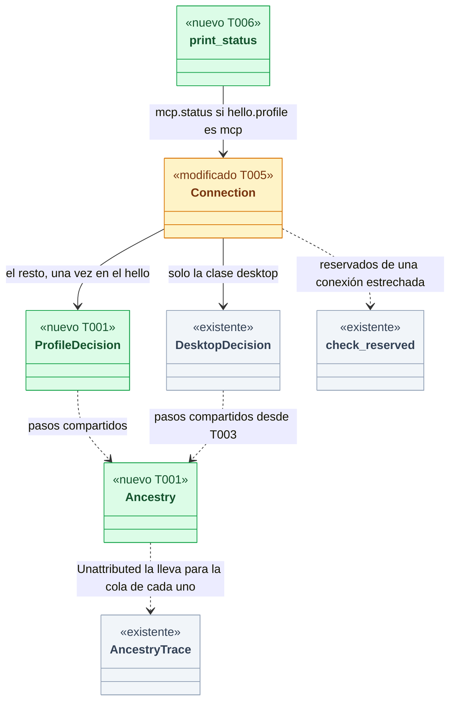
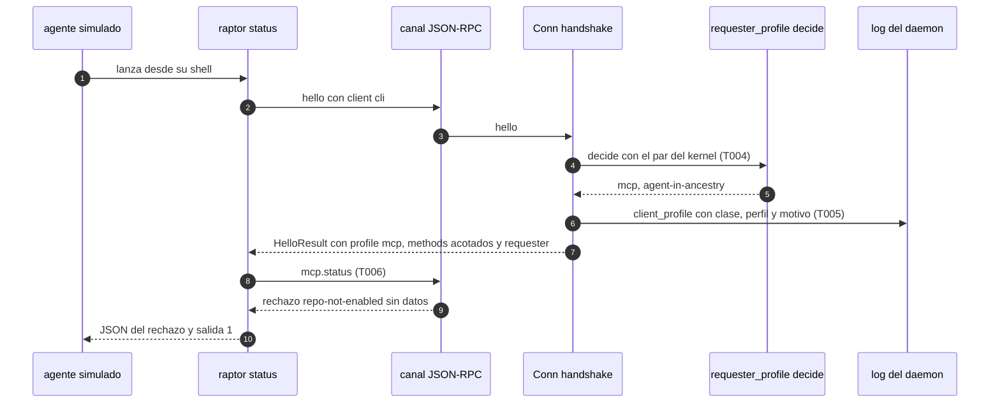
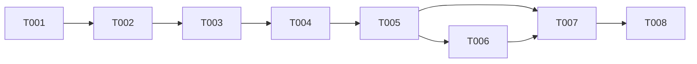

# DS-TS-GRP-010 · Perfil `mcp` por solicitante para toda conexión del canal

## Contexto rápido

Al terminar, un agente que usa la CLI `raptor`, la TUI o un cliente JSON-RPC propio ve y puede lo mismo que por el MCP: allowlist de repos, vistas acotadas y `repo-not-enabled` sin datos. El desarrollador en su terminal conserva la vista completa, aunque su cwd esté dentro del worktree de un agente. Hoy no es así: fuera de la clase de la app de escritorio, el daemon da el perfil `mcp` solo al ejecutable `raptor-mcp` o a quien se declara `mcp` (`crates/core/src/channel/conn.rs:571-580`), así que un agente que lanza `raptor` recibe el perfil completo y la CLI es una puerta lateral (S-01).

Para eso: la parte de la ascendencia que hoy vive en `desktop::decide` se extrae a una función compartida; una decisión nueva fija el perfil de toda conexión que no es de la clase `desktop`; el handshake la aplica, la registra en el log y conserva para estas conexiones el canal declarado y el veredicto propio de los comandos reservados; y la CLI y la TUI dejan de romperse cuando el daemon les da el perfil `mcp`. Las decisiones son de ADR-MCP-001 § 2 (S-01), de la Enmienda (2026-10-05, MCP) de ADR-GRP-005 y de ADR-GRP-004; aquí se concretan (§ Decisión del orquestador).

| Término | Qué es aquí |
|---|---|
| Perfil | `ConnectionProfile`: `full` (todos los métodos) o `mcp` (la allowlist del MCP, sus vistas acotadas y el ámbito por cwd) |
| Conexión estrechada | Conexión que no es de la clase `desktop`, que no se declara `mcp` ni es `raptor-mcp`, y a la que esta entrega da el perfil `mcp` por su solicitante |
| Cliente del hook | `raptor hook`: se declara `other` y su ejecutable es el binario instalado del daemon (`limits::is_hook_client`) |
| Controles 1 a 3 | Los de ADR-GRP-005 § 6 (par no reutilizable, ascendencia sin agente, terminal de control y líder de sesión): `authz::check_reserved` |
| `confirmable` | `Resolution.confirmable`: ascendencia que acaba limpia, sin intérprete, sin multiplexor con un agente vivo y con los controles 1 a 3. Es la vara que ya usa la confirmación de trabajo ajeno |
| Daemon mismo | El par cuyo `(pid, inicio)` es el del propio proceso del daemon (`Checks.daemon`). En producción el daemon no se conecta a sí mismo; en los tests en proceso el cliente es el daemon |
| Descendiente del daemon | Par cuya ascendencia llega al daemon: hijo marcado por el ejecutor o hijo sin marca |
| Ancestry | Lo que la caminata compartida dice del par: no verificado, descendiente del daemon, agente o sin atribuir con su `Resolution` y su `AncestryTrace` |
| S-01 / SEC-MCP-01 | Perfil `mcp` por solicitante, no por cliente (ADR-MCP-001 § 2; `non-functional.md`) |

⚠️ **ASSUMPTION**: no existe `architecture-constitution.md` en la cascada; rigen `AGENTS.md` y los ADR de `must_read` (NFR-01, NFR-02, ADR-GRP-016), como en DS-TS-GRP-009.

### Decisión del orquestador (2026-11-12), validada por Arquitecto

Cada fila es una decisión del orquestador (2026-11-12), validada por Arquitecto. Ninguna reabre una decisión aceptada; D6 y D7 precisan el texto de ADR-MCP-001 § 2 y se llevan a sus ADR en T008.

| # | Decisión | Por qué |
|---|---|---|
| D1 | **Orden de la decisión para toda conexión que no es de la clase `desktop`**, primera regla que aplica: (a) declarado `mcp` o ejecutable `raptor-mcp` → `mcp` (`declared-mcp`); (b) cliente del hook → `full` (`hook-client`); (c) daemon mismo → `full` (`daemon-self`); (d) `resolve` falla → `mcp` (`requester-unverified`); (e) marca del ejecutor o descendiente del daemon → `mcp` (`daemon-descendant`); (f) agente en la ascendencia, directo o por un multiplexor con un único agente → `mcp` (`agent-in-ancestry`); (g) sin atribuir y `confirmable` → `full` (`developer`); (h) sin atribuir con intérprete, multiplexor o final no limpio → `mcp` (`ambiguous-ancestry`); (i) resto (sin terminal, controles 1 a 3 que fallan) → `mcp` (`unconfirmable`). La clase `desktop` sigue con `desktop::decide` | ADR-MCP-001 § 2: "si el solicitante resuelto es un agente, perfil `mcp` sea cual sea el cliente" y "un sin atribuir que pasa los controles 1 a 3 conserva el perfil completo". (g)-(i) es la forma de fallar cerrado de la ficha: sin prueba de que es el desarrollador en su terminal, `mcp`. Sin (i), `(setsid raptor status --json &)` con doble fork esquivaría S-01 desde la shell del agente. (h) cubre Claude Code instalado con npm, que corre como `node` (`ExeClass::Interpreter`, `authz.rs:86`) |
| D2 | **La ascendencia se comparte, no se duplica**: los pasos (b) a (d) de `desktop::decide` (resolve, descendiente del daemon, agente) pasan a `requester_profile::ancestry`, que usan `desktop::decide` y la decisión nueva. `desktop::decide` da exactamente los mismos resultados (sus tests de TS-GRP-009 siguen en verde sin tocarlos). La regla de `raptor-mcp` también se comparte (`is_mcp_exe`, hoy duplicada en `conn.rs:572-574` y `desktop.rs:285-288`) | Restricción del orquestador. Cada consumidor aplica su cola: la clase `desktop` trata todo multiplexor como ascendencia dudosa y decide con la identidad por ruta; el resto decide con `confirmable` |
| D3 | **El daemon mismo no es un solicitante (regla c), en producción.** Además, un campo de prueba `test_daemon_children_as_self: bool` en `ChannelConfig` (`#[cfg(debug_assertions)]`, `false` por defecto) trata como daemon mismo a un descendiente **sin marca**; un hijo marcado por el ejecutor sigue en (e). Solo lo fijan los tests con el daemon en proceso que lanzan un cliente hijo y esperan el perfil completo (§ 9.6) | Elegido frente a "solo un campo de prueba": los tests en proceso de `crates/core` se conectan desde el propio daemon (`daemon_id = std::process::id()`, `server.rs:215`); sin (c) salen `daemon-descendant` y en Windows `Unverified` (`ORPHANS_MARKED = false`), y habría que tocar unas 60 suites o poner el campo a `true` por defecto en debug, que deja S-01 apagado en todo build de desarrollo. (c) es sólido en producción: el par sale del kernel y nadie más tiene el `(pid, inicio)` del daemon. El campo cubre los 7 tests de `apps/cli` que lanzan `raptor` como hijo del daemon en proceso; en release no existe |
| D4 | **Los tests de `apps/cli` que lanzan el daemon como proceso y no fijan `GITRAPTOR_AGENT_EXECUTABLES` lo fijan a `raptor-fake-agent`** (override neutro: no hay ningún ejecutable con ese nombre en su ascendencia, y con el override `node` cuenta como `Other`). Sin vías nuevas: el override ya es solo de debug (`daemon/env.rs:132-145`) y lo propaga `client::debug_overrides` | Un worker que corre la suite bajo Claude Code tiene al `claude` real en la ascendencia del `raptor` del test: sin override recibiría `mcp`. El CI no corre bajo un agente, así que el fallo solo se vería en local |
| D5 | **El cliente del hook se clasifica antes de S-01 (regla b)** con el mismo predicado de hoy (declara `other` y su ejecutable es el binario instalado) y conserva el perfil completo y su exención de plaza; `limits.rs` no cambia. **`daemon.replace`** está en la allowlist del MCP (`method(DAEMON_REPLACE, false, true)`, `crates/api/src/methods/daemon.rs:17`) y su camino del binario instalado no mira el perfil (`conn.rs:3104-3160`), así que sigue permitido bajo un agente sin cambios | ADR-MCP-001 § 2 (condiciones 2 y 3). `guard.evaluate` no está en la allowlist del MCP (`mcp = false`): si el hook recibiera `mcp`, Guardrails caería al modo degradado bajo el `git` del agente. Hoy `is_hook_client` exige `full`, y con (b) primero lo sigue cumpliendo |
| D6 | **Multiplexor**: con un único agente bajo el servidor, el resolutor ya atribuye a ese agente (f). Con más de uno, con algún agente vivo en otra parte o con la lista de procesos ilegible, `confirmable` es falso y sale `mcp` (h). Sin agentes vivos y con los controles 1 a 3, `full`. Coste aceptado: el desarrollador en `tmux` mientras corre un agente recibe `mcp` en esa terminal; lo resuelve una terminal fuera del multiplexor. La frase de ADR-MCP-001 "un sin atribuir que pasa los controles 1 a 3 conserva el perfil completo" se precisa como "un sin atribuir que podría confirmar (`confirmable`)" | Un agente que abre un servidor separado (`tmux new -d 'raptor status --json > f'`) deja a `raptor` bajo `launchd`, con terminal de control y un líder de sesión sin agente: **pasa los controles 1 a 3**. Leer la frase al pie de la letra dejaría S-01 abierto por esa vía. Ante la duda, el más restrictivo; "ningún humano pierde capacidades" solo vale para el desarrollador que el daemon puede reconocer |
| D7 | **El perfil se fija en el `hello` para toda conexión** y no se recalcula; un segundo `hello` ya se rechaza (`already greeted`). El solicitante y la capa se siguen resolviendo en cada petición (M-03, sin cambios) | Generaliza la precisión de la Enmienda (2026-11-09, TS-GRP-009) de ADR-MCP-001. Recalcular solo serviría para endurecer, y no endurece nada: un par no gana antecesores después de conectar (si su padre muere, lo hereda `launchd`, y eso solo ablandaría, que § 2 prohíbe), las marcas del ejecutor existen antes de que el hijo conecte, y la llegada posterior de un agente a otro panel de `tmux` no le da a ese agente la conexión ya abierta del desarrollador. T008 lleva la enmienda a ADR-MCP-001 § 2 y ADR-GRP-005 § 5 |
| D8 | **Qué sigue al perfil en una conexión estrechada y qué no.** Sigue al perfil `mcp`: métodos ofrecidos, vistas (`engine.snapshot` acotado, `for_mcp`), allowlist, ámbito por cwd, `requester.resolve` sin `via` ni `confirmable` y el cubo de escrituras de la conexión. **No** sigue al perfil: (i) el canal (`request_channel`) es el declarado (`cli`, o `tui` con `surface`), nunca `mcp`; (ii) un comando reservado recibe su propio veredicto (`check_reserved`, con la caminata y su motivo, p. ej. `agent-ancestry`), no el atajo `not-available-to-mcp`; (iii) las lecturas gastan los presupuestos de un cliente que no es MCP; (iv) `hello.requester` se publica si declara `cli`. La clase `desktop` y `raptor-mcp` no cambian | (i) US-MCP-025 E1 cuenta el uso por canal: un `mcp` aquí confundiría la CLI del agente con el MCP. (ii) Los comandos reservados se deciden por ADR-GRP-005 § 6, no por el perfil; con el atajo, la auditoría perdería la ascendencia (`identity_without_walk`) y el motivo real. Un humano en `tmux` con un agente vivo conserva así sus comandos reservados, como hoy. (iii) D9 de ADR-MCP-001 § 6: "consultar el estado desde su shell no lo frena"; la ficha deja fuera S-03. (iv) La CLI pinta "actúas como: agente (capa mcp)"; el perfil ya lo sabe el cliente por `hello.profile` |
| D9 | **Log `client_profile`** (nivel info) solo cuando la decisión estrecha (D8): `class` (`cli` u `other`, la clase declarada), `profile` (`mcp`) y `reason`, todos de vocabulario cerrado. Sin rutas, sin pid, sin `client_version`. Mismo patrón que `desktop_client` (`conn.rs:605-620`) | SEC-04, SEC-12. Registrar cada conexión `full` sería ruido: el cliente del hook se conecta a menudo |
| D10 | **Sin cambio de contrato**: ningún tipo nuevo en `crates/api`, sin método nuevo ni protocolo nuevo. El motivo no se publica: el cliente conoce su perfil por `hello.profile` | ADR-GRP-016. Publicar el motivo a un agente sería un oráculo de evasión, el mismo argumento que oculta `via` y `confirmable` por MCP (`conn.rs:3948-3950`). Cambian valores, no formas: `hello.profile`, `hello.methods` y la presencia de `hello.requester` |
| D11 | **Cliente mínimo**: con `hello.profile == mcp`, `raptor status` llama a `mcp.status` en lugar de `engine.snapshot`; `--json` imprime su resultado tal cual o, si lo rechaza, `{"error": <data>}` con código de salida 1; sin `--json`, una línea de vista restringida (i18n en/es). `raptor daemon status` pinta el estado del motor de la vista acotada y el solicitante, sin lista de repos. La TUI no abre: imprime la misma vista restringida y sale con 0. El sobre versionado (`schema_version`) y los errores JSON del resto de subcomandos son de US-MCP-023 | ADR-GRP-004 (Enmienda 2026-10-05, MCP): "`raptor status` y la TUI muestran la vista acotada del MCP y, en un repo no habilitado, 'repo no habilitado para el MCP'". Sin esto, `raptor status` bajo un agente falla al deserializar `McpSnapshot` como `Snapshot`: no filtra nada, pero es un error opaco. Una TUI acotada completa es trabajo de UX y no lo pide la ficha |

**Consecuencia para US-MCP-023**: su escenario "por la CLI un agente no ve más que por el MCP" queda desbloqueado; US-MCP-023 envuelve la salida de D11 en el sobre de su D1 y da `--json` al resto de subcomandos.

---

## 📋 Índice

> **Para aprobar:** [Contexto rápido](#contexto-rápido) · [⚠️ Gaps](#gaps-y-violaciones-de-la-constitución) · [🔭 La forma](#la-forma) · [El trabajo de un vistazo](#el-trabajo-de-un-vistazo).
> **Para implementar:** [🚀 Plan](#plan-de-implementación), en orden. Las `_(ref)_` se abren desde la tarea que las cita.

| Sección | Propósito |
|---------|-----------|
| [Contexto rápido](#contexto-rápido) | Qué se construye, el glosario y las decisiones |
| [⚠️ Gaps y violaciones de la constitución](#gaps-y-violaciones-de-la-constitución) | Qué impide empezar |
| [🔭 La forma](#la-forma) | Piezas, cambios y flujo |
| [🚀 Plan de implementación](#plan-de-implementación) | T001…T008, en orden |
| ↳ [El trabajo de un vistazo](#el-trabajo-de-un-vistazo) | Tareas en tabla y su orden |
| [Estructura de ficheros](#estructura-de-ficheros) _(ref)_ | Árbol anotado de ficheros |
| [Contratos compartidos](#contratos-compartidos) _(ref)_ | Tipos y firmas |
| [Contrato de API](#contrato-de-api) _(ref)_ | Cambios de valor · errores · numéricos |
| [Modelo de datos](#modelo-de-datos) _(ref)_ | No aplica |
| [Estrategia de pruebas y cobertura](#estrategia-de-pruebas-y-cobertura) _(ref)_ | Tests del contrato, mapa criterio → test y tests existentes que cambian |
| [Gate de seguridad](#gate-de-seguridad) | Checklist pre-merge |
| [Fuera de alcance](#fuera-de-alcance) | Lo que esta entrega no toca |
| [Notas del autor](#notas-del-autor) _(ref)_ | Lo que no bloquea |

---

## ⚠️ Gaps y violaciones de la constitución

_No gaps. Ready to implement._

Las precisiones de ADR (D6, D7, D8) están en § Decisión del orquestador y las lleva T008 a sus ADR; lo que no bloquea, en [Notas del autor](#notas-del-autor).

---

## 🔭 La forma

Al terminar, el canal tiene un módulo `channel::requester_profile` con la caminata compartida y la decisión del perfil de toda conexión que no es de la app; el handshake la aplica una vez, y la CLI y la TUI saben pintar la vista acotada.



🟩 nuevo · 🟨 modificado · ⬜ existente (contexto: no cambia). Cada pieza dice qué tarea la toca.

Las dos decisiones comparten la caminata y difieren en la cola: la app decide con la identidad por ruta; el resto, con `confirmable`.

**Cómo fluye:**



El paso que decide es el 4 y se da una vez: el perfil queda fijo para la conexión (D7). Ningún mensaje cambia de forma; cambian `hello.profile`, `hello.methods` y la presencia de `hello.requester` de la conexión estrechada.

---

## 🚀 Plan de implementación

> Orden topológico (`Depende:`). Una casilla se marca cuando su `Aceptación` está verificada. Las rutas son relativas a la raíz del repo.

### El trabajo de un vistazo

Cuatro frentes y un cierre: esqueleto y tests del contrato en rojo (T001-T002), decisión en el daemon (T003-T005), cliente (T006), tests existentes (T007) y documentación con gate (T008).

| # | Tarea | Depende | Aterriza en |
|---|---|---|---|
| T001 | Crear el módulo `channel::requester_profile` con sus firmas y stubs que fallan cerrado | — | `crates/core/src/channel` |
| T002 | Escribir los tests del contrato en rojo | T001 | `crates/core/tests`, `apps/cli/tests` |
| T003 | Extraer la caminata compartida y pasar `desktop::decide` a usarla | T002 | `crates/core/src/channel` |
| T004 | Implementar la decisión del perfil de toda conexión que no es de la app | T003 | `crates/core/src/channel/requester_profile.rs` |
| T005 | Conectar la decisión al handshake, al log y a las excepciones de D8 | T004 | `crates/core/src/channel/conn.rs` |
| T006 | Pintar la vista acotada en `raptor status`, `raptor daemon status` y la TUI | T005 | `apps/cli` |
| T007 | Ajustar los tests existentes que dependían del perfil completo | T005, T006 | `apps/cli/tests`, `crates/core/tests` |
| T008 | Llevar D6 a D8 a sus ADR, cerrar la ficha y correr el gate | T007 | `docs/` |

### En qué orden

Cadena recta; T006 puede empezar en cuanto T005 compile.



### T001 — Crear el módulo `channel::requester_profile` con sus firmas y stubs que fallan cerrado

**Objetivo.** Las firmas de § Firmas del stack existen y compilan, para que T002 escriba sus tests contra ellas. Fuera: la lógica, que es de T003 y T004.

**Ubicación.**
- `crates/core/src/channel/requester_profile.rs` (**CREATE**)
- `crates/core/src/channel/mod.rs` (**MODIFY**)

**Reglas**
- Declarar en `requester_profile.rs` los tipos y funciones de § Tipos y datos compartidos y § Firmas del stack. Los stubs devuelven lo más restrictivo: `ancestry` → `Ancestry::Unverified`, `decide` → `ProfileDecision { profile: Mcp, reason: RequesterUnverified }`, `is_mcp_exe` → la regla real (es una línea).
- Ningún `todo!()` ni `unimplemented!()`: el camino de producción no debe poder entrar en pánico.
- Añadir en `channel/mod.rs` la línea `pub mod requester_profile;` y a `ChannelConfig` el campo `test_daemon_children_as_self: bool` con `#[cfg(debug_assertions)] #[doc(hidden)]`, `false` en `Default`, con el patrón de `test_app_binaries` (`channel/mod.rs:123-125`).

> **Nota técnica.** Los `ChannelConfig { … }` de los tests usan `..ChannelConfig::default()` o `ChannelConfig::default()`, así que el campo nuevo no rompe ninguno.

- **Depende:** —
- **Refs:** `extender-sin-archivos-compartidos.md` (módulo nuevo = su línea `mod`); D2, D3
- **Aceptación:** `cargo build -p gitraptor-core` y `cargo clippy -p gitraptor-core --all-targets -- -D warnings` en verde; `grep -nE 'todo!|unimplemented!' crates/core/src/channel/requester_profile.rs` sin resultados

### T002 — Escribir los tests del contrato en rojo

**Objetivo.** Los tres archivos de § 9.4 existen, compilan y fallan contra los stubs por aserción. Fuera: tocar tests existentes (T007).

**Ubicación.**
- `crates/core/tests/ts_grp_010_requester_profile.rs` (**CREATE**)
- `crates/core/tests/ts_grp_010_channel.rs` (**CREATE**)
- `apps/cli/tests/ts_grp_010_agent_cli.rs` (**CREATE**)

**Pasos**
1. Escribir `ts_grp_010_requester_profile.rs` con un doble `Tree` de `ProcSource` copiado del patrón de `crates/core/tests/ts_grp_009_desktop_profile.rs` y los tests de § 9.4, archivo 1.
   1.1 ⛔1.1 Construir `Checks` con `terminal_proof: true` y `orphans_marked: true` y un `daemon` que no esté en la cadena, salvo en los tests que piden lo contrario. Con `orphans_marked = false` toda cadena dudosa sale `Unverified` y los tests de `ambiguous-ancestry` pasarían por la regla equivocada.
2. Escribir `ts_grp_010_channel.rs` con el daemon en proceso de `tests/common` sobre un perfil temporal (NFR-01) y un cliente hijo que relanza el binario del test con una entrada `--exact` (patrón de `mcp_client_entry` en `crates/core/tests/mcp_status_full.rs:319`), con `#![cfg(all(debug_assertions, unix))]`.
3. Escribir `apps/cli/tests/ts_grp_010_agent_cli.rs` con el daemon `raptor daemon` como proceso, perfil temporal, `GITRAPTOR_AGENT_EXECUTABLES=raptor-fake-agent` y el agente simulado como copia del binario del test (patrón `fake_agent_entry` / `as_agent` de `apps/cli/tests/channel_process.rs:35-140`), con `#![cfg(target_os = "macos")]`.

- **Depende:** T001
- **Refs:** TS-GRP-010 § Plan de Verificación; ADR-MCP-001 Validación 12; `AGENTS.md` (repos temporales)
- **Aceptación:** `cargo test -p gitraptor-core --test ts_grp_010_requester_profile --test ts_grp_010_channel` y `cargo test -p gitraptor-cli --test ts_grp_010_agent_cli` compilan y fallan por aserción
- **Guard ⛔1.1:** `npm_agent_as_interpreter_gets_mcp` (afirma el motivo `AmbiguousAncestry`, no solo el perfil)

### T003 — Extraer la caminata compartida y pasar `desktop::decide` a usarla

**Objetivo.** `requester_profile::ancestry` hace los pasos (b) a (d) de `desktop::decide` y `desktop::decide` la usa con el mismo resultado. Fuera: cambiar cualquier regla de la clase `desktop`.

**Ubicación.**
- `crates/core/src/channel/requester_profile.rs` (**MODIFY**)
- `crates/core/src/channel/desktop.rs` (**MODIFY**)

**Pasos**
1. Implementar `ancestry`: `resolve_traced` con `Err` → `Unverified`; `via == ResolvedVia::Executor` → `DaemonDescendant { marked: true }`; `trace.daemon_descendant` → `DaemonDescendant { marked: false }`; `who.is_agent()` → `Agent`; si no, `Unattributed { resolution, trace }`.
   1.1 ⛔1.1 Comprobar la marca del ejecutor antes que el agente, como hoy `desktop.rs:257-262`: un hijo marcado de un plan de un agente se registra como `daemon-descendant`.
2. Reescribir los pasos 2 a 5 de `desktop::decide` como un `match` sobre `ancestry(...)`: `Unverified` → `RequesterUnverified`, `DaemonDescendant { .. }` → `DaemonDescendant`, `Agent` → `AgentInAncestry`, `Unattributed { trace, .. }` → la regla de ascendencia dudosa y las filas de identidad de hoy.
3. Mover `is_mcp_exe` de `desktop.rs` a `requester_profile.rs` y usarla desde `desktop::decide`.

- **Depende:** T002
- **Refs:** D2; DS-TS-GRP-009 D3
- **Aceptación:** `cargo test -p gitraptor-core --test ts_grp_009_desktop_profile --test ts_grp_009_path_identity --test ts_grp_009_desktop_wire` sigue en verde sin tocar esos archivos
- **Guard ⛔1.1:** `executor_mark_gets_mcp_as_daemon_descendant` (ya existe en `ts_grp_009_desktop_profile.rs`)

### T004 — Implementar la decisión del perfil de toda conexión que no es de la app

**Objetivo.** `requester_profile::decide` aplica D1 en su orden y nada más. Fuera: la capa de escritura, que sigue saliendo de `layer_for` sin cambios.

**Ubicación.** `crates/core/src/channel/requester_profile.rs` (**MODIFY**)

**Pasos**
1. `declared == ClientKind::Mcp || is_mcp_exe(exe)` → `Mcp` + `DeclaredMcp`.
2. `declared == ClientKind::Other && installed_exe` → `Full` + `HookClient`.
3. `checks.daemon == Some((peer.pid, peer.start_us))` → `Full` + `DaemonSelf`, sin caminar.
4. Llamar a `ancestry(peer, checks, marks)`: `Unverified` → `Mcp` + `RequesterUnverified`; `DaemonDescendant { marked: false }` con `daemon_children_as_self` → `Full` + `DaemonSelf`; `DaemonDescendant { .. }` → `Mcp` + `DaemonDescendant`; `Agent` → `Mcp` + `AgentInAncestry`.
5. `Unattributed { resolution, trace }`: `resolution.confirmable` → `Full` + `Developer`; si no, `trace.interpreter || trace.multiplexer || !trace.ended_cleanly` → `Mcp` + `AmbiguousAncestry`; si no, `Mcp` + `Unconfirmable`.
   5.1 ⛔5.1 Usar `Resolution.confirmable` y no `check_reserved` solo: los controles 1 a 3 no ven un servidor `tmux` separado por el agente (D6).
6. No leer el cwd ni nada del `hello` salvo `declared`.

- **Depende:** T003
- **Refs:** D1, D3, D5, D6; ADR-MCP-001 § 2
- **Aceptación:** `cargo test -p gitraptor-core --test ts_grp_010_requester_profile` en verde
- **Guard ⛔5.1:** `multiplexer_with_a_live_agent_elsewhere_gets_mcp`

### T005 — Conectar la decisión al handshake, al log y a las excepciones de D8

**Objetivo.** Toda conexión que no es de la clase `desktop` recibe el perfil de `decide` una vez; una conexión estrechada conserva canal, veredicto de reservados, presupuestos de lectura y `requester` (D8). Fuera: la clase `desktop` y `raptor-mcp`, que no cambian.

**Ubicación.** `crates/core/src/channel/conn.rs` (**MODIFY**)

**Pasos**
1. Añadir a `Connection` el campo `narrowed: bool`, `false` por defecto, y extraer el cierre `installed()` de `claim_slot` (`conn.rs:660-666`) a un método `installed_exe(&self) -> bool` que usen el handshake y `claim_slot`.
2. En `handshake`, rama `else` de `is_desktop_exe` (`conn.rs:571-580`): llamar a `requester_profile::decide(self.peer, &checks, Some(&self.ctx.marks), hello.client, exe, self.installed_exe(), daemon_children_as_self)` con `daemon_children_as_self` = `self.ctx.config.test_daemon_children_as_self` en debug y `false` en release; `self.profile = decision.profile`; `self.narrowed = decision.narrowed()`.
   2.1 ⛔2.1 Calcular la decisión antes de la comprobación del protocolo, como hoy: una conexión incompatible que solo pide `daemon.replace` también tiene su perfil fijado.
3. Tras `claim_slot` sin rechazo, si `self.narrowed`, registrar `logger.info("client_profile", …)` con `class` (`"cli"` u `"other"`), `profile` = `"mcp"` y `reason` = `decision.reason.as_str()`, todos `Field::Text`.
   3.1 ⛔3.1 Ningún campo de texto libre: ni ruta del ejecutable ni del cwd, ni pid, ni `client_version`.
4. Publicar `requester` si `has(CAP_REQUESTER) && ((hello.client == ClientKind::Cli && (self.profile == Full || self.narrowed)) || self.desktop.is_some())`.
5. En `request_channel` (`conn.rs:3901`), usar `self.is_mcp() && !self.narrowed` en lugar de `self.is_mcp()`.
6. En `reserved` (`conn.rs:3221`) y `reserved_quiet` (`conn.rs:3261`), aplicar el atajo `NotAvailableToMcp` solo si `self.is_mcp() && !self.narrowed`; una conexión estrechada pasa por `check_reserved` como hoy una `full`.
7. En el presupuesto de lecturas de `dispatch` (`conn.rs:918-930`), usar `self.is_mcp() && !self.narrowed` para `mcp` (el cubo `mcp_read_bucket` y las lecturas compartidas de la clave). No tocar las escrituras.
8. No tocar ningún otro uso de `is_mcp()`: siguen al perfil (vistas, `for_mcp`, ámbito por cwd, `mcp_write_bucket`).

> **Nota técnica.** `is_hook_client` (`limits.rs:133-138`) exige `full` + `other` + instalado; la regla (b) de D1 da `full` exactamente a ese caso, así que la plaza y la clave de límites no cambian. `daemon.stop` y el resto de reservados llegan a `reserved` aunque no estén en `hello.methods`, porque `dispatch` deja pasar los reservados (`conn.rs:897`).

- **Depende:** T004
- **Refs:** D1, D5, D7, D8, D9; ADR-GRP-016; SEC-04
- **Aceptación:** `cargo test -p gitraptor-core --test ts_grp_010_channel` en verde, y las suites del canal (`channel`, `channel_capabilities`, `channel_scopes`, `profile_mcp_allowlist`, `us_grd_006_channel`, `ts_grp_009_desktop_wire`) siguen en verde
- **Guard ⛔2.1:** `narrowed_child_keeps_its_channel_and_reserved_verdict`
- **Guard ⛔3.1:** `direct_cli_client_under_an_agent_gets_the_mcp_view` (comprueba el log)

### T006 — Pintar la vista acotada en `raptor status`, `raptor daemon status` y la TUI

**Objetivo.** Con `hello.profile == mcp`, los tres comandos muestran la vista acotada en lugar de fallar (D11). Fuera: el sobre versionado y el `--json` del resto de subcomandos (US-MCP-023).

**Ubicación.**
- `apps/cli/src/commands/status.rs` (**MODIFY**)
- `apps/cli/src/commands/daemon.rs` (**MODIFY**)
- `apps/cli/src/commands/tui.rs` (**MODIFY**)
- `apps/cli/src/restricted.rs` (**CREATE**)
- `apps/cli/src/main.rs` (**MODIFY**)
- `apps/cli/i18n/en/restricted.txt` (**CREATE**)
- `apps/cli/i18n/es/restricted.txt` (**CREATE**)

**Pasos**
1. Crear `restricted.rs` con `is_restricted(&Client) -> bool` (`hello().profile == ConnectionProfile::Mcp`) y `print_status(&mut Client, json: bool) -> ExitCode`: llama a `mcp.status` con `McpStatusParams::default()`; con `--json` imprime el resultado o `{"error": <data del error>}` por stdout, stderr vacío y salida 1 si rechaza; sin `--json`, `restricted.status` con el nombre del worktree y el estado, o `restricted.not-enabled` con la acción del desarrollador. Registrar el módulo en `main.rs` con su línea `mod`.
   1.1 ⛔1.1 Pasar todo texto del daemon por el saneado de SEC-12 que ya usa la CLI (`UntrustedName`), nunca `println!` del valor crudo.
2. En `status` (`status.rs:45`), antes de `snapshot(...)`: si `is_restricted`, devolver `print_status`.
3. En `daemon status` (`daemon.rs:157-200`), con `is_restricted`: leer `engine.snapshot` como `McpSnapshot`, pintar el estado del motor y la línea del solicitante (`codes::requester_text`), y no pedir `scope.snapshot` ni recorrer repos.
4. En la TUI (`tui.rs`), tras conectar: si `is_restricted`, imprimir `restricted.tui` y la vista de `print_status(client, false)` y salir con 0, sin entrar en el modo alternativo de la terminal.
5. Escribir las claves `restricted.status`, `restricted.not-enabled`, `restricted.tui` en `en` y `es`.

- **Depende:** T005
- **Refs:** D11; ADR-GRP-004 (Enmienda 2026-10-05, MCP); ADR-GRP-005 § 5 (SEC-12)
- **Aceptación:** `cargo test -p gitraptor-cli --test ts_grp_010_agent_cli` en verde
- **Guard ⛔1.1:** `raptor_status_under_an_agent_is_the_mcp_view` (worktree con un nombre con escape ANSI no sale crudo)

### T007 — Ajustar los tests existentes que dependían del perfil completo

**Objetivo.** La suite completa en verde, en CI y en local bajo un agente, sin debilitar ninguna aserción de seguridad. Fuera: cambiar comportamiento de producción para que un test pase.

**Ubicación.** Los archivos de § 9.6, cada uno (**MODIFY**).

**Pasos**
1. Fijar `test_daemon_children_as_self: true` en el `ChannelConfig` de los 7 tests de `apps/cli` con daemon en proceso y `raptor` hijo (§ 9.6, grupo A).
2. Fijar `GITRAPTOR_AGENT_EXECUTABLES=raptor-fake-agent` en los tests de § 9.6, grupo B.
3. Adaptar las aserciones del grupo C como dice § 9.6.
4. Correr `cargo test -p gitraptor-core` y `cargo test -p gitraptor-cli` una vez en local bajo Claude Code y otra con `env -u CLAUDECODE` fuera de él si se puede; un test que falle y no esté en § 9.6 se clasifica con la misma regla (hijo del daemon en proceso → grupo A; daemon como proceso sin override → grupo B; aserción sobre lo que ve un agente → grupo C).
   4.1 ⛔4.1 Si un test afirma que un agente o un descendiente del daemon obtiene el perfil completo fuera de los grupos A y B, no se cambia la aserción: se pregunta al orquestador.

- **Depende:** T005, T006
- **Refs:** D3, D4, D8, D11
- **Aceptación:** `cargo test --workspace --exclude gitraptor-desktop` en verde
- **Guard ⛔4.1:** _no comprobable — es una regla de proceso del worker; la revisa el orquestador en el diff de `apps/cli/tests` y `crates/core/tests` antes del merge_

### T008 — Llevar D6 a D8 a sus ADR, cerrar la ficha y correr el gate

**Objetivo.** Los ADR dicen lo que hace el código y la ficha queda `implemented`. Ninguna regla nueva.

**Ubicación.**
- `docs/architecture/decisions/ADR-MCP-001-servidor-mcp-cliente-daemon.md` (**MODIFY**)
- `docs/architecture/decisions/ADR-GRP-005-forma-motor-proceso-segundo-plano.md` (**MODIFY**)
- `docs/requirements/features/motor-local/technical-stories/TS-GRP-010-perfil-mcp-por-solicitante.md` (**MODIFY**)

**Pasos**
1. Añadir a ADR-MCP-001 una "Enmienda (fecha del PR, TS-GRP-010)" con tres viñetas: el perfil se fija en el `hello` para toda conexión (D7); "pasa los controles 1 a 3" se lee como `confirmable` y el porqué del servidor `tmux` separado (D6); qué sigue al perfil en una conexión estrechada y qué no (D8), con la nota de que la lectura del agente por la CLI no gasta el cubo de lecturas compartido (D9 de § 6 sigue). Actualizar en C1 el "Estado en `main`".
2. Añadir a ADR-GRP-005 una fila en su tabla de la Enmienda (2026-10-05, MCP) o una enmienda corta que remita a la de ADR-MCP-001.
3. Poner la ficha en `status: implemented` con el PR.
4. Correr `cargo clippy --workspace --exclude gitraptor-desktop --all-targets -- -D warnings` y `cargo test --workspace --exclude gitraptor-desktop`.

- **Depende:** T007
- **Refs:** `AGENTS.md` (reglas de calidad); D6, D7, D8
- **Aceptación:** los dos comandos del paso 4 terminan con código 0, y `grep -n 'TS-GRP-010' docs/architecture/decisions/ADR-MCP-001-servidor-mcp-cliente-daemon.md` encuentra la enmienda

---

> Las secciones siguientes son de referencia: se abren desde la tarea que las cita.

## Estructura de ficheros

```text
crates/core/
├── src/channel/
│   ├── requester_profile.rs                 ← CREATE (T001, T003, T004)
│   ├── desktop.rs                           ← MODIFY (T003)
│   ├── conn.rs                              ← MODIFY (T005)
│   └── mod.rs                               ← MODIFY (T001)
└── tests/
    ├── ts_grp_010_requester_profile.rs      ← CREATE (T002)
    └── ts_grp_010_channel.rs                ← CREATE (T002)
apps/cli/
├── src/
│   ├── restricted.rs                        ← CREATE (T006)
│   ├── main.rs                              ← MODIFY (T006)
│   └── commands/{status,daemon,tui}.rs      ← MODIFY (T006)
├── i18n/{en,es}/restricted.txt              ← CREATE (T006)
└── tests/
    ├── ts_grp_010_agent_cli.rs              ← CREATE (T002)
    └── (§ 9.6)                              ← MODIFY (T007)
docs/
├── architecture/decisions/ADR-MCP-001-servidor-mcp-cliente-daemon.md      ← MODIFY (T008)
├── architecture/decisions/ADR-GRP-005-forma-motor-proceso-segundo-plano.md ← MODIFY (T008)
└── requirements/features/motor-local/technical-stories/TS-GRP-010-perfil-mcp-por-solicitante.md ← MODIFY (T008)
```

`← CREATE`: fichero nuevo. `← MODIFY`: fichero existente. `crates/core/src/channel/mod.rs` recibe también el campo de prueba de `ChannelConfig` (T001).

---

## Contratos compartidos

### Tipos y datos compartidos

```rust
// crates/core/src/channel/requester_profile.rs (T001)
/// What the shared ancestry walk says about a peer (D2).
#[derive(Debug, Clone, PartialEq, Eq)]
pub enum Ancestry {
    /// `resolve_traced` failed: gone, reused or unreadable.
    Unverified,
    /// Below the daemon; `marked` when an executor mark resolved it.
    DaemonDescendant { marked: bool },
    /// An agent, directly or as the only one under a multiplexer.
    Agent,
    /// No agent found: the resolution and what the walk saw.
    Unattributed { resolution: Resolution, trace: AncestryTrace },
}

/// Why the daemon fixed this profile (log only, never on the wire: D10).
#[derive(Debug, Clone, Copy, PartialEq, Eq)]
pub enum ProfileReason {
    DeclaredMcp,         // "declared-mcp"
    HookClient,          // "hook-client"
    DaemonSelf,          // "daemon-self"
    RequesterUnverified, // "requester-unverified"
    DaemonDescendant,    // "daemon-descendant"
    AgentInAncestry,     // "agent-in-ancestry"
    AmbiguousAncestry,   // "ambiguous-ancestry"
    Unconfirmable,       // "unconfirmable"
    Developer,           // "developer"
}

#[derive(Debug, Clone, Copy, PartialEq, Eq)]
pub struct ProfileDecision {
    pub profile: ConnectionProfile,
    pub reason: ProfileReason,
}
```

### Ciclos de vida (DI)

_No ambient state — DI lifetimes follow stack defaults._ La decisión vive en el `Connection` de su conexión (`profile`, `narrowed`) y se fija una vez en el `hello` (D7).

### Firmas del stack

```rust
// crates/core/src/channel/requester_profile.rs
impl ProfileReason {
    /// The kebab-case word of the log (closed vocabulary).
    pub fn as_str(self) -> &'static str;
}
impl ProfileDecision {
    /// `mcp` by the requester rule, not by declaration: the exceptions of D8 apply.
    pub fn narrowed(&self) -> bool; // profile == Mcp && reason != DeclaredMcp
}

/// The MCP server's executable (`raptor-mcp`, `raptor-mcp.exe`); shared with `desktop`.
pub fn is_mcp_exe(exe: Option<&Path>) -> bool;

/// Steps shared with `desktop::decide` (D2). Order: resolve → executor mark →
/// daemon descendant → agent → unattributed.
pub fn ancestry(
    peer: AcceptedPeer,
    checks: &Checks<'_>,
    marks: Option<&ExecutorMarks>,
) -> Ancestry;

/// Profile of any connection outside the desktop class (D1), first rule that applies.
pub fn decide(
    peer: AcceptedPeer,
    checks: &Checks<'_>,
    marks: Option<&ExecutorMarks>,
    declared: ClientKind,
    exe: Option<&Path>,
    installed_exe: bool,
    daemon_children_as_self: bool, // test knob of D3; always false in release
) -> ProfileDecision;

// crates/core/src/channel/desktop.rs (unchanged signature, body uses `ancestry`)
pub fn decide(peer: AcceptedPeer, checks: &Checks<'_>, marks: Option<&ExecutorMarks>,
              declared: ClientKind, exe: Option<&Path>, identity: PathIdentity) -> DesktopDecision;

// apps/cli/src/restricted.rs
pub(crate) fn is_restricted(client: &Client) -> bool;
pub(crate) fn print_status(client: &mut Client, json: bool) -> ExitCode;
```

---

## Contrato de API

Canal JSON-RPC local (ADR-GRP-005 § 5). Ningún método, tipo ni capacidad nuevos; ningún mensaje cambia de forma (D10).

| Qué cambia | Para quién | Antes | Después |
|---|---|---|---|
| `hello.profile` | Conexión estrechada (D1 d-i) | `full` | `mcp` |
| `hello.methods` | Conexión estrechada | Todos | Los de la allowlist del MCP |
| `hello.requester` | Conexión estrechada que declara `cli` | Presente | Presente (D8 iv) |
| `requester.resolve` | Conexión estrechada | `RequesterView` con `via` y `confirmable` | `McpRequesterView` (`actor`, `channel`), con el canal declarado (D8 i) |
| Reservados | Conexión estrechada | Veredicto de `check_reserved` | El mismo (D8 ii) |

### Forma del error y del cuerpo de respuesta

_No aplica — esta entrega no añade caminos de error._ Un método fuera de la allowlist pedido por una conexión estrechada responde el `-32601` que ya da `dispatch` (`conn.rs:897-900`); `mcp.status` en un repo no habilitado da el rechazo `repo-not-enabled` que ya existe (`crates/api/src/mcp_view.rs:180`). T006 reenvía ese rechazo por stdout como `{"error": <data>}`; el sobre de US-MCP-023 lo envolverá después.

### Forma de la configuración

_No aplica — no hay configuración nueva._ El único campo nuevo de `ChannelConfig` es de prueba, solo en builds de depuración (T001).

### Valores numéricos

| Concepto | Valor | Fuente |
|---------|-------|--------|
| Profundidad máxima de la caminata | 64 (`MAX_DEPTH`, sin cambios) | `requester.rs:38` |
| Código de salida de `raptor status --json` con rechazo | 1 | D11 |
| Código de salida de la TUI con perfil `mcp` | 0 | D11 |

---

## Modelo de datos

_No aplica — esta entrega no persiste nada; el perfil vive en memoria con la conexión._

---

## Estrategia de pruebas y cobertura

### 9.1 Pirámide de pruebas

| Tipo | Cantidad | Tareas dueñas | Herramientas | Cuándo |
|------|---------:|-------------|---------|------|
| Unit | 12 | T002 (archivo 1) | `cargo test`, doble `Tree` | PR gate |
| Integration | 5 | T002 (archivos 2 y 3) | daemon en proceso y como proceso, perfil temporal, agente simulado | PR gate |
| Security | 0 | — | (los de escalada están contados en Unit e Integration) | — |

### 9.2 Umbrales de cobertura

| Capa | Línea | Rama | Mutación | Camino crítico 100% |
|-------|-----:|-------:|---------:|:------------------:|
| `crates/core/src/channel/requester_profile.rs` | — | — | — | ✅ cada regla de `decide` y cada variante de `ancestry` tiene su test |

### 9.3 Datos de prueba

- Builders / fixtures: el doble `Tree` de `ts_grp_009_desktop_profile.rs` con las cadenas de Terminal (`login` de root, `zsh` con terminal de control y líder de sesión), `claude`, `node`, `tmux` y `launchd`; `raptor-fake-agent` como copia del binario del test en `apps/cli`.
- Multi-tenant data: no aplica.
- PII / PHI: ninguna; el log se comprueba sin rutas ni `client_version` (uno distintivo, `zz-ts-grp-010`).
- Time / clock: tiempos de inicio fijos en el doble.

### 9.4 Comportamientos críticos verificados

**Archivo 1 — `crates/core/tests/ts_grp_010_requester_profile.rs`** (decisión, doble `Tree`; `decide` y `ancestry`)

- [ ] `agent_in_ancestry_gets_mcp` — `claude` → `zsh` → `raptor`, declarado `cli` ⇒ `Mcp`, `AgentInAncestry`
- [ ] `agent_behind_multiplexer_gets_mcp` — `tmux` con un único agente debajo ⇒ `Mcp`, `AgentInAncestry`
- [ ] `npm_agent_as_interpreter_gets_mcp` — `node` → `zsh` → `raptor` con terminal ⇒ `Mcp`, `AmbiguousAncestry`
- [ ] `developer_at_a_terminal_keeps_full` — Terminal limpia, controles 1 a 3 ⇒ `Full`, `Developer`
- [ ] `multiplexer_with_a_live_agent_elsewhere_gets_mcp` — `tmux` sin agentes debajo y un `claude` vivo fuera, `raptor` con terminal ⇒ `Mcp`, `AmbiguousAncestry`; el mismo árbol sin el `claude` ⇒ `Full`, `Developer`
- [ ] `detached_without_terminal_gets_mcp` — padre `launchd`, sin terminal de control ⇒ `Mcp`, `Unconfirmable`
- [ ] `unverified_requester_gets_mcp` — inicio del par distinto ⇒ `Mcp`, `RequesterUnverified`
- [ ] `daemon_descendants_get_mcp` — hijo sin marca del daemon ⇒ `Mcp`, `DaemonDescendant`; hijo marcado de un plan de agente ⇒ `Mcp`, `DaemonDescendant`; con `daemon_children_as_self`, el hijo sin marca ⇒ `Full`, `DaemonSelf` y el marcado sigue `Mcp`
- [ ] `the_daemon_itself_keeps_todays_rule` — `peer == checks.daemon`: `cli` ⇒ `Full`, `DaemonSelf`; `mcp` ⇒ `Mcp`, `DeclaredMcp`
- [ ] `hook_client_keeps_full_under_an_agent` — bajo `claude`: `other` + instalado ⇒ `Full`, `HookClient`; `other` sin instalar ⇒ `Mcp`, `AgentInAncestry`; `cli` + instalado ⇒ `Mcp`, `AgentInAncestry`
- [ ] `declared_kind_never_widens` — para cada cadena anterior sin binario instalado: `cli` y `other` dan la misma decisión; `mcp` y el ejecutable `raptor-mcp` dan siempre `Mcp`, `DeclaredMcp`
- [ ] `daemon_replace_stays_open_to_mcp` — `methods::spec(DAEMON_REPLACE)` tiene `mcp == true` y `reserved == false` (D5)

**Archivo 2 — `crates/core/tests/ts_grp_010_channel.rs`** (daemon en proceso, cliente hijo que relanza el binario del test)

- [ ] `narrowed_child_keeps_its_channel_and_reserved_verdict` — hijo sin marca, declarado `cli`, sin el campo de prueba: `hello.profile == mcp`, `hello.requester` presente; `requester.resolve` con `surface: tui` ⇒ `channel == "tui"` sin `via`; `daemon.stop` ⇒ rechazo `daemon-descendant` (no `not-available-to-mcp`) y la fila de auditoría con `daemon_descendant: true`
- [ ] `test_knob_keeps_daemon_children_full` — el mismo hijo con `test_daemon_children_as_self: true` ⇒ `hello.profile == full` y `methods` igual al de un `cli` del propio daemon

**Archivo 3 — `apps/cli/tests/ts_grp_010_agent_cli.rs`** (daemon como proceso, `GITRAPTOR_AGENT_EXECUTABLES=raptor-fake-agent`, repo observado y no habilitado)

- [ ] `direct_cli_client_under_an_agent_gets_the_mcp_view` (Validación 12) — el agente lanza `/bin/sh -c '… | nc -U <socket>'` desde el cwd del repo con `hello` como `cli`, `engine.snapshot` y `mcp.status`: `profile == "mcp"`; `methods` sin `scope.snapshot` ni `audit.list`; `engine.snapshot` sin la clave `repos`; `mcp.status` rechaza con `repo-not-enabled` y sin datos del repo; `daemon.log` con `client_profile`, `class=cli`, `profile=mcp`, `reason=agent-in-ancestry`, sin `zz-ts-grp-010`, sin la ruta del repo ni del perfil
- [ ] `raptor_status_under_an_agent_is_the_mcp_view` — el agente lanza `raptor status --json` en el repo: salida 1, stdout con `repo-not-enabled`, sin la ruta del repo ni el nombre de la rama; tras `raptor mcp enable` del desarrollador bajo `script`, el mismo comando da salida 0 con el nombre del worktree y sin la clave `repos`; un worktree con escape ANSI en el nombre no sale crudo
- [ ] `developer_in_the_agent_worktree_keeps_the_full_view` — el desarrollador bajo `script`, con el cwd en el worktree donde trabaja el agente: `raptor status --json` con la lista de repos completa, y el agente sigue vivo durante la prueba

**Mapa criterio → test** (TS-GRP-010 § Plan de Verificación)

| Criterio de la ficha | Tests |
|---|---|
| Cliente directo bajo un agente simulado (Validación 12) | `direct_cli_client_under_an_agent_gets_the_mcp_view`, `agent_in_ancestry_gets_mcp` |
| `raptor` y TUI bajo un agente: vista con allowlist de campos, sin los métodos que `mcp` no ofrece | `raptor_status_under_an_agent_is_the_mcp_view`, `direct_cli_client_under_an_agent_gets_the_mcp_view`, `tui_unobserved_repo::an_agent_is_never_asked` (T007) |
| El desarrollador conserva su vista; la atribución sale del proceso, no del cwd | `developer_in_the_agent_worktree_keeps_the_full_view`, `developer_at_a_terminal_keeps_full` |
| Falla cerrada | `unverified_requester_gets_mcp`, `npm_agent_as_interpreter_gets_mcp`, `multiplexer_with_a_live_agent_elsewhere_gets_mcp`, `detached_without_terminal_gets_mcp`, `daemon_descendants_get_mcp` |
| Sin escalada: no cambia tras el handshake; declarar otra clase no da más | `declared_kind_never_widens`; `profile_is_fixed_at_hello` (TS-GRP-009, sin tocar) |
| Compatibilidad: hook, `raptor-mcp` y app con las mismas formas y perfiles | `hook_client_keeps_full_under_an_agent`, `daemon_replace_stays_open_to_mcp`, `the_daemon_itself_keeps_todays_rule`, suites `ts_grp_009_*` y del canal (T003, T005), suites del hook de `apps/cli` (T007) |
| Comandos reservados siguen rechazándose desde un agente | `narrowed_child_keeps_its_channel_and_reserved_verdict`, `channel_process::reserved_commands_from_an_agent_are_refused_and_audited` (sin cambios) |
| Log con clase, perfil y motivo, sin rutas ni texto del cliente | `direct_cli_client_under_an_agent_gets_the_mcp_view` |

### 9.5 Plataformas

| Plataforma | Cómo se verifica | Pendiente |
|---|---|---|
| macOS | Archivos 1, 2 y 3 en local; manual de la ficha desde una sesión de Claude Code y desde la terminal del desarrollador | — |
| Linux | CI `ubuntu-latest`: archivos 1 y 2 | **Pendiente: etapa de validación multiplataforma** — el archivo 3 usa `script` y `nc -U` de macOS |
| Windows | Archivo 1 en CI (el doble inyecta `terminal_proof` y `orphans_marked`) | **Pendiente: etapa de validación multiplataforma** — con `ORPHANS_MARKED = false`, un sin atribuir no verificable sale `requester-unverified` y recibe `mcp`; el desarrollador con ascendencia limpia y consola conserva `full` |

### 9.6 Tests existentes que probablemente cambien (T007)

Lista sacada del árbol en `c429e0aa`; el worker la completa con la regla de T007 paso 4.

**Grupo A — daemon en proceso con `raptor` hijo** (el cliente es descendiente sin marca del daemon ⇒ `mcp` sin el campo de prueba). Acción: `test_daemon_children_as_self: true` en su `ChannelConfig`, sin tocar aserciones.

- `apps/cli/tests/undo_process.rs`, `redo_process.rs`, `restore_process.rs`, `resources_tiers.rs`, `us_tmc_010_process.rs`, `us_tmc_011_process.rs`, `us_tmc_013_process.rs`
- Candidatos en `crates/core/tests` con un cliente hijo del daemon en proceso que espera `full`: `channel_protected.rs` (`Behavior::SpawnClient`), `us_grd_014_capability.rs` y `us_grd_014_confirm_expired.rs` (`developer_client_entry`), `ts_ckp_003_deadlock.rs`, `ts_ckp_011_base_refresh.rs`. Confirmar corriéndolos; los que lanzan un daemon hijo (`daemon_entry`) no son del grupo A.

**Grupo B — daemon como proceso sin `GITRAPTOR_AGENT_EXECUTABLES`** (en local bajo Claude Code el `claude` real es su agente ⇒ `mcp`). Acción: añadir `("GITRAPTOR_AGENT_EXECUTABLES", "raptor-fake-agent")` a su entorno (D4).

- `apps/cli/tests/tui_process.rs`, `tui_without_profile.rs`, `predict_worker_cli.rs` (si conecta al daemon), `mcp_install.rs` (si conecta al daemon)
- `apps/cli/tests/mcp_real_claude.rs` **no**: usa el `claude` real a propósito
- `apps/cli/tests/guard_windows.rs`: solo Windows, pendiente de la etapa multiplataforma

**Grupo C — aserciones sobre lo que ve un agente por la CLI.**

| Test | Qué cambia | Acción |
|---|---|---|
| `apps/cli/tests/tui_unobserved_repo.rs::an_agent_is_never_asked` | La TUI del agente ya no abre (D11): no aparece la vista de `feat-shop` | Esperar el texto de `restricted.tui` y el nombre `feat-shop` de la vista acotada; conservar `!seen.contains("[y/N]")` y `!m.notes_observed()` |
| `apps/cli/tests/protected_process.rs::a_client_under_an_agent_is_that_agent_by_cli_and_mcp` | `requester.resolve` de la CLI del agente devuelve `McpRequesterView` (D8) | Deserializar como `McpRequesterView`; afirmar `actor` de Claude y `channel == Cli`; quitar las aserciones de `via` y `confirmable` de la rama `cli` |
| `apps/cli/tests/channel_process.rs::reserved_commands_from_an_agent_are_refused_and_audited` | Nada si D8 (ii) se cumple: sigue `agent-ancestry` con `agent_ancestor` | No tocar. Si falla, el fallo está en T005 paso 6 o en un `offers()` de la CLI que mira `hello.methods` antes de llamar a un reservado: corregir el código, no el test |
| `apps/cli/tests/channel_process.rs` (bloque de `daemon status` del agente, ~l. 495) | Debe seguir mostrando "you act as: agent" y "(layer mcp)" (D8 iv, D11) | No tocar |
| `apps/cli/tests/repo_state.rs::an_agent_cannot_add_or_retire_repos`, `mcp_allowlist.rs::an_agent_cannot_enable_a_repo`, `guard_us_grd_006.rs::an_agent_cannot_use_the_exception` | Igual que la fila de `reserved_commands…` | No tocar; si fallan, misma regla |
| `crates/core/tests/ts_grp_009_desktop_wire.rs::other_clients_keep_their_shapes` | Nada: sus clientes son el daemon mismo (regla c) | No tocar |

---

## Gate de seguridad

- El perfil sale solo del par que da el kernel y de su ascendencia; del `hello` solo cuenta `client` para estrechar (`mcp`) o para el cliente del hook junto con el ejecutable instalado (`declared_kind_never_widens`).
- Ninguna regla da `full` a un agente, a un descendiente del daemon (salvo el campo de prueba de debug) ni a un sin atribuir que no podría confirmar.
- El campo `test_daemon_children_as_self` no existe en release (`#[cfg(debug_assertions)]`), y `GITRAPTOR_AGENT_EXECUTABLES` ya no se lee en release.
- El log `client_profile` no lleva rutas, pid ni `client_version` (SEC-04).
- La CLI sanea el texto de `mcp.status` antes de imprimirlo (SEC-12).
- `hello`, `ClientKind`, `HelloResult` y los tipos de `crates/api` no cambian de forma.
- Revisión de `security-expert` antes del merge (ficha § Dependencias), con atención a D5 (hook antes de S-01), D6 (multiplexor) y D8 (excepciones de una conexión estrechada).

Corre `/security-review --scope devspec docs/requirements/features/motor-local/dev-specs/TS-GRP-010-dev-spec.md` antes de mezclar.

---

## Fuera de alcance

> No-goals con gate verificable: cómo se comprueba que la story NO tocó cada ítem.

| Ítem / no-objetivo | Historia que lo cubre | Gate (cómo se verifica) |
|----------------|--------------------|-------------------------|
| Cubo de lecturas compartido para la CLI del agente (S-03 completo) | Puerta de M4 | T005 paso 7: `dispatch` usa `is_mcp() && !narrowed` para el presupuesto de lecturas |
| Sobre versionado `--json` y errores JSON del resto de subcomandos | US-MCP-023 | `grep -rn 'schema_version' apps/cli/src` sin resultados nuevos |
| TUI acotada interactiva | Historia de UX posterior (Notas, G3) | La TUI con perfil `mcp` sale sin entrar en el modo alternativo (T006 paso 4) |
| Cambios en la clase `desktop` | — | `ts_grp_009_*` en verde sin tocar sus archivos |
| Agente que lanza con `open -a`, `open x.command`, `tmux send-keys` u otra aplicación del usuario | SPIKE-DSK-002; ADR-GRP-005 Enmienda TS-GRP-004 punto 9 (A-2) | Sin uso de Apple Events en el diff |
| Windows y Linux | Etapa de validación multiplataforma | § 9.5 |

---

## Notas del autor

| ID | Nota | Acción | Owner |
|----|------|--------|-------|
| G1 | Inyección en el binario instalado (`DYLD_INSERT_LIBRARIES` o un depurador sobre `raptor`, sin hardened runtime en las alphas): el código inyectado puede declararse `other` y recibir el perfil completo del cliente del hook. Es la clase de R-6 (alphas sin firma); el agente con shell ya lee los repos del disco, así que la ganancia es la vista del daemon, no los datos | Nombrarlo en la revisión de seguridad; se cierra con la firma y el hardened runtime de v0.1.0 | Coordinador |
| G2 | Coste de D1 (g)-(i) para el desarrollador: recibe `mcp` si lanza `raptor` desde un script de `node`/`bun`/`deno` (p. ej. `pnpm exec raptor`), desde `tmux` con un agente vivo o sin terminal (tareas de un IDE sin pty, `cron`). La terminal integrada de VS Code y Cursor no cuenta como intérprete (`Code Helper`, `authz.rs:86`) | Contarlo en la guía del usuario cuando US-MCP-020 enseñe la CLI | PO |
| G3 | La TUI con perfil `mcp` solo imprime la vista acotada (D11). Una TUI acotada interactiva ("abierta por un agente: vista restringida", como la app) es trabajo de UX | Proponer historia al PO si algún flujo de agente la necesita | PO |
| G4 | ADR-GRP-005 Enmienda TS-GRP-004 punto 9 (A-2): un servidor `tmux` separado también da a un agente una terminal limpia para los **comandos reservados**. D6 lo cierra para el perfil, no para los reservados (D8 ii los deja como hoy) | Recordarlo en la revisión de seguridad; sigue pendiente de decisión de Rene antes del release de `repo.retire` y `attribution.correct` | Coordinador |
| G5 | La Dev Spec está marcada como obsoleta en el contrato vigente de `aadd-architecture` (regla 6); se escribe porque el orquestador la pidió con `/aadd-devspec TS-GRP-010` y la ficha la exige | Ninguna | — |
