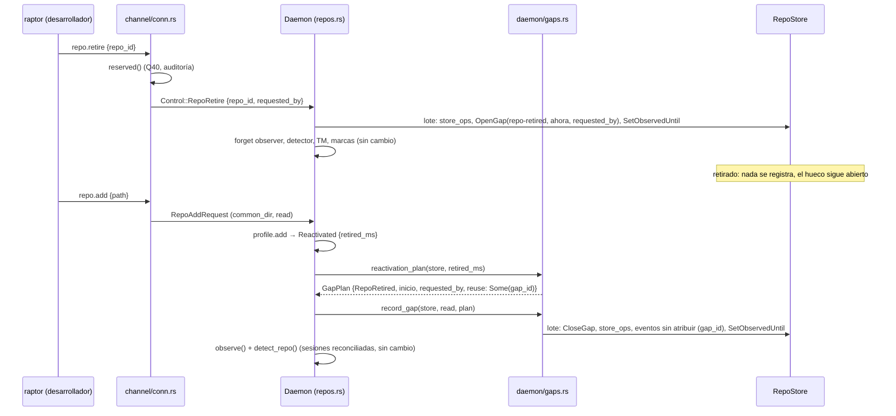

# Dev Spec — US-GRP-006: retirar un repo y recuperar su historial al volver a añadirlo

Plano compacto (AADD ligero) de [US-GRP-006](../user-stories/US-GRP-006-retirar-y-volver-a-anadir.md). Parte de lo que ya está en `main`: el `repo.retire` básico de US-GRP-001, la reactivación con la misma clave del índice del perfil (TS-GRP-001) y el hueco con su reconciliación de [US-GRP-005](./US-GRP-005-dev-spec.md) (`daemon/gaps.rs`, PR #280 y #285), que esta historia reutiliza tal cual.

**Qué entrega**: retirar un repo abre en su almacén un hueco `repo-retired` con quien lo pidió. Volver a añadirlo cierra ese hueco y registra en él, "sin atribuir", lo que cambió mientras estuvo retirado, antes de volver a observarlo. El historial anterior, con sus atribuciones, ya vuelve hoy.

⚠️ **ASSUMPTION**: no existe `architecture-constitution.md`; rigen `AGENTS.md` y los ADR de `must_read`, como en DS-US-GRP-005.

## 0. Lo que ya está implementado (solo se verifica)

| Qué pide la historia | Dónde está | Estado |
|---|---|---|
| Identidad del repo al volver: la ruta canónica del directorio Git común, en minúsculas en macOS y Windows (`key_path`). Cualquier worktree del repo llega al mismo directorio común | `profile/repo_key.rs` (`normalize_common_dir`), `profile/index.rs` (`add`: `find_by_key` → `AddOutcome::Reactivated { retired_ms }`, mismo `repo_id`) | Hecho. Test `profile_repo_key.rs::retire_and_readd_recovers_key_and_data` |
| Retirar no borra (Q25): almacén intacto (eventos, sesiones, registros de atribución, último estado conocido, huecos); en el índice, `state = retired` y `retired_ms` | `profile/index.rs` (`retire`), `daemon/repos.rs` (`Daemon::retire_repo` solo saca el almacén de `stores`) | Hecho |
| Mientras está retirado no se registra nada | `retire_repo`: `Observer::forget_repo`, `Detector::forget_repo`, `forget_tiers`, `tm.remove`, `marks.remove`, `modules.repo_retired`; el arranque se salta los repos retirados (`Daemon::start`, `entry.state != RepoState::Observed`) | Hecho, sin test de "el commit no se registra" |
| La marca MCP sale con el retiro y no vuelve al añadir (US-MCP-002, cascada) | `profile/index.rs` (`retire` y `add` ponen `mcp_enabled_ms = NULL`), `mcp_repos.set(repo_id, false)` | Hecho. Test `profile_mcp_allowlist.rs::retiring_clears_the_mark_and_re_adding_does_not_restore_it` |
| Las sesiones se reconcilian al volver: la de un proceso muerto termina `ended-during-gap`, la de un worktree quitado `worktree-removed`, una registrada sigue presente (Q41) | `Detector::forget_repo` no las cierra; `add_repo` → `observe` → `Daemon::detect_repo` (`daemon/sessions.rs`), como al arrancar (DS-US-GRP-009 D9) | Hecho |
| Las atribuciones vuelven: se resuelven desde la sesión y sus registros, guardados en el almacén | Proyección de DS-US-GRP-010 sobre `events`, `sessions`, `attribution_records` | Hecho |
| Solo el desarrollador añade o retira (Q40) | `channel/conn.rs` (`repo_add`, `repo_retire` → `reserved`), `channel/authz.rs` (`check_reserved`), auditoría | Hecho. Test `apps/cli/tests/repo_state.rs::an_agent_cannot_add_or_retire_repos` (agente simulado sin registro) |
| Presentación del hueco | `GapCauseView::RepoRetired`, `apps/cli/i18n/{en,es}/events.txt` (`gap.cause.repo-retired`), `repo.reactivated` en `repo.txt` | Hecho |

## 1. Gaps

| # | Gap | Efecto hoy | Resuelve |
|---|---|---|---|
| G1 | `Daemon::add_repo` ignora `AddOutcome::Reactivated { retired_ms }` (`daemon/repos.rs:47`, `{ .. }`) y llama a `persist_read`, que sobrescribe el último estado conocido sin compararlo | Lo ocurrido mientras estuvo retirado se absorbe sin evento ni hueco: el escenario 2 falla (el commit no figura) | D4, T003 |
| G2 | `retire_repo` no recibe quién lo pidió (`Control::RepoRetire { repo_id, reply }`) | ADR-GRP-013 § 1 (Hueco) y SEC-13 exigen guardar el cliente que provocó un hueco por comando; hoy solo está en la auditoría | D3, T002 |
| G3 | El escenario 3 nombra a "otro agente: Codex" registrado. El rechazo lo decide `check_reserved` por la ascendencia del proceso, y `AgentMatcher::classify` solo reconoce Claude Code (y los intérpretes). Un registro no tiene proceso (DS-US-GRP-009 D7), así que registrar a Codex no cambia el veredicto, y un `codex` real lanzado desde la terminal del desarrollador pasaría los controles | El escenario solo se verifica con el agente simulado de los tests (`AgentMatcher::only`) | **Cerrado por Q59**: "agente" es un proceso que el motor reconoce; en el MVP, solo Claude Code. El PO reescribió el escenario con "Claude Code" registrado. Riesgo aceptado: un agente sin soporte que ejecute `raptor` puede añadir o retirar repos |
| G4 | DS-US-GRP-005 § Fuera de alcance fija como gate de este ítem "`repo_add` no cambia". Esta historia lo cambia | El gate de DS-005 deja de valer | El orquestador lo marca cubierto al cerrar (T005) |

## 2. Decisiones

Técnicas: **Decisión del orquestador (2026-10-28), validada por Arquitecto**.

| # | Decisión | Por qué |
|---|---|---|
| D1 | **Identidad**: volver a añadir es volver a añadir el mismo directorio Git común (`key_path`). Un repo movido de carpeta es un repo nuevo, sin el historial anterior (consecuencia aceptada de ADR-GRP-006 § 3; el reenlace por `root_commit_hint` es de una fase posterior). Sin cambios de código | Ya implementado; la historia no pide reenlazar |
| D2 | **Qué se conserva**: todo el almacén y la fila del índice (§ 0). Las sesiones no se cierran al retirar; se reconcilian al volver, como al arrancar. La marca MCP no vuelve. Sin cambios de código | Q25, Q41, US-MCP-002 |
| D3 | **Retirar abre el hueco**. En `retire_repo`, antes de sacar el almacén de `stores`, un lote: `read.store_ops(...)` de una relectura del repo (si se puede leer), `OpenGap { gap_id: "repo-retired-<run_id>", started_ms: now, cause: RepoRetired, requested_by: Some(<cliente>) }` y `SetObservedUntil(now)`. El cliente es `client:<pid>:<start_us>`, el mismo formato que la parada (`conn.rs::stop_after`), y viaja en `Control::RepoRetire`. Sin el almacén abierto (repo no disponible en esa ejecución) o si el lote falla, no hay hueco abierto y se registra `observed_until_failed` como hoy; D4 cubre ese caso | Guarda quién lo pidió sin migración del esquema (`gaps.requested_by` ya existe). La relectura es la de `Daemon::stop` (DS-005 D5): el hueco al volver cubre solo lo que nadie vio. Coste aceptado, el mismo que en la parada: un cambio que la relectura ve y el observador aún no publicó queda en el estado conocido sin evento |
| D4 | **Volver a añadir cierra el hueco**. Con `AddOutcome::Reactivated { retired_ms }` y el almacén abierto, `add_repo` llama a `gaps::reactivation_plan(store, retired_ms)` y a `gaps::record_gap` en lugar de `persist_read`. El plan reutiliza el hueco `repo-retired` abierto más reciente (su inicio y su `requested_by`); sin él (un repo retirado antes de esta versión, o D3 sin lote), uno nuevo desde `retired_ms` con `requested_by: None`. `record_gap` con un hueco reutilizado no escribe `OpenGap`; escribe `CloseGap(ahora)`, los `store_ops`, los eventos y `SetObservedUntil`. Si hubiera más de un `repo-retired` abierto, los demás se cierran en el mismo lote | Mismo lote y mismas reglas que el arranque (DS-005 D1 a D7): eventos con la hora del fin del hueco, sin sesión, evidencia ni autoría ("sin atribuir", BR-EDGE-005), `reconciled` por worktree cuya huella cambió. `retired_ms` del índice es el inicio fiable aunque "observado hasta" no se moviera |
| D5 | **Si el lote de D4 falla**: el repo queda en el índice como observado, pero esa ejecución no se observa (`RepoStateView::Unavailable` en la respuesta, almacén fuera de `stores`), y el hueco sigue abierto | La regla D8 de DS-005: no observar sobre una base sin hueco |
| D6 | **El arranque cierra un hueco de retiro que siga abierto** (re-añadido durante `waiting-for-git`, que vuelve antes de abrir el almacén, o D5). `startup_plan` mira primero `StoreOpen::Recovered` (sin cambio); después, si el almacén tiene un `repo-retired` abierto, devuelve el plan de D4 con ese hueco, que contiene el intervalo del hueco pendiente de la ejecución anterior, así que este no se registra aparte | Un solo hueco por intervalo; la causa correcta es el retiro |
| D7 | `during_session` sigue en `false` para `repo-retired` (DS-005 D9). Sin cambios en `events.gaps`, `GapView`, `raptor events` ni en el contrato (`PROTOCOL_VERSION` y `API_VERSION` sin cambio) | Las piezas de presentación ya existen |
| D8 | **Log**: `record_gap` recibe el nombre de la línea; al volver a añadir escribe `reactivation_gap` / `reactivation_gap_failed` con los campos de `startup_gap` (`repo`, `cause`, `events`, `collapsed`; `kind` en el fallo). `repo_retired` añade `gap: opened|none`. Nunca una ruta ni el `requested_by` (SEC-04) | Distinguir en el log el hueco del arranque del de la reactivación |
| D9 | **Agente registrado (escenario 3)**: sin cambios de código. El test usa el agente simulado (reconocido como Claude Code por `AgentMatcher::only`) con "Claude Code" registrado en `feat-login` antes del intento, y comprueba el rechazo, la auditoría y que la lista no cambia. El alcance de "agente" es Q59 | G3. **Decisión del orquestador (2026-10-28), validada por Arquitecto**; el alcance de producto, validado por PO y Arquitecto (Q59) |
| D11 | **Coordinación con las fichas hermanas**: `daemon/repos.rs` (`add_repo`) lo toca también DS-US-GRP-016 (`repo_base` en el alta y `refresh_repo_base`), y `channel/conn.rs`, DS-US-GRP-008, DS-US-GRP-011 y DS-US-GRP-016. Otras funciones del mismo archivo; se mergean en serie y la segunda rebasa | **Decisión del orquestador (2026-10-28), validada por Arquitecto** |
| D10 | **ADR-GRP-016**: el código nuevo va en `daemon/gaps.rs` (archivo propio de los huecos). Se modifican la variante existente `Control::RepoRetire` (`daemon/shutdown.rs`), su despacho (`daemon/mod.rs`) y `conn.rs::repo_retire`; no se añade método, error, clave i18n ni capacidad | Mínimo de archivos compartidos |

### Decisiones de producto

| # | Pregunta | Decisión y motivo |
|---|---|---|
| Q59 | En el escenario "Un agente registrado no puede añadir ni retirar repos", ¿"agente" es un proceso que el motor reconoce como agente, o cualquier agente registrado aunque su proceso no se reconozca (Codex, Cursor)? | **Propuesta**: lo primero. El escenario se verifica con un proceso reconocido como agente, con un registro de "otro agente: Codex" presente, y reconocer los ejecutables de Codex y Cursor para los comandos reservados llega con su soporte (D2 del documento de negocio, revisada el 2026-10-03). **Supuesto**: el registro no da identidad de proceso (DS-US-GRP-009 D7), así que no puede decidir el rechazo. **Decisión del orquestador (2026-10-28), validada por PO y Arquitecto (Q59)**; registrada en `context.md` y BR-AUTH-001 (business-rules v1.20), abierta a veto de Rene. El escenario se reescribió con "Claude Code" registrado |

## 3. La forma

## 4. Unidades de trabajo

Orden: T001 → T002 → T003 → T004 → T005. T002 y T003 tocan `daemon/repos.rs`; van en serie.

### T001 — Escribir las pruebas de aceptación en rojo

**Ubicación**
- `crates/core/tests/us_grp_006.rs` (**NEW**): daemons en proceso sobre perfil temporal y repos del testkit, con `mod common;`, como `us_grp_005.rs` (`config`, `Live`, `history`, `gaps`, `sample_batch`). `#![cfg(any(target_os = "macos", target_os = "linux"))]`
- `apps/cli/tests/repo_state.rs` (**MODIFY**): un test nuevo junto a `an_agent_cannot_add_or_retire_repos`

**Pasos**
1. Fixture "demo": `Fixture::with_commit`, rama y worktree `feat-login`, repo añadido al perfil y 3 eventos con una sesión registrada de "otro agente: Codex" escritos con `sample_batch(&wt, "s1", 3)` (origen `Registered`, como `us_grp_005::scenario`). Los 3 eventos llevan atribución sin depender del detector.
2. Los tests de § 5. Compilan y fallan los de los escenarios 1 a 2 que dependen de T002 a T004; el 3 y los de verificación pasan ya.
3. Sin esperas fijas: respuestas del canal, marcas del almacén y `Daemon::stop` (que vacía el observador) con tope de 10 s.

- **Aceptación**: `cargo test -p gitraptor-core --test us_grp_006` compila; los rojos son los esperados.

### T002 — Abrir el hueco al retirar, con quien lo pidió

**Ubicación**
- `crates/core/src/daemon/shutdown.rs` (**MODIFY**): `Control::RepoRetire { repo_id, requested_by: String, reply }` y `ControlHandle::repo_retire(repo_id, requested_by)`
- `crates/core/src/channel/conn.rs` (**MODIFY**): `repo_retire` pasa `format!("client:{}:{}", self.peer.pid, self.peer.start_us)`
- `crates/core/src/daemon/mod.rs` (**MODIFY**): despacho de `Control::RepoRetire`
- `crates/core/src/daemon/repos.rs` (**MODIFY**): `Daemon::retire_repo(repo_id, requested_by)`
- `crates/core/src/daemon/gaps.rs` (**MODIFY**): `retirement_ops(store, read, requested_by, now) -> Vec<WriteOp>`

**Pasos**
1. En `retire_repo`, antes de `self.stores.remove(pos)`: relee el repo con `observe::reconcile(common_dir, &observe::base_branch(confirmada))`, como `reconcile_all` en `Daemon::stop`.
2. Escribe un lote con `gaps::retirement_ops`: `store_ops` de la relectura (si la hubo), `OpenGap` y `SetObservedUntil(now)` (D3). Sustituye a la escritura actual de solo `SetObservedUntil`; el log de error sigue siendo `observed_until_failed`.
3. Log `repo_retired` con `gap: opened|none` (D8).
4. Unit tests en `gaps.rs`: `retiring_opens_a_repo_retired_gap_with_its_requester`, `an_unreadable_repo_retires_without_store_ops`.

- **Depende**: T001
- **Refs**: ADR-GRP-013 § 1 (Hueco, SEC-13); DS-US-GRP-005 D5
- **Aceptación**: `cargo test -p gitraptor-core --lib daemon::gaps::tests`; test 3 de § 5 en verde; `--test channel` y `--test channel_scopes` sin regresión

### T003 — Cerrar el hueco al volver a añadir y registrar lo que cambió

**Ubicación**
- `crates/core/src/daemon/gaps.rs` (**MODIFY**): `GapPlan` gana `reuse: Option<String>`; `reactivation_plan(store, retired_ms) -> GapPlan`; `open_retirement_gaps(store) -> Vec<Gap>` (de `RepoStore::gaps`, `cause == RepoRetired && ended_ms.is_none()`); `record_gap` sin `OpenGap` cuando `plan.reuse` es `Some`, cierra también los otros abiertos (D4) y recibe el nombre del log (D8)
- `crates/core/src/daemon/repos.rs` (**MODIFY**): `add_repo`
- `crates/core/src/daemon/mod.rs` (**MODIFY**): la llamada existente a `record_gap` en `Daemon::start` pasa `"startup_gap"`

**Pasos**
1. En `add_repo`, conserva `retired_ms` del `AddOutcome::Reactivated`.
2. Tras abrir el almacén y `request.read.set_base(...)`: si es una reactivación, `record_gap(store, &request.read, &reactivation_plan(store, retired_ms), logger, repo_id, "reactivation_gap")` en lugar de `persist_read`.
   2.1 ⛔ El orden del lote es el de DS-005 T004 1.1, sin `OpenGap` cuando se reutiliza: `CloseGap`, `store_ops`, `UpsertWorktree` que falten, `AppendEvent`, `SetObservedUntil`.
   2.2 ⛔ Si `record_gap` devuelve `false`: `state = Unavailable`, quita el almacén de `stores`, no llames a `observe` (D5).
3. `New` y `AlreadyObserved` siguen con `persist_read` sin cambio. La rama `waiting-for-git` no cambia (D6 la cubre).
4. Unit tests en `gaps.rs`: `a_reactivation_reuses_the_open_retirement_gap`, `without_an_open_gap_the_reactivation_starts_at_the_retirement`, `a_reused_gap_is_closed_not_opened_again`, `extra_open_retirement_gaps_are_closed_in_the_same_batch`.

- **Depende**: T002
- **Refs**: DS-US-GRP-005 D1 a D8, T004; BR-AUTH-001 ("Retirar no borra"), BR-EDGE-005
- **Aceptación**: tests 2, 4, 5 y 6 de § 5; `--test us_grp_005` y `--test daemon_lifecycle` sin regresión

### T004 — Cerrar al arrancar un hueco de retiro abierto

**Ubicación**
- `crates/core/src/daemon/gaps.rs` (**MODIFY**): `startup_plan`
- `crates/core/src/daemon/mod.rs` (**MODIFY**): solo si la firma de `startup_plan` cambia

**Pasos**
1. En `startup_plan`, después de `StoreOpen::Recovered` y antes del hueco pendiente: si `open_retirement_gaps(store)` no está vacío, devuelve el plan de D4 con `reuse`. Sin él, el comportamiento actual.
2. Unit test: `an_open_retirement_gap_wins_over_the_pending_gap_at_startup`.

- **Depende**: T003
- **Aceptación**: test 7 de § 5; `cargo test -p gitraptor-core --lib daemon::gaps::tests`

### T005 — Cerrar la historia (orquestador)

- `docs/requirements/features/motor-local/dev-specs/US-GRP-005-dev-spec.md` § Fuera de alcance: la fila "Hueco al volver a añadir un repo retirado" pasa a cubierta por DS-US-GRP-006 (G4).
- Fila nueva en `docs/architecture/xplat-pendientes.md` (§ 6), número a asignar después de XP-52.
- Estado de la historia y del backlog (Q59 ya registrada).
- Gate: `cargo clippy --workspace` y `node tools/test/nextest-junit.mjs`.

## 5. Plan de pruebas (escenario → test)

Repos temporales del testkit y perfil temporal; nunca este repo (NFR-01).

| # | Escenario o borde | Test | Archivo |
|---|---|---|---|
| 1 | Retirar deja de observar sin borrar los datos | `retiring_stops_recording_and_keeps_the_history`: "demo" con sus 3 eventos; `repo.retire`; un commit en `feat-login`; `Daemon::stop`. El almacén abierto desde el test tiene los mismos 3 eventos (seq, tipo, sesión) y ninguno más; el índice dice `retired` con `retired_ms` | `us_grp_006.rs` |
| 2 | Volver a añadir recupera el historial | `adding_it_again_restores_the_history_and_the_retired_commit_is_unattributed`: tras el escenario 1, `repo.add` da `reactivated` y el mismo `repo_id`. `events.history` devuelve los 3 eventos con el mismo actor que antes del retiro ("otro agente: Codex", registrado) y después el commit hecho mientras estuvo retirado, con `gap_id`, sin sesión y actor "sin atribuir". `events.gaps` tiene un `repo-retired` desde `retired_ms` hasta el re-añadido, sin `during_session`. La sesión registrada sigue presente (Q41) | `us_grp_006.rs` |
| 3 | El hueco guarda quién retiró (SEC-13) | `the_retirement_gap_keeps_who_retired_the_repo`: tras `repo.retire`, `RepoStore::gaps` tiene un `repo-retired` abierto cuyo `requested_by` empieza por `client:` | `us_grp_006.rs` |
| 4 | Repo retirado antes de esta versión | `a_repo_retired_without_an_open_gap_gets_one_from_its_retirement`: perfil con el repo retirado escrito con `Profile::retire_repo` (sin hueco abierto), un commit, arranque y `repo.add`: un `repo-retired` desde `retired_ms`, sin `requested_by`, con el commit "sin atribuir" | `us_grp_006.rs` |
| 5 | Identidad: otro worktree del mismo repo | `adding_it_again_from_another_worktree_is_the_same_repo`: retirar y añadir por la ruta de `feat-login` da `reactivated` y el mismo `repo_id` | `us_grp_006.rs` |
| 6 | Sin escribir en el repo (BR-CONS-001) | `retiring_and_adding_again_writes_nothing_in_the_repo`: huella del testkit (`check`) antes del retiro y después del re-añadido, sin diferencias fuera del commit del test | `us_grp_006.rs` |
| 7 | Hueco abierto al arrancar (D6) | `an_open_retirement_gap_is_closed_at_the_next_start`: almacén con un `repo-retired` abierto y el repo observado en el índice; el arranque lo cierra, sin un `daemon-*` aparte | `us_grp_006.rs` |
| 8 | Un agente registrado no puede añadir ni retirar | `a_registered_agent_cannot_add_or_retire_repos`: el desarrollador registra "Claude Code" en `feat-login` (`raptor agent register 'Claude Code' --worktree …`, como `agent_registration.rs`); el agente simulado (`as_agent`) pide `repo add` de "otro" y `repo retire` de "demo"; los dos fallan con "only the developer can change the observed repos", la lista no cambia y la auditoría tiene dos `rejected` con `agent-ancestry` (D9, Q59) | `repo_state.rs` |
| 9 | Fallo del lote al volver (D5) | Unit `a_failed_reactivation_gap_leaves_the_repo_unobserved` (almacén de solo lectura): `record_gap` da `false` y el hueco sigue abierto | `daemon/gaps.rs` |

Comandos: `cargo test -p gitraptor-core --test us_grp_006`, `cargo test -p gitraptor-core --lib daemon::gaps::tests`, `cargo test -p gitraptor-cli --test repo_state`.

## 6. Multiplataforma (BR-03)

- `us_grp_006.rs` lleva el `cfg` de `us_grp_005.rs` (macOS y Linux): `ControlHandle::repo_add` y `repo_retire` solo se sirven por el canal Unix (`cfg_attr(not(unix), allow(dead_code))`). `repo_state.rs` es solo macOS (usa `script`).
- La clave en minúsculas ya la cubre `profile_repo_key.rs::other_case_spelling_gives_the_same_key` (macOS y Windows); `retire_and_readd_recovers_key_and_data` corre en los tres SO del CI. Los unit tests de `gaps.rs` corren en los tres.
- Windows: retirar y volver a añadir por el canal queda sin validar. *Pendiente: etapa de validación multiplataforma*, fila nueva en `xplat-pendientes.md` (T005).

## 7. Gate de seguridad

- [ ] `requested_by` solo en el almacén del perfil; ningún log lo escribe (SEC-04)
- [ ] El hueco y sus eventos se leen del repo y nunca escriben en él (test 6)
- [ ] `repo.add` y `repo.retire` siguen reservados y fuera de `raptor-mcp` (test 8, `channel.rs`)

## 8. Fuera de alcance

| Ítem | Dónde | Gate |
|---|---|---|
| Reenlazar un repo movido de carpeta por `root_commit_hint` | Fase posterior (ADR-GRP-006 § 3, Consecuencias) | `add_repo` sigue pasando `root_commit_hint: None` |
| Reconocer Codex y Cursor como agentes en los comandos reservados | Soporte de cada agente (D2 del documento de negocio), según Q59 | `AgentMatcher::classify` no cambia |
| Servir `events.history` o `events.gaps` de un repo retirado | Sin historia | `event_history` sigue buscando solo en `stores` |
| Avisar al re-añadir de cuántos cambios se encontraron | Sin historia (DS-005 P3: la guía es de US-GRP-015) | Sin claves i18n nuevas |
| `during_session` en un hueco de retiro | DS-005 D9 | `gaps::during_session` no cambia |
| Volver a mostrar la marca MCP | US-MCP-002 (no vuelve) | `profile_mcp_allowlist.rs` sin cambio |

## 9. Notas del autor

| ID | Nota | Acción |
|---|---|---|
| N1 | Verificado: `AddOutcome::Reactivated` ya documenta "the caller records `[retired_ms, now]` as a gap (US-GRP-006)" (`profile/index.rs:82`) y `retire_repo` deja "observado hasta" en la hora del retiro con ese fin (`daemon/repos.rs:239`) | Ninguna |
| N2 | Residual: un repo retirado antes de esta versión y re-añadido durante `waiting-for-git` no tiene hueco abierto; el siguiente arranque registra el intervalo como `daemon-*` desde "observado hasta", que es la hora del retiro. Cubre el intervalo con otra causa | Aceptado; se anota en el PR |
| N3 | Sin verificar: que `modules` (predicción, captura de la Time Machine) vuelvan a tomar el repo al re-añadirlo; `Modules` tiene `repo_retired` pero no un `repo_added` | El implementador lo comprueba y, si falta, lo anota en el PR como fuera de alcance |
